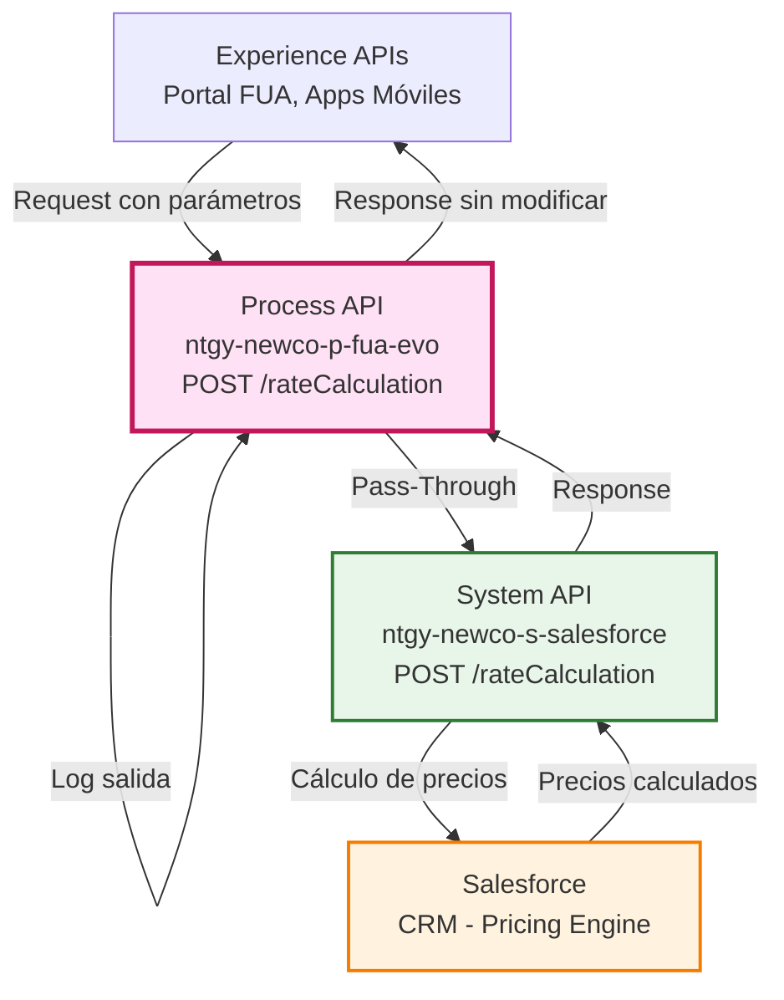
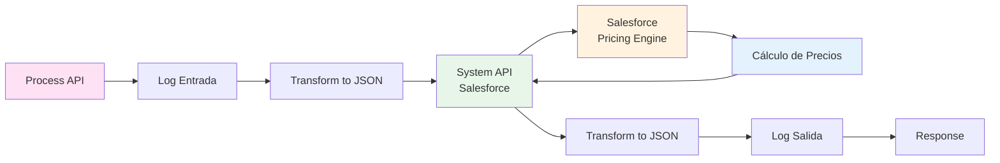
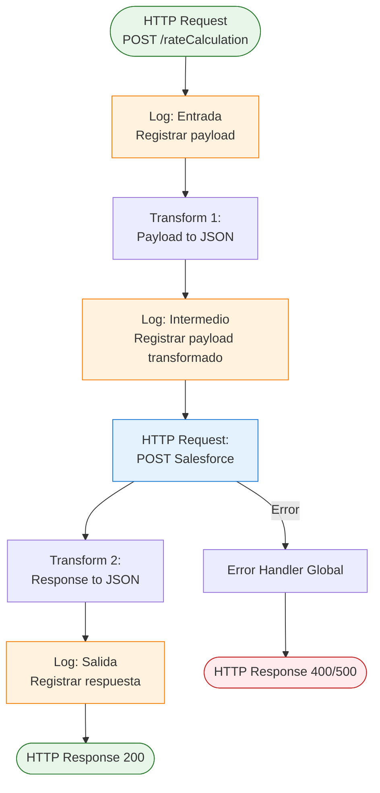
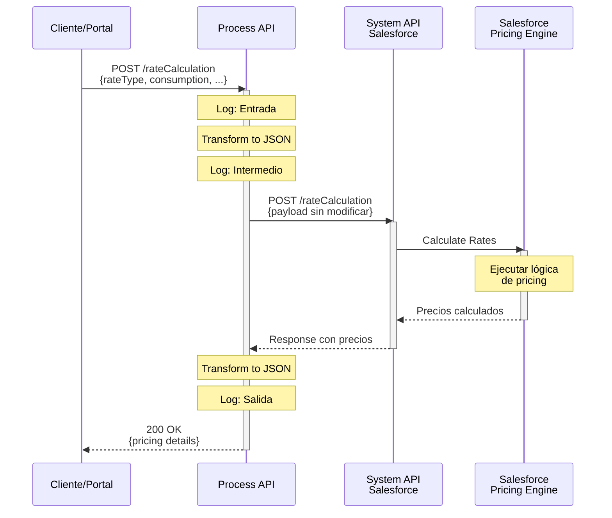
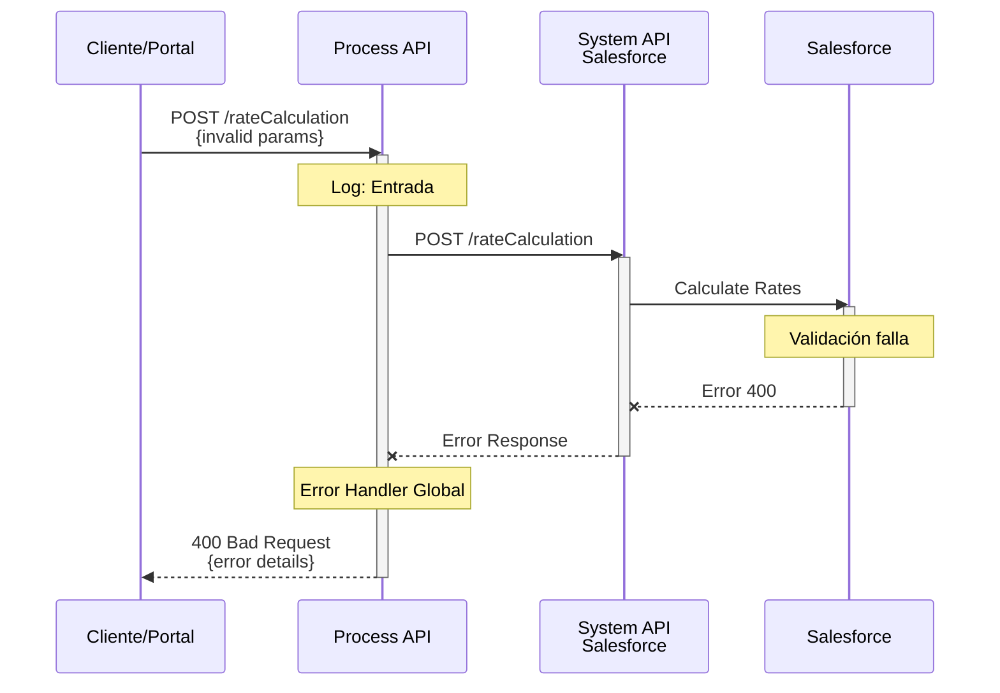
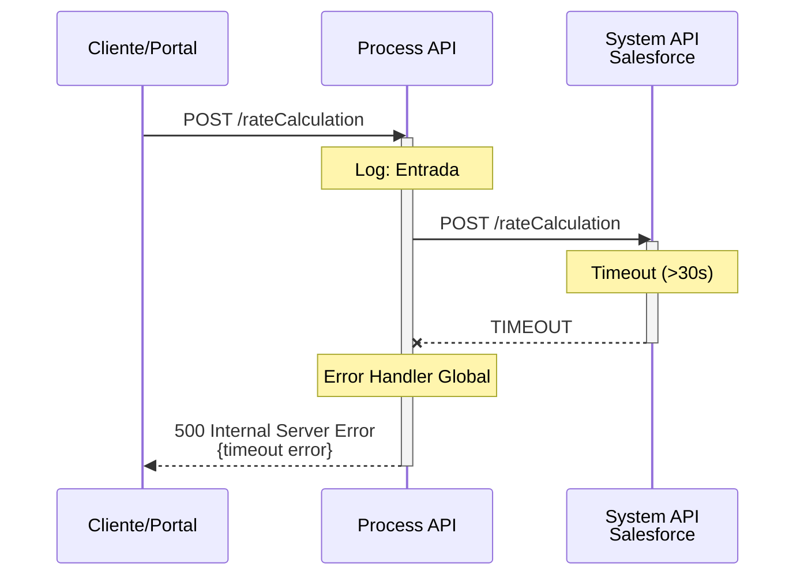

# POST /rateCalculation

## 📌 Descripción General

### Propósito del Endpoint

Este endpoint calcula los precios de las tarifas planas de energía consultando directamente a Salesforce. Actúa como un proxy pass-through que delega toda la lógica de cálculo al sistema CRM, proporcionando información de precios actualizada basada en los parámetros de entrada proporcionados.

### Tipo de API

**Capa:** Process API (API-Led Connectivity)

**Función:** Proxy pass-through para cálculo de precios de tarifas planas

### Patrón de Integración

**Tipo:** Pass-Through (Proxy Directo)

**Descripción:** 
1. Recibe request con parámetros de cálculo
2. Registra entrada para trazabilidad
3. Reenvía request sin modificaciones a Salesforce
4. Retorna respuesta de Salesforce sin transformaciones
5. Registra salida para auditoría

### Arquitectura API-Led Connectivity



---

## 💼 Propósito del Negocio

### Casos de Uso Principales

1. **Cálculo de Precios de Tarifas Planas**
   - Los clientes pueden obtener precios actualizados de tarifas planas
   - Beneficio: Información de precios en tiempo real

2. **Comparación de Tarifas**
   - Permite comparar diferentes opciones de tarifas planas
   - Beneficio: Toma de decisiones informada

3. **Cotización de Productos**
   - Agentes comerciales pueden generar cotizaciones precisas
   - Beneficio: Proceso de venta más eficiente

### 🔗 Endpoints Dependientes

Este Process API consume el siguiente System API:

| System API | Endpoint | Método | Propósito |
|------------|----------|--------|-----------|
| `ntgy-newco-s-salesforce` | `/rateCalculation` | POST | Calcular precios de tarifas planas en Salesforce |

### Lógica de Negocio



**Pasos del Proceso:**

1. **Recepción:** Recibe parámetros de cálculo (tipo de tarifa, consumo, etc.)
2. **Logging Entrada:** Registra request para trazabilidad
3. **Delegación:** Envía request a Salesforce sin modificaciones
4. **Cálculo:** Salesforce ejecuta lógica de pricing
5. **Respuesta:** Retorna precios calculados
6. **Logging Salida:** Registra response para auditoría

### Transformaciones Aplicadas

**⚠️ Este endpoint NO transforma datos:**

Este Process API actúa como **pass-through puro**:
- El request se envía tal cual a Salesforce
- La response se retorna sin modificaciones
- Solo se aplica conversión de formato a JSON

Para la estructura completa de request/response, consultar:
📖 **System API: `ntgy-newco-s-salesforce` endpoint `/rateCalculation`**

### Contexto Empresarial

- **Dominio:** Productos y Tarifas
- **Sector:** Energía - Utilities
- **División:** Naturgy España - NewCo
- **Proceso de Negocio:** Cálculo de precios y cotización de tarifas planas

### Stakeholders

- **Clientes Potenciales**: Necesitan conocer precios de tarifas planas
- **Agentes Comerciales**: Requieren cotizaciones precisas para ventas
- **Departamento de Productos**: Gestiona catálogo de tarifas
- **Sistemas de Cotización**: Integran precios en procesos de venta

### Valor de Negocio

- **Transparencia**: Precios actualizados en tiempo real
- **Precisión**: Cálculos basados en motor de pricing de Salesforce
- **Eficiencia**: Proceso automatizado de cotización
- **Consistencia**: Misma lógica de pricing en todos los canales

### Consumidores Potenciales

Este endpoint puede ser consumido por:
- Portal web de autoservicio FUA
- Aplicaciones móviles de clientes
- Sistemas de agentes comerciales
- Herramientas de cotización
- Comparadores de tarifas

---

## 🔧 Especificación Técnica

### URLs por Ambiente

| Ambiente | URL Base | URL Completa |
|----------|----------|--------------|
| **Local** | `http://localhost:8081` | `http://localhost:8081/api/rateCalculation` |
| **Development** | `https://ntgy-newco-p-fua-evo-dev.us-e2.cloudhub.io` | `https://ntgy-newco-p-fua-evo-dev.us-e2.cloudhub.io/api/rateCalculation` |
| **UAT** | `https://ntgy-newco-p-fua-evo-uat.us-e2.cloudhub.io` | `https://ntgy-newco-p-fua-evo-uat.us-e2.cloudhub.io/api/rateCalculation` |
| **Production** | `https://ntgy-newco-p-fua-evo-pro.us-e2.cloudhub.io` | `https://ntgy-newco-p-fua-evo-pro.us-e2.cloudhub.io/api/rateCalculation` |

### Método HTTP

```
POST /api/rateCalculation
```

### Parámetros de Entrada

#### Headers (Requeridos)

| Header | Tipo | Descripción | Requerido |
|--------|------|-------------|-----------|
| `Content-Type` | string | Tipo de contenido (application/json) | Sí |
| `client_id` | string | Client ID de Anypoint Platform | Sí |
| `client_secret` | string | Client Secret de Anypoint Platform | Sí |

#### Body (application/json)

**⚠️ Estructura definida por Salesforce:**

La estructura exacta del body depende de los requisitos del motor de pricing de Salesforce. Típicamente incluye:

```json
{
  "rateType": "string",
  "consumptionProfile": {
    "annualConsumption": "number",
    "powerLevel": "string"
  },
  "customerSegment": "string",
  "location": {
    "zipCode": "string",
    "province": "string"
  }
}
```

**Campos Comunes (Ejemplo):**

| Campo | Tipo | Descripción | Requerido |
|-------|------|-------------|-----------|
| `rateType` | string | Tipo de tarifa plana | Sí |
| `consumptionProfile` | object | Perfil de consumo del cliente | Sí |
| `customerSegment` | string | Segmento de cliente (residencial/negocio) | No |
| `location` | object | Ubicación para cálculo de precios | No |

**Nota:** Consultar documentación de Salesforce para estructura completa y actualizada.

### Respuestas

#### 200 OK - Éxito

**Descripción:** Precios calculados exitosamente.

**⚠️ Estructura definida por Salesforce:**

```json
{
  "rateId": "string",
  "rateName": "string",
  "pricing": {
    "monthlyFee": "number",
    "energyPrice": "number",
    "powerPrice": "number",
    "totalEstimated": "number"
  },
  "validUntil": "string",
  "conditions": ["string"]
}
```

**Campos de Respuesta (Ejemplo):**

| Campo | Tipo | Descripción |
|-------|------|-------------|
| `rateId` | string | ID de la tarifa en Salesforce |
| `rateName` | string | Nombre de la tarifa plana |
| `pricing` | object | Desglose de precios |
| `pricing.monthlyFee` | number | Cuota mensual fija |
| `pricing.energyPrice` | number | Precio de energía |
| `pricing.powerPrice` | number | Precio de potencia |
| `pricing.totalEstimated` | number | Total estimado mensual |
| `validUntil` | string | Fecha de validez de la cotización |
| `conditions` | array | Condiciones aplicables |

**Nota:** La estructura real depende de la configuración de Salesforce.

#### 400 Bad Request - Error de Validación

**Descripción:** Parámetros inválidos o faltantes.

```json
{
  "error": {
    "code": "400",
    "message": "Parámetros de entrada inválidos"
  }
}
```

#### 500 Internal Server Error - Error de Sistema

**Descripción:** Error al comunicarse con Salesforce.

```json
{
  "error": {
    "code": "500",
    "message": "Error al calcular precios en Salesforce"
  }
}
```

### Autenticación

- **Tipo:** Client ID & Client Secret (Anypoint Platform)
- **Headers Requeridos:** `client_id`, `client_secret`

### Timeouts

| Tipo | Valor |
|------|-------|
| **Request Timeout** | 30 segundos (estándar HTTP) |
| **Connection Timeout** | 10 segundos |

### Validaciones

1. **Headers requeridos:** Content-Type, client_id, client_secret
2. **Body JSON válido:** Debe ser JSON bien formado
3. **Estructura de entrada:** Debe cumplir con schema de Salesforce

---

## 🏗️ Implementación Técnica

### Arquitectura del Flow



### Transformaciones DataWeave

#### 1. Transformación de Entrada (Pass-Through)

```dataweave
%dw 2.0
output application/json
---
payload
```

**Propósito:** Asegurar formato JSON sin modificar contenido

#### 2. Transformación de Salida (Pass-Through)

```dataweave
%dw 2.0
output application/json
---
payload
```

**Propósito:** Asegurar formato JSON de respuesta sin modificar contenido

**⚠️ Nota Importante:**
Ambas transformaciones son **pass-through puras**. No modifican la estructura ni el contenido de los datos, solo aseguran el formato JSON.

### Configuración HTTP

**HTTP Request Configuration:** `HTTP_Request_configuration_ntgy_newco_s_salesforce`

**Endpoint Consumido:**
- **URL:** `${ntgy-newco-s-salesforce.pathRateCalculation}`
- **Método:** POST
- **Body:** Payload original sin modificaciones
- **Authentication:** OAuth 2.0 (configurado en connector)

### Logging

**Puntos de Logging (3 logs):**

1. **Log Entrada:**
   - Nivel: INFO
   - Mensaje: Payload recibido
   - Propósito: Trazabilidad de requests

2. **Log Intermedio:**
   - Nivel: INFO
   - Mensaje: Payload transformado
   - Propósito: Verificar transformación

3. **Log Salida:**
   - Nivel: INFO
   - Mensaje: Respuesta de Salesforce
   - Propósito: Auditoría de responses

**Formato de Log:**
```
Logger entrada calculo de Tarifa: {payload}
Logger: {payload}
Logger salida calculo de Tarifa: {payload}
```

### Patrones de Diseño

**Patrón:** Pass-Through (Proxy Directo)

**Justificación:** 
- Toda la lógica de cálculo reside en Salesforce
- El Process API solo proporciona punto de acceso unificado
- Permite cambios en Salesforce sin afectar consumidores
- Simplifica mantenimiento y evolución

**Patrón:** Logging Completo

**Justificación:**
- Trazabilidad end-to-end de requests
- Facilita debugging y troubleshooting
- Auditoría de operaciones de pricing
- Monitoreo de performance

### Diagramas de Secuencia

#### 1. Flujo Normal de Éxito



#### 2. Flujo con Error de Salesforce



#### 3. Flujo con Timeout



### Manejo de Errores

#### Estrategia de Error Handling

**Error Handler:** Global (no específico en este flow)

**Delegación:** Los errores se manejan mediante el error handler global del proyecto

**Tipos de Errores:**

| Tipo de Error | HTTP Status | Origen | Acción |
|---------------|-------------|--------|--------|
| Validación | 400 | Salesforce | Propagar error de Salesforce |
| Timeout | 500 | HTTP Connector | Error de conectividad |
| Salesforce Error | 500 | Salesforce | Propagar error del sistema |
| Otros | 500 | Sistema | Error genérico |

**Propagación de Errores:**
- Los errores de Salesforce se propagan sin modificación
- El error handler global formatea la respuesta
- Se mantiene el código de error original cuando es posible

### Variables de Flow

**⚠️ Este flow NO utiliza variables:**

El flow es completamente stateless y pass-through:
- No almacena datos en variables
- No mantiene estado entre llamadas
- Cada request es independiente

---

## 💻 Ejemplos de Uso

### Ejemplo 1: Cálculo de Tarifa Plana Residencial

#### Request

```bash
curl -X POST "https://ntgy-newco-p-fua-evo-dev.us-e2.cloudhub.io/api/rateCalculation" \
  -H "Content-Type: application/json" \
  -H "client_id: YOUR_CLIENT_ID" \
  -H "client_secret: YOUR_CLIENT_SECRET" \
  -d '{
    "rateType": "flat_rate_residential",
    "consumptionProfile": {
      "annualConsumption": 3500,
      "powerLevel": "4.6kW"
    },
    "customerSegment": "residential",
    "location": {
      "zipCode": "28001",
      "province": "Madrid"
    }
  }'
```

#### Response (200 OK)

```json
{
  "rateId": "RATE_FLAT_001",
  "rateName": "Tarifa Plana Hogar",
  "pricing": {
    "monthlyFee": 45.00,
    "energyPrice": 0.12,
    "powerPrice": 38.00,
    "totalEstimated": 83.00
  },
  "validUntil": "2026-09-24",
  "conditions": [
    "Precio fijo durante 12 meses",
    "Sin permanencia",
    "Consumo estimado: 3500 kWh/año"
  ]
}
```

### Ejemplo 2: Cálculo de Tarifa Plana Negocio

#### Request

```bash
curl -X POST "https://ntgy-newco-p-fua-evo-dev.us-e2.cloudhub.io/api/rateCalculation" \
  -H "Content-Type: application/json" \
  -H "client_id: YOUR_CLIENT_ID" \
  -H "client_secret: YOUR_CLIENT_SECRET" \
  -d '{
    "rateType": "flat_rate_business",
    "consumptionProfile": {
      "annualConsumption": 15000,
      "powerLevel": "15kW"
    },
    "customerSegment": "business",
    "location": {
      "zipCode": "08001",
      "province": "Barcelona"
    }
  }'
```

#### Response (200 OK)

```json
{
  "rateId": "RATE_FLAT_BUS_001",
  "rateName": "Tarifa Plana Negocio",
  "pricing": {
    "monthlyFee": 120.00,
    "energyPrice": 0.11,
    "powerPrice": 95.00,
    "totalEstimated": 215.00
  },
  "validUntil": "2026-09-24",
  "conditions": [
    "Precio fijo durante 24 meses",
    "Permanencia 12 meses",
    "Consumo estimado: 15000 kWh/año",
    "Descuento por volumen aplicado"
  ]
}
```

### Ejemplo 3: Error - Parámetros Inválidos

#### Request

```bash
curl -X POST "https://ntgy-newco-p-fua-evo-dev.us-e2.cloudhub.io/api/rateCalculation" \
  -H "Content-Type: application/json" \
  -H "client_id: YOUR_CLIENT_ID" \
  -H "client_secret: YOUR_CLIENT_SECRET" \
  -d '{
    "rateType": "invalid_type"
  }'
```

#### Response (400 Bad Request)

```json
{
  "error": {
    "code": "400",
    "message": "Tipo de tarifa inválido o parámetros faltantes",
    "details": "El campo consumptionProfile es requerido"
  }
}
```

### Ejemplo 4: JavaScript (Fetch API)

```javascript
const calculateRate = async (rateParams) => {
  const url = 'https://ntgy-newco-p-fua-evo-dev.us-e2.cloudhub.io/api/rateCalculation';
  
  try {
    const response = await fetch(url, {
      method: 'POST',
      headers: {
        'Content-Type': 'application/json',
        'client_id': 'YOUR_CLIENT_ID',
        'client_secret': 'YOUR_CLIENT_SECRET'
      },
      body: JSON.stringify(rateParams)
    });

    if (!response.ok) {
      const error = await response.json();
      throw new Error(error.error.message);
    }

    const pricing = await response.json();
    
    console.log('Tarifa:', pricing.rateName);
    console.log('Precio mensual estimado:', pricing.pricing.totalEstimated, '€');
    console.log('Válido hasta:', pricing.validUntil);
    
    return pricing;
    
  } catch (error) {
    console.error('Error al calcular tarifa:', error.message);
    throw error;
  }
};

// Uso
const params = {
  rateType: 'flat_rate_residential',
  consumptionProfile: {
    annualConsumption: 3500,
    powerLevel: '4.6kW'
  },
  customerSegment: 'residential',
  location: {
    zipCode: '28001',
    province: 'Madrid'
  }
};

calculateRate(params)
  .then(pricing => {
    console.log('Cálculo completado:', pricing);
  })
  .catch(error => {
    console.error('Error:', error);
  });
```

### Ejemplo 5: Python (Requests)

```python
import requests
from typing import Dict, Any

def calculate_rate(rate_params: Dict[str, Any]) -> Dict[str, Any]:
    """
    Calcula precios de tarifa plana
    
    Args:
        rate_params (dict): Parámetros de cálculo
        
    Returns:
        dict: Información de pricing calculada
    """
    url = 'https://ntgy-newco-p-fua-evo-dev.us-e2.cloudhub.io/api/rateCalculation'
    
    headers = {
        'Content-Type': 'application/json',
        'client_id': 'YOUR_CLIENT_ID',
        'client_secret': 'YOUR_CLIENT_SECRET'
    }
    
    try:
        response = requests.post(
            url, 
            json=rate_params, 
            headers=headers, 
            timeout=30
        )
        response.raise_for_status()
        
        pricing = response.json()
        
        print(f"Tarifa: {pricing['rateName']}")
        print(f"Precio mensual estimado: {pricing['pricing']['totalEstimated']}€")
        print(f"Válido hasta: {pricing['validUntil']}")
        
        return pricing
        
    except requests.exceptions.Timeout:
        print("Error: Timeout al calcular tarifa")
        raise
    except requests.exceptions.HTTPError as e:
        error_data = e.response.json()
        print(f"Error HTTP {e.response.status_code}: {error_data['error']['message']}")
        raise
    except Exception as e:
        print(f"Error inesperado: {str(e)}")
        raise

# Uso
if __name__ == "__main__":
    params = {
        'rateType': 'flat_rate_residential',
        'consumptionProfile': {
            'annualConsumption': 3500,
            'powerLevel': '4.6kW'
        },
        'customerSegment': 'residential',
        'location': {
            'zipCode': '28001',
            'province': 'Madrid'
        }
    }
    
    try:
        pricing = calculate_rate(params)
        
        print("\nDesglose de precios:")
        print(f"  Cuota mensual: {pricing['pricing']['monthlyFee']}€")
        print(f"  Precio energía: {pricing['pricing']['energyPrice']}€/kWh")
        print(f"  Precio potencia: {pricing['pricing']['powerPrice']}€")
        
        print("\nCondiciones:")
        for condition in pricing['conditions']:
            print(f"  - {condition}")
            
    except Exception as e:
        print(f"No se pudo calcular la tarifa: {e}")
```

### Ejemplo 6: Java (Spring RestTemplate)

```java
import org.springframework.http.*;
import org.springframework.web.client.RestTemplate;
import java.util.Map;
import java.util.HashMap;

public class RateCalculationClient {
    
    private final RestTemplate restTemplate;
    private final String baseUrl;
    private final String clientId;
    private final String clientSecret;
    
    public RateCalculationClient(String baseUrl, String clientId, String clientSecret) {
        this.restTemplate = new RestTemplate();
        this.baseUrl = baseUrl;
        this.clientId = clientId;
        this.clientSecret = clientSecret;
    }
    
    public RateResponse calculateRate(RateRequest rateRequest) {
        String url = baseUrl + "/api/rateCalculation";
        
        HttpHeaders headers = new HttpHeaders();
        headers.setContentType(MediaType.APPLICATION_JSON);
        headers.set("client_id", clientId);
        headers.set("client_secret", clientSecret);
        
        HttpEntity<RateRequest> entity = new HttpEntity<>(rateRequest, headers);
        
        try {
            ResponseEntity<RateResponse> response = restTemplate.exchange(
                url,
                HttpMethod.POST,
                entity,
                RateResponse.class
            );
            
            RateResponse pricing = response.getBody();
            
            System.out.println("Tarifa: " + pricing.getRateName());
            System.out.println("Precio mensual: " + pricing.getPricing().getTotalEstimated() + "€");
            
            return pricing;
            
        } catch (Exception e) {
            System.err.println("Error al calcular tarifa: " + e.getMessage());
            throw new RuntimeException("Error al calcular tarifa", e);
        }
    }
    
    // Uso
    public static void main(String[] args) {
        RateCalculationClient client = new RateCalculationClient(
            "https://ntgy-newco-p-fua-evo-dev.us-e2.cloudhub.io",
            "YOUR_CLIENT_ID",
            "YOUR_CLIENT_SECRET"
        );
        
        try {
            // Crear request
            RateRequest request = new RateRequest();
            request.setRateType("flat_rate_residential");
            
            ConsumptionProfile profile = new ConsumptionProfile();
            profile.setAnnualConsumption(3500);
            profile.setPowerLevel("4.6kW");
            request.setConsumptionProfile(profile);
            
            Location location = new Location();
            location.setZipCode("28001");
            location.setProvince("Madrid");
            request.setLocation(location);
            
            // Calcular tarifa
            RateResponse response = client.calculateRate(request);
            
            System.out.println("\nDesglose de precios:");
            System.out.println("  Cuota mensual: " + response.getPricing().getMonthlyFee() + "€");
            System.out.println("  Total estimado: " + response.getPricing().getTotalEstimated() + "€");
            
        } catch (Exception e) {
            System.err.println("Error: " + e.getMessage());
        }
    }
}

// Clases de datos (POJOs)
class RateRequest {
    private String rateType;
    private ConsumptionProfile consumptionProfile;
    private String customerSegment;
    private Location location;
    
    // Getters y Setters
}