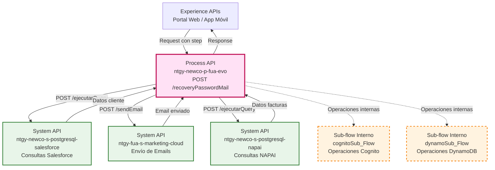
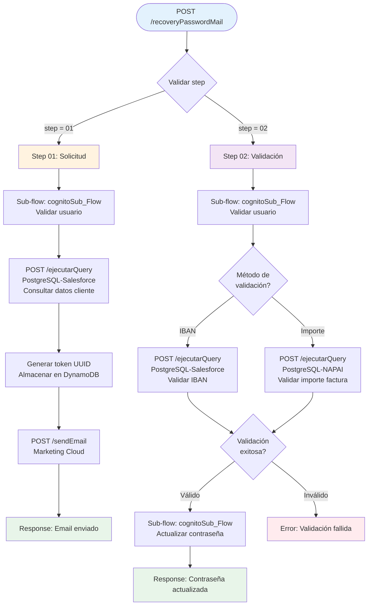
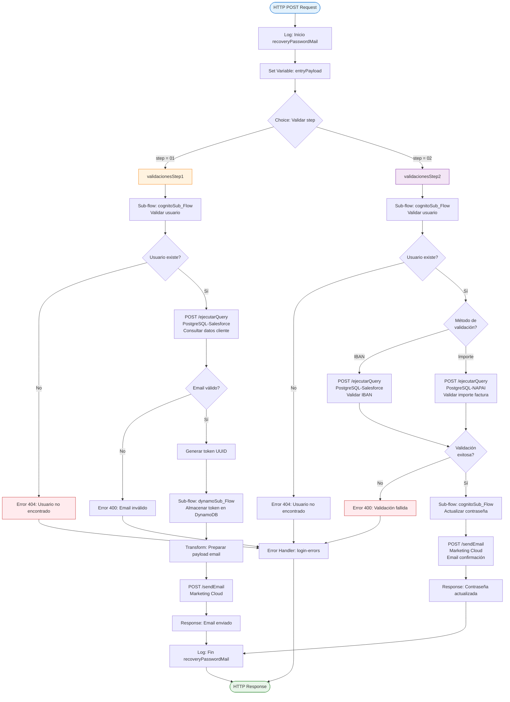
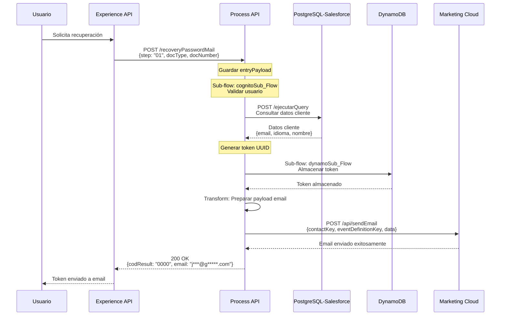
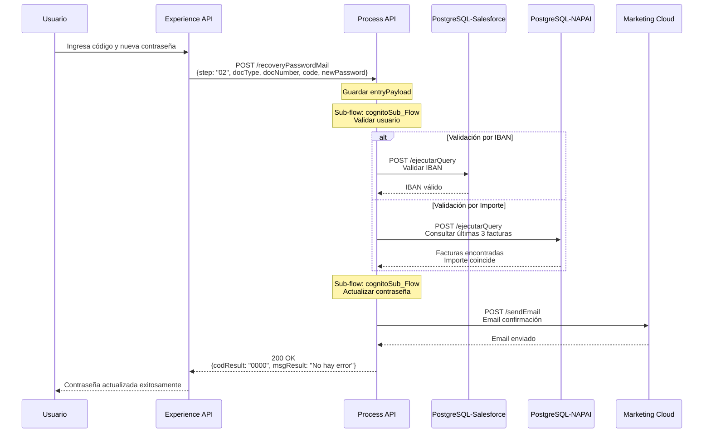
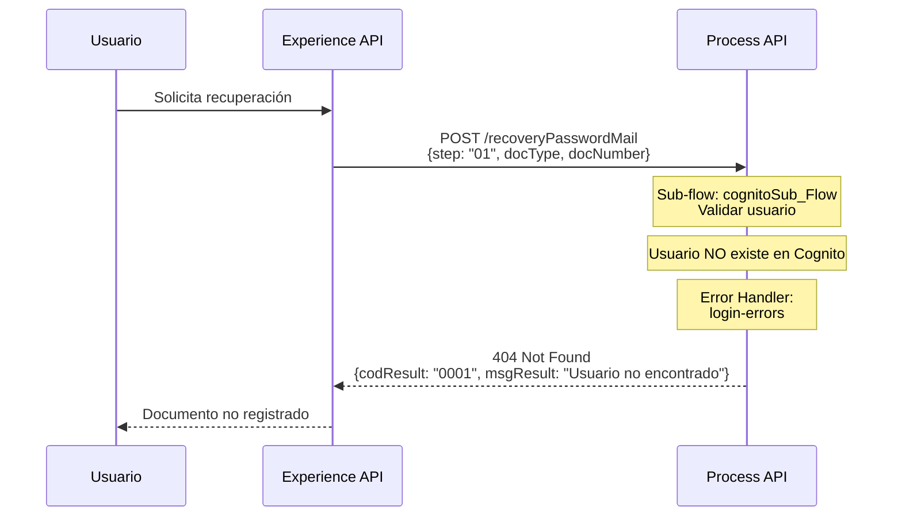
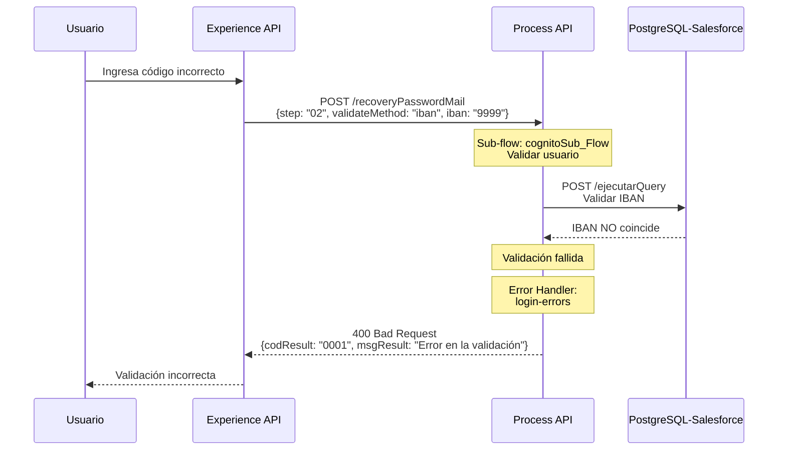

# POST /recoveryPasswordMail

## 📌 Descripción General

### Propósito del Endpoint

Este endpoint implementa el proceso completo de recuperación de contraseña en dos pasos:

**Step 01 - Solicitud de Recuperación:**
- Valida la existencia del usuario mediante operaciones internas de Cognito
- Consulta datos del cliente en Salesforce (email, idioma, nombre)
- Genera un token de recuperación y lo almacena en DynamoDB
- Envía el token por email mediante Marketing Cloud

**Step 02 - Validación y Actualización:**
- Valida el usuario y obtiene el token almacenado
- Verifica el token recibido contra el almacenado en DynamoDB
- Valida que el token no haya expirado (15 minutos)
- Actualiza la contraseña mediante operaciones internas de Cognito
- Confirma la actualización exitosa

### Tipo de API

**Capa:** Process API (API-Led Connectivity)

**Función:** Orquestación del proceso de recuperación de contraseña con validación de usuario, generación de token, envío de email y actualización de credenciales

### Patrón de Integración

**Tipo:** Orquestación Multi-Step con Validación Condicional

**Descripción:** Implementa un flujo condicional basado en el parámetro `step` que determina si se ejecuta la solicitud de recuperación (step 01) o la validación y actualización (step 02). Cada step orquesta llamadas a diferentes System APIs (Cognito y Marketing Cloud) con lógica de validación específica.

### Arquitectura API-Led Connectivity



---

## 💼 Propósito del Negocio

### Casos de Uso Principales

1. **Recuperación de Contraseña Olvidada (Step 01)**
   - Usuario olvida su contraseña y solicita recuperación
   - Sistema valida identidad mediante documento
   - Envía código de verificación por email
   - **Beneficio:** Autoservicio sin intervención de call center

2. **Validación de Identidad y Actualización (Step 02)**
   - Usuario recibe código por email
   - Ingresa código y nueva contraseña
   - Sistema valida código y actualiza credenciales
   - **Beneficio:** Proceso seguro con doble factor de autenticación

3. **Prevención de Accesos No Autorizados**
   - Validación de documento antes de enviar código
   - Código temporal con expiración
   - Verificación de código antes de actualizar contraseña
   - **Beneficio:** Seguridad robusta contra intentos de fraude

### 🔗 Endpoints Dependientes

Este Process API consume los siguientes System APIs:

| System API | Endpoint | Método | Propósito |
|------------|----------|--------|-----------|
| `ntgy-newco-s-postgresql-salesforce` | `/ejecutarQuery` | POST | Consulta de datos del cliente en Salesforce (email, idioma, nombre) |
| `ntgy-newco-s-postgresql-napai` | `/ejecutarQuery` | POST | Consulta de últimas 3 facturas para validación por importe |
| `ntgy-fua-s-marketing-cloud` | `/sendEmail` | POST | Envío de email con token de recuperación de contraseña |

### Lógica de Orquestación



**Pasos del Proceso:**

**Step 01 - Solicitud de Recuperación:**
1. **Validación de Usuario**: Buscar usuario en Cognito por docType y docNumber
2. **Generación de Token**: Crear código aleatorio de 6 dígitos
3. **Envío de Email**: Enviar código mediante Marketing Cloud con template específico
4. **Almacenamiento**: Guardar código temporalmente en Cognito con timestamp

**Step 02 - Validación y Actualización:**
1. **Validación de Usuario**: Buscar usuario en Cognito por docType y docNumber
2. **Verificación de Código**: Validar que el código recibido coincida con el almacenado
3. **Verificación de Expiración**: Validar que el código no haya expirado (tiempo configurable)
4. **Actualización de Contraseña**: Actualizar password en Cognito
5. **Limpieza**: Eliminar código temporal de Cognito

### Transformaciones Aplicadas

**Step 01 - Request a Cognito (Búsqueda):**

| Campo Request | Campo Cognito | Transformación |
|---------------|---------------|----------------|
| `docType` | `documentType` | Mapeo directo |
| `docNumber` | `documentNumber` | Mapeo directo |

**Step 01 - Request a Marketing Cloud:**

| Campo Generado | Campo Marketing Cloud | Transformación |
|----------------|----------------------|----------------|
| `recoveryCode` | `verificationCode` | Código de 6 dígitos generado |
| `email` | `to` | Email del usuario desde Cognito |
| `docNumber` | `customerDocument` | Documento del usuario |

**Step 02 - Request a Cognito (Actualización):**

| Campo Request | Campo Cognito | Transformación |
|---------------|---------------|----------------|
| `docType` | `documentType` | Mapeo directo |
| `docNumber` | `documentNumber` | Mapeo directo |
| `newPassword` | `password` | Hash seguro aplicado |
| `recoveryCode` | `verificationCode` | Validación contra código almacenado |

### Contexto Empresarial

- **Dominio:** Gestión de Identidad y Acceso (IAM)
- **Sector:** Energía - Utilities
- **División:** Naturgy España - NewCo
- **Proceso de Negocio:** Autoservicio de recuperación de contraseña para portal FUA

### Stakeholders

- **Clientes Finales**: Usuarios del portal FUA que necesitan recuperar acceso a su cuenta
- **Equipo de Seguridad**: Responsables de políticas de autenticación y prevención de fraude
- **Call Center**: Reducción de llamadas por contraseñas olvidadas
- **Equipo de Marketing**: Gestión de templates de email y comunicaciones

### Valor de Negocio

- **Reducción de Costos Operativos**: Autoservicio elimina necesidad de intervención de call center
- **Mejora de Experiencia de Usuario**: Recuperación rápida y sencilla de acceso
- **Seguridad Robusta**: Doble factor de autenticación con código temporal
- **Disponibilidad 24/7**: Proceso automatizado sin dependencia de horarios de atención

### Consumidores Potenciales

Este endpoint puede ser consumido por:
- Portal web de autoservicio FUA
- Aplicación móvil de clientes
- Sistemas de gestión de identidad corporativos
- Integraciones con proveedores de identidad externos

---

## 🔧 Especificación Técnica

### URLs por Ambiente

| Ambiente | URL Base | URL Completa |
|----------|----------|--------------|
| **Local** | `http://localhost:8081` | `http://localhost:8081/api/recoveryPasswordMail` |
| **Development** | `https://ntgy-newco-p-fua-evo-dev.us-e2.cloudhub.io` | `https://ntgy-newco-p-fua-evo-dev.us-e2.cloudhub.io/api/recoveryPasswordMail` |
| **UAT** | `https://ntgy-newco-p-fua-evo-uat.us-e2.cloudhub.io` | `https://ntgy-newco-p-fua-evo-uat.us-e2.cloudhub.io/api/recoveryPasswordMail` |
| **Production** | `https://ntgy-newco-p-fua-evo-pro.us-e2.cloudhub.io` | `https://ntgy-newco-p-fua-evo-pro.us-e2.cloudhub.io/api/recoveryPasswordMail` |

### Método HTTP

```
POST /api/recoveryPasswordMail
```

### Parámetros de Entrada

#### Request Body (Step 01 - Solicitud de Recuperación)

```json
{
  "step": "01",
  "docType": "string",
  "docNumber": "string"
}
```

| Campo | Tipo | Requerido | Descripción | Ejemplo |
|-------|------|-----------|-------------|---------|
| `step` | string | ✅ Sí | Identificador del paso del proceso | `"01"` |
| `docType` | string | ✅ Sí | Tipo de documento (NIF, NIE, CIF, Pasaporte) | `"NIF"` |
| `docNumber` | string | ✅ Sí | Número de documento del usuario | `"12345678A"` |

#### Request Body (Step 02 - Validación y Actualización)

```json
{
  "step": "02",
  "docType": "string",
  "docNumber": "string",
  "recoveryCode": "string",
  "newPassword": "string"
}
```

| Campo | Tipo | Requerido | Descripción | Ejemplo |
|-------|------|-----------|-------------|---------|
| `step` | string | ✅ Sí | Identificador del paso del proceso | `"02"` |
| `docType` | string | ✅ Sí | Tipo de documento | `"NIF"` |
| `docNumber` | string | ✅ Sí | Número de documento del usuario | `"12345678A"` |
| `recoveryCode` | string | ✅ Sí | Código de 6 dígitos recibido por email | `"123456"` |
| `newPassword` | string | ✅ Sí | Nueva contraseña (debe cumplir políticas de seguridad) | `"NewSecureP@ss123"` |

**Validaciones de Entrada:**

- `step`: Debe ser exactamente `"01"` o `"02"`
- `docType`: Valores permitidos: `NIF`, `NIE`, `CIF`, `Pasaporte`
- `docNumber`: Formato válido según tipo de documento
- `recoveryCode` (step 02): Exactamente 6 dígitos numéricos
- `newPassword` (step 02): Mínimo 8 caracteres, debe incluir mayúsculas, minúsculas, números y caracteres especiales

### Respuestas

#### Respuesta Exitosa - Step 01 (200 OK)

```json
{
  "result": {
    "codResult": "00",
    "msgResult": "Código de recuperación enviado correctamente al email registrado"
  }
}
```

#### Respuesta Exitosa - Step 02 (200 OK)

```json
{
  "result": {
    "codResult": "00",
    "msgResult": "Contraseña actualizada correctamente"
  }
}
```

#### Respuesta de Error - Usuario No Encontrado (404 Not Found)

```json
{
  "result": {
    "codResult": "01",
    "msgResult": "Usuario no encontrado con el documento proporcionado"
  }
}
```

#### Respuesta de Error - Código Inválido (400 Bad Request)

```json
{
  "result": {
    "codResult": "02",
    "msgResult": "Código de recuperación inválido o expirado"
  }
}
```

#### Respuesta de Error - Contraseña No Cumple Políticas (400 Bad Request)

```json
{
  "result": {
    "codResult": "03",
    "msgResult": "La nueva contraseña no cumple con las políticas de seguridad"
  }
}
```

#### Respuesta de Error - Error de Sistema (500 Internal Server Error)

```json
{
  "result": {
    "codResult": "99",
    "msgResult": "Error interno del sistema. Por favor, intente más tarde"
  }
}
```

### Códigos de Estado HTTP

| Código | Descripción | Cuándo se usa |
|--------|-------------|---------------|
| **200** | OK | Operación exitosa (ambos steps) |
| **400** | Bad Request | Parámetros inválidos, código incorrecto, contraseña no cumple políticas |
| **404** | Not Found | Usuario no encontrado en Cognito |
| **500** | Internal Server Error | Error en System APIs (Cognito o Marketing Cloud) |
| **503** | Service Unavailable | System APIs no disponibles |

### Autenticación

- **Tipo:** Client ID & Client Secret (Anypoint Platform)
- **Headers Requeridos:**
  - `client_id`: ID de la aplicación cliente
  - `client_secret`: Secret de la aplicación cliente

### Timeouts

| Tipo | Valor | Descripción |
|------|-------|-------------|
| **Request Timeout** | 30 segundos | Timeout total del endpoint |
| **Cognito Timeout** | 10 segundos | Timeout para llamadas a Cognito |
| **Marketing Cloud Timeout** | 15 segundos | Timeout para envío de email |

### Rate Limiting

- **Límite por Usuario**: 3 intentos por hora (step 01)
- **Límite por IP**: 10 intentos por hora (step 01)
- **Límite de Validación**: 5 intentos de código incorrecto (step 02)

---

## 🏗️ Implementación Técnica

### Arquitectura del Flow



### Componentes del Flow Principal

**Archivo:** `src/main/mule/ntgy-newco-p-fua.xml` (líneas 917-920)

```xml
<flow name="post:\recoveryPasswordMail:application\json:ntgy-newco-p-fua-config">
    <flow-ref doc:name="recoveryPasswordMail" 
              doc:id="d31bbe18-67c1-4696-a531-ca0d88ca4006" 
              name="recoveryPasswordMailFlow"/>
    <error-handler ref="login-errorsError_Handler" />
</flow>
```

**Archivo:** `src/main/mule/services/login/recoveryPasswordMail.xml`

```xml
<sub-flow name="recoveryPasswordMailFlow" doc:id="ec89c2ad-e7f1-4a19-9b05-14260b148d91">
    <set-variable value="#[payload]" 
                  doc:name="Set entryPayload Variable" 
                  variableName="entryPayload"/>
    
    <choice doc:name="Choice">
        <when expression="#[vars.entryPayload.step == '01']">
            <flow-ref doc:name="validacionesStep1" 
                      name="validacionesStep1"/>
        </when>
        <when expression="#[vars.entryPayload.step == '02']">
            <flow-ref doc:name="validacionesStep2" 
                      name="validacionesStep2"/>
        </when>
    </choice>
    
    <logger level="INFO" 
            doc:name="Fin recoveryPasswordMailFlow" 
            message='Fin recoveryPasswordMailFlow'/>
</sub-flow>
```

### Transformaciones DataWeave

#### Step 01 - Preparación de Email

**Propósito:** Transformar datos del usuario y código generado al formato requerido por Marketing Cloud

**Lógica:**
```dataweave
%dw 2.0
output application/json
---
{
  to: vars.userEmail,
  templateId: "recovery-password-template",
  substitutions: {
    verificationCode: vars.recoveryCode,
    customerName: vars.userName,
    customerDocument: vars.entryPayload.docNumber,
    expirationMinutes: "15"
  }
}
```

#### Step 02 - Validación de Código

**Propósito:** Validar código recibido contra código almacenado en Cognito

**Lógica:**
```dataweave
%dw 2.0
output application/json
---
{
  isValid: vars.entryPayload.recoveryCode == vars.storedCode,
  isExpired: (now() - vars.codeTimestamp as Number) > (15 * 60 * 1000)
}
```

### Patrones de Diseño

**Patrón 1: Multi-Step Process Pattern**

**Justificación:** Permite implementar un proceso de recuperación seguro en dos fases independientes, donde cada fase tiene su propia lógica de validación y orquestación.

**Patrón 2: Token-Based Verification Pattern**

**Justificación:** Implementa verificación de identidad mediante código temporal, proporcionando seguridad adicional sin requerir autenticación previa.

**Patrón 3: Orchestration Pattern**

**Justificación:** Coordina múltiples System APIs (Cognito y Marketing Cloud) para completar el proceso de recuperación de forma transparente para el consumidor.

### Diagramas de Secuencia

#### 1. Flujo Normal de Éxito - Step 01



#### 2. Flujo Normal de Éxito - Step 02



#### 3. Flujo con Error - Usuario No Encontrado



#### 4. Flujo con Error - Código Inválido



### Manejo de Errores

**Error Handler:** `login-errorsError_Handler`

**Estrategia de Manejo:**

1. **Errores de Validación (400)**
   - Código de recuperación inválido
   - Código expirado
   - Contraseña no cumple políticas
   - Formato de documento inválido

2. **Errores de Usuario (404)**
   - Usuario no encontrado en Cognito
   - Usuario no confirmado
   - CIF no permitido (solo personas físicas)

3. **Errores de Sistema (500)**
   - Error en Cognito API
   - Error en Marketing Cloud
   - Error en PostgreSQL/Salesforce
   - Timeout en llamadas a System APIs

4. **Errores de Negocio**
   - Email no registrado en Salesforce
   - Usuario bloqueado
   - Demasiados intentos fallidos

---

## 💻 Ejemplos de Uso

### Ejemplo 1: Solicitud de Recuperación (Step 01)

#### cURL

```bash
curl -X POST "https://ntgy-newco-p-fua-evo-dev.us-e2.cloudhub.io/api/recoveryPasswordMail" \
  -H "Content-Type: application/json" \
  -H "client_id: YOUR_CLIENT_ID" \
  -H "client_secret: YOUR_CLIENT_SECRET" \
  -d '{
    "step": "01",
    "docType": "NIF",
    "docNumber": "12345678A"
  }'
```

#### Respuesta (200 OK)

```json
{
  "result": {
    "codResult": "0000",
    "msgResult": "No hay error"
  },
  "email": "j***@g*****.com"
}
```

### Ejemplo 2: Validación y Actualización (Step 02)

#### cURL

```bash
curl -X POST "https://ntgy-newco-p-fua-evo-dev.us-e2.cloudhub.io/api/recoveryPasswordMail" \
  -H "Content-Type: application/json" \
  -H "client_id: YOUR_CLIENT_ID" \
  -H "client_secret: YOUR_CLIENT_SECRET" \
  -d '{
    "step": "02",
    "docType": "NIF",
    "docNumber": "12345678A",
    "recoveryCode": "123456",
    "newPassword": "NewSecureP@ss123"
  }'
```

#### Respuesta (200 OK)

```json
{
  "result": {
    "codResult": "0000",
    "msgResult": "No hay error"
  }
}
```

### Ejemplo 3: JavaScript (Fetch API)

```javascript
// Step 01 - Solicitar código de recuperación
const requestRecovery = async (docType, docNumber) => {
  const response = await fetch('https://ntgy-newco-p-fua-evo-dev.us-e2.cloudhub.io/api/recoveryPasswordMail', {
    method: 'POST',
    headers: {
      'Content-Type': 'application/json',
      'client_id': 'YOUR_CLIENT_ID',
      'client_secret': 'YOUR_CLIENT_SECRET'
    },
    body: JSON.stringify({
      step: "01",
      docType: docType,
      docNumber: docNumber
    })
  });
  
  const data = await response.json();
  console.log('Email enviado a:', data.email);
  return data;
};

// Step 02 - Validar código y actualizar contraseña
const updatePassword = async (docType, docNumber, code, newPassword) => {
  const response = await fetch('https://ntgy-newco-p-fua-evo-dev.us-e2.cloudhub.io/api/recoveryPasswordMail', {
    method: 'POST',
    headers: {
      'Content-Type': 'application/json',
      'client_id': 'YOUR_CLIENT_ID',
      'client_secret': 'YOUR_CLIENT_SECRET'
    },
    body: JSON.stringify({
      step: "02",
      docType: docType,
      docNumber: docNumber,
      recoveryCode: code,
      newPassword: newPassword
    })
  });
  
  const data = await response.json();
  console.log('Contraseña actualizada:', data.result.msgResult);
  return data;
};

// Uso
await requestRecovery("NIF", "12345678A");
await updatePassword("NIF", "12345678A", "123456", "NewSecureP@ss123");
```

### Ejemplo 4: Python (Requests)

```python
import requests

# Step 01 - Solicitar código de recuperación
def request_recovery(doc_type, doc_number):
    url = "https://ntgy-newco-p-fua-evo-dev.us-e2.cloudhub.io/api/recoveryPasswordMail"
    headers = {
        "Content-Type": "application/json",
        "client_id": "YOUR_CLIENT_ID",
        "client_secret": "YOUR_CLIENT_SECRET"
    }
    payload = {
        "step": "01",
        "docType": doc_type,
        "docNumber": doc_number
    }
    
    response = requests.post(url, json=payload, headers=headers)
    data = response.json()
    print(f"Email enviado a: {data.get('email')}")
    return data

# Step 02 - Validar código y actualizar contraseña
def update_password(doc_type, doc_number, code, new_password):
    url = "https://ntgy-newco-p-fua-evo-dev.us-e2.cloudhub.io/api/recoveryPasswordMail"
    headers = {
        "Content-Type": "application/json",
        "client_id": "YOUR_CLIENT_ID",
        "client_secret": "YOUR_CLIENT_SECRET"
    }
    payload = {
        "step": "02",
        "docType": doc_type,
        "docNumber": doc_number,
        "recoveryCode": code,
        "newPassword": new_password
    }
    
    response = requests.post(url, json=payload, headers=headers)
    data = response.json()
    print(f"Resultado: {data['result']['msgResult']}")
    return data

# Uso
request_recovery("NIF", "12345678A")
update_password("NIF", "12345678A", "123456", "NewSecureP@ss123")
```

### Ejemplo 5: Error - Usuario No Encontrado

#### Request

```bash
curl -X POST "https://ntgy-newco-p-fua-evo-dev.us-e2.cloudhub.io/api/recoveryPasswordMail" \
  -H "Content-Type: application/json" \
  -H "client_id: YOUR_CLIENT_ID" \
  -H "client_secret: YOUR_CLIENT_SECRET" \
  -d '{
    "step": "01",
    "docType": "NIF",
    "docNumber": "99999999Z"
  }'
```

#### Respuesta (404 Not Found)

```json
{
  "result": {
    "codResult": "0001",
    "msgResult": "Usuario no encontrado con el documento proporcionado"
  }
}
```

### Ejemplo 6: Error - Código Inválido

#### Request

```bash
curl -X POST "https://ntgy-newco-p-fua-evo-dev.us-e2.cloudhub.io/api/recoveryPasswordMail" \
  -H "Content-Type: application/json" \
  -H "client_id: YOUR_CLIENT_ID" \
  -H "client_secret: YOUR_CLIENT_SECRET" \
  -d '{
    "step": "02",
    "docType": "NIF",
    "docNumber": "12345678A",
    "recoveryCode": "999999",
    "newPassword": "NewSecureP@ss123"
  }'
```

#### Respuesta (400 Bad Request)

```json
{
  "result": {
    "codResult": "0001",
    "msgResult": "Error en la validación"
  }
}
```
