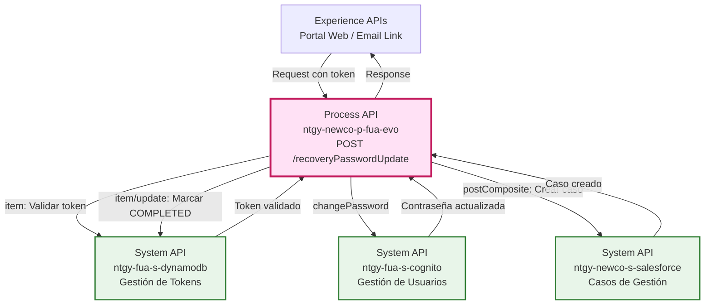
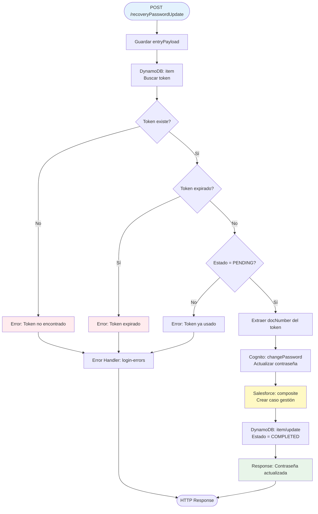
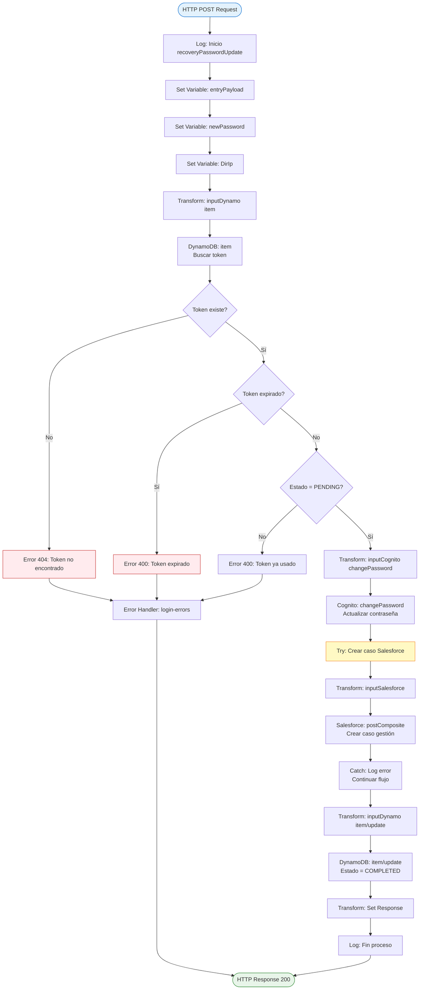
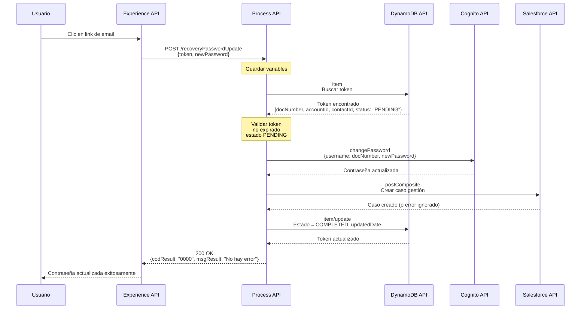
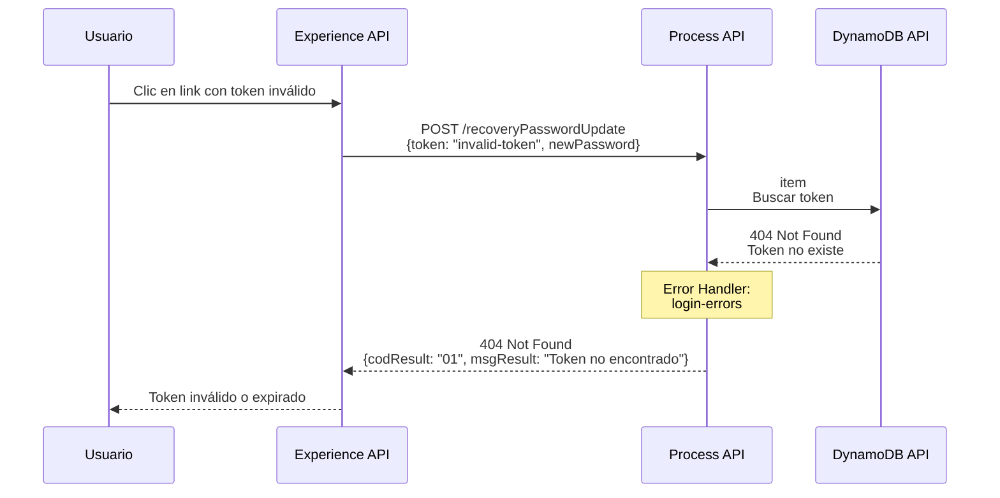
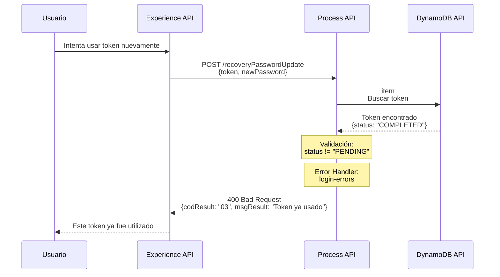

# POST /recoveryPasswordUpdate

## 📌 Descripción General

### Propósito del Endpoint

Este endpoint completa el proceso de recuperación de contraseña iniciado con `/recoveryPasswordMail`. Permite al usuario establecer una nueva contraseña utilizando el token único recibido por email.

**Flujo Completo de Recuperación:**
1. Usuario solicita recuperación → `POST /recoveryPasswordMail` (step 01)
2. Sistema envía email con token único
3. Usuario hace clic en link del email
4. Usuario ingresa nueva contraseña → **`POST /recoveryPasswordUpdate`** ✅ (Este endpoint)
5. Sistema valida token y actualiza contraseña

**Operaciones Realizadas:**
- Valida el token de recuperación en DynamoDB
- Verifica que el token no haya expirado
- Actualiza la contraseña del usuario en AWS Cognito
- Crea un caso de gestión en Salesforce para auditoría
- Marca el token como "COMPLETED" en DynamoDB

### Tipo de API

**Capa:** Process API (API-Led Connectivity)

**Función:** Orquestación del proceso de actualización de contraseña con validación de token, actualización de credenciales y registro de auditoría

### Patrón de Integración

**Tipo:** Token-Based Password Reset con Orquestación Multi-Sistema

**Descripción:** Implementa un flujo seguro de actualización de contraseña que valida un token temporal almacenado en DynamoDB, actualiza las credenciales en Cognito y registra la operación en Salesforce para auditoría. El token se invalida después de su uso para prevenir reutilización.

### Arquitectura API-Led Connectivity



---

## 💼 Propósito del Negocio

### Casos de Uso Principales

1. **Completar Recuperación de Contraseña**
   - Usuario recibe email con token único
   - Hace clic en link y establece nueva contraseña
   - Sistema valida token y actualiza credenciales
   - **Beneficio:** Proceso seguro y autoservicio completo

2. **Prevención de Uso Fraudulento**
   - Token de un solo uso
   - Validación de expiración (15 días)
   - Token se marca como "COMPLETED" después de uso
   - **Beneficio:** Seguridad robusta contra ataques de replay

3. **Auditoría y Trazabilidad**
   - Registro automático en Salesforce
   - Caso de gestión con tipo "ModificacionContrasena"
   - Timestamp de actualización en DynamoDB
   - **Beneficio:** Cumplimiento normativo y trazabilidad completa

### 🔗 Endpoints Dependientes

Este Process API consume los siguientes System APIs:

| System API | Endpoint | Método | Propósito |
|------------|----------|--------|-----------|
| `ntgy-fua-s-dynamodb` | `/item` | POST | Obtener y validar token de recuperación |
| `ntgy-fua-s-cognito` | `/changePassword` | POST | Actualizar contraseña del usuario |
| `ntgy-newco-s-salesforce` | `/postComposite` | POST | Crear caso de gestión para auditoría |
| `ntgy-fua-s-dynamodb` | `/item/update` | POST | Marcar token como COMPLETED |

### Lógica de Orquestación



**Pasos del Proceso:**

1. **Validación de Token**: Buscar token en DynamoDB y verificar existencia
2. **Verificación de Expiración**: Validar que el token no haya expirado (15 días)
3. **Verificación de Estado**: Confirmar que el token esté en estado "PENDING"
4. **Extracción de Usuario**: Obtener docNumber del registro del token
5. **Actualización de Contraseña**: Cambiar password en Cognito
6. **Registro de Auditoría**: Crear caso de gestión en Salesforce (opcional)
7. **Invalidación de Token**: Actualizar estado a "COMPLETED" con timestamp
8. **Respuesta Exitosa**: Confirmar actualización al usuario

### Transformaciones Aplicadas

**Request a DynamoDB (getItem):**

| Campo Request | Campo DynamoDB | Transformación |
|---------------|----------------|----------------|
| `token` | `key: "token"` | Búsqueda por clave primaria |
| - | `table: "ntgy-dydb-registration-token"` | Tabla configurada |

**Request a Cognito (changePassword):**

| Campo Origen | Campo Cognito | Transformación |
|--------------|---------------|----------------|
| `dynamoItem.docNumber` | `username` | Extraído del token en DynamoDB |
| `newPassword` | `newPassword` | Mapeo directo desde request |
| - | `operation: "changePassword"` | Operación específica |

**Request a Salesforce (composite):**

| Campo Generado | Campo Salesforce | Transformación |
|----------------|------------------|----------------|
| `dynamoItem.accountId` | `Case.AccountId` | Extraído del token |
| `dynamoItem.contactId` | `Case.ContactId` | Extraído del token |
| `"Gestion"` | `Case.NewCo_Recordtype__c` | Tipo de caso fijo |
| `"ModificacionContrasena"` | `acn_fld_Tittle__r.NewCo_ExternalId__c` | Identificador de operación |

**Request a DynamoDB (update):**

| Campo Generado | Campo DynamoDB | Transformación |
|----------------|----------------|----------------|
| `"COMPLETED"` | `status` | Nuevo estado del token |
| `now()` | `updatedDate` | Timestamp de actualización (formato: "dd-MM-yyyy HH:mm:ss") |

### Contexto Empresarial

- **Dominio:** Gestión de Identidad y Acceso (IAM)
- **Sector:** Energía - Utilities
- **División:** Naturgy España - NewCo
- **Proceso de Negocio:** Finalización de recuperación de contraseña para portal FUA

### Stakeholders

- **Clientes Finales**: Usuarios que completan el proceso de recuperación de contraseña
- **Equipo de Seguridad**: Responsables de políticas de contraseñas y auditoría
- **Equipo de Cumplimiento**: Requieren trazabilidad de cambios de credenciales
- **Soporte Técnico**: Necesitan visibilidad de casos de cambio de contraseña

### Valor de Negocio

- **Seguridad Mejorada**: Token de un solo uso con expiración
- **Autoservicio Completo**: Usuario completa proceso sin intervención
- **Auditoría Automática**: Registro en Salesforce para cumplimiento normativo
- **Prevención de Fraude**: Validaciones múltiples y token no reutilizable

### Consumidores Potenciales

Este endpoint puede ser consumido por:
- Portal web de autoservicio FUA (desde link de email)
- Aplicación móvil de clientes
- Sistemas de gestión de identidad corporativos
- Flujos automatizados de recuperación de contraseña

---

## 🔧 Especificación Técnica

### URLs por Ambiente

| Ambiente | URL Base | URL Completa |
|----------|----------|--------------|
| **Local** | `http://localhost:8081` | `http://localhost:8081/api/recoveryPasswordUpdate` |
| **Development** | `https://ntgy-newco-p-fua-evo-dev.us-e2.cloudhub.io` | `https://ntgy-newco-p-fua-evo-dev.us-e2.cloudhub.io/api/recoveryPasswordUpdate` |
| **UAT** | `https://ntgy-newco-p-fua-evo-uat.us-e2.cloudhub.io` | `https://ntgy-newco-p-fua-evo-uat.us-e2.cloudhub.io/api/recoveryPasswordUpdate` |
| **Production** | `https://ntgy-newco-p-fua-evo-pro.us-e2.cloudhub.io` | `https://ntgy-newco-p-fua-evo-pro.us-e2.cloudhub.io/api/recoveryPasswordUpdate` |

### Método HTTP

```
POST /api/recoveryPasswordUpdate
```

### Parámetros de Entrada

#### Request Body

```json
{
  "token": "string",
  "newPassword": "string",
  "DirIp": "string"
}
```

| Campo | Tipo | Requerido | Descripción | Ejemplo |
|-------|------|-----------|-------------|---------|
| `token` | string | ✅ Sí | Token único recibido por email (UUID) | `"550e8400-e29b-41d4-a716-446655440000"` |
| `newPassword` | string | ✅ Sí | Nueva contraseña (debe cumplir políticas de seguridad) | `"NewSecureP@ss123"` |
| `DirIp` | string | ⚠️ Opcional | Dirección IP del cliente (para auditoría) | `"192.168.1.100"` |

**Validaciones de Entrada:**

- `token`: Debe ser un UUID válido
- `token`: Debe existir en DynamoDB
- `token`: No debe estar expirado (< 15 días desde creación)
- `token`: Debe estar en estado "PENDING" (no usado previamente)
- `newPassword`: Mínimo 8 caracteres
- `newPassword`: Debe incluir mayúsculas, minúsculas, números y caracteres especiales
- `newPassword`: No debe ser igual a contraseñas anteriores

### Respuestas

#### Respuesta Exitosa (200 OK)

```json
{
  "result": {
    "codResult": "0000",
    "msgResult": "No hay error"
  }
}
```

#### Respuesta de Error - Token No Encontrado (404 Not Found)

```json
{
  "result": {
    "codResult": "01",
    "msgResult": "Token de recuperación no encontrado"
  }
}
```

#### Respuesta de Error - Token Expirado (400 Bad Request)

```json
{
  "result": {
    "codResult": "02",
    "msgResult": "El token de recuperación ha expirado. Solicite uno nuevo"
  }
}
```

#### Respuesta de Error - Token Ya Usado (400 Bad Request)

```json
{
  "result": {
    "codResult": "03",
    "msgResult": "Este token ya ha sido utilizado. Solicite uno nuevo si es necesario"
  }
}
```

#### Respuesta de Error - Contraseña No Cumple Políticas (400 Bad Request)

```json
{
  "result": {
    "codResult": "04",
    "msgResult": "La nueva contraseña no cumple con las políticas de seguridad"
  }
}
```

#### Respuesta de Error - Error de Sistema (500 Internal Server Error)

```json
{
  "result": {
    "codResult": "99",
    "msgResult": "Error interno del sistema. Por favor, intente más tarde"
  }
}
```

### Códigos de Estado HTTP

| Código | Descripción | Cuándo se usa |
|--------|-------------|---------------|
| **200** | OK | Contraseña actualizada exitosamente |
| **400** | Bad Request | Token expirado, ya usado, o contraseña no cumple políticas |
| **404** | Not Found | Token no encontrado en DynamoDB |
| **500** | Internal Server Error | Error en System APIs (DynamoDB, Cognito, Salesforce) |
| **503** | Service Unavailable | System APIs no disponibles |

### Autenticación

- **Tipo:** Client ID & Client Secret (Anypoint Platform)
- **Headers Requeridos:**
  - `client_id`: ID de la aplicación cliente
  - `client_secret`: Secret de la aplicación cliente

**Nota:** Este endpoint NO requiere autenticación de usuario (el token es la credencial temporal).

### Timeouts

| Tipo | Valor | Descripción |
|------|-------|-------------|
| **Request Timeout** | 30 segundos | Timeout total del endpoint |
| **DynamoDB Timeout** | 10 segundos | Timeout para operaciones en DynamoDB |
| **Cognito Timeout** | 10 segundos | Timeout para cambio de contraseña |
| **Salesforce Timeout** | 15 segundos | Timeout para creación de caso |

### Seguridad

**Validaciones de Seguridad:**

1. **Token de Un Solo Uso**: El token se marca como "COMPLETED" después de usarse
2. **Expiración Temporal**: Token válido por 15 días desde creación
3. **Validación de Estado**: Solo tokens en estado "PENDING" son aceptados
4. **Políticas de Contraseña**: Cognito valida complejidad de contraseña
5. **Auditoría**: Registro automático en Salesforce

**Prevención de Ataques:**

- **Replay Attack**: Token invalidado después de uso
- **Brute Force**: Token único y complejo (UUID)
- **Token Guessing**: UUID aleatorio de 128 bits
- **Expiración**: Ventana temporal limitada

---

## 🏗️ Implementación Técnica

### Arquitectura del Flow



### Componentes del Flow Principal

**Archivo:** `src/main/mule/ntgy-newco-p-fua.xml` (líneas 921-924)

```xml
<flow name="post:\recoveryPasswordUpdate:application\json:ntgy-newco-p-fua-config">
    <flow-ref doc:name="recoveryPasswordUpdate" 
              doc:id="ce06eb84-a964-4034-88dd-0ce208329926" 
              name="recoveryPasswordUpdateFlow"/>
    <error-handler ref="login-errorsError_Handler" />
</flow>
```

**Archivo:** `src/main/mule/services/login/recoveryPasswordUpdate.xml`

```xml
<sub-flow name="recoveryPasswordUpdateFlow" doc:id="9b910aee-ad87-4749-8016-a02f820920b8">
    <logger level="INFO" 
            doc:name="Inicio recoveryPasswordUpdate" 
            message='Inicio recoveryPasswordUpdate: #[payload - "newPassword"]'/>
    
    <!-- Guardar payload y variables -->
    <ee:transform doc:name="var entryPayload">
        <ee:variables>
            <ee:set-variable variableName="entryPayload">
                %dw 2.0
                output application/json
                ---
                payload
            </ee:set-variable>
        </ee:variables>
    </ee:transform>
    
    <set-variable value="#[vars.entryPayload.newPassword]" 
                  doc:name="var newPassword" 
                  variableName="newPassword"/>
    
    <!-- Buscar token en DynamoDB -->
    <ee:transform doc:name="inputDynamo item">
        <ee:variables>
            <ee:set-variable variableName="inputDynamo">
                {
                    "key": "token",
                    "keyValue": vars.entryPayload.token,
                    "table": p('fua-s-dynamo.tables.tableRegistration'),
                    "operationDynamo": "getItem"
                }
            </ee:set-variable>
        </ee:variables>
    </ee:transform>
    
    <flow-ref doc:name="dynamoSub_Flow item" 
              name="dynamoSub_Flow"/>
    
    <!-- Cambiar contraseña en Cognito -->
    <ee:transform doc:name="inputCognito changePassword">
        <ee:variables>
            <ee:set-variable variableName="inputCognito">
                {
                    "username": vars.dynamoItem.item.docNumber,
                    "newPassword": vars.newPassword,
                    "operation": "changePassword"
                }
            </ee:set-variable>
        </ee:variables>
    </ee:transform>
    
    <flow-ref doc:name="cognitoSub_Flow changePassword" 
              name="cognitoSub_Flow"/>
    
    <!-- Try: Crear caso en Salesforce (opcional) -->
    <try doc:name="Try">
        <logger level="DEBUG" 
                doc:name="Creating pwd case" 
                message='Creación caso gestion para Modificar Contraseña'/>
        
        <ee:transform doc:name="inputSalesforce">
            <ee:variables>
                <ee:set-variable variableName="inputSalesforce">
                    {
                        "body": {
                            "allOrNone": true,
                            "compositeRequest": [{
                                "method": "POST",
                                "url": "/services/data/v52.0/sobjects/Case",
                                "referenceId": "refCaseGestion",
                                "body": {
                                    "NewCo_Recordtype__c": "Gestion",
                                    "AccountId": vars.dynamoItem.item.accountId,
                                    "ContactId": vars.dynamoItem.item.contactId,
                                    "Priority": "02",
                                    "Origin": "FUA",
                                    "Status": "06",
                                    "acn_fld_Tittle__r": {
                                        "NewCo_ExternalId__c": "ModificacionContrasena"
                                    }
                                }
                            }]
                        },
                        "operationSalesforce": "composite"
                    }
                </ee:set-variable>
            </ee:variables>
        </ee:transform>
        
        <flow-ref doc:name="salesforceSub_Flow postComposite" 
                  name="salesforceSub_Flow"/>
        
        <error-handler>
            <on-error-continue enableNotifications="true" 
                              logException="false" 
                              doc:name="On Error Continue">
                <logger level="INFO" 
                        doc:name="Error" 
                        message='Error al crear el casos gestion del proceso recoveryPasswordUpdate'/>
            </on-error-continue>
        </error-handler>
    </try>
    
    <!-- Actualizar estado del token en DynamoDB -->
    <ee:transform doc:name="inputDynamo item/update">
        <ee:variables>
            <ee:set-variable variableName="inputDynamo">
                %dw 2.0
                output application/json
                var updatedDate = ((now()) >> "CET") as String {
                    format: "dd-MM-yyyy HH:mm:ss"
                }
                ---
                {
                    "body": {
                        "keys": {
                            "token": vars.dynamoItem.item.token
                        },
                        "updateValues": [
                            {
                                "name": "status",
                                "value": "COMPLETED"
                            },
                            {
                                "name": "updatedDate",
                                "value": updatedDate
                            }
                        ]
                    },
                    "operationDynamo": "update",
                    "table": p('fua-s-dynamo.tables.tableRegistration')
                }
            </ee:set-variable>
        </ee:variables>
    </ee:transform>
    
    <flow-ref doc:name="dynamoSub_Flow item/update" 
              name="dynamoSub_Flow"/>
    
    <!-- Respuesta exitosa -->
    <ee:transform doc:name="Set Response">
        <ee:message>
            <ee:set-payload>
                %dw 2.0
                output application/json
                ---
                {
                    "result": {
                        "codResult": "0000",
                        "msgResult": "No hay error"
                    }
                }
            </ee:set-payload>
        </ee:message>
    </ee:transform>
    
    <logger level="INFO" 
            doc:name="Fin proceso" 
            message="Fin proceso recoveryPasswordUpdate"/>
</sub-flow>
```

### Transformaciones DataWeave

#### 1. Preparación de Request para DynamoDB (item)

**Propósito:** Buscar el registro del token en DynamoDB

```dataweave
%dw 2.0
output application/json
---
{
  "key": "token",
  "keyValue": vars.entryPayload.token,
  "table": p('fua-s-dynamo.tables.tableRegistration'),
  "operationDynamo": "getItem"
}
```

#### 2. Preparación de Request para Cognito (changePassword)

**Propósito:** Actualizar la contraseña del usuario en Cognito

```dataweave
%dw 2.0
output application/json
---
{
  "username": vars.dynamoItem.item.docNumber,
  "newPassword": vars.newPassword,
  "operation": "changePassword"
}
```

#### 3. Preparación de Request para Salesforce (postComposite)

**Propósito:** Crear caso de gestión para auditoría

```dataweave
%dw 2.0
output application/json
---
{
  "body": {
    "allOrNone": true,
    "collateSubrequests": false,
    "compositeRequest": [
      {
        "method": "POST",
        "url": "/services/data/v52.0/sobjects/Case",
        "referenceId": "refCaseGestion",
        "body": {
          "NewCo_Recordtype__c": "Gestion",
          "AccountId": vars.dynamoItem.item.accountId,
          "ContactId": vars.dynamoItem.item.contactId,
          "Priority": "02",
          "Origin": "FUA",
          "Status": "06",
          "acn_fld_Tittle__r": {
            "NewCo_ExternalId__c": "ModificacionContrasena"
          }
        }
      }
    ]
  },
  "operationSalesforce": "composite"
}
```

#### 4. Preparación de Request para DynamoDB (update)

**Propósito:** Marcar el token como COMPLETED con timestamp

```dataweave
%dw 2.0
output application/json

var updatedDate = ((now()) >> "CET") as String {
  format: "dd-MM-yyyy HH:mm:ss"
}
---
{
  "body": {
    "keys": {
      "token": vars.dynamoItem.item.token
    },
    "updateValues": [
      {
        "name": "status",
        "value": "COMPLETED"
      },
      {
        "name": "updatedDate",
        "value": updatedDate
      }
    ]
  },
  "operationDynamo": "update",
  "table": p('fua-s-dynamo.tables.tableRegistration')
}
```

### Patrones de Diseño

**Patrón 1: Token-Based Authentication**

**Justificación:** Permite autenticación temporal sin requerir credenciales del usuario, ideal para procesos de recuperación de contraseña.

**Patrón 2: Single-Use Token Pattern**

**Justificación:** El token se invalida después de su uso, previniendo ataques de replay y garantizando que cada token solo pueda usarse una vez.

**Patrón 3: Try-Catch for Non-Critical Operations**

**Justificación:** La creación del caso en Salesforce es para auditoría y no debe bloquear el flujo principal si falla. El try-catch permite continuar incluso si Salesforce no está disponible.

**Patrón 4: Orchestration with State Management**

**Justificación:** Coordina múltiples System APIs y gestiona el estado del token a través del proceso, asegurando consistencia.

### Diagramas de Secuencia

#### 1. Flujo Normal de Éxito



#### 2. Flujo con Error - Token No Encontrado



#### 3. Flujo con Error - Token Ya Usado



### Manejo de Errores

**Error Handler:** `login-errorsError_Handler`

**Estrategia de Manejo:**

1. **Errores de Token (404, 400)**
   - Token no encontrado en DynamoDB
   - Token expirado (> 15 días)
   - Token ya usado (status != "PENDING")
   - Token inválido (formato incorrecto)

2. **Errores de Contraseña (400)**
   - Contraseña no cumple políticas de Cognito
   - Contraseña igual a anterior
   - Contraseña demasiado débil

3. **Errores de Sistema (500)**
   - Error en DynamoDB (getItem o update)
   - Error en Cognito (changePassword)
   - Timeout en llamadas a System APIs

4. **Errores No Bloqueantes**
   - Error en Salesforce (creación de caso)
   - Se registra en log pero no bloquea el flujo
   - Try-catch permite continuar

---

## 💻 Ejemplos de Uso

### Ejemplo 1: Actualización Exitosa

#### cURL

```bash
curl -X POST "https://ntgy-newco-p-fua-evo-dev.us-e2.cloudhub.io/api/recoveryPasswordUpdate" \
  -H "Content-Type: application/json" \
  -H "client_id: YOUR_CLIENT_ID" \
  -H "client_secret: YOUR_CLIENT_SECRET" \
  -d '{
    "token": "550e8400-e29b-41d4-a716-446655440000",
    "newPassword": "NewSecureP@ss123",
    "DirIp": "192.168.1.100"
  }'
```

#### Respuesta (200 OK)

```json
{
  "result": {
    "codResult": "0000",
    "msgResult": "No hay error"
  }
}
```

### Ejemplo 2: JavaScript (Fetch API)

```javascript
const updatePassword = async (token, newPassword) => {
  const response = await fetch('https://ntgy-newco-p-fua-evo-dev.us-e2.cloudhub.io/api/recoveryPasswordUpdate', {
    method: 'POST',
    headers: {
      'Content-Type': 'application/json',
      'client_id': 'YOUR_CLIENT_ID',
      'client_secret': 'YOUR_CLIENT_SECRET'
    },
    body: JSON.stringify({
      token: token,
      newPassword: newPassword,
      DirIp: window.location.hostname
    })
  });
  
  const data = await response.json();
  
  if (response.ok) {
    console.log('Contraseña actualizada exitosamente');
    // Redirigir a login
    window.location.href = '/login';
  } else {
    console.error('Error:', data.result.msgResult);
    alert(data.result.msgResult);
  }
  
  return data;
};

// Uso: Extraer token de URL
const urlParams = new URLSearchParams(window.location.search);
const token = urlParams.get('token');

// Cuando el usuario envía el formulario
document.getElementById('resetForm').addEventListener('submit', async (e) => {
  e.preventDefault();
  const newPassword = document.getElementById('newPassword').value;
  await updatePassword(token, newPassword);
});
```

### Ejemplo 3: Python (Requests)

```python
import requests

def update_password(token, new_password, ip_address=None):
    """
    Actualiza la contraseña usando el token de recuperación
    
    Args:
        token (str): Token UUID recibido por email
        new_password (str): Nueva contraseña
        ip_address (str, optional): IP del cliente
    
    Returns:
        dict: Respuesta del API
    """
    url = "https://ntgy-newco-p-fua-evo-dev.us-e2.cloudhub.io/api/recoveryPasswordUpdate"
    
    headers = {
        "Content-Type": "application/json",
        "client_id": "YOUR_CLIENT_ID",
        "client_secret": "YOUR_CLIENT_SECRET"
    }
    
    payload = {
        "token": token,
        "newPassword": new_password
    }
    
    if ip_address:
        payload["DirIp"] = ip_address
    
    try:
        response = requests.post(url, json=payload, headers=headers, timeout=30)
        data = response.json()
        
        if response.status_code == 200:
            print("✅ Contraseña actualizada exitosamente")
            return data
        else:
            print(f"❌ Error: {data['result']['msgResult']}")
            return data
            
    except requests.exceptions.Timeout:
        print("⏱️ Timeout: El servidor tardó demasiado en responder")
        return None
    except requests.exceptions.RequestException as e:
        print(f"🔥 Error de conexión: {str(e)}")
        return None

# Uso
token = "550e8400-e29b-41d4-a716-446655440000"
new_password = "NewSecureP@ss123"
result = update_password(token, new_password, "192.168.1.100")
```

### Ejemplo 4: Error - Token No Encontrado

#### Request

```bash
curl -X POST "https://ntgy-newco-p-fua-evo-dev.us-e2.cloudhub.io/api/recoveryPasswordUpdate" \
  -H "Content-Type: application/json" \
  -H "client_id: YOUR_CLIENT_ID" \
  -H "client_secret: YOUR_CLIENT_SECRET" \
  -d '{
    "token": "invalid-token-12345",
    "newPassword": "NewSecureP@ss123"
  }'
```

#### Respuesta (404 Not Found)

```json
{
  "result": {
    "codResult": "01",
    "msgResult": "Token de recuperación no encontrado"
  }
}
```

### Ejemplo 5: Error - Token Ya Usado

#### Request

```bash
curl -X POST "https://ntgy-newco-p-fua-evo-dev.us-e2.cloudhub.io/api/recoveryPasswordUpdate" \
  -H "Content-Type: application/json" \
  -H "client_id: YOUR_CLIENT_ID" \
  -H "client_secret: YOUR_CLIENT_SECRET" \
  -d '{
    "token": "550e8400-e29b-41d4-a716-446655440000",
    "newPassword": "AnotherP@ss456"
  }'
```

#### Respuesta (400 Bad Request)

```json
{
  "result": {
    "codResult": "03",
    "msgResult": "Este token ya ha sido utilizado. Solicite uno nuevo si es necesario"
  }
}
```

### Ejemplo 6: Error - Contraseña No Cumple Políticas

#### Request

```bash
curl -X POST "https://ntgy-newco-p-fua-evo-dev.us-e2.cloudhub.io/api/recoveryPasswordUpdate" \
  -H "Content-Type: application/json" \
  -H "client_id: YOUR_CLIENT_ID" \
  -H "client_secret: YOUR_CLIENT_SECRET" \
  -d '{
    "token": "550e8400-e29b-41d4-a716-446655440000",
    "newPassword": "weak"
  }'
```

#### Respuesta (400 Bad Request)

```json
{
  "result": {
    "codResult": "04",
    "msgResult": "La nueva contraseña no cumple con las políticas de seguridad"
  }
}
```

### Ejemplo 7: Flujo Completo en React

```jsx
import React, { useState, useEffect } from 'react';

function PasswordResetForm() {
  const [token, setToken] = useState('');
  const [newPassword, setNewPassword] = useState('');
  const [confirmPassword, setConfirmPassword] = useState('');
  const [loading, setLoading] = useState(false);
  const [error, setError] = useState('');
  const [success, setSuccess] = useState(false);

  useEffect(() => {
    // Extraer token de URL
    const urlParams = new URLSearchParams(window.location.search);
    const tokenParam = urlParams.get('token');
    if (tokenParam) {
      setToken(tokenParam);
    } else {
      setError('Token no encontrado en la URL');
    }
  }, []);

  const handleSubmit = async (e) => {
    e.preventDefault();
    setError('');
    
    // Validaciones
    if (newPassword !== confirmPassword) {
      setError('Las contraseñas no coinciden');
      return;
    }
    
    if (newPassword.length < 8) {
      setError('La contraseña debe tener al menos 8 caracteres');
      return;
    }
    
    setLoading(true);
    
    try {
      const response = await fetch(
        'https://ntgy-newco-p-fua-evo-dev.us-e2.cloudhub.io/api/recoveryPasswordUpdate',
        {
          method: 'POST',
          headers: {
            'Content-Type': 'application/json',
            'client_id': process.env.REACT_APP_CLIENT_ID,
            'client_secret': process.env.REACT_APP_CLIENT_SECRET
          },
          body: JSON.stringify({
            token: token,
            newPassword: newPassword,
            DirIp: window.location.hostname
          })
        }
      );
      
      const data = await response.json();
      
      if (response.ok && data.result.codResult === '0000') {
        setSuccess(true);
        setTimeout(() => {
          window.location.href = '/login';
        }, 3000);
      } else {
        setError(data.result.msgResult || 'Error al actualizar contraseña');
      }
    } catch (err) {
      setError('Error de conexión. Por favor, intente más tarde');
    } finally {
      setLoading(false);
    }
  };

  if (success) {
    return (
      <div className="success-message">
        <h2>✅ Contraseña actualizada exitosamente</h2>
        <p>Redirigiendo al login...</p>
      </div>
    );
  }

  return (
    <form onSubmit={handleSubmit}>
      <h2>Restablecer Contraseña</h2>
      
      {error && <div className="error-message">{error}</div>}
      
      <div className="form-group">
        <label>Nueva Contraseña:</label>
        <input
          type="password"
          value={newPassword}
          onChange={(e) => setNewPassword(e.target.value)}
          required
          minLength={8}
          placeholder="Mínimo 8 caracteres"
        />
      </div>
      
      <div className="form-group">
        <label>Confirmar Contraseña:</label>
        <input
          type="password"
          value={confirmPassword}
          onChange={(e) => setConfirmPassword(e.target.value)}
          required
          placeholder="Repita la contraseña"
        />
      </div>
      
      <button type="submit" disabled={loading || !token}>
        {loading ? 'Actualizando...' : 'Actualizar Contraseña'}
      </button>
      
      <div className="password-requirements">
        <p>La contraseña debe contener:</p>
        <ul>
          <li>Mínimo 8 caracteres</li>
          <li>Al menos una mayúscula</li>
          <li>Al menos una minúscula</li>
          <li>Al menos un número</li>
          <li>Al menos un carácter especial</li>
        </ul>
      </div>
    </form>
  );
}

export default PasswordResetForm;
```
