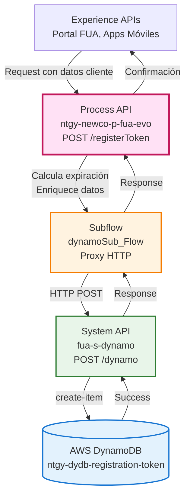
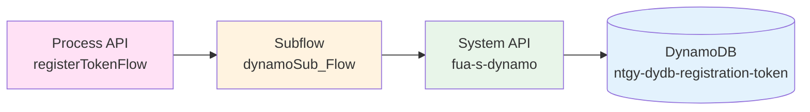
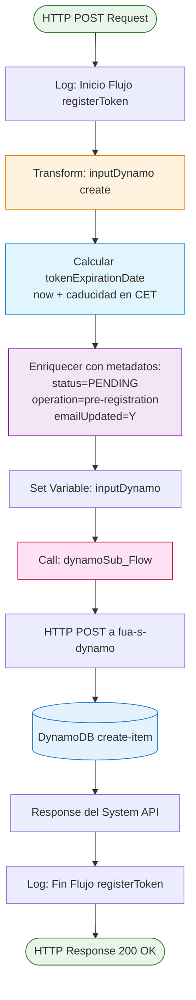
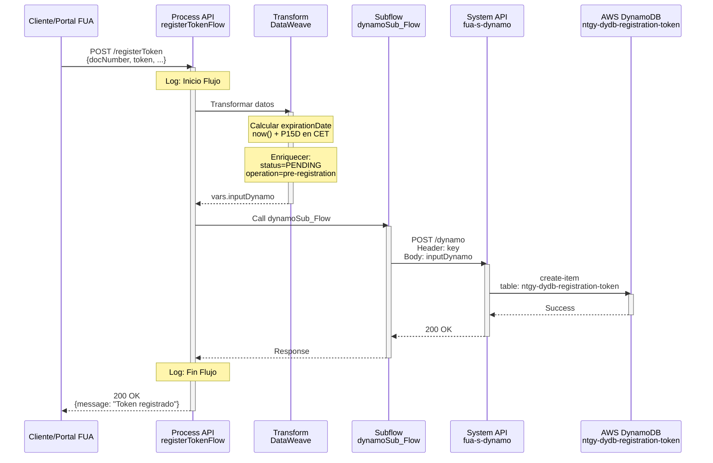
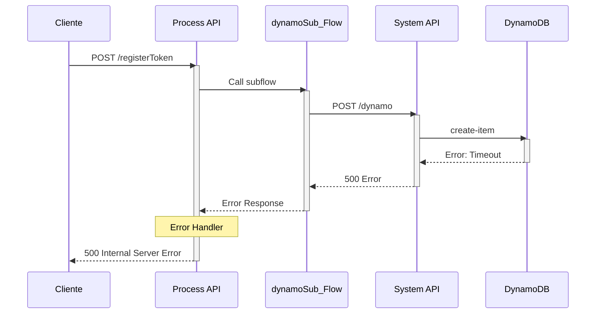
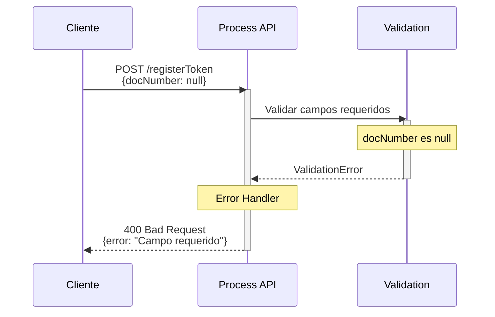

# POST /registerToken

## 📌 Descripción General

### Propósito del Endpoint

Este endpoint registra tokens de pre-registro de clientes en AWS DynamoDB, calculando automáticamente la fecha de expiración del token basándose en un período de caducidad configurable. Es parte del proceso de onboarding de nuevos clientes en el portal FUA.

### Tipo de API

**Capa:** Process API (API-Led Connectivity)

**Función:** Orquestación del proceso de registro de tokens de pre-registro con enriquecimiento de datos y cálculo de expiración

### Patrón de Integración

**Tipo:** Orquestación con Transformación

**Descripción:** El endpoint recibe los datos del cliente, calcula la fecha de expiración del token, enriquece la información con metadatos del proceso y delega la persistencia al System API `fua-s-dynamo` que interactúa con AWS DynamoDB.

### Arquitectura API-Led Connectivity



---

## 💼 Propósito del Negocio

### Casos de Uso Principales

1. **Pre-registro de Nuevos Clientes**
   - Almacena temporalmente los datos del cliente durante el proceso de alta
   - Genera un token único con fecha de expiración
   - Permite validación posterior del proceso de registro

2. **Control de Expiración de Tokens**
   - Calcula automáticamente la fecha de caducidad del token
   - Configurable mediante propiedad `s-marketing-cloud.caducidad`
   - Formato de fecha estandarizado en zona horaria CET

3. **Trazabilidad del Proceso de Alta**
   - Estado inicial: `PENDING`
   - Operación identificada: `pre-registration`
   - Seguimiento del flujo de onboarding

### 🔗 Endpoints Dependientes

Este Process API consume los siguientes System APIs:

| System API | Endpoint | Método | Propósito |
|------------|----------|--------|-----------|
| `fua-s-dynamo` | `/item` | POST | Crear items en AWS DynamoDB |

**Flujo de Integración:**



**Pasos del Proceso:**

1. **Paso 1**: `registerTokenFlow` recibe datos del cliente y token
2. **Paso 2**: Calcula fecha de expiración usando período configurable
3. **Paso 3**: Enriquece datos con metadatos (status, operation, emailUpdated)
4. **Paso 4**: `dynamoSub_Flow` actúa como proxy HTTP al System API
5. **Paso 5**: `fua-s-dynamo` ejecuta operación `create-item` en DynamoDB

### Transformaciones Aplicadas

| Campo Original (Input) | Campo Transformado (DynamoDB) | Transformación |
|------------------------|-------------------------------|----------------|
| `payload.docNumber` | `body.docNumber` | Pass-through |
| `payload.docType` | `body.docType` | Pass-through |
| `payload.accountId` | `body.accountId` | Pass-through |
| `payload.contactId` | `body.contactId` | Pass-through |
| `payload.idioma` | `body.idioma` | Pass-through |
| `payload.phone` | `body.phone` | Pass-through |
| `payload.email` | `body.email` | Default: `""` si no existe |
| `payload.name` | `body.name` | Default: `""` si no existe |
| `payload.token` | `body.token` | Pass-through |
| `payload.rol` | `body.rol` | Pass-through |
| N/A | `body.status` | Hardcoded: `"PENDING"` |
| N/A | `body.operation` | Hardcoded: `"pre-registration"` |
| N/A | `body.emailUpdated` | Hardcoded: `"Y"` |
| N/A | `body.tokenExpirationDate` | Calculado: `now() + caducidad` en formato `dd-MM-yyyy HH:mm:ss` (CET) |
| N/A | `operationDynamo` | Hardcoded: `"create"` |
| N/A | `table` | Config: `fua-s-dynamo.tables.tableRegistration` |

### Contexto Empresarial

- **Dominio:** Gestión de Pre-registro de Clientes
- **Sector:** Energía - Utilities
- **División:** Naturgy España - NewCo
- **Proceso de Negocio:** Onboarding de clientes FUA

### Stakeholders

- **Clientes Potenciales**: Usuarios en proceso de alta en el portal FUA
- **Equipo de Marketing**: Gestión de campañas de captación
- **Equipo de Desarrollo FUA**: Mantenimiento del flujo de registro
- **Administradores de DynamoDB**: Gestión de la tabla de tokens

### Valor de Negocio

- **Automatización**: Cálculo automático de expiración de tokens
- **Seguridad**: Control temporal de tokens de pre-registro
- **Trazabilidad**: Registro completo del proceso de alta
- **Escalabilidad**: Uso de DynamoDB para alto volumen de registros

### Consumidores Potenciales

Este endpoint puede ser consumido por:
- Portal web FUA (proceso de registro)
- Aplicaciones móviles de Naturgy
- Sistemas de marketing automation
- Flujos de onboarding automatizados

---

## 🔧 Especificación Técnica

### URLs por Ambiente

| Ambiente | URL Base | URL Completa |
|----------|----------|--------------|
| **Local** | `http://localhost:8081` | `http://localhost:8081/api/registerToken` |
| **Development** | `https://ntgy-newco-p-fua-evo-des.de-c1.cloudhub.io` | `https://ntgy-newco-p-fua-evo-des.de-c1.cloudhub.io/api/registerToken` |
| **UAT** | `https://ntgy-newco-p-fua-evo-uat.de-c1.cloudhub.io` | `https://ntgy-newco-p-fua-evo-uat.de-c1.cloudhub.io/api/registerToken` |
| **Production** | `https://ntgy-newco-p-fua-evo-pro.de-c1.cloudhub.io` | `https://ntgy-newco-p-fua-evo-pro.de-c1.cloudhub.io/api/registerToken` |

### Método HTTP

```
POST /api/registerToken
```

### Headers Requeridos

| Header | Tipo | Obligatorio | Descripción |
|--------|------|-------------|-------------|
| `Content-Type` | string | ✅ Sí | Debe ser `application/json` |
| `key` | string | ✅ Sí | Clave de autenticación para el System API |

### Parámetros de Entrada

#### Request Body (application/json)

```json
{
  "docNumber": "string",
  "docType": "string",
  "accountId": "string",
  "contactId": "string",
  "idioma": "string",
  "phone": "string",
  "email": "string",
  "name": "string",
  "token": "string",
  "rol": "string"
}
```

#### Descripción de Campos

| Campo | Tipo | Obligatorio | Descripción |
|-------|------|-------------|-------------|
| `docNumber` | string | ✅ Sí | Número de documento del cliente |
| `docType` | string | ✅ Sí | Tipo de documento (DNI, NIE, CIF, etc.) |
| `accountId` | string | ✅ Sí | ID de la cuenta en Salesforce |
| `contactId` | string | ✅ Sí | ID del contacto en Salesforce |
| `idioma` | string | ✅ Sí | Código de idioma (es, ca, eu, gl, en) |
| `phone` | string | ✅ Sí | Número de teléfono del cliente |
| `email` | string | ❌ No | Email del cliente (default: "") |
| `name` | string | ❌ No | Nombre del cliente (default: "") |
| `token` | string | ✅ Sí | Token único de pre-registro |
| `rol` | string | ✅ Sí | Rol del usuario en el proceso |

### Respuestas

#### 200 OK - Registro Exitoso

⚠️ **Pass-Through Response**: El Process API devuelve la respuesta del System API sin modificaciones.

**Respuesta Real del System API:**
```json
{
  "result": true
}
```

**Nota sobre RAML:** El RAML puede definir una estructura diferente, pero el código real devuelve `{"result": true}`. Esta documentación refleja la implementación real del System API `fua-s-dynamo`.

#### 400 Bad Request - Error de Validación

```json
{
  "error": "Datos de entrada inválidos",
  "details": "Campo requerido faltante: docNumber"
}
```

#### 500 Internal Server Error - Error del Sistema

```json
{
  "error": "Error al registrar token",
  "details": "Error de conexión con DynamoDB"
}
```

### Autenticación

- **Tipo:** API Key (header `key`)
- **Descripción:** Se requiere una clave de autenticación válida para acceder al System API `fua-s-dynamo`

### Timeouts

| Tipo | Valor |
|------|-------|
| **Request Timeout** | 30 segundos |
| **Connection Timeout** | 10 segundos |
| **DynamoDB Operation** | 30 segundos (configurado en fua-s-dynamo) |

---

## 🏗️ Implementación Técnica

### Arquitectura del Flow



### Transformaciones DataWeave

#### Transformación Principal: Preparación de Input para DynamoDB

**Ubicación:** `registerTokenFlow.xml` (líneas 13-42)

```dataweave
%dw 2.0
output application/json

var caducidad = Mule::p('s-marketing-cloud.caducidad') as Period

var expirationDate = ((now() + caducidad) >> "CET") as String {
	format: "dd-MM-yyyy HH:mm:ss"
}
---
{
	"body":{
		"docNumber": payload.docNumber,
		"docType": payload.docType,
		"accountId": payload.accountId,
		"contactId": payload.contactId,
		"idioma": payload.idioma,
		"phone": payload.phone,
		"email": payload.email default "",
		"name": payload.name default "",
		"status": "PENDING",
		"token": payload.token,
		"operation": "pre-registration",
		"emailUpdated": "Y",
		"rol": payload.rol,
		"tokenExpirationDate": expirationDate
	},
	"operationDynamo": "create",
	"table": p('fua-s-dynamo.tables.tableRegistration')
}
```

**Lógica de Cálculo de Expiración:**

1. **Obtener período de caducidad**: `Mule::p('s-marketing-cloud.caducidad')` → `"P15D"` (15 días)
2. **Calcular fecha futura**: `now() + caducidad` → Fecha actual + 15 días
3. **Convertir a zona horaria CET**: `>> "CET"`
4. **Formatear**: `"dd-MM-yyyy HH:mm:ss"` → Ejemplo: `"24-01-2026 14:30:00"`

### Configuración de Propiedades

**Archivo:** `properties-dev.yaml` (líneas 365-385, 420-426)

```yaml
s-marketing-cloud:
  caducidad: "P15D"  # Período de 15 días

fua-s-dynamo:
  host: "mule-worker-internal-ntgy-fua-s-dynamodb-dev.de-c1.cloudhub.io"
  port: "8091"
  timeout: "30000"
  tables:
    tableRegistration: "ntgy-dydb-registration-token"
```

### Patrones de Diseño

**Patrón 1: Proxy Pattern (dynamoSub_Flow)**

**Justificación:** El subflow `dynamoSub_Flow` actúa como un proxy reutilizable que encapsula la lógica de comunicación HTTP con el System API, permitiendo reutilización en múltiples flows del Process API.

**Patrón 2: Enrichment Pattern**

**Justificación:** El flow enriquece los datos de entrada con metadatos del proceso (status, operation, emailUpdated) y cálculos derivados (tokenExpirationDate), agregando valor sin modificar la estructura original.

**Patrón 3: Configuration-Driven**

**Justificación:** Uso de propiedades configurables (`caducidad`, `tableRegistration`) que permiten ajustar el comportamiento sin modificar código.

### Diagramas de Secuencia

#### 1. Flujo Normal de Éxito



#### 2. Flujo con Error de DynamoDB



#### 3. Flujo con Validación de Datos



### Manejo de Errores

**Estrategia:** Error handler global `login-errorsError_Handler`

**Tipos de Errores Manejados:**

1. **Errores de Validación (400)**
   - Campos requeridos faltantes
   - Formato de datos inválido

2. **Errores de Conectividad (500)**
   - Timeout en llamada a System API
   - Error de conexión con DynamoDB

3. **Errores de Negocio (400)**
   - Token duplicado
   - Datos inconsistentes

**Respuesta de Error Estandarizada:**

```json
{
  "error": "Descripción del error",
  "details": "Información adicional",
  "timestamp": "2026-01-24T14:30:00Z"
}
```

---

## 💻 Ejemplos de Uso

### Ejemplo 1: Registro Exitoso de Token

#### cURL

```bash
curl -X POST "https://ntgy-newco-p-fua-evo-des.de-c1.cloudhub.io/api/registerToken" \
  -H "Content-Type: application/json" \
  -H "key: YOUR_API_KEY" \
  -d '{
    "docNumber": "12345678A",
    "docType": "DNI",
    "accountId": "0011234567890ABC",
    "contactId": "0031234567890DEF",
    "idioma": "es",
    "phone": "+34600123456",
    "email": "cliente@example.com",
    "name": "Juan Pérez",
    "token": "abc123def456ghi789",
    "rol": "titular"
  }'
```

#### Respuesta (200 OK)

```json
{
  "result": true
}
```

**Datos Almacenados en DynamoDB:**

```json
{
  "docNumber": "12345678A",
  "docType": "DNI",
  "accountId": "0011234567890ABC",
  "contactId": "0031234567890DEF",
  "idioma": "es",
  "phone": "+34600123456",
  "email": "cliente@example.com",
  "name": "Juan Pérez",
  "status": "PENDING",
  "token": "abc123def456ghi789",
  "operation": "pre-registration",
  "emailUpdated": "Y",
  "rol": "titular",
  "tokenExpirationDate": "08-02-2026 14:30:00"
}
```

### Ejemplo 2: Registro con Campos Opcionales Vacíos

#### cURL

```bash
curl -X POST "https://ntgy-newco-p-fua-evo-des.de-c1.cloudhub.io/api/registerToken" \
  -H "Content-Type: application/json" \
  -H "key: YOUR_API_KEY" \
  -d '{
    "docNumber": "87654321B",
    "docType": "NIE",
    "accountId": "0019876543210XYZ",
    "contactId": "0039876543210UVW",
    "idioma": "ca",
    "phone": "+34611987654",
    "token": "xyz789uvw456rst123",
    "rol": "autorizado"
  }'
```

#### Respuesta (200 OK)

```json
{
  "result": true
}
```

**Nota:** Los campos `email` y `name` se almacenan como cadenas vacías `""` por defecto.

### Ejemplo 3: JavaScript (Fetch API)

```javascript
const registerToken = async () => {
  const response = await fetch(
    'https://ntgy-newco-p-fua-evo-des.de-c1.cloudhub.io/api/registerToken',
    {
      method: 'POST',
      headers: {
        'Content-Type': 'application/json',
        'key': 'YOUR_API_KEY'
      },
      body: JSON.stringify({
        docNumber: '12345678A',
        docType: 'DNI',
        accountId: '0011234567890ABC',
        contactId: '0031234567890DEF',
        idioma: 'es',
        phone: '+34600123456',
        email: 'cliente@example.com',
        api_name: 'Juan Pérez',
        token: 'abc123def456ghi789',
        rol: 'titular'
      })
    }
  );

  if (response.ok) {
    const data = await response.json();
    console.log('Token registrado:', data);
  } else {
    console.error('Error:', response.status, await response.text());
  }
};

registerToken();
```

### Ejemplo 4: Python (Requests)

```python
import requests
import json

url = 'https://ntgy-newco-p-fua-evo-des.de-c1.cloudhub.io/api/registerToken'

headers = {
    'Content-Type': 'application/json',
    'key': 'YOUR_API_KEY'
}

payload = {
    'docNumber': '12345678A',
    'docType': 'DNI',
    'accountId': '0011234567890ABC',
    'contactId': '0031234567890DEF',
    'idioma': 'es',
    'phone': '+34600123456',
    'email': 'cliente@example.com',
    'name': 'Juan Pérez',
    'token': 'abc123def456ghi789',
    'rol': 'titular'
}

response = requests.post(url, headers=headers, json=payload)

if response.status_code == 200:
    print('Token registrado:', response.json())
else:
    print(f'Error {response.status_code}:', response.text)
```

### Ejemplo 5: Error - Campo Requerido Faltante

#### cURL

```bash
curl -X POST "https://ntgy-newco-p-fua-evo-des.de-c1.cloudhub.io/api/registerToken" \
  -H "Content-Type: application/json" \
  -H "key: YOUR_API_KEY" \
  -d '{
    "docType": "DNI",
    "accountId": "0011234567890ABC",
    "contactId": "0031234567890DEF"
  }'
```

#### Respuesta (400 Bad Request)

```json
{
  "error": "Datos de entrada inválidos",
  "details": "Campos requeridos faltantes: docNumber, idioma, phone, token, rol"
}
```

### Ejemplo 6: Error - Timeout de DynamoDB

#### Respuesta (500 Internal Server Error)

```json
{
  "error": "Error al registrar token",
  "details": "Timeout al conectar con DynamoDB después de 30 segundos"
}