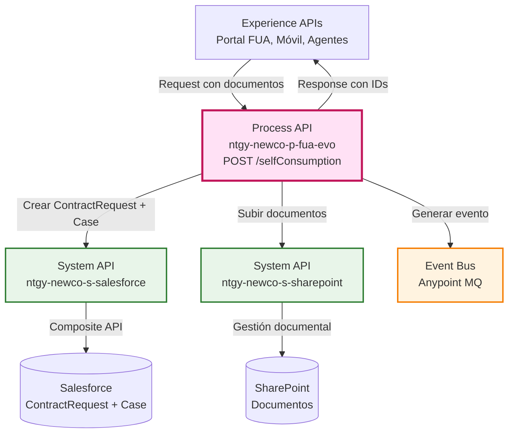
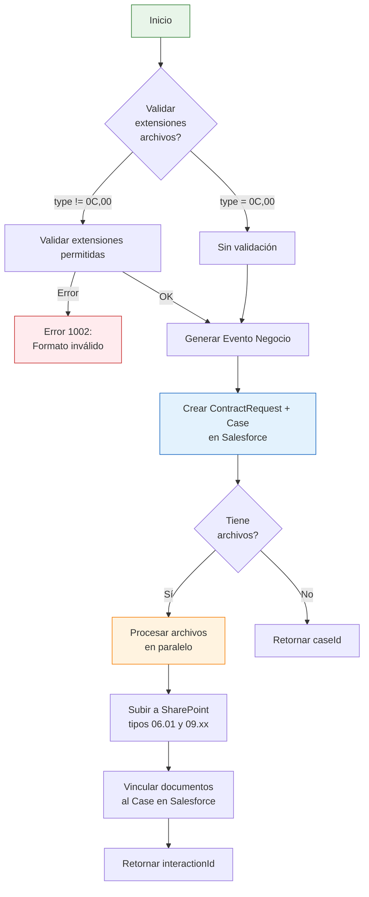
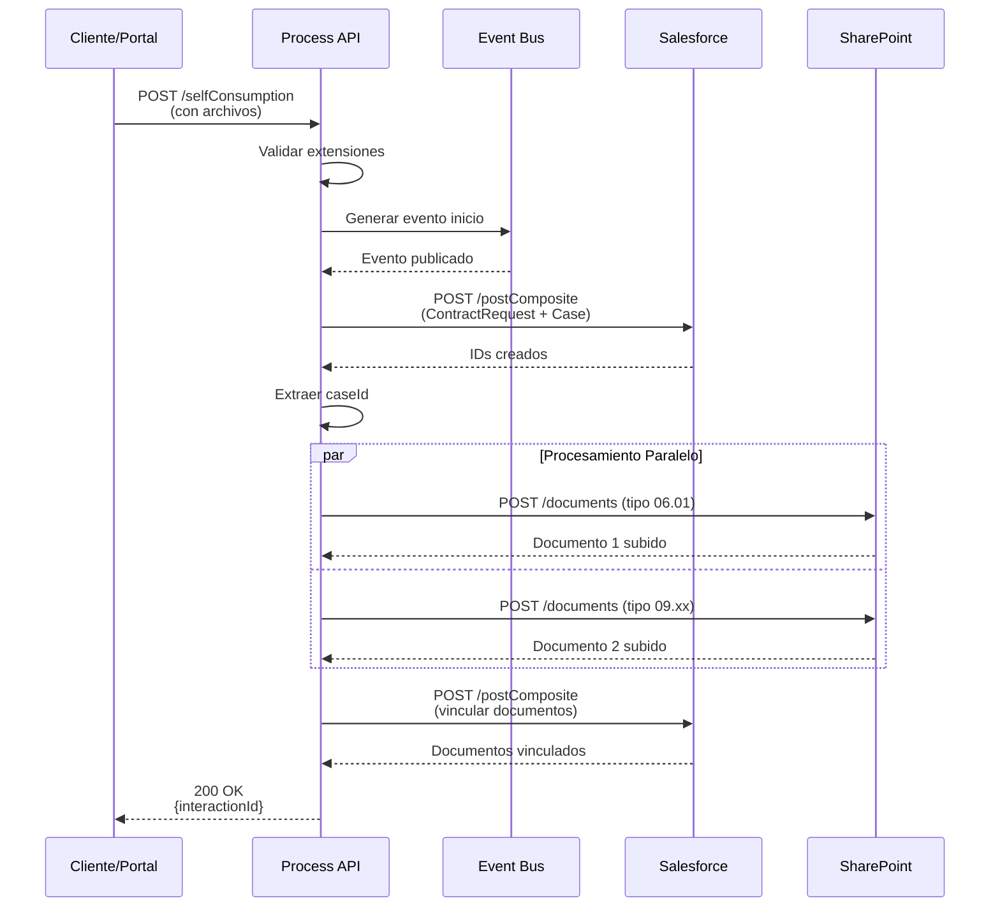
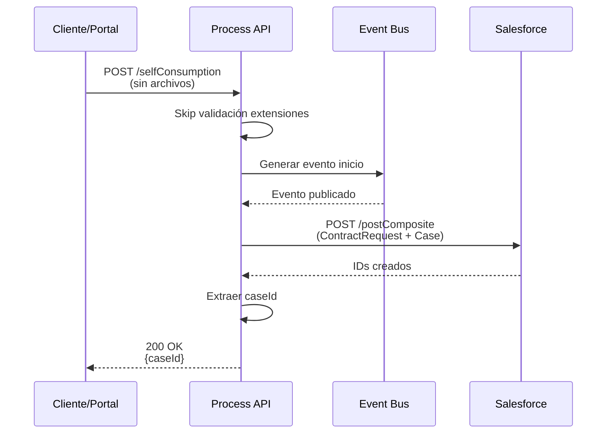
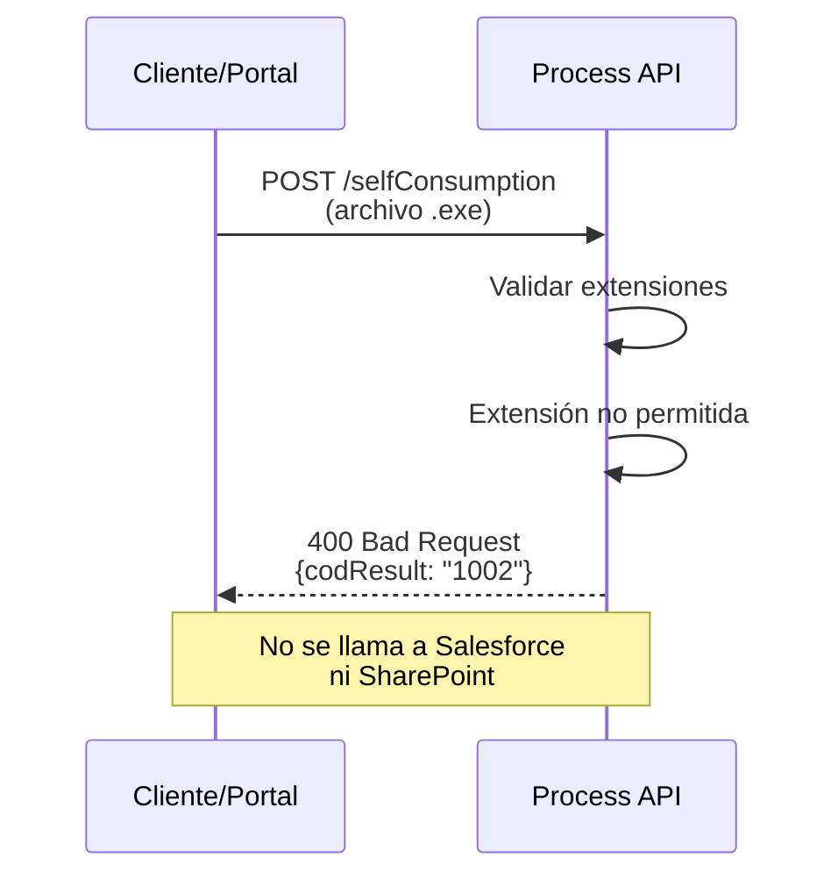
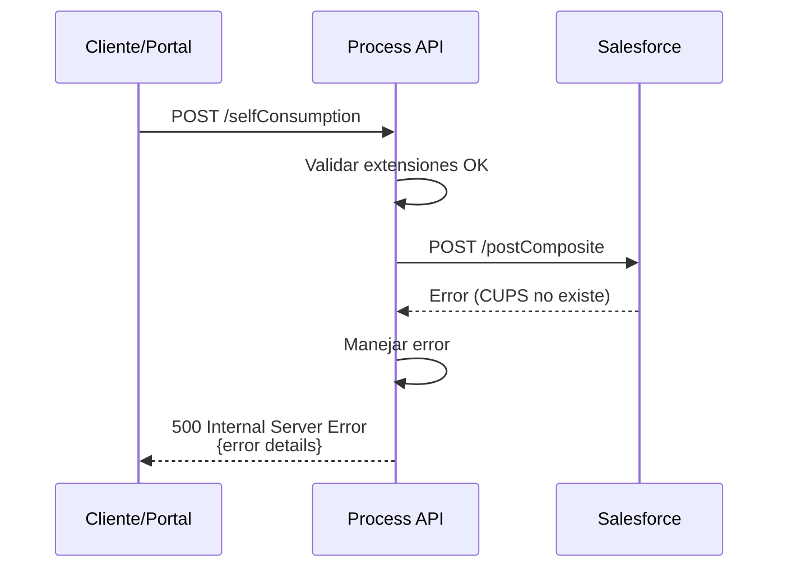

# POST /selfConsumption

## 📌 Descripción General

### Propósito del Endpoint

Este endpoint orquesta el proceso completo de alta o modificación de un autoconsumo energético, coordinando la creación de registros en Salesforce (ContractRequest y Case), la validación y subida de documentos a SharePoint, y la generación de eventos de negocio. Maneja múltiples tipos de autoconsumo (individual, colectivo) y soporta hasta 3 instalaciones de generación diferentes.

### Tipo de API

**Capa:** Process API (API-Led Connectivity)

**Función:** Orquestación de proceso de negocio de autoconsumo con gestión documental

### Patrón de Integración

**Tipo:** Orquestación Compleja con Procesamiento Paralelo

**Descripción:** Orquesta llamadas secuenciales a Salesforce para crear registros de negocio, seguidas de procesamiento paralelo (scatter-gather) de documentos hacia SharePoint, con validaciones de formato de archivo y generación de eventos asíncronos.

### Arquitectura API-Led Connectivity



---

## 💼 Propósito del Negocio

### Casos de Uso Principales

1. **Alta de Autoconsumo Individual**
   - Cliente solicita registro de instalación de autoconsumo individual
   - Se crea solicitud de contrato y caso de gestión en Salesforce
   - Se suben documentos obligatorios (CIE) a SharePoint
   - **Beneficio:** Automatización completa del proceso de alta

2. **Alta de Autoconsumo Colectivo**
   - Comunidad de vecinos o polígono industrial solicita autoconsumo colectivo
   - Se registran múltiples instalaciones de generación (hasta 3)
   - Se gestionan documentos adicionales (acuerdo reparto, coeficientes)
   - **Beneficio:** Soporte para instalaciones complejas con múltiples generadores

3. **Modificación de Autoconsumo Existente**
   - Cliente modifica configuración de autoconsumo existente
   - Se actualiza potencia contratada y tipo de instalación
   - Se vinculan nuevos documentos al caso existente
   - **Beneficio:** Gestión del ciclo de vida completo del autoconsumo

### 🔗 Endpoints Dependientes

Este Process API consume los siguientes System APIs:

| System API | Endpoint | Método | Propósito |
|------------|----------|--------|-----------|
| `ntgy-newco-s-salesforce` | `/postComposite` | POST | Crear ContractRequest y Case en una sola transacción |
| `ntgy-newco-s-sharepoint` | `/documents` | POST | Subir documentos (CIE, contratos, acuerdos) |
| `generarEventoFlow` | (interno) | - | Generar evento de negocio para motor de estados |

### Lógica de Orquestación



**Pasos del Proceso:**

1. **Validación de Archivos**: Verifica extensiones permitidas según tipo de autoconsumo
2. **Generación de Evento**: Publica evento de inicio de proceso al motor de estados
3. **Creación en Salesforce**: Crea ContractRequest y Case mediante Composite API
4. **Procesamiento de Documentos**: Si hay archivos, los procesa en paralelo (scatter-gather)
5. **Subida a SharePoint**: Sube cada documento con metadatos específicos (tipos 06.01 y 09.xx)
6. **Vinculación**: Vincula documentos al Case en Salesforce
7. **Respuesta**: Retorna caseId o interactionId según flujo

### Transformaciones Aplicadas

| Campo Original (Request) | Campo Transformado (Salesforce) | Transformación |
|--------------------------|----------------------------------|----------------|
| `contractId` | `acn_fld_Contract__c` | Directo |
| `CUPS` | `acn_fld_CUPS__r.acn_fld_Name__c` | Lookup por nombre |
| `x-client-id` | `acn_fld_Account__c` | Directo |
| `x-user-id` / `x-contact-id` | `NewCo_Creado_por__c` | Condicional: user_id si existe, sino contact_id |
| `type` | `acn_fld_AutoconsumptionType__c` | Directo (códigos: 0C, 00, etc.) |
| `datosGenInst.1/2/3` | `NewCo_TipoInstalacion1/2/3__c` | Array a campos individuales |
| `installationPower.1/2/3` | `NewCo_PotInstaladaGen1/2/3__c` | Array a campos individuales |
| `cieFile.file` | Base64 en SharePoint | Decodificación y subida |

### Contexto Empresarial

- **Dominio:** Gestión de Autoconsumo Energético
- **Sector:** Energía - Utilities
- **División:** Naturgy España - NewCo
- **Proceso de Negocio:** Alta y modificación de instalaciones de autoconsumo fotovoltaico

### Stakeholders

- **Clientes Residenciales**: Solicitan autoconsumo individual para reducir factura eléctrica
- **Comunidades de Propietarios**: Gestionan autoconsumo colectivo en edificios
- **Polígonos Industriales**: Implementan autoconsumo compartido entre empresas
- **Equipo de Gestión de Contratos**: Procesa solicitudes y valida documentación
- **Equipo de Operaciones**: Gestiona instalaciones y conexiones a red

### Valor de Negocio

- **Automatización**: Reduce tiempo de procesamiento de 5 días a 1 día
- **Trazabilidad**: Registro completo del proceso en Salesforce con documentación vinculada
- **Cumplimiento Normativo**: Gestión de documentación obligatoria (CIE, acuerdos)
- **Escalabilidad**: Soporta desde instalaciones individuales hasta colectivos complejos
- **Integración**: Conecta portal cliente, Salesforce y SharePoint en un solo flujo

### Consumidores Potenciales

Este endpoint puede ser consumido por:
- Portal web FUA
- Aplicación móvil de clientes
- Sistema de agentes de call center
- Portal de gestión de comunidades
- Integraciones con instaladores autorizados

---

## 🔧 Especificación Técnica

### URLs por Ambiente

| Ambiente | URL Base | URL Completa |
|----------|----------|--------------|
| **Local** | `http://localhost:8081` | `http://localhost:8081/api/selfConsumption` |
| **Development** | `https://ntgy-newco-p-fua-evo-dev.us-e2.cloudhub.io` | `https://ntgy-newco-p-fua-evo-dev.us-e2.cloudhub.io/api/selfConsumption` |
| **UAT** | `https://ntgy-newco-p-fua-evo-uat.us-e2.cloudhub.io` | `https://ntgy-newco-p-fua-evo-uat.us-e2.cloudhub.io/api/selfConsumption` |
| **Production** | `https://ntgy-newco-p-fua-evo-pro.us-e2.cloudhub.io` | `https://ntgy-newco-p-fua-evo-pro.us-e2.cloudhub.io/api/selfConsumption` |

### Método HTTP

```
POST /api/selfConsumption
```

### Headers Requeridos

| Header | Tipo | Obligatorio | Descripción |
|--------|------|-------------|-------------|
| `Content-Type` | string | ✅ | Debe ser `application/json` |
| `x-client-id` | string | ✅ | ID del cliente en Salesforce (AccountId) |
| `x-client-code` | string | ✅ | Código de cliente (NIF/NIE) |
| `x-contact-id` | string | ✅ | ID del contacto en Salesforce |
| `x-user-id` | string | ⚠️ | ID del usuario (agente), opcional si es cliente |
| `x-agent-mail` | string | ⚠️ | Email del agente, opcional |
| `x-interaction-id` | string | ⚠️ | ID de interacción padre, opcional |
| `traceparent` | string | ✅ | Trace ID para trazabilidad distribuida |
| `correlationId` | string | ✅ | ID de correlación para logs |
| `DirIp` | string | ✅ | Dirección IP del cliente |

### Parámetros de Entrada (Body)

#### Estructura Principal

```json
{
  "contractId": "string",
  "CUPS": "string",
  "cupsType": "string",
  "subsection": "string",
  "type": "string",
  "collective": "string",
  "proposedChangeDate": "string",
  "newPowerP1": number,
  "newPowerP2": number,
  "subject": "string",
  "cau": "string",
  "datosGenInst": {
    "1": "string",
    "2": "string",
    "3": "string"
  },
  "installationPower": {
    "1": number,
    "2": number,
    "3": number
  },
  "tecGenerador": {
    "1": "string",
    "2": "string",
    "3": "string"
  },
  "refCatastro": {
    "1": "string",
    "2": "string",
    "3": "string"
  },
  "esquemaMedida": {
    "1": "string",
    "2": "string",
    "3": "string"
  },
  "combustible": {
    "1": "string",
    "2": "string",
    "3": "string"
  },
  "ssaa": {
    "1": boolean,
    "2": boolean,
    "3": boolean
  },
  "unicoContrato": {
    "1": boolean,
    "2": boolean,
    "3": boolean
  },
  "cieFile": {
    "file": "string (base64)",
    "fileNameWithExtension": "string"
  },
  "compensationContractFile": {
    "file": "string (base64)",
    "fileNameWithExtension": "string"
  },
  "partitionAgreementFile": {
    "file": "string (base64)",
    "fileNameWithExtension": "string"
  },
  "partitionCoefficientFile": {
    "file": "string (base64)",
    "fileNameWithExtension": "string"
  }
}
```

#### Descripción de Campos

**Campos Obligatorios:**

| Campo | Tipo | Descripción |
|-------|------|-------------|
| `contractId` | string | ID del contrato en Salesforce |
| `CUPS` | string | Código Universal del Punto de Suministro |
| `type` | string | Tipo de autoconsumo: "0C" (sin excedentes), "00" (con excedentes), etc. |
| `proposedChangeDate` | string | Fecha propuesta de cambio (formato: YYYY-MM-DD) |
| `newPowerP1` | number | Nueva potencia periodo 1 (kW) |
| `newPowerP2` | number | Nueva potencia periodo 2 (kW) |

**Campos Opcionales:**

| Campo | Tipo | Descripción |
|-------|------|-------------|
| `cupsType` | string | Tipo de CUPS (producción/consumo) |
| `subsection` | string | Tipo de subsección |
| `collective` | string | Indicador de autoconsumo colectivo |
| `subject` | string | Asunto del caso de gestión |
| `cau` | string | Código de Autorización Único |
| `datosGenInst.1/2/3` | string | Tipo de instalación de generación (hasta 3) |
| `installationPower.1/2/3` | number | Potencia instalada por generador (kW) |
| `tecGenerador.1/2/3` | string | Tecnología del generador (fotovoltaica, eólica, etc.) |
| `refCatastro.1/2/3` | string | Referencia catastral de la instalación |
| `esquemaMedida.1/2/3` | string | Esquema de medida |
| `combustible.1/2/3` | string | Tipo de combustible (si aplica) |
| `ssaa.1/2/3` | boolean | Servicios auxiliares |
| `unicoContrato.1/2/3` | boolean | Indicador de contrato único |

**Archivos Adjuntos:**

| Campo | Tipo | Descripción | Obligatorio |
|-------|------|-------------|-------------|
| `cieFile` | object | Certificado de Instalación Eléctrica | ✅ (según tipo) |
| `compensationContractFile` | object | Contrato de compensación | ⚠️ (colectivos) |
| `partitionAgreementFile` | object | Acuerdo de reparto | ⚠️ (colectivos) |
| `partitionCoefficientFile` | object | Coeficientes de reparto | ⚠️ (colectivos) |

**Estructura de Archivo:**
```json
{
  "file": "base64_encoded_content",
  "fileNameWithExtension": "documento.pdf"
}
```

**Extensiones Permitidas:**
- Documentos: `.pdf`, `.doc`, `.docx`, `.odt`, `.txt`
- Imágenes: `.png`, `.jpg`, `.jpeg`
- Hojas de cálculo: `.xls`, `.xlsx`, `.csv`
- Comprimidos: `.zip`
- Otros: `.mp3`, `.afp`

### Respuestas

#### 200 OK - Éxito

```json
{
  "result": {
    "codResult": "0000",
    "msgResult": "No hay error"
  },
  "interactionId": "5003X000001AbCdQAK"
}
```

**Descripción de Campos:**

| Campo | Tipo | Descripción |
|-------|------|-------------|
| `result.codResult` | string | Código de resultado: "0000" = éxito |
| `result.msgResult` | string | Mensaje descriptivo del resultado |
| `interactionId` | string | ID del Case creado en Salesforce (si hay archivos) o caseId directo |

#### 400 Bad Request - Error de Validación

```json
{
  "result": {
    "codResult": "1002",
    "msgResult": "Error en los formatos de los ficheros"
  }
}
```

**Causas Comunes:**
- Extensión de archivo no permitida
- Archivo corrupto o no decodificable
- Campos obligatorios faltantes
- Formato de fecha inválido

#### 500 Internal Server Error - Error del Sistema

```json
{
  "code": "INTERNAL_SERVER_ERROR",
  "message": "Error al procesar la solicitud",
  "details": "Error en llamada a Salesforce"
}
```

### Validaciones

1. **Validación de Extensiones de Archivo**
   - Solo se valida si `type` NO es "0C" ni "00"
   - Extensiones permitidas definidas en: `ntgy-newco-s-sharepoint.files.allowedExtension`
   - Error 1002 si algún archivo tiene extensión no permitida

2. **Validación de Campos Obligatorios**
   - `contractId`, `CUPS`, `type`, `proposedChangeDate` son obligatorios
   - `newPowerP1` y `newPowerP2` deben ser números positivos

3. **Validación de Archivos**
   - `cieFile` es obligatorio para la mayoría de tipos de autoconsumo
   - Archivos adicionales obligatorios para autoconsumo colectivo
   - Contenido base64 debe ser válido

### Autenticación

- **Tipo:** Client ID & Client Secret (Anypoint Platform)
- **Propagación:** Headers `x-client-id`, `x-contact-id`, `x-user-id` se propagan a System APIs

### Timeouts

| Tipo | Valor | Configuración |
|------|-------|---------------|
| **Request Timeout (Salesforce)** | 60 segundos | `${ntgy-newco-s-salesforce.timeout}` |
| **Request Timeout (SharePoint)** | 30 segundos | Por defecto |
| **Connection Timeout** | 10 segundos | Por defecto |

---

## 🏗️ Implementación Técnica

### Arquitectura del Flow

```mermaid
flowchart TD
    Start([HTTP POST Request]) --> SavePayload[Guardar payload original<br/>en variable entryPayload]
    SavePayload --> GenEvent[Generar Evento Negocio<br/>generarEventoFlow]
    GenEvent --> CheckType{type es<br/>0C o 00?}
    CheckType -->|Sí| SkipValidation[Sin validación de extensiones]
    CheckType -->|No| ValidateExt[Validar extensiones permitidas]
    ValidateExt -->|Error| ErrorResponse[Error 1002:<br/>Formato inválido]
    ValidateExt -->|OK| BuildSFPayload
    SkipValidation --> BuildSFPayload[Construir payload Salesforce<br/>ContractRequest + Case]
    BuildSFPayload --> CallSF[POST a Salesforce<br/>Composite API]
    CallSF --> ExtractCase{Tiene<br/>interactionId?}
    ExtractCase -->|No| SetCase1[caseId = compositeResponse[1].id]
    ExtractCase -->|Sí| SetCase2[caseId = compositeResponse[0].id]
    SetCase1 --> HasFiles{Tiene<br/>archivos?}
    SetCase2 --> HasFiles
    HasFiles -->|No| ReturnSimple[Retornar caseId]
    HasFiles -->|Sí| ForEachFile[ForEach archivo]
    ForEachFile --> ExtractMeta[Extraer metadatos:<br/>nombre, extensión, tipo doc]
    ExtractMeta --> DetermineMime[Determinar MIME type]
    DetermineMime --> ScatterGather[Scatter-Gather paralelo]
    ScatterGather --> Route1[Ruta 1: SharePoint tipo 06.01]
    ScatterGather --> Route2[Ruta 2: SharePoint tipo 09.xx]
    Route1 --> BuildDoc1[Construir payload 06.01<br/>con metadatos caso]
    Route2 --> BuildDoc2[Construir payload 09.xx<br/>con metadatos básicos]
    BuildDoc1 --> Upload1[POST a SharePoint]
    BuildDoc2 --> Upload2[POST a SharePoint]
    Upload1 --> Aggregate[Agregar respuestas]
    Upload2 --> Aggregate
    Aggregate --> BuildComposite[Construir Composite<br/>para vincular docs]
    BuildComposite --> LinkDocs[POST a Salesforce<br/>vincular documentos]
    LinkDocs --> ReturnInteraction[Retornar interactionId]
    ReturnSimple --> End([HTTP Response])
    ReturnInteraction --> End
    ErrorResponse --> End
    
    style Start fill:#e8f5e9,stroke:#2e7d32
    style End fill:#e8f5e9,stroke:#2e7d32
    style ErrorResponse fill:#ffebee,stroke:#c62828
    style CallSF fill:#e3f2fd,stroke:#1565c0
    style ScatterGather fill:#fff3e0,stroke:#f57c00
```

### Componentes Principales del Flow

#### 1. Validación de Extensiones de Archivo

**Ubicación en código:** Líneas 18-47 del subflow `selfConsumption`

```xml
<choice doc:name="Choice">
    <when expression="#[['0C','00'] contains vars.entryPayload.'type']">
        <logger level="INFO" message="No se valida la extension de los ficheros"/>
    </when>
    <otherwise>
        <try doc:name="Try">
            <validation:is-true 
                expression="#[vars.entryPayload..fileNameWithExtension dw::core::Arrays::some (lower(dw::core::Strings::substringAfterLast($, &quot;.&quot;)) matches (p('ntgy-newco-s-sharepoint.files.allowedExtension') as Regex))]" />
            <error-handler>
                <on-error-propagate>
                    <ee:transform>
                        <ee:set-payload><![CDATA[
                            {
                                "result": {
                                    "codResult": "1002",
                                    "msgResult": "Error en los formatos de los ficheros"
                                }
                            }
                        ]]></ee:set-payload>
                    </ee:transform>
                </on-error-propagate>
            </error-handler>
        </try>
    </otherwise>
</choice>
```

**Lógica:**
- Si `type` es "0C" o "00": No valida extensiones
- Si `type` es otro: Valida que todas las extensiones estén en la lista permitida
- Usa expresión DataWeave con `Arrays::some` para verificar al menos una extensión válida
- Retorna error 1002 si validación falla

#### 2. Construcción de Payload para Salesforce

**Ubicación en código:** Líneas 48-134 del subflow

```dataweave
%dw 2.0
output application/json
---
{
  "allOrNone": true,
  "collateSubrequests": false,
  "compositeRequest": [
    {
      "method": "POST",
      "url": "/services/data/v52.0/sobjects/acn_obj_ContractRequest__c",
      "referenceId": "refSolContratacion",
      "body": {
        "NewCo_Recordtype__c": "acn_rt_With_Switching",
        "acn_fld_Contract__c": vars.entryPayload.contractId,
        "acn_fld_Sctype__c": "30",
        "acn_fld_Category__c": "40",
        "acn_fld_ReleaseDate__c": now()[0 to 9],
        "acn_fld_CUPS__r": {
          "acn_fld_Name__c": vars.entryPayload.CUPS
        },
        "acn_fld_Status__c": "01",
        "acn_fld_rateText__c": "018",
        "acn_fld_RequestPowerP1__c": vars.entryPayload.newPowerP1,
        "acn_fld_RequestPowerP2__c": vars.entryPayload.newPowerP2,
        "acn_fld_newCommertialAgreement__c": false,
        "acn_fld_ProposedChangeDate__c": vars.entryPayload.proposedChangeDate,
        "acn_fld_Account__c": vars.entryPayload."x-client-id",
        "NewCo_Creado_por__c": if(vars.entryPayload.'x-user-id' != null) 
                                vars.entryPayload.'x-user-id' 
                                else vars.entryPayload.'x-contact-id',
        "NewCo_TipoCUPS__c": vars.entryPayload.cupsType default "",
        "NewCo_TipoSubseccion__c": vars.entryPayload.subsection default "",
        
        // Instalaciones de generación (hasta 3)
        "NewCo_TipoInstalacion1__c": vars.entryPayload.datosGenInst."1" default null,
        "NewCo_TipoInstalacion2__c": vars.entryPayload.datosGenInst."2" default null,
        "NewCo_TipoInstalacion3__c": vars.entryPayload.datosGenInst."3" default null,
        
        "NewCo_PotInstaladaGen1__c": vars.entryPayload.installationPower."1" default null,
        "NewCo_PotInstaladaGen2__c": vars.entryPayload.installationPower."2" default null,
        "NewCo_PotInstaladaGen3__c": vars.entryPayload.installationPower."3" default null,
        
        "NewCo_Colectivo__c": vars.entryPayload.collective default "",
        "acn_fld_AutoconsumptionType__c": vars.entryPayload.'type',
        "acn_fld_SendRequest__c": false,
        ("NewCo_CAU__c": vars.entryPayload.cau) if (!isEmpty(vars.entryPayload.cau))
      }
    },
    {
      "method": "POST",
      "url": "/services/data/v52.0/sobjects/Case",
      "referenceId": "refCaseGestion",
      "body": {
        "NewCo_Recordtype__c": "Gestion",
        "AccountId": vars.entryPayload."x-client-id",
        "ContactId": vars.entryPayload."x-contact-id",
        "Status": "01",
        "Priority": "02",
        "Origin": "FUA",
        ("OwnerId" : payload."x-user-id") if(!isEmpty(payload."x-user-id")),
        "NewCo_Creado_por__c": if(vars.entryPayload.'x-user-id' != null) 
                                vars.entryPayload.'x-user-id' 
                                else vars.entryPayload.'x-contact-id',
        "ParentId": vars.entryPayload."x-interaction-id",
        "NewCo_Contract__c": vars.entryPayload.contractId,
        "NewCo_Ip__c": payload.DirIp,
        "NewCo_CorrelationId__c": correlationId,
        "NewCo_TipoAutoconsumoSolicitadoCliente__c" : vars.entryPayload.'type',
        "Subject": vars.entryPayload.subject default "",
        "acn_fld_Tittle__r": {
          "NewCo_ExternalId__c": "AltaAutoconsumo"
        },
        "acn_fld_ContractRequest__c": "@{refSolContratacion.id}",
        "NewCo_TraceId__c": splitBy(vars.entryPayload.traceparent,"-")[1],
        ("NewCo_IdentificadorDeIntencion__c": vars.motorIntentionId) 
          if (!isEmpty(vars.motorIntentionId))
      }
    }
  ]
}
```

**Características Clave:**
- **Composite API**: Crea ContractRequest y Case en una sola transacción
- **Referencias Cruzadas**: Case referencia a ContractRequest mediante `@{refSolContratacion.id}`
- **Lookup por Nombre**: CUPS se busca por nombre usando relación `acn_fld_CUPS__r`
- **Campos Condicionales**: CAU y OwnerId solo se incluyen si tienen valor
- **Valores por Defecto**: Usa `default` para campos opcionales
- **Instalaciones Múltiples**: Soporta hasta 3 instalaciones de generación con campos individuales

#### 3. Procesamiento de Documentos en Paralelo

**Ubicación en código:** Líneas 145-220 del subflow

**Lógica del ForEach:**

```dataweave
// Construcción del array de archivos a procesar
[
  (cieFile: vars.entryPayload.cieFile) if(!isEmpty(vars.entryPayload.cieFile.file)),
  (compensationContractFile: vars.entryPayload.compensationContractFile) 
    if(!isEmpty(vars.entryPayload.compensationContractFile.file)),
  (partitionAgreementFile: vars.entryPayload.partitionAgreementFile) 
    if(!isEmpty(vars.entryPayload.partitionAgreementFile.file)),
  (partitionCoefficientFile: vars.entryPayload.partitionCoefficientFile) 
    if(!isEmpty(vars.entryPayload.partitionCoefficientFile.file))
]
```

**Mapeo de Tipos de Documento:**

| Archivo | Tipo SharePoint (tdoctp) | Descripción |
|---------|--------------------------|-------------|
| `cieFile` | 09.03 | Certificado de Instalación Eléctrica |
| `compensationContractFile` | 09.02 | Contrato de compensación |
| `partitionAgreementFile` | 09.04 | Acuerdo de reparto |
| `partitionCoefficientFile` | 09.02 | Coeficientes de reparto |

**Determinación de MIME Type:**

```dataweave
if(vars.fileFormat == "pdf") "application/pdf" 
else if(vars.fileFormat == "doc") "application/msword"
else if(vars.fileFormat == "docx") "application/vnd.openxmlformats-officedocument.wordprocessingml.document"
else if(vars.fileFormat == "png") "image/png"
else if(vars.fileFormat == "jpeg") "image/jpeg"
else if(vars.fileFormat == "jpg") "image/jpg"
else if(vars.fileFormat == "zip") "application/zip"
else if(vars.fileFormat == "xls") "application/vnd.ms-excel"
else if(vars.fileFormat == "xlsx") "application/xlsx"
else if(vars.fileFormat == "odt") "application/vnd.oasis.opendocument.text"
else if(vars.fileFormat == "mp3") "audio/mpeg"
else if(vars.fileFormat == "txt") "text/plain"
else if(vars.fileFormat == "csv") "application/csv"
else (null)
```

#### 4. Scatter-Gather para Subida Paralela

**Patrón:** Procesamiento paralelo de dos rutas

**Ruta 1 - Tipo 06.01 (Documento de Caso):**
```json
{
  "docType": "06.01",
  "metadata": {
    "t_file_id": "nombre_archivo",
    "t_doctp": "06.01",
    "c_customer_id": "x-client-id",
    "m_contract_id": "contractId",
    "case_num": "caseId"
  },
  "typeMIME": "application/pdf",
  "file": "base64_content"
}
```

**Ruta 2 - Tipo 09.xx (Documento Específico):**
```json
{
  "docType": "09.03",
  "metadata": {
    "t_file_id": "nombre_archivo",
    "t_doctp": "09.03",
    "c_customer_id": "x-client-id",
    "m_contract_id": "contractId",
    "m_cup": ""
  },
  "typeMIME": "application/pdf",
  "file": "base64_content"
}
```

**Beneficio del Scatter-Gather:**
- Subida simultánea a SharePoint con diferentes metadatos
- Reduce tiempo total de procesamiento
- Mantiene trazabilidad con dos tipos de documento

### Patrones de Diseño

**Patrón 1: Composite Request**
- **Descripción:** Agrupa múltiples operaciones en una sola transacción
- **Justificación:** Garantiza atomicidad (todo o nada) en creación de ContractRequest y Case
- **Beneficio:** Evita estados inconsistentes si falla una operación

**Patrón 2: Scatter-Gather**
- **Descripción:** Procesamiento paralelo de documentos
- **Justificación:** Optimiza tiempo de subida de múltiples archivos
- **Beneficio:** Reduce latencia total del endpoint

**Patrón 3: Event-Driven**
- **Descripción:** Generación asíncrona de eventos de negocio
- **Justificación:** Desacopla proceso principal del motor de estados
- **Beneficio:** No bloquea respuesta al cliente

**Patrón 4: Conditional Processing**
- **Descripción:** Validación condicional según tipo de autoconsumo
- **Justificación:** Diferentes tipos tienen diferentes requisitos
- **Beneficio:** Flexibilidad sin complejidad innecesaria

### Diagramas de Secuencia

#### 1. Flujo Normal de Éxito (Con Archivos)



#### 2. Flujo Normal de Éxito (Sin Archivos)



#### 3. Flujo con Error de Validación



#### 4. Flujo con Error en Salesforce



### Manejo de Errores

#### Estrategia de Error Handling

**1. Errores de Validación (400)**
- Extensión de archivo no permitida → Error 1002
- Campos obligatorios faltantes → Error de validación
- Formato de datos inválido → Error de transformación

**2. Errores de Negocio (400)**
- CUPS no existe en Salesforce
- Contrato no válido
- Cliente no encontrado

**3. Errores Técnicos (500)**
- Timeout en llamada a Salesforce
- Error de conexión a SharePoint
- Error en transformación DataWeave

**4. Manejo de Errores Parciales**
- Si falla subida de un documento: Se registra pero no detiene el proceso
- Si falla creación en Salesforce: Se aborta todo (allOrNone: true)
- Si falla evento: No afecta respuesta al cliente (asíncrono)

#### Logging

**Puntos de Log:**
```
INFO: Inicio de selfConsumption (payload sin archivos)
INFO: Sin validar extension / Validación OK
INFO: Respuesta de salesforce de la modificacion potencia
INFO: CaseId: [ID]
INFO: GestDocumental 06.01 / 09.01
INFO: Fin de proceso de subida de documento
INFO: Log json adjuntar documento composite
INFO: Fin de modificacion de potencia
```

---

## 💻 Ejemplos de Uso

### Ejemplo 1: Alta de Autoconsumo Individual con CIE

#### Request

```bash
curl -X POST "https://ntgy-newco-p-fua-evo-dev.us-e2.cloudhub.io/api/selfConsumption" \
  -H "Content-Type: application/json" \
  -H "x-client-id: 0013X00000AbCdQAK" \
  -H "x-client-code: 12345678A" \
  -H "x-contact-id: 0033X00000XyzQAK" \
  -H "traceparent: 00-4bf92f3577b34da6a3ce929d0e0e4736-00f067aa0ba902b7-01" \
  -H "correlationId: 550e8400-e29b-41d4-a716-446655440000" \
  -H "DirIp: 192.168.1.100" \
  -d '{
    "contractId": "8003X000000AbCdQAK",
    "CUPS": "ES0021000000000001JN0F",
    "cupsType": "Consumo",
    "type": "41",
    "proposedChangeDate": "2026-09-01",
    "newPowerP1": 5.75,
    "newPowerP2": 5.75,
    "subject": "Alta autoconsumo individual",
    "datosGenInst": {
      "1": "Fotovoltaica"
    },
    "installationPower": {
      "1": 5.0
    },
    "tecGenerador": {
      "1": "Solar fotovoltaica"
    },
    "refCatastro": {
      "1": "1234567AB1234C0001AB"
    },
    "esquemaMedida": {
      "1": "Tipo 5"
    },
    "cieFile": {
      "file": "JVBERi0xLjQKJeLjz9MKMSAwIG9iago8PC9UeXBlL0NhdGFsb2cvUGFnZXMgMiAwIFI+PgplbmRvYmoKMiAwIG9iago8PC9UeXBlL1BhZ2VzL0NvdW50IDEvS2lkc1szIDAgUl0+PgplbmRvYmoKMyAwIG9iago8PC9UeXBlL1BhZ2UvTWVkaWFCb3hbMCAwIDYxMiA3OTJdL1BhcmVudCAyIDAgUi9SZXNvdXJjZXM8PC9Gb250PDwvRjEgNCAwIFI+Pj4+L0NvbnRlbnRzIDUgMCBSPj4KZW5kb2JqCjQgMCBvYmoKPDwvVHlwZS9Gb250L1N1YnR5cGUvVHlwZTEvQmFzZUZvbnQvSGVsdmV0aWNhPj4KZW5kb2JqCjUgMCBvYmoKPDwvTGVuZ3RoIDQ0Pj4Kc3RyZWFtCkJUCi9GMSA0OCBUZgoxMCA3MDAgVGQKKENJRSkgVGoKRVQKZW5kc3RyZWFtCmVuZG9iagp4cmVmCjAgNgowMDAwMDAwMDAwIDY1NTM1IGYgCjAwMDAwMDAwMTUgMDAwMDAgbiAKMDAwMDAwMDA2NCAwMDAwMCBuIAowMDAwMDAwMTIxIDAwMDAwIG4gCjAwMDAwMDAyMzQgMDAwMDAgbiAKMDAwMDAwMDMwMiAwMDAwMCBuIAp0cmFpbGVyCjw8L1NpemUgNi9Sb290IDEgMCBSPj4Kc3RhcnR4cmVmCjM5NQolJUVPRgo=",
      "fileNameWithExtension": "CIE_instalacion.pdf"
    }
  }'
```

#### Response (200 OK)

```json
{
  "result": {
    "codResult": "0000",
    "msgResult": "No hay error"
  },
  "interactionId": "5003X000001AbCdQAK"
}
```

### Ejemplo 2: Alta de Autoconsumo Colectivo con Múltiples Documentos

#### Request

```bash
curl -X POST "https://ntgy-newco-p-fua-evo-dev.us-e2.cloudhub.io/api/selfConsumption" \
  -H "Content-Type: application/json" \
  -H "x-client-id: 0013X00000AbCdQAK" \
  -H "x-client-code: 12345678A" \
  -H "x-contact-id: 0033X00000XyzQAK" \
  -H "x-user-id: 0053X00000AgentQAK" \
  -H "x-agent-mail: agente@naturgy.com" \
  -H "traceparent: 00-4bf92f3577b34da6a3ce929d0e0e4736-00f067aa0ba902b7-01" \
  -H "correlationId: 550e8400-e29b-41d4-a716-446655440001" \
  -H "DirIp: 192.168.1.101" \
  -d '{
    "contractId": "8003X000000AbCdQAK",
    "CUPS": "ES0021000000000001JN0F",
    "cupsType": "Consumo",
    "subsection": "Colectivo",
    "type": "43",
    "collective": "SI",
    "proposedChangeDate": "2026-09-15",
    "newPowerP1": 15.0,
    "newPowerP2": 15.0,
    "subject": "Alta autoconsumo colectivo edificio",
    "datosGenInst": {
      "1": "Fotovoltaica",
      "2": "Fotovoltaica"
    },
    "installationPower": {
      "1": 10.0,
      "2": 5.0
    },
    "tecGenerador": {
      "1": "Solar fotovoltaica",
      "2": "Solar fotovoltaica"
    },
    "refCatastro": {
      "1": "1234567AB1234C0001AB",
      "2": "1234567AB1234C0002CD"
    },
    "cieFile": {
      "file": "base64_encoded_cie_content",
      "fileNameWithExtension": "CIE_colectivo.pdf"
    },
    "compensationContractFile": {
      "file": "base64_encoded_contract_content",
      "fileNameWithExtension": "contrato_compensacion.pdf"
    },
    "partitionAgreementFile": {
      "file": "base64_encoded_agreement_content",
      "fileNameWithExtension": "acuerdo_reparto.pdf"
    },
    "partitionCoefficientFile": {
      "file": "base64_encoded_coefficients_content",
      "fileNameWithExtension": "coeficientes.xlsx"
    }
  }'
```

#### Response (200 OK)

```json
{
  "result": {
    "codResult": "0000",
    "msgResult": "No hay error"
  },
  "interactionId": "5003X000001XyzQAK"
}
```

### Ejemplo 3: Error de Validación - Extensión No Permitida

#### Request

```bash
curl -X POST "https://ntgy-newco-p-fua-evo-dev.us-e2.cloudhub.io/api/selfConsumption" \
  -H "Content-Type: application/json" \
  -H "x-client-id: 0013X00000AbCdQAK" \
  -H "x-client-code: 12345678A" \
  -H "x-contact-id: 0033X00000XyzQAK" \
  -H "traceparent: 00-4bf92f3577b34da6a3ce929d0e0e4736-00f067aa0ba902b7-01" \
  -H "correlationId: 550e8400-e29b-41d4-a716-446655440002" \
  -H "DirIp: 192.168.1.102" \
  -d '{
    "contractId": "8003X000000AbCdQAK",
    "CUPS": "ES0021000000000001JN0F",
    "type": "41",
    "proposedChangeDate": "2026-09-01",
    "newPowerP1": 5.75,
    "newPowerP2": 5.75,
    "cieFile": {
      "file": "base64_content",
      "fileNameWithExtension": "documento.exe"
    }
  }'
```

#### Response (400 Bad Request)

```json
{
  "result": {
    "codResult": "1002",
    "msgResult": "Error en los formatos de los ficheros"
  }
}
```

### Ejemplo 4: JavaScript (Fetch API)

```javascript
const selfConsumptionData = {
  contractId: "8003X000000AbCdQAK",
  CUPS: "ES0021000000000001JN0F",
  cupsType: "Consumo",
  type: "41",
  proposedChangeDate: "2026-09-01",
  newPowerP1: 5.75,
  newPowerP2: 5.75,
  subject: "Alta autoconsumo individual",
  datosGenInst: {
    "1": "Fotovoltaica"
  },
  installationPower: {
    "1": 5.0
  },
  tecGenerador: {
    "1": "Solar fotovoltaica"
  },
  cieFile: {
    file: await fileToBase64(cieFileInput.files[0]),
    fileNameWithExtension: cieFileInput.files[0].name
  }
};

const response = await fetch(
  'https://ntgy-newco-p-fua-evo-dev.us-e2.cloudhub.io/api/selfConsumption',
  {
    method: 'POST',
    headers: {
      'Content-Type': 'application/json',
      'x-client-id': '0013X00000AbCdQAK',
      'x-client-code': '12345678A',
      'x-contact-id': '0033X00000XyzQAK',
      'traceparent': generateTraceParent(),
      'correlationId': generateUUID(),
      'DirIp': await getClientIP()
    },
    body: JSON.stringify(selfConsumptionData)
  }
);

const result = await response.json();
console.log('Autoconsumo creado:', result.interactionId);

// Helper function para convertir archivo a base64
async function fileToBase64(file) {
  return new Promise((resolve, reject) => {
    const reader = new FileReader();
    reader.readAsDataURL(file);
    reader.onload = () => resolve(reader.result.split(',')[1]);
    reader.onerror = error => reject(error);
  });
}
```

### Ejemplo 5: Python

```python
import requests
import base64
import uuid
from datetime import datetime

def create_self_consumption(contract_id, cups, cie_file_path):
    # Leer y codificar archivo CIE
    with open(cie_file_path, 'rb') as file:
        cie_base64 = base64.b64encode(file.read()).decode('utf-8')
    
    # Construir payload
    payload = {
        "contractId": contract_id,
        "CUPS": cups,
        "cupsType": "Consumo",
        "type": "41",
        "proposedChangeDate": "2026-09-01",
        "newPowerP1": 5.75,
        "newPowerP2": 5.75,
        "subject": "Alta autoconsumo individual",
        "datosGenInst": {
            "1": "Fotovoltaica"
        },
        "installationPower": {
            "1": 5.0
        },
        "tecGenerador": {
            "1": "Solar fotovoltaica"
        },
        "refCatastro": {
            "1": "1234567AB1234C0001AB"
        },
        "cieFile": {
            "file": cie_base64,
            "fileNameWithExtension": "CIE_instalacion.pdf"
        }
    }
    
    # Headers
    headers = {
        'Content-Type': 'application/json',
        'x-client-id': '0013X00000AbCdQAK',
        'x-client-code': '12345678A',
        'x-contact-id': '0033X00000XyzQAK',
        'traceparent': f'00-{uuid.uuid4().hex}-{uuid.uuid4().hex[:16]}-01',
        'correlationId': str(uuid.uuid4()),
        'DirIp': '192.168.1.100'
    }
    
    # Realizar request
    response = requests.post(
        'https://ntgy-newco-p-fua-evo-dev.us-e2.cloudhub.io/api/selfConsumption',
        json=payload,
        headers=headers
    )
    
    if response.status_code == 200:
        result = response.json()
        print(f"✅ Autoconsumo creado exitosamente")
        print(f"   Interaction ID: {result['interactionId']}")
        return result
    else:
        print(f"❌ Error: {response.status_code}")
        print(f"   {response.json()}")
        return None

# Uso
result = create_self_consumption(
    contract_id="8003X000000AbCdQAK",
    cups="ES0021000000000001JN0F",
    cie_file_path="./documentos/CIE_instalacion.pdf"
)
```

### Ejemplo 6: Tipos de Autoconsumo

#### Códigos de Tipo de Autoconsumo

| Código | Descripción | Validación Archivos |
|--------|-------------|---------------------|
| `0C` | Sin excedentes individual | No valida extensiones |
| `00` | Con excedentes individual | No valida extensiones |
| `41` | Sin excedentes colectivo | Valida extensiones |
| `42` | Con excedentes colectivo sin compensación | Valida extensiones |
| `43` | Con excedentes colectivo con compensación | Valida extensiones |

#### Request para Tipo 0C (Sin Validación)

```json
{
  "contractId": "8003X000000AbCdQAK",
  "CUPS": "ES0021000000000001JN0F",
  "type": "0C",
  "proposedChangeDate": "2026-09-01",
  "newPowerP1": 5.75,
  "newPowerP2": 5.75,
  "cieFile": {
    "file": "base64_content",
    "fileNameWithExtension": "documento.cualquier_extension"
  }
}
```

**Nota:** Para tipos "0C" y "00", NO se validan las extensiones de archivo, permitiendo mayor flexibilidad.
