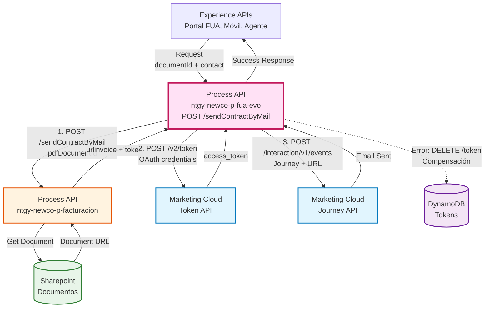
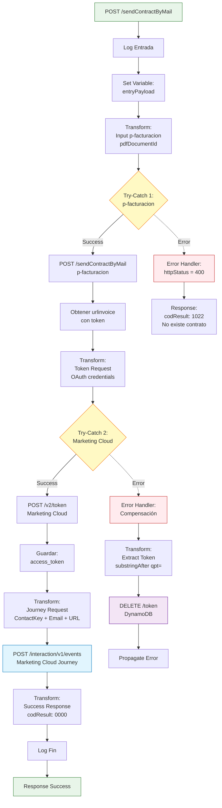
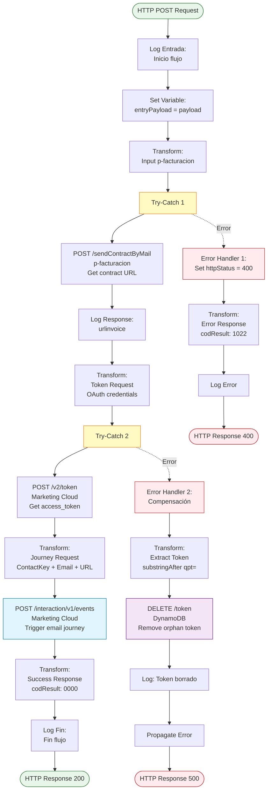
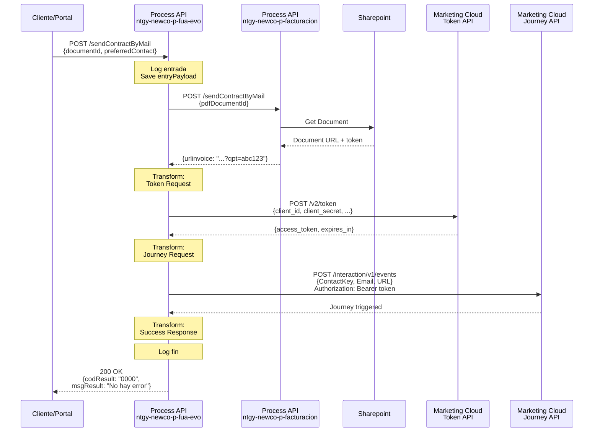
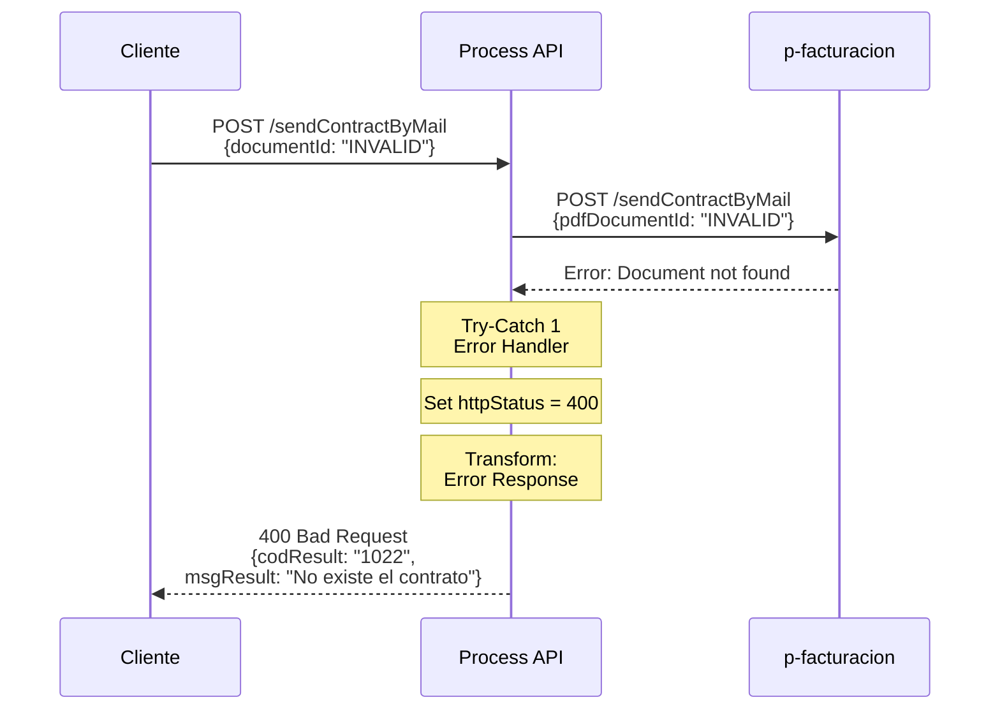
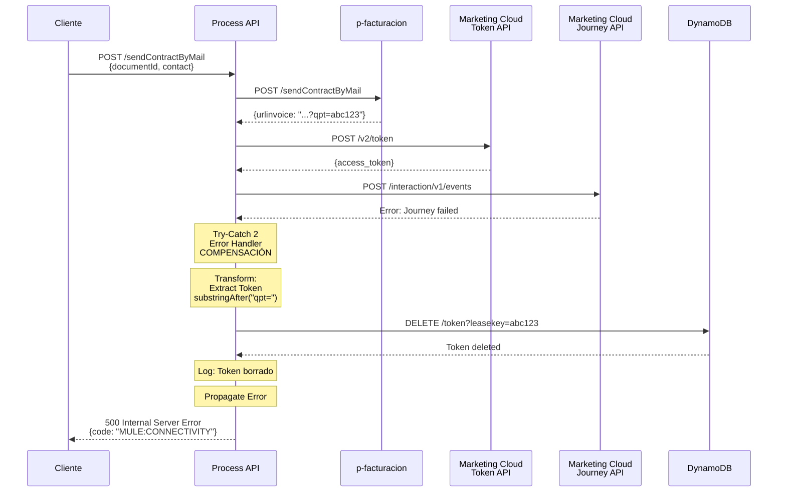

# POST /sendContractByMail

## 📌 Descripción General

### Propósito del Endpoint

Este endpoint orquesta el proceso completo de envío de contratos por email a clientes. Coordina tres sistemas diferentes: obtiene la URL del contrato desde Sharepoint (vía p-facturacion), autentica con Marketing Cloud usando OAuth 2.0, y dispara un journey de email. Implementa un patrón de compensación que elimina tokens huérfanos si el envío falla.

### Tipo de API

**Capa:** Process API (API-Led Connectivity)

**Función:** Orquestación secuencial con patrón de compensación (Saga simplificado)

### Patrón de Integración

**Tipo:** Orquestación con Compensación y Manejo de Errores Avanzado

**Descripción:** El endpoint implementa un flujo de orquestación secuencial que:
1. Obtiene la URL del contrato desde Sharepoint (vía p-facturacion)
2. Autentica con Marketing Cloud para obtener token OAuth 2.0
3. Dispara un journey de Marketing Cloud para enviar el email
4. Si falla el envío, elimina el token de DynamoDB (compensación)
5. Retorna respuesta de éxito o error específico

### Arquitectura API-Led Connectivity



---

## 💼 Propósito del Negocio

### Casos de Uso Principales

1. **Envío Automático de Contratos**
   - Cliente solicita recibir su contrato por email
   - Sistema obtiene el documento de Sharepoint
   - Se envía email automático con enlace al contrato

2. **Comunicación Post-Alta/Subrogación**
   - Después de dar de alta un servicio o subrogación
   - Cliente recibe contrato para revisión y firma
   - Email personalizado con datos del contacto

3. **Gestión de Tokens de Acceso**
   - URL del contrato incluye token temporal de acceso
   - Si falla el envío, se elimina el token (evita tokens huérfanos)
   - Garantiza seguridad y limpieza de tokens

### 🔗 Endpoints Dependientes

Este Process API consume 4 endpoints de 3 sistemas diferentes:

| Sistema | Endpoint | Método | Propósito |
|---------|----------|--------|-----------|
| `ntgy-newco-p-facturacion` | `/api/sendContractByMail` | POST | Obtener URL del contrato desde Sharepoint |
| `Salesforce Marketing Cloud` | `/v2/token` | POST | Obtener token OAuth 2.0 |
| `Salesforce Marketing Cloud` | `/interaction/v1/events` | POST | Disparar journey de email |
| `ntgy-newco-s-dynamodb` | `/api/token` | DELETE | Eliminar token (solo en error) |

### Flujo de Orquestación



**Pasos del Proceso:**

1. **Guardar Payload**: Almacena request original en variable
2. **Llamada a p-facturacion**: Obtiene URL del contrato con token
   - **Try-Catch 1**: Si falla → Error 400 "No existe el contrato"
3. **Autenticación Marketing Cloud**: Obtiene token OAuth 2.0
4. **Disparar Journey**: Envía email con el contrato
   - **Try-Catch 2**: Si falla → Elimina token de DynamoDB (compensación)
5. **Respuesta**: Retorna éxito o error

### Transformaciones Aplicadas

**Transformación 1: Input p-facturacion**

| Campo Origen | Campo Destino | Descripción |
|--------------|---------------|-------------|
| `entryPayload.documentId` | `pdfDocumentId` | ID del documento en Sharepoint |

**Transformación 2: Token Request (OAuth 2.0)**

| Campo | Valor | Tipo | Descripción |
|-------|-------|------|-------------|
| `client_id` | Config | Fijo | Client ID de Marketing Cloud |
| `client_secret` | Secure Config | Fijo | Client Secret (encriptado) |
| `account_id` | Config | Fijo | Account ID de Marketing Cloud |
| `grant_type` | "client_credentials" | Fijo | Tipo de grant OAuth 2.0 |

**Transformación 3: Journey Request**

| Campo | Valor | Descripción |
|-------|-------|-------------|
| `ContactKey` | `entryPayload.preferredContact.contactId` | ID del contacto en Salesforce |
| `EventDefinitionKey` | Config: `EventDefKeyAltaSubrog` | ID del journey (Alta/Subrogación) |
| `Data.SubscriberKey` | `entryPayload.preferredContact.contactId` | Subscriber en Marketing Cloud |
| `Data.Email` | `entryPayload.preferredContact.preferredEmail` | Email del destinatario |
| `Data.URL` | `payload.urlinvoice` | URL del contrato con token |

**Transformación 4: Extract Token (Error Handler)**

Extrae el token de la URL para eliminarlo de DynamoDB:
```dataweave
substringAfter(payload.urlinvoice, "qpt=")
```

**Ejemplo:**
- URL: `https://example.com/contract?qpt=abc123xyz`
- Token extraído: `abc123xyz`

### Contexto Empresarial

- **Dominio:** Gestión de Documentos y Comunicaciones
- **Sector:** Energía - Utilities
- **División:** Naturgy España - NewCo
- **Proceso de Negocio:** Envío automático de contratos por email

### Stakeholders

- **Clientes de Naturgy**: Reciben contratos por email
- **Agentes de Call Center**: Solicitan envío de contratos
- **Departamento Legal**: Define contenido de contratos
- **Equipo de Marketing**: Gestiona journeys en Marketing Cloud
- **Sistema Sharepoint**: Almacena documentos
- **Sistema DynamoDB**: Gestiona tokens de acceso

### Valor de Negocio

- **Automatización**: Envío automático sin intervención manual
- **Seguridad**: Tokens temporales con gestión de ciclo de vida
- **Trazabilidad**: Registro completo del envío en Marketing Cloud
- **Compensación**: Limpieza automática de tokens en caso de error
- **Personalización**: Email personalizado con datos del contacto
- **Escalabilidad**: Uso de journeys de Marketing Cloud

### Consumidores Potenciales

Este endpoint puede ser consumido por:
- Portal web FUA
- Aplicaciones móviles de clientes
- Sistemas de agentes de call center
- Procesos de alta y subrogación

---

## 🔧 Especificación Técnica

### URLs por Ambiente

| Ambiente | URL Base | URL Completa |
|----------|----------|--------------|
| **Local** | `http://localhost:8081` | `http://localhost:8081/api/sendContractByMail` |
| **Development** | `https://ntgy-newco-p-fua-evo-dev.us-e2.cloudhub.io` | `https://ntgy-newco-p-fua-evo-dev.us-e2.cloudhub.io/api/sendContractByMail` |
| **UAT** | `https://ntgy-newco-p-fua-evo-uat.us-e2.cloudhub.io` | `https://ntgy-newco-p-fua-evo-uat.us-e2.cloudhub.io/api/sendContractByMail` |
| **Production** | `https://ntgy-newco-p-fua-evo-pro.us-e2.cloudhub.io` | `https://ntgy-newco-p-fua-evo-pro.us-e2.cloudhub.io/api/sendContractByMail` |

### Método HTTP

```
POST /api/sendContractByMail
```

### Request Body

```json
{
  "documentId": "string",
  "preferredContact": {
    "contactId": "string",
    "preferredEmail": "string"
  }
}
```

| Campo | Tipo | Obligatorio | Descripción | Ejemplo |
|-------|------|-------------|-------------|---------|
| `documentId` | string | ✅ | ID del documento en Sharepoint | `"DOC-2026-001234"` |
| `preferredContact.contactId` | string | ✅ | ID del contacto en Salesforce | `"0031234567890ABC"` |
| `preferredContact.preferredEmail` | string | ✅ | Email del destinatario | `"cliente@example.com"` |

**Notas:**
- `documentId`: Debe existir en Sharepoint, si no existe retorna error 1022
- `contactId`: Usado como ContactKey y SubscriberKey en Marketing Cloud
- `preferredEmail`: Email donde se enviará el contrato

### Respuestas

#### Respuesta Exitosa (200 OK)

```json
{
  "result": {
    "codResult": "0000",
    "msgResult": "No hay error"
  }
}
```

| Campo | Tipo | Descripción |
|-------|------|-------------|
| `result.codResult` | string | Código de resultado ("0000" = éxito) |
| `result.msgResult` | string | Mensaje descriptivo |

#### Respuesta de Error - Contrato No Existe (400 Bad Request)

```json
{
  "result": {
    "codResult": "1022",
    "msgResult": "No existe el contrato"
  }
}
```

**Causa:** El `documentId` proporcionado no existe en Sharepoint o no se pudo obtener.

#### Respuesta de Error - Marketing Cloud (500 Internal Server Error)

```json
{
  "code": "MULE:CONNECTIVITY",
  "message": "Error al enviar email via Marketing Cloud",
  "timestamp": "2026-08-27T15:00:00Z"
}
```

**Causa:** Fallo en la autenticación o envío a Marketing Cloud. El token se elimina automáticamente de DynamoDB.

### Autenticación

- **Tipo:** Client ID & Client Secret (Anypoint Platform)
- **Headers:** `client_id` y `client_secret` en los headers de la petición

### Timeouts

| Tipo | Valor |
|------|-------|
| **Request Timeout** | 60 segundos |
| **Connection Timeout** | 30 segundos |
| **p-facturacion Timeout** | 30 segundos |
| **Marketing Cloud Timeout** | 30 segundos |

**Nota:** El timeout total considera 3 llamadas secuenciales (p-facturacion + token + journey).

---

## 🏗️ Implementación Técnica

### Arquitectura del Flow



### Transformaciones DataWeave

#### Transformación 1: Input p-facturacion

**Ubicación:** Sub-flow `sendContractByMailFlow` (línea 18 del XML)

```dataweave
%dw 2.0
output application/json
---
{
	"pdfDocumentId": vars.entryPayload.documentId
}
```

**Propósito:** Construir el request para p-facturacion con el ID del documento.

**Entrada:**
```json
{
  "documentId": "DOC-2026-001234",
  "preferredContact": {...}
}
```

**Salida:**
```json
{
  "pdfDocumentId": "DOC-2026-001234"
}
```

#### Transformación 2: Token Request (OAuth 2.0)

**Ubicación:** Sub-flow `sendContractByMailFlow` (líneas 42-49 del XML)

```dataweave
%dw 2.0
output application/json
---
{
	"client_id": p('marketingCloud.token.client_id'),
	"client_secret": p('secure::marketingCloud.token.client_secret'),
	"account_id": p('marketingCloud.token.account_id'),
	"grant_type":"client_credentials"
}
```

**Propósito:** Construir el request de autenticación OAuth 2.0 para Marketing Cloud.

**Configuración utilizada:**
- `marketingCloud.token.client_id`: `"kbrzedg74cfsy5fe6hs6qds2"`
- `marketingCloud.token.client_secret`: Valor encriptado
- `marketingCloud.token.account_id`: `"510006070"`

**Salida:**
```json
{
  "client_id": "kbrzedg74cfsy5fe6hs6qds2",
  "client_secret": "***encrypted***",
  "account_id": "510006070",
  "grant_type": "client_credentials"
}
```

**Respuesta de Marketing Cloud:**
```json
{
  "access_token": "eyJhbGciOiJIUzI1NiIsInR5cCI6IkpXVCJ9...",
  "token_type": "Bearer",
  "expires_in": 3600
}
```

#### Transformación 3: Journey Request

**Ubicación:** Sub-flow `sendContractByMailFlow` (líneas 57-68 del XML)

```dataweave
%dw 2.0
output application/json
---
{
    "ContactKey": vars.entryPayload.preferredContact.contactId,
    "EventDefinitionKey": p('marketingCloud.journey.EventDefKeyAltaSubrog'),
    "Data": {
        "SubscriberKey": vars.entryPayload.preferredContact.contactId,
        "Email": vars.entryPayload.preferredContact.preferredEmail,
        "URL": payload.urlinvoice
    }
}
```

**Propósito:** Construir el request para disparar el journey de Marketing Cloud con los datos del email.

**Configuración utilizada:**
- `marketingCloud.journey.EventDefKeyAltaSubrog`: `"APIEvent-5a8e8d82-334f-3040-efc7-1fe176000c8b"`

**Entrada (payload de p-facturacion):**
```json
{
  "urlinvoice": "https://fau-dev.adn.naturgy.com/download-fol?qpt=abc123xyz"
}
```

**Salida:**
```json
{
  "ContactKey": "0031234567890ABC",
  "EventDefinitionKey": "APIEvent-5a8e8d82-334f-3040-efc7-1fe176000c8b",
  "Data": {
    "SubscriberKey": "0031234567890ABC",
    "Email": "cliente@example.com",
    "URL": "https://fau-dev.adn.naturgy.com/download-fol?qpt=abc123xyz"
  }
}
```

**Campos del Journey:**
- `ContactKey`: Identifica el contacto en Salesforce
- `EventDefinitionKey`: ID del journey a disparar (Alta/Subrogación)
- `SubscriberKey`: Identifica el subscriber en Marketing Cloud
- `Email`: Email del destinatario
- `URL`: URL del contrato con token de acceso temporal

#### Transformación 4: Extract Token (Error Handler)

**Ubicación:** Error Handler del Try-Catch 2 (líneas 82-87 del XML)

```dataweave
%dw 2.0
import * from dw::core::Strings
output application/java
---
substringAfter(payload.urlinvoice, "qpt=")
```

**Propósito:** Extraer el token de la URL del contrato para eliminarlo de DynamoDB si falla el envío.

**Función DataWeave utilizada:**
- `substringAfter(string, separator)`: Extrae la parte después del separador

**Ejemplo:**
- **Entrada:** `"https://fau-dev.adn.naturgy.com/download-fol?qpt=abc123xyz"`
- **Salida:** `"abc123xyz"`

**Uso:** El token extraído se usa en el query parameter `leasekey` para eliminar el registro de DynamoDB.

#### Transformación 5: Success Response

**Ubicación:** Sub-flow `sendContractByMailFlow` (líneas 103-110 del XML)

```dataweave
%dw 2.0
output application/json
---
{
    "result": {
	    "codResult": "0000",
	    "msgResult": "No hay error"
    }
}
```

**Propósito:** Construir la respuesta de éxito estándar.

#### Transformación 6: Error Response (Contrato No Existe)

**Ubicación:** Error Handler del Try-Catch 1 (líneas 33-41 del XML)

```dataweave
%dw 2.0
output application/json
---
{
    "result": {
        "codResult": '1022',
        "msgResult": "No existe el contrato"
    }
}
```

**Propósito:** Construir la respuesta de error cuando el contrato no existe en Sharepoint.

### Patrones de Diseño

**Patrón 1: Orquestación Secuencial**

**Justificación:** El proceso requiere pasos secuenciales donde cada uno depende del anterior:
1. Obtener URL del contrato → Necesaria para el email
2. Obtener token OAuth → Necesario para llamar al Journey API
3. Disparar journey → Usa URL y token

**Patrón 2: Compensación (Saga Simplificado)**

**Justificación:** Si falla el envío del email, se elimina el token de DynamoDB:
- **Acción:** Disparar journey de Marketing Cloud
- **Compensación:** Eliminar token de DynamoDB si falla
- **Propósito:** Evitar tokens huérfanos que nunca se usarán

**Patrón 3: Try-Catch Anidados**

**Justificación:** Manejo de errores en múltiples niveles:
- **Try-Catch 1:** Captura errores de p-facturacion (contrato no existe)
- **Try-Catch 2:** Captura errores de Marketing Cloud (con compensación)

**Patrón 4: Variable Sharing**

**Justificación:** Usa variables para compartir datos entre transformaciones:
- `vars.entryPayload`: Datos del request disponibles en todo el flujo
- `vars.marketingToken`: Token OAuth compartido entre transformaciones
- `vars.tokenFact`: Token extraído para eliminación

### Diagramas de Secuencia

#### 1. Flujo Normal de Éxito



#### 2. Flujo con Error - Contrato No Existe



#### 3. Flujo con Error y Compensación



### Manejo de Errores

**Estrategia de Manejo de Errores:**

1. **Try-Catch 1: p-facturacion**
   - **Captura:** Errores al obtener URL del contrato
   - **Acción:** 
     - Set `httpStatus = 400`
     - Retorna error 1022 "No existe el contrato"
   - **Propagación:** No propaga, retorna error controlado

2. **Try-Catch 2: Marketing Cloud**
   - **Captura:** Errores en autenticación o envío de journey
   - **Acción (Compensación):**
     - Extrae token de la URL (`substringAfter("qpt=")`)
     - Elimina token de DynamoDB (`DELETE /token?leasekey=...`)
     - Log: "Token borrado"
   - **Propagación:** Propaga el error después de compensar

3. **Códigos de Error:**
   - **1022**: "No existe el contrato" (p-facturacion falló)
   - **MULE:CONNECTIVITY**: Error de conectividad con Marketing Cloud

**Error Handlers Aplicables:**
- Error handler inline en Try-Catch 1 (p-facturacion)
- Error handler inline en Try-Catch 2 (Marketing Cloud con compensación)
- Error handler global de la aplicación (para errores no capturados)

### Configuración de Backends

**Process API: ntgy-newco-p-facturacion**

| Configuración | Valor (dev) | Descripción |
|---------------|-------------|-------------|
| **Config-ref** | `HTTP_Request_configuration_p_facturacion` | Configuración HTTP |
| **Host** | `ntgy-newco-p-facturacion-des.de-c1.cloudhub.io` | Host del Process API |
| **Port** | 80 | Puerto HTTP |
| **Protocol** | HTTP | Protocolo |
| **Base Path** | `/api` | Ruta base |
| **Path** | `/sendContractByMail` | Endpoint específico |

**Marketing Cloud: Token API**

| Configuración | Valor (dev) | Descripción |
|---------------|-------------|-------------|
| **URL** | `https://mc8p72ysm3cv2gbklx7mv61hb-54.auth.marketingcloudapis.com` | URL base |
| **API** | `/v2` | Versión del API |
| **Path** | `/token` | Endpoint de token |
| **Client ID** | `kbrzedg74cfsy5fe6hs6qds2` | Client ID OAuth |
| **Client Secret** | Encrypted | Client Secret (encriptado) |
| **Account ID** | `510006070` | Account ID |

**Marketing Cloud: Journey API**

| Configuración | Valor (dev) | Descripción |
|---------------|-------------|-------------|
| **URL** | `https://mc8p72ysm3cv2gbklx7mv61hb-54.rest.marketingcloudapis.com` | URL base |
| **API** | `/interaction` | API de interacción |
| **Path** | `/v1/events` | Endpoint de eventos |
| **Event Definition Key** | `APIEvent-5a8e8d82-334f-3040-efc7-1fe176000c8b` | Journey de Alta/Subrogación |

**System API: ntgy-newco-s-dynamodb (Compensación)**

| Configuración | Valor (dev) | Descripción |
|---------------|-------------|-------------|
| **Config-ref** | `HTTP_Request_configuration_ntgy_newco_s_dynamodb` | Configuración HTTP |
| **Path** | `/token` | Endpoint de tokens |
| **Method** | DELETE | Método HTTP |
| **Query Param** | `leasekey` | Token a eliminar |

---

## 💻 Ejemplos de Uso

### Ejemplo 1: Envío Exitoso de Contrato

#### cURL

```bash
curl -X POST "https://ntgy-newco-p-fua-evo-dev.us-e2.cloudhub.io/api/sendContractByMail" \
  -H "Content-Type: application/json" \
  -H "client_id: YOUR_CLIENT_ID" \
  -H "client_secret: YOUR_CLIENT_SECRET" \
  -d '{
    "documentId": "DOC-2026-001234",
    "preferredContact": {
      "contactId": "0031234567890ABC",
      "preferredEmail": "cliente@example.com"
    }
  }'
```

#### Respuesta (200 OK)

```json
{
  "result": {
    "codResult": "0000",
    "msgResult": "No hay error"
  }
}
```

### Ejemplo 2: Error - Contrato No Existe

#### cURL

```bash
curl -X POST "https://ntgy-newco-p-fua-evo-dev.us-e2.cloudhub.io/api/sendContractByMail" \
  -H "Content-Type: application/json" \
  -H "client_id: YOUR_CLIENT_ID" \
  -H "client_secret: YOUR_CLIENT_SECRET" \
  -d '{
    "documentId": "DOC-INVALID-999",
    "preferredContact": {
      "contactId": "0031234567890ABC",
      "preferredEmail": "cliente@example.com"
    }
  }'
```

#### Respuesta (400 Bad Request)

```json
{
  "result": {
    "codResult": "1022",
    "msgResult": "No existe el contrato"
  }
}
```

### Ejemplo 3: Error - Marketing Cloud No Disponible

#### cURL

```bash
curl -X POST "https://ntgy-newco-p-fua-evo-dev.us-e2.cloudhub.io/api/sendContractByMail" \
  -H "Content-Type: application/json" \
  -H "client_id: YOUR_CLIENT_ID" \
  -H "client_secret: YOUR_CLIENT_SECRET" \
  -d '{
    "documentId": "DOC-2026-001234",
    "preferredContact": {
      "contactId": "0031234567890ABC",
      "preferredEmail": "invalid-email"
    }
  }'
```

#### Respuesta (500 Internal Server Error)

```json
{
  "code": "MULE:CONNECTIVITY",
  "message": "Error al enviar email via Marketing Cloud",
  "timestamp": "2026-08-27T15:00:00Z"
}
```

**Nota:** En este caso, el token se elimina automáticamente de DynamoDB (compensación).

### Ejemplo 4: JavaScript (Fetch API)

```javascript
const sendContractByMail = async (documentId, contact) => {
  const url = 'https://ntgy-newco-p-fua-evo-dev.us-e2.cloudhub.io/api/sendContractByMail';
  
  const requestBody = {
    documentId: documentId,
    preferredContact: {
      contactId: contact.contactId,
      preferredEmail: contact.email
    }
  };
  
  const response = await fetch(url, {
    method: 'POST',
    headers: {
      'Content-Type': 'application/json',
      'client_id': 'YOUR_CLIENT_ID',
      'client_secret': 'YOUR_CLIENT_SECRET'
    },
    body: JSON.stringify(requestBody)
  });
  
  const data = await response.json();
  
  if (response.ok) {
    console.log('✅ Contrato enviado exitosamente');
    console.log(`Código: ${data.result.codResult}`);
    console.log(`Mensaje: ${data.result.msgResult}`);
    return data;
  } else {
    console.error('❌ Error al enviar contrato');
    if (data.result) {
      console.error(`Código: ${data.result.codResult}`);
      console.error(`Mensaje: ${data.result.msgResult}`);
    } else {
      console.error(`Código: ${data.code}`);
      console.error(`Mensaje: ${data.message}`);
    }
    throw new Error(data.result?.msgResult || data.message);
  }
};

// Uso
const documentId = 'DOC-2026-001234';
const contact = {
  contactId: '0031234567890ABC',
  email: 'cliente@example.com'
};

sendContractByMail(documentId, contact)
  .then(result => console.log('Resultado:', result))
  .catch(error => console.error('Error:', error));
```

### Ejemplo 5: Python (Requests)

```python
import requests
from typing import Dict, Optional

def send_contract_by_mail(document_id: str, contact: Dict) -> Optional[Dict]:
    """
    Envía un contrato por email usando Marketing Cloud.
    
    Args:
        document_id: ID del documento en Sharepoint
        contact: Diccionario con contactId y email
        
    Returns:
        Dict con resultado del envío o None si hay error
    """
    url = "https://ntgy-newco-p-fua-evo-dev.us-e2.cloudhub.io/api/sendContractByMail"
    
    headers = {
        "Content-Type": "application/json",
        "client_id": "YOUR_CLIENT_ID",
        "client_secret": "YOUR_CLIENT_SECRET"
    }
    
    request_body = {
        "documentId": document_id,
        "preferredContact": {
            "contactId": contact["contactId"],
            "preferredEmail": contact["email"]
        }
    }
    
    try:
        response = requests.post(url, json=request_body, headers=headers, timeout=60)
        response.raise_for_status()
        
        data = response.json()
        result = data.get("result", {})
        
        print(f"✅ Contrato enviado exitosamente")
        print(f"Código: {result.get('codResult')}")
        print(f"Mensaje: {result.get('msgResult')}")
        
        return data
        
    except requests.exceptions.HTTPError as e:
        error_data = e.response.json()
        
        if "result" in error_data:
            # Error controlado (1022)
            print(f"❌ Error al enviar contrato")
            print(f"Código: {error_data['result'].get('codResult')}")
            print(f"Mensaje: {error_data['result'].get('msgResult')}")
        else:
            # Error de sistema
            print(f"❌ Error del sistema")
            print(f"Código: {error_data.get('code')}")
            print(f"Mensaje: {error_data.get('message')}")
        
        return None
        
    except requests.exceptions.RequestException as e:
        print(f"❌ Error en la petición: {e}")
        return None

# Uso
if __name__ == "__main__":
    document_id = "DOC-2026-001234"
    contact = {
        "contactId": "0031234567890ABC",
        "email": "cliente@example.com"
    }
    
    result = send_contract_by_mail(document_id, contact)
    if result:
        print(f"\n✅ Email enviado correctamente")
```

### Ejemplo 6: Flujo Completo con Manejo de Errores

```javascript
const sendContractWithRetry = async (documentId, contact, maxRetries = 3) => {
  const url = 'https://ntgy-newco-p-fua-evo-dev.us-e2.cloudhub.io/api/sendContractByMail';
  
  for (let attempt = 1; attempt <= maxRetries; attempt++) {
    try {
      console.log(`Intento ${attempt} de ${maxRetries}...`);
      
      const response = await fetch(url, {
        method: 'POST',
        headers: {
          'Content-Type': 'application/json',
          'client_id': 'YOUR_CLIENT_ID',
          'client_secret': 'YOUR_CLIENT_SECRET'
        },
        body: JSON.stringify({
          documentId: documentId,
          preferredContact: {
            contactId: contact.contactId,
            preferredEmail: contact.email
          }
        })
      });
      
      const data = await response.json();
      
      if (response.ok) {
        console.log('✅ Contrato enviado exitosamente');
        return { success: true, data };
      }
      
      // Error 1022: No existe el contrato (no reintentar)
      if (data.result?.codResult === '1022') {
        console.error('❌ El contrato no existe, no se reintentará');
        return { success: false, error: data, retry: false };
      }
      
      // Otros errores: reintentar
      if (attempt < maxRetries) {
        console.warn(`⚠️ Error, reintentando en 2 segundos...`);
        await new Promise(resolve => setTimeout(resolve, 2000));
      } else {
        console.error('❌ Máximo de reintentos alcanzado');
        return { success: false, error: data, retry: false };
      }
      
    } catch (error) {
      console.error(`❌ Error en intento ${attempt}:`, error.message);
      
      if (attempt < maxRetries) {
        await new Promise(resolve => setTimeout(resolve, 2000));
      } else {
        return { success: false, error: error.message, retry: false };
      }
    }
  }
};

// Uso
sendContractWithRetry('DOC-2026-001234', {
  contactId: '0031234567890ABC',
  email: 'cliente@example.com'
}).then(result => {
  if (result.success) {
    console.log('✅ Proceso completado exitosamente');
  } else {
    console.error('❌ Proceso falló:', result.error);
  }
});
```

---

**Última Actualización:** 27/08/2026  
**Versión del API:** 1.97.0-SNAPSHOT  
**Mantenido por:** Equipo MuleSoft Naturgy
