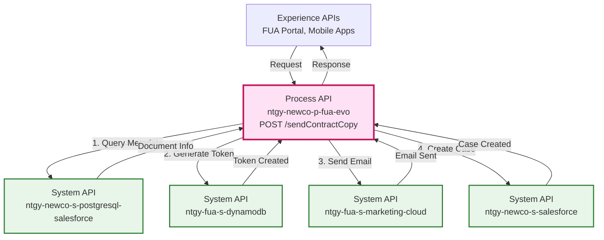
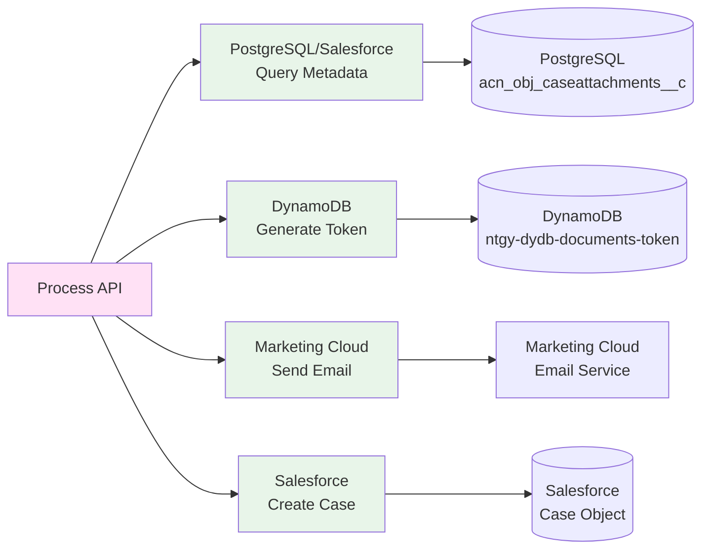
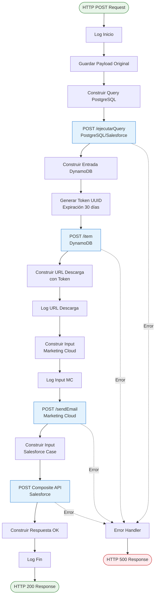
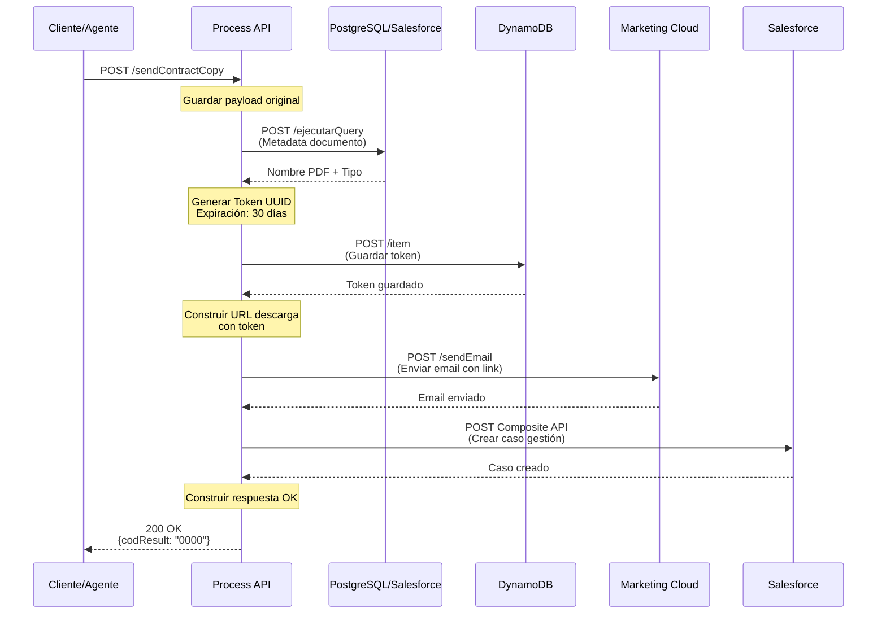
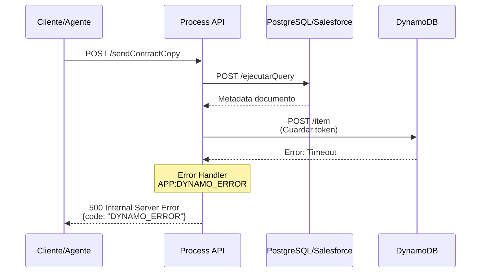
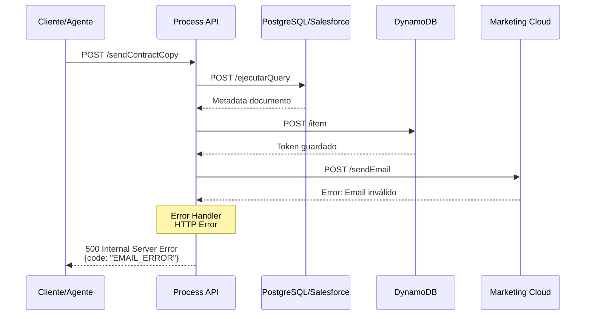

# POST /sendContractCopy

## 📌 Descripción General

### Propósito del Endpoint

Este endpoint orquesta el proceso completo de envío de copias de contratos por correo electrónico a los clientes. Gestiona la generación de tokens de descarga seguros, la construcción de URLs temporales, el envío del email mediante Marketing Cloud y el registro del caso de gestión en Salesforce.

### Tipo de API

**Capa:** Process API (API-Led Connectivity)

**Función:** Orquestación del proceso de envío de copias de contratos por email

### Patrón de Integración

**Tipo:** Orquestación Compleja

**Descripción:** Coordina 4 System APIs diferentes en secuencia para completar el proceso de negocio:
1. Consulta metadata del documento en PostgreSQL/Salesforce
2. Genera token de descarga en DynamoDB
3. Envía email con link de descarga mediante Marketing Cloud
4. Registra caso de gestión en Salesforce

### Arquitectura API-Led Connectivity



---

## 💼 Propósito del Negocio

### Casos de Uso Principales

1. **Envío de Copia de Contrato por Agente**
   - Un agente de atención al cliente solicita enviar una copia del contrato al email del cliente
   - El sistema genera un link de descarga seguro con expiración de 30 días
   - El cliente recibe el email con el link para descargar su contrato

2. **Autoservicio de Documentación**
   - Cliente solicita copia de su contrato desde el portal FUA
   - Sistema automatiza todo el proceso sin intervención manual
   - Reduce carga operativa del call center

3. **Cumplimiento Normativo**
   - Registro automático del caso de gestión en Salesforce
   - Trazabilidad completa de la solicitud
   - Auditoría de accesos a documentos mediante tokens

### 🔗 Endpoints Dependientes

Este Process API consume los siguientes System APIs:

| System API | Endpoint | Método | Propósito |
|------------|----------|--------|-----------|
| `ntgy-newco-s-postgresql-salesforce` | `/ejecutarQuery` | POST | Consulta metadata del documento (nombre PDF, tipo) |
| `ntgy-fua-s-dynamodb` | `/item` | POST | Guarda token de descarga con expiración de 30 días |
| `ntgy-fua-s-marketing-cloud` | `/sendEmail` | POST | Envía email con link de descarga del contrato |
| `ntgy-newco-s-salesforce` | `${pathCasos}` | POST | Crea caso de gestión "Duplicado de contrato por mail" |

### Lógica de Orquestación



**Pasos del Proceso:**

1. **Consulta Metadata del Documento**: Query a PostgreSQL para obtener nombre del PDF y tipo de documento
2. **Generación de Token**: Crea token UUID en DynamoDB con expiración de 30 días
3. **Construcción de URL**: Genera URL de descarga con token y parámetros de validación
4. **Envío de Email**: Invoca Marketing Cloud con datos del cliente y link de descarga
5. **Registro de Caso**: Crea caso de gestión en Salesforce para trazabilidad

### Transformaciones Aplicadas

| Campo Original | Campo Transformado | Transformación |
|----------------|-------------------|----------------|
| `payload.documentId` | `query.acn_fld_documentkey__c` | Construcción de query SQL |
| `payload.*` | `dynEntry.token` | Generación de UUID + expiración 30 días |
| `dynEntry.token` | `urlDescarga` | Construcción de URL con token y parámetros |
| `payload.*` | `inputMarketingCloud.Data` | Mapeo de campos para email template |
| `payload.*` | `inputSF.compositeRequest` | Construcción de caso Salesforce |

### Contexto Empresarial

- **Dominio:** Gestión de Documentos y Comunicaciones
- **Sector:** Energía - Utilities
- **División:** Naturgy España - NewCo
- **Proceso de Negocio:** Envío de documentación contractual a clientes

### Stakeholders

- **Clientes**: Reciben copia de su contrato por email de forma inmediata
- **Agentes de Call Center**: Pueden enviar contratos sin procesos manuales
- **Área de Cumplimiento**: Trazabilidad completa de envíos de documentación
- **Área de Sistemas**: Gestión centralizada de tokens y accesos

### Valor de Negocio

- **Reducción de Tiempos**: Envío inmediato vs proceso manual de 24-48 horas
- **Mejora de Experiencia**: Cliente recibe documento en minutos
- **Reducción de Costes**: Elimina envíos postales y gestión manual
- **Seguridad**: Tokens con expiración y validación de acceso
- **Trazabilidad**: Registro automático en Salesforce

### Consumidores Potenciales

Este endpoint puede ser consumido por:
- Portal web FUA
- Aplicaciones móviles de clientes
- Sistemas de agentes de call center
- Portales de autoservicio

---

## 🔧 Especificación Técnica

### URLs por Ambiente

| Ambiente | URL Base | URL Completa |
|----------|----------|--------------|
| **Local** | `http://localhost:8081` | `http://localhost:8081/api/sendContractCopy` |
| **Development** | `https://ntgy-newco-p-fua-evo-dev.us-e2.cloudhub.io` | `https://ntgy-newco-p-fua-evo-dev.us-e2.cloudhub.io/api/sendContractCopy` |
| **UAT** | `https://ntgy-newco-p-fua-evo-uat.us-e2.cloudhub.io` | `https://ntgy-newco-p-fua-evo-uat.us-e2.cloudhub.io/api/sendContractCopy` |
| **Production** | `https://ntgy-newco-p-fua-evo-pro.us-e2.cloudhub.io` | `https://ntgy-newco-p-fua-evo-pro.us-e2.cloudhub.io/api/sendContractCopy` |

### Método HTTP

```
POST /api/sendContractCopy
```

### Headers Requeridos

| Header | Tipo | Obligatorio | Descripción |
|--------|------|-------------|-------------|
| `Content-Type` | string | Sí | Debe ser `application/json` |
| `client_id` | string | Sí | Client ID de Anypoint Platform |
| `client_secret` | string | Sí | Client Secret de Anypoint Platform |
| `x-contact-id` | string | Sí | ID del contacto en Salesforce |
| `x-client-id` | string | Sí | ID del cliente en Salesforce |
| `x-user-id` | string | No | ID del usuario/agente que realiza la acción |
| `x-agent-mail` | string | No | Email del agente (para Salesforce) |
| `x-interaction-id` | string | Sí | ID del caso de interacción padre |

### Parámetros de Entrada (Body)

```json
{
  "documentId": "string",           // ID del documento en sistema
  "contractNumber": "string",       // Número de contrato
  "docNumber": "string",            // NIF/NIE del titular
  "cups": "string",                 // CUPS del punto de suministro
  "contractAccount": "string",      // Cuenta contrato
  "name": "string",                 // Nombre del titular
  "surname": "string",              // Primer apellido
  "surname2": "string",             // Segundo apellido
  "language": "string",             // Idioma (ES/CA/EU/GL)
  "email": "string",                // Email destino
  "reason": "string",               // Motivo de la solicitud
  "supplyAddress": "string",        // Dirección de suministro
  "DirIp": "string"                 // IP del solicitante
}
```

#### Descripción de Campos

| Campo | Tipo | Obligatorio | Descripción | Ejemplo |
|-------|------|-------------|-------------|---------|
| `documentId` | string | Sí | Identificador único del documento | "DOC123456" |
| `contractNumber` | string | Sí | Número del contrato | "1234567890" |
| `docNumber` | string | Sí | NIF/NIE del titular | "12345678A" |
| `cups` | string | Sí | Código CUPS del suministro | "ES0021000000000001JN" |
| `contractAccount` | string | Sí | Número de cuenta contrato | "200123456789" |
| `name` | string | No | Nombre del titular | "Juan" |
| `surname` | string | Sí | Primer apellido | "García" |
| `surname2` | string | No | Segundo apellido | "López" |
| `language` | string | Sí | Código de idioma | "ES" |
| `email` | string | Sí | Email destino | "cliente@example.com" |
| `reason` | string | Sí | Motivo de la solicitud | "Solicitud de copia de contrato" |
| `supplyAddress` | string | Sí | Dirección de suministro | "Calle Mayor 1, Madrid" |
| `DirIp` | string | Sí | IP del solicitante | "192.168.1.1" |

### Respuestas

#### 200 OK - Éxito

```json
{
  "result": {
    "codResult": "0000",
    "msgResult": "OK"
  }
}
```

#### 400 Bad Request - Error de Validación

```json
{
  "code": "VALIDATION_ERROR",
  "message": "Campo requerido faltante: email",
  "details": "El campo email es obligatorio para enviar el contrato"
}
```

#### 500 Internal Server Error - Error del Sistema

```json
{
  "code": "SYSTEM_ERROR",
  "message": "Error al procesar la solicitud",
  "details": "Error en la comunicación con Marketing Cloud"
}
```

### Autenticación

- **Tipo:** Client ID & Client Secret (Anypoint Platform)
- **Headers:** `client_id` y `client_secret`

### Timeouts

| Tipo | Valor |
|------|-------|
| **Request Timeout** | 60 segundos |
| **Connection Timeout** | 30 segundos |

### Códigos de Estado HTTP

| Código | Descripción |
|--------|-------------|
| `200` | Contrato enviado exitosamente |
| `400` | Error de validación en los datos de entrada |
| `401` | Error de autenticación |
| `500` | Error interno del servidor |
| `503` | Servicio no disponible |

---

## 🏗️ Implementación Técnica

### Arquitectura del Flow



### Transformaciones DataWeave

#### 1. Query PostgreSQL (Metadata del Documento)

```dataweave
%dw 2.0
output application/json
---
{
    "query": "select aocc.acn_fld_nombre_de_pdf__c,aocc.acn_fld_documenttype__c from newcosalesforce.acn_obj_caseattachments__c aocc where aocc.acn_fld_documentkey__c = '" ++ vars.entryPayload.documentId ++ "'"
}
```

**Propósito:** Construye query SQL para obtener nombre del PDF y tipo de documento desde PostgreSQL.

**Tabla Consultada:** `newcosalesforce.acn_obj_caseattachments__c`

**Campos Obtenidos:**
- `acn_fld_nombre_de_pdf__c`: Nombre completo del archivo PDF
- `acn_fld_documenttype__c`: Tipo de documento (contratoComun, etc.)

#### 2. Entrada DynamoDB (Token de Descarga)

```dataweave
%dw 2.0
output application/json
var expirationDate = ((now() + |P30D|) >> "CET") as String {format: "dd-MM-yyyy HH:mm:ss"}
var pathS3 = dw::core::Strings::substringBeforeLast(vars.caseAttachmentResult[0].acn_fld_nombre_de_pdf__c, "/")	
---
{
	"token": uuid(),
	"tokenExpirationDate": expirationDate,
	"documentType": "contratoComun",
	"docId": if(vars.entryPayload.documentId != "") vars.entryPayload.documentId else (null),
    "contract": if(vars.entryPayload.contractNumber != "") vars.entryPayload.contractNumber else (null),
	"nif": if(vars.entryPayload.docNumber != "") vars.entryPayload.docNumber else (null),
	"cups": if(vars.entryPayload.cups != "") vars.entryPayload.cups else (null),
	"contractAccount": if(vars.entryPayload.contractAccount != "") vars.entryPayload.contractAccount else (null),
	"name": if(vars.entryPayload.name != "") vars.entryPayload.name else (null),
	"surname": if(vars.entryPayload.surname != "") vars.entryPayload.surname else (null),
	"surname2": if(vars.entryPayload.surname2 != "") vars.entryPayload.surname2 else (null),
	"language": if(vars.entryPayload.language != "") vars.entryPayload.language else (null),
	"email": if(vars.entryPayload.email != "") vars.entryPayload.email else (null),
	"s3File": vars.caseAttachmentResult[0].acn_fld_documenttype__c == 'contratoComun',
	("pathS3": pathS3) if(vars.caseAttachmentResult[0].acn_fld_documenttype__c == 'contratoComun')
}
```

**Propósito:** Genera token UUID con expiración de 30 días y metadata del documento.

**Lógica Especial:**
- Genera UUID único para el token
- Calcula fecha de expiración: `now() + 30 días` en zona horaria CET
- Extrae path S3 del nombre del PDF
- Incluye pathS3 solo si el tipo es 'contratoComun'
- Convierte campos vacíos a null

#### 3. URL de Descarga

```dataweave
%dw 2.0
output application/json
---
p('ntgy-newco-s-sharepoint.downloadUrl') ++ "qt=" ++ vars.dynEntry.token ++ "&documentId=" ++ vars.entryPayload.documentId ++ "&checkToken=Yes"
```

**Propósito:** Construye URL de descarga con token y parámetros de validación.

**Formato:** `{baseUrl}?qt={token}&documentId={docId}&checkToken=Yes`

**Ejemplo:** `https://sharepoint.naturgy.com/download?qt=abc123-def456&documentId=DOC123&checkToken=Yes`

#### 4. Input Marketing Cloud (Email)

```dataweave
%dw 2.0
output application/json
---
{
    "ContactKey": vars.entryPayload.'x-contact-id',
    "EventDefinitionKey": p('s-marketing-cloud.eventDefinitionKey'),
    "Data": {
		"SubscriberKey": vars.entryPayload.'x-contact-id',
		"recordId": uuid(),
		"cups": vars.entryPayload.cups,
		"numeroContrato": vars.entryPayload.contractNumber,
		"nombre": if(!isEmpty(vars.entryPayload.name)) vars.entryPayload.name else vars.entryPayload.surname,
		"apellidos": if(!isEmpty(vars.entryPayload.name)) ((vars.entryPayload.surname  default "") ++ " " ++ (vars.entryPayload.surname2  default "")) else "",		
		"email": vars.entryPayload.email,
		"nif": vars.entryPayload.docNumber,
		"idioma": upper(vars.entryPayload.language),
		"linkPdf": vars.urlDescarga,
		"direccion": vars.entryPayload.supplyAddress
	}
}
```

**Propósito:** Prepara datos para envío de email mediante Marketing Cloud.

**Lógica Especial:**
- Si no hay nombre, usa el apellido como nombre
- Si hay nombre, concatena apellidos
- Convierte idioma a mayúsculas
- Incluye link de descarga con token

#### 5. Input Salesforce (Caso de Gestión)

```dataweave
%dw 2.0
output application/json
---
{
	"allOrNone" : true,
	"collateSubrequests": false,
	"compositeRequest" : [
		{
			"method" : "POST",
			"url" : "/services/data/v52.0/sobjects/Case",
			"referenceId" : "refCaseGestion",
			"body" : { 
				"NewCo_Recordtype__c" : "Gestion",
				"AccountId" : vars.entryPayload.'x-client-id',
				"ContactId" : vars.entryPayload.'x-contact-id',
				"Origin" : "FUA",
				"Status" : "06",
				"Subject": "Duplicado de contrato por mail",
				"Description": vars.entryPayload.reason, 
				"NewCo_Creado_por__c" : if(!isEmpty(vars.entryPayload.'x-user-id')) vars.entryPayload.'x-user-id' else vars.entryPayload.'x-contact-id',
				"ParentId" : vars.entryPayload."x-interaction-id",
				"NewCo_Ip__c": vars.entryPayload.DirIp,
				"NewCo_CorrelationId__c": correlationId,	
				"acn_fld_Tittle__r":{
					"NewCo_ExternalId__c":"DuplicadoContratoActaSubrogacion"
				}
			}
		}
	]
}
```

**Propósito:** Crea caso de gestión en Salesforce usando Composite API.

**Campos del Caso:**
- **RecordType:** "Gestion"
- **Origin:** "FUA"
- **Status:** "06" (Cerrado)
- **Subject:** "Duplicado de contrato por mail"
- **Description:** Motivo proporcionado por el usuario
- **ParentId:** ID del caso de interacción padre

### Patrones de Diseño

**Patrón:** Orchestration Pattern (Orquestación)

**Justificación:** 
- Coordina múltiples servicios en secuencia
- Cada paso depende del resultado del anterior
- Mantiene estado durante todo el proceso
- Gestiona errores de forma centralizada

**Patrón:** Token-Based Security

**Justificación:**
- Genera tokens únicos con expiración
- Evita acceso no autorizado a documentos
- Permite auditoría de descargas
- Cumple con requisitos de seguridad

### Diagramas de Secuencia

#### 1. Flujo Normal de Éxito



#### 2. Flujo con Error en DynamoDB



#### 3. Flujo con Error en Marketing Cloud



### Manejo de Errores

#### Error Mapping

```xml
<http:request method="POST" config-ref="HTTP_Request_s_dynamo" path="/item">
    <error-mapping targetType="APP:DYNAMO_ERROR"/>
</http:request>
```

**Errores Mapeados:**
- **APP:DYNAMO_ERROR**: Error al guardar token en DynamoDB
- **HTTP:CONNECTIVITY**: Error de conectividad con servicios externos
- **HTTP:TIMEOUT**: Timeout en llamadas a System APIs

#### Estrategia de Recuperación

1. **Error en PostgreSQL**: Retorna error 500, no continúa el proceso
2. **Error en DynamoDB**: Retorna error 500 con tipo APP:DYNAMO_ERROR
3. **Error en Marketing Cloud**: Retorna error 500, token ya creado (puede reintentarse)
4. **Error en Salesforce**: Retorna error 500, email ya enviado

**Nota:** No hay rollback automático. Si falla después de crear el token, este permanece en DynamoDB.

### Configuración de Timeouts

| Servicio | Timeout | Configuración |
|----------|---------|---------------|
| PostgreSQL/Salesforce | 30s | `${ntgy-newco-s-postgresql-salesforce.timeout}` |
| DynamoDB | 30s | Default HTTP connector |
| Marketing Cloud | 30s | Default HTTP connector |
| Salesforce | Variable | `${ntgy-newco-s-salesforce.timeout}` |

---

## 💻 Ejemplos de Uso

### Ejemplo 1: Envío Exitoso de Contrato

#### cURL

```bash
curl -X POST "https://ntgy-newco-p-fua-evo-dev.us-e2.cloudhub.io/api/sendContractCopy" \
  -H "Content-Type: application/json" \
  -H "client_id: YOUR_CLIENT_ID" \
  -H "client_secret: YOUR_CLIENT_SECRET" \
  -H "x-contact-id: 003XXXXXXXXXXXXXXX" \
  -H "x-client-id: 001XXXXXXXXXXXXXXX" \
  -H "x-interaction-id: 500XXXXXXXXXXXXXXX" \
  -d '{
    "documentId": "DOC123456",
    "contractNumber": "1234567890",
    "docNumber": "12345678A",
    "cups": "ES0021000000000001JN",
    "contractAccount": "200123456789",
    "name": "Juan",
    "surname": "García",
    "surname2": "López",
    "language": "ES",
    "email": "juan.garcia@example.com",
    "reason": "Solicitud de copia de contrato por parte del cliente",
    "supplyAddress": "Calle Mayor 1, 28001 Madrid",
    "DirIp": "192.168.1.100"
  }'
```

#### Respuesta (200 OK)

```json
{
  "result": {
    "codResult": "0000",
    "msgResult": "OK"
  }
}
```

### Ejemplo 2: JavaScript (Fetch API)

```javascript
const sendContractCopy = async () => {
  const response = await fetch(
    'https://ntgy-newco-p-fua-evo-dev.us-e2.cloudhub.io/api/sendContractCopy',
    {
      method: 'POST',
      headers: {
        'Content-Type': 'application/json',
        'client_id': 'YOUR_CLIENT_ID',
        'client_secret': 'YOUR_CLIENT_SECRET',
        'x-contact-id': '003XXXXXXXXXXXXXXX',
        'x-client-id': '001XXXXXXXXXXXXXXX',
        'x-interaction-id': '500XXXXXXXXXXXXXXX'
      },
      body: JSON.stringify({
        documentId: 'DOC123456',
        contractNumber: '1234567890',
        docNumber: '12345678A',
        cups: 'ES0021000000000001JN',
        contractAccount: '200123456789',
        name: 'Juan',
        surname: 'García',
        surname2: 'López',
        language: 'ES',
        email: 'juan.garcia@example.com',
        reason: 'Solicitud de copia de contrato por parte del cliente',
        supplyAddress: 'Calle Mayor 1, 28001 Madrid',
        DirIp: '192.168.1.100'
      })
    }
  );

  const data = await response.json();
  console.log(data);
};

sendContractCopy();
```

### Ejemplo 3: Python (Requests)

```python
import requests

url = 'https://ntgy-newco-p-fua-evo-dev.us-e2.cloudhub.io/api/sendContractCopy'

headers = {
    'Content-Type': 'application/json',
    'client_id': 'YOUR_CLIENT_ID',
    'client_secret': 'YOUR_CLIENT_SECRET',
    'x-contact-id': '003XXXXXXXXXXXXXXX',
    'x-client-id': '001XXXXXXXXXXXXXXX',
    'x-interaction-id': '500XXXXXXXXXXXXXXX'
}

payload = {
    'documentId': 'DOC123456',
    'contractNumber': '1234567890',
    'docNumber': '12345678A',
    'cups': 'ES0021000000000001JN',
    'contractAccount': '200123456789',
    'name': 'Juan',
    'surname': 'García',
    'surname2': 'López',
    'language': 'ES',
    'email': 'juan.garcia@example.com',
    'reason': 'Solicitud de copia de contrato por parte del cliente',
    'supplyAddress': 'Calle Mayor 1, 28001 Madrid',
    'DirIp': '192.168.1.100'
}

response = requests.post(url, json=payload, headers=headers)
print(response.json())
```

### Ejemplo 4: Error - Email Inválido

#### Request

```bash
curl -X POST "https://ntgy-newco-p-fua-evo-dev.us-e2.cloudhub.io/api/sendContractCopy" \
  -H "Content-Type: application/json" \
  -H "client_id: YOUR_CLIENT_ID" \
  -H "client_secret: YOUR_CLIENT_SECRET" \
  -H "x-contact-id: 003XXXXXXXXXXXXXXX" \
  -H "x-client-id: 001XXXXXXXXXXXXXXX" \
  -H "x-interaction-id: 500XXXXXXXXXXXXXXX" \
  -d '{
    "documentId": "DOC123456",
    "contractNumber": "1234567890",
    "docNumber": "12345678A",
    "cups": "ES0021000000000001JN",
    "contractAccount": "200123456789",
    "surname": "García",
    "language": "ES",
    "email": "",
    "reason": "Solicitud de copia de contrato",
    "supplyAddress": "Calle Mayor 1, Madrid",
    "DirIp": "192.168.1.100"
  }'
```

#### Respuesta (400 Bad Request)

```json
{
  "code": "VALIDATION_ERROR",
  "message": "Campo requerido faltante: email",
  "details": "El campo email es obligatorio para enviar el contrato"
}
```
