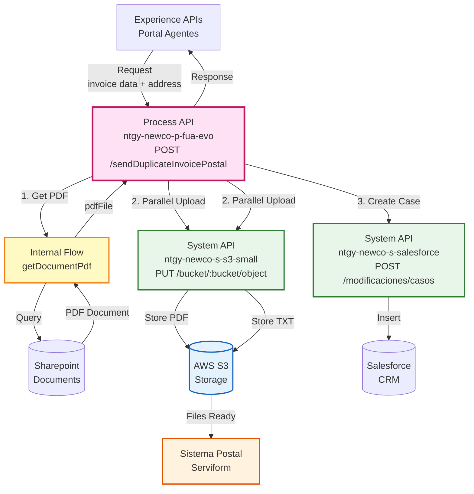
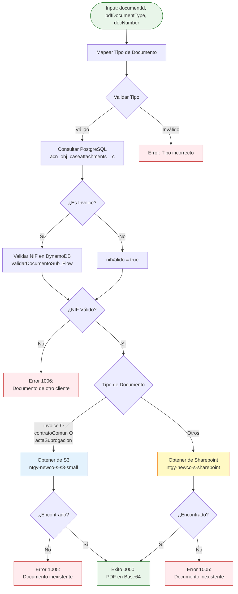
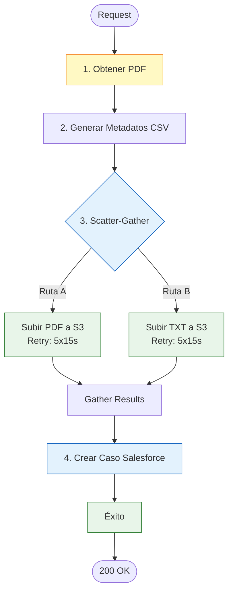
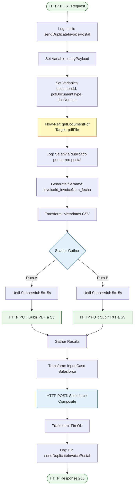
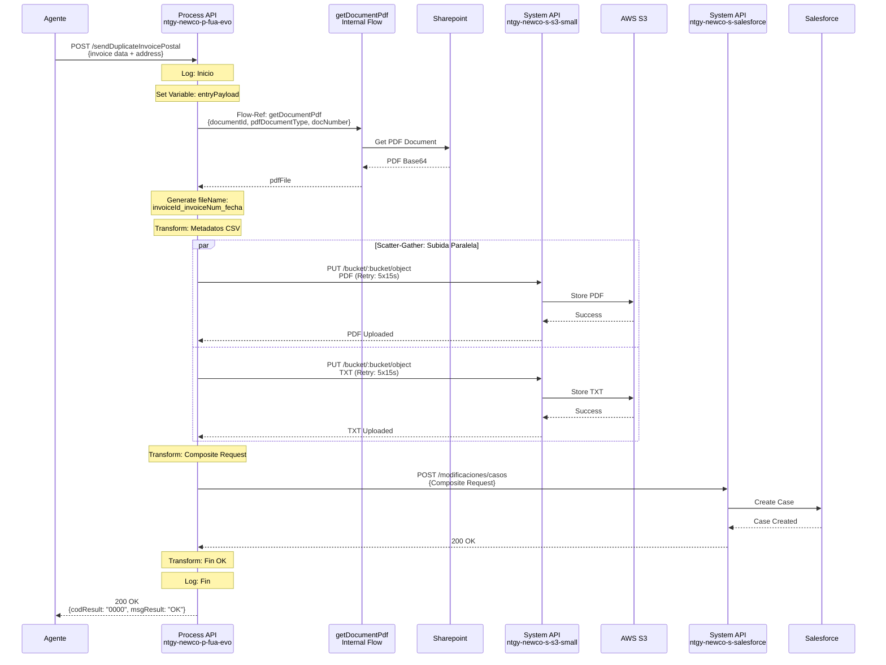
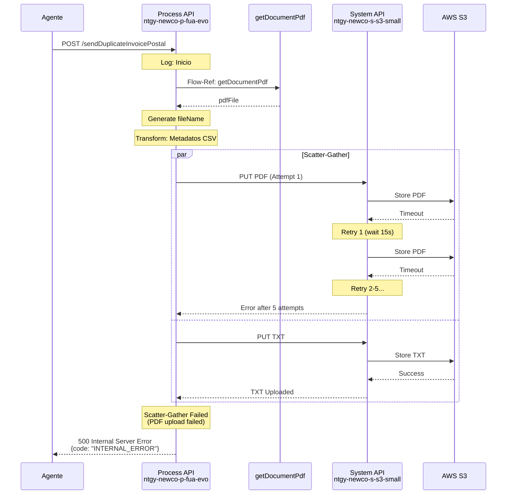

# POST /sendDuplicateInvoicePostal

## 📌 Descripción General

### Propósito del Endpoint

Este endpoint orquesta un proceso complejo para enviar duplicados de facturas por correo postal. Obtiene el PDF de la factura, genera metadatos del destinatario, sube ambos archivos a S3 en paralelo para su procesamiento por el sistema de correo postal (Serviform), y crea un caso de seguimiento en Salesforce.

### Tipo de API

**Capa:** Process API (API-Led Connectivity)

**Función:** Orquestación de envío de duplicado de factura por correo postal

### Patrón de Integración

**Tipo:** Orquestación Compleja con Procesamiento Paralelo (Scatter-Gather)

**Descripción:** El endpoint ejecuta cuatro operaciones:
1. **Obtención de PDF**: Recupera el documento de factura
2. **Generación de Metadatos**: Crea archivo CSV con datos del destinatario
3. **Subida Paralela a S3**: Sube PDF y TXT simultáneamente (Scatter-Gather)
4. **Creación de Caso**: Registra la solicitud en Salesforce

### Arquitectura API-Led Connectivity



---

## 💼 Propósito del Negocio

### Casos de Uso Principales

1. **Solicitud de Duplicado de Factura por Correo Postal**
   - Los agentes pueden solicitar el envío de duplicados de facturas por correo postal
   - Automatiza el proceso de preparación y envío
   - Beneficio: Servicio completo para clientes sin acceso digital

2. **Gestión de Documentación Física**
   - Permite enviar facturas a direcciones específicas
   - Genera documentación con marca de agua "Duplicado"
   - Beneficio: Cumplimiento de requisitos legales y regulatorios

3. **Trazabilidad de Envíos Postales**
   - Crea caso de seguimiento en Salesforce
   - Vincula con caso de interacción padre
   - Beneficio: Control completo del proceso de envío

### 🔗 Endpoints Dependientes

Este Process API consume los siguientes recursos:

| Recurso | Tipo | Método | Propósito | Orden |
|---------|------|--------|-----------|-------|
| `getDocumentPdf` | Internal Flow | - | Obtiene PDF de factura desde Sharepoint | 1º |
| `ntgy-newco-s-s3-small` | System API | PUT | Subida de archivo PDF a S3 | 2º (Paralelo A) |
| `ntgy-newco-s-s3-small` | System API | PUT | Subida de archivo TXT (metadatos) a S3 | 2º (Paralelo B) |
| `ntgy-newco-s-salesforce` | System API | POST | Creación de caso de gestión en Salesforce | 3º |

#### Dependencia: getDocumentPdf (Internal Flow)

**Propósito:** Obtiene el documento PDF desde múltiples fuentes (S3 o Sharepoint) según el tipo de documento

**Flujo de Decisión Completo:**



**Input (Variables):**
- `documentId`: ID del documento (clave de búsqueda)
- `pdfDocumentType`: Tipo de documento - valores permitidos:
  - `"contract"` → Se mapea a código `"01.01"`
  - `"invoice"` → Se mapea a código `"03.01"`
  - `"cases"` → Se mapea a código `"06.01"`
- `docNumber`: Número del documento (usado para validación y path en S3)

**Output (Target: pdfFile):**
```json
{
  "result": {
    "codResult": "0000|1005|1006",
    "msgResult": "Mensaje descriptivo"
  },
  "pdfDocument": "Base64EncodedPDF"  // Solo si codResult = "0000"
}
```

**Códigos de Resultado:**

| Código | Mensaje | Causa | Impacto |
|--------|---------|-------|---------|
| `0000` | "No hay error" | Documento recuperado exitosamente | ✅ Continúa el flujo |
| `1005` | "Documento inexistente" | No encontrado en S3 o Sharepoint | ❌ Detiene el flujo |
| `1006` | "Documento asociado a otro cliente" | Falla validación de NIF (solo invoices) | ❌ Detiene el flujo |

**Backends Consultados (en orden):**

1. **PostgreSQL (ntgy-newco-s-postgresql-salesforce)**
   - **Tabla:** `newcosalesforce.acn_obj_caseattachments__c`
   - **Query:** `SELECT acn_fld_nombre_de_pdf__c, acn_fld_documenttype__c WHERE acn_fld_documentkey__c = '{documentId}'`
   - **Propósito:** Obtener metadatos del documento (nombre PDF, tipo)

2. **DynamoDB (solo para invoices)**
   - **Flow:** `validarDocumentoSub_Flow`
   - **Propósito:** Validar que el NIF del documento coincide con el cliente
   - **Resultado:** Variable `nifValido` (true/false)

3. **S3 (ntgy-newco-s-s3-small)** - Ruta A
   - **Condición:** Si `pdfDocumentType = "invoice"` O `acn_fld_documenttype__c IN ["contratoComun", "actaSubrogacion"]`
   - **Bucket:** Dinámico según tipo de documento: `p('s-s3-small.{documentType}.bucket')`
   - **Path:** 
     - Para contratos: `acn_fld_nombre_de_pdf__c` (de PostgreSQL)
     - Para facturas: `{docNumber}/fact_{nif}_{invoiceNumber}.pdf`
   - **Timeout:** 240 segundos
   - **Error Handling:** On Error Continue → payload = null

4. **Sharepoint (ntgy-newco-s-sharepoint)** - Ruta B
   - **Condición:** Para otros tipos de documentos
   - **Endpoint:** `GET /documents/{documentId}?docType={pdfDocuType}`
   - **Error Handling:** On Error Continue → payload = null

**Lógica de Validación de NIF (solo invoices):**

```dataweave
// Solo se ejecuta si pdfDocumentType == "invoice"
validarDocumentoSub_Flow
  → Consulta DynamoDB
  → Compara NIF del documento vs NIF del cliente
  → Si NO coincide: nifValido = false → Error 1006
  → Si coincide: nifValido = true → Continúa
```

**Manejo de Errores:**

1. **Tipo de documento inválido**
   - Validación: `pdfDocumentType` debe ser "contract", "invoice" o "cases"
   - Error: "El campo pdfDocumentType esta vacio o tiene un valor incorrecto"
   - Impacto: Detiene el flujo inmediatamente

2. **Documento no encontrado en PostgreSQL**
   - Si la query no devuelve resultados
   - Impacto: Continúa pero puede fallar en pasos posteriores

3. **Validación de NIF fallida (Error 1006)**
   - Solo para invoices
   - El documento existe pero pertenece a otro cliente
   - Response: `{"result": {"codResult": "1006", "msgResult": "Documento asociado a otro cliente"}}`

4. **Documento no encontrado en S3/Sharepoint (Error 1005)**
   - El documento no existe en el storage
   - Response: `{"result": {"codResult": "1005", "msgResult": "Documento inexistente"}}`

5. **Errores de conexión**
   - S3: Timeout de 240s, luego payload = null → Error 1005
   - Sharepoint: On Error Continue → payload = null → Error 1005

**Ejemplo de Uso en sendDuplicateInvoicePostal:**

```dataweave
// Preparación de variables
vars.documentId = payload.documentId
vars.pdfDocumentType = payload.pdfDocumentType  // "invoice"
vars.docNumber = payload.docNumber

// Llamada al flow
flow-ref: getDocumentPdf → target: pdfFile

// Resultado esperado (éxito)
vars.pdfFile = {
  "result": {
    "codResult": "0000",
    "msgResult": "No hay error"
  },
  "pdfDocument": "JVBERi0xLjQKJeLjz9MKMSAwIG9iago8PC9UeXBlL0NhdGFsb2cvUGFnZXMgMiAwIFI+PgplbmRvYmoKMiAwIG9iago8PC9UeXBlL1BhZ2VzL0tpZHNbMyAwIFJdL0NvdW50IDE+PgplbmRvYmoKMyAwIG9iago8PC9UeXBlL1BhZ2UvTWVkaWFCb3hbMCAwIDYxMiA3OTJdL1BhcmVudCAyIDAgUi9SZXNvdXJjZXM8PC9Gb250PDwvRjEgNCAwIFI+Pj4+L0NvbnRlbnRzIDUgMCBSPj4KZW5kb2JqCjQgMCBvYmoKPDwvVHlwZS9Gb250L1N1YnR5cGUvVHlwZTEvQmFzZUZvbnQvSGVsdmV0aWNhPj4KZW5kb2JqCjUgMCBvYmoKPDwvTGVuZ3RoIDQ0Pj4Kc3RyZWFtCkJUCi9GMSA0OCBUZgoxMCA3MDAgVGQKKEhlbGxvIFdvcmxkKSBUagpFVAplbmRzdHJlYW0KZW5kb2JqCnhyZWYKMCA2CjAwMDAwMDAwMDAgNjU1MzUgZiAKMDAwMDAwMDAxNSAwMDAwMCBuIAowMDAwMDAwMDY0IDAwMDAwIG4gCjAwMDAwMDAxMjEgMDAwMDAgbiAKMDAwMDAwMDIzNyAwMDAwMCBuIAowMDAwMDAwMzA2IDAwMDAwIG4gCnRyYWlsZXIKPDwvU2l6ZSA2L1Jvb3QgMSAwIFI+PgpzdGFydHhyZWYKMzk4CiUlRU9GCg=="
}

// Uso del PDF
vars.pdfFile.pdfDocument  // Base64 string del PDF
```

**Notas Importantes:**

- ⚠️ **El flujo NO siempre va a Sharepoint** - puede ir a S3 según el tipo de documento
- ⚠️ **Hay validación de NIF** solo para invoices - puede fallar con error 1006
- ⚠️ **El bucket de S3 es dinámico** - se construye según `acn_fld_documenttype__c`
- ⚠️ **El path en S3 es dinámico** - diferente para contratos vs facturas
- ✅ **Timeout generoso en S3** - 240 segundos para documentos grandes
- ✅ **Error handling robusto** - On Error Continue evita fallos abruptos

### Lógica de Orquestación



**Pasos del Proceso:**

1. **Obtención de PDF** (Secuencial)
   - Se invoca el flow interno `getDocumentPdf`
   - Se pasan variables: `documentId`, `pdfDocumentType`, `docNumber`
   - Resultado almacenado en variable `pdfFile`

2. **Generación de Metadatos** (Secuencial)
   - Se genera nombre de archivo: `{invoiceId}_{invoiceNum}_{fecha}`
   - Se crea CSV con datos del destinatario
   - Incluye marca de agua "Duplicado"

3. **Subida Paralela a S3** (Scatter-Gather)
   - **Ruta A**: Subir PDF con retry (5 intentos, 15s entre intentos)
   - **Ruta B**: Subir TXT con retry (5 intentos, 15s entre intentos)
   - Ambas rutas deben completarse exitosamente

4. **Creación de Caso** (Secuencial)
   - Se crea caso en Salesforce con Composite API
   - Recordtype: "Gestion"
   - Subject: "Duplicado de factura correo postal"

### Transformaciones Aplicadas

**Transformación 1: Generación de Nombre de Archivo**

```dataweave
vars.entryPayload.invoiceId ++ "_" ++ 
vars.entryPayload.invoiceNum ++ "_" ++ 
(now() as Date as String {format: "yyyyMMdd"})
```

**Ejemplo:** `12345_FAC001_20240828`

**Transformación 2: Metadatos CSV**

| Campo Origen | Campo CSV | Transformación |
|--------------|-----------|----------------|
| `fileName` | `NombrePDF` | Directo |
| - | `DOCUMENTO` | Fijo: "FACTURA" |
| `name` | `NOMBRE` | Directo |
| `surname` | `APE1` | Directo |
| `surname2` | `APE2` | Directo (sin default, puede estar vacío) |
| `fullAddress` | `DIRECCION` | Directo |
| `zipCode` | `CP` | Directo |
| `town` | `LOCALIDAD` | Directo |
| `city` | `PROVINCIA` | Directo |
| - | `MARCA_DE_AGUA` | Fijo: "Duplicado" |
| `idioma` | `IDIOMA` | upper() default "ES" |

**Ejemplo de Archivo TXT Generado:**

```csv
NombrePDF;DOCUMENTO;NOMBRE;APE1;APE2;DIRECCION;CP;LOCALIDAD;PROVINCIA;MARCA_DE_AGUA;IDIOMA
12345_FAC001_20240828;FACTURA;Juan;García;López;Calle Mayor 123, 3º A;28001;Madrid;Madrid;Duplicado;ES
```

**Nota:** El archivo TXT se genera en formato CSV con separador `;` y contiene los metadatos necesarios para el sistema postal (Serviform).

**Transformación 3: Salesforce Composite Request**

| Campo Origen | Campo Salesforce | Transformación | Descripción |
|--------------|------------------|----------------|-------------|
| `x-client-id` | `AccountId` | Directo | ID del cliente en Salesforce |
| `x-contact-id` | `ContactId` | Directo | ID del contacto en Salesforce |
| - | `NewCo_Recordtype__c` | Fijo: "Gestion" | Tipo de caso |
| - | `Origin` | Fijo: "FUA" | Origen del caso |
| - | `Status` | Fijo: "06" | Estado: Cerrado |
| - | `Subject` | Fijo: "Duplicado de factura correo postal" | Asunto del caso |
| `reason` | `Description` | Directo | Descripción/motivo |
| `x-user-id` o `x-contact-id` | `NewCo_Creado_por__c` | Condicional | Creador del caso |
| `x-interaction-id` | `ParentId` | Directo | Caso padre (interacción) |
| `DirIp` | `NewCo_Ip__c` | Directo | IP del solicitante |
| `correlationId` | `NewCo_CorrelationId__c` | Variable global | ID de correlación |
| - | `acn_fld_Tittle__r.NewCo_ExternalId__c` | Fijo: "DuplicadoFactura" | Referencia externa |

**Nota sobre Status "06":** Este estado indica que el caso se crea directamente como "Cerrado" ya que es un caso de gestión automático que no requiere seguimiento manual.

### Contexto Empresarial

- **Dominio:** Gestión de Documentación y Facturación
- **Sector:** Energía - Utilities
- **División:** Naturgy España - NewCo
- **Proceso de Negocio:** Envío de duplicados de facturas por correo postal

### Stakeholders

- **Agentes de Call Center**: Solicitan duplicados de facturas para clientes
- **Clientes**: Reciben facturas físicas por correo postal
- **Equipo de Facturación**: Monitorea las solicitudes de duplicados
- **Sistema Postal (Serviform)**: Procesa y envía los documentos físicos

### Valor de Negocio

- **Accesibilidad**: Servicio para clientes sin acceso digital
- **Automatización**: Proceso completamente automatizado desde solicitud hasta envío
- **Trazabilidad**: Registro completo en Salesforce
- **Cumplimiento**: Marca de agua "Duplicado" para cumplimiento legal
- **Eficiencia**: Procesamiento paralelo reduce tiempos de respuesta

### Consumidores Potenciales

Este endpoint puede ser consumido por:
- Aplicaciones de agentes de call center
- Portales de gestión de atención al cliente
- Sistemas de back-office
- Herramientas de gestión de casos

---

## 🔧 Especificación Técnica

### URLs por Ambiente

| Ambiente | URL Base | URL Completa |
|----------|----------|--------------|
| **Local** | `http://localhost:8081` | `http://localhost:8081/api/sendDuplicateInvoicePostal` |
| **Development** | `https://ntgy-newco-p-fua-evo-dev.us-e2.cloudhub.io` | `https://ntgy-newco-p-fua-evo-dev.us-e2.cloudhub.io/api/sendDuplicateInvoicePostal` |
| **UAT** | `https://ntgy-newco-p-fua-evo-uat.us-e2.cloudhub.io` | `https://ntgy-newco-p-fua-evo-uat.us-e2.cloudhub.io/api/sendDuplicateInvoicePostal` |
| **Production** | `https://ntgy-newco-p-fua-evo-pro.us-e2.cloudhub.io` | `https://ntgy-newco-p-fua-evo-pro.us-e2.cloudhub.io/api/sendDuplicateInvoicePostal` |

### Método HTTP

```
POST /api/sendDuplicateInvoicePostal
```

### Parámetros de Entrada

#### Headers Requeridos

| Header | Tipo | Requerido | Descripción | Ejemplo |
|--------|------|-----------|-------------|---------|
| `Content-Type` | String | ✅ Sí | Tipo de contenido | `application/json` |
| `client_id` | String | ✅ Sí | Client ID de Anypoint Platform | `{your_client_id}` |
| `client_secret` | String | ✅ Sí | Client Secret de Anypoint Platform | `{your_client_secret}` |
| `x-client-id` | String | ✅ Sí | ID del cliente (AccountId en Salesforce) | `"0012345678"` |
| `x-contact-id` | String | ✅ Sí | ID del contacto en Salesforce | `"003XXXXXXXX"` |
| `x-user-id` | String | ⚠️ Opcional | ID del usuario/agente (usado en NewCo_Creado_por__c) | `"005XXXXXXXX"` |
| `x-agent-mail` | String | ⚠️ Opcional | Email del agente para Salesforce (header username) | `"agente@naturgy.com"` |
| `x-interaction-id` | String | ⚠️ Opcional | ID del caso de interacción padre (ParentId) | `"500XXXXXXXX"` |

#### Body (JSON)

**Estructura del Request:**

```json
{
  "documentId": "string",
  "pdfDocumentType": "string",
  "docNumber": "string",
  "invoiceId": "string",
  "invoiceNum": "string",
  "name": "string",
  "surname": "string",
  "surname2": "string",
  "fullAddress": "string",
  "zipCode": "string",
  "town": "string",
  "city": "string",
  "idioma": "string",
  "reason": "string",
  "DirIp": "string"
}
```

**Campos del Body:**

| Campo | Tipo | Requerido | Descripción |
|-------|------|-----------|-------------|
| `documentId` | String | ✅ Sí | ID del documento en Sharepoint |
| `pdfDocumentType` | String | ✅ Sí | Tipo de documento PDF |
| `docNumber` | String | ✅ Sí | Número del documento |
| `invoiceId` | String | ✅ Sí | ID de la factura |
| `invoiceNum` | String | ✅ Sí | Número de la factura |
| `name` | String | ✅ Sí | Nombre del destinatario |
| `surname` | String | ✅ Sí | Primer apellido del destinatario |
| `surname2` | String | ⚠️ Opcional | Segundo apellido del destinatario (se usa "" si no se proporciona) |
| `fullAddress` | String | ✅ Sí | Dirección completa del destinatario |
| `zipCode` | String | ✅ Sí | Código postal |
| `town` | String | ✅ Sí | Localidad |
| `city` | String | ✅ Sí | Provincia |
| `idioma` | String | ⚠️ Opcional | Idioma (ES, CA, EU, GL, EN) - Default: "ES" - Se convierte a mayúsculas |
| `reason` | String | ⚠️ Opcional | Motivo de la solicitud (Description en Salesforce) |
| `DirIp` | String | ⚠️ Opcional | Dirección IP del solicitante (NewCo_Ip__c en Salesforce) |

### Respuestas

#### 200 OK - Éxito

**Descripción:** Duplicado de factura procesado y enviado exitosamente

**Content-Type:** `application/json`

**Estructura:**

```json
{
  "result": {
    "codResult": "0000",
    "msgResult": "OK"
  }
}
```

#### 400 Bad Request - Error de Validación

**Descripción:** Parámetros de entrada inválidos o faltantes

**Content-Type:** `application/json`

**Estructura:**

```json
{
  "code": "VALIDATION_ERROR",
  "message": "Parámetros de entrada inválidos",
  "details": "El campo 'documentId' es requerido"
}
```

#### 500 Internal Server Error - Error del Sistema

**Descripción:** Error en alguno de los pasos del proceso

**Content-Type:** `application/json`

**Estructura:**

```json
{
  "code": "INTERNAL_ERROR",
  "message": "Error al procesar la solicitud",
  "details": "Error al subir archivo a S3"
}
```

### Autenticación

- **Tipo:** Client ID & Client Secret (Anypoint Platform)
- **Ubicación:** Headers HTTP
- **Validación:** Gestionada por API Manager de Anypoint Platform

### Timeouts

| Tipo | Valor | Descripción |
|------|-------|-------------|
| **Request Timeout** | 90 segundos | Timeout general del request (proceso complejo) |
| **S3 Upload Timeout** | 30 segundos | Timeout para subida a S3 |
| **Salesforce Timeout** | 60 segundos | Timeout para llamada a Salesforce |
| **Retry Interval** | 15 segundos | Intervalo entre reintentos en S3 |
| **Max Retries** | 5 intentos | Número máximo de reintentos |

---

## 🏗️ Implementación Técnica

### Arquitectura del Flow



### Componentes del Flow

#### 1. Flow Principal: `post:\sendDuplicateInvoicePostal:application\json:ntgy-newco-p-fua-config`

**Ubicación:** `src/main/mule/ntgy-newco-p-fua-evo.xml`

**Componentes:**
1. **Logger (INFO)**: Registra el inicio de la operación
2. **Flow Reference**: Invoca el subflow `sendDuplicateInvoicePostalFlow`

#### 2. Subflow: `sendDuplicateInvoicePostalFlow`

**Ubicación:** `src/main/mule/implementation/sendDuplicateInvoicePostalFlow.xml`

**Componentes Principales:**

1. **Logger (INFO)**: Log de inicio con payload
2. **Set Variable**: Almacena payload original en `entryPayload`
3. **Transform**: Prepara variables para getDocumentPdf
4. **Flow-Ref**: Invoca `getDocumentPdf` (target: `pdfFile`)
5. **Logger (INFO)**: Log de envío por correo postal
6. **Set Variable**: Genera `fileName` dinámicamente
7. **Transform**: Genera metadatos CSV
8. **Scatter-Gather**: Procesamiento paralelo
   - **Ruta A**: Until Successful + HTTP PUT (PDF)
   - **Ruta B**: Until Successful + HTTP PUT (TXT)
9. **Transform**: Prepara Composite Request para Salesforce
10. **HTTP Request**: POST a Salesforce
11. **Transform**: Respuesta OK
12. **Logger (INFO)**: Log de fin

### Transformaciones DataWeave

#### Transformación 1: Variables para getDocumentPdf

**Código:**

```dataweave
%dw 2.0
output application/java
---
{
    documentId: vars.entryPayload.documentId,
    pdfDocumentType: vars.entryPayload.pdfDocumentType,
    docNumber: vars.entryPayload.docNumber
}
```

#### Transformación 2: Generación de Nombre de Archivo

**Código:**

```dataweave
vars.entryPayload.invoiceId ++ "_" ++ 
vars.entryPayload.invoiceNum ++ "_" ++ 
(now() as Date as String {format: "yyyyMMdd"})
```

**Ejemplo de Salida:** `12345_FAC001_20240828`

#### Transformación 3: Metadatos CSV

**Código:**

```dataweave
%dw 2.0
output application/csv separator=";"
---
{
    "NombrePDF": vars.fileName,
    "DOCUMENTO": "FACTURA",
    "NOMBRE": vars.entryPayload.name,
    "APE1": vars.entryPayload.surname,
    "APE2": vars.entryPayload.surname2,
    "DIRECCION": vars.entryPayload.fullAddress,
    "CP": vars.entryPayload.zipCode,
    "LOCALIDAD": vars.entryPayload.town,
    "PROVINCIA": vars.entryPayload.city,
    "MARCA_DE_AGUA": "Duplicado",
    "IDIOMA": upper(vars.entryPayload.idioma) default "ES"   
}
```

**Ejemplo de Salida CSV:**

```csv
NombrePDF;DOCUMENTO;NOMBRE;APE1;APE2;DIRECCION;CP;LOCALIDAD;PROVINCIA;MARCA_DE_AGUA;IDIOMA
12345_FAC001_20240828;FACTURA;Juan;García;López;Calle Mayor 123;28001;Madrid;Madrid;Duplicado;ES
```

#### Transformación 4: Salesforce Composite Request

**Código:**

```dataweave
%dw 2.0
output application/json
---
{
    "allOrNone": true,
    "collateSubrequests": false,
    "compositeRequest": [
        {
            "method": "POST",
            "url": "/services/data/v52.0/sobjects/Case",
            "referenceId": "refCaseGestion",
            "body": { 
                "NewCo_Recordtype__c": "Gestion",
                "AccountId": vars.entryPayload.'x-client-id',
                "ContactId": vars.entryPayload.'x-contact-id',
                "Origin": "FUA",
                "Status": "06",
                "Subject": "Duplicado de factura correo postal",
                "Description": vars.entryPayload.reason, 
                "NewCo_Creado_por__c": if(!isEmpty(vars.entryPayload.'x-user-id')) 
                    vars.entryPayload.'x-user-id' 
                    else vars.entryPayload.'x-contact-id',
                "ParentId": vars.entryPayload."x-interaction-id",
                "NewCo_Ip__c": vars.entryPayload.DirIp,
                "NewCo_CorrelationId__c": correlationId,	
                "acn_fld_Tittle__r": {
                    "NewCo_ExternalId__c": "DuplicadoFactura"
                }
            }
        }
    ]
}
```

#### Transformación 5: Respuesta Final

**Código:**

```dataweave
%dw 2.0
output application/json
---
{
    "result": {
        "codResult": "0000",
        "msgResult": "OK"
    }
}
```

### Configuración HTTP

**HTTP Request 1: Subir PDF a S3**

```xml
<http:request 
    method="PUT" 
    doc:name="Subir PDF s3" 
    config-ref="HTTP_Request_s_s3_small" 
    path="/bucket/{bucket}/object">
    <http:body>
        <![CDATA[#[output application/octet-stream --- 
            dw::core::Binaries::fromBase64(vars.pdfFile.pdfDocument)]]]>
    </http:body>
    <http:headers>
        <![CDATA[#[output application/java
---
{
    "file-key": p('s-s3-small.siteDCTIC.duplicateInvoicesPathIn') ++ 
                vars.fileName ++ ".pdf"
}]]]>
    </http:headers>
    <http:uri-params>
        <![CDATA[#[output application/java
---
{
    "bucket": p('s-s3-small.siteDCTIC.bucket')
}]]]>
    </http:uri-params>
</http:request>
```

**Propiedades:**
- `s-s3-small.siteDCTIC.bucket`: Nombre del bucket S3 (ej: `naturgy-dctic-dev`)
- `s-s3-small.siteDCTIC.duplicateInvoicesPathIn`: Path en S3 (ej: `SFTP/Serviform/PdfFacturasyDocumentos/Out/`)
- Body: PDF convertido de Base64 a binario usando `dw::core::Binaries::fromBase64()`
- File-key: `{path}{fileName}.pdf` (ej: `SFTP/Serviform/.../12345_FAC001_20240828.pdf`)

**Configuración de Almacenamiento en S3:**

| Propiedad | Descripción | Ejemplo |
|-----------|-------------|---------|
| Bucket | Bucket de AWS S3 | `naturgy-dctic-dev` |
| Path Base | Directorio base en S3 | `SFTP/Serviform/PdfFacturasyDocumentos/Out/` |
| Nombre Archivo PDF | `{invoiceId}_{invoiceNum}_{fecha}.pdf` | `12345_FAC001_20240828.pdf` |
| Nombre Archivo TXT | `{invoiceId}_{invoiceNum}_{fecha}.txt` | `12345_FAC001_20240828.txt` |

**Sistema Consumidor:** Los archivos subidos a S3 son procesados por el sistema postal **Serviform** para el envío físico de documentos.

**HTTP Request 2: Subir TXT a S3**

```xml
<http:request 
    method="PUT" 
    doc:name="Subir TXT a S3" 
    config-ref="HTTP_Request_s_s3_small" 
    path="/bucket/{bucket}/object">
    <http:body>
        <![CDATA[#[vars.metadata]]]>
    </http:body>
    <http:headers>
        <![CDATA[#[output application/java
---
{
    "file-key": p('s-s3-small.siteDCTIC.duplicateInvoicesPathIn') ++ 
                vars.fileName ++ ".txt"
}]]]>
    </http:headers>
    <http:uri-params>
        <![CDATA[#[output application/java
---
{
    "bucket": p('s-s3-small.siteDCTIC.bucket')
}]]]>
    </http:uri-params>
</http:request>
```

**HTTP Request 3: Salesforce**

```xml
<http:request 
    method="POST" 
    doc:name="ntgy-newco-s-salesforce" 
    config-ref="HTTP_Request_configuration_ntgy_newco_s_salesforce" 
    path="${ntgy-newco-s-salesforce.pathCasos}" 
    responseTimeout="${ntgy-newco-s-salesforce.timeout}">
    <http:body>
        <![CDATA[#[vars.inputSF]]]>
    </http:body>
    <http:headers>
        <![CDATA[#[output application/java
---
{
    ("username": vars.entryPayload.'x-agent-mail') 
        if (!isEmpty(vars.entryPayload.'x-agent-mail'))
}]]]>
    </http:headers>
</http:request>
```

**Propiedades:**
- `ntgy-newco-s-salesforce.pathCasos`: `/modificaciones/casos`
- `ntgy-newco-s-salesforce.timeout`: `60000` (60 segundos)

### Patrones de Diseño

**Patrón 1: Scatter-Gather (Procesamiento Paralelo)**

**Justificación:**
- Subida simultánea de PDF y TXT mejora el rendimiento
- Ambos archivos son independientes
- Reduce el tiempo total de procesamiento

**Patrón 2: Until Successful (Retry Pattern)**

**Justificación:**
- Garantiza la subida de archivos ante fallos temporales
- 5 intentos con 15 segundos entre intentos
- Resiliencia ante problemas de red o S3

**Patrón 3: Flow Reference (Reutilización)**

**Justificación:**
- Reutiliza el flow `getDocumentPdf` existente
- Evita duplicación de código
- Mantiene consistencia en la obtención de PDFs

**Patrón 4: Composite API Pattern (Salesforce)**

**Justificación:**
- Uso de Salesforce Composite API para crear casos
- Permite operaciones complejas en una sola llamada
- Reduce latencia y mejora rendimiento

### Diagramas de Secuencia

#### 1. Flujo Normal de Éxito



#### 2. Flujo con Error en Subida a S3



### Manejo de Errores

**Estrategia:** Retry Pattern con Scatter-Gather y manejo granular de errores

**Nivel 1: Retry en Subidas a S3**
- **Tipo:** Until Successful (5 intentos, 15s entre intentos)
- **Comportamiento:** Reintenta automáticamente ante fallos temporales
- **Aplicado a:** Subida de PDF y subida de TXT
- **Rationale:** Garantiza resiliencia ante problemas de red o S3

**Nivel 2: Scatter-Gather**
- **Tipo:** Procesamiento paralelo con validación de ambas rutas
- **Comportamiento:** Ambas rutas deben completarse exitosamente
- **Si falla una ruta:** El proceso completo falla
- **Rationale:** Ambos archivos (PDF + TXT) son necesarios para el sistema postal
- **⚠️ Importante:** Si falla la subida a S3, NO se crea el caso en Salesforce

**Tipos de Errores Manejados:**

1. **Errores en getDocumentPdf (500)**
   - Documento no encontrado en Sharepoint
   - Error de conexión con Sharepoint
   - Timeout en la obtención del PDF
   - **Response:** Error interno del servidor
   - **Impacto:** El proceso se detiene, no se suben archivos ni se crea caso

2. **Errores en Subida a S3 (500)**
   - Timeout en la conexión (después de 5 reintentos)
   - Error de autenticación con S3
   - Bucket no disponible o sin permisos
   - Espacio insuficiente en S3
   - **Response:** Error después de 5 reintentos (75 segundos total)
   - **Impacto:** El proceso se detiene, no se crea caso en Salesforce
   - **⚠️ Rollback:** Si falla una subida (PDF o TXT), la otra subida exitosa permanece en S3

3. **Errores en Salesforce (500)**
   - Timeout en la comunicación (60s)
   - Error de validación en Composite Request
   - Sistema Salesforce no disponible
   - Campos requeridos faltantes
   - Límites de API excedidos
   - **Response:** Error interno del servidor
   - **Impacto:** Los archivos YA están en S3, pero no hay caso de seguimiento
   - **⚠️ Inconsistencia:** Archivos en S3 sin caso en Salesforce

4. **Errores de Validación (400)**
   - Headers faltantes (`x-client-id`, `x-contact-id`)
   - Body inválido o campos requeridos faltantes
   - Formato de datos incorrecto
   - **Response:** Error de validación
   - **Impacto:** El proceso no inicia

**Escenarios de Error Críticos:**

| Escenario | Archivos en S3 | Caso en Salesforce | Acción Recomendada |
|-----------|----------------|--------------------|--------------------|
| Error en getDocumentPdf | ❌ No | ❌ No | Reintentar solicitud completa |
| Error en subida PDF (5 intentos) | ❌ No | ❌ No | Verificar conectividad S3, reintentar |
| Error en subida TXT (5 intentos) | ✅ PDF sí, ❌ TXT no | ❌ No | Limpiar PDF de S3, reintentar |
| Error en Salesforce | ✅ Ambos | ❌ No | Crear caso manualmente o reintentar solo Salesforce |

**Mejoras Recomendadas:**
1. Implementar compensación (borrar archivos de S3 si falla Salesforce)
2. Agregar tabla de auditoría para rastrear solicitudes fallidas
3. Implementar endpoint de reintento solo para creación de caso
4. Agregar alertas para inconsistencias (archivos sin caso)

---

## 💻 Ejemplos de Uso

### Ejemplo 1: Llamada Exitosa

#### cURL

```bash
curl -X POST "https://ntgy-newco-p-fua-evo-dev.us-e2.cloudhub.io/api/sendDuplicateInvoicePostal" \
  -H "Content-Type: application/json" \
  -H "client_id: YOUR_CLIENT_ID" \
  -H "client_secret: YOUR_CLIENT_SECRET" \
  -H "x-client-id: 0012345678" \
  -H "x-contact-id: 003XXXXXXXX" \
  -H "x-user-id: 005XXXXXXXX" \
  -H "x-agent-mail: agente@naturgy.com" \
  -H "x-interaction-id: 500XXXXXXXX" \
  -d '{
    "documentId": "DOC123456",
    "pdfDocumentType": "INVOICE",
    "docNumber": "FAC001",
    "invoiceId": "12345",
    "invoiceNum": "FAC001",
    "name": "Juan",
    "surname": "García",
    "surname2": "López",
    "fullAddress": "Calle Mayor 123, 3º A",
    "zipCode": "28001",
    "town": "Madrid",
    "city": "Madrid",
    "idioma": "ES",
    "reason": "Cliente solicita duplicado de factura por correo postal",
    "DirIp": "192.168.1.100"
  }'
```

#### Respuesta (200 OK)

```json
{
  "result": {
    "codResult": "0000",
    "msgResult": "OK"
  }
}
```

### Ejemplo 2: JavaScript (Fetch API)

```javascript
const enviarDuplicadoPostal = async (invoiceData, addressData, clientId, contactId, userId = null) => {
  try {
    const response = await fetch(
      'https://ntgy-newco-p-fua-evo-dev.us-e2.cloudhub.io/api/sendDuplicateInvoicePostal',
      {
        method: 'POST',
        headers: {
          'Content-Type': 'application/json',
          'client_id': 'YOUR_CLIENT_ID',
          'client_secret': 'YOUR_CLIENT_SECRET',
          'x-client-id': clientId,
          'x-contact-id': contactId,
          ...(userId && { 'x-user-id': userId }),
          'x-agent-mail': 'agente@naturgy.com',
          'x-interaction-id': '500XXXXXXXX'
        },
        body: JSON.stringify({
          documentId: invoiceData.documentId,
          pdfDocumentType: invoiceData.pdfDocumentType,
          docNumber: invoiceData.docNumber,
          invoiceId: invoiceData.invoiceId,
          invoiceNum: invoiceData.invoiceNum,
          api_name: addressData.name,
          surname: addressData.surname,
          surname2: addressData.surname2,
          fullAddress: addressData.fullAddress,
          zipCode: addressData.zipCode,
          town: addressData.town,
          city: addressData.city,
          idioma: addressData.idioma || 'ES',
          reason: 'Cliente solicita duplicado por correo postal',
          DirIp: '192.168.1.100'
        })
      }
    );

    if (!response.ok) {
      throw new Error(`HTTP error! status: ${response.status}`);
    }

    const result = await response.json();
    console.log('✅ Duplicado enviado exitosamente');
    console.log('Resultado:', result);
    
    return result;
  } catch (error) {
    console.error('❌ Error al enviar duplicado:', error);
    throw error;
  }
};

// Uso
const invoiceData = {
  documentId: 'DOC123456',
  pdfDocumentType: 'INVOICE',
  docNumber: 'FAC001',
  invoiceId: '12345',
  invoiceNum: 'FAC001'
};

const addressData = {
  api_name: 'Juan',
  surname: 'García',
  surname2: 'López',
  fullAddress: 'Calle Mayor 123, 3º A',
  zipCode: '28001',
  town: 'Madrid',
  city: 'Madrid',
  idioma: 'ES'
};

enviarDuplicadoPostal(
  invoiceData,
  addressData,
  '0012345678',
  '003XXXXXXXX',
  '005XXXXXXXX'
).then(result => {
  console.log('Proceso completado:', result);
});
```

### Ejemplo 3: Python (Requests)

```python
import requests
from typing import Dict, Optional

def enviar_duplicado_postal(
    invoice_data: Dict[str, str],
    address_data: Dict[str, str],
    client_id: str,
    contact_id: str,
    user_id: Optional[str] = None,
    agent_mail: Optional[str] = None,
    interaction_id: Optional[str] = None,
    reason: str = "Cliente solicita duplicado por correo postal",
    dir_ip: str = "192.168.1.100"
) -> Dict:
    """
    Envía duplicado de factura por correo postal
    
    Args:
        invoice_data: Datos de la factura (documentId, invoiceId, etc.)
        address_data: Datos del destinatario (nombre, dirección, etc.)
        client_id: ID del cliente (AccountId)
        contact_id: ID del contacto
        user_id: ID del usuario/agente (opcional)
        agent_mail: Email del agente (opcional)
        interaction_id: ID del caso de interacción (opcional)
        reason: Motivo de la solicitud
        dir_ip: Dirección IP
        
    Returns:
        dict: Resultado de la operación
    """
    url = 'https://ntgy-newco-p-fua-evo-dev.us-e2.cloudhub.io/api/sendDuplicateInvoicePostal'
    
    headers = {
        'Content-Type': 'application/json',
        'client_id': 'YOUR_CLIENT_ID',
        'client_secret': 'YOUR_CLIENT_SECRET',
        'x-client-id': client_id,
        'x-contact-id': contact_id
    }
    
    # Headers opcionales
    if user_id:
        headers['x-user-id'] = user_id
    if agent_mail:
        headers['x-agent-mail'] = agent_mail
    if interaction_id:
        headers['x-interaction-id'] = interaction_id
    
    payload = {
        **invoice_data,
        **address_data,
        'reason': reason,
        'DirIp': dir_ip
    }
    
    try:
        response = requests.post(url, json=payload, headers=headers, timeout=120)
        response.raise_for_status()
        
        result = response.json()
        print(f"✅ Duplicado enviado exitosamente")
        print(f"   Código: {result['result']['codResult']}")
        print(f"   Mensaje: {result['result']['msgResult']}")
        
        return result
        
    except requests.exceptions.HTTPError as http_err:
        print(f"❌ HTTP error occurred: {http_err}")
        print(f"   Response: {response.text}")
        raise
    except requests.exceptions.Timeout:
        print("❌ Request timed out (>120s)")
        raise
    except Exception as err:
        print(f"❌ An error occurred: {err}")
        raise

# Uso
if __name__ == "__main__":
    invoice_data = {
        'documentId': 'DOC123456',
        'pdfDocumentType': 'INVOICE',
        'docNumber': 'FAC001',
        'invoiceId': '12345',
        'invoiceNum': 'FAC001'
    }
    
    address_data = {
        'name': 'Juan',
        'surname': 'García',
        'surname2': 'López',
        'fullAddress': 'Calle Mayor 123, 3º A',
        'zipCode': '28001',
        'town': 'Madrid',
        'city': 'Madrid',
        'idioma': 'ES'
    }
    
    try:
        result = enviar_duplicado_postal(
            invoice_data=invoice_data,
            address_data=address_data,
            client_id='0012345678',
            contact_id='003XXXXXXXX',
            user_id='005XXXXXXXX',
            agent_mail='agente@naturgy.com',
            interaction_id='500XXXXXXXX'
        )
        
        print("\n📊 Resultado completo:")
        print(f"   {result}")
        
    except Exception as e:
        print(f"\n❌ Failed to process: {e}")
```

### Ejemplo 4: Error - Campos Requeridos Faltantes

#### cURL

```bash
curl -X POST "https://ntgy-newco-p-fua-evo-dev.us-e2.cloudhub.io/api/sendDuplicateInvoicePostal" \
  -H "Content-Type: application/json" \
  -H "client_id: YOUR_CLIENT_ID" \
  -H "client_secret: YOUR_CLIENT_SECRET" \
  -H "x-client-id: 0012345678" \
  -H "x-contact-id: 003XXXXXXXX" \
  -d '{
    "invoiceId": "12345",
    "name": "Juan"
  }'
```

#### Respuesta (400 Bad Request)

```json
{
  "code": "VALIDATION_ERROR",
  "message": "Parámetros de entrada inválidos",
  "details": "Los campos 'documentId', 'pdfDocumentType', 'docNumber', 'invoiceNum', 'surname', 'fullAddress', 'zipCode', 'town' y 'city' son requeridos"
}
```

### Ejemplo 5: Archivo CSV Generado (Metadatos)

**Contenido del archivo TXT que se sube a S3:**

```csv
NombrePDF;DOCUMENTO;NOMBRE;APE1;APE2;DIRECCION;CP;LOCALIDAD;PROVINCIA;MARCA_DE_AGUA;IDIOMA
12345_FAC001_20240828;FACTURA;Juan;García;López;Calle Mayor 123, 3º A;28001;Madrid;Madrid;Duplicado;ES
```

**Nota:** Este archivo es procesado por el sistema postal (Serviform) para generar el envío físico.
