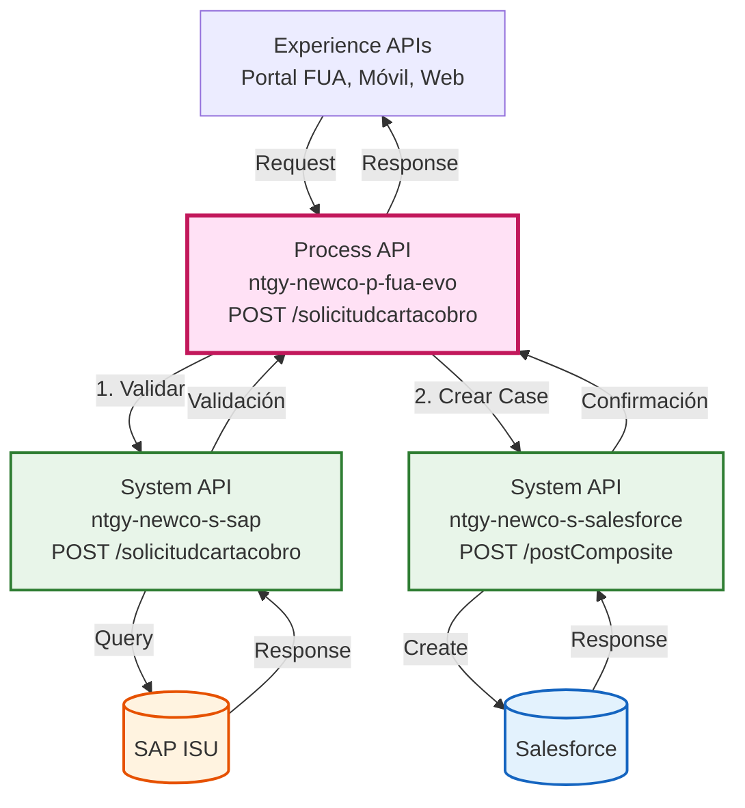
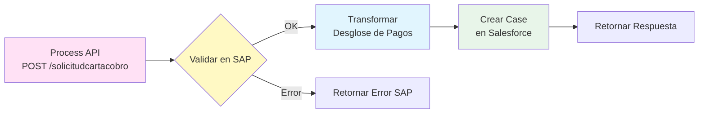
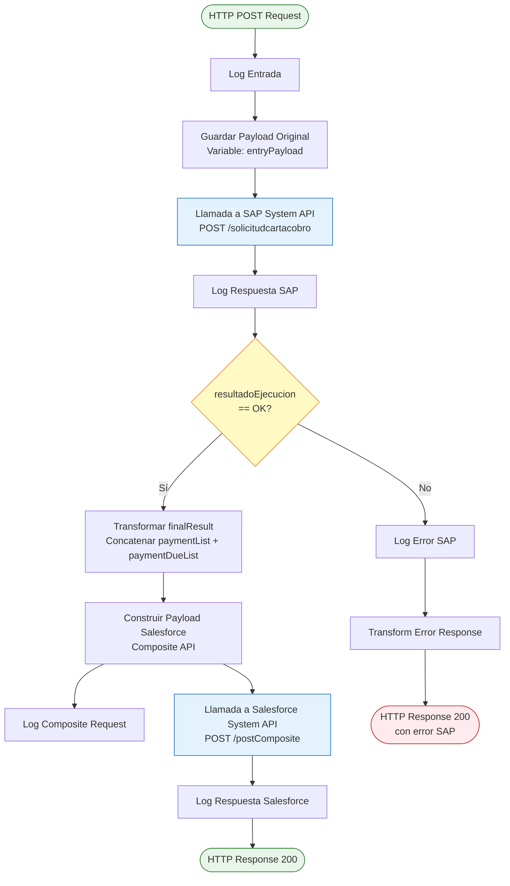
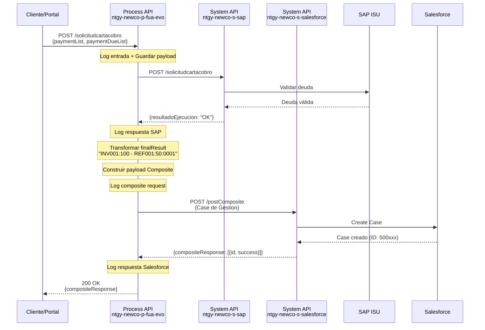
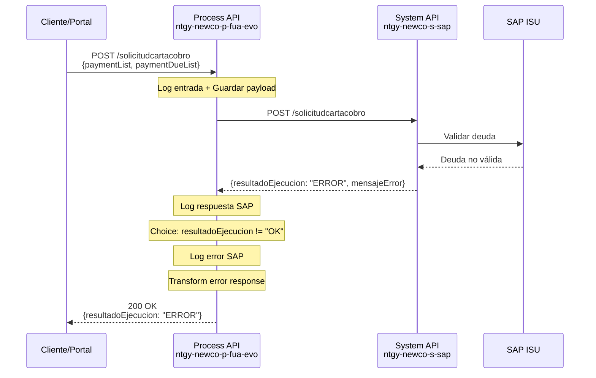
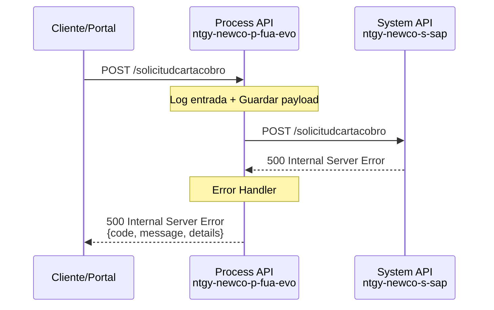

# POST /solicitudcartacobro

## 📌 Descripción General

### Propósito del Endpoint

Este endpoint orquesta el proceso completo de solicitud de carta de cobro, validando primero la solicitud en SAP ISU y posteriormente creando un Case de gestión en Salesforce con toda la información de la deuda y el contexto del cliente.

### Tipo de API

**Capa:** Process API (API-Led Connectivity)

**Función:** Orquestación de proceso de solicitud de carta de cobro con validación en SAP y registro en Salesforce

### Patrón de Integración

**Tipo:** Orquestación con Transformación

**Descripción:** El endpoint implementa un flujo secuencial que primero valida la solicitud en SAP ISU, transforma los datos de pago en un formato consolidado, y finalmente crea un Case de gestión en Salesforce con toda la información necesaria para el seguimiento del cobro.

### Arquitectura API-Led Connectivity



---

## 💼 Propósito del Negocio

### Casos de Uso Principales

1. **Solicitud de Carta de Cobro por Cliente**
   - El cliente solicita una carta de cobro formal para gestionar su deuda
   - Se valida la deuda en SAP ISU antes de proceder
   - Se crea un registro de gestión en Salesforce para seguimiento

2. **Gestión de Deuda con Trazabilidad**
   - Permite registrar el desglose completo de la deuda (facturas y/o plazos)
   - Mantiene trazabilidad completa con correlationId, IP, canales de contacto
   - Facilita el seguimiento posterior del proceso de cobro

3. **Integración Multicanal**
   - Soporta solicitudes desde múltiples canales (web, móvil, agente)
   - Captura información del canal de pago y contacto preferido
   - Permite asignación automática al agente si está disponible

### 🔗 Endpoints Dependientes

Este Process API consume los siguientes System APIs:

| System API | Endpoint | Método | Propósito |
|------------|----------|--------|-----------|
| `ntgy-newco-s-sap` | `/solicitudcartacobro` | POST | Validar la solicitud de carta de cobro en SAP ISU |
| `ntgy-newco-s-salesforce` | `/postComposite` | POST | Crear Case de gestión tipo "Gestion" en Salesforce |

### Lógica de Orquestación



**Pasos del Proceso:**

1. **Validación en SAP ISU**: Se envía la solicitud al System API de SAP para validar que la deuda existe y es correcta
2. **Evaluación de Resultado**: Si SAP responde con `resultadoEjecucion == "OK"`, se procede; de lo contrario, se retorna el error
3. **Transformación de Datos**: Se construye el campo `finalResult` concatenando información de `paymentList` y `paymentDueList`
4. **Creación de Case en Salesforce**: Se crea un Case tipo "Gestion" con toda la información de la solicitud
5. **Respuesta al Cliente**: Se retorna la confirmación de Salesforce al consumidor

### Transformaciones Aplicadas

**Transformación 1: Construcción de `finalResult`**

| Campo Original | Campo Transformado | Transformación |
|----------------|-------------------|----------------|
| `paymentList[].invoiceId` | `finalResult` | Concatena: `invoiceId:amount` |
| `paymentList[].amount` | `finalResult` | Concatena: `invoiceId:amount` |
| `paymentDueList[].numRef` | `finalResult` | Concatena: `numRef:amount:numberDue` |
| `paymentDueList[].amount` | `finalResult` | Concatena: `numRef:amount:numberDue` |
| `paymentDueList[].numberDue` | `finalResult` | Concatena: `numRef:amount:numberDue` (default "0000") |

**Formato del resultado:** `"invoice1:100 - invoice2:200 - ref1:50:0001"`

**Transformación 2: Construcción del Payload Salesforce**

| Campo Original | Campo Salesforce | Transformación |
|----------------|------------------|----------------|
| `x-client-id` | `AccountId` | Directo |
| `x-contact-id` | `ContactId` | Directo |
| `x-user-id` | `NewCo_Creado_por__c` | Si existe, sino usa `x-contact-id` |
| `x-user-id` | `OwnerId` | Condicional (solo si no está vacío) |
| `ParentId` | `ParentId` | Directo |
| `dirIp` | `NewCo_Ip__c` | Directo |
| `correlationId` | `NewCo_CorrelationId__c` | Variable del flow |
| `emailChannel` | `NewCo_OperationEmail__c` | Directo |
| `phoneChannel` | `NewCo_OperationPhone__c` | Directo |
| `channel` | `NewCo_PaymentChannel__c` | Directo |
| `finalResult` | `NewCo_PaymentBreakdown__c` | Transformado (ver arriba) |

### Contexto Empresarial

- **Dominio:** Gestión de Cobros y Deuda
- **Sector:** Energía - Utilities
- **División:** Naturgy España - NewCo
- **Proceso de Negocio:** Solicitud y gestión de cartas de cobro para clientes con deuda

### Stakeholders

- **Clientes de Naturgy**: Necesitan solicitar cartas de cobro formales para gestionar su deuda
- **Departamento de Cobros**: Requiere trazabilidad completa de las solicitudes de carta de cobro
- **Agentes de Call Center**: Pueden procesar solicitudes en nombre de los clientes
- **Equipo de Salesforce**: Gestiona los Cases de cobro y su seguimiento

### Valor de Negocio

- **Automatización del Proceso**: Elimina la gestión manual de solicitudes de carta de cobro
- **Trazabilidad Completa**: Registra toda la información relevante (IP, canal, correlationId) para auditoría
- **Validación Previa**: Asegura que la deuda existe en SAP antes de crear el Case en Salesforce
- **Integración Multicanal**: Soporta solicitudes desde web, móvil y agentes
- **Mejora en Cobros**: Facilita el seguimiento estructurado de las gestiones de cobro

### Consumidores Potenciales

Este endpoint puede ser consumido por:
- Portal web FUA
- Aplicaciones móviles de clientes
- Sistemas de agentes de call center
- Portales de autoservicio

---

## 🔧 Especificación Técnica

### URLs por Ambiente

| Ambiente | URL Base | URL Completa |
|----------|----------|--------------|
| **Local** | `http://localhost:8081` | `http://localhost:8081/api/solicitudcartacobro` |
| **Development** | `https://ntgy-newco-p-fua-evo-dev.us-e2.cloudhub.io` | `https://ntgy-newco-p-fua-evo-dev.us-e2.cloudhub.io/api/solicitudcartacobro` |
| **UAT** | `https://ntgy-newco-p-fua-evo-uat.us-e2.cloudhub.io` | `https://ntgy-newco-p-fua-evo-uat.us-e2.cloudhub.io/api/solicitudcartacobro` |
| **Production** | `https://ntgy-newco-p-fua-evo-pro.us-e2.cloudhub.io` | `https://ntgy-newco-p-fua-evo-pro.us-e2.cloudhub.io/api/solicitudcartacobro` |

### Método HTTP

```
POST /api/solicitudcartacobro
```

### Headers Requeridos

| Header | Tipo | Obligatorio | Descripción |
|--------|------|-------------|-------------|
| `Content-Type` | string | ✅ | Debe ser `application/json` |
| `x-client-id` | string | ✅ | ID del cliente (AccountId en Salesforce) |
| `x-contact-id` | string | ✅ | ID del contacto en Salesforce |
| `x-user-id` | string | ⚠️ | ID del usuario/agente (opcional, para asignación) |
| `x-agent-mail` | string | ⚠️ | Email del agente (opcional, para trazabilidad) |

### Parámetros de Entrada (Body)

#### Estructura del Request

```json
{
  "x-client-id": "string",
  "x-contact-id": "string",
  "x-user-id": "string",
  "x-agent-mail": "string",
  "ParentId": "string",
  "dirIp": "string",
  "emailChannel": "string",
  "phoneChannel": "string",
  "channel": "string",
  "paymentList": [
    {
      "invoiceId": "string",
      "amount": "number"
    }
  ],
  "paymentDueList": [
    {
      "numRef": "string",
      "amount": "number",
      "numberDue": "string"
    }
  ]
}
```

#### Descripción de Campos

| Campo | Tipo | Obligatorio | Descripción |
|-------|------|-------------|-------------|
| `x-client-id` | string | ✅ | ID del cliente en Salesforce (AccountId) |
| `x-contact-id` | string | ✅ | ID del contacto en Salesforce |
| `x-user-id` | string | ⚠️ | ID del usuario/agente que procesa la solicitud |
| `x-agent-mail` | string | ⚠️ | Email del agente (para header en llamada a Salesforce) |
| `ParentId` | string | ⚠️ | ID del Case padre (si es un Case relacionado) |
| `dirIp` | string | ✅ | Dirección IP desde donde se realiza la solicitud |
| `emailChannel` | string | ⚠️ | Email de contacto del cliente |
| `phoneChannel` | string | ⚠️ | Teléfono de contacto del cliente |
| `channel` | string | ✅ | Canal de pago (ej: "Web", "Móvil", "Agente") |
| `paymentList` | array | ⚠️ | Lista de facturas a incluir en la carta de cobro |
| `paymentList[].invoiceId` | string | ✅ | ID de la factura |
| `paymentList[].amount` | number | ✅ | Importe de la factura |
| `paymentDueList` | array | ⚠️ | Lista de plazos de deuda a incluir |
| `paymentDueList[].numRef` | string | ✅ | Número de referencia del plazo |
| `paymentDueList[].amount` | number | ✅ | Importe del plazo |
| `paymentDueList[].numberDue` | string | ⚠️ | Número de plazo (default "0000") |

**Nota:** Debe proporcionarse al menos `paymentList` o `paymentDueList` (o ambos).

### Respuestas

#### Respuesta Exitosa (200 OK)

**Cuando SAP valida correctamente y Salesforce crea el Case:**

```json
{
  "compositeResponse": [
    {
      "body": {
        "id": "5001234567890ABC",
        "success": true,
        "errors": []
      },
      "httpHeaders": {},
      "httpStatusCode": 201,
      "referenceId": "refCaseGestion"
    }
  ]
}
```

| Campo | Tipo | Descripción |
|-------|------|-------------|
| `compositeResponse` | array | Respuesta del Composite API de Salesforce |
| `compositeResponse[].body.id` | string | ID del Case creado en Salesforce |
| `compositeResponse[].body.success` | boolean | Indica si la creación fue exitosa |
| `compositeResponse[].httpStatusCode` | number | Código HTTP de la operación (201 = Created) |
| `compositeResponse[].referenceId` | string | ID de referencia de la operación |

#### Respuesta de Error de Validación SAP (200 OK con error)

**Cuando SAP rechaza la solicitud:**

```json
{
  "resultadoEjecucion": "ERROR",
  "mensajeError": "Deuda no encontrada o ya gestionada",
  "codigoError": "SAP_001"
}
```

#### Respuesta de Error (400 Bad Request)

```json
{
  "code": "VALIDATION_ERROR",
  "message": "Debe proporcionar al menos paymentList o paymentDueList",
  "timestamp": "2026-08-27T12:35:26Z"
}
```

#### Respuesta de Error (500 Internal Server Error)

```json
{
  "code": "INTERNAL_ERROR",
  "message": "Error al procesar la solicitud de carta de cobro",
  "details": "Error en la comunicación con Salesforce",
  "timestamp": "2026-08-27T12:35:26Z"
}
```

### Autenticación

- **Tipo:** Client ID & Client Secret (Anypoint Platform)
- **Headers:** `client_id` y `client_secret` en los headers de la petición

### Timeouts

| Tipo | Valor |
|------|-------|
| **Request Timeout** | 60 segundos |
| **Connection Timeout** | 30 segundos |
| **SAP System API Timeout** | 30 segundos |
| **Salesforce System API Timeout** | 30 segundos |

---

## 🏗️ Implementación Técnica

### Arquitectura del Flow



### Transformaciones DataWeave

#### Transformación 1: Construcción de `finalResult`

**Ubicación:** Inline en el flow (líneas 42-54 del XML)

```dataweave
%dw 2.0
output application/json
---
(
  ((vars.entryPayload.paymentList map (item) -> 
    item.invoiceId ++ ":" ++ item.amount as String
  ) default []) ++
  ((vars.entryPayload.paymentDueList map (item) -> 
    item.numRef ++ ":" ++ item.amount as String ++ ":" ++ (item.numberDue default "0000")
  ) default [])
)  joinBy " - "
```

**Propósito:** Concatenar información de facturas y plazos en un único string para el campo `NewCo_PaymentBreakdown__c` de Salesforce.

**Ejemplo de salida:** `"INV001:150.50 - INV002:200.00 - REF001:75.25:0001"`

#### Transformación 2: Construcción del Payload Salesforce Composite

**Ubicación:** Inline en el flow (líneas 56-91 del XML)

```dataweave
%dw 2.0
output application/json
---
{
  "allOrNone" : true,
  "collateSubrequests": false,
  "compositeRequest" : [
    {
      "method" : "POST",
      "url" : "/services/data/v52.0/sobjects/Case",
      "referenceId" : "refCaseGestion",
      "body" : { 
        "NewCo_Recordtype__c" : "Gestion",
        "AccountId" : vars.entryPayload.'x-client-id',
        "ContactId" :  vars.entryPayload.'x-contact-id',
        "Status" : "06",
        "Priority" : "02",
        "Origin" : "FUA",
        "NewCo_Creado_por__c" : if(vars.entryPayload.'x-user-id' != null) 
                                   vars.entryPayload.'x-user-id' 
                                 else 
                                   vars.entryPayload.'x-contact-id',
        ("OwnerId" : vars.entryPayload.'x-user-id') if(!isEmpty(vars.entryPayload.'x-user-id')),
        "ParentId" : vars.entryPayload.ParentId,
        "NewCo_Ip__c": vars.entryPayload.dirIp,
        "NewCo_CorrelationId__c": correlationId,
        "NewCo_OperationEmail__c": vars.entryPayload.emailChannel,
        "NewCo_OperationPhone__c": vars.entryPayload.phoneChannel,
        "NewCo_PaymentChannel__c": vars.entryPayload.channel,
        "NewCo_PaymentBreakdown__c": vars.finalResult,
        "NewCo_OperationLanguage__c":"",
        "NewCo_PaymentMode__c": "Solicitud carta de cobro",
        "NewCo_PaymentDocument__c": "",
        "acn_fld_Tittle__r":{
          "NewCo_ExternalId__c": "PagoDeuda"
        }
      }
    }
  ]
}
```

**Propósito:** Construir el payload para el Composite API de Salesforce que crea un Case de tipo "Gestion".

**Campos Clave del Case:**
- `NewCo_Recordtype__c`: "Gestion" (tipo de Case)
- `Status`: "06" (estado inicial)
- `Priority`: "02" (prioridad media)
- `Origin`: "FUA" (origen del Case)
- `NewCo_PaymentMode__c`: "Solicitud carta de cobro"
- `acn_fld_Tittle__r.NewCo_ExternalId__c`: "PagoDeuda" (título del Case)

### Patrones de Diseño

**Patrón 1: Orquestación Secuencial con Validación**

**Justificación:** Se valida primero en SAP antes de crear el Case en Salesforce para evitar registros innecesarios si la deuda no es válida.

**Patrón 2: Choice Router (Conditional Routing)**

**Justificación:** Se evalúa la respuesta de SAP (`resultadoEjecucion == "OK"`) para decidir si proceder con Salesforce o retornar el error.

**Patrón 3: Variable Storage**

**Justificación:** Se guarda el payload original en `entryPayload` para poder acceder a él después de las transformaciones y llamadas a backends.

### Diagramas de Secuencia

#### 1. Flujo Normal de Éxito



#### 2. Flujo con Error de Validación SAP



#### 3. Flujo con Error Técnico



### Manejo de Errores

**Estrategia de Manejo de Errores:**

1. **Errores de Validación SAP (Negocio):**
   - Se retorna 200 OK con el error de SAP en el body
   - El consumidor debe verificar `resultadoEjecucion` para determinar éxito/fallo
   - No se procede a crear el Case en Salesforce

2. **Errores Técnicos (Conectividad, Timeout):**
   - Se retorna 500 Internal Server Error
   - Se incluye mensaje descriptivo del error
   - Se registra en logs para troubleshooting

3. **Errores de Salesforce:**
   - Se retorna la respuesta de Salesforce tal cual
   - El Composite API de Salesforce incluye detalles del error en `compositeResponse`

**Error Handlers Aplicables:**
- `error/general-errors.xml`: Errores HTTP y de conectividad
- `error/agrupadores-errors.xml`: Errores de agregación de datos

### Configuración de Backends

**SAP System API:**
- **Config-ref:** `HTTP_Request_ntgy-newco-s-sap`
- **Path:** `${ntgy-newco-s-sap.functions.postSolicitudCartaCobro}`
- **Valor (dev):** `/solicitudcartacobro`
- **Método:** POST
- **Timeout:** 30 segundos

**Salesforce System API:**
- **Config-ref:** `HTTP_Request_configuration_ntgy_newco_s_salesforce`
- **Path:** `${ntgy-newco-s-salesforce.pathCartaCobro}`
- **Valor (dev):** `/postComposite`
- **Método:** POST
- **Timeout:** 30 segundos
- **Header adicional:** `username` (si `x-agent-mail` está presente)

---

## 💻 Ejemplos de Uso

### Ejemplo 1: Solicitud con Facturas (paymentList)

#### cURL

```bash
curl -X POST "https://ntgy-newco-p-fua-evo-dev.us-e2.cloudhub.io/api/solicitudcartacobro" \
  -H "Content-Type: application/json" \
  -H "client_id: YOUR_CLIENT_ID" \
  -H "client_secret: YOUR_CLIENT_SECRET" \
  -d '{
    "x-client-id": "0011234567890ABC",
    "x-contact-id": "0031234567890DEF",
    "dirIp": "192.168.1.100",
    "channel": "Web",
    "emailChannel": "cliente@example.com",
    "phoneChannel": "+34600123456",
    "paymentList": [
      {
        "invoiceId": "INV001",
        "amount": 150.50
      },
      {
        "invoiceId": "INV002",
        "amount": 200.00
      }
    ]
  }'
```

#### Respuesta (200 OK)

```json
{
  "compositeResponse": [
    {
      "body": {
        "id": "5001234567890ABC",
        "success": true,
        "errors": []
      },
      "httpHeaders": {
        "Location": "/services/data/v52.0/sobjects/Case/5001234567890ABC"
      },
      "httpStatusCode": 201,
      "referenceId": "refCaseGestion"
    }
  ]
}
```

### Ejemplo 2: Solicitud con Plazos (paymentDueList)

#### cURL

```bash
curl -X POST "https://ntgy-newco-p-fua-evo-dev.us-e2.cloudhub.io/api/solicitudcartacobro" \
  -H "Content-Type: application/json" \
  -H "client_id: YOUR_CLIENT_ID" \
  -H "client_secret: YOUR_CLIENT_SECRET" \
  -d '{
    "x-client-id": "0011234567890ABC",
    "x-contact-id": "0031234567890DEF",
    "dirIp": "192.168.1.100",
    "channel": "Móvil",
    "emailChannel": "cliente@example.com",
    "phoneChannel": "+34600123456",
    "paymentDueList": [
      {
        "numRef": "REF001",
        "amount": 75.25,
        "numberDue": "0001"
      },
      {
        "numRef": "REF002",
        "amount": 50.00,
        "numberDue": "0002"
      }
    ]
  }'
```

#### Respuesta (200 OK)

```json
{
  "compositeResponse": [
    {
      "body": {
        "id": "5001234567890XYZ",
        "success": true,
        "errors": []
      },
      "httpHeaders": {
        "Location": "/services/data/v52.0/sobjects/Case/5001234567890XYZ"
      },
      "httpStatusCode": 201,
      "referenceId": "refCaseGestion"
    }
  ]
}
```

### Ejemplo 3: Solicitud por Agente (con asignación)

#### cURL

```bash
curl -X POST "https://ntgy-newco-p-fua-evo-dev.us-e2.cloudhub.io/api/solicitudcartacobro" \
  -H "Content-Type: application/json" \
  -H "client_id: YOUR_CLIENT_ID" \
  -H "client_secret: YOUR_CLIENT_SECRET" \
  -d '{
    "x-client-id": "0011234567890ABC",
    "x-contact-id": "0031234567890DEF",
    "x-user-id": "0051234567890GHI",
    "x-agent-mail": "agente@naturgy.com",
    "dirIp": "10.0.0.50",
    "channel": "Agente",
    "emailChannel": "cliente@example.com",
    "phoneChannel": "+34600123456",
    "paymentList": [
      {
        "invoiceId": "INV003",
        "amount": 300.00
      }
    ],
    "paymentDueList": [
      {
        "numRef": "REF003",
        "amount": 100.00,
        "numberDue": "0001"
      }
    ]
  }'
```

#### Respuesta (200 OK)

```json
{
  "compositeResponse": [
    {
      "body": {
        "id": "5001234567890MNO",
        "success": true,
        "errors": []
      },
      "httpHeaders": {
        "Location": "/services/data/v52.0/sobjects/Case/5001234567890MNO"
      },
      "httpStatusCode": 201,
      "referenceId": "refCaseGestion"
    }
  ]
}
```

### Ejemplo 4: Error de Validación SAP

#### cURL

```bash
curl -X POST "https://ntgy-newco-p-fua-evo-dev.us-e2.cloudhub.io/api/solicitudcartacobro" \
  -H "Content-Type: application/json" \
  -H "client_id: YOUR_CLIENT_ID" \
  -H "client_secret: YOUR_CLIENT_SECRET" \
  -d '{
    "x-client-id": "0011234567890ABC",
    "x-contact-id": "0031234567890DEF",
    "dirIp": "192.168.1.100",
    "channel": "Web",
    "paymentList": [
      {
        "invoiceId": "INV999",
        "amount": 999.99
      }
    ]
  }'
```

#### Respuesta (200 OK con error de negocio)

```json
{
  "resultadoEjecucion": "ERROR",
  "mensajeError": "Factura no encontrada o ya gestionada",
  "codigoError": "SAP_INVOICE_NOT_FOUND"
}
```

### Ejemplo 5: JavaScript (Fetch API)

```javascript
const solicitudCartaCobro = async () => {
  const response = await fetch(
    'https://ntgy-newco-p-fua-evo-dev.us-e2.cloudhub.io/api/solicitudcartacobro',
    {
      method: 'POST',
      headers: {
        'Content-Type': 'application/json',
        'client_id': 'YOUR_CLIENT_ID',
        'client_secret': 'YOUR_CLIENT_SECRET'
      },
      body: JSON.stringify({
        'x-client-id': '0011234567890ABC',
        'x-contact-id': '0031234567890DEF',
        dirIp: '192.168.1.100',
        channel: 'Web',
        emailChannel: 'cliente@example.com',
        phoneChannel: '+34600123456',
        paymentList: [
          {
            invoiceId: 'INV001',
            amount: 150.50
          }
        ]
      })
    }
  );

  const data = await response.json();
  
  // Verificar si SAP validó correctamente
  if (data.compositeResponse) {
    console.log('Case creado:', data.compositeResponse[0].body.id);
  } else if (data.resultadoEjecucion === 'ERROR') {
    console.error('Error de validación SAP:', data.mensajeError);
  }
  
  return data;
};

// Uso
solicitudCartaCobro()
  .then(result => console.log('Resultado:', result))
  .catch(error => console.error('Error:', error));
```

### Ejemplo 6: Python (Requests)

```python
import requests
import json

def solicitar_carta_cobro():
    url = 'https://ntgy-newco-p-fua-evo-dev.us-e2.cloudhub.io/api/solicitudcartacobro'
    
    headers = {
        'Content-Type': 'application/json',
        'client_id': 'YOUR_CLIENT_ID',
        'client_secret': 'YOUR_CLIENT_SECRET'
    }
    
    payload = {
        'x-client-id': '0011234567890ABC',
        'x-contact-id': '0031234567890DEF',
        'dirIp': '192.168.1.100',
        'channel': 'Web',
        'emailChannel': 'cliente@example.com',
        'phoneChannel': '+34600123456',
        'paymentList': [
            {
                'invoiceId': 'INV001',
                'amount': 150.50
            }
        ]
    }
    
    response = requests.post(url, headers=headers, json=payload)
    
    if response.status_code == 200:
        data = response.json()
        
        # Verificar si SAP validó correctamente
        if 'compositeResponse' in data:
            case_id = data['compositeResponse'][0]['body']['id']
            print(f'Case creado exitosamente: {case_id}')
        elif data.get('resultadoEjecucion') == 'ERROR':
            print(f'Error de validación SAP: {data.get("mensajeError")}')
        
        return data
    else:
        print(f'Error HTTP: {response.status_code}')
        return None

# Uso
resultado = solicitar_carta_cobro()
print(json.dumps(resultado, indent=2))
```

### Ejemplo 7: Java (Spring RestTemplate)

```java
import org.springframework.http.*;
import org.springframework.web.client.RestTemplate;
import java.util.*;

public class SolicitudCartaCobroClient {
    
    public ResponseEntity<Map> solicitarCartaCobro() {
        RestTemplate restTemplate = new RestTemplate();
        
        String url = "https://ntgy-newco-p-fua-evo-dev.us-e2.cloudhub.io/api/solicitudcartacobro";
        
        // Headers
        HttpHeaders headers = new HttpHeaders();
        headers.setContentType(MediaType.APPLICATION_JSON);
        headers.set("client_id", "YOUR_CLIENT_ID");
        headers.set("client_secret", "YOUR_CLIENT_SECRET");
        
        // Payload
        Map<String, Object> payload = new HashMap<>();
        payload.put("x-client-id", "0011234567890ABC");
        payload.put("x-contact-id", "0031234567890DEF");
        payload.put("dirIp", "192.168.1.100");
        payload.put("channel", "Web");
        payload.put("emailChannel", "cliente@example.com");
        payload.put("phoneChannel", "+34600123456");
        
        List<Map<String, Object>> paymentList = new ArrayList<>();
        Map<String, Object> payment = new HashMap<>();
        payment.put("invoiceId", "INV001");
        payment.put("amount", 150.50);
        paymentList.add(payment);
        
        payload.put("paymentList", paymentList);
        
        HttpEntity<Map<String, Object>> request = new HttpEntity<>(payload, headers);
        
        ResponseEntity<Map> response = restTemplate.exchange(
            url,
            HttpMethod.POST,
            request,
            Map.class
        );
        
        return response;
    }
}
```
