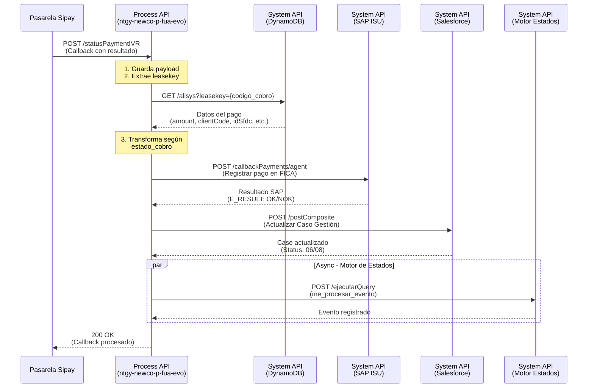
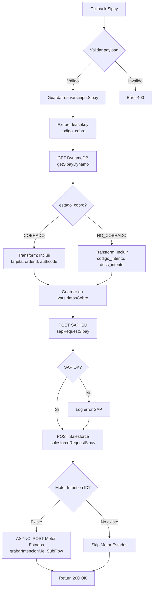

# POST /statusPaymentIVR

## 📌 Descripción General

Endpoint de callback que recibe notificaciones de la pasarela de pagos Sipay sobre el resultado de pagos realizados mediante IVR (Interactive Voice Response). Este endpoint forma parte del proceso de "Pago de Deuda" y se encarga de procesar el resultado del pago, actualizando los sistemas backend correspondientes (SAP ISU, Salesforce y Motor de Estados).

**Tipo de API:** Process API  
**Patrón:** Callback/Webhook  
**Operación:** Procesamiento asíncrono de resultado de pago IVR

## 💼 Propósito del Negocio

### Contexto del Negocio

Este endpoint es parte fundamental del flujo de cobro por IVR, donde los clientes realizan pagos de deudas mediante llamada telefónica. La pasarela Sipay ejecuta el cobro y notifica el resultado a través de este callback, permitiendo:

1. **Registro contable en SAP ISU**: Contabilizar el pago (exitoso o fallido) en el sistema financiero
2. **Actualización de Caso de Gestión**: Mantener trazabilidad del proceso de cobro en Salesforce
3. **Seguimiento de intenciones**: Registrar el estado final del proceso en el Motor de Estados
4. **Recuperación de contexto**: Obtener información del pago desde DynamoDB para completar el proceso

### Casos de Uso

- **Pago exitoso por IVR**: Cliente completa el pago telefónico y se registra en todos los sistemas
- **Pago fallido por IVR**: Se registra el intento fallido con código y descripción del error
- **Trazabilidad completa**: Cada callback actualiza el Caso de Gestión con detalles del resultado

### Valor de Negocio

- ✅ **Automatización del cobro**: Procesamiento automático de pagos telefónicos sin intervención manual
- ✅ **Trazabilidad end-to-end**: Seguimiento completo desde la llamada hasta el registro contable
- ✅ **Conciliación automática**: Sincronización entre pasarela de pago, SAP y Salesforce
- ✅ **Gestión de errores**: Registro detallado de intentos fallidos para análisis y seguimiento

## 🔧 Especificación Técnica

### Request

**Método:** `POST`  
**Content-Type:** `application/json`

#### Estructura del Payload

```json
{
  "codigo_cobro": "0123456789",
  "estado_cobro": "COBRADO",
  "fecha_cobro": "2024-01-15 14:30:00",
  "orderid": "TXN123456",
  "reference": "REF789",
  "authcode": "AUTH456",
  "tarjeta": "************1234"
}
```

#### Payload para Pago Fallido

```json
{
  "codigo_cobro": "0123456789",
  "estado_cobro": "NO_COBRADO",
  "codigo_intento": "103",
  "desc_intento": "Tarjeta en lista negra o sospecha de fraude"
}
```

#### Parámetros del Request

| Campo | Tipo | Requerido | Descripción |
|-------|------|-----------|-------------|
| `codigo_cobro` | String | Sí | Identificador único del cobro (leasekey en DynamoDB) |
| `estado_cobro` | String | Sí | Estado del cobro: "COBRADO" o "NO_COBRADO" |
| `fecha_cobro` | String | Condicional | Fecha y hora del cobro (formato: yyyy-MM-dd HH:mm:ss). Requerido si estado_cobro = "COBRADO" |
| `orderid` | String | Condicional | ID de la transacción en Sipay. Requerido si estado_cobro = "COBRADO" |
| `reference` | String | Condicional | Referencia de la transacción. Requerido si estado_cobro = "COBRADO" |
| `authcode` | String | Condicional | Código de autorización del pago. Requerido si estado_cobro = "COBRADO" |
| `tarjeta` | String | Condicional | Número de tarjeta enmascarado. Requerido si estado_cobro = "COBRADO" |
| `codigo_intento` | String | Condicional | Código de error. Requerido si estado_cobro = "NO_COBRADO" |
| `desc_intento` | String | Condicional | Descripción del error. Requerido si estado_cobro = "NO_COBRADO" |

### Response

#### Response Exitoso (200 OK)

```json
{
  "result": {
    "codResult": "0000",
    "msgResult": "Callback procesado correctamente"
  }
}
```

#### Response de Error (400 Bad Request)

```json
{
  "result": {
    "codResult": "1001",
    "msgResult": "Error al procesar callback"
  }
}
```

#### Response de Error (500 Internal Server Error)

```json
{
  "result": {
    "codResult": "1013",
    "msgResult": "Error interno del servidor"
  }
}
```

### Códigos de Estado HTTP

| Código | Descripción |
|--------|-------------|
| 200 | Callback procesado correctamente |
| 400 | Request inválido o datos faltantes |
| 500 | Error interno del servidor |

## 🏗️ Implementación Técnica

### Arquitectura del Flujo



### Flujo de Datos Detallado



### Transformaciones de Datos

#### 1. Transformación Inicial según Estado (Líneas 2567-2608)

**Ubicación:** `callbackPaymentsIVR_AgentFlow` (payments.xml)

```dataweave
%dw 2.0
output application/json

// Para estado_cobro = "COBRADO"
var cardInput = if(isEmpty(payload.tarjeta)) (null) else payload.tarjeta [12 to 15]
---
{
  "codigo_cobro": payload.codigo_cobro,
  "estado_cobro": payload.estado_cobro,
  "fecha_cobro": payload.fecha_cobro,
  "orderid": payload.orderid,
  "reference": payload.reference,
  "authcode": payload.authcode,
  "card": payload.tarjeta,
  "paymentMode": "Tarjeta",
  "operationType": "IVR"
}

// Para estado_cobro = "NO_COBRADO"
---
{
  "codigo_cobro": payload.codigo_cobro,
  "estado_cobro": payload.estado_cobro,
  "codigo_intento": payload.codigo_intento,
  "desc_intento": payload.desc_intento,
  "paymentMode": "Tarjeta",
  "operationType": "IVR"
}
```

**Propósito:** Normalizar el payload de Sipay según el resultado del pago, agregando campos estándar como `paymentMode` y `operationType`.

#### 2. Transformación para SAP ISU (Líneas 2886-2936)

**Ubicación:** `sapRequestSipay` (payments.xml)

```dataweave
%dw 2.0
import * from dw::core::Strings
output application/json

var statusSipay = if(vars.datosCobro.estado_cobro == "COBRADO") "1" else "2"
var statusDescSipay = if(vars.datosCobro.estado_cobro == "COBRADO") 
  "Approved" 
  else 
  "Unexpected Gateway Response: 103 - Card in Blacklist or suspected of fraud"

var modifDate = vars.datosCobro.fecha_cobro replace " " with(";")
var payDate = substringBefore(modifDate, ";")
var endDate = payDate replace "-" with("")
---
{
  amount: vars.getSipay.amount,
  paymentDate: endDate,
  merchantTransactionId: vars.datosCobro.codigo_cobro,
  status: statusSipay,
  statusDescription: statusDescSipay,
  telephone: trim(if(isEmpty(vars.getSipay.telephone)) (null) else vars.getSipay.telephone),
  operationType: vars.datosCobro.operationType,
  source: "A" // viene de Alisys/Sipay
}
```

**Propósito:** Transformar datos al formato requerido por SAP ISU para el RFC `ZFI_FM_PAGO_TPV`, convirtiendo estados y formateando fechas.

#### 3. Transformación para Salesforce (Líneas 3121-3160)

**Ubicación:** `salesforceRequestSipay` (payments.xml)

```dataweave
%dw 2.0
output application/json

var resultStatus = if(vars.respSAP.ZFI_FM_PAGO_TPV.export.E_RESULT == "OK" 
  and vars.datosCobro.'estado_cobro' == "COBRADO") "OK" else "KO"

var descSipay = if(vars.datosCobro.estado_cobro != "COBRADO") 
  vars.datosCobro.desc_intento default "Se ha producido un error desconocido en pasarela de pago"
  else if(vars.respSAP.ZFI_FM_PAGO_TPV.export.E_RESULT == "NOK") 
    vars.respSAP.ZFI_FM_PAGO_TPV.export.ES_ERROR.DESCRIPTION
  else if(vars.flagErrorSAP == true) 
    "El pago se realizo con exito pero no se ha contabilizado en SAP" 
  else 
    "El pago se realizo con exito"

fun concatena(valor) =
  (write(valor, "application/json", {"indent":false}) as String ++ '\r' 
    replace "{" with "" 
    replace "}" with "" 
    replace "," with "\r\n") 
    replace "\"" with ""
---
{
  "allOrNone": true,
  "collateSubrequests": false,
  "compositeRequest": [
    {
      "method": "PATCH",
      "url": "/services/data/v52.0/sobjects/Case/" ++ vars.getSipay.idSfdc,
      "referenceId": "updatedCase",
      "body": {
        "Status": 
          if((vars.flagErrorSAP == true or vars.respSAP.ZFI_FM_PAGO_TPV.export.E_RESULT == "NOK") 
            and vars.datosCobro.'estado_cobro' == "COBRADO")  
            "02"
          else if(resultStatus == "OK")
            "06"
          else if(vars.datosCobro.'estado_cobro' != "COBRADO")
            "08"
          else 
            "02",
        "NewCo_OperationAmount__c": vars.getSipay.amount,
        "NewCo_OperationDate__c": now() as String {format: "uuuu-MM-dd'T'HH:mm:ss'Z'"},
        "NewCo_OperationResult__c": resultStatus,
        "NewCo_ResultDescription__c": descSipay,
        "NewCo_PaymentMode__c": vars.datosCobro.paymentMode,
        "comments": "[Actualización final CG tras pago]\r\n" ++ 
          "fecha: " ++ ((now() >> "Europe/Madrid") as String {format: "yyyy-MM-dd HH:mm:ss"}) ++ 
          "\r\n[Respuesta Final Pasarela Pago]\r\n" ++ concatena(vars.inputSipay) ++ 
          "\r\n[Respuesta Final SAP]\r\n" ++ concatena(vars.respSAP)
      }
    }
  ]
}
```

**Propósito:** Actualizar el Caso de Gestión en Salesforce con el resultado final del pago, incluyendo estado, descripción y comentarios detallados.

#### 4. Transformación para Motor de Estados (common.xml)

**Ubicación:** `grabarIntencionMe_SubFlow` (common.xml)

```dataweave
%dw 2.0
output application/json

var medioPago = if (!isEmpty(vars.datosCobro.card)) 
  vars.datosCobro.card 
  else 
  vars.datosCobro.pasarela

var comentario = "Método: " ++ (vars.datosCobro.metodo default "") ++ " | " ++ 
  "Código: " ++ (vars.datosCobro.codigo_cobro default "") ++ " | " ++ 
  "Estado: " ++ (vars.datosCobro.estado_cobro default "") ++ " | " ++ 
  "Medio: " ++ (medioPago default "")
---
{
  "evento": "PROCESO_FINALIZADO",
  "jsonPayload": {
    "comentario": comentario 
  }
}
```

**Propósito:** Preparar datos para registrar el evento `PROCESO_FINALIZADO` en el Motor de Estados, incluyendo detalles del pago en el comentario.

### Dependencias de Sistemas

#### 1. DynamoDB (ntgy-newco-s-dynamodb)

**Operación:** Recuperar datos del pago

```http
GET /alisys?leasekey={codigo_cobro}
```

**Response esperado:**
```json
{
  "leaseKey": "0123456789",
  "amount": "150.50",
  "clientCode": "12345678A",
  "idSfdc": "500xx000000XXXXX",
  "telephone": "666777888",
  "invoice": "FE2024001234"
}
```

#### 2. SAP ISU (ntgy-newco-s-sap)

**Operación:** Registrar pago en FICA

```http
POST /callbackPayments/agent
Content-Type: application/json

{
  "amount": "150.50",
  "paymentDate": "20240115",
  "merchantTransactionId": "0123456789",
  "status": "1",
  "statusDescription": "Approved",
  "telephone": "666777888",
  "operationType": "IVR",
  "source": "A"
}
```

**Response esperado:**
```json
{
  "ZFI_FM_PAGO_TPV": {
    "export": {
      "E_RESULT": "OK",
      "ES_ERROR": {
        "DESCRIPTION": ""
      }
    }
  }
}
```

#### 3. Salesforce (ntgy-newco-s-salesforce-evo)

**Operación:** Actualizar Caso de Gestión

```http
POST /postComposite
Content-Type: application/json

{
  "allOrNone": true,
  "collateSubrequests": false,
  "compositeRequest": [
    {
      "method": "PATCH",
      "url": "/services/data/v52.0/sobjects/Case/500xx000000XXXXX",
      "referenceId": "updatedCase",
      "body": {
        "Status": "06",
        "NewCo_OperationAmount__c": "150.50",
        "NewCo_OperationDate__c": "2024-01-15T14:30:00Z",
        "NewCo_OperationResult__c": "OK",
        "NewCo_ResultDescription__c": "El pago se realizo con exito",
        "NewCo_PaymentMode__c": "Tarjeta",
        "comments": "[Actualización final CG tras pago]..."
      }
    }
  ]
}
```

#### 4. Motor de Estados (ntgy-fua-s-rds-postgres)

**Operación:** Registrar evento (Asíncrono)

```http
POST /ejecutarQuery
Content-Type: application/json

{
  "query": "SELECT public.me_procesar_evento('12345678A','PagoDeuda',NULL,'PROCESO_FINALIZADO',NULL,'500xx000000XXXXX','{\"comentario\":\"Método: IVR | Código: 0123456789 | Estado: COBRADO | Medio: ************1234\"}','2024-01-15T14:30:00',NULL,NULL)"
}
```

### Manejo de Errores

#### Errores de DynamoDB

```xml
<on-error-continue>
  <logger message="Error recuperando datos de DynamoDB: #[error.description]"/>
  <!-- Continúa el flujo sin datos de contexto -->
</on-error-continue>
```

#### Errores de SAP

```xml
<on-error-continue>
  <logger message="Error SAP: #[error.description]"/>
  <set-variable variableName="flagErrorSAP" value="#[true]"/>
  <!-- Continúa para actualizar Salesforce con error -->
</on-error-continue>
```

#### Errores de Salesforce

```xml
<on-error-continue>
  <logger message="Error actualizar CG SF: #[error.errorMessage.payload]"/>
  <!-- Registra error pero no detiene el flujo -->
</on-error-continue>
```

### Configuración

**Archivo:** `src/main/resources/properties/ntgy-newco-p-fua-{env}.yaml`

```yaml
# DynamoDB
ntgy-newco-s-dynamodb:
  functions:
    getAlisys: "/alisys"

# SAP ISU
ntgy-newco-s-sap:
  functions:
    postCallbackPayAgent: "/callbackPayments/agent"

# Salesforce
ntgy-newco-s-salesforce:
  pathGenericComposite: "/postComposite"

# Motor de Estados
s-rds-postgres:
  timeoutEventoMotorEstados: "30000"
```

## 💻 Ejemplos de Uso

### Ejemplo 1: Callback de Pago Exitoso

**Request:**

```bash
curl -X POST "https://api.naturgy.com/p-fua-evo/v1/statusPaymentIVR" \
  -H "Content-Type: application/json" \
  -d '{
    "codigo_cobro": "0987654321",
    "estado_cobro": "COBRADO",
    "fecha_cobro": "2024-01-15 14:30:00",
    "orderid": "TXN987654",
    "reference": "REF456789",
    "authcode": "AUTH789",
    "tarjeta": "************5678"
  }'
```

**Response:**

```json
{
  "result": {
    "codResult": "0000",
    "msgResult": "Callback procesado correctamente"
  }
}
```

**Flujo ejecutado:**
1. ✅ Recupera datos de DynamoDB (amount: 250.00, clientCode: 87654321B)
2. ✅ Transforma a formato con tarjeta enmascarada
3. ✅ Registra pago en SAP ISU (status: 1 - Approved)
4. ✅ Actualiza Case en Salesforce (Status: 06 - Cerrado)
5. ✅ Registra evento PROCESO_FINALIZADO en Motor de Estados

### Ejemplo 2: Callback de Pago Fallido

**Request:**

```bash
curl -X POST "https://api.naturgy.com/p-fua-evo/v1/statusPaymentIVR" \
  -H "Content-Type: application/json" \
  -d '{
    "codigo_cobro": "0987654321",
    "estado_cobro": "NO_COBRADO",
    "codigo_intento": "103",
    "desc_intento": "Tarjeta en lista negra o sospecha de fraude"
  }'
```

**Response:**

```json
{
  "result": {
    "codResult": "0000",
    "msgResult": "Callback procesado correctamente"
  }
}
```

**Flujo ejecutado:**
1. ✅ Recupera datos de DynamoDB
2. ✅ Transforma a formato con código de error
3. ✅ Registra intento fallido en SAP ISU (status: 2 - Rejected)
4. ✅ Actualiza Case en Salesforce (Status: 08 - Cancelado)
5. ✅ Registra evento PROCESO_FINALIZADO en Motor de Estados

### Ejemplo 3: Error en SAP pero Pago Exitoso

**Escenario:** El pago se realizó correctamente en Sipay pero SAP ISU no está disponible.

**Request:**

```bash
curl -X POST "https://api.naturgy.com/p-fua-evo/v1/statusPaymentIVR" \
  -H "Content-Type: application/json" \
  -d '{
    "codigo_cobro": "0987654321",
    "estado_cobro": "COBRADO",
    "fecha_cobro": "2024-01-15 14:30:00",
    "orderid": "TXN987654",
    "reference": "REF456789",
    "authcode": "AUTH789",
    "tarjeta": "************5678"
  }'
```

**Response:**

```json
{
  "result": {
    "codResult": "0000",
    "msgResult": "Callback procesado correctamente"
  }
}
```

**Flujo ejecutado:**
1. ✅ Recupera datos de DynamoDB
2. ✅ Transforma a formato con tarjeta
3. ❌ Error al registrar en SAP ISU (timeout o error de conexión)
4. ✅ Actualiza Case en Salesforce (Status: 02 - En Proceso, con nota de error SAP)
5. ✅ Registra evento en Motor de Estados

**Salesforce Case Comments:**
```
[Actualización final CG tras pago]
fecha: 2024-01-15 14:30:00
[Respuesta Final Pasarela Pago]
codigo_cobro: 0987654321
estado_cobro: COBRADO
...
[Respuesta Final SAP]
ERROR: Timeout al conectar con SAP ISU
```

### Ejemplo 4: Callback con Datos Incompletos

**Request:**

```bash
curl -X POST "https://api.naturgy.com/p-fua-evo/v1/statusPaymentIVR" \
  -H "Content-Type: application/json" \
  -d '{
    "codigo_cobro": "0987654321",
    "estado_cobro": "COBRADO"
  }'
```

**Response:**

```json
{
  "result": {
    "codResult": "1001",
    "msgResult": "Datos incompletos en el callback"
  }
}
```

**Validaciones:**
- ❌ Falta `fecha_cobro` (requerido para estado COBRADO)
- ❌ Falta `orderid` (requerido para estado COBRADO)
- ❌ Falta `tarjeta` (requerido para estado COBRADO)