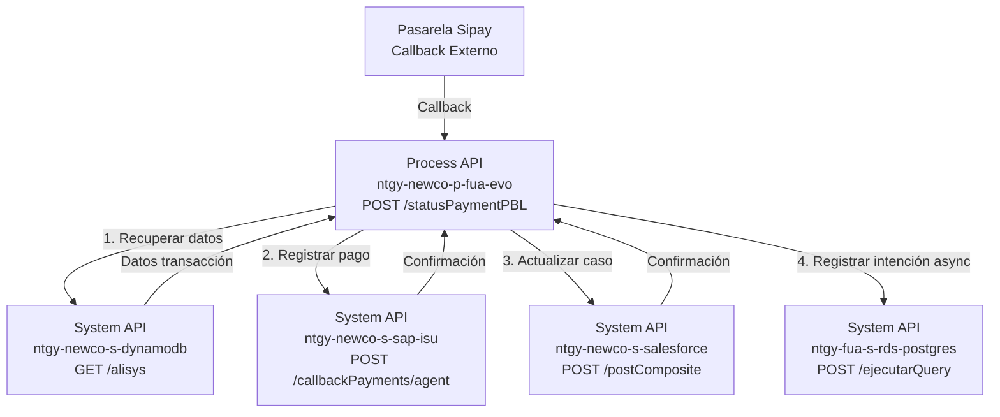
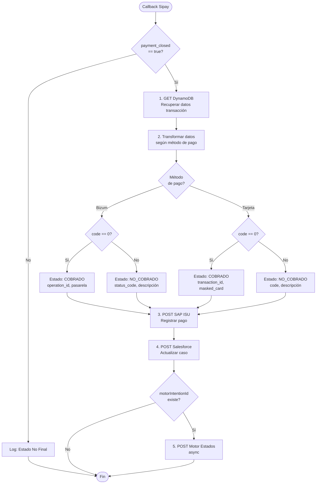
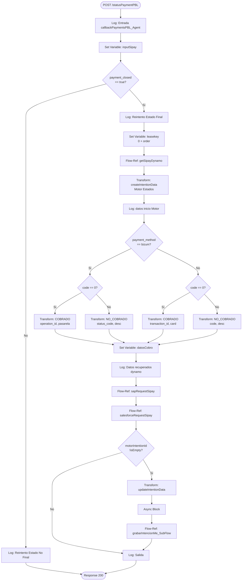
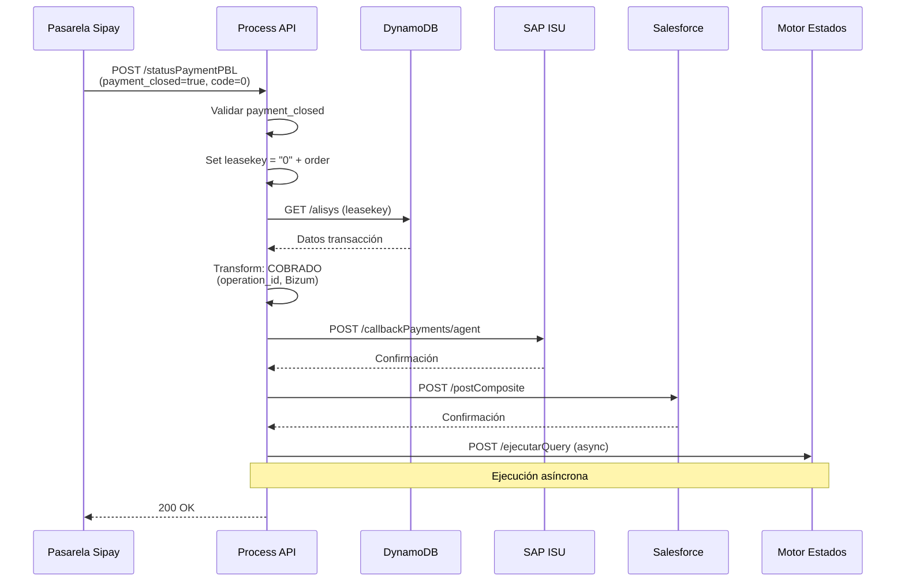
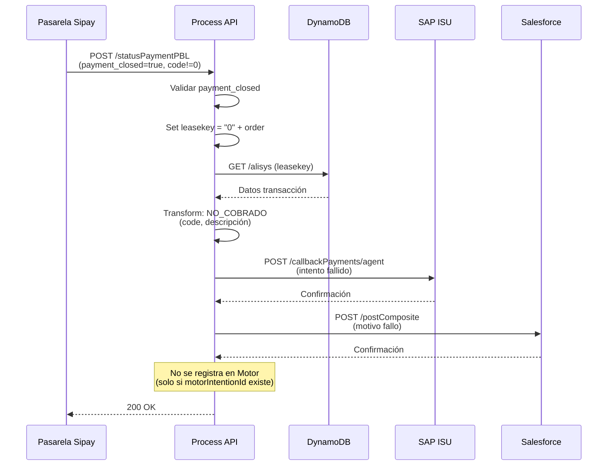
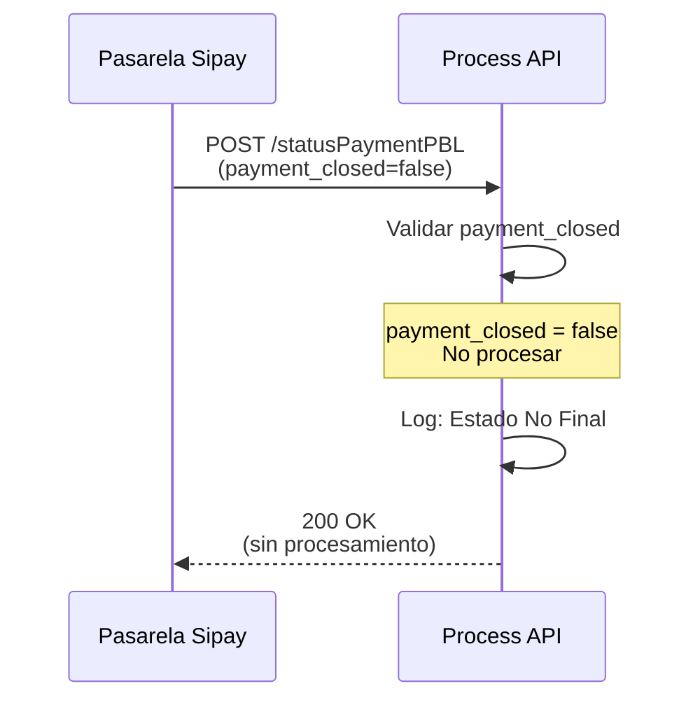

# POST /statusPaymentPBL

## 📌 Descripción General

### Propósito del Endpoint

Endpoint de callback que recibe notificaciones de estado de pagos desde la pasarela de pagos Sipay para el flujo de Payment By Link (PBL). Procesa callbacks de pagos realizados mediante Bizum o Tarjeta, orquestando actualizaciones en múltiples sistemas backend (DynamoDB, SAP ISU, Salesforce y Motor de Estados) según el resultado del pago.

### Tipo de API

**Capa:** Process API (API-Led Connectivity)

**Función:** Orquestación de proceso de callback de pagos PBL con actualización multi-sistema

### Patrón de Integración

**Tipo:** Orquestación Compleja con Lógica Condicional

**Descripción:** 
- Recibe callback de Sipay con estado del pago
- Valida si la transacción está cerrada (`payment_closed == true`)
- Recupera datos de la transacción desde DynamoDB
- Transforma datos según método de pago (Bizum vs Tarjeta)
- Registra pago en SAP ISU
- Actualiza caso en Salesforce
- Registra intención en Motor de Estados (asíncrono)

### Arquitectura API-Led Connectivity



---

## 💼 Propósito del Negocio

### Casos de Uso Principales

1. **Callback de Pago Exitoso con Bizum**
   - Sipay notifica pago exitoso realizado con Bizum
   - Se registra el pago en SAP ISU con `operation_id`
   - Se actualiza el caso de gestión en Salesforce
   - Beneficio: Sincronización automática del pago en todos los sistemas

2. **Callback de Pago Exitoso con Tarjeta**
   - Sipay notifica pago exitoso realizado con Tarjeta
   - Se registra el pago en SAP ISU con `transaction_id` y tarjeta enmascarada
   - Se actualiza el caso de gestión en Salesforce
   - Beneficio: Trazabilidad completa del pago con datos de la tarjeta

3. **Callback de Pago Fallido**
   - Sipay notifica intento de pago fallido (código != "0")
   - Se registra el intento fallido con código y descripción del error
   - Se actualiza el caso en Salesforce con el motivo del fallo
   - Beneficio: Visibilidad del motivo del fallo para seguimiento

4. **Callback de Transacción No Cerrada**
   - Sipay notifica estado intermedio (`payment_closed == false`)
   - Se registra en logs pero no se procesan actualizaciones
   - Beneficio: Evita procesamiento prematuro de transacciones en curso

### 🔗 Endpoints Dependientes

Este Process API consume los siguientes System APIs:

| System API | Endpoint | Método | Propósito |
|------------|----------|--------|-----------|
| `ntgy-newco-s-dynamodb` | `/alisys` | GET | Recupera datos de la transacción Sipay almacenados previamente |
| `ntgy-newco-s-sap-isu` | `/callbackPayments/agent` | POST | Registra el pago en SAP ISU con resultado del callback |
| `ntgy-newco-s-salesforce` | `/postComposite` | POST | Actualiza el caso de gestión en Salesforce |
| `ntgy-fua-s-rds-postgres` | `/ejecutarQuery` | POST | Registra intención de proceso finalizado (asíncrono) |

### Lógica de Orquestación



**Pasos del Proceso:**

1. **Validación de Estado**: Verifica si `payment_closed == true` (transacción finalizada)
2. **Recuperación de Datos**: Obtiene datos de la transacción desde DynamoDB usando `leasekey`
3. **Transformación Condicional**: Transforma datos según método de pago y resultado:
   - **Bizum Exitoso**: `estado_cobro: COBRADO`, incluye `operation_id` y `pasarela: Bizum`
   - **Bizum Fallido**: `estado_cobro: NO_COBRADO`, incluye `status_code` y descripción del error
   - **Tarjeta Exitosa**: `estado_cobro: COBRADO`, incluye `transaction_id` y `masked_card`
   - **Tarjeta Fallida**: `estado_cobro: NO_COBRADO`, incluye `code` y descripción del error
4. **Registro en SAP**: Envía datos transformados a SAP ISU para registro contable
5. **Actualización Salesforce**: Actualiza caso de gestión con resultado del pago
6. **Motor de Estados**: Registra intención de proceso finalizado (solo si existe `motorIntentionId`)

### Transformaciones Aplicadas

#### Transformación por Método de Pago

**Bizum - Pago Exitoso (code == "0"):**

| Campo Sipay | Campo Transformado | Valor |
|-------------|-------------------|-------|
| `order` | `codigo_cobro` | `"0" ++ order` (prefijo "0") |
| `code` | `estado_cobro` | `"COBRADO"` |
| `operation_id` | `orderid` | Valor directo |
| - | `fecha_cobro` | `now()` formato "yyyy-MM-dd HH:mm:ss" |
| - | `pasarela` | `"Bizum"` |
| - | `paymentMode` | `"Bizum"` |
| - | `operationType` | `"PBB"` (Pago Bizum) |

**Bizum - Pago Fallido (code != "0"):**

| Campo Sipay | Campo Transformado | Valor |
|-------------|-------------------|-------|
| `order` | `codigo_cobro` | `"0" ++ order` |
| `code` | `estado_cobro` | `"NO_COBRADO"` |
| `status_code` | `codigo_intento` | Valor directo |
| - | `desc_intento` | Lookup en properties: `sipayBizum.resultCodes.code_[status_code]` |
| - | `paymentMode` | `"Bizum"` |
| - | `operationType` | `"PBB"` |

**Tarjeta - Pago Exitoso (code == "0"):**

| Campo Sipay | Campo Transformado | Valor |
|-------------|-------------------|-------|
| `order` | `codigo_cobro` | `"0" ++ order` |
| `code` | `estado_cobro` | `"COBRADO"` |
| `transaction_id` | `orderid` | Valor directo |
| `masked_card` | `card` | Valor directo (tarjeta enmascarada) |
| - | `fecha_cobro` | `now()` formato "yyyy-MM-dd HH:mm:ss" |
| - | `paymentMode` | `"Tarjeta"` |
| - | `operationType` | `"PBT"` (Pago Tarjeta) |

**Tarjeta - Pago Fallido (code != "0"):**

| Campo Sipay | Campo Transformado | Valor |
|-------------|-------------------|-------|
| `order` | `codigo_cobro` | `"0" ++ order` |
| `code` | `estado_cobro` | `"NO_COBRADO"` |
| `code` | `codigo_intento` | Valor directo |
| - | `desc_intento` | Lookup en properties: `sipayCardPBL.resultCodes.code_[code]` |
| `type` | `paymentMode` | `""` si type == "expired", sino `"Tarjeta"` |
| `type` | `operationType` | `"PBE"` si type == "expired", sino `"PBT"` |

### Contexto Empresarial

- **Dominio:** Gestión de Pagos y Cobros
- **Sector:** Energía - Utilities
- **División:** Naturgy España - NewCo
- **Proceso de Negocio:** Callback de pagos Payment By Link (PBL) desde pasarela Sipay

### Stakeholders

- **Pasarela Sipay**: Sistema externo que envía callbacks de estado de pagos
- **Departamento de Cobros**: Necesita visibilidad del estado de pagos en SAP ISU
- **Agentes de Call Center**: Consultan estado de pagos en Salesforce
- **Clientes**: Realizan pagos mediante Bizum o Tarjeta a través de links de pago

### Valor de Negocio

- **Automatización Completa**: Sincronización automática del resultado del pago en todos los sistemas
- **Trazabilidad**: Registro completo del pago con método, fecha, identificadores y resultado
- **Visibilidad de Errores**: Captura y registro de motivos de fallo para análisis y seguimiento
- **Integración Multi-Sistema**: Actualización coordinada en DynamoDB, SAP ISU, Salesforce y Motor de Estados

### Consumidores Potenciales

Este endpoint es consumido exclusivamente por:
- **Pasarela de Pagos Sipay**: Sistema externo que envía callbacks automáticos

---

## 🔧 Especificación Técnica

### URLs por Ambiente

| Ambiente | URL Base | URL Completa |
|----------|----------|--------------|
| **Local** | `http://localhost:8081` | `http://localhost:8081/api/statusPaymentPBL` |
| **Development** | `https://ntgy-newco-p-fua-evo-dev.us-e2.cloudhub.io` | `https://ntgy-newco-p-fua-evo-dev.us-e2.cloudhub.io/api/statusPaymentPBL` |
| **UAT** | `https://ntgy-newco-p-fua-evo-uat.us-e2.cloudhub.io` | `https://ntgy-newco-p-fua-evo-uat.us-e2.cloudhub.io/api/statusPaymentPBL` |
| **Production** | `https://ntgy-newco-p-fua-evo-pro.us-e2.cloudhub.io` | `https://ntgy-newco-p-fua-evo-pro.us-e2.cloudhub.io/api/statusPaymentPBL` |

### Método HTTP

```
POST /api/statusPaymentPBL
```

### Parámetros de Entrada

#### Headers

| Header | Tipo | Requerido | Descripción |
|--------|------|-----------|-------------|
| `Content-Type` | string | Sí | Debe ser `application/json` |

#### Body (JSON)

**Estructura del Callback de Sipay:**

```json
{
  "payment_closed": boolean,
  "order": "string",
  "code": "string",
  "payment_method": "bizum" | "card",
  
  // Campos específicos de Bizum
  "operation_id": "string",
  "status_code": "string",
  
  // Campos específicos de Tarjeta
  "transaction_id": "string",
  "masked_card": "string",
  "type": "string"
}
```

**Campos Principales:**

| Campo | Tipo | Requerido | Descripción |
|-------|------|-----------|-------------|
| `payment_closed` | boolean | Sí | Indica si la transacción está finalizada |
| `order` | string | Sí | Identificador del pedido (se convierte en `leasekey` con prefijo "0") |
| `code` | string | Sí | Código de resultado ("0" = éxito, otro = error) |
| `payment_method` | string | Sí | Método de pago: "bizum" o "card" |

**Campos Bizum (cuando payment_method == "bizum"):**

| Campo | Tipo | Requerido | Descripción |
|-------|------|-----------|-------------|
| `operation_id` | string | Condicional | ID de operación Bizum (si code == "0") |
| `status_code` | string | Condicional | Código de estado Bizum (si code != "0") |

**Campos Tarjeta (cuando payment_method != "bizum"):**

| Campo | Tipo | Requerido | Descripción |
|-------|------|-----------|-------------|
| `transaction_id` | string | Condicional | ID de transacción (si code == "0") |
| `masked_card` | string | Condicional | Tarjeta enmascarada (si code == "0") |
| `type` | string | Opcional | Tipo de error (ej: "expired") |

### Respuestas

#### 200 OK - Callback Procesado

**Descripción:** El callback fue procesado correctamente.

El endpoint construye una respuesta estándar después de procesar el callback y actualizar todos los sistemas backend (DynamoDB, SAP ISU, Salesforce y Motor de Estados).

**Respuesta de Éxito:**

Cuando el callback se procesa correctamente (`code == "0"`):

```json
{
  "result": {
    "codResult": "0000",
    "msgResult": "No hay error"
  }
}
```

**Respuesta con Error en Pasarela:**

Cuando hay un error en la pasarela de pago (`code != "0"`):

```json
{
  "result": {
    "codResult": "[código_error]",
    "msgResult": "Se ha producido un error en pasarela de pago"
  }
}
```

**Nota:** El `codResult` corresponde al código devuelto por la pasarela Sipay en el callback original. El endpoint siempre devuelve HTTP 200, pero el código de resultado interno indica si hubo éxito o error.

#### 400 Bad Request - Datos Inválidos

**Descripción:** El payload del callback no cumple con el formato esperado

```json
{
  "code": "400",
  "message": "Bad request",
  "details": "Invalid payload structure"
}
```

#### 500 Internal Server Error - Error de Procesamiento

**Descripción:** Error al procesar el callback o al comunicarse con sistemas backend

```json
{
  "code": "500",
  "message": "Internal server error",
  "details": "Error processing callback"
}
```

### Autenticación

- **Tipo:** Client ID & Client Secret (Anypoint Platform)
- **Nota:** Sipay debe estar configurado con las credenciales correctas para invocar este endpoint

### Timeouts

| Tipo | Valor |
|------|-------|
| **Request Timeout** | 60 segundos |
| **Connection Timeout** | 30 segundos |

### Códigos de Resultado Sipay

#### Bizum

Los códigos de resultado de Bizum se mapean desde properties:
- `sipayBizum.resultCodes.code_[status_code]`

Ejemplos comunes:
- `0`: Operación exitosa
- `1`: Operación rechazada
- `2`: Timeout
- `3`: Error técnico

#### Tarjeta

Los códigos de resultado de Tarjeta se mapean desde properties:
- `sipayCardPBL.resultCodes.code_[code]`

Ejemplos comunes:
- `0`: Pago autorizado
- `101`: Tarjeta caducada
- `102`: Fondos insuficientes
- `103`: Tarjeta bloqueada

---

## 🏗️ Implementación Técnica

### Arquitectura del Flow



### Transformaciones DataWeave

#### 1. Inicialización de Datos para Motor de Estados

```dataweave
%dw 2.0
output application/java
---
{
	evento: "",
	proceso: "PagoDeuda",
	nif: vars.getSipay.clientCode,
	billingAccount: "",
	contrato: "",
	casoGestion: "",
	jsonPayload: {}
}
```

#### 2. Transformación Bizum Exitoso

```dataweave
%dw 2.0
output application/json
---
{
	"codigo_cobro": vars.leasekey,
	"estado_cobro": "COBRADO",
	"fecha_cobro": now() as String {format: "yyyy-MM-dd HH:mm:ss"},
	"orderid": vars.inputSipay.operation_id,
	"pasarela": "Bizum",
	"paymentMode": "Bizum",
	"operationType" : "PBB"
}
```

#### 3. Transformación Bizum Fallido

```dataweave
%dw 2.0
output application/json
---
{
	"codigo_cobro": vars.leasekey,
	"estado_cobro": "NO_COBRADO",
	"codigo_intento": vars.inputSipay.status_code,
	"desc_intento": Mule::p("sipayBizum.resultCodes.code_" ++ vars.inputSipay.status_code),
	"paymentMode": "Bizum",
	"operationType" : "PBB"
}
```

#### 4. Transformación Tarjeta Exitosa

```dataweave
%dw 2.0
output application/json
---
{
	"codigo_cobro": vars.leasekey,
	"estado_cobro": "COBRADO",
	"fecha_cobro": now() as String {format: "yyyy-MM-dd HH:mm:ss"},
	"orderid": vars.inputSipay.transaction_id,
	"card": vars.inputSipay.masked_card,
	"paymentMode": "Tarjeta",
 	"operationType" : "PBT"
}
```

#### 5. Transformación Tarjeta Fallida

```dataweave
%dw 2.0
output application/json
---
{
	"codigo_cobro": vars.leasekey,
	"estado_cobro": "NO_COBRADO",
	"codigo_intento": vars.inputSipay.code,
	"desc_intento": Mule::p("sipayCardPBL.resultCodes.code_" ++ vars.inputSipay.code),
	"paymentMode": (if (vars.inputSipay."type" == "expired") "" else "Tarjeta"),
	"operationType": (if (vars.inputSipay."type" == "expired") "PBE" else "PBT")
}
```

#### 6. Actualización de Intención para Motor de Estados

```dataweave
%dw 2.0
output application/json

var medioPago = if (!isEmpty(vars.datosCobro.card)) 
                   vars.datosCobro.card 
                else 
                   vars.datosCobro.pasarela

var comentario = "Método: " ++ (vars.datosCobro.metodo default "") ++ " | " ++ 
				 "Código: " ++ (vars.datosCobro.codigo_cobro default "") ++ " | " ++ 
				 "Estado: " ++ (vars.datosCobro.estado_cobro default "") ++ " | " ++ 
				 "Medio: " ++ (medioPago default "")
---
{
	"evento": "PROCESO_FINALIZADO",
	"jsonPayload": {
		"comentario": comentario 
	}
}
```

### Patrones de Diseño

**Patrón 1: Content-Based Routing**

**Justificación:** Se utiliza para enrutar el flujo según el método de pago (Bizum vs Tarjeta) y el resultado del pago (exitoso vs fallido), aplicando transformaciones específicas para cada caso.

**Patrón 2: Asynchronous Processing**

**Justificación:** El registro en el Motor de Estados se ejecuta de forma asíncrona para no bloquear la respuesta del callback, mejorando el tiempo de respuesta.

**Patrón 3: Data Enrichment**

**Justificación:** Se recuperan datos adicionales de DynamoDB para enriquecer la información del callback antes de registrar en SAP ISU y Salesforce.

### Diagramas de Secuencia

#### 1. Flujo Normal de Éxito - Pago con Bizum



#### 2. Flujo con Pago Fallido - Tarjeta



#### 3. Flujo con Transacción No Cerrada



### Manejo de Errores

#### Estrategia de Manejo de Errores

1. **Error de Validación (payment_closed = false)**
   - Acción: Log y respuesta 200 OK sin procesamiento
   - No se considera error, es un estado intermedio válido

2. **Error en DynamoDB**
   - Acción: Propagar error, respuesta 500
   - Impacto: No se puede recuperar datos de la transacción

3. **Error en SAP ISU**
   - Acción: Propagar error, respuesta 500
   - Impacto: El pago no se registra contablemente

4. **Error en Salesforce**
   - Acción: Propagar error, respuesta 500
   - Impacto: El caso no se actualiza con el resultado

5. **Error en Motor de Estados**
   - Acción: Log del error (ejecución asíncrona)
   - Impacto: No afecta la respuesta del callback

#### Error Handler Global

El endpoint utiliza el error handler global del API que transforma todos los errores a formato estándar:

```json
{
  "code": "ERROR_CODE",
  "message": "Error message",
  "details": "Additional details"
}
```

---

## 💻 Ejemplos de Uso

### Ejemplo 1: Callback de Pago Exitoso con Bizum

#### Request desde Sipay

```bash
curl -X POST "https://ntgy-newco-p-fua-evo-pro.us-e2.cloudhub.io/api/statusPaymentPBL" \
  -H "Content-Type: application/json" \
  -H "client_id: YOUR_CLIENT_ID" \
  -H "client_secret: YOUR_CLIENT_SECRET" \
  -d '{
    "payment_closed": true,
    "order": "123456789",
    "code": "0",
    "payment_method": "bizum",
    "operation_id": "BZM-20260907-001234"
  }'
```

#### Respuesta (200 OK)

⚠️ **Nota:** La respuesta real proviene de Salesforce (último subflujo ejecutado).

```json
{
  "compositeResponse": [
    {
      "body": {
        "id": "500XXXXXXXXXXXXXXX",
        "success": true,
        "errors": []
      },
      "httpHeaders": {},
      "httpStatusCode": 200,
      "referenceId": "refCaseUpdate"
    }
  ]
}
```

**Para estructura detallada:** Revisar implementación de `salesforceRequestSipay.xml` para identificar el endpoint exacto de Salesforce

### Ejemplo 2: Callback de Pago Exitoso con Tarjeta

#### Request desde Sipay

```bash
curl -X POST "https://ntgy-newco-p-fua-evo-pro.us-e2.cloudhub.io/api/statusPaymentPBL" \
  -H "Content-Type: application/json" \
  -H "client_id: YOUR_CLIENT_ID" \
  -H "client_secret: YOUR_CLIENT_SECRET" \
  -d '{
    "payment_closed": true,
    "order": "987654321",
    "code": "0",
    "payment_method": "card",
    "transaction_id": "TXN-20260907-005678",
    "masked_card": "************1234"
  }'
```

#### Respuesta (200 OK)

```json
{
  "result": {
    "codResult": "0000",
    "msgResult": "No hay error"
  }
}
```

### Ejemplo 3: Callback de Pago Fallido con Bizum

#### Request desde Sipay

```bash
curl -X POST "https://ntgy-newco-p-fua-evo-pro.us-e2.cloudhub.io/api/statusPaymentPBL" \
  -H "Content-Type: application/json" \
  -H "client_id: YOUR_CLIENT_ID" \
  -H "client_secret: YOUR_CLIENT_SECRET" \
  -d '{
    "payment_closed": true,
    "order": "555666777",
    "code": "1",
    "payment_method": "bizum",
    "status_code": "102"
  }'
```

#### Respuesta (200 OK)

```json
{
  "result": {
    "codResult": "102",
    "msgResult": "Se ha producido un error en pasarela de pago"
  }
}
```

**Nota adicional:** El pago se registra como NO_COBRADO con código de intento 102 (ej: "Fondos insuficientes")

### Ejemplo 4: Callback de Transacción No Cerrada

#### Request desde Sipay

```bash
curl -X POST "https://ntgy-newco-p-fua-evo-pro.us-e2.cloudhub.io/api/statusPaymentPBL" \
  -H "Content-Type: application/json" \
  -H "client_id: YOUR_CLIENT_ID" \
  -H "client_secret: YOUR_CLIENT_SECRET" \
  -d '{
    "payment_closed": false,
    "order": "111222333",
    "code": "0",
    "payment_method": "bizum"
  }'
```

#### Respuesta (200 OK)

⚠️ **Nota:** Cuando `payment_closed = false`, el endpoint termina sin procesar actualizaciones y devuelve una respuesta vacía o mínima.

```json
{
  "result": {
    "codResult": "0000",
    "msgResult": "No hay error"
  }
}
```

**Nota adicional:** No se procesa ninguna actualización en backends, solo se registra en logs como "Estado No Final". La respuesta es estándar aunque no se haya procesado el callback.

### Ejemplo 5: JavaScript (Node.js)

```javascript
const axios = require('axios');

async function sendPaymentCallback() {
  try {
    const response = await axios.post(
      'https://ntgy-newco-p-fua-evo-pro.us-e2.cloudhub.io/api/statusPaymentPBL',
      {
        payment_closed: true,
        order: '123456789',
        code: '0',
        payment_method: 'bizum',
        operation_id: 'BZM-20260907-001234'
      },
      {
        headers: {
          'Content-Type': 'application/json',
          'client_id': 'YOUR_CLIENT_ID',
          'client_secret': 'YOUR_CLIENT_SECRET'
        }
      }
    );
    
    console.log('Callback procesado:', response.data);
  } catch (error) {
    console.error('Error:', error.response?.data || error.message);
  }
}

sendPaymentCallback();
```

### Ejemplo 6: Python

```python
import requests
import json

def send_payment_callback():
    url = 'https://ntgy-newco-p-fua-evo-pro.us-e2.cloudhub.io/api/statusPaymentPBL'
    
    headers = {
        'Content-Type': 'application/json',
        'client_id': 'YOUR_CLIENT_ID',
        'client_secret': 'YOUR_CLIENT_SECRET'
    }
    
    payload = {
        'payment_closed': True,
        'order': '987654321',
        'code': '0',
        'payment_method': 'card',
        'transaction_id': 'TXN-20260907-005678',
        'masked_card': '************1234'
    }
    
    try:
        response = requests.post(url, headers=headers, json=payload)
        response.raise_for_status()
        print('Callback procesado:', response.json())
    except requests.exceptions.RequestException as e:
        print('Error:', e)

send_payment_callback()
```

### Ejemplo 7: Error - Datos Inválidos

#### Request con Payload Inválido

```bash
curl -X POST "https://ntgy-newco-p-fua-evo-pro.us-e2.cloudhub.io/api/statusPaymentPBL" \
  -H "Content-Type: application/json" \
  -H "client_id: YOUR_CLIENT_ID" \
  -H "client_secret: YOUR_CLIENT_SECRET" \
  -d '{
    "invalid_field": "value"
  }'
```

#### Respuesta (400 Bad Request)

```json
{
  "code": "400",
  "message": "Bad request",
  "details": "Missing required field: payment_closed"
}
```
