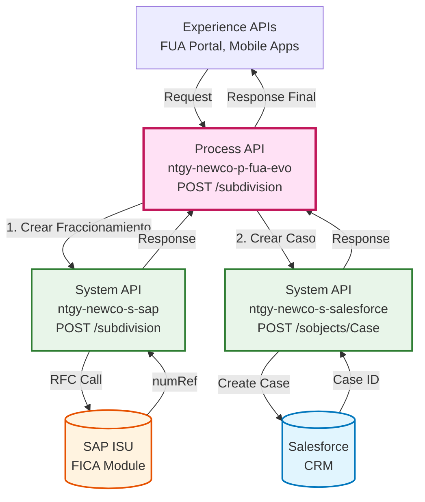
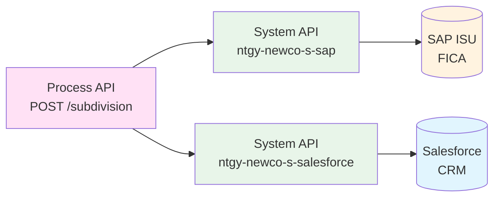
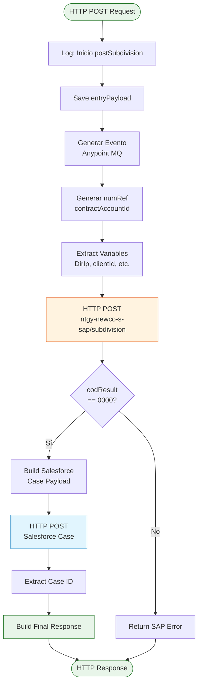
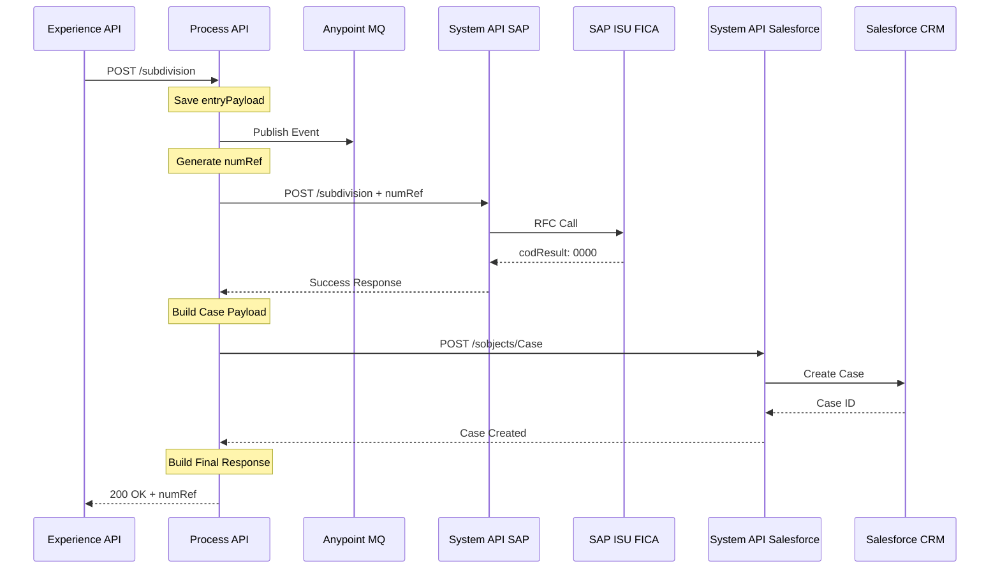
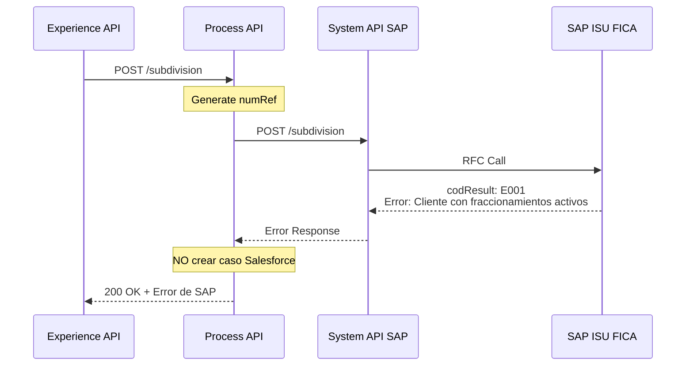
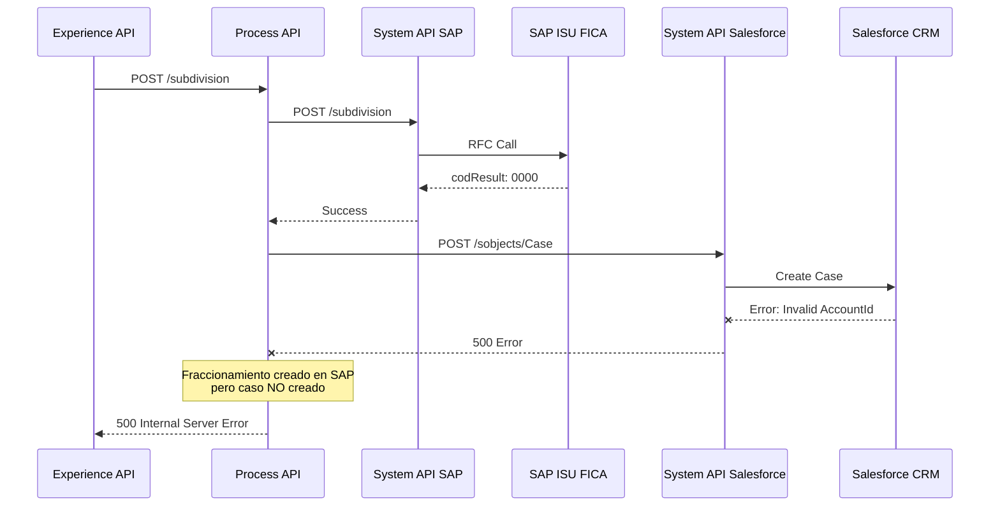

# POST /subdivision

## 📌 Descripción General

### Propósito del Endpoint

Este endpoint crea un nuevo fraccionamiento de pago (plan de pago a plazos) en SAP ISU para una cuenta contrato específica. Implementa un **patrón de orquestación secuencial** que primero registra el fraccionamiento en SAP y, si es exitoso, crea automáticamente un caso de gestión en Salesforce para trazabilidad completa del proceso.

### Tipo de API

**Capa:** Process API (API-Led Connectivity)

**Función:** Orquestación de alta de fraccionamiento con registro en CRM

### Patrón de Integración

**Tipo:** Orquestación Secuencial (SAP → Salesforce)

**Descripción:** Coordina la creación del fraccionamiento en el sistema de billing (SAP ISU) y el registro del caso de gestión en el CRM (Salesforce), garantizando trazabilidad end-to-end del proceso de negocio.

### Arquitectura API-Led Connectivity



---

## 💼 Propósito del Negocio

### Casos de Uso Principales

1. **Solicitud de Plan de Pago por Cliente**
   - El cliente solicita fraccionar una deuda desde el portal FUA
   - Define número de cuotas e importe de primera cuota
   - **Beneficio:** Facilita el pago de deudas y reduce morosidad

2. **Gestión de Fraccionamiento por Agente**
   - El agente de call center crea un fraccionamiento para el cliente
   - Registra la solicitud con trazabilidad completa
   - **Beneficio:** Mejor servicio al cliente y control de gestión

3. **Regularización de Deuda**
   - El departamento de cobranza ofrece planes de pago
   - Evita cortes de suministro por impago
   - **Beneficio:** Mejora la recuperación de deuda y satisfacción del cliente

### 🔗 Endpoints Dependientes

Este Process API consume los siguientes System APIs:

| System API | Endpoint | Método | Propósito |
|------------|----------|--------|-----------|
| `ntgy-newco-s-sap` | `/subdivision` | POST | Crea fraccionamiento en SAP ISU FICA |
| `ntgy-newco-s-salesforce` | `/modificaciones/casos` | POST | Crea caso de gestión en Salesforce |

### Lógica de Orquestación



**Pasos del Proceso:**

1. **Paso 1**: Genera evento de trazabilidad (Anypoint MQ)
2. **Paso 2**: Genera numRef único para el fraccionamiento
3. **Paso 3**: Invoca SAP para crear el fraccionamiento
4. **Paso 4**: Si exitoso → Crea caso de gestión en Salesforce
5. **Paso 5**: Devuelve respuesta con numRef y resultado

### Transformaciones Aplicadas

#### Transformación 1: Enriquecimiento de Request

| Campo Original | Campo Añadido | Transformación |
|----------------|---------------|----------------|
| `payload` | `refNum` | Genera numRef único (contractAccountId) |
| `payload` | `DirIp` | Extrae IP del cliente |
| `payload` | `clientId` | Extrae de payload |
| `payload` | `contactId` | Extrae de payload |

#### Transformación 2: Creación de Caso Salesforce

**Mapeo de campos para caso de gestión:**

| Campo Salesforce | Origen | Descripción |
|------------------|--------|-------------|
| `NewCo_Recordtype__c` | Constante: "Gestion" | Tipo de caso |
| `AccountId` | `payload.x-client-id` | ID del cliente |
| `ContactId` | `payload.x-contact-id` | ID del contacto |
| `Status` | Constante: "06" | Estado cerrado |
| `NewCo_Contract__c` | `payload.contractId` | ID del contrato |
| `Origin` | Constante: "FUA" | Canal de origen |
| `Description` | "Alta Fraccionamiento " + numRef | Descripción |
| `acn_fld_Tittle__r.NewCo_ExternalId__c` | "AltaFraccionamiento" | Título del caso |

### Contexto Empresarial

- **Dominio:** Gestión de Pagos y Cobranza
- **Sector:** Energía - Utilities
- **División:** Naturgy España - NewCo
- **Proceso de Negocio:** Alta de Fraccionamientos de Pago (FICA)

### Stakeholders

- **Clientes Residenciales**: Solicitan planes de pago para gestionar deudas
- **Agentes de Call Center**: Crean fraccionamientos en nombre del cliente
- **Departamento de Cobranza**: Gestionan recuperación de deuda
- **Equipo de Auditoría**: Requieren trazabilidad de operaciones

### Valor de Negocio

- **Reducción de Morosidad**: Facilita el pago de deudas pendientes
- **Mejora de Cash Flow**: Recuperación gradual de deuda
- **Satisfacción del Cliente**: Opciones flexibles de pago
- **Trazabilidad Completa**: Registro en CRM para auditoría

### Consumidores Potenciales

Este endpoint puede ser consumido por:
- Portal web FUA
- Aplicaciones móviles de clientes
- Sistemas de agentes de call center
- Herramientas de gestión de cobranza

---

## 🔧 Especificación Técnica

### URLs por Ambiente

| Ambiente | URL Base | URL Completa |
|----------|----------|--------------|
| **Local** | `http://localhost:8081` | `http://localhost:8081/api/subdivision` |
| **Development** | `https://ntgy-newco-p-fua-evo-dev.us-e2.cloudhub.io` | `https://ntgy-newco-p-fua-evo-dev.us-e2.cloudhub.io/api/subdivision` |
| **UAT** | `https://ntgy-newco-p-fua-evo-uat.us-e2.cloudhub.io` | `https://ntgy-newco-p-fua-evo-uat.us-e2.cloudhub.io/api/subdivision` |
| **Production** | `https://ntgy-newco-p-fua-evo-pro.us-e2.cloudhub.io` | `https://ntgy-newco-p-fua-evo-pro.us-e2.cloudhub.io/api/subdivision` |

### Método HTTP

```
POST /api/subdivision
```

### Parámetros de Entrada

#### Request Body (application/json)

```json
{
  "clientId": "string",
  "contractAccountId": "string",
  "contractId": "string",
  "totalAmount": "number",
  "installments": "number",
  "firstInstallmentPercentage": "number",
  "x-client-id": "string",
  "x-contact-id": "string",
  "x-user-id": "string",
  "x-interaction-id": "string",
  "x-agent-mail": "string",
  "DirIp": "string",
  "traceparent": "string"
}
```

#### Campos Obligatorios

| Campo | Tipo | Descripción | Ejemplo |
|-------|------|-------------|---------|
| `clientId` | string | ID del cliente en Salesforce | `"0031w00000AbCdEFG"` |
| `contractAccountId` | string | Cuenta contrato en SAP | `"200123456"` |
| `contractId` | string | ID del contrato en Salesforce | `"8001w00000AbCdEFG"` |
| `totalAmount` | number | Importe total a fraccionar | `450.75` |
| `installments` | number | Número de cuotas | `6` |
| `firstInstallmentPercentage` | number | % de primera cuota (opcional) | `20` |

#### Campos de Trazabilidad

| Campo | Tipo | Descripción | Ejemplo |
|-------|------|-------------|---------|
| `x-client-id` | string | ID del cliente (Account) | `"0011w00000AbCdEFG"` |
| `x-contact-id` | string | ID del contacto | `"0031w00000XyZaBC"` |
| `x-user-id` | string | ID del usuario/agente | `"0051w00000PqRsT"` |
| `x-interaction-id` | string | ID del caso de interacción | `"5001w00000UvWxY"` |
| `x-agent-mail` | string | Email del agente | `"agente@naturgy.com"` |
| `DirIp` | string | IP del cliente | `"192.168.1.100"` |
| `traceparent` | string | Trace ID para correlación | `"00-abc123-def456-01"` |

### Respuestas

#### 200 OK - Fraccionamiento Creado

**Descripción:** Fraccionamiento creado exitosamente en SAP y caso registrado en Salesforce

```json
{
  "result": {
    "codResult": "0000",
    "msgResult": "Fraccionamiento creado exitosamente"
  },
  "numRef": "1234567890"
}
```

#### 200 OK - Error de SAP

**Descripción:** SAP devolvió error al crear el fraccionamiento

```json
{
  "result": {
    "codResult": "E001",
    "msgResult": "Cliente tiene fraccionamientos activos pendientes"
  }
}
```

#### 400 Bad Request

**Descripción:** Parámetros faltantes o inválidos

```json
{
  "code": "BAD_REQUEST",
  "message": "Campo contractAccountId es obligatorio",
  "timestamp": "2026-08-26T12:00:00Z"
}
```

#### 500 Internal Server Error

**Descripción:** Error interno del servidor

```json
{
  "code": "INTERNAL_ERROR",
  "message": "Error al procesar la solicitud",
  "timestamp": "2026-08-26T12:00:00Z"
}
```

### Autenticación

- **Tipo:** Client ID & Client Secret (Anypoint Platform)
- **Headers requeridos:** `client_id`, `client_secret`

### Timeouts

| Tipo | Valor |
|------|-------|
| **Request Timeout (SAP)** | 30 segundos |
| **Request Timeout (Salesforce)** | 60 segundos |
| **Connection Timeout** | 10 segundos |

---

## 🏗️ Implementación Técnica

### Arquitectura del Flow



### Código del Flow (Simplificado)

**Archivo:** `src/main/mule/services/invoices/subdivision.xml`

**Subflow:** `postSubdivision`

```xml
<sub-flow name="postSubdivision">
    <logger level="INFO" message="Inicio postSubdivision: #[payload]"/>
    
    <!-- Guardar payload original -->
    <set-variable variableName="entryPayload" value="#[payload]"/>
    
    <!-- Generar evento de trazabilidad -->
    <flow-ref name="generarEventoFlow"/>
    
    <!-- Generar numRef único -->
    <set-variable variableName="numRef" 
                  value="#[vars.entryPayload.contractAccountId]"/>
    
    <!-- Extraer variables -->
    <ee:transform>
        <ee:variables>
            <ee:set-variable variableName="DirIp">
                attributes.headers.'x-real-ip' default "0.0.0.0"
            </ee:set-variable>
            <ee:set-variable variableName="clientId">
                payload.clientId
            </ee:set-variable>
            <ee:set-variable variableName="preferredContactId">
                payload.contactId
            </ee:set-variable>
        </ee:variables>
    </ee:transform>
    
    <!-- Llamada a SAP -->
    <http:request method="POST" 
                  config-ref="HTTP_Request_ntgy-newco-s-sap" 
                  path="${ntgy-newco-s-sap.functions.subdivision}">
        <http:body>
            #[vars.entryPayload ++ {refNum: vars.numRef}]
        </http:body>
    </http:request>
    
    <logger level="INFO" message="Respuesta SAP: #[payload]"/>
    
    <!-- Choice: ¿Éxito en SAP? -->
    <choice>
        <when expression='#[payload.result.codResult == "0000"]'>
            <!-- Crear caso en Salesforce -->
            <ee:transform>
                <ee:set-payload>
                    {
                      "allOrNone": true,
                      "compositeRequest": [{
                        "method": "POST",
                        "url": "/services/data/v52.0/sobjects/Case",
                        "referenceId": "refCaseGestion",
                        "body": {
                          "NewCo_Recordtype__c": "Gestion",
                          "AccountId": vars.entryPayload."x-client-id",
                          "ContactId": vars.entryPayload."x-contact-id",
                          "Status": "06",
                          "NewCo_Contract__c": vars.entryPayload.contractId,
                          "Origin": "FUA",
                          "Description": "Alta Fraccionamiento " ++ vars.numRef,
                          "NewCo_Creado_por__c": vars.entryPayload.'x-user-id',
                          "NewCo_Ip__c": vars.entryPayload.DirIp,
                          "acn_fld_Tittle__r": {
                            "NewCo_ExternalId__c": "AltaFraccionamiento"
                          }
                        }
                      }]
                    }
                </ee:set-payload>
            </ee:transform>
            
            <http:request method="POST" 
                          config-ref="HTTP_Request_ntgy_newco_s_salesforce" 
                          path="${ntgy-newco-s-salesforce.pathCasos}">
                <http:headers>
                    username: vars.entryPayload.'x-agent-mail'
                </http:headers>
            </http:request>
            
            <!-- Extraer ID del caso -->
            <set-variable variableName="idCase" 
                          value='#[(payload.compositeResponse filter 
                                    ((item, index) -> item.referenceId == "refCaseGestion"))[0].body.id]'/>
            
            <!-- Respuesta final -->
            <ee:transform>
                <ee:set-payload>
                    {
                      "result": {
                        "codResult": payload.result.codResult,
                        "msgResult": payload.result.msgResult
                      },
                      "numRef": vars.numRef
                    }
                </ee:set-payload>
            </ee:transform>
        </when>
        <otherwise>
            <!-- Devolver error de SAP -->
            <ee:transform>
                <ee:set-payload>
                    payload
                </ee:set-payload>
            </ee:transform>
        </otherwise>
    </choice>
    
    <logger level="INFO" message="Respuesta final: #[payload]"/>
</sub-flow>
```

### Transformaciones DataWeave

#### Transformación 1: Enriquecimiento de Request para SAP

**Ubicación:** Inline en flow (línea 47)

```dataweave
%dw 2.0
output application/json
---
vars.entryPayload ++ {refNum: vars.numRef}
```

**Explicación:** Añade el `refNum` generado al payload original.

#### Transformación 2: Creación de Caso Salesforce

**Ubicación:** Inline en flow (líneas 67-103)

```dataweave
%dw 2.0
output application/json
---
{
  "allOrNone": true,
  "collateSubrequests": false,
  "compositeRequest": [
    {
      "method": "POST",
      "url": "/services/data/v52.0/sobjects/Case",
      "referenceId": "refCaseGestion",
      "body": {
        "NewCo_Recordtype__c": "Gestion",
        "AccountId": vars.entryPayload."x-client-id",
        "ContactId": vars.entryPayload."x-contact-id",
        "Status": "06",
        "NewCo_Contract__c": vars.entryPayload.contractId,
        "Origin": "FUA",
        ("OwnerId": vars.entryPayload."x-user-id") if (!isEmpty(vars.entryPayload."x-user-id")),
        "Description": "Alta Fraccionamiento " ++ vars.numRef,
        "NewCo_Creado_por__c": if (vars.entryPayload.'x-user-id' != null) 
                                  vars.entryPayload.'x-user-id' 
                                else 
                                  vars.entryPayload."x-contact-id",
        ("ParentId": vars.entryPayload."x-interaction-id") if (vars.entryPayload."x-interaction-id"?),
        "NewCo_Ip__c": vars.entryPayload.DirIp,
        "NewCo_CorrelationId__c": correlationId,
        "acn_fld_Tittle__r": {
          "NewCo_ExternalId__c": "AltaFraccionamiento"
        },
        "NewCo_TraceId__c": splitBy(vars.entryPayload.traceparent, "-")[1]
      }
    }
  ]
}
```

**Campos Condicionales:**
- `OwnerId`: Solo si `x-user-id` no está vacío
- `ParentId`: Solo si existe `x-interaction-id`

#### Transformación 3: Respuesta Final

**Ubicación:** Inline en flow (líneas 115-125)

```dataweave
%dw 2.0
output application/json
---
if (payload.result.codResult == "0000") {
  result: {
    codResult: payload.result.codResult,
    msgResult: payload.result.msgResult
  },
  numRef: vars.numRef
}
else payload
```

### Patrones de Diseño

#### Patrón 1: Saga Pattern (Simplificado)

**Justificación:** Coordina transacciones distribuidas entre SAP y Salesforce

**Implementación:**
- Paso 1: Crear fraccionamiento en SAP (transacción principal)
- Paso 2: Si exitoso → Crear caso en Salesforce (registro de auditoría)
- No hay rollback automático (compensación manual si es necesario)

#### Patrón 2: Event Sourcing

**Justificación:** Trazabilidad completa del proceso

**Implementación:**
- Genera evento al inicio (Anypoint MQ)
- Registra caso en Salesforce con todos los detalles
- Permite auditoría y seguimiento end-to-end

### Diagramas de Secuencia

#### 1. Flujo Normal de Éxito



#### 2. Flujo con Error de SAP



#### 3. Flujo con Error de Salesforce



**⚠️ Nota Importante:** Si Salesforce falla, el fraccionamiento YA está creado en SAP. Se requiere compensación manual o proceso de reconciliación.

### Manejo de Errores

#### Estrategia de Manejo

| Tipo de Error | Acción | Respuesta |
|---------------|--------|-----------|
| **Error de SAP (codResult != 0000)** | No crear caso Salesforce | 200 OK con error de SAP |
| **Error de Salesforce** | Propagar error | 500 Internal Server Error |
| **Parámetros faltantes** | Validación RAML | 400 Bad Request |
| **Timeout SAP** | Retry automático | 3 intentos con backoff |
| **Timeout Salesforce** | Retry automático | 3 intentos con backoff |

#### Códigos de Error SAP Comunes

| Código | Descripción | Acción Recomendada |
|--------|-------------|-------------------|
| `0000` | Éxito | Continuar con Salesforce |
| `E001` | Cliente con fraccionamientos activos | Informar al usuario |
| `E002` | Importe inválido | Validar datos de entrada |
| `E003` | Cuenta contrato no encontrada | Verificar contractAccountId |
| `E004` | Cliente no elegible | Verificar condiciones de negocio |

---

## 💻 Ejemplos de Uso

### Ejemplo 1: Creación Exitosa de Fraccionamiento

#### cURL

```bash
curl -X POST "https://ntgy-newco-p-fua-evo-dev.us-e2.cloudhub.io/api/subdivision" \
  -H "Content-Type: application/json" \
  -H "client_id: YOUR_CLIENT_ID" \
  -H "client_secret: YOUR_CLIENT_SECRET" \
  -d '{
    "clientId": "0031w00000AbCdEFG",
    "contractAccountId": "200123456",
    "contractId": "8001w00000AbCdEFG",
    "totalAmount": 450.75,
    "installments": 6,
    "firstInstallmentPercentage": 20,
    "x-client-id": "0011w00000AbCdEFG",
    "x-contact-id": "0031w00000XyZaBC",
    "x-user-id": "0051w00000PqRsT",
    "x-interaction-id": "5001w00000UvWxY",
    "x-agent-mail": "agente@naturgy.com",
    "DirIp": "192.168.1.100",
    "traceparent": "00-abc123def456-789012-01"
  }'
```

#### Respuesta (200 OK)

```json
{
  "result": {
    "codResult": "0000",
    "msgResult": "Fraccionamiento creado exitosamente"
  },
  "numRef": "200123456"
}
```

**Interpretación:**
- `codResult: "0000"` → Operación exitosa
- `numRef` → Referencia única del fraccionamiento creado
- Caso de gestión creado automáticamente en Salesforce

### Ejemplo 2: Error - Cliente con Fraccionamientos Activos

#### cURL

```bash
curl -X POST "https://ntgy-newco-p-fua-evo-dev.us-e2.cloudhub.io/api/subdivision" \
  -H "Content-Type: application/json" \
  -H "client_id: YOUR_CLIENT_ID" \
  -H "client_secret: YOUR_CLIENT_SECRET" \
  -d '{
    "clientId": "0031w00000AbCdEFG",
    "contractAccountId": "200123456",
    "contractId": "8001w00000AbCdEFG",
    "totalAmount": 300.00,
    "installments": 3,
    "x-client-id": "0011w00000AbCdEFG",
    "x-contact-id": "0031w00000XyZaBC"
  }'
```

#### Respuesta (200 OK - Error de Negocio)

```json
{
  "result": {
    "codResult": "E001",
    "msgResult": "El cliente ya tiene fraccionamientos activos. No puede crear uno nuevo hasta liquidar los existentes."
  }
}
```

**Interpretación:**
- `codResult: "E001"` → Error de negocio de SAP
- NO se crea caso en Salesforce (solo se crea si SAP tiene éxito)
- El usuario debe liquidar fraccionamientos existentes primero

### Ejemplo 3: JavaScript con Manejo de Errores

```javascript
async function createSubdivision(subdivisionData) {
  try {
    const response = await fetch(
      'https://api.naturgy.com/subdivision',
      {
        method: 'POST',
        headers: {
          'Content-Type': 'application/json',
          'client_id': 'YOUR_CLIENT_ID',
          'client_secret': 'YOUR_CLIENT_SECRET'
        },
        body: JSON.stringify(subdivisionData)
      }
    );

    const data = await response.json();

    // Verificar código de resultado
    if (data.result.codResult === '0000') {
      console.log('✅ Fraccionamiento creado exitosamente');
      console.log(`Referencia: ${data.numRef}`);
      return {
        success: true,
        numRef: data.numRef,
        message: data.result.msgResult
      };
    } else {
      console.warn('⚠️ Error de negocio:', data.result.msgResult);
      return {
        success: false,
        error: data.result.codResult,
        message: data.result.msgResult
      };
    }

  } catch (error) {
    console.error('❌ Error técnico:', error);
    throw error;
  }
}

// Uso
const subdivisionData = {
  clientId: '0031w00000AbCdEFG',
  contractAccountId: '200123456',
  contractId: '8001w00000AbCdEFG',
  totalAmount: 450.75,
  installments: 6,
  firstInstallmentPercentage: 20,
  'x-client-id': '0011w00000AbCdEFG',
  'x-contact-id': '0031w00000XyZaBC',
  'x-user-id': '0051w00000PqRsT',
  DirIp: '192.168.1.100'
};

const result = await createSubdivision(subdivisionData);

if (result.success) {
  alert(`Fraccionamiento creado con referencia: ${result.numRef}`);
} else {
  alert(`No se pudo crear el fraccionamiento: ${result.message}`);
}
```

### Ejemplo 4: Python con Validación Previa

```python
import requests
from typing import Dict, Optional

def create_subdivision(
    client_id: str,
    contract_account_id: str,
    contract_id: str,
    total_amount: float,
    installments: int,
    first_installment_percentage: Optional[int] = None,
    **kwargs
) -> Dict:
    """
    Crea un fraccionamiento de pago en SAP ISU
    
    Args:
        client_id: ID del cliente en Salesforce
        contract_account_id: Cuenta contrato en SAP
        contract_id: ID del contrato en Salesforce
        total_amount: Importe total a fraccionar
        installments: Número de cuotas
        first_installment_percentage: Porcentaje de primera cuota (opcional)
        **kwargs: Campos adicionales de trazabilidad
    
    Returns:
        Dict con resultado de la operación
    """
    url = "https://api.naturgy.com/subdivision"
    
    # Construir payload
    payload = {
        'clientId': client_id,
        'contractAccountId': contract_account_id,
        'contractId': contract_id,
        'totalAmount': total_amount,
        'installments': installments
    }
    
    # Añadir campos opcionales
    if first_installment_percentage:
        payload['firstInstallmentPercentage'] = first_installment_percentage
    
    # Añadir campos de trazabilidad
    payload.update(kwargs)
    
    headers = {
        'Content-Type': 'application/json',
        'client_id': 'YOUR_CLIENT_ID',
        'client_secret': 'YOUR_CLIENT_SECRET'
    }
    
    try:
        response = requests.post(url, json=payload, headers=headers, timeout=60)
        response.raise_for_status()
        
        data = response.json()
        
        # Verificar resultado
        if data['result']['codResult'] == '0000':
            print(f"✅ Fraccionamiento creado: {data['numRef']}")
            return {
                'success': True,
                'numRef': data['numRef'],
                'message': data['result']['msgResult']
            }
        else:
            print(f"⚠️ Error de negocio: {data['result']['msgResult']}")
            return {
                'success': False,
                'error': data['result']['codResult'],
                'message': data['result']['msgResult']
            }
            
    except requests.exceptions.RequestException as e:
        print(f"❌ Error técnico: {e}")
        raise

# Uso
result = create_subdivision(
    client_id='0031w00000AbCdEFG',
    contract_account_id='200123456',
    contract_id='8001w00000AbCdEFG',
    total_amount=450.75,
    installments=6,
    first_installment_percentage=20,
    **{
        'x-client-id': '0011w00000AbCdEFG',
        'x-contact-id': '0031w00000XyZaBC',
        'x-user-id': '0051w00000PqRsT',
        'x-interaction-id': '5001w00000UvWxY',
        'x-agent-mail': 'agente@naturgy.com',
        'DirIp': '192.168.1.100',
        'traceparent': '00-abc123def456-789012-01'
    }
)

if result['success']:
    print(f"Referencia del fraccionamiento: {result['numRef']}")
else:
    print(f"Error: {result['message']}")
```

### Ejemplo 5: Error - Parámetros Faltantes

#### cURL

```bash
curl -X POST "https://ntgy-newco-p-fua-evo-dev.us-e2.cloudhub.io/api/subdivision" \
  -H "Content-Type: application/json" \
  -H "client_id: YOUR_CLIENT_ID" \
  -H "client_secret: YOUR_CLIENT_SECRET" \
  -d '{
    "clientId": "0031w00000AbCdEFG",
    "totalAmount": 450.75
  }'
```

#### Respuesta (400 Bad Request)

```json
{
  "code": "BAD_REQUEST",
  "message": "Required field 'contractAccountId' is missing",
  "timestamp": "2026-08-26T12:00:00Z"
}
```
