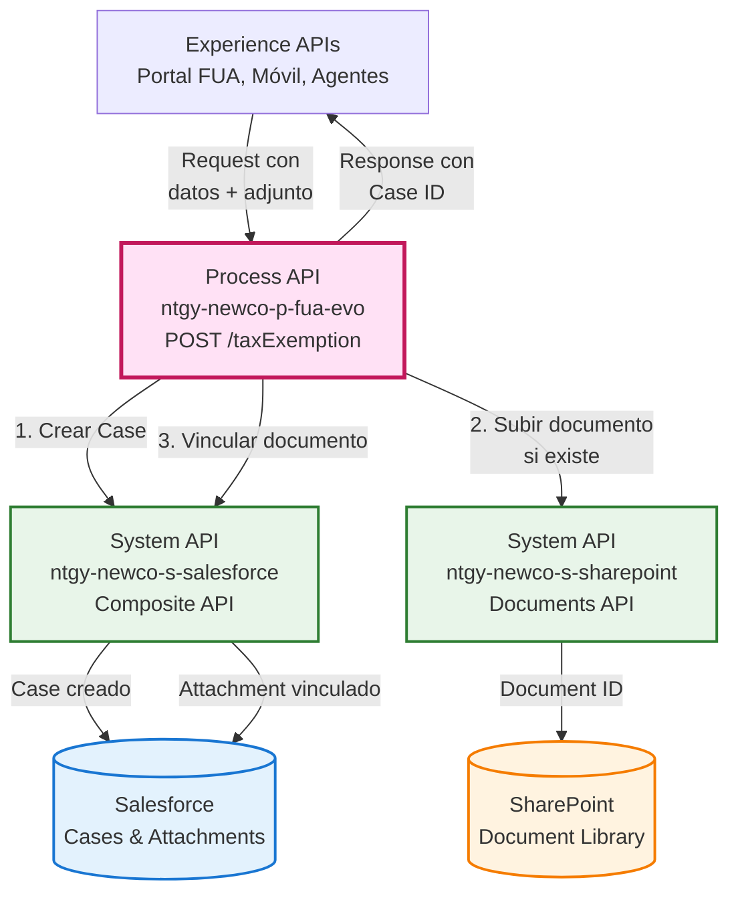
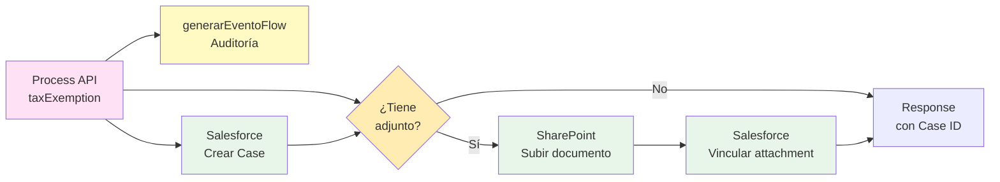
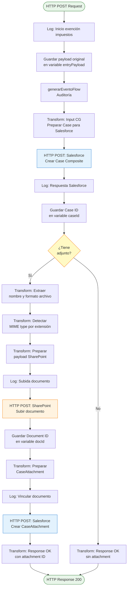
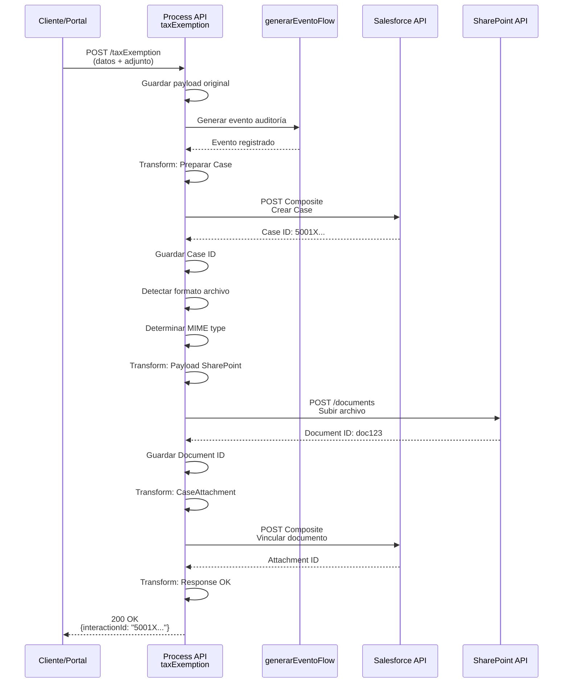
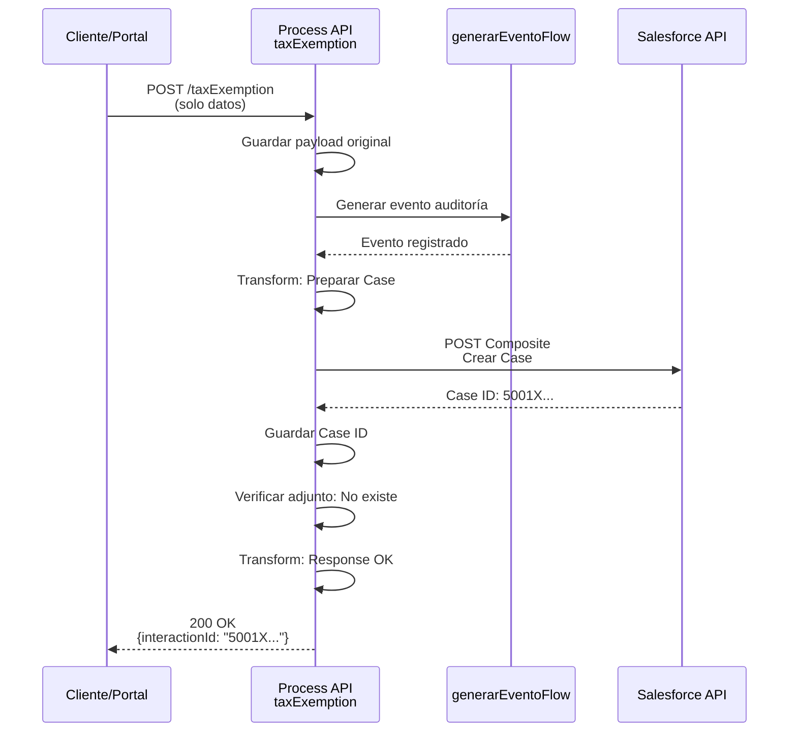
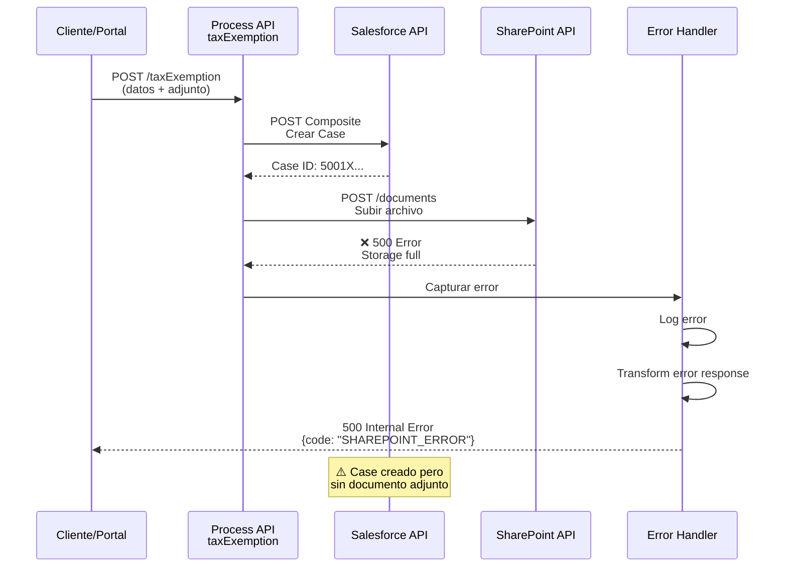

# POST /taxExemption

## 📌 Descripción General

### Propósito del Endpoint

Este endpoint orquesta el proceso completo de solicitud de exención de impuestos (eléctrico o gas) para clientes de Naturgy. Crea un caso de gestión en Salesforce y, opcionalmente, adjunta documentación justificativa almacenándola en SharePoint y vinculándola al caso.

### Tipo de API

**Capa:** Process API (API-Led Connectivity)

**Función:** Orquestación de proceso de negocio para gestión de exenciones fiscales

### Patrón de Integración

**Tipo:** Orquestación con Transformación

**Descripción:** Orquesta llamadas a Salesforce para creación de casos y a SharePoint para almacenamiento de documentos, aplicando transformaciones complejas de datos y lógica condicional para adjuntos.

### Arquitectura API-Led Connectivity



---

## 💼 Propósito del Negocio

### Casos de Uso Principales

1. **Solicitud de Exención de Impuesto Eléctrico**
   - Cliente solicita exención del impuesto eléctrico por cumplir requisitos legales
   - Se crea caso de gestión en Salesforce con tipo "Impuesto eléctrico"
   - Se adjunta documentación justificativa (certificados, resoluciones)
   - **Beneficio:** Automatización del proceso de solicitud y seguimiento

2. **Solicitud de Exención de Impuesto de Gas**
   - Cliente solicita exención del impuesto especial de hidrocarburos
   - Se crea caso de gestión con tipo "Impuesto gas"
   - Se vincula a cuenta de servicio y contrato específico
   - **Beneficio:** Trazabilidad completa del proceso de exención

3. **Gestión de Documentación Justificativa**
   - Almacenamiento seguro de documentos en SharePoint
   - Vinculación automática al caso de Salesforce
   - Marcado para envío a distribuidora
   - **Beneficio:** Centralización documental y cumplimiento normativo

### 🔗 Endpoints Dependientes

Este Process API consume los siguientes System APIs:

| System API | Endpoint | Método | Propósito |
|------------|----------|--------|-----------|
| `ntgy-newco-s-salesforce` | `/postComposite` | POST | Crear caso de gestión de exención |
| `ntgy-newco-s-sharepoint` | `/documents` | POST | Almacenar documento justificativo |
| `ntgy-newco-s-salesforce` | `/gasReadSend` | POST | Vincular documento al caso |

### Lógica de Orquestación



**Pasos del Proceso:**

1. **Generación de Evento**: Registra inicio del proceso en sistema de auditoría
2. **Creación de Case en Salesforce**: 
   - Tipo: "Gestion"
   - Estado: "02" (En proceso)
   - Prioridad: "02" (Normal)
   - Origen: "FUA"
   - Vinculado a cliente, contacto, cuenta de servicio y contrato
3. **Procesamiento Condicional de Adjunto**:
   - Si existe adjunto: Subir a SharePoint → Vincular a Case
   - Si no existe: Continuar sin adjunto
4. **Respuesta**: Retornar ID del caso creado

### Transformaciones Aplicadas

| Campo Original (Request) | Campo Transformado (Salesforce) | Transformación |
|--------------------------|----------------------------------|----------------|
| `x-client-id` | `AccountId` | Directo |
| `x-contact-id` | `ContactId` | Directo |
| `serviceAccount` | `vlocity_cmt__ServiceAccountId__c` | Directo |
| `contractId` | `NewCo_Contract__c` | Directo |
| `exemptionType` | `Description` | Directo |
| `exemptionType` | `acn_fld_BusinessLine__c` | Condicional: "Impuesto eléctrico" → "01", otros → "02" |
| `x-interaction-id` | `ParentId` | Directo (vincula a interacción padre) |
| `traceparent` | `NewCo_TraceId__c` | Extrae segundo segmento separado por "-" |
| `attach.fileNameWithExtension` | `acn_fld_Nombre_de_PDF__c` | Directo |
| `attach.file` | Documento en SharePoint | Base64 decode y subida |

**Transformaciones Especiales:**

- **Tipo de Documento**: Siempre "06.02" (Exención de impuestos)
- **Subtipo Gas**: Siempre "06" para documentos de gas
- **Envío a Distribuidora**: Marcado automáticamente como `true`
- **MIME Type**: Detectado automáticamente según extensión del archivo

### Contexto Empresarial

- **Dominio:** Gestión de Casos y Servicios al Cliente
- **Sector:** Energía - Utilities
- **División:** Naturgy España - NewCo
- **Proceso de Negocio:** Solicitud y gestión de exenciones fiscales en suministros energéticos

### Stakeholders

- **Clientes Finales**: Solicitan exención de impuestos por cumplir requisitos legales
- **Agentes de Atención al Cliente**: Procesan solicitudes de exención en nombre de clientes
- **Departamento Fiscal**: Revisa y aprueba solicitudes de exención
- **Distribuidoras**: Reciben documentación para aplicar exención en facturación

### Valor de Negocio

- **Automatización**: Reduce tiempo de procesamiento de solicitudes de exención
- **Trazabilidad**: Seguimiento completo del ciclo de vida de la solicitud
- **Cumplimiento**: Asegura documentación completa para auditorías fiscales
- **Experiencia del Cliente**: Proceso digital sin necesidad de visitas presenciales

### Consumidores Potenciales

Este endpoint puede ser consumido por:
- Portal web FUA
- Aplicaciones móviles de clientes
- Sistemas de agentes de call center
- Portales de gestión de agentes comerciales

---

## 🔧 Especificación Técnica

### URLs por Ambiente

| Ambiente | URL Base | URL Completa |
|----------|----------|--------------|
| **Local** | `http://localhost:8081` | `http://localhost:8081/api/taxExemption` |
| **Development** | `https://ntgy-newco-p-fua-evo-dev.us-e2.cloudhub.io` | `https://ntgy-newco-p-fua-evo-dev.us-e2.cloudhub.io/api/taxExemption` |
| **UAT** | `https://ntgy-newco-p-fua-evo-uat.us-e2.cloudhub.io` | `https://ntgy-newco-p-fua-evo-uat.us-e2.cloudhub.io/api/taxExemption` |
| **Production** | `https://ntgy-newco-p-fua-evo-pro.us-e2.cloudhub.io` | `https://ntgy-newco-p-fua-evo-pro.us-e2.cloudhub.io/api/taxExemption` |

### Método HTTP

```
POST /api/taxExemption
```

### Headers Requeridos

| Header | Tipo | Obligatorio | Descripción |
|--------|------|-------------|-------------|
| `Content-Type` | string | ✅ Sí | Debe ser `application/json` |
| `x-client-id` | string | ✅ Sí | ID del cliente en Salesforce (AccountId) |
| `x-contact-id` | string | ✅ Sí | ID del contacto en Salesforce |
| `x-client-code` | string | ✅ Sí | Código/NIF del cliente |
| `x-interaction-id` | string | ✅ Sí | ID de la interacción padre en Salesforce |
| `x-user-id` | string | ❌ No | ID del usuario/agente que crea el caso |
| `x-agent-mail` | string | ❌ No | Email del agente (para username en Salesforce) |
| `traceparent` | string | ✅ Sí | Trace ID para trazabilidad (formato: `00-{traceId}-{spanId}-{flags}`) |

### Parámetros de Entrada

#### Request Body

```json
{
  "serviceAccount": "string",
  "contractId": "string",
  "cups": "string",
  "exemptionType": "string",
  "DirIp": "string",
  "attach": {
    "fileNameWithExtension": "string",
    "file": "string (base64)"
  }
}
```

#### Descripción de Campos

| Campo | Tipo | Obligatorio | Descripción | Ejemplo |
|-------|------|-------------|-------------|---------|
| `serviceAccount` | string | ✅ Sí | ID de la cuenta de servicio en Salesforce | `"a1B2C3D4E5F6G7H8I9"` |
| `contractId` | string | ✅ Sí | ID del contrato en Salesforce | `"8001X000000AbCdQAK"` |
| `cups` | string | ✅ Sí | Código CUPS del punto de suministro | `"ES0021000000000001JN"` |
| `exemptionType` | string | ✅ Sí | Tipo de exención solicitada | `"Impuesto eléctrico"` o `"Impuesto gas"` |
| `DirIp` | string | ❌ No | Dirección IP del cliente | `"192.168.1.100"` |
| `attach` | object | ❌ No | Objeto con información del adjunto | Ver estructura abajo |
| `attach.fileNameWithExtension` | string | ⚠️ Condicional | Nombre completo del archivo con extensión | `"certificado_exencion.pdf"` |
| `attach.file` | string | ⚠️ Condicional | Contenido del archivo en base64 | `"JVBERi0xLjQKJeLjz9..."` |

**Nota sobre adjuntos:** Si se incluye el objeto `attach`, ambos campos (`fileNameWithExtension` y `file`) son obligatorios.

**Tipos de Exención Válidos:**
- `"Impuesto eléctrico"` → BusinessLine: "01" (Electricidad)
- Cualquier otro valor → BusinessLine: "02" (Gas)

**Formatos de Archivo Soportados:**
- PDF (`.pdf`)
- Word (`.doc`, `.docx`)
- Imágenes (`.png`, `.jpeg`, `.jpg`)
- Comprimidos (`.zip`)
- Excel (`.xls`, `.xlsx`)
- Texto (`.txt`, `.csv`, `.odt`)
- Audio (`.mp3`)
- AFP (`.afp`)

### Respuestas

#### 200 OK - Éxito

**Con adjunto procesado:**

```json
{
  "result": {
    "codResult": "0000",
    "msgResult": "No hay error"
  },
  "interactionId": "5001X000000AbCdQAK"
}
```

**Sin adjunto:**

```json
{
  "result": {
    "codResult": "0000",
    "msgResult": "No hay error"
  },
  "interactionId": "5001X000000AbCdQAK"
}
```

| Campo | Tipo | Descripción |
|-------|------|-------------|
| `result.codResult` | string | Código de resultado ("0000" = éxito) |
| `result.msgResult` | string | Mensaje descriptivo del resultado |
| `interactionId` | string | ID del caso de gestión creado en Salesforce |

#### 400 Bad Request - Error de Validación

```json
{
  "code": "VALIDATION_ERROR",
  "message": "Campos requeridos faltantes",
  "details": "El campo 'serviceAccount' es obligatorio"
}
```

#### 500 Internal Server Error - Error del Sistema

```json
{
  "code": "SALESFORCE_ERROR",
  "message": "Error al crear caso en Salesforce",
  "details": "REQUIRED_FIELD_MISSING: Required fields are missing: [AccountId]"
}
```

#### 503 Service Unavailable - Sistema Backend No Disponible

```json
{
  "code": "SERVICE_UNAVAILABLE",
  "message": "Salesforce no disponible temporalmente",
  "details": "Connection timeout after 60000ms"
}
```

### Autenticación

- **Tipo:** Client ID & Client Secret (Anypoint Platform)
- **Headers:** `client_id` y `client_secret`

### Timeouts

| Tipo | Valor | Descripción |
|------|-------|-------------|
| **Request Timeout (Salesforce)** | 60 segundos | Timeout para llamadas a Salesforce |
| **Request Timeout (SharePoint)** | 60 segundos | Timeout para subida de documentos |
| **Connection Timeout** | 30 segundos | Timeout de conexión HTTP |

---

## 🏗️ Implementación Técnica

### Arquitectura del Flow



### Transformaciones DataWeave

#### 1. Transformación: Input Case para Salesforce

**Ubicación en código:** Inline en `taxExemptionSub_Flow`

```dataweave
%dw 2.0
output application/json
---
{
    "allOrNone" : true, 
    "collateSubrequests": false, 
    "compositeRequest" : [
        {
            "method" : "POST",
            "url" : "/services/data/v52.0/sobjects/Case",
            "referenceId" : "refCaseGestion",
            "body" : { 
                "NewCo_Recordtype__c" : "Gestion",
                "AccountId" : vars.entryPayload."x-client-id",
                "ContactId" : vars.entryPayload."x-contact-id",
                "vlocity_cmt__ServiceAccountId__c": vars.entryPayload.serviceAccount,
                "Status" : "02",
                "Priority" : "02",
                "Origin" : "FUA",
                ("OwnerId" : payload."x-user-id") if(!isEmpty(payload."x-user-id")),
                "NewCo_Creado_por__c" : if(vars.entryPayload.'x-user-id' != null) 
                    vars.entryPayload.'x-user-id' 
                    else vars.entryPayload.'x-contact-id',
                "ParentId": vars.entryPayload."x-interaction-id",
                "NewCo_Contract__c" : vars.entryPayload.contractId,
                "NewCo_Ip__c": vars.entryPayload..DirIp,
                "NewCo_CorrelationId__c": correlationId,
                "acn_fld_BusinessLine__c": if(vars.entryPayload.exemptionType == "Impuesto eléctrico") 
                    "01" 
                    else "02",	
                "Description": vars.entryPayload.exemptionType,
                "acn_fld_Tittle__r":{
                    "NewCo_ExternalId__c": "ExencionDeImpuestos"                
                },
                "NewCo_TraceId__c": splitBy(vars.entryPayload.traceparent,"-")[1],
                ("NewCo_IdentificadorDeIntencion__c": vars.motorIntentionId) 
                    if (!isEmpty(vars.motorIntentionId))
            }
        }
    ]	
}
```

**Lógica Destacada:**
- **BusinessLine condicional**: Electricidad ("01") vs Gas ("02")
- **OwnerId opcional**: Solo si se proporciona `x-user-id`
- **Creado por**: Prioriza `x-user-id`, fallback a `x-contact-id`
- **TraceId**: Extrae segundo segmento del `traceparent`

#### 2. Transformación: Detección de MIME Type

**Ubicación en código:** Inline en `taxExemptionSub_Flow`

```dataweave
%dw 2.0
output application/java
var formato=lower(vars.fileFormat)
---
if(formato == "pdf") "application/pdf" 
else if(formato == "doc") "application/msword"
else if(formato == "docx") "application/vnd.openxmlformats-officedocument.wordprocessingml.document"
else if(formato == "png") "image/png"
else if(formato == "jpeg") "image/jpeg"
else if(formato == "jpg") "image/jpg"
else if(formato == "zip") "application/zip"
else if(formato == "xls") "application/vnd.ms-excel"
else if(formato == "odt") "application/vnd.oasis.opendocument.text"
else if(formato == "mp3") "audio/mpeg"
else if(formato == "afp") "application/vnd.ibm.modcap"
else if(formato == "txt") "text/plain"
else if(formato == "csv") "application/csv"
else if(formato == "xlsx") "application/xlsx"
else (null)
```

#### 3. Transformación: Payload SharePoint

**Ubicación en código:** Inline en `taxExemptionSub_Flow`

```dataweave
%dw 2.0
output application/json
---
{
    "docType": "06.02",
    "metadata": {
        "t_file_id": vars.fileName,
        "t_doctp": "06.02",
        "c_customer_id": vars.entryPayload."x-client-id",
        "t_nif_nie": "",
        "m_contract_id":  vars.entryPayload.contractId,
        "m_cup": vars.entryPayload.cups,
        "d_sending_date": "",
        "case_num": vars.caseId,
        "m_document_id": ""
    },
    "typeMIME": vars.typeMime,
    "file": vars.inputFile
}
```

**Metadatos Clave:**
- **docType**: Siempre "06.02" (Exención de impuestos)
- **case_num**: ID del caso recién creado
- **m_cup**: CUPS del punto de suministro

#### 4. Transformación: CaseAttachment

**Ubicación en código:** Inline en `taxExemptionSub_Flow`

```dataweave
%dw 2.0
output application/json
---
{
    "allOrNone" : true,
    "collateSubrequests": false,
    "compositeRequest" : [
        {
            "method" : "POST",
            "url": "/services/data/v52.0/sobjects/acn_obj_CaseAttachments__c",
            "referenceId" : "refCaseAttachment",
            "body" : {
                "acn_fld_DocumentKey__c" : vars.docId,
                "acn_fld_Case__c" :  vars.caseId,
                "acn_fld_Nombre_de_PDF__c" : vars.fileName ++ "." ++ vars.fileFormat,
                "acn_fld_Type__c" : "06.02",
                "NewCo_fld_SubTypeGas__c": "06",
                "NewCo_Envio_distribuidora__c": true
            }
        }
    ]
}
```

**Campos Fijos:**
- **Type**: "06.02" (Exención de impuestos)
- **SubTypeGas**: "06" (Categoría de documento)
- **Envio_distribuidora**: `true` (Marca para envío automático)

### Patrones de Diseño

**Patrón:** Saga Pattern (Orquestación con Compensación Implícita)

**Justificación:** 
- El proceso involucra múltiples sistemas (Salesforce, SharePoint)
- Si falla la subida del documento, el caso ya está creado
- No hay rollback automático, pero el caso queda registrado para seguimiento manual
- La lógica condicional permite completar el proceso sin adjunto si es necesario

**Patrón:** Content Enrichment

**Justificación:**
- El payload original se enriquece con datos calculados (MIME type, trace ID)
- Se agregan metadatos de contexto (correlation ID, motor de intenciones)

### Diagramas de Secuencia

#### 1. Flujo Normal de Éxito (Con Adjunto)



#### 2. Flujo Normal de Éxito (Sin Adjunto)



#### 3. Flujo con Error en SharePoint



### Manejo de Errores

**Estrategia:** Error handling con logging detallado y respuestas estandarizadas

**Tipos de Errores Manejados:**

1. **Errores de Salesforce**
   - Campos requeridos faltantes
   - IDs inválidos (AccountId, ContactId, etc.)
   - Permisos insuficientes
   - **Acción:** Retornar 500 con detalles del error de Salesforce

2. **Errores de SharePoint**
   - Archivo demasiado grande
   - Formato no soportado
   - Espacio insuficiente
   - **Acción:** Retornar 500, caso ya creado en Salesforce

3. **Errores de Validación**
   - Headers requeridos faltantes
   - Payload malformado
   - Adjunto incompleto (nombre sin archivo o viceversa)
   - **Acción:** Retornar 400 con mensaje descriptivo

4. **Errores de Timeout**
   - Salesforce no responde en 60s
   - SharePoint no responde en 60s
   - **Acción:** Retornar 503 con mensaje de servicio no disponible

**Logging:**
- Todos los errores se registran con nivel ERROR
- Se incluye trace ID para correlación
- Se registran detalles técnicos para debugging

---

## 💻 Ejemplos de Uso

### Ejemplo 1: Solicitud de Exención con Adjunto (Éxito)

#### Request

**Headers:**
```http
POST /api/taxExemption HTTP/1.1
Host: ntgy-newco-p-fua-evo-dev.us-e2.cloudhub.io
Content-Type: application/json
client_id: YOUR_CLIENT_ID
client_secret: YOUR_CLIENT_SECRET
x-client-id: 0011X00000AbCdQAA
x-contact-id: 0031X00000XyzAbQAJ
x-client-code: 12345678A
x-interaction-id: 5001X00000InterQAA
x-user-id: 0051X00000AgentQAA
x-agent-mail: agente@naturgy.com
traceparent: 00-4bf92f3577b34da6a3ce929d0e0e4736-00f067aa0ba902b7-01
```

**Body:**
```json
{
  "serviceAccount": "a1B2C3D4E5F6G7H8I9",
  "contractId": "8001X000000ContQAK",
  "cups": "ES0021000000000001JN",
  "exemptionType": "Impuesto eléctrico",
  "DirIp": "192.168.1.100",
  "attach": {
    "fileNameWithExtension": "certificado_exencion_electrico.pdf",
    "file": "JVBERi0xLjQKJeLjz9MKMyAwIG9iago8PC9UeXBlIC9QYWdlCi9QYXJlbnQgMSAwIFIKL01lZGlhQm94IFswIDAgNjEyIDc5Ml0KL0NvbnRlbnRzIDQgMCBSCi9SZXNvdXJjZXMgPDwKL1Byb2NTZXQgWy9QREYgL1RleHRdCi9Gb250IDw8Ci9GMSA2IDAgUgo+Pgo+Pgo+PgplbmRvYmoK..."
  }
}
```

#### Response (200 OK)

```json
{
  "result": {
    "codResult": "0000",
    "msgResult": "No hay error"
  },
  "interactionId": "5001X000000CaseQAA"
}
```

#### cURL

```bash
curl -X POST "https://ntgy-newco-p-fua-evo-dev.us-e2.cloudhub.io/api/taxExemption" \
  -H "Content-Type: application/json" \
  -H "client_id: YOUR_CLIENT_ID" \
  -H "client_secret: YOUR_CLIENT_SECRET" \
  -H "x-client-id: 0011X00000AbCdQAA" \
  -H "x-contact-id: 0031X00000XyzAbQAJ" \
  -H "x-client-code: 12345678A" \
  -H "x-interaction-id: 5001X00000InterQAA" \
  -H "x-user-id: 0051X00000AgentQAA" \
  -H "x-agent-mail: agente@naturgy.com" \
  -H "traceparent: 00-4bf92f3577b34da6a3ce929d0e0e4736-00f067aa0ba902b7-01" \
  -d '{
    "serviceAccount": "a1B2C3D4E5F6G7H8I9",
    "contractId": "8001X000000ContQAK",
    "cups": "ES0021000000000001JN",
    "exemptionType": "Impuesto eléctrico",
    "DirIp": "192.168.1.100",
    "attach": {
      "fileNameWithExtension": "certificado_exencion_electrico.pdf",
      "file": "JVBERi0xLjQKJeLjz9MK..."
    }
  }'
```

---

### Ejemplo 2: Solicitud de Exención sin Adjunto (Éxito)

#### Request

**Headers:**
```http
POST /api/taxExemption HTTP/1.1
Host: ntgy-newco-p-fua-evo-dev.us-e2.cloudhub.io
Content-Type: application/json
client_id: YOUR_CLIENT_ID
client_secret: YOUR_CLIENT_SECRET
x-client-id: 0011X00000AbCdQAA
x-contact-id: 0031X00000XyzAbQAJ
x-client-code: 87654321B
x-interaction-id: 5001X00000InterQAB
traceparent: 00-5cf93g4688c45eb7b4df030e1f1f5847-11g178bb1cb013c8-01
```

**Body:**
```json
{
  "serviceAccount": "a1B2C3D4E5F6G7H8I9",
  "contractId": "8001X000000ContQAL",
  "cups": "ES0031000000000002KM",
  "exemptionType": "Impuesto gas"
}
```

#### Response (200 OK)

```json
{
  "result": {
    "codResult": "0000",
    "msgResult": "No hay error"
  },
  "interactionId": "5001X000000CaseQAB"
}
```

#### cURL

```bash
curl -X POST "https://ntgy-newco-p-fua-evo-dev.us-e2.cloudhub.io/api/taxExemption" \
  -H "Content-Type: application/json" \
  -H "client_id: YOUR_CLIENT_ID" \
  -H "client_secret: YOUR_CLIENT_SECRET" \
  -H "x-client-id: 0011X00000AbCdQAA" \
  -H "x-contact-id: 0031X00000XyzAbQAJ" \
  -H "x-client-code: 87654321B" \
  -H "x-interaction-id: 5001X00000InterQAB" \
  -H "traceparent: 00-5cf93g4688c45eb7b4df030e1f1f5847-11g178bb1cb013c8-01" \
  -d '{
    "serviceAccount": "a1B2C3D4E5F6G7H8I9",
    "contractId": "8001X000000ContQAL",
    "cups": "ES0031000000000002KM",
    "exemptionType": "Impuesto gas"
  }'
```

---

### Ejemplo 3: Error de Validación (400 Bad Request)

#### Request

**Body con campo faltante:**
```json
{
  "contractId": "8001X000000ContQAK",
  "cups": "ES0021000000000001JN",
  "exemptionType": "Impuesto eléctrico"
}
```

#### Response (400 Bad Request)

```json
{
  "code": "VALIDATION_ERROR",
  "message": "Campos requeridos faltantes",
  "details": "El campo 'serviceAccount' es obligatorio"
}
```

---

### Ejemplo 4: Error de Salesforce (500 Internal Server Error)

#### Request

**Body con ID inválido:**
```json
{
  "serviceAccount": "INVALID_ID",
  "contractId": "8001X000000ContQAK",
  "cups": "ES0021000000000001JN",
  "exemptionType": "Impuesto eléctrico"
}
```

#### Response (500 Internal Server Error)

```json
{
  "code": "SALESFORCE_ERROR",
  "message": "Error al crear caso en Salesforce",
  "details": "INVALID_FIELD: No such column 'vlocity_cmt__ServiceAccountId__c' on sobject of type Case"
}
```

---

### Ejemplo 5: JavaScript (Fetch API)

```javascript
const createTaxExemption = async () => {
  const response = await fetch(
    'https://ntgy-newco-p-fua-evo-dev.us-e2.cloudhub.io/api/taxExemption',
    {
      method: 'POST',
      headers: {
        'Content-Type': 'application/json',
        'client_id': 'YOUR_CLIENT_ID',
        'client_secret': 'YOUR_CLIENT_SECRET',
        'x-client-id': '0011X00000AbCdQAA',
        'x-contact-id': '0031X00000XyzAbQAJ',
        'x-client-code': '12345678A',
        'x-interaction-id': '5001X00000InterQAA',
        'x-user-id': '0051X00000AgentQAA',
        'x-agent-mail': 'agente@naturgy.com',
        'traceparent': '00-4bf92f3577b34da6a3ce929d0e0e4736-00f067aa0ba902b7-01'
      },
      body: JSON.stringify({
        serviceAccount: 'a1B2C3D4E5F6G7H8I9',
        contractId: '8001X000000ContQAK',
        cups: 'ES0021000000000001JN',
        exemptionType: 'Impuesto eléctrico',
        DirIp: '192.168.1.100',
        attach: {
          fileNameWithExtension: 'certificado_exencion.pdf',
          file: 'JVBERi0xLjQKJeLjz9MK...' // Base64 encoded file
        }
      })
    }
  );

  if (!response.ok) {
    const error = await response.json();
    console.error('Error:', error);
    throw new Error(`HTTP error! status: ${response.status}`);
  }

  const data = await response.json();
  console.log('Case ID:', data.interactionId);
  return data;
};

// Uso
createTaxExemption()
  .then(result => console.log('Exención creada:', result))
  .catch(error => console.error('Error al crear exención:', error));
```

---

### Ejemplo 6: Python (Requests)

```python
import requests
import base64

def create_tax_exemption(
    client_id,
    client_secret,
    account_id,
    contact_id,
    client_code,
    interaction_id,
    service_account,
    contract_id,
    cups,
    exemption_type,
    file_path=None,
    user_id=None,
    agent_mail=None
):
    """
    Crea una solicitud de exención de impuestos
    
    Args:
        client_id: Client ID de Anypoint Platform
        client_secret: Client Secret de Anypoint Platform
        account_id: ID del cliente en Salesforce
        contact_id: ID del contacto en Salesforce
        client_code: NIF/CIF del cliente
        interaction_id: ID de la interacción padre
        service_account: ID de la cuenta de servicio
        contract_id: ID del contrato
        cups: Código CUPS del punto de suministro
        exemption_type: Tipo de exención ("Impuesto eléctrico" o "Impuesto gas")
        file_path: Ruta al archivo adjunto (opcional)
        user_id: ID del usuario/agente (opcional)
        agent_mail: Email del agente (opcional)
    
    Returns:
        dict: Respuesta con el ID del caso creado
    """
    url = 'https://ntgy-newco-p-fua-evo-dev.us-e2.cloudhub.io/api/taxExemption'
    
    headers = {
        'Content-Type': 'application/json',
        'client_id': client_id,
        'client_secret': client_secret,
        'x-client-id': account_id,
        'x-contact-id': contact_id,
        'x-client-code': client_code,
        'x-interaction-id': interaction_id,
        'traceparent': '00-4bf92f3577b34da6a3ce929d0e0e4736-00f067aa0ba902b7-01'
    }
    
    # Agregar headers opcionales
    if user_id:
        headers['x-user-id'] = user_id
    if agent_mail:
        headers['x-agent-mail'] = agent_mail
    
    # Preparar payload
    payload = {
        'serviceAccount': service_account,
        'contractId': contract_id,
        'cups': cups,
        'exemptionType': exemption_type
    }
    
    # Agregar adjunto si se proporciona
    if file_path:
        with open(file_path, 'rb') as file:
            file_content = base64.b64encode(file.read()).decode('utf-8')
            file_name = file_path.split('/')[-1]
            
            payload['attach'] = {
                'fileNameWithExtension': file_name,
                'file': file_content
            }
    
    # Realizar petición
    response = requests.post(url, headers=headers, json=payload)
    
    # Manejar respuesta
    if response.status_code == 200:
        data = response.json()
        print(f"✅ Exención creada exitosamente. Case ID: {data['interactionId']}")
        return data
    else:
        error = response.json()
        print(f"❌ Error {response.status_code}: {error.get('message', 'Unknown error')}")
        raise Exception(f"Error al crear exención: {error}")

# Ejemplo de uso
if __name__ == '__main__':
    try:
        result = create_tax_exemption(
            client_id='YOUR_CLIENT_ID',
            client_secret='YOUR_CLIENT_SECRET',
            account_id='0011X00000AbCdQAA',
            contact_id='0031X00000XyzAbQAJ',
            client_code='12345678A',
            interaction_id='5001X00000InterQAA',
            service_account='a1B2C3D4E5F6G7H8I9',
            contract_id='8001X000000ContQAK',
            cups='ES0021000000000001JN',
            exemption_type='Impuesto eléctrico',
            file_path='./certificado_exencion.pdf',
            user_id='0051X00000AgentQAA',
            agent_mail='agente@naturgy.com'
        )
        print(f"Caso creado: {result['interactionId']}")
    except Exception as e:
        print(f"Error: {e}")
```

---

### Ejemplo 7: Postman Collection

```json
{
  "info": {
    "name": "Tax Exemption API",
    "schema": "https://schema.getpostman.com/json/collection/v2.1.0/collection.json"
  },
  "item": [
    {
      "name": "Create Tax Exemption with Attachment",
      "request": {
        "method": "POST",
        "header": [
          {
            "key": "Content-Type",
            "value": "application/json"
          },
          {
            "key": "client_id",
            "value": "{{client_id}}"
          },
          {
            "key": "client_secret",
            "value": "{{client_secret}}"
          },
          {
            "key": "x-client-id",
            "value": "{{account_id}}"
          },
          {
            "key": "x-contact-id",
            "value": "{{contact_id}}"
          },
          {
            "key": "x-client-code",
            "value": "{{client_code}}"
          },
          {
            "key": "x-interaction-id",
            "value": "{{interaction_id}}"
          },
          {
            "key": "x-user-id",
            "value": "{{user_id}}"
          },
          {
            "key": "x-agent-mail",
            "value": "{{agent_mail}}"
          },
          {
            "key": "traceparent",
            "value": "00-{{$guid}}-{{$guid}}-01"
          }
        ],
        "body": {
          "mode": "raw",
          "raw": "{\n  \"serviceAccount\": \"{{service_account_id}}\",\n  \"contractId\": \"{{contract_id}}\",\n  \"cups\": \"{{cups}}\",\n  \"exemptionType\": \"Impuesto eléctrico\",\n  \"DirIp\": \"{{$randomIP}}\",\n  \"attach\": {\n    \"fileNameWithExtension\": \"certificado_exencion.pdf\",\n    \"file\": \"{{base64_file}}\"\n  }\n}"
        },
        "url": {
          "raw": "{{base_url}}/api/taxExemption",
          "host": ["{{base_url}}"],
          "path": ["api", "taxExemption"]
        }
      }
    }
  ]
}
```

**Variables de entorno sugeridas:**
```json
{
  "base_url": "https://ntgy-newco-p-fua-evo-dev.us-e2.cloudhub.io",
  "client_id": "YOUR_CLIENT_ID",
  "client_secret": "YOUR_CLIENT_SECRET",
  "account_id": "0011X00000AbCdQAA",
  "contact_id": "0031X00000XyzAbQAJ",
  "client_code": "12345678A",
  "interaction_id": "5001X00000InterQAA",
  "user_id": "0051X00000AgentQAA",
  "agent_mail": "agente@naturgy.com",
  "service_account_id": "a1B2C3D4E5F6G7H8I9",
  "contract_id": "8001X000000ContQAK",
  "cups": "ES0021000000000001JN"
}
```
