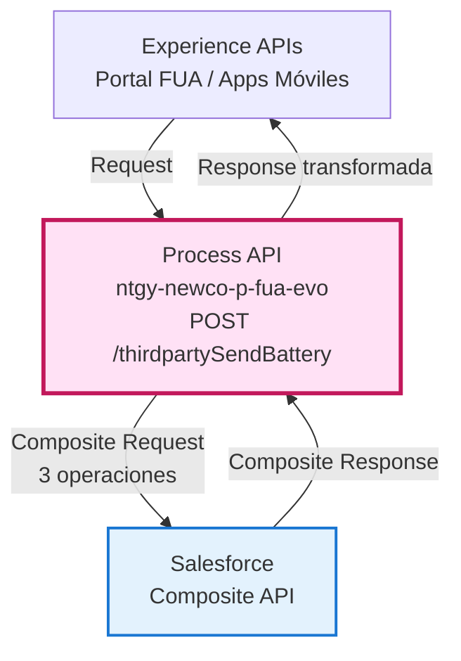
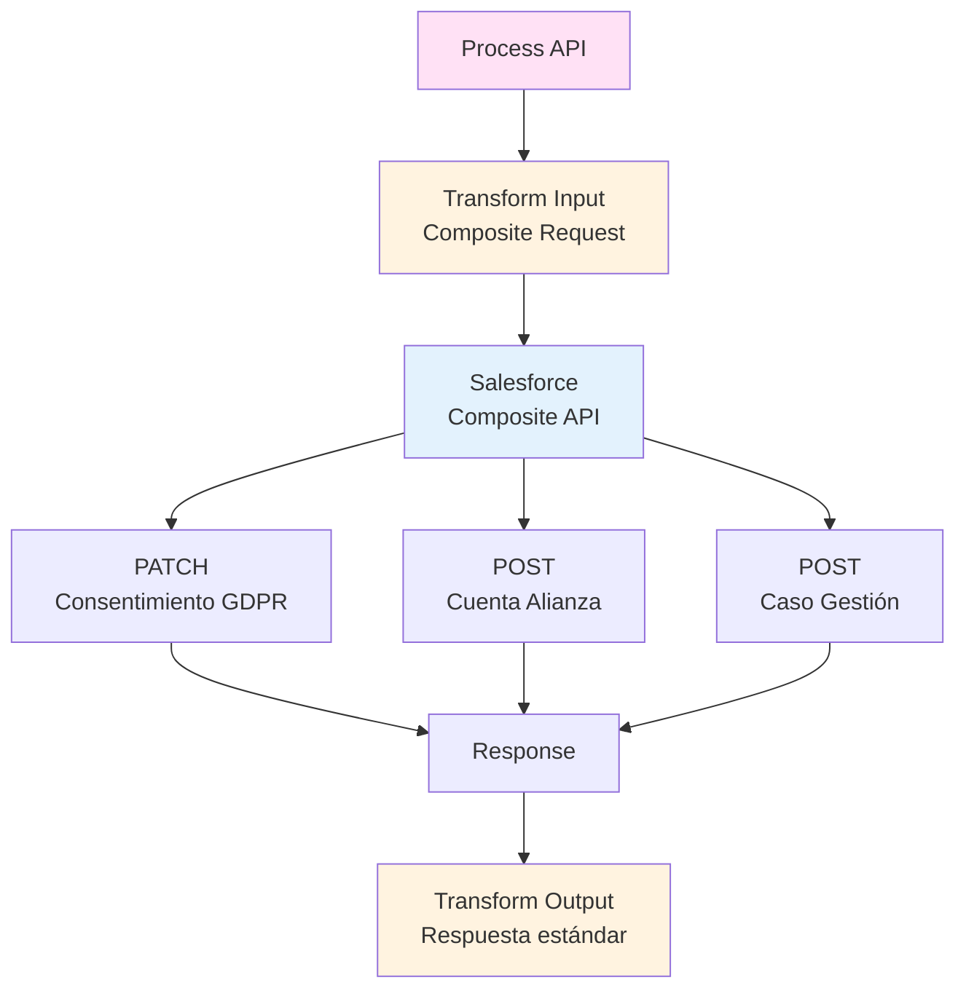
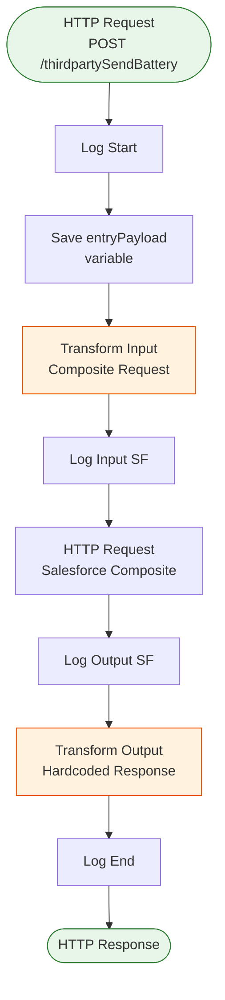
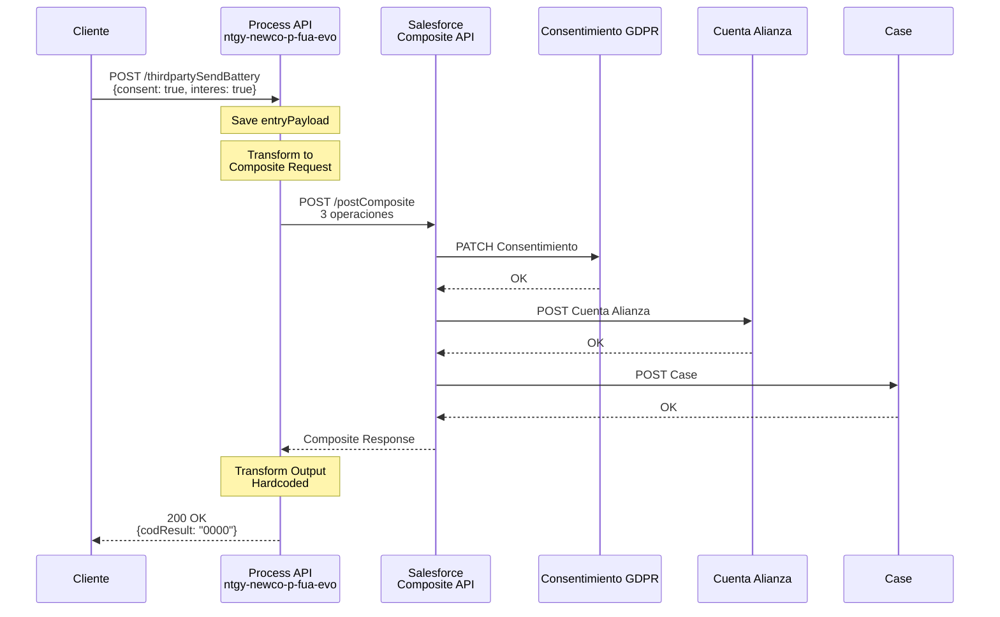
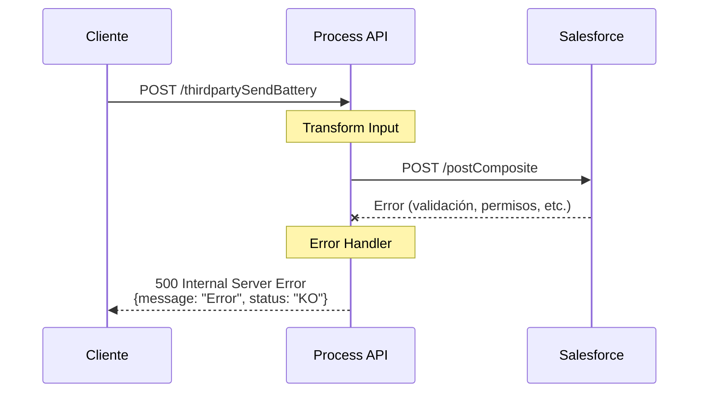

# POST /thirdpartySendBattery

## 📌 Descripción General

### Propósito del Endpoint

Este endpoint permite registrar el consentimiento GDPR y el interés de un cliente en alianzas de batería, ejecutando múltiples operaciones en Salesforce mediante su Composite API. Actualiza el consentimiento, crea una cuenta de alianza y genera un caso de gestión en una sola transacción.

### Tipo de API

**Capa:** Process API (API-Led Connectivity)

**Función:** Orquestación de registro de consentimiento e interés en alianzas con Salesforce

### Patrón de Integración

**Tipo:** Transformación + Orquestación (Composite API)

**Descripción:** El endpoint transforma el payload de entrada en una solicitud compuesta de Salesforce que ejecuta 3 operaciones atómicas: PATCH para actualizar consentimiento GDPR, POST para crear cuenta de alianza, y POST para crear caso de gestión.

### Arquitectura API-Led Connectivity



---

## 💼 Propósito del Negocio

### Casos de Uso Principales

1. **Registro de Consentimiento GDPR**
   - El cliente acepta o rechaza el consentimiento para alianzas de batería
   - Se registra la IP, canal y usuario que realiza la modificación
   - Beneficio: Cumplimiento legal de GDPR

2. **Registro de Interés en Alianzas**
   - El cliente manifiesta su interés en participar en alianzas de batería
   - Se crea una cuenta de alianza asociada al cliente
   - Beneficio: Gestión de leads para programas de batería

3. **Creación de Caso de Gestión**
   - Se genera automáticamente un caso para dar seguimiento
   - El caso se asigna al agente correspondiente o al contacto
   - Beneficio: Trazabilidad del proceso de alta en alianzas

### 🔗 Endpoints Dependientes

Este Process API consume el siguiente System API:

| Sistema | Endpoint | Método | Propósito |
|---------|----------|--------|-----------|
| `ntgy-newco-s-salesforce` | `/postComposite` | POST | Ejecuta 3 operaciones en Salesforce: actualizar consentimiento GDPR, crear cuenta de alianza y crear caso de gestión |

### Lógica de Orquestación



**Pasos del Proceso:**

1. **Paso 1**: Recepción del payload con consentimiento e interés
2. **Paso 2**: Transformación a formato Salesforce Composite API (3 operaciones)
3. **Paso 3**: Ejecución atómica de las 3 operaciones en Salesforce
4. **Paso 4**: Transformación de respuesta a formato estándar

### Transformaciones Aplicadas

**Transformación de Entrada (DataWeave):**

| Campo Original | Campo Salesforce | Operación | Transformación |
|----------------|------------------|-----------|----------------|
| `consent` | `NewCo_Tipo_de_consentimiento__c` | PATCH | `"02"` si true, `""` si false |
| `interes` | `NewCo_Estado__c` | PATCH | `"Si"` si true, `"No"` si false |
| `DirIp` | `NewCo_IP__c` | PATCH | Directo |
| `x-user-id` | `NewCo_Canal_modificacion__c` | PATCH | `"FUA - agente"` si existe, `"FUA - cliente"` si no |
| `name` + `surname` | `Name` | POST | Concatenación con código alianza |
| `x-client-id` | `NewCo_Account__c` | PATCH/POST | Directo |

**Transformación de Salida (Hardcoded):**

```json
{
  "result": {
    "codResult": "0000",
    "msgResult": "No hay error"
  }
}
```

### Contexto Empresarial

- **Dominio:** Gestión de Alianzas - Baterías
- **Sector:** Energía - Utilities
- **División:** Naturgy España - NewCo
- **Proceso de Negocio:** Alta de clientes en programas de alianzas de batería

### Stakeholders

- **Clientes**: Usuarios finales que aceptan participar en alianzas
- **Agentes de Call Center**: Registran el interés de clientes por teléfono
- **Equipo de Alianzas**: Gestiona las cuentas de alianza creadas
- **Equipo Legal**: Supervisa cumplimiento de GDPR

### Valor de Negocio

- **Cumplimiento Legal**: Registro auditable de consentimientos GDPR
- **Generación de Leads**: Captura de interés en programas de batería
- **Trazabilidad**: Casos de gestión para seguimiento del proceso
- **Eficiencia**: 3 operaciones en una sola transacción atómica

### Consumidores Potenciales

Este endpoint puede ser consumido por:
- Portal web FUA
- Aplicaciones móviles de gestión energética
- Sistemas de agentes de call center
- Herramientas de gestión de alianzas

---

## 🔧 Especificación Técnica

### URLs por Ambiente

| Ambiente | URL Base | URL Completa |
|----------|----------|--------------|
| **Local** | `http://localhost:8081` | `http://localhost:8081/api/thirdpartySendBattery` |
| **Development** | `https://ntgy-newco-p-fua-evo-dev.us-e2.cloudhub.io` | `https://ntgy-newco-p-fua-evo-dev.us-e2.cloudhub.io/api/thirdpartySendBattery` |
| **UAT** | `https://ntgy-newco-p-fua-evo-uat.us-e2.cloudhub.io` | `https://ntgy-newco-p-fua-evo-uat.us-e2.cloudhub.io/api/thirdpartySendBattery` |
| **Production** | `https://ntgy-newco-p-fua-evo-pro.us-e2.cloudhub.io` | `https://ntgy-newco-p-fua-evo-pro.us-e2.cloudhub.io/api/thirdpartySendBattery` |

### Método HTTP

```
POST /api/thirdpartySendBattery
```

### Parámetros de Entrada

#### Headers

| Header | Tipo | Requerido | Descripción |
|--------|------|-----------|-------------|
| `Content-Type` | string | Sí | Debe ser `application/json` |
| `x-client-id` | string | Sí | ID del cliente (Account) en Salesforce |
| `x-contact-id` | string | Sí | ID del contacto en Salesforce |
| `x-user-id` | string | No | ID del usuario agente (si aplica) |
| `x-agent-mail` | string | No | Email del agente (para username en Salesforce) |
| `x-interaction-id` | string | No | ID de interacción padre (para casos relacionados) |
| `x-user-role` | string | No | Rol del usuario que realiza la operación |

#### Body (application/json)

```json
{
  "consent": true,
  "interes": true,
  "DirIp": "192.168.1.1",
  "name": "Juan",
  "surname": "Pérez",
  "codigoAlianza": "AL001"
}
```

| Campo | Tipo | Requerido | Descripción |
|-------|------|-----------|-------------|
| `consent` | boolean | Sí | Consentimiento GDPR (true = acepta, false = rechaza) |
| `interes` | boolean | Sí | Interés en la alianza (true = sí, false = no) |
| `DirIp` | string | Sí | Dirección IP desde donde se realiza la operación |
| `name` | string | Sí | Nombre del cliente |
| `surname` | string | Sí | Apellido del cliente |
| `codigoAlianza` | string | Sí | Código de la alianza (ej: "AL001") |

### Respuestas

#### 200 OK - Operación Exitosa

**Respuesta Transformada (Hardcoded):**

```json
{
  "result": {
    "codResult": "0000",
    "msgResult": "No hay error"
  }
}
```

**Nota:** Esta respuesta está hardcoded en el código. Independientemente del resultado de Salesforce, si no hay error, siempre devuelve este formato.

#### 500 Internal Server Error - Error del Sistema

En caso de error en Salesforce o en el proceso, se devuelve un error estándar.

```json
{
  "message": "Error al procesar la solicitud",
  "status": "KO"
}
```

### Autenticación

- **Tipo:** Client ID & Client Secret (Anypoint Platform)
- **Salesforce Authentication:** OAuth 2.0 (gestionado por el conector)

### Timeouts

| Tipo | Valor |
|------|-------|
| **Request Timeout** | 60 segundos (configurado en Salesforce connector) |
| **Connection Timeout** | 10 segundos |

---

## 🏗️ Implementación Técnica

### Arquitectura del Flow



### Operaciones Salesforce (Composite API)

#### Operación 1: PATCH - Actualizar Consentimiento GDPR

**Objeto:** `NewCo_Consentimiento_GDPR__c`

**URL:** `/services/data/v52.0/sobjects/NewCo_Consentimiento_GDPR__c/NewCo_Clave__c/{x-client-id}02`

**Campos Actualizados:**
```json
{
  "NewCo_Tipo_de_consentimiento__c": "02" | "",
  "NewCo_IP__c": "192.168.1.1",
  "NewCo_Canal_modificacion__c": "FUA - agente" | "FUA - cliente",
  "NewCo_Modificado_por__c": "Juan Pérez" | "role",
  "NewCo_Estado__c": "Si" | "No",
  "NewCo_Account__c": "{x-client-id}"
}
```

#### Operación 2: POST - Crear Cuenta de Alianza

**Objeto:** `NewCo_Cuenta_Alianza__c`

**URL:** `/services/data/v52.0/sobjects/NewCo_Cuenta_Alianza__c`

**Campos:**
```json
{
  "NewCo_Alianza__r": {
    "NewCo_CodigoAlianza__c": "AL001"
  },
  "NewCo_Account__c": "{x-client-id}",
  "RecordType": {
    "Name": "Interés"
  },
  "Name": "Juan Pérez - AL001"
}
```

#### Operación 3: POST - Crear Caso de Gestión

**Objeto:** `Case`

**URL:** `/services/data/v52.0/sobjects/Case`

**Campos:**
```json
{
  "NewCo_Recordtype__c": "Gestion",
  "AccountId": "{x-client-id}",
  "ContactId": "{x-contact-id}",
  "Status": "06",
  "Priority": "02",
  "Origin": "FUA",
  "OwnerId": "{x-user-id}",
  "NewCo_Creado_por__c": "{x-user-id}" | "{x-contact-id}",
  "ParentId": "{x-interaction-id}",
  "acn_fld_Tittle__r": {
    "NewCo_ExternalId__c": "SolAltaAlianza"
  },
  "Subject": "Solicitud alta alianza",
  "Description": "Solicitud alta alianza",
  "NewCo_Ip__c": "192.168.1.1",
  "NewCo_CorrelationId__c": "{correlationId}"
}
```

### Transformación DataWeave de Entrada

**Archivo:** Inline en `alianzaThirdpartySendBattery.xml`

**Lógica Condicional:**

1. **Canal de Modificación:**
   ```dataweave
   if(payload."x-user-id" != "" and payload."x-user-id" != null) 
     "FUA - agente" 
   else 
     "FUA - cliente"
   ```

2. **Modificado Por:**
   ```dataweave
   if(payload.name != null and payload.surname != null)
     payload.name ++ " " ++ payload.surname
   else
     payload.'x-user-role'
   ```

3. **Owner del Caso:**
   ```dataweave
   ("OwnerId" : payload."x-user-id") if(!isEmpty(payload."x-user-id"))
   ```

4. **Parent Case:**
   ```dataweave
   ("ParentId": payload."x-interaction-id") if(payload."x-interaction-id"?)
   ```

### Transformación DataWeave de Salida

**Archivo:** Inline en `alianzaThirdpartySendBattery.xml`

```dataweave
%dw 2.0
output application/json
---
{
  "result": {
    "codResult": '0000',
    "msgResult": "No hay error"
  }
}
```

**Nota:** Esta transformación es hardcoded y no depende de la respuesta de Salesforce.

### Patrones de Diseño

**Patrón:** Composite Request Pattern + Atomic Transaction

**Justificación:** 
- Ejecuta 3 operaciones en una sola transacción atómica
- Si una operación falla, todas se revierten (allOrNone: true)
- Reduce latencia al evitar múltiples llamadas HTTP
- Garantiza consistencia de datos en Salesforce

### Diagramas de Secuencia

#### 1. Flujo Normal de Éxito



#### 2. Flujo con Error en Salesforce



### Manejo de Errores

**Estrategia:** Error propagation con logging

**Tipos de Errores Manejados:**

1. **Errores de Salesforce**
   - Validación de campos requeridos
   - Permisos insuficientes
   - Objetos no encontrados
   - Límites de API excedidos

2. **Errores de Transformación**
   - Campos faltantes en el payload
   - Tipos de datos incorrectos
   - Valores nulos inesperados

3. **Errores de Conectividad**
   - Timeout al conectar con Salesforce
   - Connection refused
   - Network errors

**Respuesta de Error Estándar:**
```json
{
  "message": "Descripción del error",
  "status": "KO"
}
```

### Logging

**Log de Inicio:**
```
Level: INFO
Message: "Start alianza thirdpartySendBattery: #[payload]"
```

**Log de Input Salesforce:**
```
Level: INFO
Message: "input SF composite thirdpartySendBattery: #[payload]"
```

**Log de Output Salesforce:**
```
Level: INFO
Message: "output SF composite thirdpartySendBattery: #[payload]"
```

**Log de Fin:**
```
Level: INFO
Message: "End alianza thirdpartySendBattery: #[payload]"
```

---

## 💻 Ejemplos de Uso

### Ejemplo 1: Cliente Acepta Consentimiento e Interés

#### cURL

```bash
curl -X POST "https://ntgy-newco-p-fua-evo-dev.us-e2.cloudhub.io/api/thirdpartySendBattery" \
  -H "Content-Type: application/json" \
  -H "client_id: YOUR_CLIENT_ID" \
  -H "client_secret: YOUR_CLIENT_SECRET" \
  -H "x-client-id: 0011234567890ABC" \
  -H "x-contact-id: 0031234567890DEF" \
  -d '{
    "consent": true,
    "interes": true,
    "DirIp": "192.168.1.100",
    "name": "Juan",
    "surname": "Pérez García",
    "codigoAlianza": "AL001"
  }'
```

#### Respuesta (200 OK)

```json
{
  "result": {
    "codResult": "0000",
    "msgResult": "No hay error"
  }
}
```

### Ejemplo 2: Agente Registra Interés por Teléfono

#### JavaScript

```javascript
const response = await fetch('https://ntgy-newco-p-fua-evo-dev.us-e2.cloudhub.io/api/thirdpartySendBattery', {
  method: 'POST',
  headers: {
    'Content-Type': 'application/json',
    'client_id': 'YOUR_CLIENT_ID',
    'client_secret': 'YOUR_CLIENT_SECRET',
    'x-client-id': '0011234567890ABC',
    'x-contact-id': '0031234567890DEF',
    'x-user-id': '0051234567890GHI',
    'x-agent-mail': 'agente@naturgy.com',
    'x-user-role': 'Agente Call Center'
  },
  body: JSON.stringify({
    consent: true,
    interes: true,
    DirIp: '10.0.0.50',
    api_name: 'María',
    surname: 'López Martínez',
    codigoAlianza: 'AL001'
  })
});

const data = await response.json();
console.log(data);
```

#### Respuesta (200 OK)

```json
{
  "result": {
    "codResult": "0000",
    "msgResult": "No hay error"
  }
}
```

### Ejemplo 3: Cliente Rechaza Consentimiento

#### Python

```python
import requests

response = requests.post(
    'https://ntgy-newco-p-fua-evo-dev.us-e2.cloudhub.io/api/thirdpartySendBattery',
    headers={
        'Content-Type': 'application/json',
        'client_id': 'YOUR_CLIENT_ID',
        'client_secret': 'YOUR_CLIENT_SECRET',
        'x-client-id': '0011234567890ABC',
        'x-contact-id': '0031234567890DEF'
    },
    json={
        'consent': False,
        'interes': False,
        'DirIp': '192.168.1.100',
        'name': 'Carlos',
        'surname': 'Rodríguez',
        'codigoAlianza': 'AL001'
    }
)

print(response.json())
```

#### Respuesta (200 OK)

```json
{
  "result": {
    "codResult": "0000",
    "msgResult": "No hay error"
  }
}
```

### Ejemplo 4: Error de Salesforce

#### cURL

```bash
curl -X POST "https://ntgy-newco-p-fua-evo-dev.us-e2.cloudhub.io/api/thirdpartySendBattery" \
  -H "Content-Type: application/json" \
  -H "client_id: YOUR_CLIENT_ID" \
  -H "client_secret: YOUR_CLIENT_SECRET" \
  -H "x-client-id: INVALID_ID" \
  -H "x-contact-id: INVALID_CONTACT" \
  -d '{
    "consent": true,
    "interes": true,
    "DirIp": "192.168.1.100",
    "name": "Test",
    "surname": "User",
    "codigoAlianza": "AL001"
  }'
```

#### Respuesta (500 Internal Server Error)

```json
{
  "message": "Error al procesar la solicitud en Salesforce: Account no encontrado",
  "status": "KO"
}