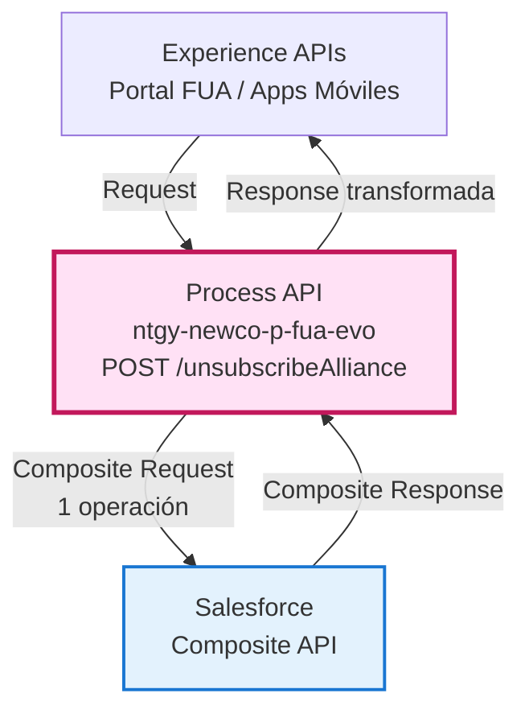
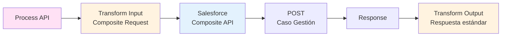
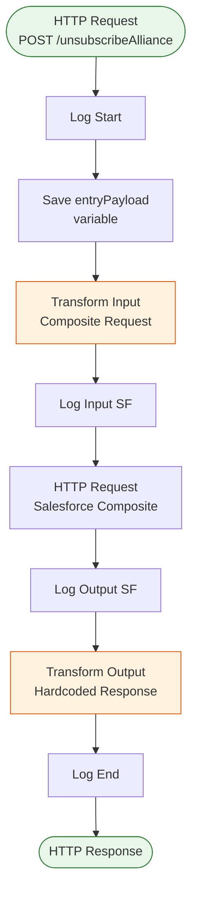
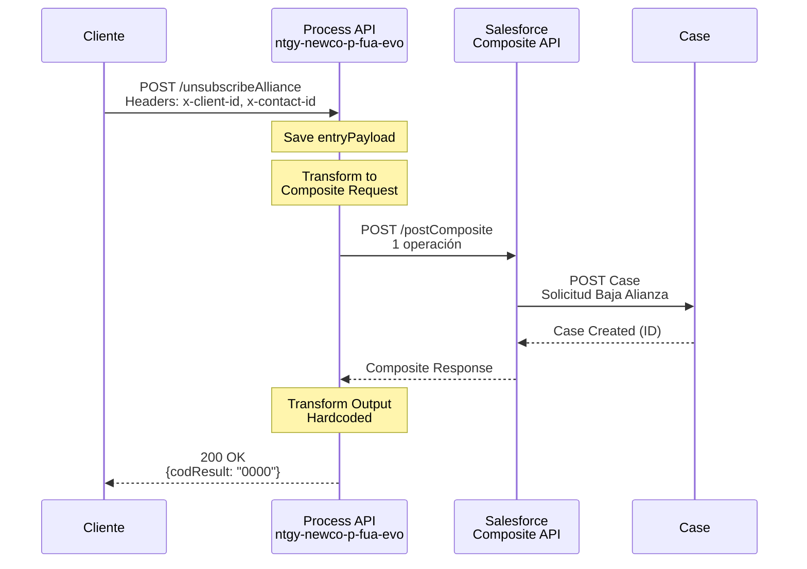
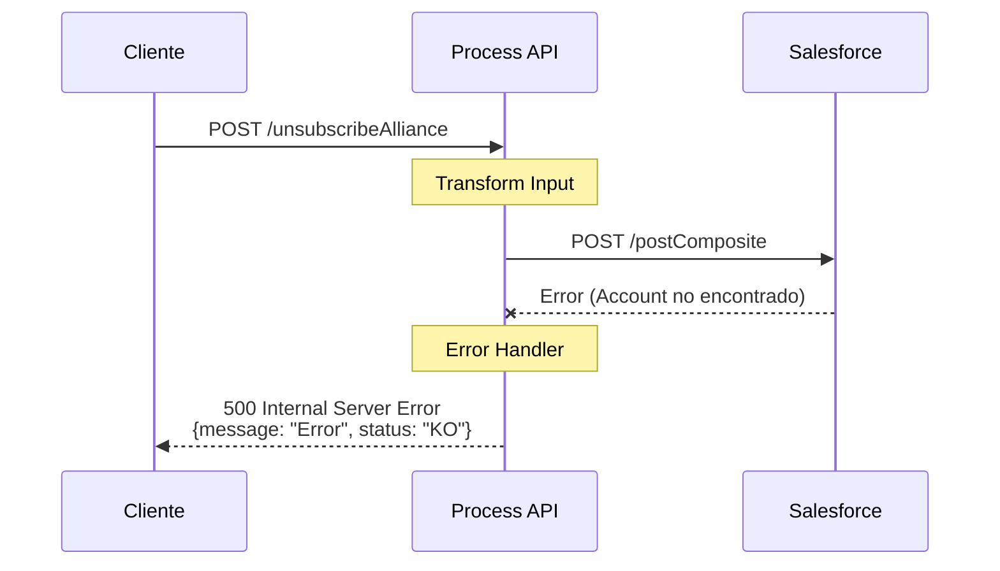

# POST /unsubscribeAlliance

## 📌 Descripción General

### Propósito del Endpoint

Este endpoint permite solicitar la baja de un cliente de una alianza de batería, creando automáticamente un caso de gestión en Salesforce para procesar la solicitud. Es el proceso inverso al alta en alianzas.

### Tipo de API

**Capa:** Process API (API-Led Connectivity)

**Función:** Orquestación de solicitud de baja de alianza con Salesforce

### Patrón de Integración

**Tipo:** Transformación + Operación única en Salesforce

**Descripción:** El endpoint transforma el payload de entrada en una solicitud de Salesforce Composite API que crea un caso de gestión con el tipo "Solicitud Baja Alianza".

### Arquitectura API-Led Connectivity



---

## 💼 Propósito del Negocio

### Casos de Uso Principales

1. **Solicitud de Baja por Cliente**
   - El cliente decide darse de baja de la alianza de batería
   - Se crea un caso de gestión para procesar la solicitud
   - Beneficio: Proceso formal y trazable de baja

2. **Solicitud de Baja por Agente**
   - Un agente de call center procesa la solicitud de baja del cliente
   - El caso se asigna automáticamente para seguimiento
   - Beneficio: Gestión centralizada de bajas

3. **Trazabilidad de Bajas**
   - Cada solicitud de baja queda registrada en Salesforce
   - Permite análisis de motivos de baja y retención
   - Beneficio: Datos para mejorar el servicio

### 🔗 Endpoints Dependientes

Este Process API consume el siguiente System API:

| Sistema | Endpoint | Método | Propósito |
|---------|----------|--------|-----------|
| `ntgy-newco-s-salesforce` | `/postComposite` | POST | Crea un caso de gestión en Salesforce para procesar la solicitud de baja |

### Lógica de Orquestación



**Pasos del Proceso:**

1. **Paso 1**: Recepción de la solicitud de baja con identificadores del cliente
2. **Paso 2**: Transformación a formato Salesforce Composite API (1 operación)
3. **Paso 3**: Creación del caso de gestión en Salesforce
4. **Paso 4**: Transformación de respuesta a formato estándar

### Transformaciones Aplicadas

**Transformación de Entrada (DataWeave):**

| Campo Original | Campo Salesforce | Valor |
|----------------|------------------|-------|
| `x-client-id` | `AccountId` | Directo (ID del cliente) |
| `x-contact-id` | `ContactId` | Directo (ID del contacto) |
| N/A | `NewCo_Recordtype__c` | "Gestion" (hardcoded) |
| N/A | `Status` | "06" (hardcoded) |
| N/A | `Priority` | "02" (hardcoded) |
| N/A | `Origin` | "FUA" (hardcoded) |
| N/A | `Subject` | "Solicitud Baja Alianza" (hardcoded) |

**Transformación de Salida (Hardcoded):**

```json
{
  "result": {
    "codResult": "0000",
    "msgResult": "No hay error"
  }
}
```

### Contexto Empresarial

- **Dominio:** Gestión de Alianzas - Baterías
- **Sector:** Energía - Utilities
- **División:** Naturgy España - NewCo
- **Proceso de Negocio:** Baja de clientes de programas de alianzas de batería

### Stakeholders

- **Clientes**: Usuarios finales que solicitan darse de baja
- **Agentes de Call Center**: Procesan solicitudes de baja por teléfono
- **Equipo de Alianzas**: Gestiona las bajas y analiza motivos
- **Equipo de Retención**: Puede contactar al cliente antes de procesar la baja

### Valor de Negocio

- **Trazabilidad**: Registro formal de todas las solicitudes de baja
- **Gestión Centralizada**: Casos en Salesforce para seguimiento
- **Análisis de Churn**: Datos para entender por qué los clientes se dan de baja
- **Proceso Formal**: Evita bajas no autorizadas o erróneas

### Consumidores Potenciales

Este endpoint puede ser consumido por:
- Portal web FUA
- Aplicaciones móviles de gestión energética
- Sistemas de agentes de call center
- Herramientas de gestión de alianzas

---

## 🔧 Especificación Técnica

### URLs por Ambiente

| Ambiente | URL Base | URL Completa |
|----------|----------|--------------|
| **Local** | `http://localhost:8081` | `http://localhost:8081/api/unsubscribeAlliance` |
| **Development** | `https://ntgy-newco-p-fua-evo-dev.us-e2.cloudhub.io` | `https://ntgy-newco-p-fua-evo-dev.us-e2.cloudhub.io/api/unsubscribeAlliance` |
| **UAT** | `https://ntgy-newco-p-fua-evo-uat.us-e2.cloudhub.io` | `https://ntgy-newco-p-fua-evo-uat.us-e2.cloudhub.io/api/unsubscribeAlliance` |
| **Production** | `https://ntgy-newco-p-fua-evo-pro.us-e2.cloudhub.io` | `https://ntgy-newco-p-fua-evo-pro.us-e2.cloudhub.io/api/unsubscribeAlliance` |

### Método HTTP

```
POST /api/unsubscribeAlliance
```

### Parámetros de Entrada

#### Headers

| Header | Tipo | Requerido | Descripción |
|--------|------|-----------|-------------|
| `Content-Type` | string | Sí | Debe ser `application/json` |
| `x-client-id` | string | Sí | ID del cliente (Account) en Salesforce |
| `x-contact-id` | string | Sí | ID del contacto en Salesforce |
| `x-agent-mail` | string | No | Email del agente (para username en Salesforce) |

#### Body (application/json)

```json
{}
```

**Nota:** El body puede estar vacío. La información necesaria se obtiene de los headers.

### Respuestas

#### 200 OK - Operación Exitosa

**Respuesta Transformada (Hardcoded):**

```json
{
  "result": {
    "codResult": "0000",
    "msgResult": "No hay error"
  }
}
```

**Nota:** Esta respuesta está hardcoded en el código. Independientemente del resultado de Salesforce, si no hay error, siempre devuelve este formato.

#### 500 Internal Server Error - Error del Sistema

En caso de error en Salesforce o en el proceso, se devuelve un error estándar.

```json
{
  "message": "Error al procesar la solicitud de baja",
  "status": "KO"
}
```

### Autenticación

- **Tipo:** Client ID & Client Secret (Anypoint Platform)
- **Salesforce Authentication:** OAuth 2.0 (gestionado por el conector)

### Timeouts

| Tipo | Valor |
|------|-------|
| **Request Timeout** | 60 segundos (configurado en Salesforce connector) |
| **Connection Timeout** | 10 segundos |

---

## 🏗️ Implementación Técnica

### Arquitectura del Flow



### Operación Salesforce (Composite API)

#### POST - Crear Caso de Gestión

**Objeto:** `Case`

**URL:** `/services/data/v52.0/sobjects/Case`

**Campos del Caso:**
```json
{
  "AccountId": "{x-client-id}",
  "ContactId": "{x-contact-id}",
  "NewCo_Recordtype__c": "Gestion",
  "Status": "06",
  "Priority": "02",
  "Origin": "FUA",
  "acn_fld_Tittle__r": {
    "NewCo_ExternalId__c": "SolBajaAlianza"
  },
  "Subject": "Solicitud Baja Alianza"
}
```

**Descripción de Campos:**
- **AccountId**: ID del cliente que solicita la baja
- **ContactId**: ID del contacto asociado
- **NewCo_Recordtype__c**: Tipo de registro "Gestion"
- **Status**: Estado "06" (pendiente de gestión)
- **Priority**: Prioridad "02" (media)
- **Origin**: Origen "FUA" (portal)
- **acn_fld_Tittle__r.NewCo_ExternalId__c**: Identificador externo "SolBajaAlianza"
- **Subject**: Asunto del caso

### Transformación DataWeave de Entrada

**Archivo:** Inline en `alianzaUnsubscribeAlliance.xml`

```dataweave
%dw 2.0
output application/json
---
{
  "allOrNone": true,
  "collateSubrequests": false,
  "compositeRequest": [
    {
      "method": "POST",
      "url": "/services/data/v52.0/sobjects/Case",
      "referenceId": "refCaseGestion",
      "body": {
        "AccountId": payload.'x-client-id' default "",
        "ContactId": payload.'x-contact-id',
        "NewCo_Recordtype__c": "Gestion",
        "Status": "06",
        "Priority": "02",
        "Origin": "FUA",
        "acn_fld_Tittle__r": {
          "NewCo_ExternalId__c": "SolBajaAlianza"
        },
        "Subject": "Solicitud Baja Alianza"
      }
    }
  ]
}
```

**Características:**
- **allOrNone: true**: Transacción atómica (aunque solo hay 1 operación)
- **collateSubrequests: false**: No agrupa subrequests
- **Campos hardcoded**: La mayoría de campos tienen valores fijos

### Transformación DataWeave de Salida

**Archivo:** Inline en `alianzaUnsubscribeAlliance.xml`

```dataweave
%dw 2.0
output application/json
---
{
  "result": {
    "codResult": '0000',
    "msgResult": "No hay error"
  }
}
```

**Nota:** Esta transformación es hardcoded y no depende de la respuesta de Salesforce.

### Patrones de Diseño

**Patrón:** Simple Request Pattern + Atomic Transaction

**Justificación:** 
- Operación única y simple (crear caso)
- Transacción atómica garantiza consistencia
- Respuesta estándar simplifica integración con clientes

### Diagramas de Secuencia

#### 1. Flujo Normal de Éxito



#### 2. Flujo con Error en Salesforce



### Manejo de Errores

**Estrategia:** Error propagation con logging

**Tipos de Errores Manejados:**

1. **Errores de Salesforce**
   - Account no encontrado (x-client-id inválido)
   - Contact no encontrado (x-contact-id inválido)
   - Permisos insuficientes
   - Límites de API excedidos

2. **Errores de Validación**
   - Headers requeridos faltantes
   - Formato de IDs incorrecto

3. **Errores de Conectividad**
   - Timeout al conectar con Salesforce
   - Connection refused
   - Network errors

**Respuesta de Error Estándar:**
```json
{
  "message": "Descripción del error",
  "status": "KO"
}
```

### Logging

**Log de Inicio:**
```
Level: INFO
Message: "Start alianza alianzaUnsubscribeAlliance: #[payload]"
```

**Log de Input Salesforce:**
```
Level: INFO
Message: "input SF composite alianzaUnsubscribeAlliance: #[payload]"
```

**Log de Output Salesforce:**
```
Level: INFO
Message: "output SF composite alianzaUnsubscribeAlliance: #[payload]"
```

**Log de Fin:**
```
Level: INFO
Message: "End alianza alianzaUnsubscribeAlliance: #[payload]"
```

---

## 💻 Ejemplos de Uso

### Ejemplo 1: Cliente Solicita Baja

#### cURL

```bash
curl -X POST "https://ntgy-newco-p-fua-evo-dev.us-e2.cloudhub.io/api/unsubscribeAlliance" \
  -H "Content-Type: application/json" \
  -H "client_id: YOUR_CLIENT_ID" \
  -H "client_secret: YOUR_CLIENT_SECRET" \
  -H "x-client-id: 0011234567890ABC" \
  -H "x-contact-id: 0031234567890DEF" \
  -d '{}'
```

#### Respuesta (200 OK)

```json
{
  "result": {
    "codResult": "0000",
    "msgResult": "No hay error"
  }
}
```

### Ejemplo 2: Agente Procesa Baja por Teléfono

#### JavaScript

```javascript
const response = await fetch('https://ntgy-newco-p-fua-evo-dev.us-e2.cloudhub.io/api/unsubscribeAlliance', {
  method: 'POST',
  headers: {
    'Content-Type': 'application/json',
    'client_id': 'YOUR_CLIENT_ID',
    'client_secret': 'YOUR_CLIENT_SECRET',
    'x-client-id': '0011234567890ABC',
    'x-contact-id': '0031234567890DEF',
    'x-agent-mail': 'agente@naturgy.com'
  },
  body: JSON.stringify({})
});

const data = await response.json();
console.log(data);
```

#### Respuesta (200 OK)

```json
{
  "result": {
    "codResult": "0000",
    "msgResult": "No hay error"
  }
}
```

### Ejemplo 3: Solicitud desde Portal Web

#### Python

```python
import requests

response = requests.post(
    'https://ntgy-newco-p-fua-evo-dev.us-e2.cloudhub.io/api/unsubscribeAlliance',
    headers={
        'Content-Type': 'application/json',
        'client_id': 'YOUR_CLIENT_ID',
        'client_secret': 'YOUR_CLIENT_SECRET',
        'x-client-id': '0011234567890ABC',
        'x-contact-id': '0031234567890DEF'
    },
    json={}
)

print(response.json())
```

#### Respuesta (200 OK)

```json
{
  "result": {
    "codResult": "0000",
    "msgResult": "No hay error"
  }
}
```

### Ejemplo 4: Error - Cliente No Encontrado

#### cURL

```bash
curl -X POST "https://ntgy-newco-p-fua-evo-dev.us-e2.cloudhub.io/api/unsubscribeAlliance" \
  -H "Content-Type: application/json" \
  -H "client_id: YOUR_CLIENT_ID" \
  -H "client_secret: YOUR_CLIENT_SECRET" \
  -H "x-client-id: INVALID_ID" \
  -H "x-contact-id: INVALID_CONTACT" \
  -d '{}'
```

#### Respuesta (500 Internal Server Error)

```json
{
  "message": "Error al procesar la solicitud: Account no encontrado",
  "status": "KO"
}