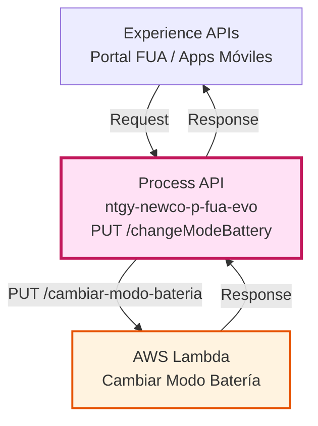
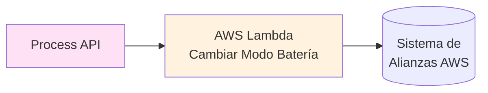
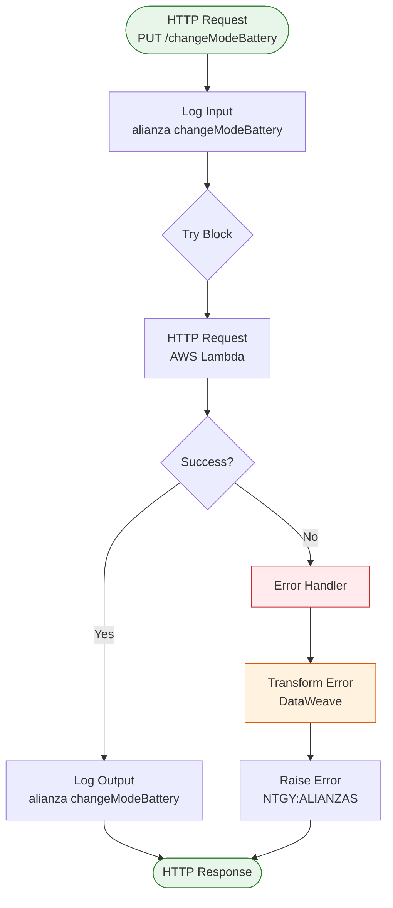
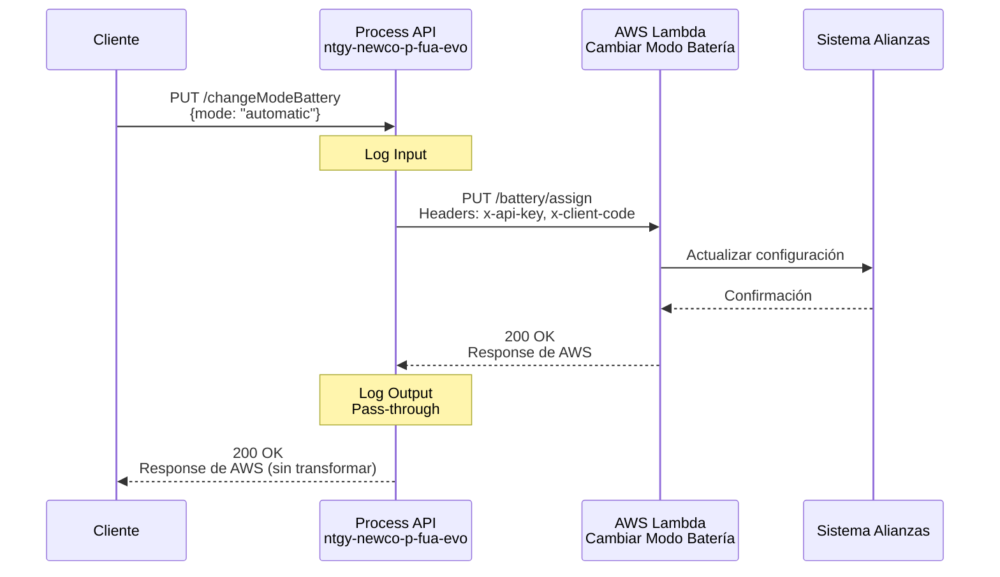
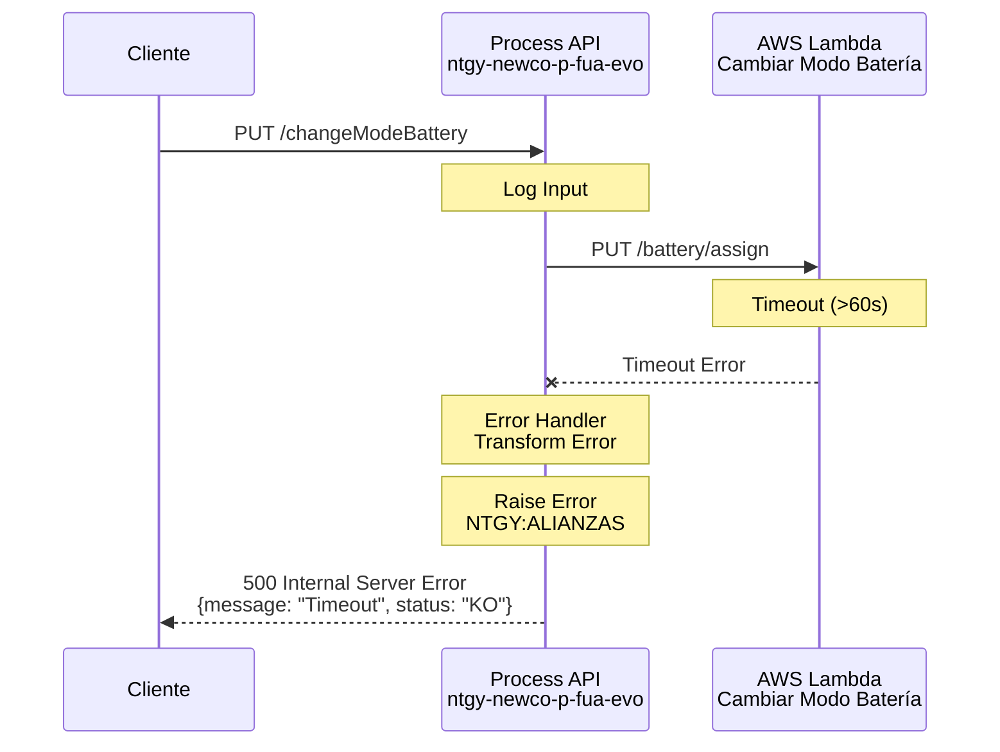
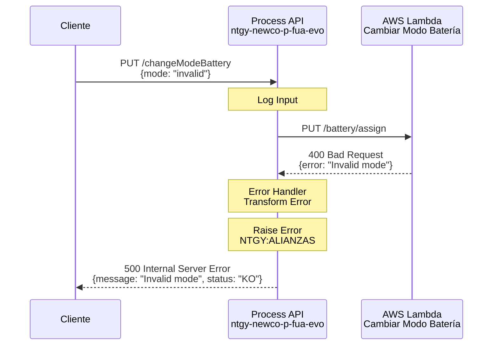

# PUT /changeModeBattery

⚠️ **ADVERTENCIA CRÍTICA - PASS-THROUGH SIN TRANSFORMACIÓN**

El código del Process API actúa como **pass-through puro** hacia AWS Lambda:

- ✅ **Único campo confirmado en código:** `x-client-code` (extraído del payload y enviado como header a AWS)
- ❌ **NO hay transformación del body** en el código MuleSoft
- ❌ **NO hay validación de estructura** en el código MuleSoft
- ❌ El resto del payload se envía **tal cual** a AWS Lambda sin modificación

**Estado:** 🔴 Estructura del Body NO Documentada en Código

**Para conocer la estructura completa del request:**
Consultar la especificación oficial del endpoint AWS Lambda:
- **Endpoint AWS:** `/battery/assign` 
- **Host:** `80xkw026n1.execute-api.eu-west-1.amazonaws.com`
- **Método:** PUT

---

## 📌 Descripción General

### Propósito del Endpoint

Este endpoint permite cambiar el modo de operación de la batería entre automático y manual en el sistema de alianzas AWS. Actúa como orquestador entre el cliente y el servicio AWS Lambda que gestiona la configuración de las baterías.

### Tipo de API

**Capa:** Process API (API-Led Connectivity)

**Función:** Orquestación de cambio de modo de batería con sistema de alianzas AWS

### Patrón de Integración

**Tipo:** Pass-Through con Transformación de Errores

**Descripción:** El endpoint recibe la solicitud del cliente, la reenvía al servicio AWS Lambda correspondiente, y transforma los errores a un formato estándar en caso de fallo.

### Arquitectura API-Led Connectivity



---

## 💼 Propósito del Negocio

### Casos de Uso Principales

1. **Cambio a Modo Automático**
   - El cliente configura la batería para que opere automáticamente
   - El sistema gestiona la carga/descarga según algoritmos predefinidos
   - Beneficio: Optimización automática del uso de la batería

2. **Cambio a Modo Manual**
   - El cliente toma control manual de la operación de la batería
   - Permite decisiones personalizadas sobre carga/descarga
   - Beneficio: Mayor control del usuario sobre su sistema energético

3. **Gestión de Configuración de Alianzas**
   - Actualiza la configuración en el sistema de alianzas AWS
   - Sincroniza el estado con los sistemas de gestión energética
   - Beneficio: Consistencia en la configuración entre sistemas

### 🔗 Endpoints Dependientes

Este Process API consume el siguiente servicio externo:

| Sistema | Endpoint | Método | Host | Propósito |
|---------|----------|--------|------|-----------|
| `AWS Lambda - Gestión de Batería` | `/battery/assign` | PUT | `80xkw026n1.execute-api.eu-west-1.amazonaws.com` | Actualiza el modo de operación de la batería (automático/manual) |

### Lógica de Orquestación



**Pasos del Proceso:**

1. **Paso 1**: Recepción de la solicitud con el nuevo modo de batería
2. **Paso 2**: Envío de la solicitud al servicio AWS Lambda con headers de autenticación
3. **Paso 3**: Procesamiento de la respuesta o transformación de errores

### Transformaciones Aplicadas

**Transformación de Errores:**

En caso de error, el endpoint transforma la respuesta a un formato estándar:

| Campo Original | Campo Transformado | Transformación |
|----------------|-------------------|----------------|
| `error.errorMessage.payload` | `message` | Extrae el mensaje de error del payload |
| `error.description` | `message` | Usa la descripción del error si no hay payload |
| N/A | `status` | Añade campo "KO" para indicar fallo |

**Si es exitoso:**

⚠️ **Este Process API NO transforma la respuesta exitosa del servicio AWS.**

La respuesta del servicio AWS Lambda se devuelve directamente al cliente.

### Contexto Empresarial

- **Dominio:** Gestión de Energía - Baterías
- **Sector:** Energía - Utilities
- **División:** Naturgy España - NewCo
- **Proceso de Negocio:** Configuración de sistemas de almacenamiento energético

### Stakeholders

- **Clientes con Batería**: Usuarios finales que gestionan su sistema de batería
- **Sistema de Alianzas AWS**: Plataforma que gestiona la configuración de baterías
- **Equipo de Operaciones**: Monitorea el correcto funcionamiento del sistema

### Valor de Negocio

- **Flexibilidad**: Permite a los clientes elegir entre gestión automática o manual
- **Optimización Energética**: El modo automático optimiza el uso de la batería
- **Autonomía del Cliente**: Mayor control sobre su sistema energético
- **Integración con Alianzas**: Sincronización con sistemas de gestión de terceros

### Consumidores Potenciales

Este endpoint puede ser consumido por:
- Portal web FUA
- Aplicaciones móviles de gestión energética
- Sistemas de agentes de call center
- Integraciones con sistemas de gestión de baterías de terceros

---

## 🔧 Especificación Técnica

### URLs por Ambiente

| Ambiente | URL Base | URL Completa |
|----------|----------|--------------|
| **Local** | `http://localhost:8081` | `http://localhost:8081/api/changeModeBattery` |
| **Development** | `https://ntgy-newco-p-fua-evo-dev.us-e2.cloudhub.io` | `https://ntgy-newco-p-fua-evo-dev.us-e2.cloudhub.io/api/changeModeBattery` |
| **UAT** | `https://ntgy-newco-p-fua-evo-uat.us-e2.cloudhub.io` | `https://ntgy-newco-p-fua-evo-uat.us-e2.cloudhub.io/api/changeModeBattery` |
| **Production** | `https://ntgy-newco-p-fua-evo-pro.us-e2.cloudhub.io` | `https://ntgy-newco-p-fua-evo-pro.us-e2.cloudhub.io/api/changeModeBattery` |

### Método HTTP

```
PUT /api/changeModeBattery
```

### Parámetros de Entrada

#### Headers

| Header | Tipo | Requerido | Descripción |
|--------|------|-----------|-------------|
| `Content-Type` | string | Sí | Debe ser `application/json` |
| `x-client-code` | string | Sí | Código del cliente para autenticación en AWS |

#### Body (application/json)

⚠️ **IMPORTANTE:** El código MuleSoft **NO transforma ni valida** el body. Actúa como pass-through puro hacia AWS Lambda.

**Campo Confirmado en Código (usado solo para header):**

| Campo | Ubicación | Uso | Evidencia en Código |
|-------|-----------|-----|---------------------|
| `x-client-code` | Body del request | Extraído y enviado como header `x-client-code` a AWS | `payload.'x-client-code'` (línea del http:headers) |

**Estructura Completa del Body:**

❌ **NO está documentada en el código MuleSoft**

El Process API envía el payload completo a AWS Lambda sin transformación. La estructura esperada por AWS Lambda debe consultarse en la especificación del endpoint AWS `/battery/assign`.

**Ejemplo de estructura (NO confirmada en código MuleSoft):**
```json
{
  "x-client-code": "string",
  // ... otros campos según especificación AWS Lambda
}
```

⚠️ **Recomendación:** Consultar documentación oficial del endpoint AWS Lambda para conocer la estructura completa y los campos requeridos.

### Respuestas

#### 200 OK - Cambio Exitoso

**⚠️ Pass-Through Response:**

Este endpoint actúa como pass-through. La respuesta exitosa proviene directamente del servicio AWS Lambda sin transformación por parte del Process API.

**Nota:** La estructura exacta de la respuesta depende de la implementación del servicio AWS Lambda `/battery/assign`. El Process API no modifica la respuesta exitosa.

#### 500 Internal Server Error - Error del Sistema

Cuando ocurre un error (timeout, conexión, validación de AWS), el Process API transforma el error a este formato estándar:

```json
{
  "message": "Descripción del error",
  "status": "KO"
}
```

**Ejemplos de mensajes de error:**
- `"Timeout al conectar con el sistema de alianzas AWS"`
- `"Error al cambiar modo de batería: [detalle del error]"`
- `"Internal server error"` (cuando no hay descripción específica)

### Autenticación

- **Tipo:** Client ID & Client Secret (Anypoint Platform)
- **AWS Authentication:** API Key (x-api-key) + Client Code (x-client-code)

### Timeouts

| Tipo | Valor |
|------|-------|
| **Request Timeout** | Configurado en `${aws.timeout}` (típicamente 30-60 segundos) |
| **Connection Timeout** | 10 segundos |

---

## 🏗️ Implementación Técnica

### Arquitectura del Flow



### Configuración del HTTP Request

**Archivo:** `src/main/mule/services/alianzas/alianzaChangeModeBattery.xml`

**Configuración:**
- **Method:** `${aws.alianzas.methodCambiarModoBateria}` (PUT)
- **Path:** `${aws.alianzas.pathCambiarModoBateria}` (/battery/assign)
- **Host:** `${aws.host}` (80xkw026n1.execute-api.eu-west-1.amazonaws.com)
- **Port:** `${aws.port}` (80)
- **Config-ref:** `HTTP_Request__AWS`
- **Response Timeout:** `${aws.timeout}` (60000ms)

**Headers enviados:**
```dataweave
{
  "x-api-key": p('aws.apiKey'),
  "x-client-code": payload.'x-client-code'
}
```

### Transformación de Errores (DataWeave)

**Ubicación:** Inline en el error handler

```dataweave
%dw 2.0
import * from dw::core::Strings
output application/json
---
{
    "message": 
        if(error.errorMessage.payload != null)
            error.errorMessage.payload
        else if(substringAfterLast(error.description, "' ") != "") 
            substringAfterLast(error.description, "' ") 
        else if(error.description != null) 
            error.description 
        else 
            "Internal server error",
    "status": "KO"
}
```

**Lógica de Transformación:**
1. Intenta extraer el mensaje del payload del error
2. Si no existe, extrae la última parte de la descripción del error
3. Si no existe, usa la descripción completa del error
4. Como último recurso, usa "Internal server error"
5. Añade el campo `status: "KO"` para indicar fallo

### Patrones de Diseño

**Patrón:** Try-Catch con Error Handler Especializado

**Justificación:** 
- Permite capturar cualquier error de conectividad o timeout con AWS
- Transforma errores técnicos a un formato amigable para el cliente
- Propaga el error con tipo específico (NTGY:ALIANZAS) para manejo centralizado

### Diagramas de Secuencia

#### 1. Flujo Normal de Éxito



#### 2. Flujo con Error de Timeout



#### 3. Flujo con Error de AWS



### Manejo de Errores

**Estrategia:** Try-Catch con Error Handler Especializado

**Tipos de Errores Manejados:**

1. **Errores de Conectividad**
   - Timeout al conectar con AWS
   - Connection refused
   - Network errors

2. **Errores de AWS Lambda**
   - Validación de parámetros
   - Errores de negocio del sistema de alianzas
   - Errores internos de AWS

3. **Errores de Autenticación**
   - API Key inválida
   - Client Code no autorizado

**Respuesta de Error Estándar:**
```json
{
  "message": "Descripción del error",
  "status": "KO"
}
```

**Error Type:** `NTGY:ALIANZAS`

**Error Description:** "Error cambio modo batería"

### Logging

**Log de Entrada:**
```
Level: INFO
Message: "Input alianza changeModeBattery: #[payload]"
```

**Log de Salida:**
```
Level: INFO
Message: "Ouput alianza changeModeBattery: #[payload]"
```

---

## 💻 Ejemplos de Uso

### Ejemplo 1: Request con Campo Confirmado

⚠️ **NOTA:** Este ejemplo muestra solo el campo confirmado en el código MuleSoft. La estructura completa depende de la especificación AWS Lambda.

#### cURL

```bash
curl -X PUT "https://ntgy-newco-p-fua-evo-dev.us-e2.cloudhub.io/api/changeModeBattery" \
  -H "Content-Type: application/json" \
  -H "client_id: YOUR_CLIENT_ID" \
  -H "client_secret: YOUR_CLIENT_SECRET" \
  -d '{
    "x-client-code": "CLI-12345"
    // ... otros campos según especificación AWS Lambda
  }'
```

#### Respuesta (200 OK)

**Nota:** La respuesta proviene directamente de AWS Lambda (pass-through). La estructura exacta depende de la implementación del servicio AWS `/battery/assign`.

```json
{
  // Respuesta del servicio AWS Lambda
  // Estructura NO documentada en código MuleSoft
}
```

### Ejemplo 2: Cambio a Modo Manual

#### JavaScript

```javascript
const response = await fetch('https://ntgy-newco-p-fua-evo-dev.us-e2.cloudhub.io/api/changeModeBattery', {
  method: 'PUT',
  headers: {
    'Content-Type': 'application/json',
    'client_id': 'YOUR_CLIENT_ID',
    'client_secret': 'YOUR_CLIENT_SECRET',
    'x-client-code': 'CLI-12345'
  },
  body: JSON.stringify({
    mode: 'manual',
    batteryId: 'BAT-12345',
    clientCode: 'CLI-12345'
  })
});

const data = await response.json();
console.log(data);
```

#### Respuesta (200 OK)

**Nota:** Respuesta pass-through de AWS Lambda.

```json
{
  // Respuesta del servicio AWS Lambda
}
```

### Ejemplo 3: Error de AWS Lambda

#### Python

```python
import requests

response = requests.put(
    'https://ntgy-newco-p-fua-evo-dev.us-e2.cloudhub.io/api/changeModeBattery',
    headers={
        'Content-Type': 'application/json',
        'client_id': 'YOUR_CLIENT_ID',
        'client_secret': 'YOUR_CLIENT_SECRET',
        'x-client-code': 'CLI-12345'
    },
    json={
        'mode': 'invalid_mode',
        'batteryId': 'BAT-12345',
        'clientCode': 'CLI-12345'
    }
)

print(response.json())
```

#### Respuesta (500 Internal Server Error)

Cuando AWS Lambda devuelve un error, el Process API lo transforma a este formato:

```json
{
  "message": "Modo de batería inválido. Debe ser 'automatic' o 'manual'",
  "status": "KO"
}
```

### Ejemplo 4: Error de Timeout

#### cURL

```bash
curl -X PUT "https://ntgy-newco-p-fua-evo-dev.us-e2.cloudhub.io/api/changeModeBattery" \
  -H "Content-Type: application/json" \
  -H "client_id: YOUR_CLIENT_ID" \
  -H "client_secret: YOUR_CLIENT_SECRET" \
  -H "x-client-code: CLI-12345" \
  -d '{
    "mode": "automatic",
    "batteryId": "BAT-12345",
    "clientCode": "CLI-12345"
  }'
```

#### Respuesta (500 Internal Server Error)

```json
{
  "message": "Timeout al conectar con el sistema de alianzas AWS",
  "status": "KO"
}