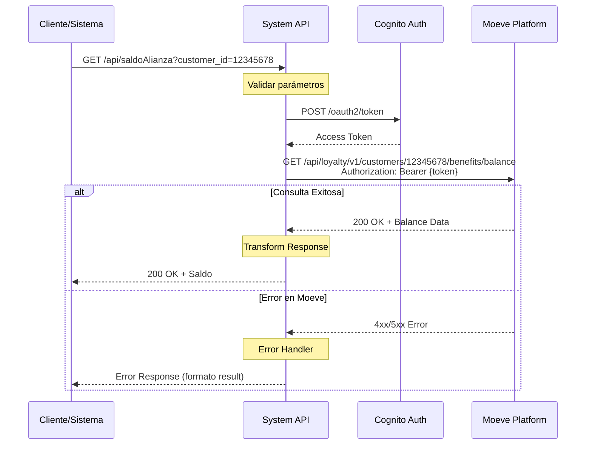
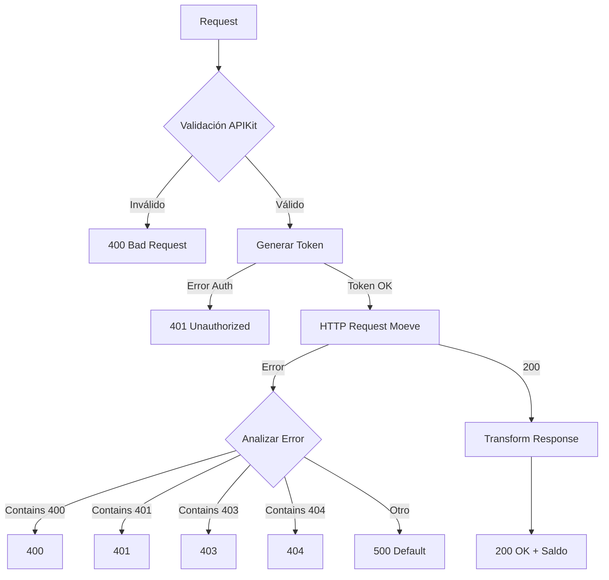
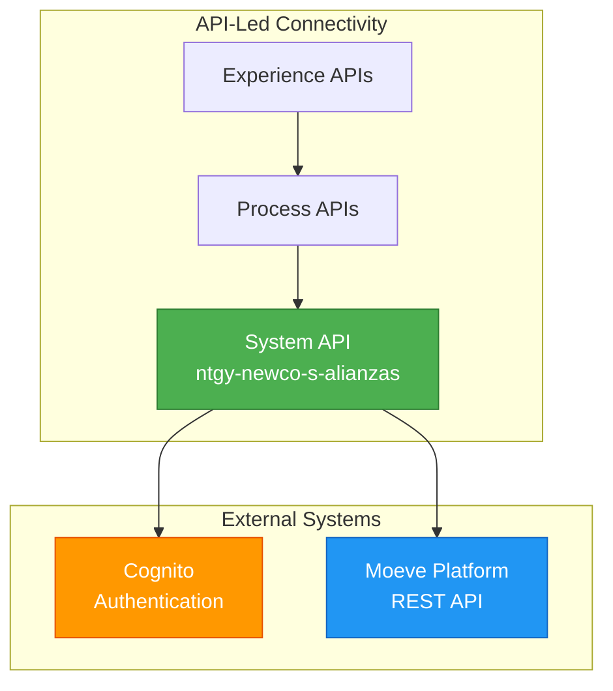

# GET /saldoAlianza

## 📌 Descripción General

Consulta el saldo de alianza de un cliente en la plataforma Moeve en tiempo real. Este endpoint realiza una llamada síncrona a la API REST de Moeve para obtener el balance actual de puntos de alianza asociados a un cliente específico.

### Información Clave
- **Método HTTP**: GET
- **Ruta**: `/api/saldoAlianza`
- **Backend**: Moeve Alliance Platform (REST API)
- **Operación Backend**: `GET /api/loyalty/v1/customers/{customer_id}/benefits/balance`
- **Autenticación**: Bearer Token (Cognito OAuth 2.0)
- **Tipo de API**: System API
- **Timeout**: 30 segundos
- **Protocolo**: HTTPS

### Flujo de Datos
```
Cliente → System API → Token Generation (Cognito) → 
Moeve Platform → Balance Response → System API → Cliente
```

---

## 💼 Propósito del Negocio

### Problema que Resuelve
Este endpoint permite a los sistemas internos de Naturgy consultar en tiempo real el saldo de puntos de alianza de un cliente en la plataforma Moeve (anteriormente Repsol). Esto es fundamental para:

- **Atención al Cliente**: Los representantes pueden consultar instantáneamente el saldo disponible
- **Experiencia del Usuario**: Los clientes pueden ver su balance actualizado en tiempo real
- **Gestión de Alianzas**: Facilita el seguimiento y gestión del programa de alianzas
- **Integración Multicanal**: Permite mostrar el saldo en diferentes canales (web, móvil, call center)

### Casos de Uso

#### 1. Consulta de Saldo por Representante de Servicio al Cliente
Un representante de atención al cliente necesita verificar el saldo de puntos de un cliente durante una llamada telefónica.

**Flujo**:
1. El representante ingresa el ID del cliente en el sistema CRM
2. El sistema realiza una llamada a este endpoint
3. Se muestra el saldo actual al representante
4. El representante informa al cliente sobre su balance disponible

#### 2. Visualización de Saldo en Portal Web
Un cliente accede a su portal web personal para consultar su saldo de alianza.

**Flujo**:
1. El cliente inicia sesión en el portal
2. El portal solicita el saldo mediante este endpoint
3. Se muestra el balance actualizado en la interfaz
4. El cliente puede ver su saldo y planificar el uso de puntos

#### 3. Validación de Saldo para Operaciones
Antes de realizar una operación que requiere puntos, el sistema valida que el cliente tenga saldo suficiente.

**Flujo**:
1. El cliente intenta realizar una operación (canje, transferencia)
2. El sistema consulta el saldo actual
3. Se valida que el saldo sea suficiente
4. Se procede o rechaza la operación según el balance

### Valor de Negocio
- **Transparencia**: Los clientes tienen visibilidad completa de su saldo
- **Eficiencia Operativa**: Reduce el tiempo de consulta manual
- **Satisfacción del Cliente**: Información instantánea y precisa
- **Integración de Socios**: Fortalece la alianza con Moeve

---

## 🔧 Especificación Técnica

### Request

#### Query Parameters

| Parámetro | Tipo | Requerido | Descripción | Ejemplo |
|-----------|------|-----------|-------------|---------|
| `customer_id` | string | ✅ Sí | Identificador único del cliente en el sistema Moeve | `"12345678"` |

#### Headers

| Header | Valor | Descripción |
|--------|-------|-------------|
| `Content-Type` | `application/json` | Tipo de contenido de la respuesta |
| `Authorization` | `Bearer {token}` | Token de autenticación (generado automáticamente) |

### Response

#### Respuesta Exitosa (200 OK)

⚠️ **ESTRUCTURA DE RESPUESTA NO DOCUMENTADA**

Este endpoint actúa como **proxy transparente** del backend Moeve.
La estructura exacta de la respuesta no está documentada porque está
controlada completamente por el proveedor externo (Moeve Alliance Platform).

**Transformación Aplicada:**

El flow extrae el objeto "response" del payload del backend (línea 59 de alianzaSaldo.xml):
```
Backend retorna: { "response": {...} }
Este endpoint retorna: {...} (solo el contenido de "response")
```

**Para Conocer la Estructura Real:**

1. **Consultar documentación oficial de Moeve:**
   - Solicitar especificaciones API de Moeve Alliance Platform
   - Endpoint backend: `GET /api/loyalty/v1/customers/{customer_id}/benefits/balance`

2. **Realizar pruebas en ambientes no productivos:**
   - Ejecutar llamadas reales en DEV/UAT con customer_id válido
   - Capturar y analizar respuestas reales del backend

3. **Revisar logs de producción:**
   - Analizar respuestas en CloudHub logs
   - Identificar patrones de estructura en respuestas reales

4. **Contactar equipo técnico de Moeve:**
   - Solicitar documentación actualizada del endpoint
   - Confirmar campos disponibles y tipos de datos

**Advertencias Importantes:**

- ❌ Esta API NO valida la estructura de la respuesta
- ❌ NO se garantiza la presencia de campos específicos
- ❌ La estructura puede cambiar sin previo aviso por parte de Moeve
- ⚠️ El contrato está controlado por el proveedor (Moeve)

**Recomendaciones para Consumidores:**

Los sistemas que consuman esta API **DEBEN**:

- ✅ Implementar manejo defensivo de la respuesta
- ✅ Verificar existencia de campos antes de acceder
- ✅ Manejar casos donde campos esperados no existan
- ✅ No asumir tipos de datos específicos sin validación

**Ejemplo de Manejo Defensivo (DataWeave):**
```dataweave
{
  customerId: payload.customer_id default "unknown",
  balance: payload.balance default 0,
  status: if (payload.status != null) payload.status else "unknown"
}
```

#### Respuestas de Error

**Formato de Error (según código real en `general-errors.xml`):**
```json
{
  "result": {
    "codResult": "{httpStatusCode}",
    "msgResult": "{errorMessage}"
  }
}
```

**400 Bad Request** - Parámetros inválidos
```json
{
  "result": {
    "codResult": "400",
    "msgResult": "Error backend: Bad request"
  }
}
```

**401 Unauthorized** - Token inválido o expirado
```json
{
  "result": {
    "codResult": "401",
    "msgResult": "Error backend: Unauthorized"
  }
}
```

**403 Forbidden** - Acceso denegado
```json
{
  "result": {
    "codResult": "403",
    "msgResult": "Error backend: Forbidden"
  }
}
```

**404 Not Found** - Cliente no encontrado
```json
{
  "result": {
    "codResult": "404",
    "msgResult": "Error backend: Customer not found"
  }
}
```

**500 Internal Server Error** - Error en backend (default)
```json
{
  "result": {
    "codResult": "500",
    "msgResult": "Error backend: Internal server error"
  }
}
```

**Nota sobre mensajes de error**: Los mensajes en `msgResult` son **dinámicos** según el código:
- **Línea 41 de `alianzaSaldo.xml`**: `"Error backend: " ++ error.errorMessage.payload.response.error.message default ("Error backend: " ++ "Internal server error")`
- **Línea 19 de `general-errors.xml`**: `if(payload.message != null) payload.message else error.description default "Error backend: " ++ "Internal server error"`

Por lo tanto, el mensaje puede ser:
1. El mensaje específico del error de Moeve (si existe)
2. La descripción del error de MuleSoft (si existe)
3. Como último fallback: `"Error backend: Internal server error"`

### Códigos de Estado HTTP

| Código | Descripción | Cuándo Ocurre |
|--------|-------------|---------------|
| 200 | OK | Consulta exitosa, saldo retornado |
| 400 | Bad Request | `customer_id` faltante o formato inválido |
| 401 | Unauthorized | Token de autenticación inválido o expirado |
| 403 | Forbidden | Acceso denegado al recurso |
| 404 | Not Found | Cliente no existe en plataforma Moeve |
| 500 | Internal Server Error | Error en el servidor o backend Moeve (default para cualquier otro error) |

**Nota**: Según el código en `general-errors.xml` (líneas 42-54), cualquier error que no sea 400, 401, 403 o 404 se mapea automáticamente a 500.

---

## 🏗️ Implementación Técnica

### Arquitectura del Flujo



### Componentes Técnicos

#### 1. APIKit Router
- **Archivo**: `ntgy-newco-s-alianzas.xml`
- **Flow**: `get:\saldoAlianza:ntgy-newco-s-alianzas-config`
- **Función**: Enrutamiento basado en RAML y validación de request

#### 2. Sub-flow Principal
- **Archivo**: `alianzaMoeve/alianzaSaldo.xml`
- **Sub-flow**: `alianzaSaldo`
- **Función**: Lógica de negocio y orquestación

#### 3. Generación de Token
- **Archivo**: `alianzaMoeve/alianzaGenerarToken.xml`
- **Sub-flow**: `generarTokenSubflow`
- **Función**: Obtención de token OAuth 2.0 desde Cognito

#### 4. HTTP Request Configuration
- **Archivo**: `global.xml`
- **Config**: `Moeve_HTTP_Request`
- **Protocolo**: HTTPS
- **Timeout**: 30 segundos

### Transformaciones DataWeave

#### Transformación de Input (Query Parameters)
**Ubicación**: `alianzaSaldo.xml` líneas 14-20
```dataweave
%dw 2.0
output application/java
---
{
    "customer_id": attributes.queryParams.customer_id
}
```

**Propósito**: Extraer y preparar el `customer_id` para la llamada a Moeve.

#### Transformación de Output (Response)
**Ubicación**: `alianzaSaldo.xml` líneas 56-59
```dataweave
%dw 2.0
output application/json
---
payload.response
```

**Propósito**: Extraer el objeto `response` del payload de Moeve y retornarlo al cliente.

#### Transformación de Error
**Ubicación**: `alianzaSaldo.xml` líneas 37-46
```dataweave
%dw 2.0
output application/json
---
{
    "message": "Error backend: " ++ error.errorMessage.payload.response.error.message 
               default ("Error backend: " ++ "Internal server error"),
    "status": "KO"
}
```

**Propósito**: Capturar error del backend Moeve y prepararlo para el error handler global.

#### Transformación Final de Error (Global)
**Ubicación**: `general-errors.xml` líneas 12-21
```dataweave
%dw 2.0
import * from dw::core::Strings
output application/json
---
{
    "result": {
        "codResult": vars.httpStatus as String,
        "msgResult": if(payload.message != null) payload.message 
                     else error.description 
                     default "Error backend: " ++ "Internal server error"
    }
}
```

**Propósito**: Formato final de error estandarizado con estructura `result`.

### Manejo de Errores



#### Error Handler Configuration
- **Global Handler**: `general-errorsError_Handler` (archivo: `error/general-errors.xml`)
- **Try-Catch**: Implementado en sub-flow `alianzaSaldo` (líneas 23-52)
- **Error Propagation**: `on-error-propagate` con transformación de error
- **Mapeo de Códigos**: Basado en `error.description contains` (líneas 42-54 de `general-errors.xml`)

### Configuración de Propiedades

#### Properties File (`properties-local.yaml`)
```yaml
moeve:
  host: "e-cepsa-loyalty-test.ir-e1.cloudhub.io"
  protocol: "HTTPS"
  timeout: "30000"
  pathConsultaSaldoAlianza: "/api/loyalty/v1/customers/{customer_id}/benefits/balance"

cognito:  
  host: "ecustomer-oauth.auth.eu-west-1.amazoncognito.com"
  timeout: "30000"
  methodToken: "POST"
  pathToken: "/oauth2/token"
  clientIdLoyalti: "${secure::cognito.clientIdLoyalti}"
  clientSecretLoyalti: "${secure::cognito.clientSecretLoyalti}"
  scopeLoyalti: "ecustomer-qa/loyalty:all"

http:
  newco: 
    port: "8081"
```

### Diagrama de Arquitectura



### Seguridad

#### Autenticación
- **Tipo**: OAuth 2.0 Client Credentials
- **Provider**: AWS Cognito
- **Token Type**: Bearer Token
- **Scope**: `ecustomer-qa/loyalty:all`
- **Token Refresh**: Automático antes de expiración

#### Encriptación
- **En Tránsito**: TLS 1.2+ (HTTPS)
- **Credenciales**: Encriptadas con secure properties
- **Secure Key**: Configurado en `global.xml`

#### Headers de Seguridad
```
Authorization: Bearer {cognito_token}
Content-Type: application/x-www-form-urlencoded
```

### Performance

#### Métricas Objetivo
- **Response Time**: < 5 segundos (P95)
- **Availability**: 99.5%
- **Error Rate**: < 1%
- **Throughput**: 100 requests/segundo

#### Optimizaciones
- **Connection Pooling**: Habilitado en HTTP connector
- **Keep-Alive**: Habilitado para reutilizar conexiones
- **Timeout Management**: 30 segundos
- **Token Caching**: Token reutilizado hasta expiración

---

## 💻 Ejemplos de Uso

### Ejemplo 1: Consulta Exitosa con cURL

```bash
curl -X GET "https://api.naturgy.com/api/saldoAlianza?customer_id=12345678" \
  -H "Content-Type: application/json"
```

**Respuesta**:
```json
{
  "response": {
    "balance": 1500.50,
    "currency": "EUR",
    "lastUpdate": "2026-01-06T15:30:00Z",
    "status": "ACTIVE",
    "customerId": "12345678",
    "accountType": "STANDARD"
  }
}
```

### Ejemplo 2: Cliente No Encontrado

```bash
curl -X GET "https://api.naturgy.com/api/saldoAlianza?customer_id=99999999" \
  -H "Content-Type: application/json"
```

**Respuesta** (404):
```json
{
  "result": {
    "codResult": "404",
    "msgResult": "Error backend: Customer not found"
  }
}
```

### Ejemplo 3: Parámetro Faltante

```bash
curl -X GET "https://api.naturgy.com/api/saldoAlianza" \
  -H "Content-Type: application/json"
```

**Respuesta** (400):
```json
{
  "result": {
    "codResult": "400",
    "msgResult": "Error backend: Bad request"
  }
}
```

### Ejemplo 4: Integración desde JavaScript

```javascript
async function consultarSaldoAlianza(customerId) {
  try {
    const response = await fetch(
      `https://api.naturgy.com/api/saldoAlianza?customer_id=${customerId}`,
      {
        method: 'GET',
        headers: {
          'Content-Type': 'application/json'
        }
      }
    );
    
    if (!response.ok) {
      const errorData = await response.json();
      throw new Error(`Error ${errorData.result.codResult}: ${errorData.result.msgResult}`);
    }
    
    const data = await response.json();
    console.log('Saldo:', data.response.balance);
    console.log('Estado:', data.response.status);
    
    return data.response;
  } catch (error) {
    console.error('Error consultando saldo:', error);
    throw error;
  }
}

// Uso
consultarSaldoAlianza('12345678')
  .then(saldo => {
    console.log(`Cliente tiene ${saldo.balance} ${saldo.currency}`);
  })
  .catch(error => {
    console.error('Error:', error);
  });
```

### Ejemplo 5: Testing con Postman

**Request**:
```
GET https://api.naturgy.com/api/saldoAlianza?customer_id=12345678
Content-Type: application/json
```

**Tests (Postman)**:
```javascript
pm.test("Status code is 200", function () {
    pm.response.to.have.status(200);
});

pm.test("Response has balance", function () {
    var jsonData = pm.response.json();
    pm.expect(jsonData.response).to.have.property('balance');
    pm.expect(jsonData.response.balance).to.be.a('number');
    pm.expect(jsonData.response.balance).to.be.at.least(0);
});

pm.test("Response has valid status", function () {
    var jsonData = pm.response.json();
    pm.expect(jsonData.response.status).to.be.oneOf([
        'ACTIVE', 'INACTIVE', 'SUSPENDED', 'PENDING'
    ]);
});

pm.test("Response time is less than 5000ms", function () {
    pm.expect(pm.response.responseTime).to.be.below(5000);
});

// Test para errores
pm.test("Error response has correct format", function () {
    if (pm.response.code !== 200) {
        var jsonData = pm.response.json();
        pm.expect(jsonData).to.have.property('result');
        pm.expect(jsonData.result).to.have.property('codResult');
        pm.expect(jsonData.result).to.have.property('msgResult');
    }
});