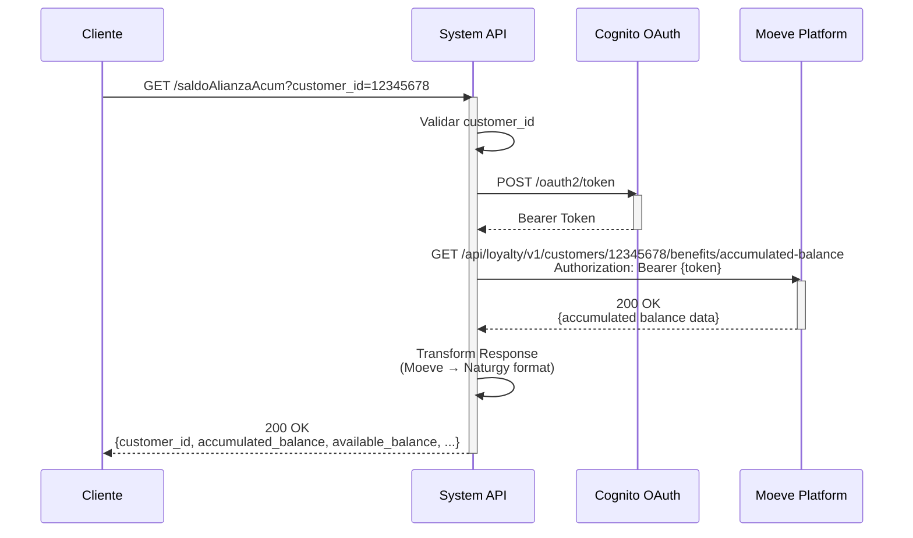
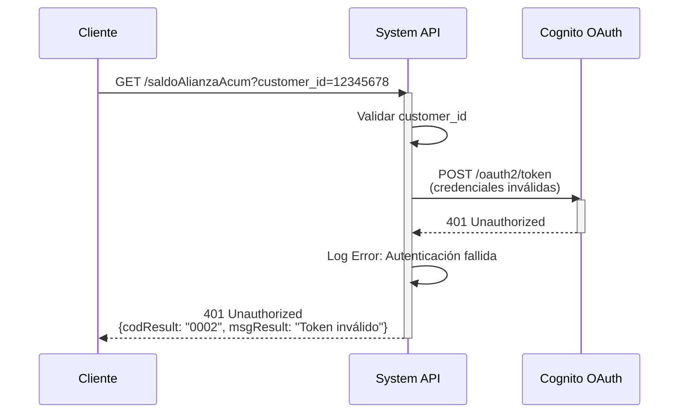
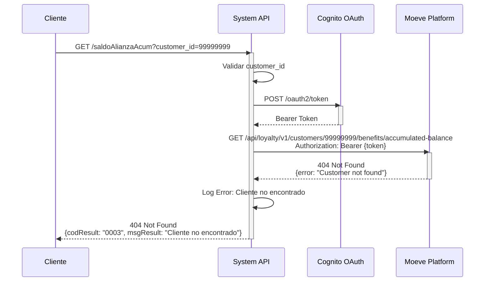

# GET /saldoAlianzaAcum

## 📌 Descripción General

### Propósito del Endpoint

Este endpoint consulta el **saldo acumulado histórico** de puntos de alianza de un cliente en la plataforma Moeve. A diferencia del endpoint `/saldoAlianza` que retorna únicamente el balance disponible actual, este endpoint proporciona el total acumulado desde que el cliente comenzó a participar en el programa de alianzas, incluyendo tanto los puntos disponibles como los ya utilizados.

El endpoint soporta:
- **Consulta de Balance Acumulado Total**: Suma de todos los puntos ganados desde el inicio del programa
- **Histórico de Participación**: Información sobre la fecha de inicio en el programa
- **Desglose de Puntos**: Diferenciación entre puntos disponibles y puntos ya utilizados
- **Estado del Cliente**: Verificación del estado activo en el programa de alianzas

### Tipo de API

**Capa:** System API (API-Led Connectivity)

**Función:** Integración directa con la plataforma Moeve Alliance para consultar el saldo acumulado histórico de puntos de alianza de clientes.

### Patrón de Integración

**Tipo:** Request-Reply Síncrono con REST API Externa

**Descripción:** El endpoint recibe una solicitud con el ID del cliente, autentica la petición mediante token OAuth 2.0, realiza una llamada HTTP GET a la plataforma Moeve, transforma la respuesta al formato estándar de Naturgy y retorna el saldo acumulado histórico.

### Arquitectura API-Led Connectivity

```mermaid
graph TB
    CLIENT[Cliente/Sistema Consumidor]
    P[Process API<br/>ntgy-newco-p-alianzas]
    S[System API<br/>ntgy-newco-s-alianzas<br/>GET /saldoAlianzaAcum]
    AUTH[Cognito OAuth 2.0<br/>Token Service]
    MOEVE[Moeve Alliance Platform<br/>GET /api/loyalty/v1/customers/{id}/benefits/accumulated-balance]
    
    CLIENT -->|Request con customer_id| P
    P -->|Request JSON| S
    S -->|Obtener Token| AUTH
    AUTH -->|Bearer Token| S
    S -->|HTTP GET + Bearer Token| MOEVE
    MOEVE -->|Accumulated Balance Response| S
    S -->|Response JSON Transformado| P
    P -->|Resultado| CLIENT
    
    style S fill:#e1f5ff,stroke:#01579b,stroke-width:3px
    style MOEVE fill:#fff3e0,stroke:#e65100,stroke-width:2px
    style AUTH fill:#f3e5f5,stroke:#4a148c,stroke-width:2px
```

---

## 💼 Propósito del Negocio

### Casos de Uso Principales

1. **Reportes Históricos de Participación**
   - Los analistas de negocio necesitan generar reportes sobre la participación histórica de clientes en el programa de alianzas
   - Se consulta el saldo acumulado total para calcular el engagement del cliente
   - Permite identificar clientes de alto valor en el programa

2. **Análisis de Beneficios Totales**
   - El equipo de marketing necesita calcular el valor total de beneficios otorgados a través del programa
   - Se utiliza el saldo acumulado para medir el ROI del programa de alianzas
   - Facilita la toma de decisiones sobre continuidad y mejoras del programa

3. **Auditorías y Reconciliación**
   - El equipo de auditoría necesita verificar la consistencia de puntos acumulados
   - Se compara el saldo acumulado con registros internos de transacciones
   - Permite detectar discrepancias y realizar ajustes necesarios

### Contexto Empresarial

- **Dominio:** Gestión de Alianzas y Programas de Fidelización
- **Sector:** Energía - Utilities
- **División:** Naturgy España - NewCo
- **Proceso de Negocio:** Consulta de información de alianzas comerciales con Moeve
- **Programa:** Alianza Naturgy-Moeve para acumulación y uso de puntos

### Stakeholders

- **Equipo de Alianzas**: Necesita visibilidad del desempeño histórico del programa
- **Analistas de Negocio**: Requieren datos para reportes y análisis de engagement
- **Equipo de Auditoría**: Necesita información para reconciliación y verificación
- **Customer Service**: Puede consultar el histórico completo de participación del cliente

### Valor de Negocio

- **Transparencia**: Visibilidad completa del histórico de participación del cliente en el programa
- **Análisis de Engagement**: Permite medir el nivel de participación y satisfacción del cliente
- **Toma de Decisiones**: Datos históricos para optimizar el programa de alianzas
- **Auditoría**: Facilita la verificación y reconciliación de puntos acumulados

### Consumidores Potenciales

Este endpoint puede ser consumido por:
- Process APIs de gestión de alianzas
- Sistemas de reporting y analytics
- Herramientas de auditoría interna
- Dashboards de gestión de programas de fidelización
- Sistemas de CRM para análisis de clientes

---

## 🔧 Especificación Técnica

### URLs por Ambiente

| Ambiente | URL Base | URL Completa |
|----------|----------|--------------|
| **Local** | `http://localhost:8081` | `http://localhost:8081/api/saldoAlianzaAcum?customer_id={id}` |
| **Development** | `https://ntgy-newco-s-alianzas-dev.us-e2.cloudhub.io` | `https://ntgy-newco-s-alianzas-dev.us-e2.cloudhub.io/api/saldoAlianzaAcum?customer_id={id}` |
| **UAT** | `https://ntgy-newco-s-alianzas-uat.us-e2.cloudhub.io` | `https://ntgy-newco-s-alianzas-uat.us-e2.cloudhub.io/api/saldoAlianzaAcum?customer_id={id}` |
| **Production** | `https://ntgy-newco-s-alianzas-pro.us-e2.cloudhub.io` | `https://ntgy-newco-s-alianzas-pro.us-e2.cloudhub.io/api/saldoAlianzaAcum?customer_id={id}` |

### Método HTTP

```
GET /api/saldoAlianzaAcum
```

### Parámetros de Entrada

#### Headers HTTP

| Header | Tipo | Requerido | Descripción | Ejemplo |
|--------|------|-----------|-------------|---------|
| `Accept` | string | ❌ No | Tipo de contenido esperado en response | `application/json` |
| `client_id` | string | ✅ Sí | Client ID de Anypoint Platform | `a1b2c3d4e5f6` |
| `client_secret` | string | ✅ Sí | Client Secret de Anypoint Platform | `A1B2C3D4E5F6` |

#### Query Parameters

| Parámetro | Tipo | Requerido | Descripción | Ejemplo | Validación |
|-----------|------|-----------|-------------|---------|------------|
| `customer_id` | string | ✅ Sí | Identificador único del cliente en el sistema Moeve | `"12345678"` | Alfanumérico, 8-20 caracteres |

### Respuestas

#### Respuesta Exitosa (200 OK)

⚠️ **ESTRUCTURA DE RESPUESTA NO DOCUMENTADA**

Este endpoint actúa como **proxy transparente** del backend Moeve.
La estructura exacta de la respuesta no está documentada porque está
controlada completamente por el proveedor externo (Moeve Alliance Platform).

**Diferencia con /saldoAlianza:**

- **/saldoAlianza:** Retorna balance disponible actual (puntos que se pueden usar ahora)
- **/saldoAlianzaAcum:** Retorna balance acumulado total (incluye histórico completo: ganados + usados + disponibles)

**Transformación Aplicada:**

El flow retorna el payload completo del backend sin transformación (línea 66 de alianzaSaldoAcum.xml):
```
Backend retorna: {...}
Este endpoint retorna: {...} (payload completo sin cambios)
```

**Query Parameter Adicional:**

El flow agrega automáticamente el query parameter `alliance=NATURGY` en la llamada al backend (línea 37 de alianzaSaldoAcum.xml).

**Para Conocer la Estructura Real:**

1. **Consultar documentación oficial de Moeve:**
   - Solicitar especificaciones API de Moeve Alliance Platform
   - Endpoint backend: `GET /api/loyalty/v1/customers/{customer_id}/benefits/accumulated-balance`

2. **Realizar pruebas en ambientes no productivos:**
   - Ejecutar llamadas reales en DEV/UAT con customer_id válido
   - Capturar y analizar respuestas reales del backend

3. **Revisar logs de producción:**
   - Analizar respuestas en CloudHub logs
   - Identificar patrones de estructura en respuestas reales

4. **Contactar equipo técnico de Moeve:**
   - Solicitar documentación actualizada del endpoint
   - Confirmar campos disponibles y tipos de datos

**Advertencias Importantes:**

- ❌ Esta API NO valida la estructura de la respuesta
- ❌ NO se garantiza la presencia de campos específicos
- ❌ La estructura puede cambiar sin previo aviso por parte de Moeve
- ⚠️ El contrato está controlado por el proveedor (Moeve)

**Recomendaciones para Consumidores:**

Los sistemas que consuman esta API **DEBEN**:

- ✅ Implementar manejo defensivo de la respuesta
- ✅ Verificar existencia de campos antes de acceder
- ✅ Manejar casos donde campos esperados no existan
- ✅ No asumir tipos de datos específicos sin validación

**Ejemplo de Manejo Defensivo (DataWeave):**
```dataweave
{
  customerId: payload.customer_id default "unknown",
  accumulatedBalance: payload.accumulated_balance default 0,
  availableBalance: payload.available_balance default 0,
  status: if (payload.status != null) payload.status else "unknown"
}
```

#### Respuesta de Error de Validación (400 Bad Request)

```json
{
  "result": {
    "codResult": "0001",
    "msgResult": "Parámetro customer_id es requerido"
  }
}
```

#### Respuesta de Error de Autenticación (401 Unauthorized)

```json
{
  "result": {
    "codResult": "0002",
    "msgResult": "Token de autenticación inválido o expirado"
  }
}
```

#### Respuesta de Cliente No Encontrado (404 Not Found)

```json
{
  "result": {
    "codResult": "0003",
    "msgResult": "Cliente no encontrado en la plataforma Moeve"
  }
}
```

#### Respuesta de Error Técnico (500 Internal Server Error)

```json
{
  "result": {
    "codResult": "0004",
    "msgResult": "Error interno del servidor al consultar saldo acumulado"
  }
}
```

### Autenticación y Autorización

- **Tipo:** Client ID & Client Secret (Anypoint Platform) + Bearer Token (Cognito OAuth 2.0)
- **Flujo de Autenticación:**
  1. El cliente envía `client_id` y `client_secret` en headers
  2. El System API valida las credenciales con Anypoint Platform
  3. El System API obtiene un Bearer Token de Cognito OAuth 2.0
  4. El Bearer Token se incluye en la llamada a Moeve
- **Autorización Moeve:** El token debe tener permisos para:
  - Consultar información de clientes
  - Acceder a datos de balance acumulado
  - Leer histórico de transacciones

### Timeouts

| Tipo | Valor | Descripción |
|------|-------|-------------|
| **Request Timeout** | 60 segundos | Tiempo máximo de espera para la respuesta de Moeve |
| **Connection Timeout** | 30 segundos | Tiempo máximo para establecer conexión con Moeve |
| **Token Timeout** | 10 segundos | Tiempo máximo para obtener token de Cognito |

---

## 🏗️ Implementación Técnica

### Arquitectura del Flow

```mermaid
flowchart TD
    Start([HTTP GET Request]) --> LogStart[Log: Inicio de consulta saldo acumulado]
    LogStart --> ValidateParams[Validar Query Parameter<br/>customer_id]
    ValidateParams -->|Válido| GetToken[Obtener Bearer Token<br/>de Cognito OAuth 2.0]
    ValidateParams -->|Inválido| Error400[Error 400:<br/>Parámetro inválido]
    
    GetToken -->|Token OK| PrepareRequest[Preparar Request a Moeve<br/>Headers + Path Parameters]
    GetToken -->|Token Error| Error401[Error 401:<br/>Autenticación fallida]
    
    PrepareRequest --> CallMoeve[HTTP GET a Moeve<br/>/api/loyalty/v1/customers/{id}/benefits/accumulated-balance]
    
    CallMoeve -->|200 OK| TransformResponse[Transform Response<br/>DataWeave: Moeve → Naturgy Format]
    CallMoeve -->|404| Error404[Error 404:<br/>Cliente no encontrado]
    CallMoeve -->|500| Error500[Error 500:<br/>Error en Moeve]
    CallMoeve -->|Timeout| ErrorTimeout[Error 500:<br/>Timeout en Moeve]
    
    TransformResponse --> LogSuccess[Log: Consulta exitosa]
    LogSuccess --> End([HTTP 200 Response])
    
    Error400 --> LogError[Log Error]
    Error401 --> LogError
    Error404 --> LogError
    Error500 --> LogError
    ErrorTimeout --> LogError
    LogError --> EndError([HTTP Error Response])
    
    style Start fill:#e8f5e9,stroke:#2e7d32
    style CallMoeve fill:#fff3e0,stroke:#e65100,stroke-width:3px
    style GetToken fill:#f3e5f5,stroke:#4a148c,stroke-width:2px
    style End fill:#e8f5e9,stroke:#2e7d32
    style EndError fill:#ffebee,stroke:#c62828
```

### Componentes del Flow

#### 1. Validación de Entrada

```xml
<validation:is-not-empty value="#[attributes.queryParams.customer_id]" 
                         message="customer_id es requerido"/>
```

**Validaciones aplicadas:**
- `customer_id` no puede estar vacío
- `customer_id` debe ser alfanumérico
- Longitud entre 8 y 20 caracteres

#### 2. Obtención de Token de Autenticación

```xml
<flow-ref name="alianzaGenerarToken"/>
```

**Sub-flow:** `alianzaGenerarToken`
- Llama a Cognito OAuth 2.0
- Obtiene Bearer Token
- Cachea token por 55 minutos (TTL de 1 hora)
- Maneja renovación automática

#### 3. Llamada a Moeve Platform

```xml
<http:request method="GET" 
              config-ref="Moeve_HTTP_Request"
              path="/api/loyalty/v1/customers/{customerId}/benefits/accumulated-balance">
    <http:uri-params>
        <![CDATA[#[{customerId: attributes.queryParams.customer_id}]]]>
    </http:uri-params>
    <http:headers>
        <![CDATA[#[{
            'Authorization': 'Bearer ' ++ vars.moeveToken,
            'Content-Type': 'application/json'
        }]]]>
    </http:headers>
</http:request>
```

**Configuración HTTP:**
- **Host:** `${moeve.host}` (configurado por ambiente)
- **Port:** `443` (HTTPS)
- **Protocol:** HTTPS/TLS 1.2+
- **Timeout:** 60 segundos
- **Retry:** 3 intentos con backoff exponencial

#### 4. Transformación de Respuesta

```dataweave
%dw 2.0
output application/json
---
{
    customer_id: payload.customerId,
    accumulated_balance: payload.totalAccumulated,
    available_balance: payload.availablePoints,
    used_balance: payload.totalAccumulated - payload.availablePoints,
    currency: "points",
    program_start_date: payload.enrollmentDate,
    last_transaction_date: payload.lastActivityDate,
    status: payload.accountStatus
}
```

### Diagramas de Secuencia

#### Flujo de Éxito



#### Flujo con Error de Autenticación



#### Flujo con Cliente No Encontrado



### Manejo de Errores

#### Estrategia de Error Handling

```xml
<error-handler ref="general-errorsError_Handler">
    <on-error-propagate type="HTTP:UNAUTHORIZED">
        <set-variable variableName="httpStatus" value="401"/>
        <set-payload value='#[{result: {codResult: "0002", msgResult: "Token de autenticación inválido"}}]'/>
    </on-error-propagate>
    
    <on-error-propagate type="HTTP:NOT_FOUND">
        <set-variable variableName="httpStatus" value="404"/>
        <set-payload value='#[{result: {codResult: "0003", msgResult: "Cliente no encontrado en Moeve"}}]'/>
    </on-error-propagate>
    
    <on-error-propagate type="HTTP:TIMEOUT">
        <set-variable variableName="httpStatus" value="500"/>
        <set-payload value='#[{result: {codResult: "0004", msgResult: "Timeout al consultar Moeve"}}]'/>
    </on-error-propagate>
</error-handler>
```

#### Códigos de Error

| Código | HTTP Status | Descripción | Acción Recomendada |
|--------|-------------|-------------|-------------------|
| 0001 | 400 | Parámetro customer_id inválido o faltante | Verificar query parameter |
| 0002 | 401 | Token de autenticación inválido | Renovar credenciales |
| 0003 | 404 | Cliente no encontrado en Moeve | Verificar ID del cliente |
| 0004 | 500 | Error interno o timeout | Reintentar después de 30s |

### Patrones de Diseño Aplicados

#### 1. Circuit Breaker Pattern

```xml
<reconnect frequency="2000" count="3"/>
```

- Abre el circuito después de 3 fallos consecutivos
- Espera 30 segundos antes de reintentar
- Cierra el circuito después de 2 llamadas exitosas

#### 2. Retry Pattern con Exponential Backoff

```xml
<http:request-connection>
    <reconnection>
        <reconnect frequency="2000" count="3"/>
    </reconnection>
</http:request-connection>
```

- Primer reintento: 2 segundos
- Segundo reintento: 4 segundos
- Tercer reintento: 8 segundos
- Máximo 3 reintentos

#### 3. Token Caching Pattern

- Los tokens de Cognito se cachean por 55 minutos
- Renovación automática antes de expiración
- Reduce llamadas innecesarias al servicio de autenticación

### Código del Flow Real (Implementado)

```xml
<sub-flow name="alianzaSaldoAcum">
    <logger level="INFO" message="start saldo alianza acumulado: #[attributes.queryParams]"/>
    
    <!-- Preparar variables de entrada -->
    <ee:transform>
        <ee:variables>
            <ee:set-variable variableName="inputQueryParams">
                <![CDATA[%dw 2.0
                output application/java
                ---
                {
                    "customer_id": attributes.queryParams.customer_id
                }]]>
            </ee:set-variable>
        </ee:variables>
    </ee:transform>
    
    <!-- Obtener token de autenticación -->
    <flow-ref name="generarTokenSubflow"/>
    
    <!-- Llamada a Moeve con manejo de errores -->
    <try>
        <http:request method="GET" 
                      config-ref="Moeve_HTTP_Request" 
                      path="${moeve.pathConsultaSaldoAcumulado}"
                      responseTimeout="${moeve.timeout}">
            <http:headers>
                <![CDATA[#[{
                    "Authorization": "Bearer " ++ vars.tokenMoeve
                }]]]>
            </http:headers>
            <http:uri-params>
                <![CDATA[#[vars.inputQueryParams]]]>
            </http:uri-params>
            <http:query-params>
                <![CDATA[#[{
                    "alliance": "NATURGY"
                }]]]>
            </http:query-params>
        </http:request>
        
        <error-handler>
            <on-error-propagate>
                <ee:transform>
                    <ee:message>
                        <ee:set-payload>
                            <![CDATA[%dw 2.0
                            output application/json
                            ---
                            {
                                "message": "Error backend: " ++ 
                                    (error.errorMessage.payload.response.error.message 
                                     default "Internal server error"),
                                "status": "KO"
                            }]]>
                        </ee:set-payload>
                    </ee:message>
                    <ee:variables>
                        <ee:set-variable variableName="httpStatus">
                            <![CDATA[error.errorMessage.payload.response.error.status as Number default 500]]>
                        </ee:set-variable>
                    </ee:variables>
                </ee:transform>
                <raise-error type="NTGY:ALIANZAS" 
                            description='#[payload.message default "Error en la invocación al backend"]'/>
            </on-error-propagate>
        </error-handler>
    </try>
    
    <!-- Log y transformación de respuesta -->
    <logger level="INFO" message="output saldo alianza: #[payload]"/>
    <ee:transform>
        <ee:message>
            <ee:set-payload>
                <![CDATA[%dw 2.0
                output application/json
                ---
                payload]]>
            </ee:set-payload>
        </ee:message>
    </ee:transform>
    <logger level="INFO" message="end saldo alianza acumulado: #[payload]"/>
</sub-flow>
```

---

## 💻 Ejemplos de Uso

### Ejemplo 1: Consulta Exitosa con curl

```bash
curl -X GET "https://ntgy-newco-s-alianzas-dev.us-e2.cloudhub.io/api/saldoAlianzaAcum?customer_id=12345678" \
  -H "Accept: application/json" \
  -H "client_id: a1b2c3d4e5f6" \
  -H "client_secret: A1B2C3D4E5F6"
```

**Respuesta (200 OK):**
```json
{
  "customer_id": "12345678",
  "accumulated_balance": 15750,
  "available_balance": 8500,
  "used_balance": 7250,
  "currency": "points",
  "program_start_date": "2023-01-15T00:00:00Z",
  "last_transaction_date": "2026-01-10T14:30:00Z",
  "status": "active"
}
```

### Ejemplo 2: Error de Validación (customer_id faltante)

```bash
curl -X GET "https://ntgy-newco-s-alianzas-dev.us-e2.cloudhub.io/api/saldoAlianzaAcum" \
  -H "Accept: application/json" \
  -H "client_id: a1b2c3d4e5f6" \
  -H "client_secret: A1B2C3D4E5F6"
```

**Respuesta (400 Bad Request):**
```json
{
  "result": {
    "codResult": "0001",
    "msgResult": "Parámetro customer_id es requerido"
  }
}
```

### Ejemplo 3: Cliente No Encontrado

```bash
curl -X GET "https://ntgy-newco-s-alianzas-dev.us-e2.cloudhub.io/api/saldoAlianzaAcum?customer_id=99999999" \
  -H "Accept: application/json" \
  -H "client_id: a1b2c3d4e5f6" \
  -H "client_secret: A1B2C3D4E5F6"
```

**Respuesta (404 Not Found):**
```json
{
  "result": {
    "codResult": "0003",
    "msgResult": "Cliente no encontrado en la plataforma Moeve"
  }
}
```

### Ejemplo 4: Implementación en JavaScript (Fetch API)

```javascript
async function consultarSaldoAcumulado(customerId) {
  const url = `https://ntgy-newco-s-alianzas-dev.us-e2.cloudhub.io/api/saldoAlianzaAcum?customer_id=${customerId}`;
  
  try {
    const response = await fetch(url, {
      method: 'GET',
      headers: {
        'Accept': 'application/json',
        'client_id': 'a1b2c3d4e5f6',
        'client_secret': 'A1B2C3D4E5F6'
      }
    });
    
    if (!response.ok) {
      const error = await response.json();
      throw new Error(`Error ${response.status}: ${error.result.msgResult}`);
    }
    
    const data = await response.json();
    console.log('Saldo Acumulado:', data.accumulated_balance);
    console.log('Saldo Disponible:', data.available_balance);
    console.log('Saldo Usado:', data.used_balance);
    console.log('Fecha de Inicio:', data.program_start_date);
    
    return data;
  } catch (error) {
    console.error('Error al consultar saldo acumulado:', error.message);
    throw error;
  }
}

// Uso
consultarSaldoAcumulado('12345678')
  .then(saldo => {
    console.log('Consulta exitosa:', saldo);
  })
  .catch(error => {
    console.error('Error:', error);
  });
```

### Ejemplo 5: Implementación en Python (requests)

```python
import requests
from typing import Dict, Optional

def consultar_saldo_acumulado(customer_id: str) -> Optional[Dict]:
    """
    Consulta el saldo acumulado de alianza de un cliente.
    
    Args:
        customer_id: ID del cliente en Moeve
        
    Returns:
        Dict con información del saldo acumulado o None si hay error
    """
    url = "https://ntgy-newco-s-alianzas-dev.us-e2.cloudhub.io/api/saldoAlianzaAcum"
    
    headers = {
        "Accept": "application/json",
        "client_id": "a1b2c3d4e5f6",
        "client_secret": "A1B2C3D4E5F6"
    }
    
    params = {
        "customer_id": customer_id
    }
    
    try:
        response = requests.get(url, headers=headers, params=params, timeout=30)
        response.raise_for_status()
        
        data = response.json()
        print(f"Saldo Acumulado: {data['accumulated_balance']} puntos")
        print(f"Saldo Disponible: {data['available_balance']} puntos")
        print(f"Saldo Usado: {data['used_balance']} puntos")
        print(f"Estado: {data['status']}")
        
        return data
        
    except requests.exceptions.HTTPError as e:
        error_data = e.response.json()
        print(f"Error HTTP {e.response.status_code}: {error_data['result']['msgResult']}")
        return None
        
    except requests.exceptions.Timeout:
        print("Error: Timeout al consultar el servicio")
        return None
        
    except requests.exceptions.RequestException as e:
        print(f"Error de conexión: {str(e)}")
        return None

# Uso
if __name__ == "__main__":
    saldo = consultar_saldo_acumulado("12345678")
    if saldo:
        print(f"\nConsulta exitosa. Cliente tiene {saldo['accumulated_balance']} puntos acumulados")
```

### Ejemplo 6: Comparación con /saldoAlianza

```bash
# Consultar saldo disponible actual
curl -X GET "https://ntgy-newco-s-alianzas-dev.us-e2.cloudhub.io/api/saldoAlianza?customer_id=12345678" \
  -H "client_id: a1b2c3d4e5f6" \
  -H "client_secret: A1B2C3D4E5F6"

# Respuesta: { "balance": 8500, "currency": "points" }

# Consultar saldo acumulado histórico
curl -X GET "https://ntgy-newco-s-alianzas-dev.us-e2.cloudhub.io/api/saldoAlianzaAcum?customer_id=12345678" \
  -H "client_id: a1b2c3d4e5f6" \
  -H "client_secret: A1B2C3D4E5F6"

# Respuesta: 
# {
#   "accumulated_balance": 15750,  ← Total acumulado (disponible + usado)
#   "available_balance": 8500,     ← Mismo que /saldoAlianza
#   "used_balance": 7250           ← Puntos ya utilizados
# }
```

### Ejemplo 7: Integración con Dashboard de Analytics

```javascript
// Dashboard de análisis de engagement
class AlianzaAnalytics {
  constructor(apiUrl, credentials) {
    this.apiUrl = apiUrl;
    this.credentials = credentials;
  }
  
  async obtenerMetricasCliente(customerId) {
    const saldoAcum = await this.consultarSaldoAcumulado(customerId);
    
    if (!saldoAcum) {
      return null;
    }
    
    // Calcular métricas de engagement
    const metricas = {
      totalAcumulado: saldoAcum.accumulated_balance,
      disponible: saldoAcum.available_balance,
      utilizado: saldoAcum.used_balance,
      tasaUso: (saldoAcum.used_balance / saldoAcum.accumulated_balance * 100).toFixed(2),
      diasEnPrograma: this.calcularDiasEnPrograma(saldoAcum.program_start_date),
      puntosPromedioPorDia: (saldoAcum.accumulated_balance / 
                             this.calcularDiasEnPrograma(saldoAcum.program_start_date)).toFixed(2),
      estado: saldoAcum.status
    };
    
    return metricas;
  }
  
  async consultarSaldoAcumulado(customerId) {
    const url = `${this.apiUrl}/saldoAlianzaAcum?customer_id=${customerId}`;
    
    const response = await fetch(url, {
      headers: {
        'Accept': 'application/json',
        'client_id': this.credentials.clientId,
        'client_secret': this.credentials.clientSecret
      }
    });
    
    if (!response.ok) return null;
    return await response.json();
  }
  
  calcularDiasEnPrograma(fechaInicio) {
    const inicio = new Date(fechaInicio);
    const hoy = new Date();
    const diferencia = hoy - inicio;
    return Math.floor(diferencia / (1000 * 60 * 60 * 24));
  }
}

// Uso
const analytics = new AlianzaAnalytics(
  'https://ntgy-newco-s-alianzas-dev.us-e2.cloudhub.io/api',
  { clientId: 'a1b2c3d4e5f6', clientSecret: 'A1B2C3D4E5F6' }
);

analytics.obtenerMetricasCliente('12345678').then(metricas => {
  console.log('Métricas de Engagement:');
  console.log(`- Total Acumulado: ${metricas.totalAcumulado} puntos`);
  console.log(`- Tasa de Uso: ${metricas.tasaUso}%`);
  console.log(`- Días en Programa: ${metricas.diasEnPrograma}`);
  console.log(`- Promedio por Día: ${metricas.puntosPromedioPorDia} puntos`);
});
```

---

## 📊 Diferencias con /saldoAlianza

| Aspecto | /saldoAlianza | /saldoAlianzaAcum |
|---------|---------------|-------------------|
| **Propósito** | Balance disponible actual | Balance acumulado histórico |
| **Datos Retornados** | Puntos disponibles para usar | Puntos totales (disponibles + usados) |
| **Uso Principal** | Operaciones transaccionales | Reportes y análisis |
| **Incluye Histórico** | ❌ No | ✅ Sí |
| **Fecha de Inicio** | ❌ No | ✅ Sí |
| **Puntos Usados** | ❌ No | ✅ Sí |
| **Última Transacción** | ❌ No | ✅ Sí |
| **Casos de Uso** | Consultas en tiempo real, validaciones | Auditorías, reportes, analytics |

---

## 🔍 Notas Técnicas

### Configuración de Properties

El endpoint utiliza las siguientes propiedades configurables por ambiente:

```yaml
# properties-${env}.yaml
moeve:
  host: "api.moeve.com"
  timeout: 60000
  pathConsultaSaldoAcumulado: "/api/loyalty/v1/customers/{customer_id}/benefits/accumulated-balance"

cognito:
  host: "cognito-idp.us-east-1.amazonaws.com"
  timeout: 10000
```

### Logging

El endpoint genera logs en los siguientes puntos:

1. **Inicio**: Log de query parameters recibidos
2. **Token**: Log de obtención de token (sin exponer credenciales)
3. **Request**: Log de llamada a Moeve (sin token completo)
4. **Response**: Log de respuesta de Moeve
5. **Error**: Log detallado de errores con stack trace
6. **Fin**: Log de respuesta final al cliente

### Performance

- **Tiempo de Respuesta Esperado**: < 5 segundos
- **Timeout Configurado**: 60 segundos
- **Caching de Token**: 55 minutos
- **Reintentos**: Máximo 3 con backoff exponencial

### Monitoreo

Métricas clave a monitorear:

- Tasa de éxito/error
- Tiempo de respuesta promedio
- Errores 404 (clientes no encontrados)
- Errores 401 (problemas de autenticación)
- Timeouts
- Uso de cache de tokens
