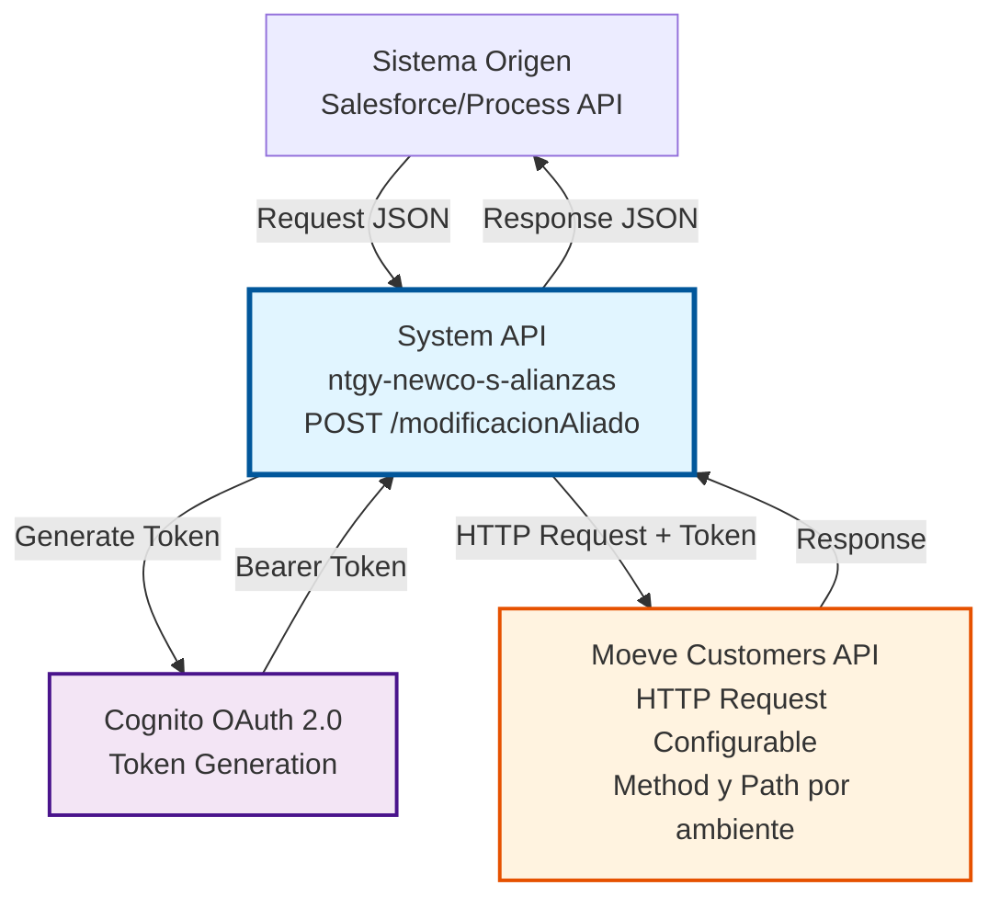
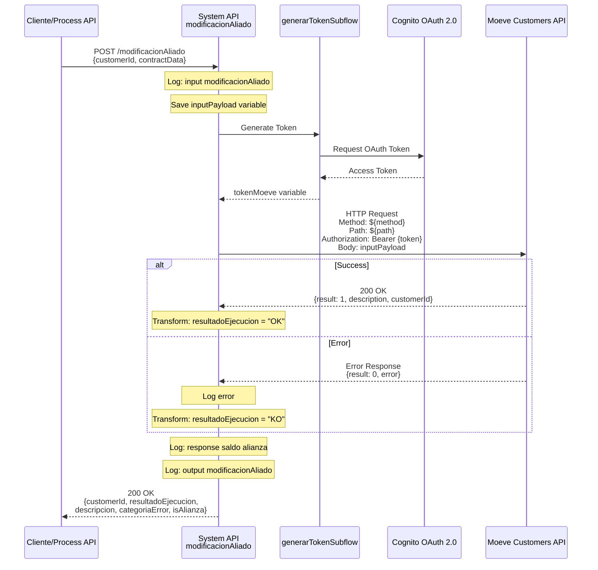
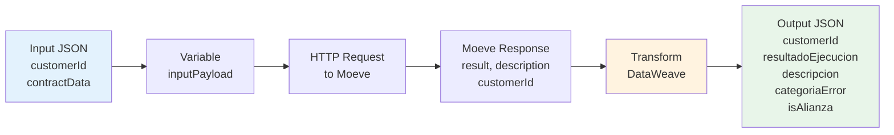

# POST /modificacionAliado

## 📌 Descripción General

### Propósito del Endpoint

Este endpoint permite modificar información de un aliado (cliente) en la plataforma Moeve, actualizando datos contractuales y el estado del cliente en el programa de alianzas. La operación se realiza mediante una llamada síncrona a la API de Moeve Customers.

El endpoint soporta:
- **Modificación de datos contractuales**: Actualización de información del contrato del cliente
- **Cambio de estado**: Modificación del estado del cliente en el programa de alianzas
- **Actualización de atributos**: Modificación de otros atributos relacionados con la participación en alianzas
- **Validación en tiempo real**: Verificación inmediata de la modificación en el sistema Moeve

### Tipo de API

**Capa:** System API (API-Led Connectivity)

**Función:** Integración directa con Moeve Customers API para modificar información de clientes aliados en el programa de alianzas.

### Patrón de Integración

**Tipo:** Request-Reply Síncrono con REST API Externa

**Descripción:** Recibe datos del cliente a modificar, genera token de autenticación OAuth 2.0, invoca la API de Moeve Customers con el método y path configurados por ambiente, procesa la respuesta y retorna el resultado de la modificación en formato estándar.

### Arquitectura API-Led Connectivity



---

## 💼 Propósito del Negocio

### Casos de Uso Principales

1. **Actualización de Estado de Cliente**
   - Un cliente cambia su estado en el programa de alianzas (activo, inactivo, suspendido)
   - Se actualiza la información en Moeve para reflejar el cambio
   - Permite gestionar el ciclo de vida del cliente en el programa

2. **Modificación de Datos Contractuales**
   - Se actualizan datos del contrato del cliente (número, tipo, condiciones)
   - La información se sincroniza con la plataforma Moeve
   - Mantiene la consistencia de datos entre sistemas

3. **Gestión de Participación en Alianzas**
   - Se modifica el tipo de participación del cliente en el programa
   - Se actualizan atributos relacionados con beneficios y acumulación de puntos
   - Permite personalizar la experiencia del cliente en el programa

### Contexto Empresarial

- **Dominio:** Gestión de Alianzas Comerciales
- **Sector:** Energía - Utilities
- **División:** Naturgy España - NewCo
- **Proceso de Negocio:** Administración del programa de alianzas Moeve
- **Partner Estratégico:** Moeve (anteriormente Repsol)

### Stakeholders

- **Equipo de Alianzas**: Gestiona las relaciones con clientes del programa Moeve
- **Servicio al Cliente**: Actualiza información de clientes según solicitudes
- **Sistemas de Salesforce**: Origen de las modificaciones contractuales
- **Equipo Técnico de Moeve**: Propietarios de la API de Moeve Customers

### Valor de Negocio

- **Sincronización en Tiempo Real**: Actualización inmediata de datos en la plataforma Moeve
- **Gestión Centralizada**: Punto único de integración para modificaciones de aliados
- **Trazabilidad**: Registro completo de modificaciones realizadas
- **Experiencia del Cliente**: Cambios reflejados inmediatamente en beneficios y servicios

### Consumidores Potenciales

Este endpoint puede ser consumido por:
- Process APIs de gestión de clientes
- Flujos de Salesforce (Platform Events, Flows, Apex)
- Sistemas de integración middleware
- Aplicaciones de administración del programa de alianzas
- Servicios de sincronización batch

---

## 🔧 Especificación Técnica

### URLs por Ambiente

| Ambiente | URL Base | URL Completa |
|----------|----------|--------------|
| **Local** | `http://localhost:8081` | `http://localhost:8081/api/modificacionAliado` |
| **Development** | `https://ntgy-newco-s-alianzas-dev.us-e2.cloudhub.io` | `https://ntgy-newco-s-alianzas-dev.us-e2.cloudhub.io/api/modificacionAliado` |
| **UAT** | `https://ntgy-newco-s-alianzas-uat.us-e2.cloudhub.io` | `https://ntgy-newco-s-alianzas-uat.us-e2.cloudhub.io/api/modificacionAliado` |
| **Production** | `https://ntgy-newco-s-alianzas-pro.us-e2.cloudhub.io` | `https://ntgy-newco-s-alianzas-pro.us-e2.cloudhub.io/api/modificacionAliado` |

### Método HTTP

```
POST /api/modificacionAliado
```

### Parámetros de Entrada

#### Headers HTTP

| Header | Tipo | Requerido | Descripción | Ejemplo |
|--------|------|-----------|-------------|---------|
| `Content-Type` | string | ✅ Sí | Tipo de contenido del request | `application/json` |
| `Accept` | string | ❌ No | Tipo de contenido esperado en response | `application/json` |

#### Body Parameters

⚠️ **IMPORTANTE:** Este endpoint actúa como proxy transparente hacia la API de Moeve Customers.
El payload completo se envía tal cual al backend de Moeve sin transformación.

**Tipo RAML:** `ModificacionAliadoRequest`

| Campo | Tipo | Requerido | Descripción | Ejemplo |
|-------|------|-----------|-------------|---------|
| `customerId` | string | ✅ Sí | Identificador único del cliente en Moeve | `"12345678"` |

**Nota Técnica:** 
El flow almacena el payload completo en la variable `inputPayload` y locomo envía íntegramente
al backend configurado en `${moeveCustomers.pathMovimientoAliado}`. Cualquier campo adicional
incluido en el request será enviado al backend de Moeve.

**Ejemplo de Request Body:**

```json
{
  "customerId": "12345678"
}
```

### Respuestas

#### Respuesta Exitosa (200 OK)

La respuesta es generada por el flow después de procesar la respuesta del backend de Moeve.

**Tipo RAML:** `ModificacionAliadoResponse`

```json
{
  "customerId": "12345678",
  "resultadoEjecucion": "OK",
  "descripcion": "Modificación realizada exitosamente",
  "categoriaError": "99",
  "isAlianza": true
}
```

**Campos de la Respuesta:**

| Campo | Tipo | Descripción |
|-------|------|-------------|
| `customerId` | string | Identificador único del cliente procesado (extraído de la respuesta del backend) |
| `resultadoEjecucion` | string | Resultado de la operación: **"OK"** si backend retornó `result=1`, **"KO"** en caso contrario |
| `descripcion` | string | Mensaje descriptivo: `payload.description` si existe, sino `payload.error.errorDescription` |
| `categoriaError` | string | Código de categoría de error (valor fijo: **"99"** para errores generales) |
| `isAlianza` | boolean | Flag que indica si es operación de alianza (valor fijo: **true**) |

**Lógica de Transformación (líneas 40-49 de modificacionAliado.xml):**
```dataweave
{	
  customerId: payload.customerId,
  resultadoEjecucion: if (payload.result == 1) "OK" else "KO",
  descripcion: if(payload.description != null) 
                 payload.description 
               else 
                 payload.error.errorDescription,
  categoriaError: "99",
  "isAlianza": true
}
```

#### Respuesta de Error de Negocio (200 OK con resultadoEjecucion = "KO")

```json
{
  "customerId": "12345678",
  "resultadoEjecucion": "KO",
  "descripcion": "Cliente no encontrado en el sistema Moeve",
  "categoriaError": "99",
  "isAlianza": false
}
```

#### Respuesta de Error Técnico (400/401/404/500)

```json
{
  "result": {
    "codResult": "0001",
    "msgResult": "Error interno del servidor"
  }
}
```

### Autenticación y Autorización

- **Tipo:** Client ID & Client Secret (Anypoint Platform)
- **Autorización Moeve:** 
  - Token OAuth 2.0 generado mediante Cognito
  - Token incluido en header Authorization como Bearer token
  - Token generado automáticamente por el flow `generarTokenSubflow`
  - Permisos necesarios en Moeve Customers API para modificar clientes

### Timeouts

| Tipo | Valor | Descripción |
|------|-------|-------------|
| **Response Timeout** | `${moeve.timeout}` | Tiempo máximo de espera para la respuesta de Moeve (configurado por ambiente) |
| **Connection Timeout** | 30 segundos | Tiempo máximo para establecer conexión con Moeve |

---

## 🏗️ Implementación Técnica

### Arquitectura del Flow

```mermaid
flowchart TD
    Start([HTTP POST Request]) --> LogStart[Log Start<br/>Logger: input modificacionAliado]
    LogStart --> SavePayload[Save Input Payload<br/>Variable: inputPayload]
    SavePayload --> GenToken[Generate Token<br/>Flow-ref: generarTokenSubflow]
    GenToken --> TryBlock{Try Block}
    TryBlock --> HTTPReq[HTTP Request to Moeve<br/>Method: ${moeveCustomers.methodMovimientoAliado}<br/>Path: ${moeveCustomers.pathMovimientoAliado}]
    HTTPReq --> Success{Success?}
    Success -->|Yes| Transform[Transform Response<br/>DataWeave: output format]
    Success -->|No| ErrorHandler[Error Handler<br/>Log error]
    ErrorHandler --> Transform
    Transform --> LogResp[Log Response<br/>Logger: response saldo alianza]
    LogResp --> LogEnd[Log End<br/>Logger: output modificacionAliado]
    LogEnd --> End([HTTP Response])
    
    style Start fill:#e8f5e9,stroke:#2e7d32
    style HTTPReq fill:#fff3e0,stroke:#e65100,stroke-width:3px
    style GenToken fill:#f3e5f5,stroke:#4a148c,stroke-width:2px
    style End fill:#e8f5e9,stroke:#2e7d32
```

### Componentes del Flow

#### 1. Logger de Inicio
```xml
<logger level="INFO" message="input modificacionAliado: #[payload]"/>
```
- Registra el payload de entrada para trazabilidad
- Nivel INFO para auditoría

#### 2. Almacenamiento del Payload Original
```dataweave
%dw 2.0
output application/json
---
payload
```
- Guarda el payload original en variable `inputPayload`
- Permite recuperar datos originales después de transformaciones

#### 3. Generación de Token
```xml
<flow-ref name="generarTokenSubflow"/>
```
- Invoca sub-flow de generación de token OAuth 2.0
- Token almacenado en variable `tokenMoeve`
- Utiliza Cognito para autenticación

#### 4. HTTP Request a Moeve Customers
```xml
<http:request 
    method="${moeveCustomers.methodMovimientoAliado}" 
    config-ref="MoeveCustomers_HTTP_Request" 
    path="${moeveCustomers.pathMovimientoAliado}" 
    responseTimeout="${moeve.timeout}">
    <http:body>#[vars.inputPayload]</http:body>
    <http:headers>
        #[output application/java
        ---
        {
            "Authorization" : "Bearer " ++ vars.tokenMoeve
        }]
    </http:headers>
</http:request>
```

**Configuración:**
- Método HTTP: Configurado por ambiente
- Path: Configurado por ambiente
- Body: Payload original almacenado en variable
- Headers: Authorization Bearer con token generado

#### 5. Manejo de Errores
```xml
<error-handler>
    <on-error-continue>
        <logger level="INFO" message="Logger error: #[payload]"/>
    </on-error-continue>
</error-handler>
```
- Captura errores de la llamada HTTP
- Registra el error en logs
- Continúa el flujo para retornar respuesta de error

#### 6. Transformación de Respuesta
```dataweave
%dw 2.0
output application/json
---
{	
    customerId: payload.customerId,
    resultadoEjecucion: if (payload.result == 1) "OK" else "KO",
    descripcion: if(payload.description != null) 
                    payload.description 
                 else 
                    payload.error.errorDescription,
    categoriaError: "99",
    "isAlianza": true
}
```

**Lógica de Transformación:**
- `resultadoEjecucion`: "OK" si result=1, "KO" en caso contrario
- `descripcion`: Usa description si existe, sino errorDescription del error
- `categoriaError`: Fijo en "99" para errores generales
- `isAlianza`: Siempre true para clientes en el programa

### Diagrama de Secuencia Completo



### Configuración por Ambiente

El endpoint utiliza propiedades configurables por ambiente:

```properties
# Moeve Customers Configuration
moeveCustomers.methodMovimientoAliado=PUT
moeveCustomers.pathMovimientoAliado=/api/v1/customers/{customerId}/contract
moeve.timeout=60000

# Cognito Configuration (para token generation)
cognito.tokenUrl=https://cognito-idp.region.amazonaws.com/oauth2/token
cognito.clientId=${secure::cognito.clientId}
cognito.clientSecret=${secure::cognito.clientSecret}
```

### Manejo de Errores y Logging

**Estrategia de Logging:**
1. **Inicio**: Log del payload de entrada
2. **Token Generation**: Logs en generarTokenSubflow
3. **HTTP Request**: Logs automáticos del conector HTTP
4. **Error**: Log específico en error handler
5. **Respuesta**: Log de la respuesta transformada
6. **Fin**: Log del output final

**Niveles de Log:**
- INFO: Flujo normal de ejecución
- ERROR: Errores capturados en error handler

### Transformación de Datos



---

## 💻 Ejemplos de Uso

### Ejemplo 1: Modificación Exitosa de Estado

**Request:**

```bash
curl -X POST "https://ntgy-newco-s-alianzas-dev.us-e2.cloudhub.io/api/modificacionAliado" \
  -H "Content-Type: application/json" \
  -H "client_id: your-client-id" \
  -H "client_secret: your-client-secret" \
  -d '{
    "customerId": "12345678",
    "contractData": {
      "contractNumber": "CNT-2024-001",
      "status": "active",
      "modificationType": "status_change"
    }
  }'
```

**Response (200 OK):**

```json
{
  "customerId": "12345678",
  "resultadoEjecucion": "OK",
  "descripcion": "Modificación realizada exitosamente",
  "categoriaError": "99",
  "isAlianza": true
}
```

### Ejemplo 2: Cliente No Encontrado

**Request:**

```bash
curl -X POST "https://ntgy-newco-s-alianzas-dev.us-e2.cloudhub.io/api/modificacionAliado" \
  -H "Content-Type: application/json" \
  -H "client_id: your-client-id" \
  -H "client_secret: your-client-secret" \
  -d '{
    "customerId": "99999999",
    "contractData": {
      "contractNumber": "CNT-2024-999",
      "status": "active",
      "modificationType": "status_change"
    }
  }'
```

**Response (200 OK con resultadoEjecucion = "KO"):**

```json
{
  "customerId": "99999999",
  "resultadoEjecucion": "KO",
  "descripcion": "Cliente no encontrado en el sistema Moeve",
  "categoriaError": "99",
  "isAlianza": false
}
```

### Ejemplo 3: Error de Autenticación

**Request:**

```bash
curl -X POST "https://ntgy-newco-s-alianzas-dev.us-e2.cloudhub.io/api/modificacionAliado" \
  -H "Content-Type: application/json" \
  -d '{
    "customerId": "12345678",
    "contractData": {
      "status": "inactive"
    }
  }'
```

**Response (401 Unauthorized):**

```json
{
  "result": {
    "codResult": "0401",
    "msgResult": "No autorizado - Token inválido o expirado"
  }
}
```

### Ejemplo 4: Error del Backend Moeve

**Request:**

```bash
curl -X POST "https://ntgy-newco-s-alianzas-dev.us-e2.cloudhub.io/api/modificacionAliado" \
  -H "Content-Type: application/json" \
  -H "client_id: your-client-id" \
  -H "client_secret: your-client-secret" \
  -d '{
    "customerId": "12345678",
    "contractData": {
      "contractNumber": "INVALID",
      "status": "invalid_status"
    }
  }'
```

**Response (200 OK con resultadoEjecucion = "KO"):**

```json
{
  "customerId": "12345678",
  "resultadoEjecucion": "KO",
  "descripcion": "Estado de contrato inválido. Valores permitidos: active, inactive, suspended",
  "categoriaError": "99",
  "isAlianza": true
}
```

### Ejemplo 5: Código JavaScript/Node.js

```javascript
const axios = require('axios');

async function modificarAliado() {
  try {
    const response = await axios.post(
      'https://ntgy-newco-s-alianzas-dev.us-e2.cloudhub.io/api/modificacionAliado',
      {
        customerId: "12345678",
        contractData: {
          contractNumber: "CNT-2024-001",
          status: "active",
          modificationType: "status_change"
        }
      },
      {
        headers: {
          'Content-Type': 'application/json',
          'client_id': 'your-client-id',
          'client_secret': 'your-client-secret'
        }
      }
    );

    console.log('Modificación exitosa:', response.data);
    
    if (response.data.resultadoEjecucion === 'OK') {
      console.log('Cliente modificado correctamente');
    } else {
      console.log('Error de negocio:', response.data.descripcion);
    }
  } catch (error) {
    console.error('Error técnico:', error.response?.data || error.message);
  }
}

modificarAliado();
```

### Ejemplo 6: Código Python

```python
import requests
import json

def modificar_aliado():
    url = "https://ntgy-newco-s-alianzas-dev.us-e2.cloudhub.io/api/modificacionAliado"
    
    headers = {
        "Content-Type": "application/json",
        "client_id": "your-client-id",
        "client_secret": "your-client-secret"
    }
    
    payload = {
        "customerId": "12345678",
        "contractData": {
            "contractNumber": "CNT-2024-001",
            "status": "active",
            "modificationType": "status_change"
        }
    }
    
    try:
        response = requests.post(url, headers=headers, json=payload)
        response.raise_for_status()
        
        data = response.json()
        print(f"Respuesta: {json.dumps(data, indent=2)}")
        
        if data.get('resultadoEjecucion') == 'OK':
            print("Cliente modificado correctamente")
        else:
            print(f"Error de negocio: {data.get('descripcion')}")
            
    except requests.exceptions.RequestException as e:
        print(f"Error técnico: {e}")

if __name__ == "__main__":
    modificar_aliado()
```

### Ejemplo 7: Postman Collection

```json
{
  "info": {
    "name": "Moeve Alianzas - Modificación Aliado",
    "schema": "https://schema.getpostman.com/json/collection/v2.1.0/collection.json"
  },
  "item": [
    {
      "name": "POST Modificación Aliado",
      "request": {
        "method": "POST",
        "header": [
          {
            "key": "Content-Type",
            "value": "application/json"
          },
          {
            "key": "client_id",
            "value": "{{client_id}}"
          },
          {
            "key": "client_secret",
            "value": "{{client_secret}}"
          }
        ],
        "body": {
          "mode": "raw",
          "raw": "{\n  \"customerId\": \"12345678\",\n  \"contractData\": {\n    \"contractNumber\": \"CNT-2024-001\",\n    \"status\": \"active\",\n    \"modificationType\": \"status_change\"\n  }\n}"
        },
        "url": {
          "raw": "{{base_url}}/api/modificacionAliado",
          "host": ["{{base_url}}"],
          "path": ["api", "modificacionAliado"]
        }
      }
    }
  ]
}
```
