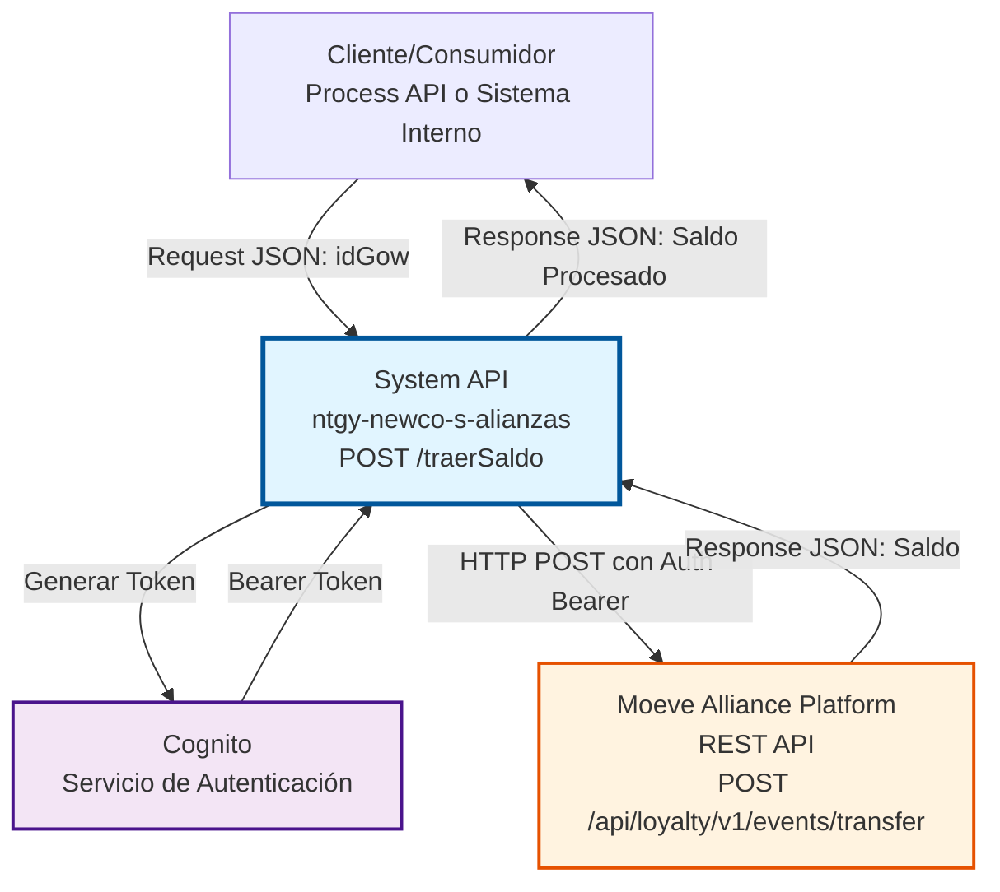
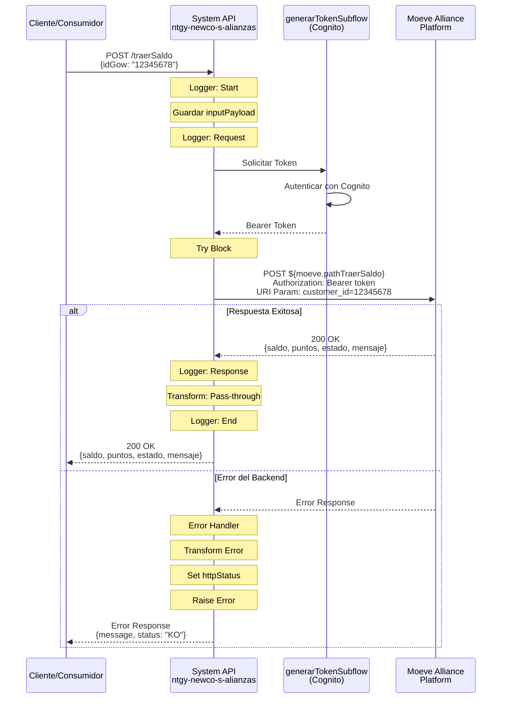

# POST /traerSaldo

## 📌 Descripción General

### Propósito del Endpoint

Este endpoint consulta el saldo de batería de un cliente en la plataforma Moeve Alliance en tiempo real. El "saldo de batería" representa los puntos o créditos acumulados por el cliente en el programa de alianzas Moeve-Naturgy que pueden ser utilizados para obtener beneficios.

El endpoint soporta:
- **Consulta en Tiempo Real**: Obtiene el saldo actual directamente desde la plataforma Moeve
- **Autenticación Automática**: Genera y gestiona tokens de autenticación mediante Cognito
- **Manejo Robusto de Errores**: Captura y transforma errores del backend para respuestas consistentes
- **Trazabilidad Completa**: Logging detallado en cada etapa del proceso

### Tipo de API

**Capa:** System API (API-Led Connectivity)

**Función:** Integración directa con la plataforma Moeve Alliance para consulta de saldos de batería, proporcionando una capa de abstracción sobre el sistema externo.

### Patrón de Integración

**Tipo:** Request-Reply Síncrono con REST API Externa

**Descripción:** El endpoint recibe una solicitud con el identificador del cliente (idGow), genera un token de autenticación mediante Cognito, invoca el endpoint REST de Moeve con el token Bearer, procesa la respuesta y retorna el saldo de batería al consumidor.

### Arquitectura API-Led Connectivity



---

## 💼 Propósito del Negocio

### Casos de Uso Principales

1. **Consulta de Saldo para Atención al Cliente**
   - Representantes de servicio al cliente consultan el saldo de batería durante llamadas
   - Permite informar al cliente sobre sus puntos acumulados
   - Facilita la gestión de beneficios y promociones

2. **Integración con Portales de Autoservicio**
   - Portales web y aplicaciones móviles muestran el saldo en tiempo real
   - Clientes pueden verificar sus puntos antes de canjearlos
   - Mejora la experiencia del usuario con información actualizada

3. **Procesos de Facturación y Cobros**
   - Sistemas de facturación verifican saldos para aplicar descuentos
   - Validación de puntos disponibles antes de aplicar beneficios
   - Integración con procesos de liquidación de alianzas

### Contexto Empresarial

- **Dominio:** Gestión de Alianzas y Programas de Fidelización
- **Sector:** Energía - Utilities
- **División:** Naturgy España - NewCo
- **Proceso de Negocio:** Programa de Alianzas Moeve-Naturgy
- **Partner Estratégico:** Moeve (anteriormente Repsol)

### Stakeholders

- **Clientes Finales**: Consultan sus puntos acumulados en el programa de alianzas
- **Representantes de Atención al Cliente**: Proporcionan información de saldos durante interacciones
- **Equipos de Marketing**: Utilizan datos de saldos para campañas y promociones
- **Sistemas de Facturación**: Aplican beneficios basados en saldos disponibles
- **Moeve**: Partner de alianzas que gestiona el programa de puntos

### Valor de Negocio

- **Transparencia**: Clientes tienen visibilidad en tiempo real de sus puntos acumulados
- **Eficiencia Operativa**: Automatización de consultas reduce carga manual
- **Experiencia del Cliente**: Información inmediata mejora satisfacción
- **Integración de Alianzas**: Fortalece la relación estratégica con Moeve
- **Escalabilidad**: Arquitectura permite manejar alto volumen de consultas

### Consumidores Potenciales

Este endpoint puede ser consumido por:
- Process APIs de gestión de clientes y facturación
- Experience APIs de portales web y aplicaciones móviles
- Sistemas de CRM y atención al cliente
- Plataformas de marketing y comunicaciones
- Sistemas de análisis y reporting

---

## 🔧 Especificación Técnica

### URLs por Ambiente

| Ambiente | URL Base | URL Completa |
|----------|----------|--------------|
| **Local** | `http://localhost:8081` | `http://localhost:8081/api/traerSaldo` |
| **Development** | `https://ntgy-newco-s-alianzas-dev.us-e2.cloudhub.io` | `https://ntgy-newco-s-alianzas-dev.us-e2.cloudhub.io/api/traerSaldo` |
| **UAT** | `https://ntgy-newco-s-alianzas-uat.us-e2.cloudhub.io` | `https://ntgy-newco-s-alianzas-uat.us-e2.cloudhub.io/api/traerSaldo` |
| **Production** | `https://ntgy-newco-s-alianzas-pro.us-e2.cloudhub.io` | `https://ntgy-newco-s-alianzas-pro.us-e2.cloudhub.io/api/traerSaldo` |

### Método HTTP

```
POST /api/traerSaldo
```

### Parámetros de Entrada

#### Headers HTTP

| Header | Tipo | Requerido | Descripción | Ejemplo |
|--------|------|-----------|-------------|---------|
| `Content-Type` | string | ✅ Sí | Tipo de contenido del request | `application/json` |
| `Accept` | string | ❌ No | Tipo de contenido esperado en response | `application/json` |

#### Body Parameters

⚠️ **IMPORTANTE:** Este endpoint actúa como proxy transparente hacia la API de Moeve.

**Tipo RAML:** `TraerSaldoRequest`

| Campo | Tipo | Requerido | Descripción | Ejemplo | Validaciones |
|-------|------|-----------|-------------|---------|--------------|
| `idGow` | string | ✅ Sí | Identificador único del cliente en el sistema (GOW ID). Se transforma a `customer_id` y se envía como **URI parameter** al backend | `"12345678"` | minLength: 1, maxLength: 50 |

**Transformación Interna (líneas 32-36 de alianzaTraerSaldo.xml):**
```dataweave
// URI Parameters enviados al backend
{
  "customer_id": vars.inputPayload.idGow
}
```

**Nota Técnica:**
- El campo `idGow` del request se almacena en `vars.inputPayload`
- Se extrae y se envía como URI parameter `customer_id` al backend
- Endpoint backend: `POST ${moeve.pathTraerSaldo}?customer_id={idGow}`

**Ejemplo de Request:**
```json
{
  "idGow": "12345678"
}
```

### Respuestas

#### Respuesta Exitosa (200 OK)

⚠️ **ESTRUCTURA DE RESPUESTA NO DOCUMENTADA**

Este endpoint actúa como **proxy transparente** del backend Moeve.
La estructura exacta de la respuesta no está documentada porque está
controlada completamente por el proveedor externo (Moeve Alliance Platform).

**Tipo RAML:** `TraerSaldoResponse`

**Transformación Aplicada:**

El flow retorna el payload completo del backend sin transformación (línea 73 de alianzaTraerSaldo.xml):
```
Backend retorna: {...}
Este endpoint retorna: {...} (payload completo sin cambios)
```

**Para Conocer la Estructura Real:**

1. **Consultar documentación oficial de Moeve:**
   - Solicitar especificaciones API de Moeve Alliance Platform
   - Endpoint backend: `POST ${moeve.pathTraerSaldo}` (configurado por ambiente)

2. **Realizar pruebas en ambientes no productivos:**
   - Ejecutar llamadas reales en DEV/UAT con idGow válido
   - Capturar y analizar respuestas reales del backend

3. **Revisar logs de producción:**
   - Analizar respuestas en CloudHub logs
   - Identificar patrones de estructura en respuestas reales

4. **Contactar equipo técnico de Moeve:**
   - Solicitar documentación actualizada del endpoint
   - Confirmar campos disponibles y tipos de datos

**Advertencias Importantes:**

- ❌ Esta API NO valida la estructura de la respuesta
- ❌ NO se garantiza la presencia de campos específicos
- ❌ La estructura puede cambiar sin previo aviso por parte de Moeve
- ⚠️ El contrato está controlado por el proveedor (Moeve)

**Recomendaciones para Consumidores:**

Los sistemas que consuman esta API **DEBEN**:

- ✅ Implementar manejo defensivo de la respuesta
- ✅ Verificar existencia de campos antes de acceder
- ✅ Manejar casos donde campos esperados no existan
- ✅ No asumir tipos de datos específicos sin validación

**Ejemplo de Manejo Defensivo (DataWeave):**
```dataweave
{
  saldo: payload.saldo default 0,
  puntos: payload.puntos default 0,
  estado: if (payload.estado != null) payload.estado else "unknown"
}
```

#### Respuesta de Error de Backend (200 OK con estado KO)

```json
{
  "message": "Error backend: Cliente no encontrado",
  "status": "KO"
}
```

#### Respuesta de Error Técnico (400 Bad Request)

```json
{
  "result": {
    "codResult": "0001",
    "msgResult": "Parámetro idGow es requerido"
  }
}
```

#### Respuesta de Error de Autenticación (401 Unauthorized)

```json
{
  "result": {
    "codResult": "0002",
    "msgResult": "Token de autenticación inválido o expirado"
  }
}
```

#### Respuesta de Cliente No Encontrado (404 Not Found)

```json
{
  "message": "Error backend: Cliente no encontrado en la plataforma Moeve",
  "status": "KO"
}
```

#### Respuesta de Error Interno (500 Internal Server Error)

```json
{
  "result": {
    "codResult": "0003",
    "msgResult": "Error interno del servidor"
  }
}
```

### Códigos de Estado HTTP

| Código | Descripción | Cuándo Ocurre |
|--------|-------------|---------------|
| **200** | OK | Consulta exitosa o error controlado del backend |
| **400** | Bad Request | Parámetros faltantes o inválidos |
| **401** | Unauthorized | Token de autenticación inválido o expirado |
| **404** | Not Found | Cliente no encontrado en Moeve |
| **500** | Internal Server Error | Error interno del servidor o error no controlado del backend |

### Autenticación y Autorización

- **Tipo de Autenticación API:** Client ID & Client Secret (Anypoint Platform)
- **Autenticación Backend Moeve:** Bearer Token generado mediante Cognito OAuth 2.0
- **Flujo de Autenticación:**
  1. El endpoint invoca `generarTokenSubflow` antes de llamar a Moeve
  2. Se genera un token OAuth 2.0 mediante Cognito
  3. El token se almacena en la variable `vars.tokenMoeve`
  4. El token se incluye en el header `Authorization: Bearer {token}`
  5. Moeve valida el token antes de procesar la solicitud

### Timeouts

| Tipo | Valor | Descripción |
|------|-------|-------------|
| **Response Timeout** | `${moeve.timeout}` | Tiempo máximo de espera para la respuesta de Moeve (configurable por ambiente) |
| **Connection Idle Timeout** | `${moeve.timeout}` | Tiempo máximo de inactividad de la conexión |

---

## 🏗️ Implementación Técnica

### Arquitectura del Flow

```mermaid
flowchart TD
    Start([HTTP POST Request]) --> LogStart[Logger: Start alianzaTraerSaldo]
    LogStart --> SaveInput[Transform: Guardar inputPayload<br/>en variable]
    SaveInput --> LogRequest[Logger: Request traer saldo]
    LogRequest --> GenToken[Flow-Ref: generarTokenSubflow<br/>Genera Bearer Token]
    GenToken --> Try{Try Block}
    
    Try --> HTTPReq[HTTP Request: POST Moeve<br/>Path: ${moeve.pathTraerSaldo}<br/>Header: Authorization Bearer<br/>URI Param: customer_id]
    
    HTTPReq --> LogResp[Logger: Response traer saldo]
    LogResp --> TransformOut[Transform: Output traer saldo<br/>Pass-through payload]
    TransformOut --> LogEnd[Logger: End alianzaTraerSaldo]
    LogEnd --> End([HTTP Response 200])
    
    Try -->|Error| ErrorHandler[On Error Propagate]
    ErrorHandler --> TransformError[Transform: Error Controller<br/>Mapear error del backend]
    TransformError --> SetStatus[Set Variable: httpStatus<br/>Extraer código de error]
    SetStatus --> RaiseError[Raise Error: NTGY:ALIANZAS<br/>Propagar error controlado]
    RaiseError --> EndError([HTTP Response Error])
    
    style Start fill:#e8f5e9,stroke:#2e7d32
    style HTTPReq fill:#fff3e0,stroke:#e65100,stroke-width:3px
    style GenToken fill:#f3e5f5,stroke:#4a148c,stroke-width:2px
    style ErrorHandler fill:#ffebee,stroke:#c62828,stroke-width:2px
    style End fill:#e8f5e9,stroke:#2e7d32
```

### Componentes del Flow

#### 1. Logger Inicial
```xml
<logger level="INFO" message="start alianzaTraerSaldo: #[payload]"/>
```
- Registra el inicio del sub-flow con el payload de entrada
- Facilita trazabilidad y debugging

#### 2. Guardar Input Payload
```dataweave
%dw 2.0
output application/json
---
payload
```
- Almacena el payload original en la variable `inputPayload`
- Permite acceder al request original en cualquier punto del flow

#### 3. Generación de Token
```xml
<flow-ref name="generarTokenSubflow"/>
```
- Invoca sub-flow que genera token de autenticación mediante Cognito
- El token se almacena en `vars.tokenMoeve`
- Reutilizable para múltiples llamadas a Moeve

#### 4. HTTP Request a Moeve

**Configuración:**
```xml
<http:request 
    method="POST" 
    config-ref="Moeve_HTTP_Request" 
    path="${moeve.pathTraerSaldo}" 
    responseTimeout="${moeve.timeout}">
```

**Body:**
```dataweave
#[vars.inputPayload]
```
- Envía el payload original al backend

**Headers:**
```dataweave
%dw 2.0
output application/java
---
{
    "Authorization": "Bearer " ++ vars.tokenMoeve
}
```
- Incluye token Bearer para autenticación

**URI Parameters:**
```dataweave
%dw 2.0
output application/java
---
{
    "customer_id": vars.inputPayload.idGow
}
```
- Pasa el ID del cliente como parámetro de URI

#### 5. Manejo de Errores

**Transformación de Error:**
```dataweave
%dw 2.0
output application/json
---
{
    "message": if(error.errorMessage.payload.error.message != null) 
                    "Error backend: " ++ error.errorMessage.payload.error.message 
               else if(error.errorMessage.payload.error.errorDescription != null) 
                    "Error backend: " ++ error.errorMessage.payload.error.errorDescription
               else ("Error backend: " ++ "Internal server error"),
    "status": "KO"
}
```

**Extracción de HTTP Status:**
```dataweave
if(error.errorMessage.payload.error.status != null)
    error.errorMessage.payload.error.status as Number 
else if(error.errorMessage.payload.error.errorCode != null)
    error.errorMessage.payload.error.errorCode as Number
else
    500
```

**Propagación de Error:**
```xml
<raise-error 
    type="NTGY:ALIANZAS" 
    description='#[payload.message default "Error en la invocación al backend"]'/>
```

### Diagrama de Secuencia Detallado



### Configuración HTTP (global.xml)

#### Moeve HTTP Request Configuration
```xml
<http:request-config 
    name="Moeve_HTTP_Request" 
    responseTimeout="${moeve.timeout}">
    <http:request-connection 
        protocol="HTTPS" 
        host="${moeve.host}" 
        connectionIdleTimeout="${moeve.timeout}"/>
</http:request-config>
```

**Propiedades Configurables:**
- `moeve.host`: Host de la plataforma Moeve (por ambiente)
- `moeve.timeout`: Timeout de respuesta y conexión
- `moeve.pathTraerSaldo`: Path específico del endpoint

### Manejo de Variables

| Variable | Tipo | Descripción | Cuándo se Crea |
|----------|------|-------------|----------------|
| `inputPayload` | JSON | Payload original del request | Al inicio del flow |
| `tokenMoeve` | String | Bearer token de autenticación | En generarTokenSubflow |
| `httpStatus` | Number | Código HTTP del error | En error handler |

### Logging y Trazabilidad

El flow incluye 4 puntos de logging:

1. **Start**: Registra inicio con payload de entrada
2. **Request**: Registra request antes de llamar a Moeve
3. **Response**: Registra respuesta de Moeve
4. **End**: Registra finalización con payload de salida

**Formato de Logs:**
```
INFO: start alianzaTraerSaldo: {idGow: "12345678"}
INFO: request traer saldo alianza: {idGow: "12345678"}
INFO: response traer saldo alianza: {saldo: 150.50, puntos: 1500, ...}
INFO: end alianzaTraerSaldo: {saldo: 150.50, puntos: 1500, ...}
```

---

## 💻 Ejemplos de Uso

### Ejemplo 1: Consulta Exitosa

#### Request
```bash
curl -X POST "https://ntgy-newco-s-alianzas-dev.us-e2.cloudhub.io/api/traerSaldo" \
  -H "Content-Type: application/json" \
  -H "client_id: your-client-id" \
  -H "client_secret: your-client-secret" \
  -d '{
    "idGow": "12345678"
  }'
```

#### Response (200 OK)
```json
{
  "saldo": 150.50,
  "puntos": 1500,
  "estado": "OK",
  "mensaje": "Consulta exitosa"
}
```

---

### Ejemplo 2: Cliente No Encontrado

#### Request
```bash
curl -X POST "https://ntgy-newco-s-alianzas-dev.us-e2.cloudhub.io/api/traerSaldo" \
  -H "Content-Type: application/json" \
  -H "client_id: your-client-id" \
  -H "client_secret: your-client-secret" \
  -d '{
    "idGow": "99999999"
  }'
```

#### Response (200 OK con estado KO)
```json
{
  "message": "Error backend: Cliente no encontrado en la plataforma Moeve",
  "status": "KO"
}
```

---

### Ejemplo 3: Parámetro Faltante

#### Request
```bash
curl -X POST "https://ntgy-newco-s-alianzas-dev.us-e2.cloudhub.io/api/traerSaldo" \
  -H "Content-Type: application/json" \
  -H "client_id: your-client-id" \
  -H "client_secret: your-client-secret" \
  -d '{}'
```

#### Response (400 Bad Request)
```json
{
  "result": {
    "codResult": "0001",
    "msgResult": "Parámetro idGow es requerido"
  }
}
```

---

### Ejemplo 4: Error de Autenticación

#### Request
```bash
curl -X POST "https://ntgy-newco-s-alianzas-dev.us-e2.cloudhub.io/api/traerSaldo" \
  -H "Content-Type: application/json" \
  -H "client_id: invalid-client-id" \
  -H "client_secret: invalid-secret" \
  -d '{
    "idGow": "12345678"
  }'
```

#### Response (401 Unauthorized)
```json
{
  "result": {
    "codResult": "0002",
    "msgResult": "Token de autenticación inválido o expirado"
  }
}
```

---

### Ejemplo 5: Uso desde JavaScript

```javascript
const axios = require('axios');

async function consultarSaldoBateria(idGow) {
  try {
    const response = await axios.post(
      'https://ntgy-newco-s-alianzas-dev.us-e2.cloudhub.io/api/traerSaldo',
      {
        idGow: idGow
      },
      {
        headers: {
          'Content-Type': 'application/json',
          'client_id': process.env.CLIENT_ID,
          'client_secret': process.env.CLIENT_SECRET
        }
      }
    );
    
    console.log('Saldo:', response.data.saldo);
    console.log('Puntos:', response.data.puntos);
    console.log('Estado:', response.data.estado);
    
    return response.data;
  } catch (error) {
    console.error('Error consultando saldo:', error.response?.data || error.message);
    throw error;
  }
}

// Uso
consultarSaldoBateria('12345678')
  .then(data => console.log('Consulta exitosa:', data))
  .catch(err => console.error('Error:', err));
```

---

### Ejemplo 6: Uso desde Python

```python
import requests
import os

def consultar_saldo_bateria(id_gow):
    """
    Consulta el saldo de batería de un cliente en Moeve
    
    Args:
        id_gow (str): Identificador del cliente en Moeve
        
    Returns:
        dict: Respuesta con saldo, puntos, estado y mensaje
    """
    url = "https://ntgy-newco-s-alianzas-dev.us-e2.cloudhub.io/api/traerSaldo"
    
    headers = {
        "Content-Type": "application/json",
        "client_id": os.getenv("CLIENT_ID"),
        "client_secret": os.getenv("CLIENT_SECRET")
    }
    
    payload = {
        "idGow": id_gow
    }
    
    try:
        response = requests.post(url, json=payload, headers=headers)
        response.raise_for_status()
        
        data = response.json()
        print(f"Saldo: {data.get('saldo')}")
        print(f"Puntos: {data.get('puntos')}")
        print(f"Estado: {data.get('estado')}")
        
        return data
    except requests.exceptions.HTTPError as err:
        print(f"Error HTTP: {err}")
        print(f"Respuesta: {err.response.text}")
        raise
    except Exception as err:
        print(f"Error: {err}")
        raise

# Uso
if __name__ == "__main__":
    resultado = consultar_saldo_bateria("12345678")
    print(f"Resultado completo: {resultado}")
```

---

### Ejemplo 7: Uso desde Postman

**Configuración de Request:**

1. **Method:** POST
2. **URL:** `https://ntgy-newco-s-alianzas-dev.us-e2.cloudhub.io/api/traerSaldo`
3. **Headers:**
   - `Content-Type`: `application/json`
   - `client_id`: `{{client_id}}`
   - `client_secret`: `{{client_secret}}`
4. **Body (raw JSON):**
```json
{
  "idGow": "12345678"
}
```

**Variables de Entorno en Postman:**
```json
{
  "client_id": "your-client-id",
  "client_secret": "your-client-secret",
  "base_url": "https://ntgy-newco-s-alianzas-dev.us-e2.cloudhub.io"
}
```

---

## 📊 Consideraciones de Rendimiento

### Tiempos de Respuesta Esperados

| Escenario | Tiempo Esperado | Notas |
|-----------|-----------------|-------|
| **Consulta Exitosa** | < 2 segundos | Incluye generación de token + llamada a Moeve |
| **Error de Validación** | < 100 ms | Validación local, sin llamada a backend |
| **Timeout** | 30 segundos | Configurado en `${moeve.timeout}` |

### Optimizaciones Implementadas

1. **Reutilización de Token**: El token de Cognito se genera una vez y se reutiliza
2. **Logging Eficiente**: Logs estructurados para facilitar troubleshooting
3. **Error Handling**: Captura y transformación de errores para respuestas consistentes
4. **Connection Pooling**: Configurado en HTTP Request para reutilizar conexiones

### Recomendaciones de Uso

- **Caché**: Considerar implementar caché de saldos con TTL corto (1-2 minutos)
- **Rate Limiting**: Implementar límites de tasa para evitar sobrecarga
- **Retry Logic**: El consumidor debe implementar retry con backoff exponencial
- **Circuit Breaker**: Considerar implementar circuit breaker para proteger el backend

---

## 🔒 Seguridad

### Autenticación

- **API Gateway**: Client ID y Client Secret requeridos
- **Backend Moeve**: Bearer Token OAuth 2.0 mediante Cognito
- **Token Refresh**: Automático mediante `generarTokenSubflow`

### Datos Sensibles

- **idGow**: Identificador del cliente, debe tratarse como dato sensible
- **Saldo**: Información financiera, debe protegerse en tránsito y reposo
- **Logs**: No se registran datos sensibles en logs (solo IDs)

### Mejores Prácticas

1. **HTTPS Obligatorio**: Todas las comunicaciones deben usar HTTPS
2. **Rotación de Credenciales**: Rotar client_id y client_secret periódicamente
3. **Monitoreo**: Alertas para intentos de acceso no autorizado
4. **Auditoría**: Registrar todas las consultas para auditoría

---

## 🐛 Troubleshooting

### Problemas Comunes

#### 1. Error 401 - Token Inválido

**Síntoma:**
```json
{
  "result": {
    "codResult": "0002",
    "msgResult": "Token de autenticación inválido o expirado"
  }
}
```

**Causa:** Token de Cognito expirado o credenciales incorrectas

**Solución:**
- Verificar credenciales de Cognito en properties
- Revisar logs de `generarTokenSubflow`
- Validar que el token se está generando correctamente

#### 2. Error 404 - Cliente No Encontrado

**Síntoma:**
```json
{
  "message": "Error backend: Cliente no encontrado en la plataforma Moeve",
  "status": "KO"
}
```

**Causa:** El idGow no existe en la plataforma Moeve

**Solución:**
- Verificar que el idGow es correcto
- Confirmar que el cliente está registrado en Moeve
- Validar que el cliente está activo en el programa de alianzas

#### 3. Timeout

**Síntoma:** Request tarda más de 30 segundos

**Causa:** Backend Moeve lento o no disponible

**Solución:**
- Verificar conectividad con Moeve
- Revisar logs de Moeve para errores
- Considerar aumentar timeout si es necesario
- Implementar circuit breaker

#### 4. Error 500 - Error Interno

**Síntoma:**
```json
{
  "result": {
    "codResult": "0003",
    "msgResult": "Error interno del servidor"
  }
}
```

**Causa:** Error no controlado en el flow o en Moeve

**Solución:**
- Revisar logs completos del flow
- Verificar stack trace en CloudHub
- Validar configuración de HTTP Request
- Contactar soporte de Moeve si el error es del backend

---

## 📈 Monitoreo y Métricas

### KPIs Recomendados

| Métrica | Objetivo | Descripción |
|---------|----------|-------------|
| **Tasa de Éxito** | > 99% | Porcentaje de requests exitosos |
| **Tiempo de Respuesta P95** | < 3s | 95% de requests completan en menos de 3s |
| **Tasa de Error 4xx** | < 1% | Errores de cliente (validación, autenticación) |
| **Tasa de Error 5xx** | < 0.1% | Errores de servidor |
| **Disponibilidad** | > 99.5% | Uptime del endpoint |

### Alertas Sugeridas

1. **Tasa de Error Alta**: > 5% de errores en 5 minutos
2. **Latencia Alta**: P95 > 5 segundos por 10 minutos
3. **Disponibilidad Baja**: < 95% en 15 minutos
4. **Errores de Autenticación**: > 10 errores 401 en 5 minutos

### Logs Clave para Monitoreo

```
INFO: start alianzaTraerSaldo: {idGow: "..."}
INFO: request traer saldo alianza: {idGow: "..."}
INFO: response traer saldo alianza: {saldo: ..., puntos: ..., estado: "..."}
INFO: end alianzaTraerSaldo: {saldo: ..., puntos: ..., estado: "..."}
ERROR: Error en invocación a Moeve: {message: "..."}
```
