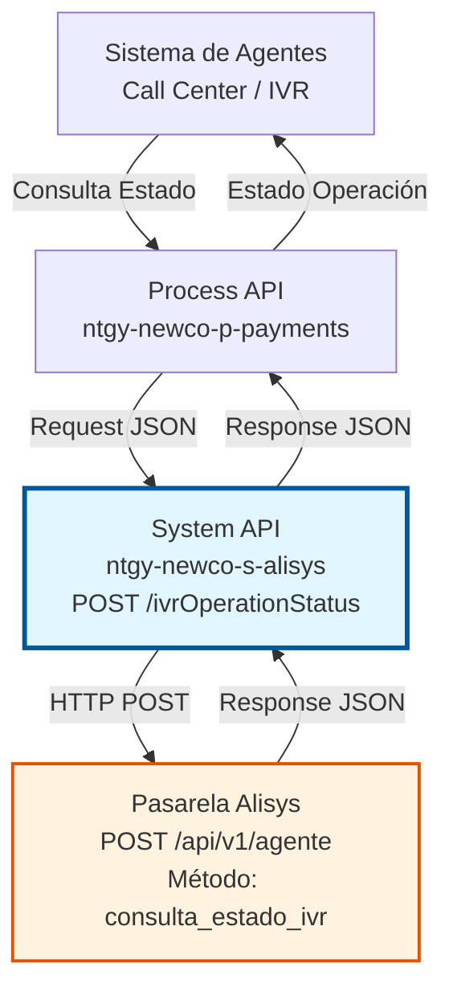
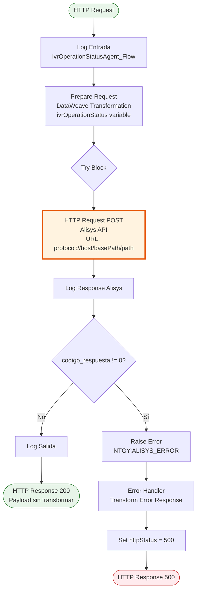
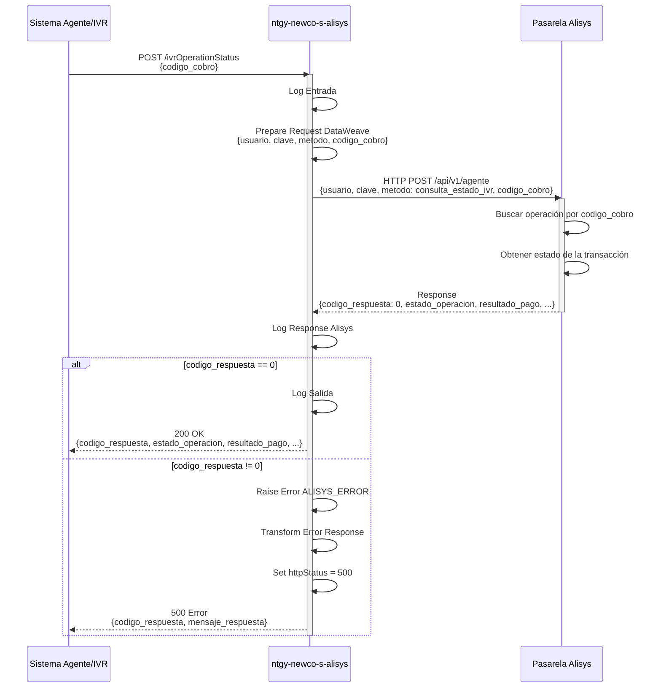

# POST /ivrOperationStatus

## 📌 Descripción General

### Propósito del Endpoint

Este endpoint permite consultar el estado de una operación de pago por tarjeta realizada a través del canal IVR (Interactive Voice Response) en la pasarela de pagos Alisys. Proporciona información sobre el resultado de la transacción de pago telefónico.

El endpoint soporta:
- **Consulta de Estado**: Verifica el resultado de un cobro por tarjeta vía IVR
- **Trazabilidad**: Permite seguimiento de operaciones de pago telefónico
- **Validación**: Confirma si el pago fue exitoso o falló

### Tipo de API

**Capa:** System API (API-Led Connectivity)

**Función:** Integración directa con la pasarela de pagos Alisys para consultar el estado de operaciones IVR.

### Patrón de Integración

**Tipo:** Request-Reply Síncrono con API REST Externa

**Descripción:** Recibe el código de cobro, invoca la API REST de Alisys con el método de consulta de estado IVR y retorna el resultado de la operación.

### Arquitectura API-Led Connectivity



---

## 💼 Propósito del Negocio

### Casos de Uso Principales

1. **Verificación Post-Pago IVR**
   - Un agente necesita confirmar si el pago telefónico fue exitoso
   - Se consulta el estado usando el código de cobro
   - Se obtiene confirmación del resultado de la transacción

2. **Seguimiento de Operaciones**
   - El sistema necesita verificar el estado de pagos IVR pendientes
   - Se consulta periódicamente el estado de operaciones en curso
   - Se actualiza el estado en los sistemas internos

3. **Reconciliación de Pagos**
   - El departamento de cobros necesita validar pagos telefónicos
   - Se consulta el estado final de las operaciones
   - Se confirma la recepción del pago

### Contexto Empresarial

- **Dominio:** Gestión de Cobros y Pagos
- **Sector:** Energía - Utilities
- **División:** Naturgy España - NewCo
- **Proceso de Negocio:** Verificación de pagos telefónicos vía IVR
- **Proveedor:** Alisys (Pasarela de Pagos)

### Stakeholders

- **Agentes de Call Center**: Necesitan confirmar el resultado de pagos telefónicos
- **Sistemas IVR**: Requieren validación automática del estado de pagos
- **Departamento de Cobros**: Necesita reconciliación de operaciones de pago
- **Área de Tesorería**: Requiere confirmación de pagos recibidos

### Valor de Negocio

- **Confirmación Inmediata**: Permite verificar el resultado de pagos en tiempo real
- **Trazabilidad Completa**: Mantiene registro del estado de todas las operaciones
- **Reducción de Incertidumbre**: Elimina dudas sobre el resultado de pagos telefónicos
- **Mejora de Servicio**: Permite a los agentes dar respuestas inmediatas a clientes

### Consumidores Potenciales

Este endpoint puede ser consumido por:
- Process APIs de gestión de cobros
- Sistemas IVR automatizados
- Plataformas de CRM (Salesforce)
- Sistemas de reconciliación de pagos

---

## 🔧 Especificación Técnica

### URLs por Ambiente

| Ambiente | URL Base | URL Completa |
|----------|----------|--------------|
| **Local** | `http://localhost:8081` | `http://localhost:8081/api/ivrOperationStatus` |
| **Development** | `https://ntgy-newco-s-alisys-dev.us-e2.cloudhub.io` | `https://ntgy-newco-s-alisys-dev.us-e2.cloudhub.io/api/ivrOperationStatus` |
| **UAT** | `https://ntgy-newco-s-alisys-uat.us-e2.cloudhub.io` | `https://ntgy-newco-s-alisys-uat.us-e2.cloudhub.io/api/ivrOperationStatus` |
| **Production** | `https://ntgy-newco-s-alisys-pro.us-e2.cloudhub.io` | `https://ntgy-newco-s-alisys-pro.us-e2.cloudhub.io/api/ivrOperationStatus` |

### Método HTTP

```
POST /api/ivrOperationStatus
```

### Parámetros de Entrada

#### Headers HTTP

| Header | Tipo | Requerido | Descripción | Ejemplo |
|--------|------|-----------|-------------|---------|
| `Content-Type` | string | ✅ Sí | Tipo de contenido del request | `application/json` |
| `Accept` | string | ❌ No | Tipo de contenido esperado en response | `application/json` |

#### Body Parameters

| Campo | Tipo | Requerido | Descripción |
|-------|------|-----------|-------------|
| `codigo_cobro` | string | ✅ Sí | Código único del cobro a consultar |

**Ejemplo de Request Body:**

```json
{
  "codigo_cobro": "COB123456"
}
```

### Respuestas

#### Respuesta Exitosa (200 OK)

La respuesta contiene el estado completo de la operación IVR según lo retornado por Alisys.

```json
{
  "codigo_respuesta": 0,
  "mensaje_respuesta": "Consulta realizada correctamente",
  "estado_operacion": "COMPLETADO",
  "resultado_pago": "EXITOSO",
  "importe": 150.50,
  "fecha_operacion": "2024-01-15T10:30:00Z"
}
```

**Nota:** La estructura exacta de la respuesta depende de la implementación de Alisys. El endpoint retorna la respuesta completa de la pasarela.

#### Respuesta de Error de Alisys (500 Internal Server Error)

```json
{
  "codigo_respuesta": 1,
  "mensaje_respuesta": "Código de cobro no encontrado"
}
```

### Autenticación y Autorización

- **Tipo:** Client ID & Client Secret (Anypoint Platform)
- **Autorización Alisys:** 
  - Usuario y clave configurados en propiedades (`alisys.user`, `alisys.password`)
  - Método de consulta configurado (`alisys.methodIvrOperationStatus`)
  - Credenciales enviadas en cada request a Alisys

### Timeouts

| Tipo | Valor | Descripción |
|------|-------|-------------|
| **Request Timeout** | 30 segundos | Tiempo máximo de espera para la respuesta de Alisys |
| **Connection Timeout** | 10 segundos | Tiempo máximo para establecer conexión con Alisys |

---

## 🏗️ Implementación Técnica

### Arquitectura del Flow



### Operación de Backend

**Tipo:** HTTP Request a API REST Externa

**Endpoint Alisys:**
```
POST https://[alisys.host]/[alisys.basePath]/[alisys.path]
```

**Configuración (desde properties):**
- **Protocol:** `https`
- **Host:** `api.alisys.com` (ejemplo)
- **Base Path:** `/api/v1`
- **Path:** `/agente`
- **User:** Configurado en `alisys.user`
- **Password:** Configurado en `secure::alisys.password`
- **Method:** Configurado en `alisys.methodIvrOperationStatus` (valor: `consulta_estado_ivr`)

### Transformaciones DataWeave

#### Transformación de Input

**Ubicación:** Inline en XML (líneas 30-38 de implementation.xml)

```dataweave
%dw 2.0
output application/json
---
{
  "usuario": p('alisys.user'),
  "clave": p('secure::alisys.password'),
  "metodo": p('alisys.methodIvrOperationStatus'),
  "codigo_cobro": payload.codigo_cobro
}
```

**Campos enviados a Alisys:**
- `usuario`: Usuario de autenticación en Alisys (desde properties)
- `clave`: Contraseña encriptada (desde secure properties)
- `metodo`: Método de operación (`consulta_estado_ivr` desde properties)
- `codigo_cobro`: Código del cobro a consultar (desde request)

#### Transformación de Output - Respuesta de Error

**Ubicación:** Inline en XML (líneas 60-66 de implementation.xml)

```dataweave
%dw 2.0
output application/json
---
error.errorMessage.payload
```

**Nota:** Para respuestas exitosas, el endpoint retorna el payload sin transformación adicional, pasando directamente la respuesta de Alisys.

### Lógica de Negocio

1. **Preparación de Request**: Se construye el request con credenciales y código de cobro
2. **Invocación a Alisys**: Se realiza HTTP POST con el método de consulta de estado IVR
3. **Validación de Respuesta**: Se verifica que `codigo_respuesta` sea 0 (éxito)
4. **Retorno de Datos**: Si es exitoso, se retorna la respuesta completa de Alisys sin transformación
5. **Manejo de Errores**: Si `codigo_respuesta != 0`, se lanza error personalizado

### Diagrama de Secuencia



### Manejo de Errores

**Tipos de Errores:**

1. **Error de Validación Alisys** (`codigo_respuesta != 0`)
   - Se lanza error tipo `NTGY:ALISYS_ERROR`
   - Se transforma a respuesta 500 con detalles del error
   - Se retorna el payload de error original de Alisys

2. **Código de Cobro No Encontrado**
   - Alisys retorna `codigo_respuesta != 0`
   - Se captura y se retorna como error 500
   - Mensaje indica que el código no existe

3. **Error de Conexión**
   - Timeout de conexión (10s)
   - Timeout de request (30s)
   - Se captura en error handler y se retorna 500

### Diferencias con paymentPreparationAgent_Flow

**Características únicas de este endpoint:**

1. **Sin Transformación de Salida**: La respuesta exitosa se retorna tal cual viene de Alisys
2. **Método Configurable**: El método de operación viene de properties (`alisys.methodIvrOperationStatus`)
3. **Request Simplificado**: Solo requiere el código de cobro
4. **Operación de Consulta**: No modifica datos, solo consulta estado

---

## 💻 Ejemplos de Uso

### Ejemplo 1: Consulta Exitosa

#### Request

```bash
curl -X POST "https://ntgy-newco-s-alisys-dev.us-e2.cloudhub.io/api/ivrOperationStatus" \
  -H "Content-Type: application/json" \
  -H "client_id: your-client-id" \
  -H "client_secret: your-client-secret" \
  -d '{
    "codigo_cobro": "COB123456"
  }'
```

#### Response Exitosa (200 OK)

```json
{
  "codigo_respuesta": 0,
  "mensaje_respuesta": "Consulta realizada correctamente",
  "estado_operacion": "COMPLETADO",
  "resultado_pago": "EXITOSO",
  "importe": 150.50,
  "fecha_operacion": "2024-01-15T10:30:00Z",
  "numero_autorizacion": "AUTH789012",
  "ultimos_digitos_tarjeta": "1234"
}
```

### Ejemplo 2: Operación Pendiente

#### Request

```bash
curl -X POST "https://ntgy-newco-s-alisys-dev.us-e2.cloudhub.io/api/ivrOperationStatus" \
  -H "Content-Type: application/json" \
  -H "client_id: your-client-id" \
  -H "client_secret: your-client-secret" \
  -d '{
    "codigo_cobro": "COB789012"
  }'
```

#### Response (200 OK)

```json
{
  "codigo_respuesta": 0,
  "mensaje_respuesta": "Consulta realizada correctamente",
  "estado_operacion": "EN_PROCESO",
  "resultado_pago": "PENDIENTE",
  "importe": 250.75,
  "fecha_operacion": "2024-01-15T11:00:00Z"
}
```

### Ejemplo 3: Pago Rechazado

#### Request

```bash
curl -X POST "https://ntgy-newco-s-alisys-dev.us-e2.cloudhub.io/api/ivrOperationStatus" \
  -H "Content-Type: application/json" \
  -H "client_id: your-client-id" \
  -H "client_secret: your-client-secret" \
  -d '{
    "codigo_cobro": "COB345678"
  }'
```

#### Response (200 OK)

```json
{
  "codigo_respuesta": 0,
  "mensaje_respuesta": "Consulta realizada correctamente",
  "estado_operacion": "COMPLETADO",
  "resultado_pago": "RECHAZADO",
  "motivo_rechazo": "Fondos insuficientes",
  "importe": 180.00,
  "fecha_operacion": "2024-01-15T11:30:00Z"
}
```

### Ejemplo 4: Código de Cobro No Encontrado

#### Request

```bash
curl -X POST "https://ntgy-newco-s-alisys-dev.us-e2.cloudhub.io/api/ivrOperationStatus" \
  -H "Content-Type: application/json" \
  -H "client_id: your-client-id" \
  -H "client_secret: your-client-secret" \
  -d '{
    "codigo_cobro": "COB_INEXISTENTE"
  }'
```

#### Response de Error (500 Internal Server Error)

```json
{
  "codigo_respuesta": 1,
  "mensaje_respuesta": "Código de cobro no encontrado en el sistema"
}