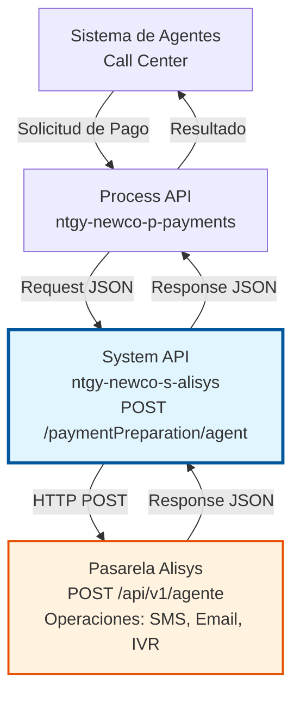
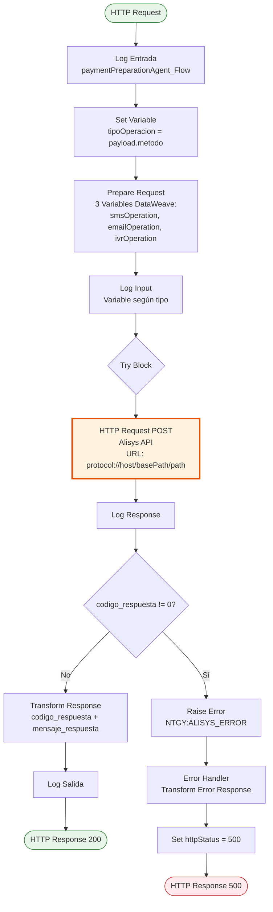
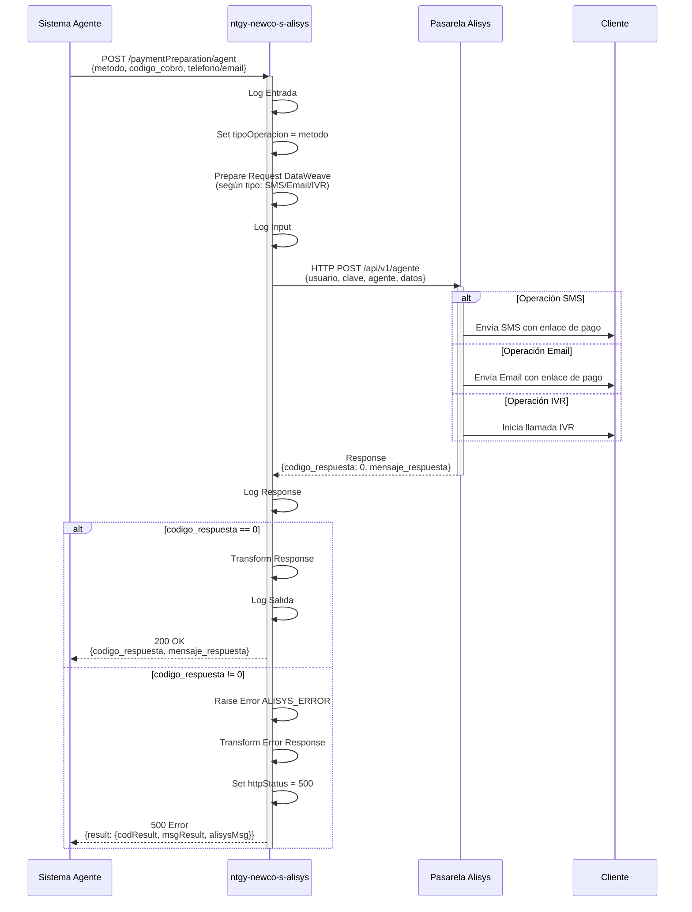

# POST /paymentPreparation/agent

## 📌 Descripción General

### Propósito del Endpoint

Este endpoint permite realizar la preparación de pagos a través de la pasarela de pago Alisys en modo agente. Soporta tres tipos de operaciones de cobro: SMS, Email e IVR (voz), permitiendo a los agentes iniciar procesos de pago con clientes a través de diferentes canales de comunicación.

El endpoint soporta:
- **Operación SMS**: Envía un SMS al cliente con un enlace de pago
- **Operación Email**: Envía un correo electrónico con enlace de pago
- **Operación IVR (Voz)**: Inicia un proceso de pago telefónico mediante IVR

### Tipo de API

**Capa:** System API (API-Led Connectivity)

**Función:** Integración directa con la pasarela de pagos Alisys para gestionar operaciones de cobro iniciadas por agentes.

### Patrón de Integración

**Tipo:** Request-Reply Síncrono con API REST Externa

**Descripción:** Recibe la solicitud de pago del agente, transforma los datos según el tipo de operación (SMS/Email/IVR), invoca la API REST de Alisys y retorna el resultado de la operación.

### Arquitectura API-Led Connectivity



---

## 💼 Propósito del Negocio

### Casos de Uso Principales

1. **Cobro por SMS**
   - Un agente necesita enviar un enlace de pago al móvil del cliente
   - Se genera un SMS con el enlace de pago y el importe
   - El cliente recibe el SMS y puede realizar el pago desde su móvil

2. **Cobro por Email**
   - Un agente necesita enviar un enlace de pago al correo del cliente
   - Se genera un email con plantilla personalizada y enlace de pago
   - El cliente recibe el email y puede realizar el pago desde cualquier dispositivo

3. **Cobro por IVR (Voz)**
   - Un agente inicia un proceso de pago telefónico
   - El sistema llama al cliente y le guía por IVR para realizar el pago
   - El cliente introduce los datos de su tarjeta mediante el teclado telefónico

### Contexto Empresarial

- **Dominio:** Gestión de Cobros y Pagos
- **Sector:** Energía - Utilities
- **División:** Naturgy España - NewCo
- **Proceso de Negocio:** Cobro asistido por agente a través de múltiples canales
- **Proveedor:** Alisys (Pasarela de Pagos)

### Stakeholders

- **Agentes de Call Center**: Necesitan herramientas para facilitar el cobro a clientes
- **Clientes**: Reciben opciones flexibles para realizar pagos (SMS, Email, Teléfono)
- **Departamento de Cobros**: Requiere seguimiento de operaciones de pago iniciadas
- **Área de Tesorería**: Necesita conciliación de pagos recibidos

### Valor de Negocio

- **Flexibilidad de Canales**: Permite al agente elegir el canal más apropiado según el cliente
- **Reducción de Fricción**: Facilita el proceso de pago con enlaces directos
- **Trazabilidad**: Cada operación tiene un código único de cobro para seguimiento
- **Experiencia del Cliente**: Ofrece opciones de pago convenientes y seguras

### Consumidores Potenciales

Este endpoint puede ser consumido por:
- Process APIs de gestión de cobros
- Sistemas de agentes de call center
- Plataformas de CRM (Salesforce)
- Aplicaciones de gestión de cobranza

---

## 🔧 Especificación Técnica

### URLs por Ambiente

| Ambiente | URL Base | URL Completa |
|----------|----------|--------------|
| **Local** | `http://localhost:8081` | `http://localhost:8081/api/paymentPreparation/agent` |
| **Development** | `https://ntgy-newco-s-alisys-dev.us-e2.cloudhub.io` | `https://ntgy-newco-s-alisys-dev.us-e2.cloudhub.io/api/paymentPreparation/agent` |
| **UAT** | `https://ntgy-newco-s-alisys-uat.us-e2.cloudhub.io` | `https://ntgy-newco-s-alisys-uat.us-e2.cloudhub.io/api/paymentPreparation/agent` |
| **Production** | `https://ntgy-newco-s-alisys-pro.us-e2.cloudhub.io` | `https://ntgy-newco-s-alisys-pro.us-e2.cloudhub.io/api/paymentPreparation/agent` |

### Método HTTP

```
POST /api/paymentPreparation/agent
```

### Parámetros de Entrada

#### Headers HTTP

| Header | Tipo | Requerido | Descripción | Ejemplo |
|--------|------|-----------|-------------|---------|
| `Content-Type` | string | ✅ Sí | Tipo de contenido del request | `application/json` |
| `Accept` | string | ❌ No | Tipo de contenido esperado en response | `application/json` |

#### Body Parameters

**Estructura del Request (varía según tipo de operación):**

**Campos Comunes a Todas las Operaciones:**

| Campo | Tipo | Requerido | Descripción |
|-------|------|-----------|-------------|
| `metodo` | string | ✅ Sí | Tipo de operación: `operacion_sms`, `operacion_email`, `operacion_voz` |
| `carga` | string | ✅ Sí | Identificador de la carga/lote |
| `codigo_cobro` | string | ✅ Sí | Código único del cobro |
| `importe_cobro` | number | ⚠️ Condicional | Importe del cobro (requerido para email) |
| `campo_libre` | string | ❌ No | Campo libre para información adicional |
| `sms_confirmacion` | string | ❌ No | Número para SMS de confirmación |
| `idioma` | string | ❌ No | Idioma de la comunicación |

**Campos Específicos para SMS (`operacion_sms`):**

| Campo | Tipo | Requerido | Descripción |
|-------|------|-----------|-------------|
| `texto_sms` | string | ❌ No | Texto personalizado del SMS |
| `remitente_sms` | string | ✅ Sí | Remitente del SMS |
| `telefono` | string | ✅ Sí | Número de teléfono del destinatario |

**Campos Específicos para Email (`operacion_email`):**

| Campo | Tipo | Requerido | Descripción |
|-------|------|-----------|-------------|
| `remitente_email` | string | ❌ No | Remitente del email |
| `asunto` | string | ❌ No | Asunto del email |
| `id_plantilla` | string | ❌ No | ID de la plantilla de email |
| `email` | string | ✅ Sí | Dirección de email del destinatario |

**Campos Específicos para IVR (`operacion_voz`):**

| Campo | Tipo | Requerido | Descripción |
|-------|------|-----------|-------------|
| `texto_sms` | string | ❌ No | Texto del SMS previo a la llamada |
| `remitente_sms` | string | ✅ Sí | Remitente del SMS |
| `telefono` | string | ✅ Sí | Número de teléfono para la llamada IVR |

### Respuestas

#### Respuesta Exitosa (200 OK)

```json
{
  "codigo_respuesta": 0,
  "mensaje_respuesta": "Operación realizada correctamente"
}
```

#### Respuesta de Error de Alisys (500 Internal Server Error)

```json
{
  "result": {
    "codResult": "1013",
    "msgResult": "Ha ocurrido un error en la pasarela de pago",
    "alisysMsg": {
      "codigo_respuesta": 1,
      "mensaje_respuesta": "Error en la validación de datos"
    }
  }
}
```

### Autenticación y Autorización

- **Tipo:** Client ID & Client Secret (Anypoint Platform)
- **Autorización Alisys:** 
  - Usuario y clave configurados en propiedades (`alisys.user`, `alisys.password`)
  - Usuario agente configurado (`alisys.userAgente`)
  - Credenciales enviadas en cada request a Alisys

### Timeouts

| Tipo | Valor | Descripción |
|------|-------|-------------|
| **Request Timeout** | 30 segundos | Tiempo máximo de espera para la respuesta de Alisys |
| **Connection Timeout** | 10 segundos | Tiempo máximo para establecer conexión con Alisys |

---

## 🏗️ Implementación Técnica

### Arquitectura del Flow



### Operación de Backend

**Tipo:** HTTP Request a API REST Externa

**Endpoint Alisys:**
```
POST https://[alisys.host]/[alisys.basePath]/[alisys.path]
```

**Configuración (desde properties):**
- **Protocol:** `https`
- **Host:** `api.alisys.com` (ejemplo)
- **Base Path:** `/api/v1`
- **Path:** `/agente`
- **User:** Configurado en `alisys.user`
- **Password:** Configurado en `secure::alisys.password`
- **User Agente:** Configurado en `alisys.userAgente`

### Transformaciones DataWeave

#### Transformación de Input - Operación SMS

**Ubicación:** Inline en XML (líneas 27-42)

```dataweave
%dw 2.0
output application/json
---
{
  "usuario": p('alisys.user'),
  "clave": p('secure::alisys.password'),
  "metodo": payload.metodo,
  "agente": p('alisys.userAgente'),
  "carga": payload.carga,
  "texto_sms": if(isEmpty(payload.texto_sms)) (null) else payload.texto_sms,
  "remitente_sms": payload.remitente_sms,
  "codigo_cobro": payload.codigo_cobro,
  "importe_cobro": if(isEmpty(payload.importe_cobro)) (null) else payload.importe_cobro,
  "telefono": payload.telefono,
  "campo_libre": if(isEmpty(payload.campo_libre)) (null) else payload.campo_libre,
  "sms_confirmacion": if(isEmpty(payload.sms_confirmacion)) (null) else payload.sms_confirmacion,
  "idioma": if(isEmpty(payload.idioma)) (null) else payload.idioma
}
```

#### Transformación de Input - Operación Email

**Ubicación:** Inline en XML (líneas 43-58)

```dataweave
%dw 2.0
output application/json
---
{
  "usuario": p('alisys.user'),
  "clave": p('secure::alisys.password'),
  "metodo": payload.metodo,
  "agente": p('alisys.userAgente'),
  "carga": payload.carga,
  "remitente_email": if(isEmpty(payload.remitente_email)) (null) else payload.remitente_email,
  "asunto": if(isEmpty(payload.asunto)) (null) else payload.asunto,
  "id_plantilla": if(isEmpty(payload.id_plantilla)) (null) else payload.id_plantilla,
  "email": payload.email,
  "codigo_cobro": payload.codigo_cobro,
  "importe_cobro": payload.importe_cobro,
  "campo_libre": if(isEmpty(payload.campo_libre)) (null) else payload.campo_libre,
  "sms_confirmacion": if(isEmpty(payload.sms_confirmacion)) (null) else payload.sms_confirmacion,
  "idioma": if(isEmpty(payload.idioma)) (null) else payload.idioma
}
```

#### Transformación de Input - Operación IVR

**Ubicación:** Inline en XML (líneas 59-74)

```dataweave
%dw 2.0
output application/json
---
{
  "usuario": p('alisys.user'),
  "clave": p('secure::alisys.password'),
  "metodo": payload.metodo,
  "agente": p('alisys.userAgente'),
  "carga": payload.carga,
  "texto_sms": if(isEmpty(payload.texto_sms)) (null) else payload.texto_sms,
  "remitente_sms": payload.remitente_sms,
  "codigo_cobro": payload.codigo_cobro,
  "importe_cobro": if(isEmpty(payload.importe_cobro)) (null) else payload.importe_cobro,
  "telefono": payload.telefono,
  "campo_libre": if(isEmpty(payload.campo_libre)) (null) else payload.campo_libre,
  "sms_confirmacion": if(isEmpty(payload.sms_confirmacion)) (null) else payload.sms_confirmacion,
  "idioma": if(isEmpty(payload.idioma)) (null) else payload.idioma
}
```

#### Transformación de Output - Respuesta Exitosa

**Ubicación:** Inline en XML (líneas 92-100)

```dataweave
%dw 2.0
output application/json
---
{
  "codigo_respuesta": payload.codigo_respuesta,
  "mensaje_respuesta": payload.mensaje_respuesta
}
```

#### Transformación de Output - Respuesta de Error

**Ubicación:** Inline en XML (líneas 107-116)

```dataweave
%dw 2.0
output application/json
---
{
  "result": {
    "codResult": "1013",
    "msgResult": "Ha ocurrido un error en la pasarela de pago",
    "alisysMsg": error.errorMessage.payload
  }
}
```

### Lógica de Negocio

1. **Selección de Operación**: El flow determina el tipo de operación mediante el campo `metodo`
2. **Preparación de Request**: Se selecciona la variable DataWeave apropiada (smsOperation, emailOperation, ivrOperation)
3. **Invocación a Alisys**: Se realiza HTTP POST con las credenciales y datos de la operación
4. **Validación de Respuesta**: Se verifica que `codigo_respuesta` sea 0 (éxito)
5. **Manejo de Errores**: Si `codigo_respuesta != 0`, se lanza error personalizado

### Diagrama de Secuencia



### Manejo de Errores

**Tipos de Errores:**

1. **Error de Validación Alisys** (`codigo_respuesta != 0`)
   - Se lanza error tipo `NTGY:ALISYS_ERROR`
   - Se transforma a respuesta 500 con detalles del error
   - Se incluye el mensaje original de Alisys en `alisysMsg`

2. **Error de Conexión**
   - Timeout de conexión (10s)
   - Timeout de request (30s)
   - Se captura en error handler y se retorna 500

3. **Error de Transformación**
   - Campos requeridos faltantes
   - Formato de datos incorrecto
   - Se captura y se retorna 500

---

## 💻 Ejemplos de Uso

### Ejemplo 1: Operación SMS

#### Request

```bash
curl -X POST "https://ntgy-newco-s-alisys-dev.us-e2.cloudhub.io/api/paymentPreparation/agent" \
  -H "Content-Type: application/json" \
  -H "client_id: your-client-id" \
  -H "client_secret: your-client-secret" \
  -d '{
    "metodo": "operacion_sms",
    "carga": "CARGA_001",
    "codigo_cobro": "COB123456",
    "importe_cobro": 150.50,
    "telefono": "+34600123456",
    "remitente_sms": "Naturgy",
    "texto_sms": "Tienes un pago pendiente. Haz clic en el enlace para pagar.",
    "campo_libre": "Factura Enero 2024",
    "idioma": "es"
  }'
```

#### Response Exitosa (200 OK)

```json
{
  "codigo_respuesta": 0,
  "mensaje_respuesta": "SMS enviado correctamente"
}
```

### Ejemplo 2: Operación Email

#### Request

```bash
curl -X POST "https://ntgy-newco-s-alisys-dev.us-e2.cloudhub.io/api/paymentPreparation/agent" \
  -H "Content-Type: application/json" \
  -H "client_id: your-client-id" \
  -H "client_secret: your-client-secret" \
  -d '{
    "metodo": "operacion_email",
    "carga": "CARGA_002",
    "codigo_cobro": "COB789012",
    "importe_cobro": 250.75,
    "email": "cliente@example.com",
    "remitente_email": "pagos@naturgy.com",
    "asunto": "Pago pendiente - Factura Enero 2024",
    "id_plantilla": "TEMPLATE_001",
    "campo_libre": "Cliente Premium",
    "idioma": "es"
  }'
```

#### Response Exitosa (200 OK)

```json
{
  "codigo_respuesta": 0,
  "mensaje_respuesta": "Email enviado correctamente"
}
```

### Ejemplo 3: Operación IVR (Voz)

#### Request

```bash
curl -X POST "https://ntgy-newco-s-alisys-dev.us-e2.cloudhub.io/api/paymentPreparation/agent" \
  -H "Content-Type: application/json" \
  -H "client_id: your-client-id" \
  -H "client_secret: your-client-secret" \
  -d '{
    "metodo": "operacion_voz",
    "carga": "CARGA_003",
    "codigo_cobro": "COB345678",
    "importe_cobro": 180.00,
    "telefono": "+34600987654",
    "remitente_sms": "Naturgy",
    "texto_sms": "Vas a recibir una llamada para realizar el pago",
    "campo_libre": "Pago urgente",
    "idioma": "es"
  }'
```

#### Response Exitosa (200 OK)

```json
{
  "codigo_respuesta": 0,
  "mensaje_respuesta": "Llamada IVR iniciada correctamente"
}
```

### Ejemplo 4: Error de Validación

#### Request con datos inválidos

```bash
curl -X POST "https://ntgy-newco-s-alisys-dev.us-e2.cloudhub.io/api/paymentPreparation/agent" \
  -H "Content-Type: application/json" \
  -H "client_id: your-client-id" \
  -H "client_secret: your-client-secret" \
  -d '{
    "metodo": "operacion_sms",
    "carga": "CARGA_001",
    "codigo_cobro": "COB_INVALIDO"
  }'
```

#### Response de Error (500 Internal Server Error)

```json
{
  "result": {
    "codResult": "1013",
    "msgResult": "Ha ocurrido un error en la pasarela de pago",
    "alisysMsg": {
      "codigo_respuesta": 1,
      "mensaje_respuesta": "Faltan campos obligatorios: telefono, remitente_sms"
    }
  }
}
```
