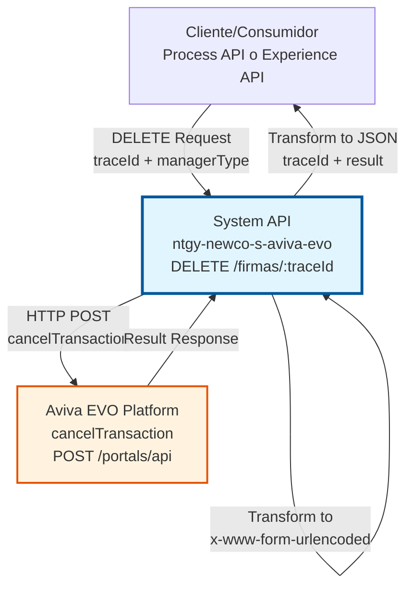
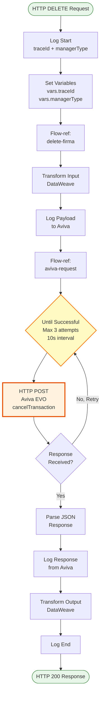
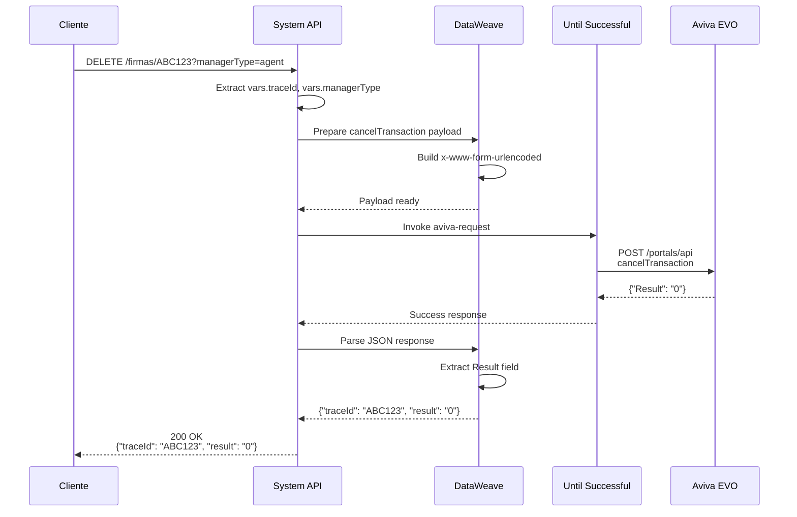
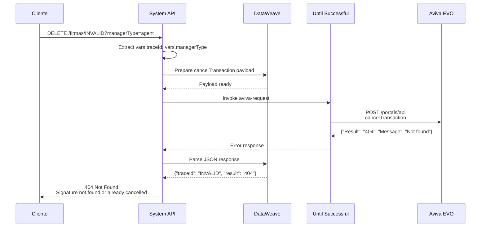
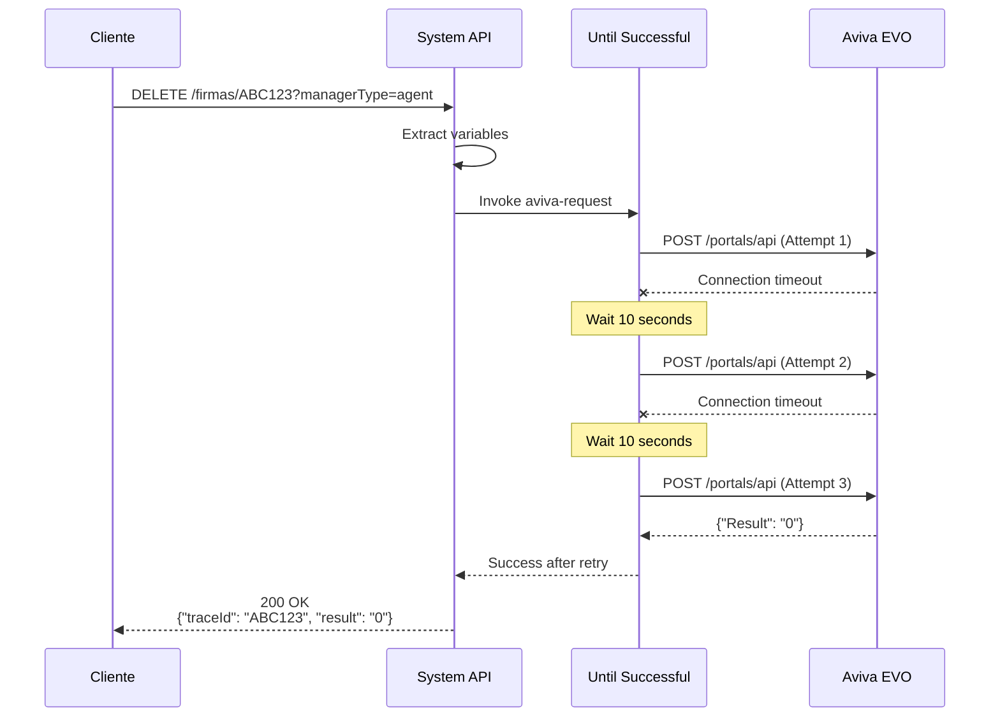

# DELETE /firmas/:traceId

## 📌 Descripción General

### Propósito del Endpoint

Este endpoint cancela una solicitud de firma digital previamente creada en la plataforma Aviva EVO. Permite gestionar el ciclo de vida completo de las firmas digitales, incluyendo la cancelación de transacciones en proceso, pendientes o que han experimentado errores.

El endpoint soporta:
- **Cancelación de Firmas en Proceso**: Detiene transacciones de firma que están en curso
- **Liberación de Recursos**: Libera recursos de transacciones no completadas en Aviva EVO
- **Gestión de Errores**: Permite cancelar firmas que han experimentado timeouts o errores
- **Auditoría**: Registra todas las cancelaciones para trazabilidad y cumplimiento normativo

### Tipo de API

**Capa:** System API (API-Led Connectivity)

**Función:** Integración directa con la plataforma Aviva EVO Voice Signature para cancelación de transacciones de firma digital mediante la operación `cancelTransaction`.

### Patrón de Integración

**Tipo:** Request-Reply Síncrono con REST API Externa

**Descripción:** El endpoint recibe una solicitud DELETE con el traceId de la firma a cancelar, transforma los datos al formato requerido por Aviva EVO (application/x-www-form-urlencoded), invoca la operación `cancelTransaction` mediante HTTP POST, y retorna el resultado de la cancelación. Incluye lógica de retry automático para manejar fallos transitorios de conectividad.

### Arquitectura API-Led Connectivity



---

## 💼 Propósito del Negocio

### Casos de Uso Principales

1. **Cancelación por Error del Usuario**
   - Un agente o cliente inicia una firma pero proporciona datos incorrectos
   - Se cancela la transacción antes de completarla
   - Se crea una nueva solicitud con los datos correctos
   - **Beneficio:** Evita firmas inválidas y mejora la calidad de datos

2. **Gestión de Timeouts**
   - Una firma no se completa dentro del tiempo esperado
   - El sistema cancela automáticamente la transacción expirada
   - Se libera el recurso en Aviva EVO
   - **Beneficio:** Optimiza el uso de recursos y evita transacciones huérfanas

3. **Cancelación por Solicitud del Cliente**
   - Un cliente decide no proceder con la firma digital
   - El agente cancela la transacción activa
   - Se registra la cancelación para auditoría
   - **Beneficio:** Respeta la voluntad del cliente y mantiene trazabilidad

### Contexto Empresarial

- **Dominio:** Gestión de Firmas Digitales
- **Sector:** Energía - Utilities
- **División:** Naturgy España - NewCo
- **Proceso de Negocio:** Ciclo de vida de firmas digitales por voz para contratos y documentos
- **Plataforma Externa:** Aviva EVO Voice Signature Platform

### Stakeholders

- **Agentes de Call Center**: Necesitan cancelar firmas cuando detectan errores o el cliente desiste
- **Clientes**: Tienen derecho a cancelar procesos de firma iniciados
- **Sistemas de Auditoría**: Requieren trazabilidad de todas las cancelaciones
- **Equipo de Operaciones**: Monitorea y gestiona transacciones fallidas o expiradas

### Valor de Negocio

- **Gestión Completa del Ciclo de Vida**: Permite crear, consultar, verificar estado y cancelar firmas
- **Optimización de Recursos**: Libera recursos de Aviva EVO al cancelar transacciones no utilizadas
- **Cumplimiento Normativo**: Registra todas las cancelaciones para auditoría y compliance
- **Mejora de Experiencia**: Permite corregir errores sin dejar transacciones pendientes

### Consumidores Potenciales

Este endpoint puede ser consumido por:
- Process APIs de gestión de contratos y documentos
- Experience APIs de canales web, móvil y voz
- Sistemas de workflow y orquestación
- Servicios de limpieza y mantenimiento de transacciones
- Herramientas de administración y soporte

---

## 🔧 Especificación Técnica

### URLs por Ambiente

| Ambiente | URL Base | URL Completa |
|----------|----------|--------------|
| **Local** | `http://localhost:8091` | `http://localhost:8091/api/firmas/:traceId?managerType=agent` |
| **Development** | `https://ntgy-newco-s-aviva-evo-dev.us-e2.cloudhub.io` | `https://ntgy-newco-s-aviva-evo-dev.us-e2.cloudhub.io/api/firmas/:traceId?managerType=agent` |
| **Test** | `https://ntgy-newco-s-aviva-evo-test.us-e2.cloudhub.io` | `https://ntgy-newco-s-aviva-evo-test.us-e2.cloudhub.io/api/firmas/:traceId?managerType=agent` |
| **Production** | `https://ntgy-newco-s-aviva-evo-pro.us-e2.cloudhub.io` | `https://ntgy-newco-s-aviva-evo-pro.us-e2.cloudhub.io/api/firmas/:traceId?managerType=agent` |

### Método HTTP

```
DELETE /api/firmas/:traceId
```

### Parámetros de Entrada

#### Headers HTTP

| Header | Tipo | Requerido | Descripción | Ejemplo |
|--------|------|-----------|-------------|---------|
| `Content-Type` | string | ❌ No | No se requiere body en DELETE | N/A |
| `Accept` | string | ❌ No | Tipo de contenido esperado en response | `application/json` |
| `client_id` | string | ✅ Sí | Client ID de Anypoint Platform | `a1b2c3d4e5f6` |
| `client_secret` | string | ✅ Sí | Client Secret de Anypoint Platform | `A1B2C3D4E5F6` |

#### Path Parameters

| Parámetro | Tipo | Requerido | Descripción | Ejemplo |
|-----------|------|-----------|-------------|---------|
| `traceId` | string | ✅ Sí | Identificador único de la transacción de firma a cancelar | `"ABC123XYZ"` |

#### Query Parameters

| Parámetro | Tipo | Requerido | Descripción | Valores Permitidos | Ejemplo |
|-----------|------|-----------|-------------|-------------------|---------|
| `managerType` | string | ✅ Sí | Tipo de gestor que realiza la solicitud (determina las credenciales de Aviva EVO a utilizar) | `agent`, `client` | `agent` |

### Respuestas

#### Respuesta Exitosa (200 OK)

Cancelación exitosa de la firma en Aviva EVO.

```json
{
  "traceId": "ABC123XYZ",
  "result": "0"
}
```

**Campos de Respuesta:**

| Campo | Tipo | Descripción |
|-------|------|-------------|
| `traceId` | string | Identificador único de la transacción cancelada |
| `result` | string | Código de resultado de Aviva EVO ("0" = éxito) |

#### Respuesta de Error de Negocio (404 Not Found)

La firma no existe en Aviva EVO o ya fue cancelada previamente.

```json
{
  "error": "AVIVA:BAD_REQUEST",
  "message": "Signature not found or already cancelled",
  "timestamp": "2026-06-12T11:45:00Z"
}
```

#### Respuesta de Error Técnico (400 Bad Request)

Parámetros inválidos o faltantes.

```json
{
  "result": {
    "codResult": "0001",
    "msgResult": "Required query parameter 'managerType' is missing"
  }
}
```

#### Respuesta de Error Técnico (500 Internal Server Error)

Error interno del servidor o fallo en la comunicación con Aviva EVO.

```json
{
  "result": {
    "codResult": "0002",
    "msgResult": "Error connecting to Aviva EVO platform"
  }
}
```

### Autenticación y Autorización

- **Tipo:** Client ID & Client Secret (Anypoint Platform)
- **Autorización Aviva EVO:** El sistema utiliza credenciales específicas según el `managerType`:
  - `agent`: Credenciales para operaciones de agentes
  - `client`: Credenciales para operaciones de clientes
- **Secure Properties:** Las credenciales se almacenan en propiedades seguras:
  - `secure::aviva.agent.user` / `secure::aviva.agent.password`
  - `secure::aviva.client.user` / `secure::aviva.client.password`

### Timeouts

| Tipo | Valor | Descripción |
|------|-------|-------------|
| **Request Timeout** | 60 segundos | Tiempo máximo de espera para la respuesta de Aviva EVO |
| **Connection Timeout** | 30 segundos | Tiempo máximo para establecer conexión con Aviva EVO |
| **Retry Interval** | 10 segundos | Intervalo entre reintentos en caso de fallo |

---

## 🏗️ Implementación Técnica

### Arquitectura del Flow



### REST API Externa: Aviva EVO Platform

**Plataforma:** Aviva EVO Voice Signature Platform

**Endpoint Base:** 
- Test: `https://test.avivavoice.com/portals/api`
- Production: `https://prod.avivavoice.com/portals/api` (TBD)

**Operación:** `cancelTransaction`

**Método HTTP:** POST (aunque el endpoint MuleSoft es DELETE)

**Content-Type:** `application/x-www-form-urlencoded`

**Descripción:** La operación `cancelTransaction` de Aviva EVO permite cancelar transacciones de firma digital que están en proceso o pendientes. Requiere el ID de la transacción y credenciales válidas.

### Transformaciones DataWeave

#### Transformación de Entrada (Request → Aviva EVO)

**Ubicación:** `src/main/mule/implementation/delete-firma.xml` (líneas 12-20)

```dataweave
%dw 2.0
output application/x-www-form-urlencoded
---
{
  action: "cancelTransaction",
  user: p("secure::aviva." ++ vars.managerType ++ ".user"),
  password: p("secure::aviva." ++ vars.managerType ++ ".password"),
  idtransaction: vars.traceId
}
```

**Explicación:**
- **action**: Operación fija "cancelTransaction" para Aviva EVO
- **user**: Credencial de usuario obtenida dinámicamente según managerType
- **password**: Credencial de contraseña obtenida dinámicamente según managerType
- **idtransaction**: TraceId de la firma a cancelar (del path parameter)

**Mapeo de Campos:**

| Campo Origen | Campo Destino | Transformación |
|--------------|---------------|----------------|
| `vars.traceId` | `idtransaction` | Directo |
| `vars.managerType` | `user` | Lookup en secure properties |
| `vars.managerType` | `password` | Lookup en secure properties |
| N/A | `action` | Constante: "cancelTransaction" |

#### Transformación de Salida (Aviva EVO → Response)

**Ubicación:** `src/main/mule/implementation/delete-firma.xml` (líneas 28-34)

```dataweave
%dw 2.0
output application/json
---
{
  traceId: vars.traceId default "",
  result: payload.Result default "-1"
}
```

**Explicación:**
- **traceId**: Devuelve el traceId original para tracking
- **result**: Extrae el código de resultado de Aviva EVO
  - "0" indica cancelación exitosa
  - Otros valores indican error (firma no encontrada, ya procesada, etc.)

**Mapeo de Campos:**

| Campo Origen | Campo Destino | Transformación |
|--------------|---------------|----------------|
| `vars.traceId` | `traceId` | Directo con default "" |
| `payload.Result` | `result` | Directo con default "-1" |

### Patrones de Diseño Implementados

#### 1. Until Successful Pattern (Retry Logic)

**Ubicación:** `src/main/mule/external/aviva-requests.xml` (líneas 11-13)

```xml
<until-successful 
    maxRetries="${system.retries.attempts}" 
    millisBetweenRetries="${system.retries.interval}">
    <http:request method="POST" config-ref="HTTP_Request_configuration_Aviva" 
                  path="${aviva.portal}"/>
</until-successful>
```

**Configuración:**
- **Intentos:** 3 (configurable via `system.retries.attempts`)
- **Intervalo:** 10000ms (configurable via `system.retries.interval`)
- **Condición:** Se reintenta automáticamente en caso de errores de conectividad o timeout

**Beneficios:**
- Maneja fallos transitorios de red
- Mejora la resiliencia del sistema
- Reduce errores reportados al consumidor

#### 2. Flow-ref Pattern (Separación de Responsabilidades)

**Estructura:**
- **Main Flow:** `delete:\firmas\(traceId):ntgy-newco-s-aviva-evo-config`
  - Responsabilidad: Routing, logging, extracción de variables
- **Implementation Flow:** `delete-firma`
  - Responsabilidad: Lógica de negocio, transformaciones
- **External Integration Flow:** `aviva-request`
  - Responsabilidad: Comunicación con Aviva EVO, retry logic

**Beneficios:**
- Código más mantenible y testeable
- Reutilización del flow `aviva-request` por otros endpoints
- Separación clara de responsabilidades

#### 3. Secure Properties Pattern

**Configuración:** `src/main/mule/global.xml` (línea 21)

```xml
<secure-properties:config name="Secure_Properties_Config" 
    file="properties/secure/secure-${env}.yaml" 
    key="${secure.key}" />
```

**Uso:**
```dataweave
user: p("secure::aviva." ++ vars.managerType ++ ".user")
password: p("secure::aviva." ++ vars.managerType ++ ".password")
```

**Beneficios:**
- Credenciales encriptadas en reposo
- Diferentes credenciales por ambiente
- Cumplimiento de políticas de seguridad

### Diagramas de Secuencia

#### Flujo Exitoso (Result = "0")



#### Flujo con Firma No Encontrada (Result != "0")



#### Flujo con Error de Conectividad (Retry Logic)



### Connection Pooling

**Configuración:** `src/main/mule/global.xml` (líneas 17-19)

```xml
<http:request-config name="HTTP_Request_configuration_Aviva">
    <http:request-connection 
        protocol="${aviva.protocol}" 
        host="${aviva.host}" 
        port="${aviva.port}" />
</http:request-config>
```

**Propiedades por Ambiente:**

| Propiedad | Desarrollo | Test | Producción |
|-----------|------------|------|------------|
| `aviva.protocol` | HTTPS | HTTPS | HTTPS |
| `aviva.host` | test.avivavoice.com | test.avivavoice.com | prod.avivavoice.com |
| `aviva.port` | 443 | 443 | 443 |
| `aviva.portal` | /portals/api | /portals/api | /portals/api |

**Configuración de Pool:**
- **Max Connections:** 10 por worker (default MuleSoft)
- **Connection Idle Timeout:** 60 segundos
- **Keep-Alive:** Habilitado

### Manejo de Errores

**Global Error Handler:** `src/main/mule/global-error-handler.xml`

**Estrategia:**
1. **Errores de Conectividad:** Manejados por Until Successful (retry automático)
2. **Errores de Timeout:** Manejados por Until Successful (retry automático)
3. **Errores de Validación:** Retornan 400 Bad Request
4. **Errores de Negocio:** Retornan 404 Not Found (firma no existe)
5. **Errores del Sistema:** Retornan 500 Internal Server Error

**Logging:**
- Log de inicio con traceId y managerType
- Log del payload enviado a Aviva (sin credenciales)
- Log de la respuesta recibida de Aviva
- Log de fin de operación

---

## 💻 Ejemplos de Uso

### Ejemplo 1: Cancelación Exitosa con curl

```bash
curl -X DELETE "https://ntgy-newco-s-aviva-evo-dev.us-e2.cloudhub.io/api/firmas/ABC123XYZ?managerType=agent" \
  -H "client_id: a1b2c3d4e5f6" \
  -H "client_secret: A1B2C3D4E5F6" \
  -H "Accept: application/json"
```

**Respuesta (200 OK):**
```json
{
  "traceId": "ABC123XYZ",
  "result": "0"
}
```

### Ejemplo 2: Firma No Encontrada con curl

```bash
curl -X DELETE "https://ntgy-newco-s-aviva-evo-dev.us-e2.cloudhub.io/api/firmas/INVALID123?managerType=agent" \
  -H "client_id: a1b2c3d4e5f6" \
  -H "client_secret: A1B2C3D4E5F6" \
  -H "Accept: application/json"
```

**Respuesta (404 Not Found):**
```json
{
  "error": "AVIVA:BAD_REQUEST",
  "message": "Signature not found or already cancelled",
  "timestamp": "2026-06-12T12:41:00Z"
}
```

### Ejemplo 3: Cancelación con JavaScript (Fetch API)

```javascript
async function cancelSignature(traceId, managerType) {
  try {
    const response = await fetch(
      `https://ntgy-newco-s-aviva-evo-dev.us-e2.cloudhub.io/api/firmas/${traceId}?managerType=${managerType}`,
      {
        method: 'DELETE',
        headers: {
          'client_id': 'a1b2c3d4e5f6',
          'client_secret': 'A1B2C3D4E5F6',
          'Accept': 'application/json'
        }
      }
    );

    if (!response.ok) {
      throw new Error(`HTTP error! status: ${response.status}`);
    }

    const data = await response.json();
    console.log('Cancelación exitosa:', data);
    
    if (data.result === "0") {
      console.log(`Firma ${data.traceId} cancelada correctamente`);
    } else {
      console.warn(`Error al cancelar firma: result=${data.result}`);
    }
    
    return data;
  } catch (error) {
    console.error('Error al cancelar firma:', error);
    throw error;
  }
}

// Uso
cancelSignature('ABC123XYZ', 'agent')
  .then(result => console.log('Resultado:', result))
  .catch(error => console.error('Error:', error));
```

**Respuesta Exitosa:**
```json
{
  "traceId": "ABC123XYZ",
  "result": "0"
}
```

### Ejemplo 4: Cancelación con Python (requests)

```python
import requests
from typing import Dict, Optional

def cancel_signature(
    trace_id: str,
    manager_type: str,
    base_url: str = "https://ntgy-newco-s-aviva-evo-dev.us-e2.cloudhub.io",
    client_id: str = "a1b2c3d4e5f6",
    client_secret: str = "A1B2C3D4E5F6"
) -> Optional[Dict]:
    """
    Cancela una firma digital en Aviva EVO.
    
    Args:
        trace_id: Identificador único de la transacción
        manager_type: Tipo de gestor ('agent' o 'client')
        base_url: URL base del API
        client_id: Client ID de Anypoint Platform
        client_secret: Client Secret de Anypoint Platform
    
    Returns:
        Dict con traceId y result, o None si hay error
    """
    url = f"{base_url}/api/firmas/{trace_id}"
    params = {"managerType": manager_type}
    headers = {
        "client_id": client_id,
        "client_secret": client_secret,
        "Accept": "application/json"
    }
    
    try:
        response = requests.delete(url, params=params, headers=headers, timeout=30)
        response.raise_for_status()
        
        data = response.json()
        
        if data.get("result") == "0":
            print(f"✓ Firma {data['traceId']} cancelada correctamente")
        else:
            print(f"⚠ Error al cancelar firma: result={data.get('result')}")
        
        return data
        
    except requests.exceptions.HTTPError as e:
        if e.response.status_code == 404:
            print(f"✗ Firma no encontrada: {trace_id}")
        else:
            print(f"✗ Error HTTP {e.response.status_code}: {e}")
        return None
        
    except requests.exceptions.RequestException as e:
        print(f"✗ Error de conexión: {e}")
        return None

# Uso
if __name__ == "__main__":
    # Ejemplo 1: Cancelación exitosa
    result = cancel_signature("ABC123XYZ", "agent")
    if result:
        print(f"Resultado: {result}")
    
    # Ejemplo 2: Firma no encontrada
    result = cancel_signature("INVALID123", "agent")
    if result is None:
        print("La firma no pudo ser cancelada")
```

**Respuesta Exitosa:**
```
✓ Firma ABC123XYZ cancelada correctamente
Resultado: {'traceId': 'ABC123XYZ', 'result': '0'}
```

**Respuesta con Error:**
```
✗ Firma no encontrada: INVALID123
La firma no pudo ser cancelada
```

### Ejemplo 5: Manejo de Errores Completo

```javascript
async function cancelSignatureWithRetry(traceId, managerType, maxRetries = 3) {
  const baseUrl = 'https://ntgy-newco-s-aviva-evo-dev.us-e2.cloudhub.io';
  const url = `${baseUrl}/api/firmas/${traceId}?managerType=${managerType}`;
  
  for (let attempt = 1; attempt <= maxRetries; attempt++) {
    try {
      const response = await fetch(url, {
        method: 'DELETE',
        headers: {
          'client_id': 'a1b2c3d4e5f6',
          'client_secret': 'A1B2C3D4E5F6',
          'Accept': 'application/json'
        }
      });

      const data = await response.json();

      if (response.ok) {
        if (data.result === "0") {
          return {
            success: true,
            message: 'Firma cancelada correctamente',
            data: data
          };
        } else {
          return {
            success: false,
            message: `Error de Aviva EVO: result=${data.result}`,
            data: data
          };
        }
      }

      // Manejo de errores HTTP
      if (response.status === 404) {
        return {
          success: false,
          message: 'Firma no encontrada o ya cancelada',
          error: data
        };
      }

      if (response.status === 400) {
        return {
          success: false,
          message: 'Parámetros inválidos',
          error: data
        };
      }

      // Error 500 - reintentar
      if (response.status === 500 && attempt < maxRetries) {
        console.log(`Intento ${attempt} falló, reintentando...`);
        await new Promise(resolve => setTimeout(resolve, 2000 * attempt));
        continue;
      }

      return {
        success: false,
        message: `Error del servidor: ${response.status}`,
        error: data
      };

    } catch (error) {
      if (attempt < maxRetries) {
        console.log(`Intento ${attempt} falló con error de red, reintentando...`);
        await new Promise(resolve => setTimeout(resolve, 2000 * attempt));
        continue;
      }
      
      return {
        success: false,
        message: 'Error de conexión después de múltiples intentos',
        error: error.message
      };
    }
  }
}

// Uso con manejo completo de errores
cancelSignatureWithRetry('ABC123XYZ', 'agent')
  .then(result => {
    if (result.success) {
      console.log('✓', result.message);
      console.log('Datos:', result.data);
    } else {
      console.error('✗', result.message);
      console.error('Error:', result.error);
    }
  });
```
