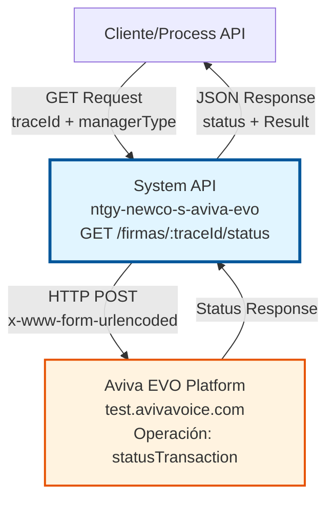
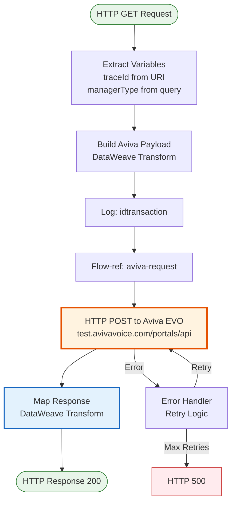
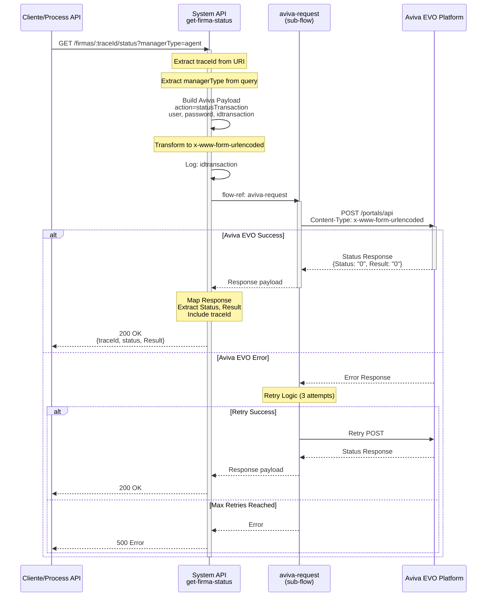
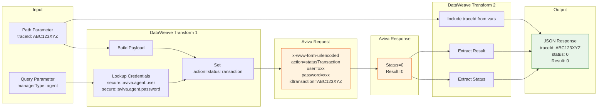

# GET /firmas/:traceId/status

## 📌 Descripción General

### Propósito del Endpoint

Este endpoint consulta el estado actual de una transacción de firma digital en la plataforma Aviva EVO Voice Signature. Permite monitorear el progreso del proceso de firma y obtener el código de estado actual de la transacción.

El endpoint soporta:
- **Consulta de Estado en Tiempo Real**: Obtiene el estado actual de la firma desde Aviva EVO
- **Tracking de Transacciones**: Permite seguimiento mediante traceId único
- **Soporte Multi-Gestor**: Funciona con credenciales de agente o cliente
- **Validación de Resultado**: Retorna código de resultado de la operación

### Tipo de API

**Capa:** System API (API-Led Connectivity)

**Función:** Integración directa con Aviva EVO Voice Signature Platform para consulta de estados de firma digital.

### Patrón de Integración

**Tipo:** Request-Reply Síncrono con REST API Externa

**Descripción:** Recibe solicitud de consulta de estado, transforma a formato x-www-form-urlencoded, invoca operación `statusTransaction` en Aviva EVO, y mapea respuesta a formato JSON estándar.

### Arquitectura API-Led Connectivity



---

## 💼 Propósito del Negocio

### Casos de Uso Principales

1. **Monitoreo de Firma en Proceso**
   - Aplicaciones cliente consultan periódicamente el estado de la firma
   - Permite mostrar progreso en tiempo real al usuario
   - Detecta cuando la firma está lista para descarga

2. **Validación de Firma Completada**
   - Sistemas backend verifican si la firma alcanzó estado final
   - Permite continuar con procesos posteriores (almacenamiento, notificaciones)
   - Facilita toma de decisiones basada en el estado actual

3. **Gestión de Timeouts y Errores**
   - Detecta firmas expiradas o rechazadas
   - Permite implementar lógica de reintento o cancelación
   - Facilita auditoría de transacciones fallidas

### Contexto Empresarial

- **Dominio:** Gestión de Firmas Digitales
- **Sector:** Energía - Utilities
- **División:** Naturgy España - NewCo
- **Proceso de Negocio:** Firma digital por voz para contratos y documentos
- **Plataforma Externa:** Aviva EVO Voice Signature

### Stakeholders

- **Agentes de Call Center**: Necesitan saber si el cliente completó la firma
- **Sistemas de Workflow**: Requieren estado para continuar procesos automatizados
- **Aplicaciones Móviles/Web**: Muestran progreso de firma al usuario final
- **Equipos de Auditoría**: Rastrean transacciones de firma para compliance

### Valor de Negocio

- **Visibilidad en Tiempo Real**: Monitoreo continuo del proceso de firma
- **Trazabilidad Completa**: Tracking del estado de cada transacción
- **Mejora de UX**: Permite feedback inmediato al usuario sobre el estado de su firma
- **Auditoría y Compliance**: Registro completo del ciclo de vida de cada firma

### Consumidores Potenciales

Este endpoint puede ser consumido por:
- Process APIs de gestión de contratos
- Experience APIs de canales digitales (web, móvil)
- Sistemas de workflow y orquestación
- Aplicaciones de agentes de call center
- Servicios de notificaciones y alertas

---

## 🔧 Especificación Técnica

### URLs por Ambiente

| Ambiente | URL Base | URL Completa |
|----------|----------|--------------|
| **Local** | `http://localhost:8091` | `http://localhost:8091/api/firmas/:traceId/status?managerType=agent` |
| **Development** | `https://ntgy-newco-s-aviva-evo-dev.us-e2.cloudhub.io` | `https://ntgy-newco-s-aviva-evo-dev.us-e2.cloudhub.io/api/firmas/:traceId/status?managerType=agent` |
| **UAT** | `https://ntgy-newco-s-aviva-evo-uat.us-e2.cloudhub.io` | `https://ntgy-newco-s-aviva-evo-uat.us-e2.cloudhub.io/api/firmas/:traceId/status?managerType=agent` |
| **Production** | `https://ntgy-newco-s-aviva-evo-pro.us-e2.cloudhub.io` | `https://ntgy-newco-s-aviva-evo-pro.us-e2.cloudhub.io/api/firmas/:traceId/status?managerType=agent` |

### Método HTTP

```
GET /api/firmas/:traceId/status
```

### Parámetros de Entrada

#### Path Parameters

| Parámetro | Tipo | Requerido | Descripción | Ejemplo |
|-----------|------|-----------|-------------|---------|
| `traceId` | string | ✅ Sí | Identificador único de la transacción de firma | `"ABC123XYZ"` |

#### Query Parameters

| Parámetro | Tipo | Requerido | Descripción | Valores Permitidos | Ejemplo |
|-----------|------|-----------|-------------|-------------------|---------|
| `managerType` | string | ✅ Sí | Tipo de gestor que realiza la solicitud (determina credenciales de Aviva EVO) | `agent`, `client` | `"agent"` |

#### Headers HTTP

| Header | Tipo | Requerido | Descripción | Ejemplo |
|--------|------|-----------|-------------|---------|
| `Accept` | string | ❌ No | Tipo de contenido esperado en response | `application/json` |

### Respuestas

#### Respuesta Exitosa (200 OK)

**Estructura de Respuesta:**
```json
{
  "traceId": "string",
  "status": "string",
  "Result": "string"
}
```

**Ejemplo - Estado en Proceso:**
```json
{
  "traceId": "ABC123XYZ",
  "status": "3",
  "Result": "0"
}
```

**Ejemplo - Firma Completada:**
```json
{
  "traceId": "XYZ789ABC",
  "status": "0",
  "Result": "0"
}
```

**Ejemplo - Firma Rechazada:**
```json
{
  "traceId": "DEF456GHI",
  "status": "1",
  "Result": "0"
}
```

#### Campos de Respuesta

| Campo | Tipo | Descripción |
|-------|------|-------------|
| `traceId` | string | Identificador único de la transacción (mismo que el path parameter) |
| `status` | string | Código de estado de la firma en Aviva EVO (ver tabla de códigos) |
| `Result` | string | Código de resultado de la operación ("0" = éxito, otros = error) |

#### Códigos de Estado de Aviva EVO

| Código | Descripción | Acción Recomendada |
|--------|-------------|-------------------|
| `"0"` | Firma completada exitosamente | Descargar certificado con GET /firmas/:traceId |
| `"1"` | Firma rechazada por el usuario | Notificar rechazo al usuario |
| `"2"` | Transacción expirada | Crear nueva solicitud de firma |
| `"3"` | Firma en proceso | Continuar consultando periódicamente |
| `"4"` | Error en el proceso de firma | Revisar logs y contactar soporte |
| `"7"` | Firma cancelada | Notificar cancelación |
| `"10"` | Usuario no disponible | Reintentar más tarde |
| `"11"` | Documento no válido | Revisar documento y crear nueva firma |

#### Códigos de Resultado (Result)

| Código | Descripción |
|--------|-------------|
| `"0"` | Operación exitosa |
| Otros | Error en la operación (ver mensaje de Aviva EVO) |

#### Respuesta de Error (404 Not Found)

```json
{
  "error": "AVIVA:BAD_REQUEST",
  "message": "Signature not found for traceId",
  "timestamp": "2026-06-12T11:45:00Z"
}
```

#### Respuesta de Error (400 Bad Request)

```json
{
  "result": {
    "codResult": "0001",
    "msgResult": "Missing required parameter: managerType"
  }
}
```

#### Respuesta de Error (500 Internal Server Error)

```json
{
  "result": {
    "codResult": "0002",
    "msgResult": "Error connecting to Aviva EVO platform"
  }
}
```

### Autenticación y Autorización

- **Tipo:** Client ID & Client Secret (Anypoint Platform)
- **Autorización Aviva EVO:** Credenciales específicas por managerType:
  - `agent`: Credenciales de agente (secure::aviva.agent.user/password)
  - `client`: Credenciales de cliente (secure::aviva.client.user/password)

### Timeouts

| Tipo | Valor | Descripción |
|------|-------|-------------|
| **Request Timeout** | 60 segundos | Tiempo máximo de espera para la respuesta de Aviva EVO |
| **Connection Timeout** | 30 segundos | Tiempo máximo para establecer conexión con Aviva EVO |

### Retry Logic

| Configuración | Valor | Descripción |
|---------------|-------|-------------|
| **Intentos** | 3 | Número de reintentos en caso de fallo (configurable: `system.retries.attempts`) |
| **Intervalo** | 10 segundos | Tiempo entre reintentos (configurable: `system.retries.interval`) |
| **Condiciones** | CONNECTIVITY, TIMEOUT | Tipos de error que activan retry |

---

## 🏗️ Implementación Técnica

### Arquitectura del Flow



### Componentes del Flow

#### 1. Sub-flow: get-firma-status

**Ubicación:** `src/main/mule/implementation/get-firma-status.xml`

**Propósito:** Consultar estado de firma en Aviva EVO

**Componentes:**
1. Transformación de entrada (DataWeave)
2. Logger de payload
3. Flow-ref a aviva-request
4. Transformación de salida (DataWeave)

#### 2. Transformación de Entrada

**Tipo:** DataWeave Transform (Set Payload)

**Output:** application/x-www-form-urlencoded

**Código Real:**
```dataweave
%dw 2.0
output application/x-www-form-urlencoded
---
{
    action: "statusTransaction",
    user: p("secure::aviva." ++ vars.managerType ++ ".user"),
    password: p("secure::aviva." ++ vars.managerType ++ ".password"),
    idtransaction: vars.traceId
}
```

**Campos Generados:**
- `action`: "statusTransaction" (operación de Aviva EVO)
- `user`: Usuario desde propiedades seguras según managerType
- `password`: Contraseña desde propiedades seguras según managerType
- `idtransaction`: TraceId de la firma a consultar

**Propiedades Seguras Utilizadas:**
```properties
secure::aviva.agent.user
secure::aviva.agent.password
secure::aviva.client.user
secure::aviva.client.password
```

#### 3. Logger de Payload

**Nivel:** INFO

**Mensaje:** `"idtransaction:" ++ (payload.idtransaction default "")`

**Propósito:** Registrar el idtransaction que se enviará a Aviva EVO para trazabilidad

#### 4. Flow-ref: aviva-request

**Referencia:** Sub-flow compartido `aviva-request`

**Propósito:** Realizar la invocación HTTP POST a Aviva EVO con retry logic

**Configuración:**
- Método: POST
- URL: `${aviva.protocol}://${aviva.host}:${aviva.port}${aviva.portal}`
- Content-Type: application/x-www-form-urlencoded
- Retry: 3 intentos, 10s intervalo

#### 5. Transformación de Salida

**Tipo:** DataWeave Transform (Set Response)

**Output:** application/json

**Código Real:**
```dataweave
%dw 2.0
output application/json
---
{
    traceId: vars.traceId default "",
    status: payload.Status default "",
    Result: payload.Result
}
```

**Mapeo de Campos:**
- `traceId`: Variable extraída del path parameter
- `status`: Campo `Status` de la respuesta de Aviva EVO
- `Result`: Campo `Result` de la respuesta de Aviva EVO

**Nota:** El código incluye una línea comentada para calcular `isStatusFinal`:
```dataweave
//isStatusFinal: p('aviva.final.status.list') contains(payload.Status),
```
Esta funcionalidad está disponible pero no activa en la implementación actual.

### Diagrama de Secuencia Completo



### Diagrama de Transformación de Datos



### Manejo de Errores

#### Error de Conectividad con Aviva EVO

**Escenario:** Aviva EVO no responde o hay problemas de red

**Handling:**
1. Retry automático (3 intentos, 10s intervalo) en sub-flow `aviva-request`
2. Log de cada intento
3. Si todos fallan: HTTP 500

**Response:**
```json
{
  "result": {
    "codResult": "0002",
    "msgResult": "Error connecting to Aviva EVO platform after 3 retries"
  }
}
```

#### Firma No Encontrada

**Escenario:** TraceId no existe en Aviva EVO

**Handling:**
1. Aviva retorna error en respuesta (Result != "0")
2. API retorna la respuesta tal cual con el código de error

**Response:**
```json
{
  "traceId": "ABC123XYZ",
  "status": "",
  "Result": "1"
}
```

#### Parámetro Faltante

**Escenario:** managerType no proporcionado

**Handling:**
1. Validación en APIKit
2. HTTP 400 Bad Request

**Response:**
```json
{
  "result": {
    "codResult": "0001",
    "msgResult": "Missing required parameter: managerType"
  }
}
```

### Configuración por Ambiente

#### Propiedades de Aviva EVO

```yaml
# dev.yaml
aviva:
  protocol: "HTTPS"
  host: "test.avivavoice.com"
  port: "443"
  portal: "/portals/api"
  final:
    status:
      list: "0,1,2,4,7,10,11"

# prod.yaml
aviva:
  protocol: "HTTPS"
  host: "prod.avivavoice.com"  # Cambiar en producción
  port: "443"
  portal: "/portals/api"
  final:
    status:
      list: "0,1,2,4,7,10,11"
```

#### Propiedades Seguras (Credenciales)

```properties
# Credenciales de Agente
secure::aviva.agent.user=agent_user
secure::aviva.agent.password=agent_password

# Credenciales de Cliente
secure::aviva.client.user=client_user
secure::aviva.client.password=client_password
```

#### Configuración de Retry

```yaml
system:
  retries:
    attempts: "3"
    interval: "10000"  # 10 segundos en milisegundos
```

---

## 💻 Ejemplos de Uso

### Ejemplo 1: Consultar Estado de Firma en Proceso

**Request:**
```bash
curl -X GET "http://localhost:8091/api/firmas/ABC123XYZ/status?managerType=agent" \
  -H "Accept: application/json"
```

**Response (200 OK):**
```json
{
  "traceId": "ABC123XYZ",
  "status": "3",
  "Result": "0"
}
```

**Interpretación:**
- La firma está en proceso (status "3")
- La operación fue exitosa (Result "0")
- Se debe continuar consultando periódicamente hasta que status cambie a un valor final

---

### Ejemplo 2: Consultar Estado de Firma Completada

**Request:**
```bash
curl -X GET "https://ntgy-newco-s-aviva-evo-dev.us-e2.cloudhub.io/api/firmas/XYZ789ABC/status?managerType=client" \
  -H "Accept: application/json"
```

**Response (200 OK):**
```json
{
  "traceId": "XYZ789ABC",
  "status": "0",
  "Result": "0"
}
```

**Interpretación:**
- La firma se completó exitosamente (status "0")
- La operación fue exitosa (Result "0")
- Se puede proceder a descargar el certificado usando GET /firmas/:traceId

**Siguiente Paso:**
```bash
curl -X GET "https://ntgy-newco-s-aviva-evo-dev.us-e2.cloudhub.io/api/firmas/XYZ789ABC?managerType=client"
```

---

### Ejemplo 3: Consultar Estado de Firma Rechazada

**Request:**
```bash
curl -X GET "http://localhost:8091/api/firmas/DEF456GHI/status?managerType=agent" \
  -H "Accept: application/json"
```

**Response (200 OK):**
```json
{
  "traceId": "DEF456GHI",
  "status": "1",
  "Result": "0"
}
```

**Interpretación:**
- La firma fue rechazada por el usuario (status "1")
- La operación de consulta fue exitosa (Result "0")
- No se debe continuar consultando, la transacción ha finalizado
- Se debe notificar al usuario del rechazo

---

### Ejemplo 4: Consultar Estado de Firma Expirada

**Request:**
```bash
curl -X GET "http://localhost:8091/api/firmas/GHI789JKL/status?managerType=agent" \
  -H "Accept: application/json"
```

**Response (200 OK):**
```json
{
  "traceId": "GH