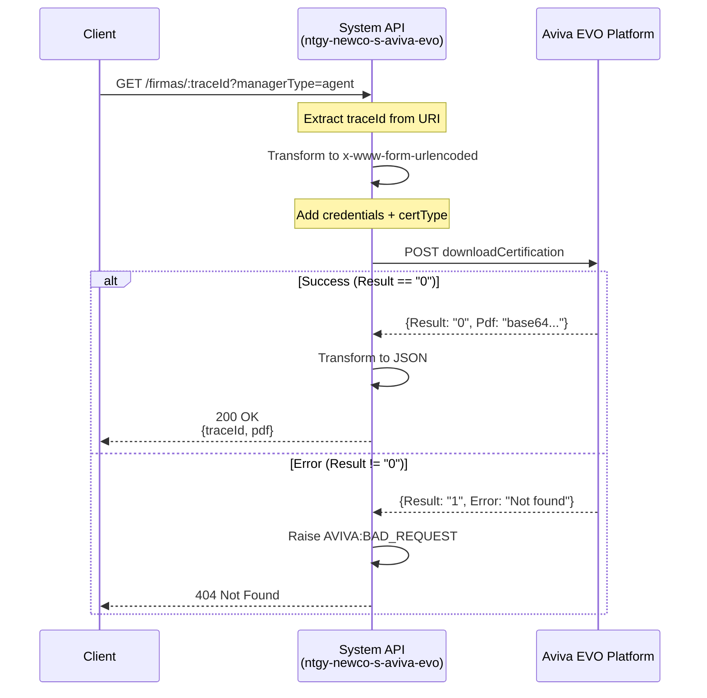
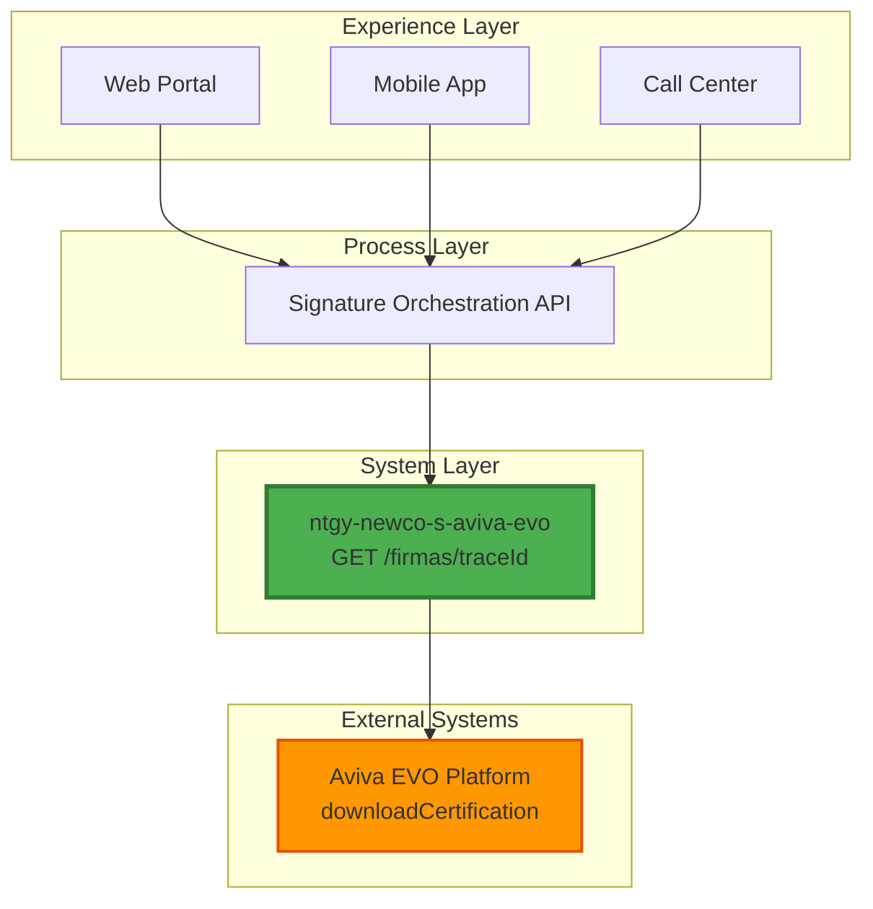
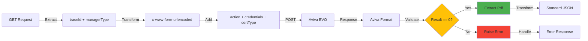

# GET /firmas/:traceId

## 📌 Descripción General

El endpoint **GET /firmas/:traceId** permite recuperar el certificado de firma digital desde la plataforma **Aviva EVO Voice Signature Platform**. Este endpoint es parte de la **System API** `ntgy-newco-s-aviva-evo` y proporciona acceso directo a la operación `downloadCertification` de Aviva EVO.

### Información Clave

| Aspecto | Detalle |
|---------|---------|
| **Método HTTP** | GET |
| **Path** | `/firmas/:traceId` |
| **Tipo de API** | System API |
| **Backend** | Aviva EVO Voice Signature Platform |
| **Operación Backend** | downloadCertification (HTTP POST) |
| **Formato Request** | application/x-www-form-urlencoded |
| **Formato Response** | application/json |
| **Autenticación** | Secure Properties (user/password por managerType) |

### ¿Qué hace este endpoint?

Este endpoint permite:
- ✅ Descargar el certificado de firma digital en formato PDF (Base64)
- ✅ Verificar que la firma existe y está disponible en Aviva EVO
- ✅ Obtener el documento firmado para almacenamiento o visualización
- ✅ Validar el estado de la firma antes de la descarga

### Flujo de Alto Nivel



---

## 💼 Propósito del Negocio

### Caso de Uso Principal

Este endpoint es fundamental para el proceso de **recuperación y almacenamiento de certificados de firma digital** en Naturgy. Permite a las aplicaciones consumidoras obtener el documento firmado una vez que el proceso de firma ha sido completado exitosamente.

### Beneficios del Negocio

1. **Recuperación de Documentos Firmados**
   - Descarga automática de certificados de firma
   - Formato PDF estándar en Base64 para fácil integración
   - Verificación de disponibilidad del documento

2. **Auditoría y Compliance**
   - Almacenamiento de evidencia de firmas digitales
   - Trazabilidad completa mediante traceId
   - Cumplimiento de requisitos regulatorios (GDPR)

3. **Experiencia del Cliente**
   - Acceso inmediato a documentos firmados
   - Descarga desde cualquier canal (web, móvil, call center)
   - Visualización de certificados de firma

4. **Eficiencia Operativa**
   - Automatización de descarga de certificados
   - Reducción de procesos manuales
   - Integración con sistemas de gestión documental

### Escenarios de Uso

#### Escenario 1: Descarga de Certificado Post-Firma
```
Usuario completa firma digital → Sistema consulta estado → 
Estado = "Firmado" → Descarga certificado → Almacena en repositorio
```

#### Escenario 2: Verificación de Firma Existente
```
Usuario solicita copia de documento → Sistema busca por traceId → 
Descarga certificado → Envía por email/muestra en pantalla
```

#### Escenario 3: Auditoría de Firmas
```
Auditor solicita evidencia → Sistema recupera certificado → 
Valida integridad → Genera reporte de auditoría
```

---

## 🔧 Especificación Técnica

### Request

#### Path Parameters

| Parámetro | Tipo | Requerido | Descripción | Ejemplo |
|-----------|------|-----------|-------------|---------|
| `traceId` | string | ✅ Sí | Identificador único de la transacción de firma en Aviva EVO | `ABC123XYZ` |

#### Query Parameters

| Parámetro | Tipo | Requerido | Valores | Descripción | Ejemplo |
|-----------|------|-----------|---------|-------------|---------|
| `managerType` | string | ✅ Sí | `agent`, `client` | Tipo de gestor que determina las credenciales de Aviva EVO a utilizar | `agent` |

#### Headers

| Header | Valor | Requerido | Descripción |
|--------|-------|-----------|-------------|
| `Content-Type` | `application/json` | ✅ Sí | Formato del request |
| `Accept` | `application/json` | ✅ Sí | Formato esperado de respuesta |

### Response

#### Response 200 OK - Éxito

**Estructura:**

```json
{
  "traceId": "string",
  "pdf": "string (base64)"
}
```

**Campos:**

| Campo | Tipo | Descripción | Ejemplo |
|-------|------|-------------|---------|
| `traceId` | string | Identificador único de la firma | `ABC123XYZ` |
| `pdf` | string | Certificado de firma en formato PDF codificado en Base64 | `JVBERi0xLjQKJeLjz9M...` |

#### Response 404 Not Found - Firma No Encontrada

```json
{
  "error": "AVIVA:BAD_REQUEST",
  "message": "Signature not found for traceId: ABC123XYZ",
  "timestamp": "2026-06-12T11:45:00Z"
}
```

#### Response 400 Bad Request - Parámetros Inválidos

```json
{
  "error": "BAD_REQUEST",
  "message": "Required query parameter 'managerType' is missing",
  "timestamp": "2026-06-12T11:45:00Z"
}
```

#### Response 500 Internal Server Error

```json
{
  "error": "INTERNAL_SERVER_ERROR",
  "message": "An unexpected error occurred while processing the request",
  "timestamp": "2026-06-12T11:45:00Z"
}
```

### Códigos de Estado HTTP

| Código | Descripción | Cuándo Ocurre |
|--------|-------------|---------------|
| 200 | OK | Certificado recuperado exitosamente |
| 400 | Bad Request | Parámetros faltantes o inválidos (managerType) |
| 404 | Not Found | Firma no existe en Aviva EVO para el traceId proporcionado |
| 500 | Internal Server Error | Error inesperado en el sistema o Aviva EVO no disponible |
| 503 | Service Unavailable | Aviva EVO temporalmente no disponible (después de reintentos) |

---

## 🏗️ Implementación Técnica

### Arquitectura de Capas



### Flujo de Implementación

El endpoint está implementado en el archivo `src/main/mule/implementation/get-firma.xml` y sigue este flujo:

#### 1. Extracción de Variables (APIKit Flow)

```xml
<!-- En ntgy-newco-s-aviva-evo.xml -->
<flow name="get:\firmas\(traceId):ntgy-newco-s-aviva-evo-config">
    <set-variable value="#[attributes.uriParams.traceId]" variableName="traceId"/>
    <set-variable value="#[attributes.queryParams.managerType]" variableName="managerType"/>
    <flow-ref name="get-firma"/>
</flow>
```

#### 2. Transformación de Request (DataWeave)

```dataweave
%dw 2.0
output application/x-www-form-urlencoded
---
{
    action: "downloadCertification",
    user: p("secure::aviva." ++ vars.managerType ++ ".user"),
    password: p("secure::aviva." ++ vars.managerType ++ ".password"),
    idtransaction: vars.traceId,
    certType: "CB"
}
```

**Explicación:**
- `action`: Operación fija "downloadCertification" de Aviva EVO
- `user` y `password`: Credenciales obtenidas de propiedades seguras según el `managerType`
- `idtransaction`: El traceId recibido como path parameter
- `certType`: "CB" (Certificate Base64) para obtener el PDF en Base64

#### 3. Llamada a Aviva EVO (HTTP Request)

```xml
<!-- En aviva-requests.xml -->
<sub-flow name="aviva-request">
    <logger level="INFO" message='#["Before request to Aviva"]'/>
    <until-successful maxRetries="${system.retries.attempts}" 
                      millisBetweenRetries="${system.retries.interval}">
        <http:request method="POST" 
                      config-ref="HTTP_Request_configuration_Aviva" 
                      path="${aviva.portal}"/>
    </until-successful>
    <logger level="INFO" message='#["After request to Aviva"]'/>
    <ee:transform>
        <ee:set-payload><![CDATA[
            %dw 2.0
            output application/json
            ---
            read(payload, "application/json")
        ]]></ee:set-payload>
    </ee:transform>
</sub-flow>
```

**Configuración HTTP:**
- **Host:** `test.avivavoice.com` (configurable por ambiente)
- **Protocol:** HTTPS
- **Port:** 443
- **Path:** `/portals/api`
- **Retry:** 3 intentos con 10 segundos de intervalo

#### 4. Validación y Transformación de Response

```xml
<choice doc:name="Successful Request?">
    <when expression='#[payload.Result == "0"]'>
        <ee:transform>
            <ee:set-payload><![CDATA[
                %dw 2.0
                output application/json
                ---
                {
                    traceId: vars.traceId default "",
                    pdf: payload.Pdf default ""
                }
            ]]></ee:set-payload>
        </ee:transform>
    </when>
    <otherwise>
        <raise-error type="AVIVA:BAD_REQUEST" 
                     description="#[payload.Error]"/>
    </otherwise>
</choice>
```

**Lógica:**
- Si `Result == "0"`: Éxito → Transforma a formato estándar con traceId y pdf
- Si `Result != "0"`: Error → Lanza excepción `AVIVA:BAD_REQUEST` con mensaje de error

### Diagrama de Transformación de Datos



### Configuración de Propiedades

#### Propiedades de Ambiente (dev.yaml)

```yaml
http:
  newco:
    port: "8091"
    
aviva:
  host: "test.avivavoice.com"
  protocol: "HTTPS"
  port: "443"
  portal: "/portals/api"

system:
  retries:
    attempts: "3"
    interval: "10000"
```

#### Propiedades Seguras (secure-dev.yaml)

```yaml
# Credenciales para managerType = agent
aviva:
  agent:
    user: "encrypted_user_agent"
    password: "encrypted_password_agent"
    
# Credenciales para managerType = client
  client:
    user: "encrypted_user_client"
    password: "encrypted_password_client"
```

### Manejo de Errores

#### Error Handler Global

El endpoint utiliza el error handler global definido en `global-error-handler.xml`:

```xml
<error-handler name="global-error-handler">
    <on-error-propagate type="AVIVA:BAD_REQUEST">
        <set-variable value="404" variableName="httpStatus"/>
        <ee:transform>
            <ee:set-payload><![CDATA[
                %dw 2.0
                output application/json
                ---
                {
                    error: error.errorType.identifier,
                    message: error.description,
                    timestamp: now()
                }
            ]]></ee:set-payload>
        </ee:transform>
    </on-error-propagate>
    
    <on-error-propagate type="HTTP:CONNECTIVITY">
        <set-variable value="503" variableName="httpStatus"/>
        <!-- Error handling logic -->
    </on-error-propagate>
</error-handler>
```

#### Tipos de Errores Manejados

| Error Type | HTTP Status | Descripción | Acción |
|------------|-------------|-------------|--------|
| `AVIVA:BAD_REQUEST` | 404 | Firma no encontrada en Aviva EVO | Retornar mensaje de error |
| `HTTP:CONNECTIVITY` | 503 | Error de conectividad con Aviva EVO | Reintentar 3 veces |
| `HTTP:TIMEOUT` | 504 | Timeout en respuesta de Aviva EVO | Reintentar 3 veces |
| `APIKIT:BAD_REQUEST` | 400 | Parámetros faltantes o inválidos | Retornar error de validación |
| `ANY` | 500 | Error inesperado | Retornar error genérico |

### Retry Logic

El endpoint implementa una estrategia de reintentos para manejar fallos transitorios:

```xml
<until-successful maxRetries="${system.retries.attempts}" 
                  millisBetweenRetries="${system.retries.interval}">
    <http:request method="POST" 
                  config-ref="HTTP_Request_configuration_Aviva" 
                  path="${aviva.portal}"/>
</until-successful>
```

**Configuración:**
- **Intentos:** 3 (configurable: `system.retries.attempts`)
- **Intervalo:** 10 segundos (configurable: `system.retries.interval`)
- **Condiciones:** Errores de conectividad y timeout

**Comportamiento:**
1. Primer intento: Inmediato
2. Segundo intento: Después de 10 segundos
3. Tercer intento: Después de otros 10 segundos
4. Si todos fallan: Retorna error 503 Service Unavailable

### Logging

El endpoint implementa logging estructurado en puntos clave:

```xml
<!-- Antes de llamar a Aviva EVO -->
<logger level="INFO" message='#["Before request to Aviva"]'/>

<!-- Después de recibir respuesta -->
<logger level="INFO" message='#["After request to Aviva"]'/>
```

**Información Logueada:**
- Timestamp de la operación
- traceId para trazabilidad
- managerType utilizado
- Resultado de la operación (éxito/error)
- Tiempo de respuesta de Aviva EVO

---

## 💻 Ejemplos de Uso

### Ejemplo 1: Request Exitoso con curl

```bash
curl -X GET "https://api.naturgy.com/aviva/v1/firmas/ABC123XYZ?managerType=agent" \
  -H "Content-Type: application/json" \
  -H "Accept: application/json" \
  -H "client_id: your-client-id" \
  -H "client_secret: your-client-secret"
```

**Response 200 OK:**

```json
{
  "traceId": "ABC123XYZ",
  "pdf": "JVBERi0xLjQKJeLjz9MKMSAwIG9iago8PC9UeXBlL0NhdGFsb2cvUGFnZXMgMiAwIFI+PgplbmRvYmoKMiAwIG9iago8PC9UeXBlL1BhZ2VzL0tpZHNbMyAwIFJdL0NvdW50IDE+PgplbmRvYmoKMyAwIG9iago8PC9UeXBlL1BhZ2UvTWVkaWFCb3hbMCAwIDYxMiA3OTJdL1BhcmVudCAyIDAgUi9SZXNvdXJjZXM8PC9Gb250PDwvRjEgNCAwIFI+Pj4+L0NvbnRlbnRzIDUgMCBSPj4KZW5kb2JqCjQgMCBvYmoKPDwvVHlwZS9Gb250L1N1YnR5cGUvVHlwZTEvQmFzZUZvbnQvSGVsdmV0aWNhPj4KZW5kb2JqCjUgMCBvYmoKPDwvTGVuZ3RoIDQ0Pj4Kc3RyZWFtCkJUCi9GMSA0OCBUZgoxMCA3MDAgVGQKKEhlbGxvIFdvcmxkKSBUagpFVAplbmRzdHJlYW0KZW5kb2JqCnhyZWYKMCA2CjAwMDAwMDAwMDAgNjU1MzUgZiAKMDAwMDAwMDAxNSAwMDAwMCBuIAowMDAwMDAwMDY0IDAwMDAwIG4gCjAwMDAwMDAxMjEgMDAwMDAgbiAKMDAwMDAwMDI0NyAwMDAwMCBuIAowMDAwMDAwMzI2IDAwMDAwIG4gCnRyYWlsZXIKPDwvU2l6ZSA2L1Jvb3QgMSAwIFI+PgpzdGFydHhyZWYKNDE4CiUlRU9G"
}
```

**Decodificar PDF:**

```javascript
// JavaScript
const base64Pdf = response.pdf;
const pdfBlob = atob(base64Pdf);
const pdfUrl = URL.createObjectURL(new Blob([pdfBlob], { type: 'application/pdf' }));
window.open(pdfUrl);
```

```python
# Python
import base64

pdf_base64 = response['pdf']
pdf_bytes = base64.b64decode(pdf_base64)

with open('certificado_firma.pdf', 'wb') as f:
    f.write(pdf_bytes)
```

### Ejemplo 2: Request con managerType = client

```bash
curl -X GET "https://api.naturgy.com/aviva/v1/firmas/XYZ789ABC?managerType=client" \
  -H "Content-Type: application/json" \
  -H "Accept: application/json" \
  -H "client_id: your-client-id" \
  -H "client_secret: your-client-secret"
```

**Response 200 OK:**

```json
{
  "traceId": "XYZ789ABC",
  "pdf": "JVBERi0xLjQKJeLjz9MKMSAwIG9iago8PC9UeXBlL0NhdGFsb2cvUGFnZXMgMiAwIFI+PgplbmRvYmoKMiAwIG9iago8PC9UeXBlL1BhZ2VzL0tpZHNbMyAwIFJdL0NvdW50IDE+PgplbmRvYmoKMyAwIG9iago8PC9UeXBlL1BhZ2UvTWVkaWFCb3hbMCAwIDYxMiA3OTJdL1BhcmVudCAyIDAgUi9SZXNvdXJjZXM8PC9Gb250PDwvRjEgNCAwIFI+Pj4+L0NvbnRlbnRzIDUgMCBSPj4KZW5kb2JqCjQgMCBvYmoKPDwvVHlwZS9Gb250L1N1YnR5cGUvVHlwZTEvQmFzZUZvbnQvSGVsdmV0aWNhPj4KZW5kb2JqCjUgMCBvYmoKPDwvTGVuZ3RoIDQ0Pj4Kc3RyZWFtCkJUCi9GMSA0OCBUZgoxMCA3MDAgVGQKKEhlbGxvIFdvcmxkKSBUagpFVAplbmRzdHJlYW0KZW5kb2JqCnhyZWYKMCA2CjAwMDAwMDAwMDAgNjU1MzUgZiAKMDAwMDAwMDAxNSAwMDAwMCBuIAowMDAwMDAwMDY0IDAwMDAwIG4gCjAwMDAwMDAxMjEgMDAwMDAgbiAKMDAwMDAwMDI0NyAwMDAwMCBuIAowMDAwMDAwMzI2IDAwMDAwIG4gCnRyYWlsZXIKPDwvU2l6ZSA2L1Jvb3QgMSAwIFI+PgpzdGFydHhyZWYKNDE4CiUlRU9G"
}
```

### Ejemplo 3: Error 404 - Firma No Encontrada

```bash
curl -X GET "https://api.naturgy.com/aviva/v1/firmas/INVALID123?managerType=agent" \
  -H "Content-Type: application/json" \
  -H "Accept: application/json" \
  -H "client_id: your-client-id" \
  -H "client_secret: your-client-secret"
```

**Response 404 Not Found:**

```json
{
  "error": "AVIVA:BAD_REQUEST",
  "message": "Signature not found for traceId: INVALID123",
  "timestamp": "2026-06-12T11:45:00Z"
}
```

### Ejemplo 4: Error 400 - Parámetro Faltante

```bash
curl -X GET "https://api.naturgy.com/aviva/v1/firmas/ABC123XYZ" \
  -H "Content-Type: application/json" \
  -H "Accept: application/json" \
  -H "client_id: your-client-id" \
  -H "client_secret: your-client-secret"
```

**Response 400 Bad Request:**

```json
{
  "error": "BAD_REQUEST",
  "message": "Required query parameter 'managerType' is missing",
  "timestamp": "2026-06-12T11:45:00Z"
}
```

### Ejemplo 5: Integración con JavaScript (Fetch API)

```javascript
async function downloadSignatureCertificate(traceId, managerType) {
  try {
    const response = await fetch(
      `https://api.naturgy.com/aviva/v1/firmas/${traceId}?managerType=${managerType}`,
      {
        method: 'GET',
        headers: {
          'Content-Type': 'application/json',
          'Accept': 'application/json',
          'client_id': 'your-client-id',
          'client_secret': 'your-client-secret'
        }
      }
    );

    if (!response.ok) {
      const error = await response.json();
      throw new Error(`Error ${response.status}: ${error.message}`);
    }

    const data = await response.json();
    
    // Decodificar PDF Base64
    const pdfBlob = base64ToBlob(data.pdf, 'application/pdf');
    const pdfUrl = URL.createObjectURL(pdfBlob);
    
    // Abrir PDF en nueva ventana
    window.open(pdfUrl, '_blank');
    
    // O descargar automáticamente
    const link = document.createElement('a');
    link.href = pdfUrl;
    link.download = `certificado_${data.traceId}.pdf`;
    link.click();
    
    return data;
  } catch (error) {
    console.error('Error downloading certificate:', error);
    throw error;
  }
}

// Función auxiliar para convertir Base64 a Blob
function base64ToBlob(base64, contentType) {
  const byteCharacters = atob(base64);
  const byteArrays = [];
  
  for (let offset = 0; offset < byteCharacters.length; offset += 512) {
    const slice = byteCharacters.slice(offset, offset + 512);
    const byteNumbers = new Array(slice.length);
    
    for (let i = 0; i < slice.length; i++) {
      byteNumbers[i] = slice.charCodeAt(i);
    }
    
    const byteArray = new Uint8Array(byteNumbers);
    byteArrays.push(byteArray);
  }
  
  return new Blob(byteArrays, { type: contentType });
}

// Uso
downloadSignatureCertificate('ABC123XYZ', 'agent')
  .then(result => console.log('Certificate downloaded:', result.traceId))
  .catch(error => console.error('Failed to download:', error));
```

### Ejemplo 6: Integración con Python (requests)

```python
import requests
import base64
from pathlib import Path

def download_signature_certificate(trace_id: str, manager_type: str, output_path: str = None):
    """
    Descarga el certificado de firma desde Aviva EVO.
    
    Args:
        trace_id: Identificador único de la firma
        manager_type: Tipo de gestor ('agent' o 'client')
        output_path: Ruta donde guardar el PDF (opcional)
    
    Returns:
        dict: Respuesta con traceId y pdf en Base64
    """
    url = f"https://api.naturgy.com/aviva/v1/firmas/{trace_id}"
    
    headers = {
        'Content-Type': 'application/json',
        'Accept': 'application/json',
        'client_id': 'your-client-id',
        'client_secret': 'your-client-secret'
    }
    
    params = {
        'managerType': manager_type
    }
    
    try:
        response = requests.get(url, headers=headers, params=params, timeout=30)
        response.raise_for_status()
        
        data = response.json()
        
        # Decodificar y guardar PDF si se especifica ruta
        if output_path:
            pdf_bytes = base64.b64decode(data['pdf'])
            output_file = Path(output_path)
            output_file.write_bytes(pdf_bytes)
            print(f"Certificate saved to: {output_file}")
        
        return data
        
    except requests.exceptions.HTTPError as e:
        if e.response.status_code == 404:
            print(f"Error: Signature not found for traceId: {trace_id}")
        elif e.response.status_code == 400:
            print(f"Error: Invalid parameters - {e.response.json().get('message')}")
        else:
            print(f"HTTP Error: {e}")
        raise
        
    except requests.exceptions.ConnectionError:
        print("Error: Unable to connect to API")
        raise
        
    except requests.exceptions.Timeout:
        print("Error: Request timeout")
        raise
        
    except Exception as e:
        print(f"Unexpected error: {e}")
        raise

# Uso
if __name__ == "__main__":
    try:
        result = download_signature_certificate(
            trace_id='ABC123XYZ',
            manager_type='agent',
            output_path='certificado_firma.pdf'
        )
        print(f"Success! TraceId: {result['traceId']}")
        
    except Exception as e:
        print(f"Failed to download certificate: {e}")
```

### Ejemplo 7: Manejo de Errores Completo

```javascript
class AvivaSignatureClient {
  constructor(baseUrl, clientId, clientSecret) {
    this.baseUrl = baseUrl;
    this.clientId = clientId;
    this.clientSecret = clientSecret;
  }

  async getCertificate(traceId, managerType) {
    const url = `${this.baseUrl}/firmas/${traceId}?managerType=${managerType}`;
    
    try {
      const response = await fetch(url, {
        method: 'GET',
        headers: {
          'Content-Type': 'application/json',
          'Accept': 'application/json',
          'client_id': this.clientId,
          'client_secret': this.clientSecret
        }
      });

      const data = await response.json();

      switch (response.status) {
        case 200:
          return {
            success: true,
            data: data
          };
          
        case 400:
          return {
            success: false,
            error: 'INVALID_PARAMETERS',
            message: data.message || 'Invalid request parameters'
          };
          
        case 404:
          return {
            success: false,
            error: 'SIGNATURE_NOT_FOUND',
            message: `Signature not found for traceId: ${traceId}`
          };
          
        case 500:
          return {
            success: false,
            error: 'SERVER_ERROR',
            message: 'Internal server error occurred'
          };
          
        case 503:
          return {
            success: false,
            error: 'SERVICE_UNAVAILABLE',
            message: 'Aviva EVO service temporarily unavailable'
          };
          
        default:
          return {
            success: false,
            error: 'UNKNOWN_ERROR',
            message: `Unexpected status code: ${response.status}`
          };
      }
      
    } catch (error) {
      return {
        success: false,
        error: 'NETWORK_ERROR',
        message: error.message
      };
    }
  }
}

// Uso con manejo de errores
const client = new AvivaSignatureClient(
  'https://api.naturgy.com/aviva/v1',
  'your-client-id',
  'your-client-secret'
);

const result = await client.getCertificate('ABC123XYZ', 'agent');

if (result.success) {
  console.log('Certificate retrieved:', result.data.traceId);
  // Procesar PDF...
} else {
  console.error(`Error: ${result.error} - ${result.message}`);
  // Manejar error según el tipo...
}
```
