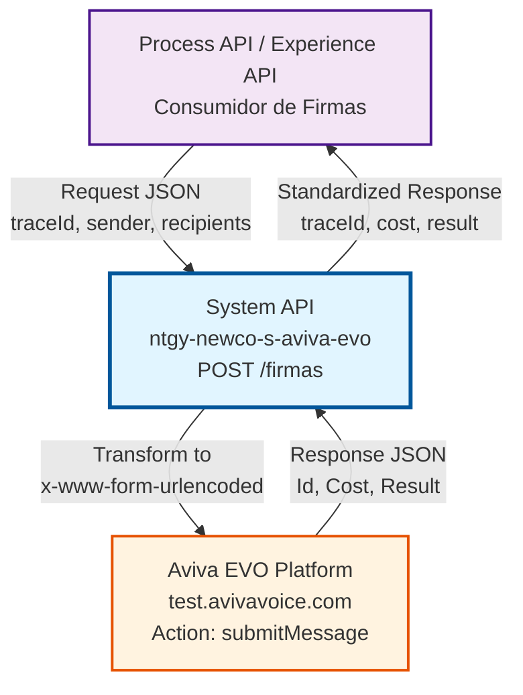
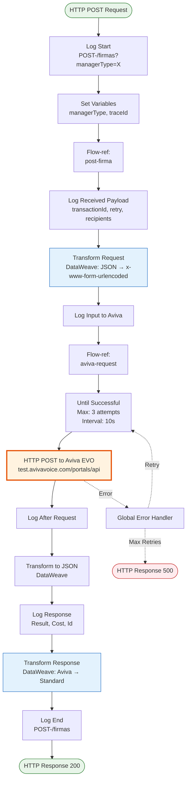
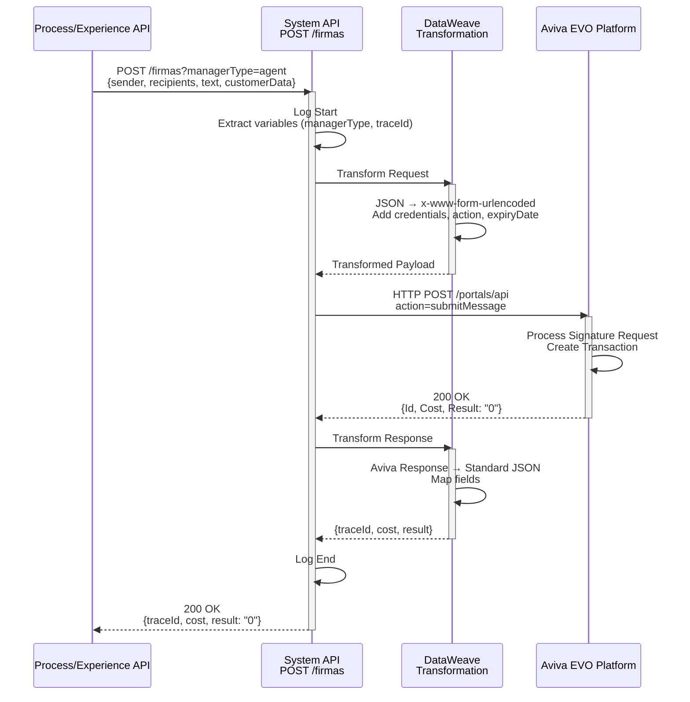
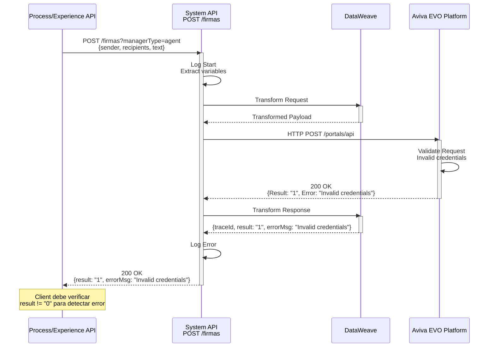
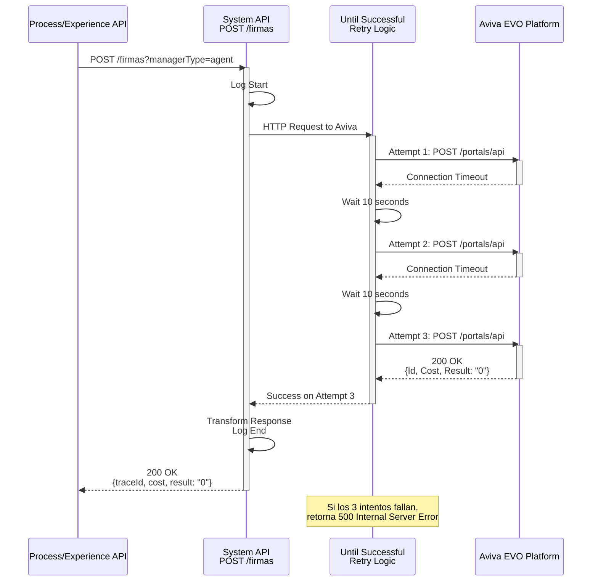

# POST /firmas

## 📌 Descripción General

### Propósito del Endpoint

Este endpoint permite crear una nueva solicitud de firma digital por voz en la plataforma Aviva EVO. Envía un documento para que sea firmado por un cliente o agente a través de un proceso de firma por voz, generando un identificador único (traceId) para el seguimiento del proceso de firma.

El endpoint soporta:
- **Firma por Voz**: Proceso de firma mediante reconocimiento de voz
- **Gestión de Documentos**: Envío de documentos PDF para firma
- **Tracking de Transacciones**: Identificación única mediante traceId
- **Múltiples Tipos de Manager**: Soporte para agentes (agent) y clientes (client)
- **Expiración Configurable**: Tiempo de expiración personalizable para cada solicitud
- **Reintentos**: Capacidad de reintentar transacciones fallidas

### Tipo de API

**Capa:** System API (API-Led Connectivity)

**Función:** Integración directa con la plataforma Aviva EVO para gestión de firmas digitales por voz, proporcionando una capa de abstracción sobre la API externa de Aviva.

### Patrón de Integración

**Tipo:** Request-Reply Síncrono con REST API Externa

**Descripción:** El endpoint recibe una solicitud JSON con los datos de la firma, transforma el payload al formato requerido por Aviva EVO (application/x-www-form-urlencoded), invoca la operación `submitMessage` de Aviva EVO mediante HTTP POST, y retorna el resultado transformado a JSON con el identificador de la transacción y detalles del costo.

### Arquitectura API-Led Connectivity



---

## 💼 Propósito del Negocio

### Casos de Uso Principales

1. **Firma de Contratos de Energía**
   - Un cliente necesita firmar un contrato de suministro eléctrico o gas
   - El agente de call center inicia el proceso de firma por voz
   - El sistema envía el documento a Aviva EVO para procesamiento
   - **Beneficio:** Agiliza el proceso de contratación sin necesidad de firma presencial

2. **Firma de Documentos en Portal Web**
   - Un cliente accede al portal de autoservicio de Naturgy
   - Necesita firmar un documento (modificación de contrato, autorización)
   - El sistema genera una solicitud de firma digital
   - **Beneficio:** Permite firmas digitales 24/7 sin intervención de agentes

3. **Firma de Autorizaciones en Aplicación Móvil**
   - Un cliente usa la app móvil de Naturgy
   - Requiere autorizar un cambio en su servicio
   - La app solicita firma digital por voz
   - **Beneficio:** Experiencia móvil completa sin cambio de canal

### Contexto Empresarial

- **Dominio:** Gestión de Firmas Digitales
- **Sector:** Energía - Utilities
- **División:** Naturgy España - NewCo
- **Proceso de Negocio:** Digitalización de procesos de firma para contratos, autorizaciones y documentos legales
- **Plataforma Externa:** Aviva EVO (Voice Signature Platform)

### Stakeholders

- **Agentes de Call Center**: Necesitan iniciar procesos de firma durante atención telefónica
- **Clientes Finales**: Requieren firmar documentos de forma digital y remota
- **Equipos de Desarrollo (Process/Experience APIs)**: Consumen este endpoint para integrar firmas en sus flujos
- **Equipo de Operaciones**: Monitorea el funcionamiento y disponibilidad del servicio
- **Equipo Legal/Compliance**: Requiere trazabilidad y validez legal de las firmas

### Valor de Negocio

- **Reducción de Tiempos**: Firma inmediata vs. envío postal (días de diferencia)
- **Reducción de Costos**: Elimina costos de impresión, envío y almacenamiento físico
- **Mejora de Experiencia**: Cliente firma desde cualquier lugar, cualquier momento
- **Cumplimiento Normativo**: Firmas digitales con validez legal y trazabilidad completa
- **Escalabilidad**: Soporta múltiples canales (web, móvil, voz) con una única integración

### Consumidores Potenciales

Este endpoint puede ser consumido por:
- **Process APIs** de orquestación de firmas (ej: ntgy-newco-p-firma-contrato)
- **Experience APIs** de canales específicos (web, móvil, voz)
- **Flujos de Salesforce** (Platform Events, Process Builder)
- **Sistemas de integración middleware** (MuleSoft, Dell Boomi)
- **Aplicaciones de terceros autorizados** (partners, distribuidores)

---

## 🔧 Especificación Técnica

### URLs por Ambiente

| Ambiente | URL Base | URL Completa |
|----------|----------|--------------|
| **Local** | `http://localhost:8091` | `http://localhost:8091/api/firmas?managerType=agent` |
| **Development** | `https://ntgy-newco-s-aviva-evo-dev.us-e2.cloudhub.io` | `https://ntgy-newco-s-aviva-evo-dev.us-e2.cloudhub.io/api/firmas?managerType=agent` |
| **Test** | `https://ntgy-newco-s-aviva-evo-test.us-e2.cloudhub.io` | `https://ntgy-newco-s-aviva-evo-test.us-e2.cloudhub.io/api/firmas?managerType=agent` |
| **Production** | `https://ntgy-newco-s-aviva-evo-pro.us-e2.cloudhub.io` | `https://ntgy-newco-s-aviva-evo-pro.us-e2.cloudhub.io/api/firmas?managerType=agent` |

### Método HTTP

```
POST /api/firmas
```

### Parámetros de Entrada

#### Headers HTTP

| Header | Tipo | Requerido | Descripción | Ejemplo |
|--------|------|-----------|-------------|---------|
| `Content-Type` | string | ✅ Sí | Tipo de contenido del request | `application/json` |
| `Accept` | string | ❌ No | Tipo de contenido esperado en response | `application/json` |
| `client_id` | string | ✅ Sí | Client ID de Anypoint Platform | `a1b2c3d4e5f6` |
| `client_secret` | string | ✅ Sí | Client Secret de Anypoint Platform | `A1B2C3D4E5F6` |

#### Query Parameters

| Parámetro | Tipo | Requerido | Descripción | Valores Permitidos | Ejemplo |
|-----------|------|-----------|-------------|-------------------|---------|
| `managerType` | string | ✅ Sí | Tipo de gestor que realiza la solicitud | `agent`, `client` | `agent` |

#### Body Parameters

| Campo | Tipo | Requerido | Descripción | Ejemplo |
|-------|------|-----------|-------------|---------|
| `sender` | string | ✅ Sí | Remitente de la firma (número de teléfono) | `"34600123456"` |
| `recipients` | string | ✅ Sí | Destinatarios de la firma (números separados por coma) | `"34600654321,34600789012"` |
| `text` | string | ✅ Sí | Texto del mensaje de firma | `"Firma de contrato de suministro"` |
| `customerData` | string | ✅ Sí | Datos del cliente en formato específico | `"NOMBRE:Juan Perez;DNI:12345678A"` |
| `traceId` | string | ❌ No | Identificador único de la transacción (se genera si no se proporciona) | `"TRX-2026-001234"` |
| `portal` | string | ❌ No | Portal de origen de la solicitud | `"WEB"`, `"MOBILE"`, `"CALLCENTER"` |
| `pdfData` | string | ❌ No | Documento PDF en Base64 para firma | `"JVBERi0xLjQKJeLjz9..."` |
| `expiresIn` | string | ❌ No | Tiempo de expiración en segundos | `"3600"` (1 hora) |
| `retryTransaction` | boolean | ❌ No | Indica si es un reintento de transacción | `false` |

### Respuestas

#### Respuesta Exitosa (200 OK)

```json
{
  "traceId": "TRX-2026-001234",
  "cost": "0.15",
  "result": "0",
  "recipientsNotBilled": ""
}
```

**Descripción de Campos:**
- `traceId`: Identificador único de la transacción de firma
- `cost`: Costo de la operación en euros
- `result`: Código de resultado (`"0"` = éxito, otros valores = error)
- `recipientsNotBilled`: Destinatarios que no fueron facturados (vacío si todos fueron facturados)

#### Respuesta de Error de Validación (400 Bad Request)

```json
{
  "result": {
    "codResult": "0001",
    "msgResult": "Required parameter 'managerType' is missing"
  }
}
```

#### Respuesta de Error Técnico (500 Internal Server Error)

```json
{
  "result": {
    "codResult": "0002",
    "msgResult": "Error connecting to Aviva EVO platform"
  }
}
```

### Autenticación y Autorización

- **Tipo:** Client ID & Client Secret (Anypoint Platform)
- **Autorización Aviva EVO:** 
  - Usuario y contraseña específicos por `managerType`
  - Credenciales almacenadas en secure properties
  - Formato: `secure::aviva.{managerType}.user` y `secure::aviva.{managerType}.password`
- **Permisos Requeridos:**
  - Acceso a la API de Anypoint Platform
  - Credenciales válidas de Aviva EVO para el tipo de manager especificado

### Timeouts

| Tipo | Valor | Descripción |
|------|-------|-------------|
| **Connection Timeout** | 30 segundos | Tiempo máximo para establecer conexión con Aviva EVO |
| **Response Timeout** | 60 segundos | Tiempo máximo de espera para la respuesta de Aviva EVO |
| **Retry Interval** | 10 segundos | Intervalo entre reintentos en caso de fallo |
| **Max Retries** | 3 intentos | Número máximo de reintentos automáticos |

---

## 🏗️ Implementación Técnica

### Arquitectura del Flow



### 🗄️ Integración con Aviva EVO

**Plataforma Externa:** Aviva EVO Voice Signature Platform

**Endpoint:** `https://test.avivavoice.com/portals/api` (test/dev)

**Operación:** `submitMessage`

**Método HTTP:** POST

**Content-Type:** application/x-www-form-urlencoded

**Parámetros Enviados a Aviva EVO:**
- `action`: "submitMessage" (operación fija)
- `user`: Usuario de Aviva EVO (según managerType)
- `password`: Contraseña de Aviva EVO (según managerType)
- `sender`: Número de teléfono del remitente
- `recipients`: Números de teléfono de destinatarios
- `text`: Texto del mensaje de firma
- `customerData`: Datos del cliente
- `idtransaction`: Identificador único de transacción
- `transactionExpiryDate`: Fecha de expiración (formato: ddMMyyyyHHmmss)
- `retryTransaction`: Indicador de reintento (true/false)
- `portal`: Portal de origen (opcional)
- `pdfData`: Documento PDF en Base64 (opcional)

**Respuesta de Aviva EVO:**
- `Id`: Identificador de la transacción en Aviva
- `Cost`: Costo de la operación
- `Result`: Código de resultado ("0" = éxito)
- `Error`: Mensaje de error (si aplica)
- `RecipientsNotBilled`: Destinatarios no facturados

### Transformaciones DataWeave

#### Transformación de Entrada (Request → Aviva EVO)

```dataweave
%dw 2.0
output application/x-www-form-urlencoded
import * from dw::core::Periods
---
{
	// Calcular fecha de expiración si se proporciona expiresIn
	(transactionExpiryDate: (now() + seconds(payload.expiresIn)) as DateTime as String{format:'ddMMyyyyHHmmss'}) 
		if (payload.expiresIn != null),
	
	// Indicador de reintento (default: false)
	retryTransaction: payload.retryTransaction default false,
	
	// Credenciales de Aviva EVO según tipo de manager
	user: p("secure::aviva." ++ vars.managerType ++ ".user"),
	password: p("secure::aviva." ++ vars.managerType ++ ".password"),
	
	// Acción fija para crear firma
	action: "submitMessage",
	
	// Datos de la firma
	sender: payload.sender,
	recipients: payload.recipients,
	text: payload.text,
	
	// Portal de origen (opcional)
	(portal: payload.portal) if (payload.portal != null),
	
	// ID de transacción (usa el del payload o el de la variable)
	idtransaction: payload.transactionId default vars.traceId,
	
	// Datos del cliente
	customerData: payload.customerData,
	
	// Documento PDF (opcional)
	(pdfData: payload.pdfData) if (payload.pdfData != null)
}
```

**Lógica Clave:**
- Calcula fecha de expiración sumando segundos al timestamp actual
- Obtiene credenciales dinámicamente según `managerType` (agent/client)
- Usa `traceId` del payload o de la variable si no se proporciona
- Incluye campos opcionales solo si están presentes

#### Transformación de Salida (Aviva EVO → Response)

```dataweave
%dw 2.0
output application/json
---
{
	// Usa traceId de variable o el Id retornado por Aviva
	traceId: vars.traceId default payload.Id,
	
	// Costo de la operación (default: cadena vacía)
	cost: payload.Cost default "",
	
	// Resultado de la operación
	result: payload.Result,
	
	// Mensaje de error (solo si existe)
	(errorMsg: payload.Error) if(!isEmpty(payload.Error)),
	
	// Destinatarios no facturados (default: cadena vacía)
	recipientsNotBilled: payload.RecipientsNotBilled default ""
}
```

**Lógica Clave:**
- Prioriza `traceId` de la variable sobre el Id de Aviva
- Incluye `errorMsg` solo si hay error
- Proporciona valores por defecto para campos opcionales

### Manejo de Errores y Reintentos

#### Estrategia de Reintentos

```xml
<until-successful 
    maxRetries="${system.retries.attempts}" 
    millisBetweenRetries="${system.retries.interval}">
    <http:request method="POST" 
                  config-ref="HTTP_Request_configuration_Aviva" 
                  path="${aviva.portal}"/>
</until-successful>
```

**Configuración:**
- **Intentos:** 3 (configurable: `system.retries.attempts`)
- **Intervalo:** 10000ms = 10 segundos (configurable: `system.retries.interval`)
- **Estrategia:** Until Successful con intervalo fijo
- **Condiciones de Reintento:** Errores de conectividad y timeout

#### Tipos de Errores

**Errores de Conectividad:**
- Aviva EVO no disponible
- Problemas de red
- **Acción:** Reintento automático (3 veces)

**Errores de Timeout:**
- Respuesta lenta de Aviva EVO
- **Acción:** Reintento automático (3 veces)

**Errores de Validación:**
- `managerType` inválido o faltante
- Campos requeridos faltantes
- **Acción:** Retorno inmediato con 400 Bad Request

**Errores de Negocio:**
- Credenciales de Aviva EVO inválidas
- Transacción duplicada
- **Acción:** Retorno con error de Aviva EVO

### Diagramas de Secuencia

#### Flujo Normal (Éxito)



#### Flujo con Error de Negocio



#### Flujo con Error Técnico y Reintentos



---

## 💻 Ejemplos de Uso

### Ejemplo 1: Crear Firma con Datos Mínimos (Éxito)

#### Request con curl

```bash
curl -X POST "https://ntgy-newco-s-aviva-evo-dev.us-e2.cloudhub.io/api/firmas?managerType=agent" \
  -H "Content-Type: application/json" \
  -H "client_id: a1b2c3d4e5f6" \
  -H "client_secret: A1B2C3D4E5F6" \
  -d '{
    "sender": "34600123456",
    "recipients": "34600654321",
    "text": "Firma de contrato de suministro eléctrico",
    "customerData": "NOMBRE:Juan Perez;DNI:12345678A;EMAIL:juan.perez@email.com",
    "traceId": "TRX-2026-001234"
  }'
```

#### Response (200 OK)

```json
{
  "traceId": "TRX-2026-001234",
  "cost": "0.15",
  "result": "0",
  "recipientsNotBilled": ""
}
```

### Ejemplo 2: Crear Firma con Documento PDF y Expiración

#### Request con curl

```bash
curl -X POST "https://ntgy-newco-s-aviva-evo-dev.us-e2.cloudhub.io/api/firmas?managerType=client" \
  -H "Content-Type: application/json" \
  -H "client_id: a1b2c3d4e5f6" \
  -H "client_secret: A1B2C3D4E5F6" \
  -d '{
    "sender": "34600123456",
    "recipients": "34600654321,34600789012",
    "text": "Firma de autorización de cambio de titular",
    "customerData": "NOMBRE:Maria Garcia;DNI:87654321B;EMAIL:maria.garcia@email.com",
    "traceId": "TRX-2026-001235",
    "portal": "WEB",
    "pdfData": "JVBERi0xLjQKJeLjz9MKMyAwIG9iago8PC9UeXBlL1BhZ2UvUGFyZW50IDIgMCBSL1Jlc291cmNlczw8L0ZvbnQ8PC9GMSA1IDAgUj4+Pj4vTWVkaWFCb3hbMCAwIDYxMiA3OTJdL0NvbnRlbnRzIDQgMCBSPj4KZW5kb2JqCg==",
    "expiresIn": "3600",
    "retryTransaction": false
  }'
```

#### Response (200 OK)

```json
{
  "traceId": "TRX-2026-001235",
  "cost": "0.30",
  "result": "0",
  "recipientsNotBilled": ""
}
```

### Ejemplo 3: Error de Validación (managerType faltante)

#### Request con curl

```bash
curl -X POST "https://ntgy-newco-s-aviva-evo-dev.us-e2.cloudhub.io/api/firmas" \
  -H "Content-Type: application/json" \
  -H "client_id: a1b2c3d4e5f6" \
  -H "client_secret: A1B2C3D4E5F6" \
  -d '{
    "sender": "34600123456",
    "recipients": "34600654321",
    "text": "Firma de contrato",
    "customerData": "NOMBRE:Test User;DNI:11111111A"
  }'
```

#### Response (400 Bad Request)

```json
{
  "result": {
    "codResult": "0001",
    "msgResult": "Required query parameter 'managerType' is missing"
  }
}
```

### Ejemplo 4: Error de Negocio (Credenciales Inválidas)

#### Request con curl

```bash
curl -X POST "https://ntgy-newco-s-aviva-evo-dev.us-e2.cloudhub.io/api/firmas?managerType=invalid" \
  -H "Content-Type: application/json" \
  -H "client_id: a1b2c3d4e5f6" \
  -H "client_secret: A1B2C3D4E5F6" \
  -d '{
    "sender": "34600123456",
    "recipients": "34600654321",
    "text": "Firma de contrato",
    "customerData": "NOMBRE:Test User;DNI:11111111A",
    "traceId": "TRX-2026-001236"
  }'
```

#### Response (200 OK con error de negocio)

```json
{
  "traceId": "TRX-2026-001236",
  "cost": "",
  "result": "1",
  "errorMsg": "Invalid credentials for managerType: invalid",
  "recipientsNotBilled": ""
}
```

### Ejemplo 5: Código JavaScript (Fetch API)

```javascript
async function crearFirmaDigital() {
  const url = 'https://ntgy-newco-s-aviva-evo-dev.us-e2.cloudhub.io/api/firmas?managerType=agent';
  
  const requestBody = {
    sender: '34600123456',
    recipients: '34600654321',
    text: 'Firma de contrato de suministro eléctrico',
    customerData: 'NOMBRE:Juan Perez;DNI:12345678A;EMAIL:juan.perez@email.com',
    traceId: 'TRX-2026-001234'
  };
  
  try {
    const response = await fetch(url, {
      method: 'POST',
      headers: {
        'Content-Type': 'application/json',
        'client_id': 'a1b2c3d4e5f6',
        'client_secret': 'A1B2C3D4E5F6'
      },
      body: JSON.stringify(requestBody)
    });
    
    if (!response.ok) {
      throw new Error(`HTTP error! status: ${response.status}`);
    }
    
    const data = await response.json();
    
    // Verificar si la operación fue exitosa
    if (data.result === '0') {
      console.log('Firma creada exitosamente:', data.traceId);
      console.log('Costo:', data.cost);
      return data;
    } else {
      console.error('Error de negocio:', data.errorMsg);
      throw new Error(data.errorMsg);
    }
  } catch (error) {
    console.error('Error al crear firma:', error);
    throw error;
  }
}

// Uso
crearFirmaDigital()
  .then(result => console.log('Resultado:', result))
  .catch(error => console.error('Error:', error));
```

### Ejemplo 6: Código Python (requests)

```python
import requests
import json

def crear_firma_digital():
    """
    Crea una solicitud de firma digital en Aviva EVO
    """
    url = 'https://ntgy-newco-s-aviva-evo-dev.us-e2.cloudhub.io/api/firmas'
    
    headers = {
        'Content-Type': 'application/json',
        'client_id': 'a1b2c3d4e5f6',
        'client_secret': 'A1B2C3D4E5F6'
    }
    
    params = {
        'managerType': 'agent'
    }
    
    payload = {
        'sender': '34600123456',
        'recipients': '34600654321',
        'text': 'Firma de contrato de suministro eléctrico',
        'customerData': 'NOMBRE:Juan Perez;DNI:12345678A;EMAIL:juan.perez@email.com',
        'traceId': 'TRX-2026-001234'
    }
    
    try:
        response = requests.post(
            url,
            headers=headers,
            params=params,
            json=payload,
            timeout=30
        )
        
        response.raise_for_status()
        
        data = response.json()
        
        # Verificar si la operación fue exitosa
        if data.get('result') == '0':
            print(f"Firma creada exitosamente: {data.get('traceId')}")
            print(f"Costo: {data.get('cost')}")
            return data
        else:
            error_msg = data.get('errorMsg', 'Error desconocido')
            print(f"Error de negocio: {error_msg}")
            raise Exception(error_msg)
            
    except requests.exceptions.Timeout:
        print("Error: Timeout al conectar con el servicio")
        raise
    except requests.exceptions.RequestException as e:
        print(f"Error en la petición: {str(e)}")
        raise
    except Exception as e:
        print(f"Error inesperado: {str(e)}")
        raise

# Uso
if __name__ == '__main__':
    try:
        resultado = crear_firma_digital()
        print(f"Resultado: {json.dumps(resultado, indent=2)}")
    except Exception as e:
        print(f"Error: {str(e)}")
```
