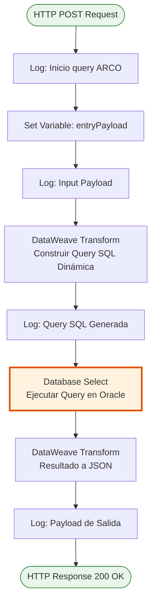
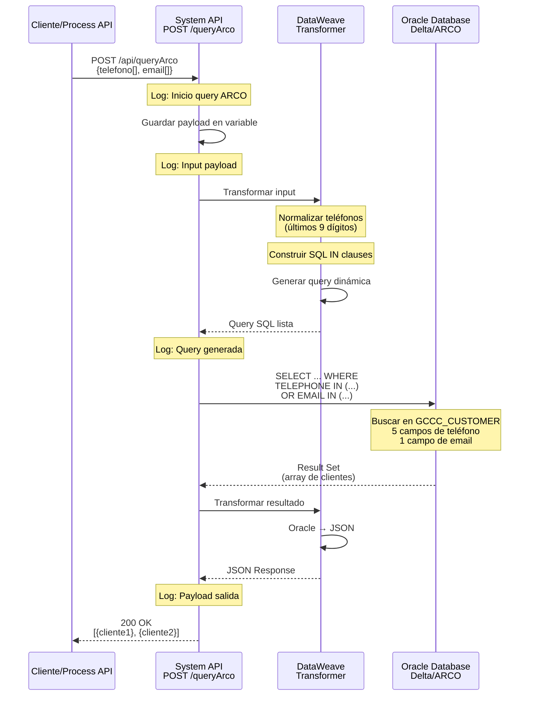

# POST /queryArco

## 📌 Descripción General

### Propósito del Endpoint

Este endpoint permite consultar información de clientes almacenada en la base de datos Delta/ARCO (réplica Oracle GoldenGate) utilizando datos de contacto como criterios de búsqueda. Está diseñado específicamente para facilitar la identificación de clientes en el contexto de consultas ARCO (Acceso, Rectificación, Cancelación y Oposición) relacionadas con derechos de protección de datos.

El endpoint soporta:
- **Búsqueda por Teléfono**: Consulta clientes por uno o múltiples números de teléfono (últimos 9 dígitos)
- **Búsqueda por Email**: Consulta clientes por una o múltiples direcciones de correo electrónico
- **Búsqueda Combinada**: Permite buscar por teléfono Y email simultáneamente usando operador OR
- **Normalización Automática**: Normaliza números de teléfono a formato español (9 dígitos sin prefijo)

### Tipo de API

**Capa:** System API (API-Led Connectivity)

**Función:** Integración directa con base de datos Oracle Delta/ARCO para consultas de información de clientes basadas en datos de contacto.

### Patrón de Integración

**Tipo:** Request-Reply Síncrono con SQL Query Dinámica

**Descripción:** El endpoint recibe arrays de teléfonos y/o emails, construye dinámicamente una query SQL usando DataWeave, ejecuta la consulta contra la tabla GCCC_CUSTOMER en Oracle, y retorna los datos del cliente en formato JSON. La query busca coincidencias en hasta 5 campos de teléfono (TELEPHONE1-5) y el campo EMAIL.

### Arquitectura API-Led Connectivity

```mermaid
graph TB
    PA[Process APIs<br/>FUA, Customer Management]
    S[System API<br/>ntgy-newco-s-delta-smile-replica<br/>POST /queryArco]
    ORACLE[Oracle Database<br/>Delta/ARCO GoldenGate<br/>Tabla: GCCC_CUSTOMER<br/>Schema: DELTA]
    
    PA -->|Request JSON<br/>telefono[], email[]| S
    S -->|Dynamic SQL Query<br/>SELECT con IN clauses| ORACLE
    ORACLE -->|Result Set<br/>Customer Data| S
    S -->|Response JSON<br/>Customer Info| PA
    
    style S fill:#e1f5ff,stroke:#01579b,stroke-width:3px
    style ORACLE fill:#fff3e0,stroke:#e65100,stroke-width:2px
```

---

## 💼 Propósito del Negocio

### Casos de Uso Principales

1. **Identificación de Cliente para Consultas ARCO**
   - Un cliente solicita ejercer sus derechos ARCO (protección de datos)
   - El sistema necesita identificar al cliente usando su teléfono o email
   - Se obtiene el código de cliente (COD_CUSTOMER) para procesar la solicitud

2. **Búsqueda de Cliente en Atención al Cliente**
   - Un agente de call center recibe una llamada
   - El agente busca al cliente por el número de teléfono desde el que llama
   - Se recupera información completa del cliente para atención personalizada

3. **Validación de Datos de Contacto**
   - Un proceso de negocio necesita verificar si un email o teléfono está registrado
   - Se consulta la base de datos para confirmar la existencia del cliente
   - Se obtienen datos adicionales del cliente si existe

### Contexto Empresarial

- **Dominio:** Gestión de Clientes y Protección de Datos
- **Sector:** Energía - Utilities
- **División:** Naturgy España - NewCo
- **Proceso de Negocio:** Identificación de clientes y gestión de derechos ARCO (GDPR compliance)
- **Sistema Backend:** Oracle Database con réplica GoldenGate (Delta/ARCO)

### Stakeholders

- **Agentes de Atención al Cliente**: Necesitan identificar rápidamente clientes por teléfono o email
- **Equipo de Protección de Datos**: Requieren acceso a información de clientes para gestionar solicitudes ARCO
- **Sistemas de Autoservicio**: Portales web y apps móviles que necesitan validar identidad de clientes
- **Administradores de Base de Datos**: Responsables de la disponibilidad y performance de la base de datos Delta

### Valor de Negocio

- **Cumplimiento GDPR**: Facilita el ejercicio de derechos de protección de datos de los clientes
- **Eficiencia Operativa**: Reduce tiempo de identificación de clientes de minutos a segundos
- **Experiencia del Cliente**: Permite atención personalizada rápida basada en datos de contacto
- **Centralización de Acceso**: Punto único de consulta que evita accesos directos múltiples a la base de datos

### Consumidores Potenciales

Este endpoint puede ser consumido por:
- Process APIs de gestión de clientes (FUA, Customer Management)
- Experience APIs de canales digitales (web, móvil)
- Sistemas de atención al cliente (call center, agentes)
- Flujos de Salesforce para validación de clientes
- Sistemas de integración middleware que requieran identificación de clientes

---

## 🔧 Especificación Técnica

### URLs por Ambiente

| Ambiente | URL Base | URL Completa |
|----------|----------|--------------|
| **Local** | `http://localhost:8081` | `http://localhost:8081/api/queryArco` |
| **Development** | `https://ntgy-newco-s-delta-smile-replica-dev.us-e2.cloudhub.io` | `https://ntgy-newco-s-delta-smile-replica-dev.us-e2.cloudhub.io/api/queryArco` |
| **UAT** | `https://ntgy-newco-s-delta-smile-replica-uat.us-e2.cloudhub.io` | `https://ntgy-newco-s-delta-smile-replica-uat.us-e2.cloudhub.io/api/queryArco` |
| **Production** | `https://ntgy-newco-s-delta-smile-replica-pro.us-e2.cloudhub.io` | `https://ntgy-newco-s-delta-smile-replica-pro.us-e2.cloudhub.io/api/queryArco` |

### Método HTTP

```
POST /api/queryArco
```

### Parámetros de Entrada

#### Headers HTTP

| Header | Tipo | Requerido | Descripción | Ejemplo |
|--------|------|-----------|-------------|---------|
| `Content-Type` | string | ✅ Sí | Tipo de contenido del request | `application/json` |
| `Accept` | string | ❌ No | Tipo de contenido esperado en response | `application/json` |

#### Body Parameters

**Estructura del Request:**

```json
{
  "telefono": ["string"],
  "email": ["string"]
}
```

**Campos del Body:**

| Campo | Tipo | Requerido | Descripción | Ejemplo |
|-------|------|-----------|-------------|---------|
| `telefono` | array[string] | ⚠️ Condicional* | Array de números de teléfono a buscar. Se normalizan a 9 dígitos (formato español) | `["612345678", "698765432"]` |
| `email` | array[string] | ⚠️ Condicional* | Array de direcciones de email a buscar | `["cliente@example.com", "otro@example.com"]` |

**\*Nota:** Al menos uno de los dos campos (`telefono` o `email`) debe estar presente y contener al menos un elemento.

**Lógica de Búsqueda:**
- La búsqueda se realiza con operador OR entre todos los criterios
- Los teléfonos se buscan en campos TELEPHONE1, TELEPHONE2, TELEPHONE3, TELEPHONE4, TELEPHONE5
- Los emails se buscan en el campo EMAIL
- Se normalizan los teléfonos a los últimos 9 dígitos para búsqueda consistente

### Respuestas

#### Respuesta Exitosa (200 OK)

**Cuando se encuentra uno o más clientes:**

```json
[
  {
    "COD_CUSTOMER": "0001234567",
    "DOC_NUMBER": "12345678A",
    "COMPLETE_NAME": "Juan García Pérez",
    "EMAIL": "juan.garcia@example.com",
    "TELEPHONE1": "612345678",
    "TELEPHONE2": "918765432",
    "TELEPHONE3": null,
    "TELEPHONE4": null,
    "TELEPHONE5": null
  }
]
```

**Cuando no se encuentran clientes:**

```json
[]
```

**Descripción de Campos de Respuesta:**

| Campo | Tipo | Descripción |
|-------|------|-------------|
| `COD_CUSTOMER` | string | Código único del cliente en el sistema |
| `DOC_NUMBER` | string | Número de documento de identidad (DNI/NIE) |
| `COMPLETE_NAME` | string | Nombre completo del cliente |
| `EMAIL` | string | Dirección de correo electrónico principal |
| `TELEPHONE1` | string | Teléfono principal |
| `TELEPHONE2` | string | Teléfono secundario (opcional) |
| `TELEPHONE3` | string | Teléfono terciario (opcional) |
| `TELEPHONE4` | string | Teléfono cuaternario (opcional) |
| `TELEPHONE5` | string | Teléfono quinario (opcional) |

#### Respuesta de Error (400 Bad Request)

```json
{
  "message": "Bad request"
}
```

**Causas comunes:**
- Request body malformado (JSON inválido)
- Campos requeridos faltantes
- Tipos de datos incorrectos

#### Respuesta de Error (500 Internal Server Error)

```json
{
  "message": "Internal server error"
}
```

**Causas comunes:**
- Error de conexión a base de datos
- Timeout en la consulta SQL
- Error en la transformación de datos

### Autenticación y Autorización

- **Tipo:** Client ID & Client Secret (Anypoint Platform)
- **Autorización Oracle:** El usuario de base de datos debe tener permisos para:
  - Ejecutar SELECT en tabla `DELTA.GCCC_CUSTOMER`
  - Acceso de lectura al schema DELTA
  - Conexión a la base de datos Oracle Delta/ARCO

### Timeouts

| Tipo | Valor | Descripción |
|------|-------|-------------|
| **Request Timeout** | 30 segundos | Tiempo máximo de espera para la respuesta |
| **Connection Timeout** | 10 segundos | Tiempo máximo para establecer conexión con Oracle |
| **Transport Timeout** | 10 segundos | Tiempo máximo para transporte de datos |

---

## 🏗️ Implementación Técnica

### Arquitectura del Flow



### Componentes del Flow

#### 1. Logger de Inicio
```xml
<logger level="INFO" message="Inicio query ARCO"/>
```
- Registra el inicio de la operación
- Nivel INFO para auditoría

#### 2. Almacenamiento de Payload Original
```xml
<set-variable value="#[payload]" variableName="entryPayload"/>
```
- Guarda el payload original en variable `entryPayload`
- Permite acceso al input original en cualquier punto del flow

#### 3. Construcción Dinámica de Query SQL

**Transformación DataWeave (inline en XML):**

```dataweave
%dw 2.0
output application/json
var tel = ((vars.entryPayload.telefono map (item) -> (item)) joinBy ",") replace "," with "','"
var email = ((vars.entryPayload.email map (item) -> (item)) joinBy ",") replace "," with "','"
var telNoPef = dw::core::Strings::substring(tel, sizeOf(tel) - 9, sizeOf(tel))
---
{
  "query": "SELECT COD_CUSTOMER, DOC_NUMBER, COMPLETE_NAME, EMAIL, TELEPHONE1, TELEPHONE2, TELEPHONE3, TELEPHONE4, TELEPHONE5 FROM " ++ p('dbDelta.scheme') ++ ".GCCC_CUSTOMER CUST WHERE (TELEPHONE1 IN ('" ++ telNoPef ++ "') OR TELEPHONE2 IN ('" ++ telNoPef ++ "') OR TELEPHONE3 IN ('" ++ telNoPef ++ "') OR TELEPHONE4 IN ('" ++ telNoPef ++ "') OR TELEPHONE5 IN ('" ++ telNoPef ++ "')) OR EMAIL IN ('" ++ email ++ "')"
}
```

**Lógica de la Transformación:**

1. **Procesamiento de Teléfonos:**
   - Convierte array de teléfonos a string separado por comas
   - Reemplaza comas con `','` para formato SQL IN clause
   - Extrae últimos 9 dígitos usando `substring` (normalización)

2. **Procesamiento de Emails:**
   - Convierte array de emails a string separado por comas
   - Reemplaza comas con `','` para formato SQL IN clause

3. **Construcción de Query:**
   - Usa property `${dbDelta.scheme}` para schema dinámico
   - Busca en 5 campos de teléfono (TELEPHONE1-5)
   - Busca en campo EMAIL
   - Usa operador OR entre todos los criterios

**Ejemplo de Query Generada:**

```sql
SELECT COD_CUSTOMER, DOC_NUMBER, COMPLETE_NAME, EMAIL, 
       TELEPHONE1, TELEPHONE2, TELEPHONE3, TELEPHONE4, TELEPHONE5 
FROM DELTA.GCCC_CUSTOMER CUST 
WHERE (TELEPHONE1 IN ('612345678','698765432') 
    OR TELEPHONE2 IN ('612345678','698765432') 
    OR TELEPHONE3 IN ('612345678','698765432') 
    OR TELEPHONE4 IN ('612345678','698765432') 
    OR TELEPHONE5 IN ('612345678','698765432')) 
   OR EMAIL IN ('cliente@example.com','otro@example.com')
```

#### 4. Ejecución de Query en Oracle

```xml
<db:select config-ref="Database_Config" target="respArcoQuery">
  <db:sql><![CDATA[#[vars.query.query]]]></db:sql>
</db:select>
```

**Configuración de Base de Datos:**
- **Config:** `Database_Config` (definido en global.xml)
- **Driver:** Oracle JDBC Driver (ojdbc8-19.13.0.0.1)
- **Connection:** Generic JDBC con failover entre dos hosts
- **Target Variable:** `respArcoQuery` (almacena resultado)

#### 5. Transformación de Respuesta

```dataweave
%dw 2.0
output application/json
---
vars.respArcoQuery
```

- Convierte resultado de Oracle a JSON
- Conversión automática de tipos de datos
- Retorna array de objetos (puede estar vacío si no hay resultados)

### Configuración de Base de Datos

#### Connection String (global.xml)

```xml
<db:generic-connection 
  url="jdbc:oracle:thin:${dbDelta.user}/${secure::dbDelta.pass}@(DESCRIPTION_LIST=(LOAD_BALANCE=off)(FAILOVER=on)(DESCRIPTION=(CONNECT_TIMEOUT=${dbDelta.connectTimeOut})(TRANSPORT_CONNECT_TIMEOUT=${dbDelta.transportConnectTimeOut})(RETRY_COUNT=${dbDelta.retryCount})(ADDRESS_LIST=(ADDRESS=(PROTOCOL=TCP)(HOST=${dbDelta.host1})(PORT=${dbDelta.port})))(CONNECT_DATA=(SERVICE_NAME=${dbDelta.serviceName})))(DESCRIPTION=(CONNECT_TIMEOUT=${dbDelta.connectTimeOut})(TRANSPORT_CONNECT_TIMEOUT=${dbDelta.transportConnectTimeOut})(RETRY_COUNT=${dbDelta.retryCount})(ADDRESS_LIST=(ADDRESS=(PROTOCOL=TCP)(HOST=${dbDelta.host2})(PORT=${dbDelta.port})))(CONNECT_DATA=(SERVICE_NAME=${dbDelta.serviceName}))))" 
  driverClassName="oracle.jdbc.driver.OracleDriver">
  <db:pooling-profile 
    maxPoolSize="${dbDelta.MaxPoolSize}" 
    maxWait="${dbDelta.MaxWaitTime}" 
    maxIdleTime="${dbDelta.MaxIdleTime}"/>
</db:generic-connection>
```

#### Características de Alta Disponibilidad

**Failover Automático:**
- Dos hosts de Oracle configurados (host1 y host2)
- Failover automático si host1 no responde
- Load balancing desactivado (LOAD_BALANCE=off)
- Failover activado (FAILOVER=on)

**Connection Pooling:**
- `maxPoolSize`: Máximo de conexiones simultáneas (configurable por ambiente)
- `maxWait`: Tiempo máximo de espera para obtener conexión del pool
- `maxIdleTime`: Tiempo antes de cerrar conexiones inactivas

**Retry Policies:**
- `connectTimeOut`: Timeout para establecer conexión
- `transportConnectTimeOut`: Timeout para transporte de datos
- `retryCount`: Número de reintentos por host

#### Propiedades de Configuración (properties-local.yaml)

```yaml
dbDelta:
  user: "DELTA_USER"
  pass: "encrypted_password"
  host1: "oracle-host-1.domain.com"
  host2: "oracle-host-2.domain.com"
  port: 1521
  serviceName: "DELTA_SERVICE"
  scheme: "DELTA"
  MaxPoolSize: 5
  MaxWaitTime: 30000
  MaxIdleTime: 60000
  connectTimeOut: 10000
  transportConnectTimeOut: 10000
  retryCount: 3
```

### Diagrama de Secuencia Completo



### Manejo de Errores

#### Errores de APIKit (HTTP Layer)

El endpoint implementa manejo estándar de errores APIKit:

| Error Type | HTTP Status | Descripción |
|------------|-------------|-------------|
| `APIKIT:BAD_REQUEST` | 400 | Request malformado o validación fallida |
| `APIKIT:NOT_FOUND` | 404 | Endpoint no existe |
| `APIKIT:METHOD_NOT_ALLOWED` | 405 | Método HTTP no permitido |
| `APIKIT:NOT_ACCEPTABLE` | 406 | Content-Type no aceptable |
| `APIKIT:UNSUPPORTED_MEDIA_TYPE` | 415 | Media type no soportado |
| `APIKIT:NOT_IMPLEMENTED` | 501 | Endpoint no implementado |

#### Errores de Base de Datos

**Estrategia de Recuperación:**

1. **Connection Failure:**
   - Failover automático a host2 de Oracle
   - Retry según `retryCount` configurado
   - Timeout según `connectTimeOut`

2. **Query Execution Error:**
   - Log detallado del error
   - Retorno de error 500 al cliente
   - No se exponen detalles internos de BD

3. **Timeout:**
   - Timeout de query según configuración
   - Liberación de conexión del pool
   - Error 500 al cliente

### Logging y Auditoría

**Puntos de Logging:**

1. **Inicio de operación** (INFO)
   ```
   "Inicio query ARCO"
   ```

2. **Input recibido** (INFO)
   ```
   "input: #[vars.entryPayload]"
   ```

3. **Query generada** (INFO)
   ```
   "query: #[vars.query]"
   ```

4. **Resultado de BD** (INFO)
   ```
   "#[payload]"
   ```

**Propósito del Logging:**
- Auditoría de consultas ARCO (compliance GDPR)
- Debugging de queries dinámicas
- Troubleshooting de errores de BD
- Análisis de performance

---

## 💻 Ejemplos de Uso

### Ejemplo 1: Búsqueda por Teléfono

#### Request

```bash
curl -X POST "http://localhost:8081/api/queryArco" \
  -H "Content-Type: application/json" \
  -d '{
    "telefono": ["612345678"],
    "email": []
  }'
```

#### Response (200 OK)

```json
[
  {
    "COD_CUSTOMER": "0001234567",
    "DOC_NUMBER": "12345678A",
    "COMPLETE_NAME": "Juan García Pérez",
    "EMAIL": "juan.garcia@example.com",
    "TELEPHONE1": "612345678",
    "TELEPHONE2": "918765432",
    "TELEPHONE3": null,
    "TELEPHONE4": null,
    "TELEPHONE5": null
  }
]
```

### Ejemplo 2: Búsqueda por Email

#### Request

```bash
curl -X POST "http://localhost:8081/api/queryArco" \
  -H "Content-Type: application/json" \
  -d '{
    "telefono": [],
    "email": ["maria.lopez@example.com"]
  }'
```

#### Response (200 OK)

```json
[
  {
    "COD_CUSTOMER": "0009876543",
    "DOC_NUMBER": "87654321B",
    "COMPLETE_NAME": "María López Martínez",
    "EMAIL": "maria.lopez@example.com",
    "TELEPHONE1": "698765432",
    "TELEPHONE2": null,
    "TELEPHONE3": null,
    "TELEPHONE4": null,
    "TELEPHONE5": null
  }
]
```

### Ejemplo 3: Búsqueda Combinada (Teléfono Y Email)

#### Request

```bash
curl -X POST "http://localhost:8081/api/queryArco" \
  -H "Content-Type: application/json" \
  -d '{
    "telefono": ["612345678", "698765432"],
    "email": ["cliente@example.com", "otro@example.com"]
  }'
```

#### Response (200 OK)

```json
[
  {
    "COD_CUSTOMER": "0001234567",
    "DOC_NUMBER": "12345678A",
    "COMPLETE_NAME": "Juan García Pérez",
    "EMAIL": "juan.garcia@example.com",
    "TELEPHONE1": "612345678",
    "TELEPHONE2": "918765432",
    "TELEPHONE3": null,
    "TELEPHONE4": null,
    "TELEPHONE5": null
  },
  {
    "COD_CUSTOMER": "0009876543",
    "DOC_NUMBER": "87654321B",
    "COMPLETE_NAME": "María López Martínez",
    "EMAIL": "cliente@example.com",
    "TELEPHONE1": "698765432",
    "TELEPHONE2": null,
    "TELEPHONE3": null,
    "TELEPHONE4": null,
    "TELEPHONE5": null
  }
]
```

### Ejemplo 4: Cliente No Encontrado

#### Request

```bash
curl -X POST "http://localhost:8081/api/queryArco" \
  -H "Content-Type: application/json" \
  -d '{
    "telefono": ["999999999"],
    "email": ["noexiste@example.com"]
  }'
```

#### Response (200 OK)

```json
[]
```

### Ejemplo 5: Error de Request Malformado

#### Request

```bash
curl -X POST "http://localhost:8081/api/queryArco" \
  -H "Content-Type: application/json" \
  -d '{
    "telefono": "612345678",
    "email": "cliente@example.com"
  }'
```

**Nota:** Los campos deben ser arrays, no strings.

#### Response (400 Bad Request)

```json
{
  "message": "Bad request"
}
```

### Ejemplo 6: Uso desde JavaScript

```javascript
const queryArco = async (telefonos, emails) => {
  const response = await fetch('http://localhost:8081/api/queryArco', {
    method: 'POST',
    headers: {
      'Content-Type': 'application/json'
    },
    body: JSON.stringify({
      telefono: telefonos,
      email: emails
    })
  });
  
  if (!response.ok) {
    throw new Error(`HTTP error! status: ${response.status}`);
  }
  
  const clientes = await response.json();
  return clientes;
};

// Uso
try {
  const clientes = await queryArco(['612345678'], ['cliente@example.com']);
  console.log('Clientes encontrados:', clientes);
} catch (error) {
  console.error('Error en consulta:', error);
}
```

### Ejemplo 7: Uso desde Python

```python
import requests
import json

def query_arco(telefonos, emails):
    url = 'http://localhost:8081/api/queryArco'
    headers = {'Content-Type': 'application/json'}
    payload = {
        'telefono': telefonos,
        'email': emails
    }
    
    response = requests.post(url, headers=headers, json=payload)
    response.raise_for_status()
    
    return response.json()

# Uso
try:
    clientes = query_arco(['612345678'], ['cliente@example.com'])
    print(f'Clientes encontrados: {len(clientes)}')
    for cliente in clientes:
        print(f"- {cliente['COMPLETE_NAME']} ({cliente['COD_CUSTOMER']})")
except requests.exceptions.HTTPError as e:
    print(f'Error HTTP: {e}')
except Exception as e:
    print(f'Error: {e}')
```

### Ejemplo 8: Uso desde Postman

**Configuración del Request:**

1. **Método:** POST
2. **URL:** `http://localhost:8081/api/queryArco`
3. **Headers:**
   - `Content-Type: application/json`
4. **Body (raw JSON):**

```json
{
  "telefono": ["612345678"],
  "email": ["cliente@example.com"]
}
```

**Expected Response:**

```json
[
  {
    "COD_CUSTOMER": "0001234567",
    "DOC_CUSTOMER": "12345678A",
    "COMPLETE_NAME": "Juan García Pérez",
    "EMAIL": "juan.garcia@example.com",
    "TELEPHONE1": "612345678",
    "TELEPHONE2": "918765432",
    "TELEPHONE3": null,
    "TELEPHONE4": null,
    "TELEPHONE5": null
  }
]
```
