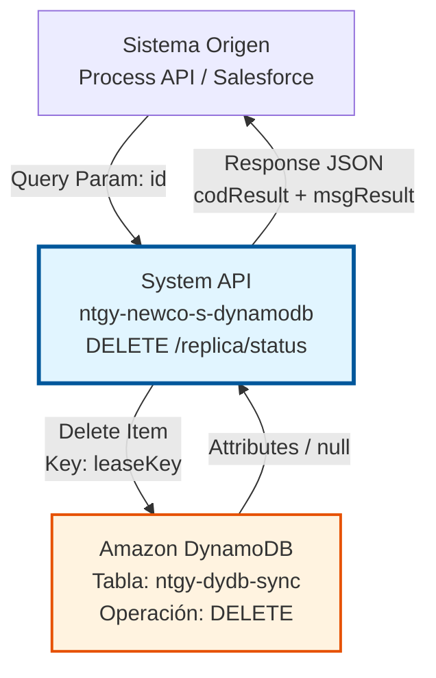
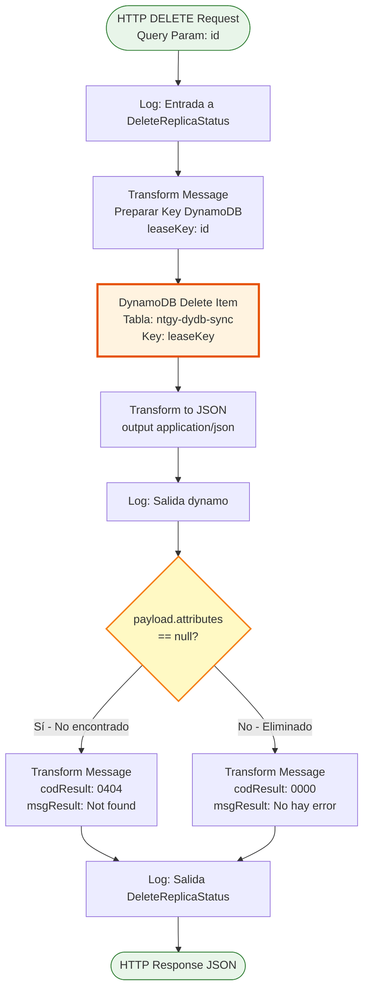
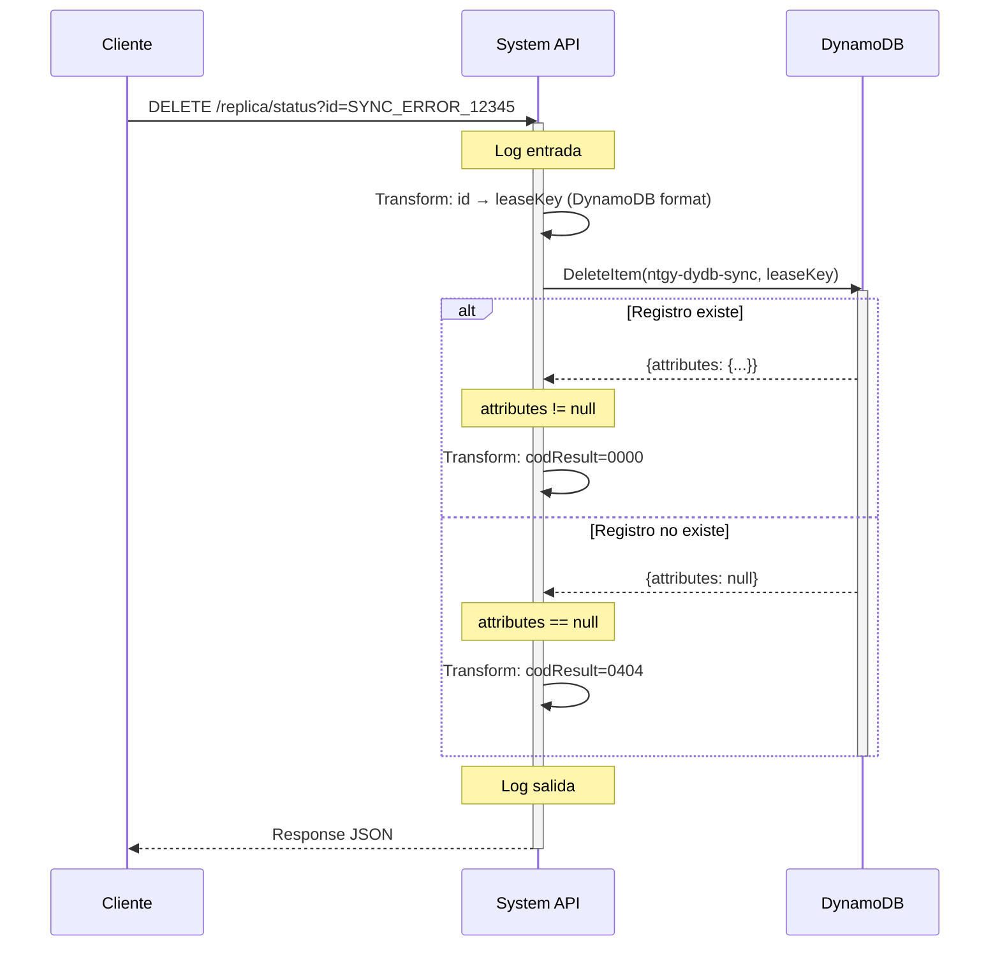
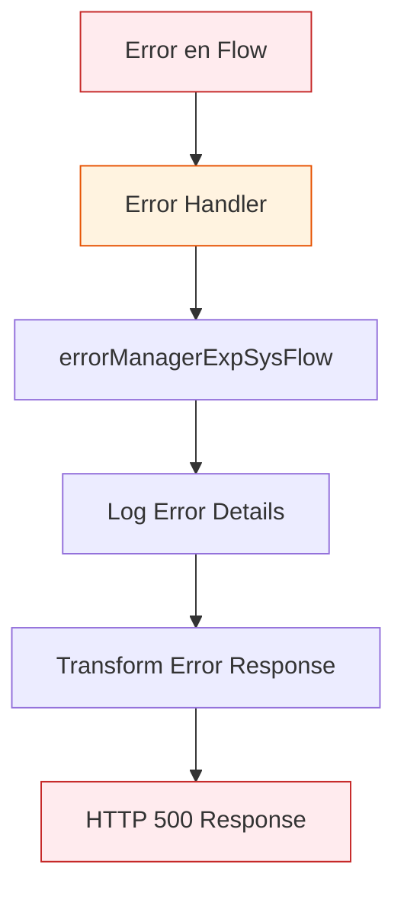

# DELETE /replica/status

## 📌 Descripción General

### Propósito del Endpoint

Este endpoint elimina registros de sincronización de la tabla `ntgy-dydb-sync` en DynamoDB. Se utiliza para limpiar registros de errores de sincronización que ya han sido procesados o corregidos, manteniendo la tabla de control limpia y actualizada.

El endpoint soporta:
- **Eliminación Individual**: Elimina un registro específico por su `leaseKey` (ID)
- **Validación de Existencia**: Verifica si el registro existe antes de eliminarlo
- **Respuesta Diferenciada**: Retorna códigos diferentes según el registro exista o no

### Tipo de API

**Capa:** System API (API-Led Connectivity)

**Función:** Integración directa con Amazon DynamoDB para gestión de registros de sincronización.

### Patrón de Integración

**Tipo:** Request-Reply Síncrono con DynamoDB Delete Operation

**Descripción:** Recibe el ID del registro a eliminar como query parameter, transforma el parámetro al formato DynamoDB, ejecuta la operación de eliminación, y retorna una respuesta indicando si el registro fue eliminado exitosamente o si no existía.

### Arquitectura API-Led Connectivity



---

## 💼 Propósito del Negocio

### Casos de Uso Principales

1. **Limpieza de Errores Procesados**
   - Después de corregir un error de sincronización, se elimina el registro de la tabla de control
   - Mantiene la tabla limpia con solo errores pendientes de resolución
   - Facilita el monitoreo de errores activos

2. **Gestión de Ciclo de Vida de Sincronización**
   - Elimina registros obsoletos o duplicados
   - Permite reintentos limpios de sincronización
   - Mantiene la integridad de los datos de control

3. **Operaciones de Mantenimiento**
   - Limpieza periódica de registros antiguos
   - Eliminación de registros de prueba
   - Gestión de datos históricos

### Contexto Empresarial

- **Dominio:** Gestión de Sincronización de Datos
- **Sector:** Energía - Utilities
- **División:** Naturgy España - NewCo
- **Proceso de Negocio:** Control y gestión de errores de sincronización entre sistemas Imperial, Newco y Salesforce
- **Tabla DynamoDB:** ntgy-dydb-sync (Control de sincronización)

### Stakeholders

- **Ingenieros de Sincronización**: Necesitan limpiar registros procesados para mantener visibilidad de errores activos
- **Equipos de Operaciones**: Requieren herramientas para gestionar el ciclo de vida de los registros de sincronización
- **Desarrolladores de Process APIs**: Consumen este endpoint para gestionar el estado de sincronización

### Valor de Negocio

- **Mantenimiento Eficiente**: Tabla de control limpia facilita identificación de errores activos
- **Reducción de Ruido**: Elimina registros procesados para mejor visibilidad operacional
- **Gestión de Datos**: Control del volumen de datos en la tabla de sincronización
- **Trazabilidad**: Permite gestión controlada del ciclo de vida de errores

### Consumidores Potenciales

Este endpoint puede ser consumido por:
- Process APIs de sincronización (ntgy-newco-p-*)
- Flujos de Salesforce (Platform Events, Flows)
- Sistemas de integración middleware
- Herramientas de administración y monitoreo
- Scripts de mantenimiento automatizado

---

## 🔧 Especificación Técnica

### URLs por Ambiente

| Ambiente | URL Base | URL Completa |
|----------|----------|--------------|
| **Local** | `http://localhost:8081` | `http://localhost:8081/api/replica/status?id=:leaseKey` |
| **Development** | `https://ntgy-newco-s-dynamodb-dev.us-e2.cloudhub.io` | `https://ntgy-newco-s-dynamodb-dev.us-e2.cloudhub.io/api/replica/status?id=:leaseKey` |
| **UAT** | `https://ntgy-newco-s-dynamodb-uat.us-e2.cloudhub.io` | `https://ntgy-newco-s-dynamodb-uat.us-e2.cloudhub.io/api/replica/status?id=:leaseKey` |
| **Production** | `https://ntgy-newco-s-dynamodb-pro.us-e2.cloudhub.io` | `https://ntgy-newco-s-dynamodb-pro.us-e2.cloudhub.io/api/replica/status?id=:leaseKey` |

### Método HTTP

```
DELETE /api/replica/status
```

### Parámetros de Entrada

#### Headers HTTP

| Header | Tipo | Requerido | Descripción | Ejemplo |
|--------|------|-----------|-------------|---------|
| `Content-Type` | string | ✅ Sí | Tipo de contenido del request | `application/json` |
| `Accept` | string | ❌ No | Tipo de contenido esperado en response | `application/json` |

#### Query Parameters

| Parámetro | Tipo | Requerido | Descripción | Ejemplo |
|-----------|------|-----------|-------------|---------|
| `id` | string | ✅ Sí | Identificador único del registro (leaseKey) a eliminar | `"SYNC_ERROR_12345"` |

**Nota:** El parámetro `id` corresponde al campo `leaseKey` en la tabla DynamoDB.

### Respuestas

#### Respuesta Exitosa - Registro Eliminado (200 OK)

```json
{
  "codResult": "0000",
  "msgResult": "No hay error"
}
```

**Descripción:** El registro fue encontrado y eliminado exitosamente de la tabla `ntgy-dydb-sync`.

#### Respuesta - Registro No Encontrado (200 OK)

```json
{
  "codResult": "0404",
  "msgResult": "Not found, registro no encontrado"
}
```

**Descripción:** El registro con el `leaseKey` especificado no existe en la tabla. La operación de eliminación no tuvo efecto.

#### Respuesta de Error Técnico (500)

```json
{
  "result": {
    "codResult": "5001",
    "msgResult": "Error de conectividad con DynamoDB"
  }
}
```

**Descripción:** Error técnico al intentar conectar o ejecutar la operación en DynamoDB.

### Códigos de Resultado

| Código | Tipo | Descripción |
|--------|------|-------------|
| `0000` | Success | Registro eliminado exitosamente |
| `0404` | Not Found | Registro no encontrado en la tabla |
| `5001` | Error | Error de conectividad con DynamoDB |
| `5002` | Error | Timeout en operación DynamoDB |

### Autenticación y Autorización

- **Tipo:** Client ID & Client Secret (Anypoint Platform)
- **Autorización DynamoDB:** El usuario debe tener permisos para:
  - Ejecutar operación `DeleteItem` en tabla `ntgy-dydb-sync`
  - Acceso de escritura a la tabla
  - Permisos IAM configurados en AWS

### Timeouts

| Tipo | Valor | Descripción |
|------|-------|-------------|
| **Request Timeout** | 30 segundos | Tiempo máximo de espera para la respuesta |
| **Connection Timeout** | 10 segundos | Tiempo máximo para establecer conexión con DynamoDB |
| **DynamoDB Operation** | 20 segundos | Timeout específico de la operación delete-item |

---

## 🏗️ Implementación Técnica

### Arquitectura del Flow



### Componentes del Flow

#### 1. Logger de Entrada
```xml
<logger level="INFO" message="Log entrada a DeleteReplicaStatus: #[message.payload]"/>
```
**Propósito:** Registra el inicio de la operación con el payload recibido.

#### 2. Transformación de Input (Query Param → DynamoDB Key)
```dataweave
%dw 2.0
output application/java
---
{
    "leaseKey": {"S": attributes.queryParams.id}
}
```
**Propósito:** Transforma el query parameter `id` al formato de clave DynamoDB con tipo String (`S`).

#### 3. Operación DynamoDB Delete Item
```xml
<dynamodb:delete-item 
    config-ref="Amazon_DynamoDB_Configuration" 
    tableName="ntgy-dydb-sync">
</dynamodb:delete-item>
```
**Propósito:** Ejecuta la operación de eliminación en DynamoDB usando el `leaseKey` como clave primaria.

**Comportamiento:**
- Si el item existe: Lo elimina y retorna sus atributos
- Si el item NO existe: Retorna `attributes = null`

#### 4. Transformación a JSON
```dataweave
%dw 2.0
output application/json
---
payload
```
**Propósito:** Convierte la respuesta de DynamoDB a formato JSON.

#### 5. Logger de Salida DynamoDB
```xml
<logger level="INFO" message="Log salida dynamo: #[message.payload]"/>
```
**Propósito:** Registra la respuesta de DynamoDB para troubleshooting.

#### 6. Choice - Validación de Existencia
```xml
<choice>
    <when expression="#[payload.attributes == null]">
        <!-- Registro no encontrado -->
    </when>
    <otherwise>
        <!-- Registro eliminado exitosamente -->
    </otherwise>
</choice>
```
**Propósito:** Determina si el registro existía basándose en la presencia de `attributes` en la respuesta.

#### 7. Transformación de Respuesta - No Encontrado
```dataweave
%dw 2.0
output application/json
---
{
    "codResult": "0404",
    "msgResult": "Not found, registro no encontrado"
}
```

#### 8. Transformación de Respuesta - Éxito
```dataweave
%dw 2.0
output application/json
---
{
    "codResult": "0000",
    "msgResult": "No hay error"
}
```

#### 9. Logger de Salida Final
```xml
<logger level="INFO" message="Log salida DeleteReplicaStatus: #[message.payload]"/>
```
**Propósito:** Registra la respuesta final antes de retornarla al cliente.

### Diagrama de Secuencia



### Tabla DynamoDB: ntgy-dydb-sync

#### Estructura de la Tabla

| Campo | Tipo | Descripción | Clave |
|-------|------|-------------|-------|
| `leaseKey` | String | Identificador único del registro de sincronización | Partition Key |
| `systemOrigin` | String | Sistema origen del error | - |
| `systemTarget` | String | Sistema destino del error | - |
| `statusMessage` | String | Mensaje de estado del error | - |
| `timestamp` | Number | Timestamp de creación del registro | - |
| `errorDetails` | Map | Detalles adicionales del error | - |

#### Operación Delete Item

**Comportamiento de DynamoDB:**
- **Input:** Clave primaria (`leaseKey`)
- **Output si existe:** Retorna los atributos del item eliminado
- **Output si NO existe:** Retorna respuesta vacía con `attributes = null`
- **Idempotencia:** Ejecutar DELETE múltiples veces con el mismo ID es seguro

### Manejo de Errores



**Tipos de Errores Manejados:**
- `DYNAMODB:CONNECTIVITY` - Error de conexión con DynamoDB
- `DYNAMODB:TIMEOUT` - Timeout en operación
- `ANY` - Cualquier otro error no esperado

### Configuración DynamoDB

```xml
<dynamodb:config name="Amazon_DynamoDB_Configuration">
    <dynamodb:basic-connection 
        accessKey="${secure::aws.accessKey}"
        secretKey="${secure::aws.secretKey}"
        region="${aws.region}"/>
</dynamodb:config>
```

**Propiedades:**
- `aws.accessKey`: AWS Access Key (secure property)
- `aws.secretKey`: AWS Secret Key (secure property)
- `aws.region`: Región AWS (ej: eu-west-1)

### Logging Estructurado

El flow implementa logging en 3 puntos clave:
1. **Entrada:** Registra el query parameter recibido
2. **Post-DynamoDB:** Registra la respuesta de DynamoDB
3. **Salida:** Registra la respuesta final al cliente

**Formato de Logs:**
```
INFO: Log entrada a DeleteReplicaStatus: {}
INFO: Log salida dynamo: {attributes: {...}}
INFO: Log salida DeleteReplicaStatus: {codResult: "0000", msgResult: "No hay error"}
```

---

## 💻 Ejemplos de Uso

### Ejemplo 1: Eliminación Exitosa de Registro

#### Request
```bash
curl -X DELETE "https://ntgy-newco-s-dynamodb-dev.us-e2.cloudhub.io/api/replica/status?id=SYNC_ERROR_12345" \
  -H "Content-Type: application/json" \
  -H "client_id: your-client-id" \
  -H "client_secret: your-client-secret"
```

#### Response (200 OK)
```json
{
  "codResult": "0000",
  "msgResult": "No hay error"
}
```

**Interpretación:** El registro con `leaseKey = "SYNC_ERROR_12345"` fue encontrado y eliminado exitosamente de la tabla `ntgy-dydb-sync`.

---

### Ejemplo 2: Registro No Encontrado

#### Request
```bash
curl -X DELETE "https://ntgy-newco-s-dynamodb-dev.us-e2.cloudhub.io/api/replica/status?id=NONEXISTENT_ID" \
  -H "Content-Type: application/json" \
  -H "client_id: your-client-id" \
  -H "client_secret: your-client-secret"
```

#### Response (200 OK)
```json
{
  "codResult": "0404",
  "msgResult": "Not found, registro no encontrado"
}
```

**Interpretación:** El registro con `leaseKey = "NONEXISTENT_ID"` no existe en la tabla. No se realizó ninguna eliminación.

---

### Ejemplo 3: Uso desde JavaScript (Node.js)

```javascript
const axios = require('axios');

async function deleteReplicaStatus(leaseKey) {
  try {
    const response = await axios.delete(
      'https://ntgy-newco-s-dynamodb-dev.us-e2.cloudhub.io/api/replica/status',
      {
        params: { id: leaseKey },
        headers: {
          'Content-Type': 'application/json',
          'client_id': 'your-client-id',
          'client_secret': 'your-client-secret'
        }
      }
    );
    
    console.log('Response:', response.data);
    
    if (response.data.codResult === '0000') {
      console.log('✅ Registro eliminado exitosamente');
    } else if (response.data.codResult === '0404') {
      console.log('⚠️ Registro no encontrado');
    }
    
    return response.data;
  } catch (error) {
    console.error('❌ Error:', error.response?.data || error.message);
    throw error;
  }
}

// Uso
deleteReplicaStatus('SYNC_ERROR_12345');
```

---

### Ejemplo 4: Uso desde Python

```python
import requests

def delete_replica_status(lease_key):
    url = "https://ntgy-newco-s-dynamodb-dev.us-e2.cloudhub.io/api/replica/status"
    
    headers = {
        "Content-Type": "application/json",
        "client_id": "your-client-id",
        "client_secret": "your-client-secret"
    }
    
    params = {"id": lease_key}
    
    try:
        response = requests.delete(url, headers=headers, params=params)
        response.raise_for_status()
        
        data = response.json()
        print(f"Response: {data}")
        
        if data.get("codResult") == "0000":
            print("✅ Registro eliminado exitosamente")
        elif data.get("codResult") == "0404":
            print("⚠️ Registro no encontrado")
        
        return data
    except requests.exceptions.RequestException as e:
        print(f"❌ Error: {e}")
        raise

# Uso
delete_replica_status("SYNC_ERROR_12345")
```

---

### Ejemplo 5: Error de Conectividad

#### Request
```bash
curl -X DELETE "https://ntgy-newco-s-dynamodb-dev.us-e2.cloudhub.io/api/replica/status?id=SYNC_ERROR_12345" \
  -H "Content-Type: application/json" \
  -H "client_id: your-client-id" \
  -H "client_secret: your-client-secret"
```

#### Response (500 Internal Server Error)
```json
{
  "result": {
    "codResult": "5001",
    "msgResult": "Error de conectividad con DynamoDB"
  }
}
```

**Interpretación:** Error técnico al intentar conectar con DynamoDB. Verificar configuración de red, credenciales AWS, o estado del servicio DynamoDB.

---

### Ejemplo 6: Flujo Completo de Gestión de Error

```javascript
// Workflow completo: Buscar → Procesar → Eliminar

async function processAndDeleteSyncError(systemOrigin, systemTarget, statusMessage) {
  // 1. Buscar errores de sincronización
  const searchResponse = await axios.post(
    'https://ntgy-newco-s-dynamodb-dev.us-e2.cloudhub.io/api/sync/search',
    {
      SYSTEMORIGIN: systemOrigin,
      SYSTEMTARGET: systemTarget,
      STATUSMESSAGE: statusMessage
    }
  );
  
  const errors = searchResponse.data;
  console.log(`Encontrados ${errors.length} errores`);
  
  // 2. Procesar cada error (lógica de corrección)
  for (const error of errors) {
    console.log(`Procesando error: ${error.leaseKey}`);
    
    // ... lógica de corrección del error ...
    
    // 3. Eliminar registro después de corregir
    const deleteResponse = await axios.delete(
      'https://ntgy-newco-s-dynamodb-dev.us-e2.cloudhub.io/api/replica/status',
      {
        params: { id: error.leaseKey }
      }
    );
    
    if (deleteResponse.data.codResult === '0000') {
      console.log(`✅ Error ${error.leaseKey} corregido y eliminado`);
    }
  }
}

// Uso
processAndDeleteSyncError('SALESFORCE', 'SAP_ISU', 'ERROR_SYNC');
```

---

### Consideraciones de Uso

#### ✅ Buenas Prácticas

1. **Verificar Existencia Antes de Eliminar**
   - Usar POST /sync/search para confirmar que el registro existe
   - Evita intentos de eliminación innecesarios

2. **Logging y Auditoría**
   - Registrar todas las eliminaciones en logs de aplicación
   - Mantener auditoría de qué registros fueron eliminados y cuándo

3. **Manejo de Errores**
   - Implementar retry logic para errores de conectividad (5001)
   - No reintentar para errores 0404 (registro no encontrado)

4. **Idempotencia**
   - Es seguro llamar DELETE múltiples veces con el mismo ID
   - El segundo intento retornará 0404 (no encontrado)

#### ⚠️ Precauciones

1. **Eliminación Permanente**
   - La operación DELETE es permanente, no hay "papelera de reciclaje"
   - Asegurarse de que el error fue realmente corregido antes de eliminar

2. **Validación de ID**
   - Verificar que el `leaseKey` es correcto antes de eliminar
   - Un ID incorrecto eliminará el registro equivocado

3. **Concurrencia**
   - Si múltiples procesos intentan eliminar el mismo registro, solo el primero tendrá éxito
   - Los demás recibirán 0404 (no encontrado)

4. **Permisos**
   - Asegurar que las credenciales AWS tienen permisos de DELETE en la tabla
   - Verificar políticas IAM antes de ejecutar en producción