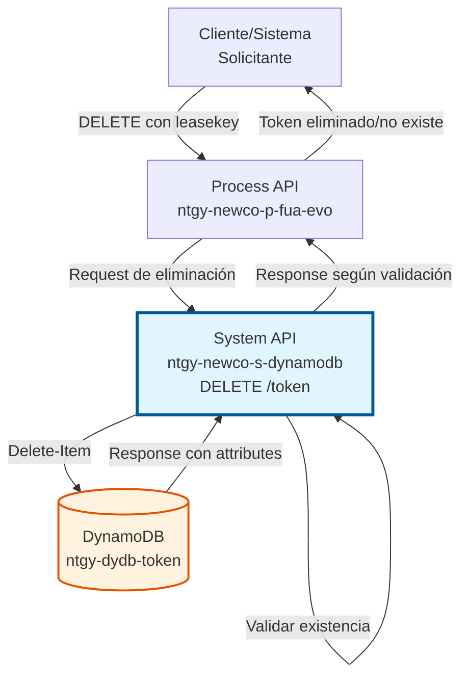
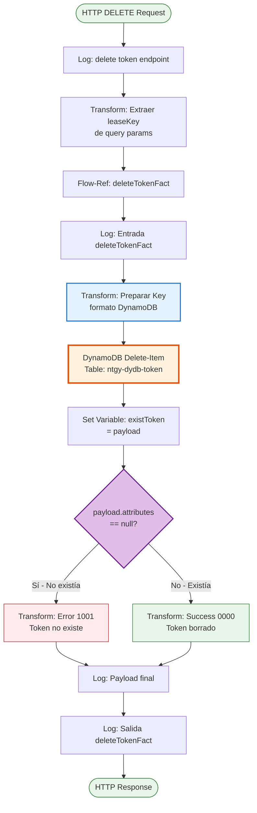
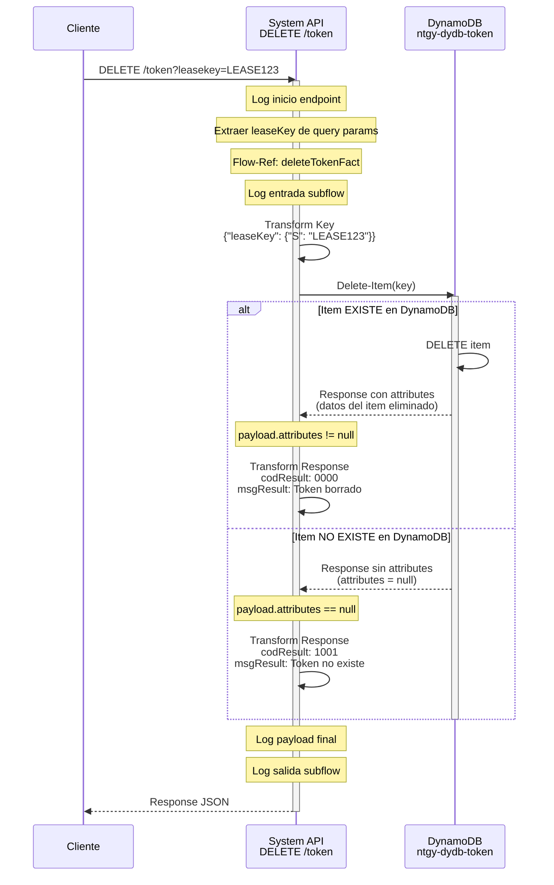
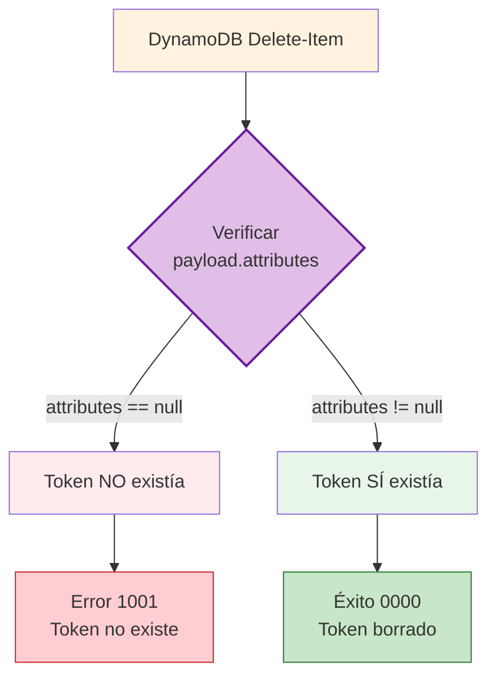
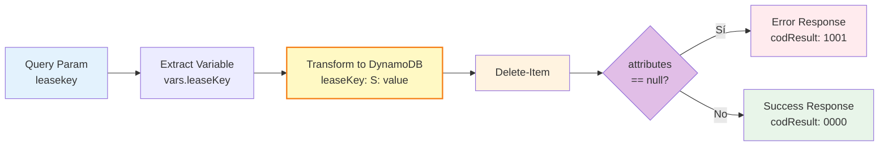

# DELETE /token

## 📌 Descripción General

### Propósito del Endpoint

Elimina un token de facturación de DynamoDB con validación de existencia previa. Este endpoint permite revocar tokens expirados, comprometidos o que ya no son necesarios, garantizando que solo se confirme la eliminación si el token existía previamente en la base de datos.

El endpoint soporta:
- **Eliminación Validada**: Solo confirma éxito si el token existía
- **Detección de No Existencia**: Retorna error específico si el token no existe
- **Operación Atómica**: Delete-item en una sola operación
- **Trazabilidad Completa**: Logging de entrada, salida y resultado

### Tipo de API

**Capa:** System API (API-Led Connectivity)

**Función:** Integración directa con Amazon DynamoDB para gestión del ciclo de vida de tokens de facturación.

### Patrón de Integración

**Tipo:** Request-Reply Síncrono con DynamoDB Delete-Item

**Descripción:** Recibe query parameter con identificador del token (`leasekey`), prepara key en formato DynamoDB, ejecuta delete-item en la tabla `ntgy-dydb-token`, valida si el item existía mediante `payload.attributes`, y retorna resultado según existencia previa.

### Arquitectura API-Led Connectivity



---

## 💼 Propósito del Negocio

### Casos de Uso Principales

1. **Revocación de Tokens Comprometidos**
   - Token de seguridad ha sido comprometido
   - Sistema detecta actividad sospechosa
   - Token debe ser revocado inmediatamente para prevenir acceso no autorizado

2. **Limpieza de Tokens Expirados**
   - Proceso batch de limpieza periódica
   - Tokens que han superado su fecha de expiración
   - Mantenimiento de la base de datos para optimizar rendimiento

3. **Cierre de Sesión de Usuario**
   - Usuario cierra sesión explícitamente
   - Sistema revoca token de acceso a facturas
   - Garantiza que el token no pueda ser reutilizado

4. **Migración y Sincronización**
   - Eliminación de tokens obsoletos durante migración
   - Sincronización entre sistemas Imperial y Newco
   - Limpieza de datos duplicados o inconsistentes

### Contexto Empresarial

- **Dominio:** Facturación y Cobros - Gestión de Seguridad
- **Sector:** Energía - Utilities
- **División:** Naturgy España - NewCo
- **Proceso de Negocio:** Gestión del ciclo de vida de tokens de autenticación
- **Criticidad:** Alta - Seguridad y control de acceso a información sensible

### Stakeholders

- **Equipos de Seguridad**: Necesitan revocar tokens comprometidos rápidamente
- **Equipos de Desarrollo**: Requieren API para gestión completa del ciclo de vida
- **Equipos de Operaciones**: Ejecutan procesos de limpieza periódica
- **Equipos de Auditoría**: Verifican que tokens revocados no puedan ser reutilizados

### Valor de Negocio

- **Seguridad**: Revocación inmediata de tokens comprometidos
- **Validación**: Confirmación de que el token existía antes de eliminarlo
- **Trazabilidad**: Logging completo para auditoría de seguridad
- **Mantenimiento**: Limpieza automática de tokens obsoletos
- **Cumplimiento**: Gestión adecuada de credenciales según políticas de seguridad

### Consumidores Potenciales

Este endpoint puede ser consumido por:
- Process APIs de autenticación y seguridad
- Servicios de gestión de sesiones
- Procesos batch de limpieza de datos
- Sistemas de detección de fraude
- Servicios de cierre de sesión

---

## 🔧 Especificación Técnica

### URLs por Ambiente

| Ambiente | URL Base | URL Completa |
|----------|----------|--------------|
| **Local** | `http://localhost:8081` | `http://localhost:8081/api/token?leasekey={leaseKey}` |
| **Development** | `https://ntgy-newco-s-dynamodb-dev.us-e2.cloudhub.io` | `https://ntgy-newco-s-dynamodb-dev.us-e2.cloudhub.io/api/token?leasekey={leaseKey}` |
| **UAT** | `https://ntgy-newco-s-dynamodb-uat.us-e2.cloudhub.io` | `https://ntgy-newco-s-dynamodb-uat.us-e2.cloudhub.io/api/token?leasekey={leaseKey}` |
| **Production** | `https://ntgy-newco-s-dynamodb-pro.us-e2.cloudhub.io` | `https://ntgy-newco-s-dynamodb-pro.us-e2.cloudhub.io/api/token?leasekey={leaseKey}` |

### Método HTTP

```
DELETE /api/token?leasekey={leaseKey}
```

### Parámetros de Entrada

#### Headers HTTP

| Header | Tipo | Requerido | Descripción | Ejemplo |
|--------|------|-----------|-------------|---------|
| `Accept` | string | ❌ No | Tipo de contenido esperado en response | `application/json` |

#### Query Parameters

| Parámetro | Tipo | Requerido | Descripción | Ejemplo |
|-----------|------|-----------|-------------|---------|
| `leasekey` | string | ✅ Sí | Identificador único del lease (partition key del token a eliminar) | `LEASE123456` |

**Nota Importante:** El parámetro se llama `leasekey` (todo en minúsculas) en el query string.

### Respuestas

#### Respuesta Exitosa - Token Eliminado (200 OK)

```json
{
  "result": {
    "codResult": "0000",
    "msgResult": "El token ha sido borrado"
  }
}
```

**Descripción:** El token existía en DynamoDB y fue eliminado exitosamente.

**Condición:** `payload.attributes != null` (DynamoDB retornó los atributos del item eliminado)

#### Respuesta de Error - Token No Existe (200 OK)

```json
{
  "result": {
    "codResult": "1001",
    "msgResult": "El token no existe o no coincide"
  }
}
```

**Descripción:** El token NO existía en DynamoDB, por lo tanto no se pudo eliminar.

**Condición:** `payload.attributes == null` (DynamoDB no encontró el item)

**Nota:** Aunque retorna código HTTP 200, el `codResult` indica que la operación no tuvo éxito porque el token no existía.

#### Respuesta de Error Técnico (500)

```json
{
  "result": {
    "codResult": "0001",
    "msgResult": "Error interno del servidor"
  }
}
```

**Descripción:** Error técnico en la operación de delete-item a DynamoDB.

**Causas posibles:**
- Error de conectividad con DynamoDB
- Throttling de DynamoDB (límite de operaciones excedido)
- Timeout en la operación
- Error en permisos IAM

### Códigos de Respuesta

| Código | Descripción | Escenario |
|--------|-------------|-----------|
| `0000` | Éxito | Token existía y fue eliminado correctamente |
| `1001` | Token no existe | El token no se encontró en la base de datos |
| `0001` | Error técnico | Fallo en DynamoDB o procesamiento |

### Autenticación y Autorización

- **Tipo:** Client ID & Client Secret (Anypoint Platform)
- **Autorización DynamoDB:** El usuario de servicio debe tener permisos para:
  - Ejecutar operación `DeleteItem` en tabla `ntgy-dydb-token`
  - Acceso de escritura (WRITE) a la tabla
  - Permisos IAM configurados en AWS

### Timeouts

| Tipo | Valor | Descripción |
|------|-------|-------------|
| **Request Timeout** | 30 segundos | Tiempo máximo de espera para la respuesta |
| **Connection Timeout** | 10 segundos | Tiempo máximo para establecer conexión con DynamoDB |
| **Delete-Item Timeout** | 5 segundos | Tiempo máximo para ejecutar delete-item en DynamoDB |

---

## 🏗️ Implementación Técnica

### Arquitectura del Flow



### Diagrama de Secuencia



### Componentes del Flow

#### 1. Flow Principal (ntgy-newco-s-dynamodb.xml)

**Ubicación:** `src/main/mule/ntgy-newco-s-dynamodb.xml` (líneas 494-508)

```xml
<flow name="delete:\token:ntgy-newco-s-dynamodb-config">
    <logger level="INFO" message="delete:\token:ntgy-newco-s-dynamodb-config" />
    
    <ee:transform doc:name="Transform Message">
        <ee:variables>
            <ee:set-variable variableName="leaseKey">
                attributes.queryParams.leasekey
            </ee:set-variable>
        </ee:variables>
    </ee:transform>
    
    <flow-ref doc:name="Flow Reference" name="deleteTokenFact" />
    
    <error-handler>
        <on-error-continue type="ANY">
            <flow-ref name="errorManagerExpSysFlow" />
        </on-error-continue>
    </error-handler>
</flow>
```

**Responsabilidades:**
- Recibir request HTTP DELETE con query parameter
- Extraer `leasekey` de query params y guardarlo en variable
- Invocar subflow de implementación
- Manejar errores globalmente

#### 2. Subflow de Implementación (deleteTokenFact.xml)

**Ubicación:** `src/main/mule/implementation/deleteTokenFact.xml` (líneas 8-48)

**Paso 1: Logging de Entrada (línea 9)**
```xml
<logger level="INFO" doc:name="Entrada" 
    message="Log Entrada deleteTokenFact"/>
```

**Paso 2: Preparar Key para DynamoDB (líneas 10-17)**
```xml
<ee:transform doc:name="Transform Message">
    <ee:set-payload><![CDATA[%dw 2.0
output application/java
---
{
    "leaseKey": {"S": vars.leaseKey}
}]]></ee:set-payload>
</ee:transform>
```

**Paso 3: Delete-Item a DynamoDB (línea 18)**
```xml
<dynamodb:delete-item 
    tableName="ntgy-dydb-token" 
    config-ref="Amazon_DynamoDB_Configuration"/>
```

**Paso 4: Guardar Payload para Validación (líneas 19-25)**
```xml
<ee:transform doc:name="Transform Message">
    <ee:variables>
        <ee:set-variable variableName="existToken">
            payload
        </ee:set-variable>
    </ee:variables>
</ee:transform>
```

**Paso 5: Validar Existencia del Token (líneas 26-46)**
```xml
<choice doc:name="Choice">
    <when expression="#[payload.attributes == null]">
        <!-- Token NO existía -->
        <ee:transform doc:name="Transform Message">
            <ee:set-payload><![CDATA[%dw 2.0
output application/json
---
{
    "result": {
        "codResult": "1001",
        "msgResult": "El token no existe o no coincide"
    }
}]]></ee:set-payload>
        </ee:transform>
    </when>
    <otherwise>
        <!-- Token existía y fue borrado -->
        <ee:transform doc:name="Transform Message">
            <ee:set-payload><![CDATA[%dw 2.0
output application/json
---
{
    "result": {
        "codResult": "0000",
        "msgResult": "El token ha sido borrado"
    }
}]]></ee:set-payload>
        </ee:transform>
    </otherwise>
</choice>
```

**Paso 6: Logging de Payload (línea 47)**
```xml
<logger level="INFO" doc:name="Logger" message="#[payload]" />
```

**Paso 7: Logging de Salida (línea 48)**
```xml
<logger level="INFO" doc:name="Salida" 
    message="Log Salida deleteTokenFact"/>
```

### Operación de Backend: DynamoDB Delete-Item

#### Configuración de Delete-Item

```xml
<dynamodb:delete-item 
    tableName="ntgy-dydb-token" 
    config-ref="Amazon_DynamoDB_Configuration" />
```

**Parámetros:**
- **tableName**: `ntgy-dydb-token` - Tabla de tokens de facturación
- **payload**: Key del item a eliminar en formato DynamoDB AttributeValue

**Comportamiento de Delete-Item en DynamoDB:**

| Escenario | Comportamiento | Response |
|-----------|----------------|----------|
| **Item EXISTE** | Elimina el item de la tabla | `payload.attributes` contiene los datos del item eliminado |
| **Item NO EXISTE** | No genera error, operación exitosa | `payload.attributes == null` |

**Diferencia Clave con PUT-Item:**
- **PUT-Item:** Siempre tiene éxito (crea o sobrescribe), no retorna información sobre existencia previa
- **DELETE-Item:** Siempre tiene éxito, pero retorna `attributes` solo si el item existía

#### Estructura de la Tabla DynamoDB

| Campo | Tipo | Descripción | Ejemplo |
|-------|------|-------------|---------|
| `leaseKey` | String (S) | Partition Key - Identificador del lease | `"LEASE123456"` |
| `token` | String (S) | Token de facturación | `"abc123def456"` |
| `*` | Varios | Cualquier campo adicional | Estructura flexible |

**Índices:**
- **Primary Key:** `leaseKey` (Partition Key)
- **No hay Sort Key** en esta tabla

### Transformaciones DataWeave

#### Transformación 1: Preparar Key para Delete-Item

```dataweave
%dw 2.0
output application/java
---
{
    "leaseKey": {"S": vars.leaseKey}
}
```

**Propósito:** Convertir el `leaseKey` a formato DynamoDB AttributeValue para la operación delete-item.

**Input:** Variable `vars.leaseKey` (ej: `"LEASE123456"`)

**Output:**
```json
{
  "leaseKey": {
    "S": "LEASE123456"
  }
}
```

#### Transformación 2: Respuesta de Error (Token No Existe)

```dataweave
%dw 2.0
output application/json
---
{
    "result": {
        "codResult": "1001",
        "msgResult": "El token no existe o no coincide"
    }
}
```

**Propósito:** Generar respuesta de error cuando el token no existía.

**Condición:** `payload.attributes == null`

#### Transformación 3: Respuesta de Éxito (Token Eliminado)

```dataweave
%dw 2.0
output application/json
---
{
    "result": {
        "codResult": "0000",
        "msgResult": "El token ha sido borrado"
    }
}
```

**Propósito:** Generar respuesta de éxito cuando el token fue eliminado.

**Condición:** `payload.attributes != null`

### Lógica de Validación

#### Validación de Existencia mediante payload.attributes



**Explicación:**

DynamoDB delete-item retorna diferentes estructuras según si el item existía:

**Caso 1: Item EXISTÍA**
```json
{
  "attributes": {
    "leaseKey": {"S": "LEASE123"},
    "token": {"S": "abc123"},
    "createdAt": {"S": "2026-01-15T10:30:00Z"}
  }
}
```
→ `payload.attributes != null` → Éxito 0000

**Caso 2: Item NO EXISTÍA**
```json
{
  "attributes": null
}
```
→ `payload.attributes == null` → Error 1001

### Manejo de Errores

#### Errores Técnicos (Manejados en Error Handler)

```xml
<error-handler>
    <on-error-continue type="ANY">
        <flow-ref name="errorManagerExpSysFlow" />
    </on-error-continue>
</error-handler>
```

**Tipos de errores capturados:**
- `DYNAMODB:CONNECTIVITY` - Error de conexión con DynamoDB
- `DYNAMODB:THROTTLING` - Límite de operaciones excedido
- `DYNAMODB:TIMEOUT` - Timeout en delete-item
- `DYNAMODB:UNAUTHORIZED` - Error de permisos IAM
- `ANY` - Cualquier otro error no esperado

### Diagrama de Transformación de Datos



### Configuración de DynamoDB Connector

```xml
<dynamodb:config name="Amazon_DynamoDB_Configuration">
    <dynamodb:basic-connection 
        accessKey="${secure::aws.accessKey}"
        secretKey="${secure::aws.secretKey}"
        region="${aws.region}"/>
</dynamodb:config>
```

**Propiedades de Configuración:**
- **accessKey**: Credencial AWS (encriptada con secure properties)
- **secretKey**: Credencial AWS (encriptada con secure properties)
- **region**: Región AWS (ej: `eu-west-1`)

### Consideraciones de Performance

- **Operación Atómica:** Delete-item es una operación atómica en DynamoDB
- **Sin Lectura Previa:** No se consulta si el item existe antes de eliminar (más rápido)
- **Response Time Esperado:** < 50ms para delete-item
- **Throughput:** Limitado por WCU (Write Capacity Units) de DynamoDB
- **Validación Post-Delete:** La validación se hace después de la eliminación mediante `attributes`

---

## 💻 Ejemplos de Uso

### Ejemplo 1: Eliminación de Token Existente

#### Request

```bash
curl -X DELETE "https://ntgy-newco-s-dynamodb-dev.us-e2.cloudhub.io/api/token?leasekey=LEASE123456" \
  -H "Accept: application/json"
```

#### Response (200 OK)

```json
{
  "result": {
    "codResult": "0000",
    "msgResult": "El token ha sido borrado"
  }
}
```

**Interpretación:** El token con `leaseKey = LEASE123456` existía en DynamoDB y fue eliminado exitosamente.

---

### Ejemplo 2: Intento de Eliminación de Token Inexistente

#### Request

```bash
curl -X DELETE "https://ntgy-newco-s-dynamodb-dev.us-e2.cloudhub.io/api/token?leasekey=LEASE_NO_EXISTE" \
  -H "Accept: application/json"
```

#### Response (200 OK)

```json
{
  "result": {
    "codResult": "1001",
    "msgResult": "El token no existe o no coincide"
  }
}
```

**Interpretación:** El token con `leaseKey = LEASE_NO_EXISTE` NO existía en DynamoDB, por lo tanto no se pudo eliminar.

---

### Ejemplo 3: Integración desde JavaScript

```javascript
async function deleteToken(leaseKey) {
  const baseUrl = 'https://ntgy-newco-s-dynamodb-dev.us-e2.cloudhub.io';
  const endpoint = '/api/token';
  
  try {
    const response = await fetch(`${baseUrl}${endpoint}?leasekey=${leaseKey}`, {
      method: 'DELETE',
      headers: {
        'Accept': 'application/json'
      }
    });
    
    const data = await response.json();
    
    if (data.result.codResult === '0000') {
      console.log('✅ Token eliminado exitosamente');
      return { 
        success: true, 
        message: 'Token eliminado',
        existed: true
      };
    } else if (data.result.codResult === '1001') {
      console.log('⚠️ Token no existía');
      return { 
        success: false, 
        message: 'Token no existe',
        existed: false
      };
    } else {
      console.log('❌ Error al eliminar token');
      return { 
        success: false, 
        message: data.result.msgResult,
        existed: null
      };
    }
  } catch (error) {
    console.error('Error de conexión:', error);
    return { 
      success: false, 
      message: error.message,
      existed: null
    };
  }
}

// Uso
const result = await deleteToken('LEASE123456');

if (result.success) {
  console.log('Token eliminado correctamente');
} else if (result.existed === false) {
  console.log('El token no existía en la base de datos');
} else {
  console.error('Error:', result.message);
}
```

---

### Ejemplo 4: Integración desde Python

```python
import requests
from typing import Dict

def delete_token(lease_key: str) -> Dict:
    """
    Elimina un token de facturación de DynamoDB.
    
    Args:
        lease_key: Identificador del lease
        
    Returns:
        Dict con resultado de la operación
    """
    base_url = 'https://ntgy-newco-s-dynamodb-dev.us-e2.cloudhub.io'
    endpoint = '/api/token'
    
    try:
        response = requests.delete(
            f'{base_url}{endpoint}',
            params={'leasekey': lease_key},
            headers={'Accept': 'application/json'},
            timeout=10
        )
        
        response.raise_for_status()
        data = response.json()
        
        if data['result']['codResult'] == '0000':
            return {
                'success': True,
                'message': 'Token eliminado exitosamente',
                'existed': True
            }
        elif data['result']['codResult'] == '1001':
            return {
                'success': False,
                'message': 'Token no existe',
                'existed': False
            }
        else:
            return {
                'success': False,
                'message': data['result']['msgResult'],
                'existed': None
            }
            
    except requests.exceptions.RequestException as e:
        return {
            'success': False,
            'message': f'Error de conexión: {str(e)}',
            'existed': None
        }

# Uso
result = delete_token('LEASE123456')

if result['success']:
    print(f"✅ {result['message']}")
elif result['existed'] is False:
    print(f"⚠️ {result['message']}")
else:
    print(f"❌ Error: {result['message']}")
```

---

### Ejemplo 5: Eliminación Masiva con Validación

```python
import requests
from typing import List, Dict

def batch_delete_tokens(lease_keys: List[str]) -> Dict:
    """
    Elimina múltiples tokens en lote con reporte detallado.
    
    Args:
        lease_keys: Lista de identificadores de lease
        
    Returns:
        Dict con resultados de la operación
    """
    base_url = 'https://ntgy-newco-s-dynamodb-dev.us-e2.cloudhub.io'
    endpoint = '/api/token'
    
    results = {
        'deleted': 0,
        'not_found': 0,
        'failed': 0,
        'details': []
    }
    
    for lease_key in lease_keys:
        try:
            response = requests.delete(
                f'{base_url}{endpoint}',
                params={'leasekey': lease_key},
                headers={'Accept': 'application/json'},
                timeout=10
            )
            
            data = response.json()
            
            if data['result']['codResult'] == '0000':
                results['deleted'] += 1
                results['details'].append({
                    'leaseKey': lease_key,
                    'status': 'deleted',
                    'message': 'Token eliminado'
                })
            elif data['result']['codResult'] == '1001':
                results['not_found'] += 1
                results['details'].append({
                    'leaseKey': lease_key,
                    'status': 'not_found',
                    'message': 'Token no existía'
                })
            else:
                results['failed'] += 1
                results['details'].append({
                    'leaseKey': lease_key,
                    'status': 'failed',
                    'message': data['result']['msgResult']
                })
                
        except Exception as e:
            results['failed'] += 1
            results['details'].append({
                'leaseKey': lease_key,
                'status': 'error',
                'message': str(e)
            })
    
    return results

# Uso
tokens_to_delete = ['LEASE001', 'LEASE002', 'LEASE003', 'LEASE_NO_EXISTE']
results = batch_delete_tokens(tokens_to_delete)

print(f"✅ Eliminados: {results['deleted']}")
print(f"⚠️ No encontrados: {results['not_found']}")
print(f"❌ Fallidos: {results['failed']}")

for detail in results['details']:
    status_icon = '✅' if detail['status'] == 'deleted' else '⚠️' if detail['status'] == 'not_found' else '❌'
    print(f"{status_icon} {detail['leaseKey']}: {detail['message']}")
```

---

### Ejemplo 6: Testing con Postman

**Pre-request Script:**
```javascript
// Generar leaseKey de prueba
const leaseKey = pm.environment.get("test_lease_key") || "LEASE_TEST_" + Date.now();
pm.environment.set("current_lease_key", leaseKey);

console.log("Intentando eliminar token:", leaseKey);
```

**Request:**
```
DELETE {{base_url}}/api/token?leasekey={{current_lease_key}}
Accept: application/json
```

**Tests:**
```javascript
pm.test("Status code is 200", function () {
    pm.response.to.have.status(200);
});

pm.test("Response has result object", function () {
    const jsonData = pm.response.json();
    pm.expect(jsonData).to.have.property('result');
    pm.expect(jsonData.result).to.have.property('codResult');
    pm.expect(jsonData.result).to.have.property('msgResult');
});

pm.test("Response is valid (deleted or not found)", function () {
    const jsonData = pm.response.json();
    const validCodes = ['0000', '1001'];
    pm.expect(validCodes).to.include(jsonData.result.codResult);
});

pm.test("Response time is acceptable", function () {
    pm.expect(pm.response.responseTime).to.be.below(1000);
});

// Logging del resultado
const jsonData = pm.response.json();
if (jsonData.result.codResult === '0000') {
    console.log("✅ Token eliminado exitosamente");
} else if (jsonData.result.codResult === '1001') {
    console.log("⚠️ Token no existía");
} else {
    console.log("❌ Error:", jsonData.result.msgResult);
}
```

---

### Ejemplo 7: Comparación con POST (Crear) y DELETE (Eliminar)

```javascript
// Flujo completo: Crear → Verificar → Eliminar → Verificar

async function fullTokenLifecycle(leaseKey, token) {
  const baseUrl = 'https://ntgy-newco-s-dynamodb-dev.us-e2.cloudhub.io';
  
  console.log('=== CICLO DE VIDA COMPLETO DEL TOKEN ===\n');
  
  // 1. Crear token
  console.log('1️⃣ Creando token...');
  const createResponse = await fetch(`${baseUrl}/api/token`, {
    method: 'POST',
    headers: { 'Content-Type': 'application/json' },
    body: JSON.stringify({ leaseKey, token })
  });
  const createData = await createResponse.json();
  console.log('Resultado:', createData.result.codResult === '0000' ? '✅ Creado' : '❌ Error');
  
  // 2. Verificar que existe (GET)
  console.log('\n2️⃣ Verificando existencia...');
  const getResponse = await fetch(`${baseUrl}/api/token?leasekey=${leaseKey}&token=${token}`);
  const getData = await getResponse.json();
  console.log('Resultado:', getData.result.codResult === '0000' ? '✅ Existe' : '❌ No existe');
  
  // 3. Eliminar token
  console.log('\n3️⃣ Eliminando token...');
  const deleteResponse = await fetch(`${baseUrl}/api/token?leasekey=${leaseKey}`, {
    method: 'DELETE'
  });
  const deleteData = await deleteResponse.json();
  console.log('Resultado:', deleteData.result.codResult === '0000' ? '✅ Eliminado' : '❌ Error');
  
  // 4. Verificar que ya no existe
  console.log('\n4️⃣ Verificando eliminación...');
  const verifyResponse = await fetch(`${baseUrl}/api/token?leasekey=${leaseKey}&token=${token}`);
  const verifyData = await verifyResponse.json();
  console.log('Resultado:', verifyData.result.codResult === '1001' ? '✅ No existe (correcto)' : '❌ Aún existe');
  
  // 5. Intentar eliminar de nuevo (debe retornar 1001)
  console.log('\n5️⃣ Intentando eliminar de nuevo...');
  const deleteAgainResponse = await fetch(`${baseUrl}/api/token?leasekey=${leaseKey}`, {
    method: 'DELETE'
  });
  const deleteAgainData = await deleteAgainResponse.json();
  console.log('Resultado:', deleteAgainData.result.codResult === '1001' ? '✅ No existe (correcto)' : '❌ Error');
  
  console.log('\n=== FIN DEL CICLO ===');
}

// Ejecutar
fullTokenLifecycle('LEASE_TEST_123', 'TOKEN_TEST_ABC');
```
