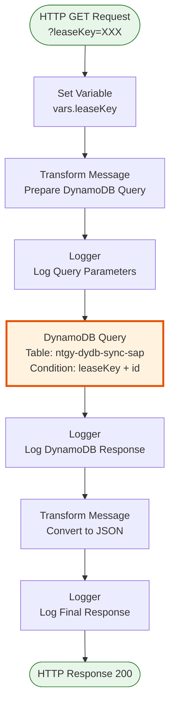
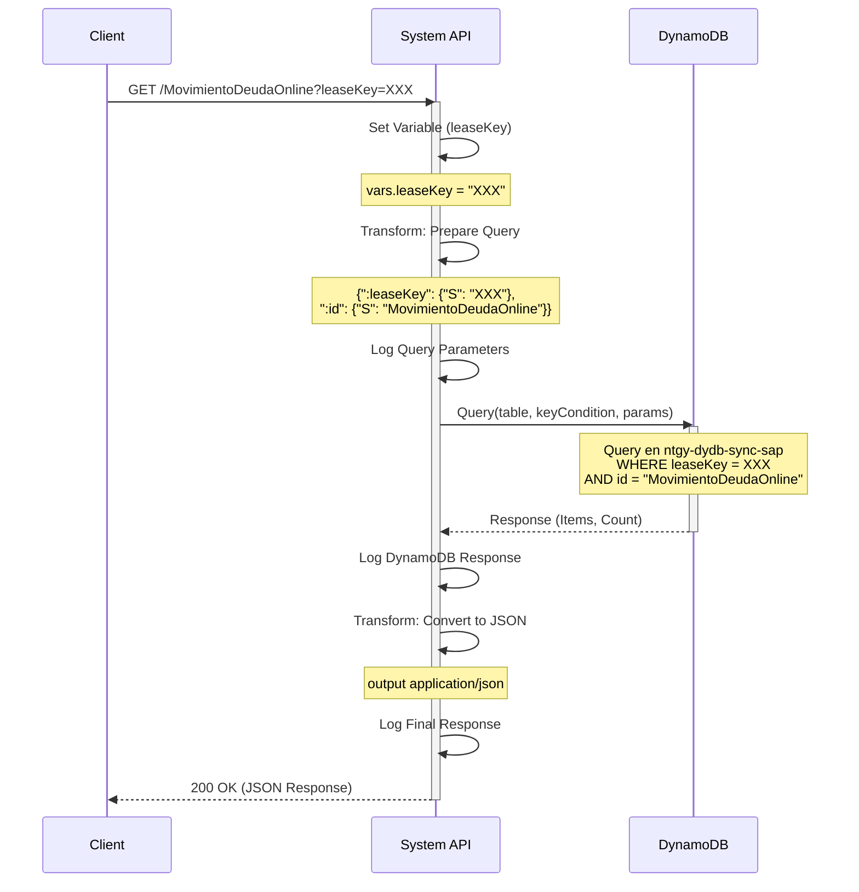

## 💼 Propósito del Negocio

### Casos de Uso Principales

1. **Consulta de Estado de Traspaso de Deuda**
   - Un cliente solicita información sobre el estado de su traspaso de deuda online
   - El sistema consulta DynamoDB para obtener el estado actual
   - Se retorna información actualizada del movimiento de deuda

2. **Verificación de Sincronización con SAP**
   - Los sistemas de sincronización necesitan verificar si un movimiento de deuda fue procesado
   - Se consulta el registro en la tabla de sincronización SAP
   - Se obtiene confirmación del estado de sincronización

3. **Auditoría de Movimientos de Deuda**
   - Los equipos de operaciones necesitan rastrear movimientos de deuda específicos
   - Se consulta por leaseKey para obtener el histórico
   - Se proporciona información completa para auditoría

### Contexto Empresarial

- **Dominio:** Gestión de Deuda y Cobros
- **Sector:** Energía - Utilities
- **División:** Naturgy España - NewCo
- **Proceso de Negocio:** Traspaso de deuda online entre sistemas Imperial y Newco
- **Sistema Backend:** DynamoDB (tabla de sincronización SAP)

### Stakeholders

- **Equipos de Cobros**: Necesitan visibilidad del estado de traspasos de deuda
- **Equipos de Sincronización**: Requieren verificar el estado de sincronización con SAP
- **Equipos de Atención al Cliente**: Consultan información para responder a clientes
- **Equipos de Auditoría**: Rastrean movimientos de deuda para cumplimiento

### Valor de Negocio

- **Trazabilidad Completa**: Visibilidad total del estado de movimientos de deuda
- **Sincronización Confiable**: Verificación del estado de sincronización con SAP ISU
- **Respuesta Rápida**: Consultas optimizadas con índices DynamoDB (< 100ms)
- **Auditoría Efectiva**: Registro completo de traspasos de deuda para cumplimiento

### Consumidores Potenciales

Este endpoint puede ser consumido por:
- Process APIs de gestión de deuda (ntgy-newco-p-deuda)
- Flujos de Salesforce para consulta de estado de deuda
- Sistemas de sincronización entre Imperial y Newco
- Herramientas de auditoría y reporting

---

## 🔧 Especificación Técnica

### URLs por Ambiente

| Ambiente | URL Base | URL Completa |
|----------|----------|--------------|
| **Local** | `http://localhost:8081` | `http://localhost:8081/api/MovimientoDeudaOnline?leaseKey=XXX` |
| **Development** | `https://ntgy-newco-s-dynamodb-dev.us-e2.cloudhub.io` | `https://ntgy-newco-s-dynamodb-dev.us-e2.cloudhub.io/api/MovimientoDeudaOnline?leaseKey=XXX` |
| **UAT** | `https://ntgy-newco-s-dynamodb-uat.us-e2.cloudhub.io` | `https://ntgy-newco-s-dynamodb-uat.us-e2.cloudhub.io/api/MovimientoDeudaOnline?leaseKey=XXX` |
| **Production** | `https://ntgy-newco-s-dynamodb-pro.us-e2.cloudhub.io` | `https://ntgy-newco-s-dynamodb-pro.us-e2.cloudhub.io/api/MovimientoDeudaOnline?leaseKey=XXX` |

### Método HTTP

```
GET /api/MovimientoDeudaOnline
```

### Parámetros de Entrada

#### Headers HTTP

| Header | Tipo | Requerido | Descripción | Ejemplo |
|--------|------|-----------|-------------|---------|
| `Accept` | string | ❌ No | Tipo de contenido esperado en response | `application/json` |
| `client_id` | string | ✅ Sí | Client ID de Anypoint Platform | `abc123...` |
| `client_secret` | string | ✅ Sí | Client Secret de Anypoint Platform | `xyz789...` |

#### Query Parameters

| Parámetro | Tipo | Requerido | Descripción | Ejemplo |
|-----------|------|-----------|-------------|---------|
| `leaseKey` | string | ✅ Sí | Identificador único del cliente (lease key) | `"0000123456"` |

### Respuestas

#### Respuesta Exitosa (200 OK)

```json
{
  "Count": 1,
  "Items": [
    {
      "leaseKey": {
        "S": "0000123456"
      },
      "id": {
        "S": "MovimientoDeudaOnline"
      },
      "timestamp": {
        "S": "2026-01-08T10:30:00Z"
      },
      "status": {
        "S": "PROCESSED"
      },
      "amount": {
        "N": "150.50"
      },
      "description": {
        "S": "Traspaso de deuda online procesado"
      }
    }
  ],
  "ScannedCount": 1
}
```

**Descripción de Campos:**
- `Count`: Número de items encontrados
- `Items`: Array con los datos del movimiento de deuda
  - `leaseKey.S`: Identificador del cliente
  - `id.S`: Identificador fijo "MovimientoDeudaOnline"
  - `timestamp.S`: Fecha y hora del movimiento
  - `status.S`: Estado del movimiento (PENDING, PROCESSED, ERROR)
  - `amount.N`: Monto de la deuda traspasada
  - `description.S`: Descripción del movimiento

#### Respuesta Sin Datos (200 OK)

```json
{
  "Count": 0,
  "Items": [],
  "ScannedCount": 0
}
```

#### Respuesta de Error Técnico (500)

```json
{
  "error": "Internal Server Error",
  "message": "Error al consultar DynamoDB"
}
```

### Autenticación y Autorización

- **Tipo:** Client ID & Client Secret (Anypoint Platform)
- **Autorización DynamoDB:** El usuario debe tener permisos para:
  - Ejecutar operación `Query` en tabla `ntgy-dydb-sync-sap`
  - Acceso de lectura a la tabla
  - Permisos IAM configurados en AWS

### Timeouts

| Tipo | Valor | Descripción |
|------|-------|-------------|
| **Request Timeout** | 30 segundos | Tiempo máximo de espera para la respuesta |
| **Connection Timeout** | 10 segundos | Tiempo máximo para establecer conexión con DynamoDB |
| **Query Timeout** | 5 segundos | Tiempo máximo para ejecutar la query en DynamoDB |

---

## 🏗️ Implementación Técnica

### Arquitectura del Flow



### Componentes del Flow

#### 1. Set Variable (vars.leaseKey)
**Propósito:** Extraer el parámetro `leaseKey` del query string y almacenarlo en una variable de flow.

**Implementación:**
```xml
<set-variable 
    variableName="leaseKey" 
    value="#[attributes.queryParams.leaseKey]"/>
```

#### 2. Transform Message - Prepare Query
**Propósito:** Construir el objeto de parámetros para la query DynamoDB en el formato requerido.

**Código DataWeave:**
```dataweave
%dw 2.0
output application/java
---
{
    ":leaseKey": {"S": vars.leaseKey},
    ":id": {"S": "MovimientoDeudaOnline"}
}
```

**Explicación:**
- Crea un objeto Java con los parámetros de la query
- `:leaseKey`: Valor dinámico del parámetro de entrada
- `:id`: Valor fijo "MovimientoDeudaOnline" para filtrar el tipo de registro
- Formato DynamoDB: `{"S": "valor"}` indica tipo String

#### 3. Logger - Query Parameters
**Propósito:** Registrar los parámetros de la query para trazabilidad.

**Implementación:**
```xml
<logger 
    level="INFO" 
    message="Log antes de Query MovimientoDeudaOnlineByLeaseKey: #[message.payload]"/>
```

#### 4. DynamoDB Query
**Propósito:** Ejecutar la consulta en DynamoDB con las condiciones especificadas.

**Configuración:**
```xml
<dynamodb:query 
    doc:name="Query" 
    config-ref="Amazon_DynamoDB_Configuration" 
    keyConditionExpression="leaseKey = :leaseKey and id = :id" 
    tableName="ntgy-dydb-sync-sap" 
    attributeValues="#[payload]"/>
```

**Detalles Técnicos:**
- **Tabla:** `ntgy-dydb-sync-sap`
- **Condición:** Composite key (leaseKey + id)
- **Tipo de Query:** Query (no Scan) - optimizado con índice
- **Performance:** < 100ms típicamente

#### 5. Logger - DynamoDB Response
**Propósito:** Registrar la respuesta de DynamoDB antes de transformación.

**Implementación:**
```xml
<logger 
    level="INFO" 
    message="Salida dynamo MovimientoDeudaOnlineByLeaseKey: #[message.payload]"/>
```

#### 6. Transform Message - Convert to JSON
**Propósito:** Convertir la respuesta de DynamoDB a formato JSON estándar.

**Código DataWeave:**
```dataweave
%dw 2.0
output application/json
---
payload
```

**Explicación:**
- Convierte el objeto Java de DynamoDB a JSON
- Mantiene la estructura original de la respuesta
- Incluye Count, Items y ScannedCount

#### 7. Logger - Final Response
**Propósito:** Registrar la respuesta final antes de retornarla al cliente.

**Implementación:**
```xml
<logger 
    level="INFO" 
    message="Salida transform dynamo MovimientoDeudaOnlineByLeaseKey: #[message.payload]"/>
```

### Diagrama de Secuencia Detallado



### Estructura de Datos DynamoDB

#### Tabla: ntgy-dydb-sync-sap

**Partition Key:** `leaseKey` (String)
**Sort Key:** `id` (String)

**Atributos Típicos:**
```json
{
  "leaseKey": "0000123456",
  "id": "MovimientoDeudaOnline",
  "timestamp": "2026-01-08T10:30:00Z",
  "status": "PROCESSED",
  "amount": 150.50,
  "description": "Traspaso de deuda online procesado",
  "sourceSystem": "Imperial",
  "targetSystem": "Newco",
  "processedBy": "AWS_GLUE",
  "errorMessage": null
}
```

### Manejo de Errores

#### Error de Conectividad DynamoDB
```xml
<on-error-propagate type="DYNAMODB:CONNECTIVITY">
    <ee:transform>
        <ee:set-payload>
            {
                "error": "DynamoDB Connection Error",
                "message": "No se pudo conectar a DynamoDB"
            }
        </ee:set-payload>
    </ee:transform>
</on-error-propagate>
```

#### Error de Query
```xml
<on-error-propagate type="DYNAMODB:QUERY_EXECUTION">
    <ee:transform>
        <ee:set-payload>
            {
                "error": "Query Execution Error",
                "message": "Error al ejecutar la query en DynamoDB"
            }
        </ee:set-payload>
    </ee:transform>
</on-error-propagate>
```

### Optimizaciones de Performance

1. **Uso de Query vs Scan**
   - ✅ Usa `Query` con keyConditionExpression (eficiente)
   - ❌ NO usa `Scan` (ineficiente para tablas grandes)

2. **Índices**
   - Usa composite key (leaseKey + id) para queries optimizadas
   - Performance típica: < 100ms

3. **Logging Estructurado**
   - Logs en puntos clave para trazabilidad
   - Nivel INFO para operaciones normales

---

## 💻 Ejemplos de Uso

### Ejemplo 1: Consulta Básica con curl

```bash
curl -X GET \
  'https://ntgy-newco-s-dynamodb-dev.us-e2.cloudhub.io/api/MovimientoDeudaOnline?leaseKey=0000123456' \
  -H 'Accept: application/json' \
  -H 'client_id: your-client-id' \
  -H 'client_secret: your-client-secret'
```

**Respuesta Esperada:**
```json
{
  "Count": 1,
  "Items": [
    {
      "leaseKey": {
        "S": "0000123456"
      },
      "id": {
        "S": "MovimientoDeudaOnline"
      },
      "timestamp": {
        "S": "2026-01-08T10:30:00Z"
      },
      "status": {
        "S": "PROCESSED"
      },
      "amount": {
        "N": "150.50"
      }
    }
  ],
  "ScannedCount": 1
}
```

### Ejemplo 2: Consulta desde JavaScript (Node.js)

```javascript
const axios = require('axios');

async function getMovimientoDeuda(leaseKey) {
  try {
    const response = await axios.get(
      'https://ntgy-newco-s-dynamodb-dev.us-e2.cloudhub.io/api/MovimientoDeudaOnline',
      {
        params: { leaseKey },
        headers: {
          'Accept': 'application/json',
          'client_id': process.env.CLIENT_ID,
          'client_secret': process.env.CLIENT_SECRET
        }
      }
    );
    
    console.log('Movimiento de Deuda:', response.data);
    return response.data;
  } catch (error) {
    console.error('Error:', error.response?.data || error.message);
    throw error;
  }
}

// Uso
getMovimientoDeuda('0000123456');
```

### Ejemplo 3: Consulta desde Python

```python
import requests
import os

def get_movimiento_deuda(lease_key):
    url = 'https://ntgy-newco-s-dynamodb-dev.us-e2.cloudhub.io/api/MovimientoDeudaOnline'
    
    headers = {
        'Accept': 'application/json',
        'client_id': os.getenv('CLIENT_ID'),
        'client_secret': os.getenv('CLIENT_SECRET')
    }
    
    params = {'leaseKey': lease_key}
    
    try:
        response = requests.get(url, headers=headers, params=params)
        response.raise_for_status()
        
        data = response.json()
        print(f"Movimiento de Deuda: {data}")
        return data
    except requests.exceptions.RequestException as e:
        print(f"Error: {e}")
        raise

# Uso
get_movimiento_deuda('0000123456')
```

### Ejemplo 4: Caso Sin Datos Encontrados

```bash
curl -X GET \
  'https://ntgy-newco-s-dynamodb-dev.us-e2.cloudhub.io/api/MovimientoDeudaOnline?leaseKey=9999999999' \
  -H 'Accept: application/json' \
  -H 'client_id: your-client-id' \
  -H 'client_secret: your-client-secret'
```

**Respuesta:**
```json
{
  "Count": 0,
  "Items": [],
  "ScannedCount": 0
}
```

### Ejemplo 5: Integración con Postman

**Request:**
- **Method:** GET
- **URL:** `{{base_url}}/api/MovimientoDeudaOnline`
- **Query Params:**
  - `leaseKey`: `0000123456`
- **Headers:**
  - `Accept`: `application/json`
  - `client_id`: `{{client_id}}`
  - `client_secret`: `{{client_secret}}`

**Tests (Postman):**
```javascript
pm.test("Status code is 200", function () {
    pm.response.to.have.status(200);
});

pm.test("Response has Count field", function () {
    var jsonData = pm.response.json();
    pm.expect(jsonData).to.have.property('Count');
});

pm.test("Response has Items array", function () {
    var jsonData = pm.response.json();
    pm.expect(jsonData.Items).to.be.an('array');
});
```

---

**Última Actualización:** 2026-01-08  
**Versión del API:** 2.0.0  
**Mantenido por:** Equipo Naturgy - Integración Newco