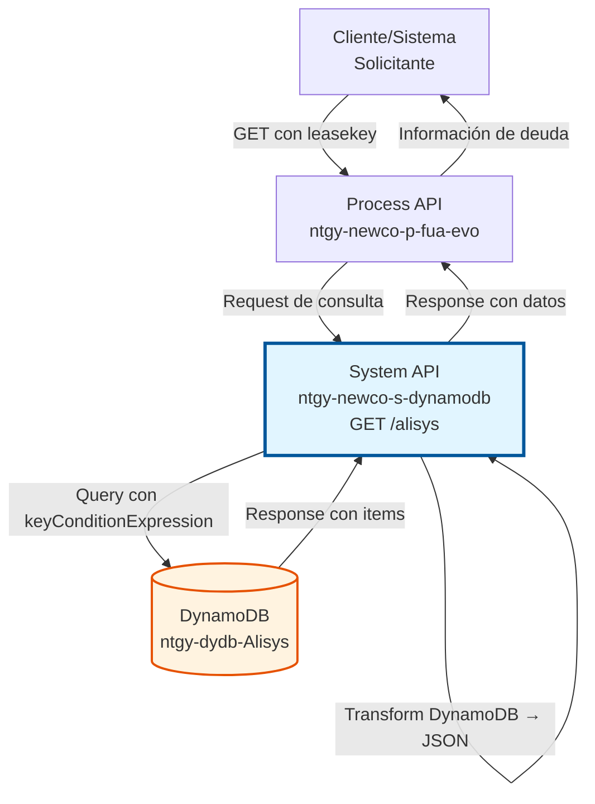
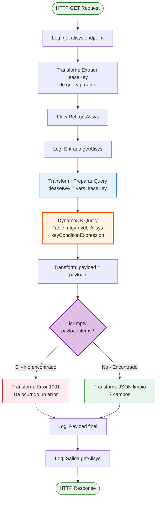
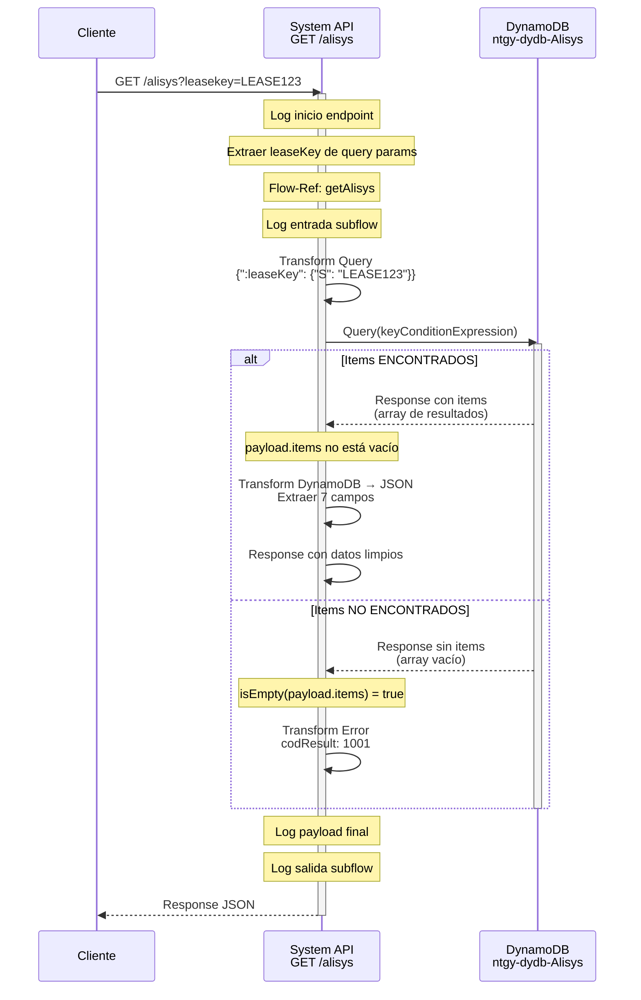
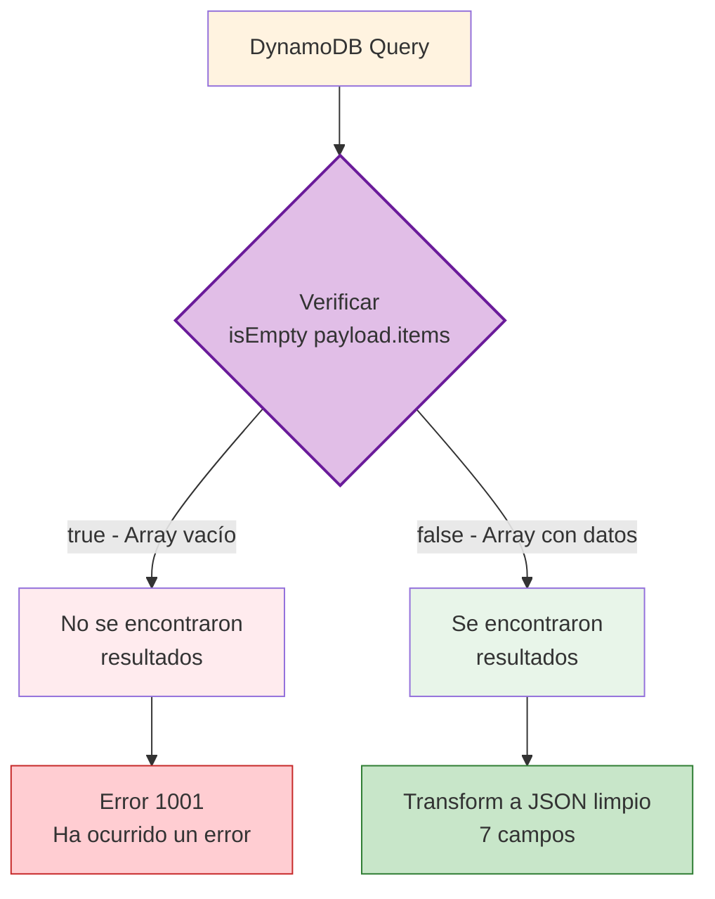
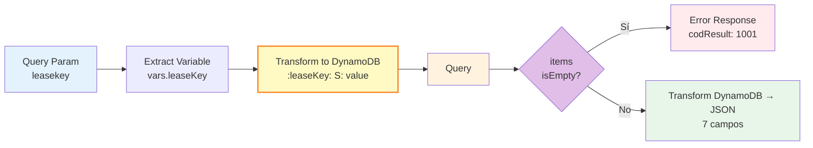

# GET /alisys

## 📌 Descripción General

### Propósito del Endpoint

Consulta información de Alisys (sistema de gestión de deuda) almacenada en DynamoDB mediante el identificador del lease. Este endpoint permite recuperar datos completos de gestión de deuda incluyendo montos, facturas, información de contacto y referencias a Salesforce.

El endpoint soporta:
- **Consulta por Partition Key**: Búsqueda eficiente usando `leaseKey`
- **Validación de Existencia**: Retorna error específico si no se encuentran datos
- **Transformación Automática**: Convierte formato DynamoDB a JSON limpio
- **Datos Completos**: Retorna 7 campos de información de deuda

### Tipo de API

**Capa:** System API (API-Led Connectivity)

**Función:** Integración directa con Amazon DynamoDB para consulta de información de gestión de deuda (Alisys).

### Patrón de Integración

**Tipo:** Request-Reply Síncrono con DynamoDB Query

**Descripción:** Recibe query parameter con identificador del lease (`leasekey`), prepara query con keyConditionExpression, ejecuta query en la tabla `ntgy-dydb-Alisys`, valida si se encontraron resultados, y retorna datos transformados de formato DynamoDB a JSON limpio.

### Arquitectura API-Led Connectivity



---

## 💼 Propósito del Negocio

### Casos de Uso Principales

1. **Consulta de Información de Deuda**
   - Agente de call center necesita información de deuda del cliente
   - Sistema consulta datos de Alisys por leaseKey
   - Obtiene monto, factura y datos de contacto

2. **Integración con Salesforce**
   - Sistema necesita sincronizar información entre Alisys y Salesforce
   - Consulta datos usando leaseKey
   - Obtiene idSfdc para correlación con Salesforce

3. **Gestión de Cobros**
   - Equipo de cobros necesita información actualizada de deuda
   - Consulta datos de contacto (teléfono, email del agente)
   - Obtiene monto e invoice para gestión

4. **Auditoría y Reporting**
   - Sistemas de reporting consultan información de deuda
   - Obtienen datos completos para análisis
   - Generan reportes de gestión de cobros

### Contexto Empresarial

- **Dominio:** Facturación y Cobros - Gestión de Deuda
- **Sector:** Energía - Utilities
- **División:** Naturgy España - NewCo
- **Proceso de Negocio:** Gestión de deuda y cobros mediante sistema Alisys
- **Criticidad:** Alta - Información crítica para gestión de cobros

### Stakeholders

- **Equipos de Cobros**: Necesitan información actualizada de deuda
- **Call Center**: Requieren datos de contacto y deuda para atención al cliente
- **Equipos de Salesforce**: Necesitan sincronización de datos
- **Equipos de Auditoría**: Verifican información de gestión de deuda

### Valor de Negocio

- **Acceso Rápido**: Consulta eficiente por partition key
- **Datos Completos**: 7 campos de información en una sola consulta
- **Integración**: Referencia a Salesforce (idSfdc) para sincronización
- **Trazabilidad**: Logging completo para auditoría
- **Validación**: Confirmación de existencia de datos

### Consumidores Potenciales

Este endpoint puede ser consumido por:
- Process APIs de gestión de cobros
- Aplicaciones de call center
- Sistemas de integración con Salesforce
- Servicios de reporting y analytics
- Aplicaciones de gestión de deuda

---

## 🔧 Especificación Técnica

### URLs por Ambiente

| Ambiente | URL Base | URL Completa |
|----------|----------|--------------|
| **Local** | `http://localhost:8081` | `http://localhost:8081/api/alisys?leasekey={leaseKey}` |
| **Development** | `https://ntgy-newco-s-dynamodb-dev.us-e2.cloudhub.io` | `https://ntgy-newco-s-dynamodb-dev.us-e2.cloudhub.io/api/alisys?leasekey={leaseKey}` |
| **UAT** | `https://ntgy-newco-s-dynamodb-uat.us-e2.cloudhub.io` | `https://ntgy-newco-s-dynamodb-uat.us-e2.cloudhub.io/api/alisys?leasekey={leaseKey}` |
| **Production** | `https://ntgy-newco-s-dynamodb-pro.us-e2.cloudhub.io` | `https://ntgy-newco-s-dynamodb-pro.us-e2.cloudhub.io/api/alisys?leasekey={leaseKey}` |

### Método HTTP

```
GET /api/alisys?leasekey={leaseKey}
```

### Parámetros de Entrada

#### Headers HTTP

| Header | Tipo | Requerido | Descripción | Ejemplo |
|--------|------|-----------|-------------|---------|
| `Accept` | string | ❌ No | Tipo de contenido esperado en response | `application/json` |

#### Query Parameters

| Parámetro | Tipo | Requerido | Descripción | Ejemplo |
|-----------|------|-----------|-------------|---------|
| `leasekey` | string | ✅ Sí | Identificador único del lease (partition key) | `LEASE123456` |

### Respuestas

#### Respuesta Exitosa - Datos Encontrados (200 OK)

```json
{
  "leaseKey": "LEASE123456",
  "amount": 150.50,
  "invoice": "INV001",
  "idSfdc": "SF001",
  "telephone": "+34600123456",
  "agentMail": "agent@example.com",
  "inputCG": "CG001"
}
```

**Descripción:** Se encontraron datos de Alisys para el leaseKey especificado.

**Campos Retornados:**

| Campo | Tipo | Descripción | Ejemplo |
|-------|------|-------------|---------|
| `leaseKey` | string | Identificador del lease/contrato | `"LEASE123456"` |
| `amount` | number | Monto de la deuda | `150.50` |
| `invoice` | string | Número de factura | `"INV001"` |
| `idSfdc` | string | ID en Salesforce | `"SF001"` |
| `telephone` | string | Teléfono de contacto | `"+34600123456"` |
| `agentMail` | string | Email del agente asignado | `"agent@example.com"` |
| `inputCG` | string | Input de Centro de Gestión | `"CG001"` |

#### Respuesta de Error - No Encontrado (200 OK)

```json
{
  "result": {
    "codResult": "1001",
    "msgResult": "Ha ocurrido un error"
  }
}
```

**Descripción:** No se encontraron datos de Alisys para el leaseKey especificado.

**Condición:** `isEmpty(payload.items)` - La query no retornó resultados

**Nota:** Aunque retorna código HTTP 200, el `codResult` indica que no se encontraron datos.

#### Respuesta de Error Técnico (500)

```json
{
  "result": {
    "codResult": "0001",
    "msgResult": "Error interno del servidor"
  }
}
```

**Descripción:** Error técnico en la operación de query a DynamoDB.

**Causas posibles:**
- Error de conectividad con DynamoDB
- Throttling de DynamoDB (límite de operaciones excedido)
- Timeout en la operación
- Error en permisos IAM

### Códigos de Respuesta

| Código | Descripción | Escenario |
|--------|-------------|-----------|
| `0000` | Éxito implícito | Datos encontrados (no hay codResult en respuesta exitosa) |
| `1001` | No encontrado | No se encontraron datos para el leaseKey |
| `0001` | Error técnico | Fallo en DynamoDB o procesamiento |

### Autenticación y Autorización

- **Tipo:** Client ID & Client Secret (Anypoint Platform)
- **Autorización DynamoDB:** El usuario de servicio debe tener permisos para:
  - Ejecutar operación `Query` en tabla `ntgy-dydb-Alisys`
  - Acceso de lectura (READ) a la tabla
  - Permisos IAM configurados en AWS

### Timeouts

| Tipo | Valor | Descripción |
|------|-------|-------------|
| **Request Timeout** | 30 segundos | Tiempo máximo de espera para la respuesta |
| **Connection Timeout** | 10 segundos | Tiempo máximo para establecer conexión con DynamoDB |
| **Query Timeout** | 5 segundos | Tiempo máximo para ejecutar query en DynamoDB |

---

## 🏗️ Implementación Técnica

### Arquitectura del Flow



### Diagrama de Secuencia



### Componentes del Flow

#### 1. Flow Principal (ntgy-newco-s-dynamodb.xml)

**Ubicación:** `src/main/mule/ntgy-newco-s-dynamodb.xml` (líneas 527-544)

```xml
<flow name="get:\alisys:ntgy-newco-s-dynamodb-config">
    <logger level="INFO" message="get:\alisys:ntgy-newco-s-dynamodb-config" />
    
    <ee:transform doc:name="Transform Message">
        <ee:variables>
            <ee:set-variable variableName="leaseKey">
                attributes.queryParams.leasekey
            </ee:set-variable>
        </ee:variables>
    </ee:transform>
    
    <flow-ref doc:name="Flow Reference" name="getAlisys" />
    
    <error-handler>
        <on-error-continue type="ANY">
            <flow-ref name="errorManagerExpSysFlow" />
        </on-error-continue>
    </error-handler>
</flow>
```

**Responsabilidades:**
- Recibir request HTTP GET con query parameter `leasekey`
- Extraer `leasekey` y guardarlo en variable `vars.leaseKey`
- Invocar subflow de implementación
- Manejar errores globalmente

#### 2. Subflow de Implementación (getAlisys)

**Ubicación:** Código proporcionado (líneas 17-54)

**Paso 1: Logging de Entrada (línea 18)**
```xml
<logger level="INFO" doc:name="Entrada" 
    message="Log Entrada GetAlisys"/>
```

**Paso 2: Preparar Query para DynamoDB (líneas 19-26)**
```xml
<ee:transform doc:name="Transform Message">
    <ee:set-payload><![CDATA[%dw 2.0
output application/java
---
{
    ":leaseKey": {"S": vars.leaseKey}
}]]></ee:set-payload>
</ee:transform>
```

**Paso 3: Query a DynamoDB (línea 27)**
```xml
<dynamodb:query 
    tableName="ntgy-dydb-Alisys" 
    keyConditionExpression="leaseKey = :leaseKey" 
    attributeValues="#[payload]" 
    config-ref="Amazon_DynamoDB_Configuration"/>
```

**Paso 4: Guardar Payload (líneas 28-34)**
```xml
<ee:transform doc:name="Transform Message">
    <ee:set-payload><![CDATA[%dw 2.0
output application/java
---
payload]]></ee:set-payload>
</ee:transform>
```

**Paso 5: Validar Resultados (líneas 35-58)**
```xml
<choice doc:name="Choice">
    <when expression="#[isEmpty(payload.items)]">
        <!-- No se encontraron resultados -->
        <ee:transform doc:name="Transform Message">
            <ee:set-payload><![CDATA[%dw 2.0
output application/json
---
{
    "result": {
        "codResult": "1001",
        "msgResult": "Ha ocurrido un error"
    }
}]]></ee:set-payload>
        </ee:transform>
    </when>
    <otherwise>
        <!-- Se encontraron resultados -->
        <ee:transform doc:name="Transform Message">
            <ee:set-payload><![CDATA[%dw 2.0
output application/json
---
{
    leaseKey: payload.items.leaseKey[0].s,
    amount: payload.items.amount[0].n as Number,
    invoice: payload.items.invoice[0].s,
    idSfdc: payload.items.idSfdc[0].s,
    telephone: payload.items.telephone[0].s,
    agentMail: payload.items.agentMail[0].s,
    inputCG: payload.items.inputCG[0].s
}]]></ee:set-payload>
        </ee:transform>
    </otherwise>
</choice>
```

**Paso 6: Logging de Payload (línea 59)**
```xml
<logger level="INFO" doc:name="Logger" message="#[payload]" />
```

**Paso 7: Logging de Salida (línea 60)**
```xml
<logger level="INFO" doc:name="Salida" 
    message="Log Salida GetAlisys"/>
```

### Operación de Backend: DynamoDB Query

#### Configuración de Query

```xml
<dynamodb:query 
    tableName="ntgy-dydb-Alisys" 
    keyConditionExpression="leaseKey = :leaseKey" 
    attributeValues="#[payload]" 
    config-ref="Amazon_DynamoDB_Configuration"/>
```

**Parámetros:**
- **tableName**: `ntgy-dydb-Alisys` - Tabla de información de Alisys
- **keyConditionExpression**: `leaseKey = :leaseKey` - Condición de búsqueda por partition key
- **attributeValues**: Valores de los placeholders (`:leaseKey`)

**Diferencia entre Query y Get-Item:**

| Característica | Query | Get-Item |
|----------------|-------|----------|
| **Búsqueda** | Por partition key (puede incluir sort key) | Por key completa (partition + sort si existe) |
| **Resultado** | Array de items (`payload.items`) | Un solo item |
| **Eficiencia** | Muy eficiente para partition key | Más directo pero requiere key completa |
| **Uso** | Cuando se busca por partition key | Cuando se conoce la key completa |

#### Estructura de la Tabla DynamoDB

| Campo | Tipo | Descripción | Ejemplo |
|-------|------|-------------|---------|
| `leaseKey` | String (S) | Partition Key - Identificador del lease | `"LEASE123456"` |
| `amount` | Number (N) | Monto de la deuda | `150.50` |
| `invoice` | String (S) | Número de factura | `"INV001"` |
| `idSfdc` | String (S) | ID en Salesforce | `"SF001"` |
| `telephone` | String (S) | Teléfono de contacto | `"+34600123456"` |
| `agentMail` | String (S) | Email del agente | `"agent@example.com"` |
| `inputCG` | String (S) | Input de Centro de Gestión | `"CG001"` |

**Índices:**
- **Primary Key:** `leaseKey` (Partition Key)
- **No hay Sort Key** en esta tabla

### Transformaciones DataWeave

#### Transformación 1: Preparar Query

```dataweave
%dw 2.0
output application/java
---
{
    ":leaseKey": {"S": vars.leaseKey}
}
```

**Propósito:** Preparar el valor del placeholder para keyConditionExpression.

**Input:** Variable `vars.leaseKey` (ej: `"LEASE123456"`)

**Output:**
```json
{
  ":leaseKey": {
    "S": "LEASE123456"
  }
}
```

#### Transformación 2: Respuesta de Error (No Encontrado)

```dataweave
%dw 2.0
output application/json
---
{
    "result": {
        "codResult": "1001",
        "msgResult": "Ha ocurrido un error"
    }
}
```

**Propósito:** Generar respuesta de error cuando no se encontraron resultados.

**Condición:** `isEmpty(payload.items)`

#### Transformación 3: Respuesta de Éxito (Datos Encontrados)

```dataweave
%dw 2.0
output application/json
---
{
    leaseKey: payload.items.leaseKey[0].s,
    amount: payload.items.amount[0].n as Number,
    invoice: payload.items.invoice[0].s,
    idSfdc: payload.items.idSfdc[0].s,
    telephone: payload.items.telephone[0].s,
    agentMail: payload.items.agentMail[0].s,
    inputCG: payload.items.inputCG[0].s
}
```

**Propósito:** Transformar de formato DynamoDB AttributeValue a JSON limpio.

**Input (DynamoDB):**
```json
{
  "items": [
    {
      "leaseKey": {"s": "LEASE123"},
      "amount": {"n": "150.50"},
      "invoice": {"s": "INV001"},
      "idSfdc": {"s": "SF001"},
      "telephone": {"s": "+34600123456"},
      "agentMail": {"s": "agent@example.com"},
      "inputCG": {"s": "CG001"}
    }
  ]
}
```

**Output (JSON limpio):**
```json
{
  "leaseKey": "LEASE123",
  "amount": 150.50,
  "invoice": "INV001",
  "idSfdc": "SF001",
  "telephone": "+34600123456",
  "agentMail": "agent@example.com",
  "inputCG": "CG001"
}
```

**Nota:** Se accede al primer elemento del array (`[0]`) y se extrae el valor según el tipo DynamoDB (`.s` para String, `.n` para Number).

### Lógica de Validación

#### Validación de Resultados mediante isEmpty



**Explicación:**

DynamoDB query retorna diferentes estructuras según si encontró resultados:

**Caso 1: Resultados ENCONTRADOS**
```json
{
  "items": [
    {
      "leaseKey": {"s": "LEASE123"},
      "amount": {"n": "150.50"},
      ...
    }
  ]
}
```
→ `isEmpty(payload.items) = false` → Transform a JSON limpio

**Caso 2: Resultados NO ENCONTRADOS**
```json
{
  "items": []
}
```
→ `isEmpty(payload.items) = true` → Error 1001

### Manejo de Errores

#### Errores Técnicos (Manejados en Error Handler)

```xml
<error-handler>
    <on-error-continue type="ANY">
        <flow-ref name="errorManagerExpSysFlow" />
    </on-error-continue>
</error-handler>
```

**Tipos de errores capturados:**
- `DYNAMODB:CONNECTIVITY` - Error de conexión con DynamoDB
- `DYNAMODB:THROTTLING` - Límite de operaciones excedido
- `DYNAMODB:TIMEOUT` - Timeout en query
- `DYNAMODB:UNAUTHORIZED` - Error de permisos IAM
- `ANY` - Cualquier otro error no esperado

### Diagrama de Transformación de Datos



### Configuración de DynamoDB Connector

```xml
<dynamodb:config name="Amazon_DynamoDB_Configuration">
    <dynamodb:basic-connection 
        accessKey="${secure::aws.accessKey}"
        secretKey="${secure::aws.secretKey}"
        region="${aws.region}"/>
</dynamodb:config>
```

**Propiedades de Configuración:**
- **accessKey**: Credencial AWS (encriptada con secure properties)
- **secretKey**: Credencial AWS (encriptada con secure properties)
- **region**: Región AWS (ej: `eu-west-1`)

### Consideraciones de Performance

- **Query por Partition Key:** Muy eficiente, usa índice primario
- **Sin Scan:** No se hace scan completo de la tabla (más rápido)
- **Response Time Esperado:** < 50ms para query
- **Throughput:** Limitado por RCU (Read Capacity Units) de DynamoDB
- **Transformación:** Overhead mínimo (< 10ms)

---

## 💻 Ejemplos de Uso

### Ejemplo 1: Consulta Exitosa - Datos Encontrados

#### Request

```bash
curl -X GET "https://ntgy-newco-s-dynamodb-dev.us-e2.cloudhub.io/api/alisys?leasekey=LEASE123456" \
  -H "Accept: application/json"
```

#### Response (200 OK)

```json
{
  "leaseKey": "LEASE123456",
  "amount": 150.50,
  "invoice": "INV001",
  "idSfdc": "SF001",
  "telephone": "+34600123456",
  "agentMail": "agent@example.com",
  "inputCG": "CG001"
}
```

**Interpretación:** Se encontraron datos de Alisys para el leaseKey especificado. El cliente tiene una deuda de 150.50€ asociada a la factura INV001.

---

### Ejemplo 2: Consulta Sin Resultados

#### Request

```bash
curl -X GET "https://ntgy-newco-s-dynamodb-dev.us-e2.cloudhub.io/api/alisys?leasekey=LEASE_NO_EXISTE" \
  -H "Accept: application/json"
```

#### Response (200 OK)

```json
{
  "result": {
    "codResult": "1001",
    "msgResult": "Ha ocurrido un error"
  }
}
```

**Interpretación:** No se encontraron datos de Alisys para el leaseKey especificado.

---

### Ejemplo 3: Integración desde JavaScript

```javascript
async function getAlisysInfo(leaseKey) {
  const baseUrl = 'https://ntgy-newco-s-dynamodb-dev.us-e2.cloudhub.io';
  const endpoint = '/api/alisys';
  
  try {
    const response = await fetch(`${baseUrl}${endpoint}?leasekey=${leaseKey}`, {
      method: 'GET',
      headers: {
        'Accept': 'application/json'
      }
    });
    
    const data = await response.json();
    
    // Verificar si tiene estructura de error
    if (data.result && data.result.codResult === '1001') {
      console.log('⚠️ No se encontraron datos');
      return { 
        success: false, 
        message: 'No se encontraron datos de Alisys',
        found: false
      };
    }
    
    // Verificar si tiene los campos esperados
    if (data.leaseKey) {
      console.log('✅ Datos encontrados');
      return { 
        success: true, 
        data: data,
        found: true
      };
    }
    
    // Respuesta inesperada
    return { 
      success: false, 
      message: 'Respuesta inesperada',
      found: null
    };
    
  } catch (error) {
    console.error('Error de conexión:', error);
    return { 
      success: false, 
      message: error.message,
      found: null
    };
  }
}

// Uso
const result = await getAlisysInfo('LEASE123456');

if (result.success && result.found) {
  console.log('Información de deuda:', result.data);
  console.log('Monto:', result.data.amount);
  console.log('Factura:', result.data.invoice);
  console.log('Teléfono:', result.data.telephone);
} else if (result.found === false) {
  console.log('No se encontraron datos para este leaseKey');
} else {
  console.error('Error:', result.message);
}
```

---

### Ejemplo 4: Integración desde Python

```python
import requests
from typing import Dict, Optional

def get_alisys_info(lease_key: str) -> Dict:
    """
    Consulta información de Alisys por leaseKey.
    
    Args:
        lease_key: Identificador del lease
        
    Returns:
        Dict con resultado de la operación
    """
    base_url = 'https://ntgy-newco-s-dynamodb-dev.us-e2.cloudhub.io'
    endpoint = '/api/alisys'
    
    try:
        response = requests.get(
            f'{base_url}{endpoint}',
            params={'leasekey': lease_key},
            headers={'Accept': 'application/json'},
            timeout=10
        )
        
        response.raise_for_status()
        data = response.json()
        
        # Verificar si es respuesta de error
        if 'result' in data and data['result'].get('codResult') == '1001':
            return {
                'success': False,
                'message': 'No se encontraron datos de Alisys',
                'found': False,
                'data': None
            }
        
        # Verificar si tiene los campos esperados
        if 'leaseKey' in data:
            return {
                'success': True,
                'message': 'Datos encontrados',
                'found': True,
                'data': {
                    'leaseKey': data.get('leaseKey'),
                    'amount': data.get('amount'),
                    'invoice': data.get('invoice'),
                    'idSfdc': data.get('idSfdc'),
                    'telephone': data.get('telephone'),
                    'agentMail': data.get('agentMail'),
                    'inputCG': data.get('inputCG')
                }
            }
        
        return {
            'success': False,
            'message': 'Respuesta inesperada',
            'found': None,
            'data': None
        }
            
    except requests.exceptions.RequestException as e:
        return {
            'success': False,
            'message': f'Error de conexión: {str(e)}',
            'found': None,
            'data': None
        }

# Uso
result = get_alisys_info('LEASE123456')

if result['success'] and result['found']:
    print(f"✅ Datos encontrados:")
    print(f"  Monto: {result['data']['amount']}€")
    print(f"  Factura: {result['data']['invoice']}")
    print(f"  Teléfono: {result['data']['telephone']}")
    print(f"  Email agente: {result['data']['agentMail']}")
    print(f"  ID Salesforce: {result['data']['idSfdc']}")
elif result['found'] is False:
    print(f"⚠️ {result['message']}")
else:
    print(f"❌ Error: {result['message']}")
```

---

### Ejemplo 5: Consulta con Manejo de Datos de Contacto

```python
import requests
from typing import Dict, Optional

class AlisysClient:
    """Cliente para consultar información de Alisys."""
    
    def __init__(self, base_url: str):
        self.base_url = base_url
        self.endpoint = '/api/alisys'
    
    def get_debt_info(self, lease_key: str) -> Optional[Dict]:
        """
        Obtiene información de deuda por leaseKey.
        
        Returns:
            Dict con información de deuda o None si no se encuentra
        """
        try:
            response = requests.get(
                f'{self.base_url}{self.endpoint}',
                params={'leasekey': lease_key},
                headers={'Accept': 'application/json'},
                timeout=10
            )
            
            response.raise_for_status()
            data = response.json()
            
            # Verificar si se encontraron datos
            if 'leaseKey' in data:
                return data
            
            return None
            
        except Exception as e:
            print(f"Error al consultar Alisys: {e}")
            return None
    
    def get_contact_info(self, lease_key: str) -> Optional[Dict]:
        """
        Obtiene solo información de contacto.
        
        Returns:
            Dict con teléfono y email del agente
        """
        data = self.get_debt_info(lease_key)
        
        if data:
            return {
                'telephone': data.get('telephone'),
                'agentMail': data.get('agentMail')
            }
        
        return None
    
    def get_salesforce_id(self, lease_key: str) -> Optional[str]:
        """
        Obtiene el ID de Salesforce asociado.
        
        Returns:
            ID de Salesforce o None
        """
        data = self.get_debt_info(lease_key)
        return data.get('idSfdc') if data else None

# Uso
client = AlisysClient('https://ntgy-newco-s-dynamodb-dev.us-e2.cloudhub.io')

# Obtener información completa
debt_info = client.get_debt_info('LEASE123456')
if debt_info:
    print(f"Deuda: {debt_info['amount']}€")
    print(f"Factura: {debt_info['invoice']}")

# Obtener solo contacto
contact = client.get_contact_info('LEASE123456')
if contact:
    print(f"Teléfono: {contact['telephone']}")
    print(f"Email: {contact['agentMail']}")

# Obtener ID de Salesforce
sfdc_id = client.get_salesforce_id('LEASE123456')
if sfdc_id:
    print(f"ID Salesforce: {sfdc_id}")
```

---

### Ejemplo 6: Testing con Postman

**Pre-request Script:**
```javascript
// Configurar leaseKey de prueba
const leaseKey = pm.environment.get("test_lease_key") || "LEASE_TEST_001";
pm.environment.set("current_lease_key", leaseKey);

console.log("Consultando leaseKey:", leaseKey);
```

**Request:**
```
GET {{base_url}}/api/alisys?leasekey={{current_lease_key}}
Accept: application/json
```

**Tests:**
```javascript
pm.test("Status code is 200", function () {
    pm.response.to.have.status(200);
});

pm.test("Response time is acceptable", function () {
    pm.expect(pm.response.responseTime).to.be.below(1000);
});

const jsonData = pm.response.json();

// Test para respuesta exitosa
if (jsonData.leaseKey) {
    pm.test("Response has all required fields", function () {
        pm.expect(jsonData).to.have.property('leaseKey');
        pm.expect(jsonData).to.have.property('amount');
        pm.expect(jsonData).to.have.property('invoice');
        pm.expect(jsonData).to.have.property('idSfdc');
        pm.expect(jsonData).to.have.property('telephone');
        pm.expect(jsonData).to.have.property('agentMail');
        pm.expect(jsonData).to.have.property('inputCG');
    });
    
    pm.test("Amount is a number", function () {
        pm.expect(jsonData.amount).to.be.a('number');
    });
    
    console.log("✅ Datos encontrados:");
    console.log("  Monto:", jsonData.amount);
    console.log("  Factura:", jsonData.invoice);
    console.log("  Teléfono:", jsonData.telephone);
    
    // Guardar para uso posterior
    pm.environment.set("last_amount", jsonData.amount);
    pm.environment.set("last_invoice", jsonData.invoice);
}

// Test para respuesta de error (no encontrado)
if (jsonData.result) {
    pm.test("Error response has correct structure", function () {
        pm.expect(jsonData.result).to.have.property('codResult');
        pm.expect(jsonData.result).to.have.property('msgResult');
    });
    
    if (jsonData.result.codResult === '1001') {
        console.log("⚠️ No se encontraron datos para el leaseKey");
    }
}
```

---

### Ejemplo 7: Integración con Salesforce

```javascript
// Consultar Alisys y sincronizar con Salesforce

async function syncAlisysToSalesforce(leaseKey) {
  const alisysUrl = 'https://ntgy-newco-s-dynamodb-dev.us-e2.cloudhub.io/api/alisys';
  const salesforceUrl = 'https://salesforce-api.example.com/api/debt';
  
  try {
    // 1. Consultar datos de Alisys
    console.log('1️⃣ Consultando Alisys...');
    const alisysResponse = await fetch(`${alisysUrl}?leasekey=${leaseKey}`);
    const alisysData = await alisysResponse.json();
    
    if (!alisysData.leaseKey) {
      console.log('⚠️ No se encontraron datos en Alisys');
      return { success: false, message: 'Datos no encontrados' };
    }
    
    console.log('✅ Datos obtenidos de Alisys');
    
    // 2. Preparar datos para Salesforce
    const salesforcePayload = {
      Id: alisysData.idSfdc,
      Debt_Amount__c: alisysData.amount,
      Invoice_Number__c: alisysData.invoice,
      Contact_Phone__c: alisysData.telephone,
      Agent_Email__c: alisysData.agentMail,
      Management_Center__c: alisysData.inputCG,
      Lease_Key__c: alisysData.leaseKey
    };
    
    // 3. Actualizar en Salesforce
    console.log('2️⃣ Actualizando Salesforce...');
    const sfResponse = await fetch(salesforceUrl, {
      method: 'PATCH',
      headers: {
        'Content-Type': 'application/json',
        'Authorization': 'Bearer YOUR_SF_TOKEN'
      },
      body: JSON.stringify(salesforcePayload)
    });
    
    if (sfResponse.ok) {
      console.log('✅ Salesforce actualizado correctamente');
      return { 
        success: true, 
        message: 'Sincronización completada',
        alisysData: alisysData,
        salesforceId: alisysData.idSfdc
      };
    } else {
      console.log('❌ Error al actualizar Salesforce');
      return { success: false, message: 'Error en Salesforce' };
    }
    
  } catch (error) {
    console.error('Error en sincronización:', error);
    return { success: false, message: error.message };
  }
}

// Uso
const result = await syncAlisysToSalesforce('LEASE123456');
console.log('Resultado:', result);
```
