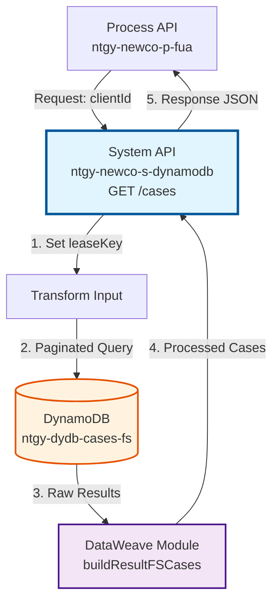
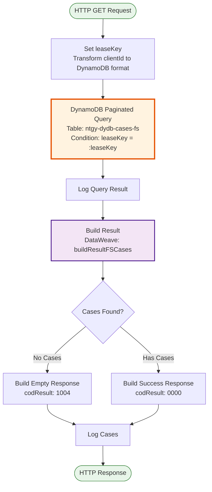
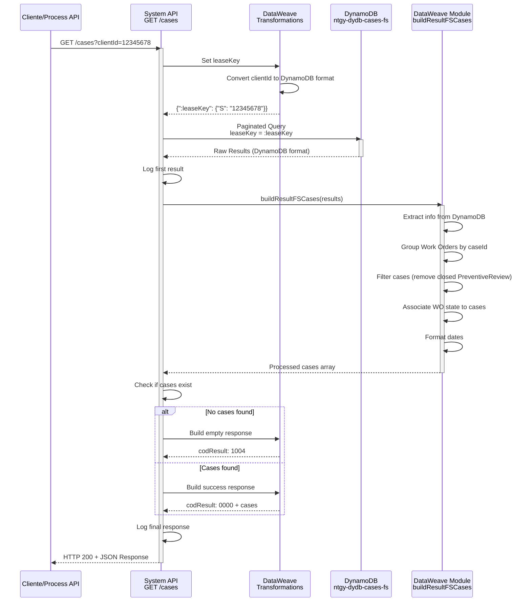

# GET /cases

## 📌 Descripción General

### Propósito del Endpoint

Este endpoint recupera todos los casos y solicitudes asociados a un cliente específico desde Amazon DynamoDB. Consulta la tabla `ntgy-dydb-cases-fs` que contiene tanto casos de Salesforce como órdenes de trabajo (Work Orders) relacionadas.

El endpoint soporta:
- **Consulta de Casos por Cliente**: Recupera todos los casos asociados a un `clientId` (leaseKey)
- **Integración de Work Orders**: Asocia automáticamente órdenes de trabajo a sus casos correspondientes
- **Filtrado Inteligente**: Aplica lógica de negocio para determinar el estado correcto según el tipo de caso
- **Formato Unificado**: Transforma datos de DynamoDB a formato JSON estándar

### Tipo de API

**Capa:** System API (API-Led Connectivity)

**Función:** Integración directa con Amazon DynamoDB para consulta de casos y solicitudes de clientes.

### Patrón de Integración

**Tipo:** Request-Reply Síncrono con DynamoDB Query

**Descripción:** El endpoint recibe un `clientId`, construye una query paginada a DynamoDB usando `leaseKey` como clave de partición, procesa los resultados aplicando lógica de negocio para asociar Work Orders a casos, y retorna una lista unificada de casos con su estado actualizado.

### Arquitectura API-Led Connectivity



---

## 💼 Propósito del Negocio

### Casos de Uso Principales

1. **Consulta de Historial de Casos del Cliente**
   - Un cliente accede a su portal web o app móvil
   - Solicita ver todas sus solicitudes y casos abiertos/cerrados
   - El sistema muestra el historial completo con estados actualizados

2. **Seguimiento de Órdenes de Trabajo**
   - Un agente de call center consulta casos de un cliente
   - El sistema muestra automáticamente el estado de las Work Orders asociadas
   - Permite dar información precisa sobre servicios técnicos

3. **Gestión de Solicitudes SVA (Servicios de Valor Añadido)**
   - El sistema identifica casos relacionados con servicios adicionales
   - Muestra información específica de SVA (isSva flag)
   - Facilita la gestión de servicios premium

### Contexto Empresarial

- **Dominio:** Gestión de Casos y Solicitudes de Clientes
- **Sector:** Energía - Utilities
- **División:** Naturgy España - NewCo
- **Proceso de Negocio:** Atención al Cliente, Gestión de Incidencias, Servicios Técnicos
- **Origen de Datos:** Salesforce (sincronizado a DynamoDB)

### Stakeholders

- **Equipos de Atención al Cliente**: Necesitan visibilidad completa del historial de casos
- **Agentes de Call Center**: Requieren información actualizada para resolver consultas
- **Clientes Finales**: Acceden a su historial de solicitudes vía portales digitales
- **Equipos Técnicos**: Consultan órdenes de trabajo asociadas a casos

### Valor de Negocio

- **Visibilidad 360°**: Historial completo de interacciones del cliente
- **Respuesta Rápida**: Acceso inmediato a información de casos sin consultar Salesforce directamente
- **Experiencia Mejorada**: Clientes pueden hacer seguimiento de sus solicitudes en tiempo real
- **Eficiencia Operativa**: Reducción de tiempos de consulta mediante cache en DynamoDB

### Consumidores Potenciales

Este endpoint puede ser consumido por:
- Process APIs de gestión de clientes (ntgy-newco-p-fua)
- Experience APIs de portales web y móviles
- Sistemas de agentes de call center
- Integraciones con sistemas de CRM

---

## 🔧 Especificación Técnica

### URLs por Ambiente

| Ambiente | URL Base | URL Completa |
|----------|----------|--------------|
| **Local** | `http://localhost:8081` | `http://localhost:8081/api/cases?clientId=:clientId` |
| **Development** | `https://ntgy-newco-s-dynamodb-dev.us-e2.cloudhub.io` | `https://ntgy-newco-s-dynamodb-dev.us-e2.cloudhub.io/api/cases?clientId=:clientId` |
| **UAT** | `https://ntgy-newco-s-dynamodb-uat.us-e2.cloudhub.io` | `https://ntgy-newco-s-dynamodb-uat.us-e2.cloudhub.io/api/cases?clientId=:clientId` |
| **Production** | `https://ntgy-newco-s-dynamodb-pro.us-e2.cloudhub.io` | `https://ntgy-newco-s-dynamodb-pro.us-e2.cloudhub.io/api/cases?clientId=:clientId` |

### Método HTTP

```
GET /api/cases
```

### Parámetros de Entrada

#### Headers HTTP

| Header | Tipo | Requerido | Descripción | Ejemplo |
|--------|------|-----------|-------------|---------|
| `Accept` | string | ❌ No | Tipo de contenido esperado en response | `application/json` |

#### Query Parameters

| Parámetro | Tipo | Requerido | Descripción | Ejemplo |
|-----------|------|-----------|-------------|---------|
| `clientId` | string | ✅ Sí | Identificador único del cliente (leaseKey en DynamoDB) | `"12345678"` |

### Respuestas

#### Respuesta Exitosa con Casos (200 OK)

```json
{
  "result": {
    "codResult": "0000",
    "msgResult": "No hay error"
  },
  "cases": [
    {
      "caseCode": "CASE-001",
      "caseId": "5003X000001AbcD",
      "typeId": "Assistance",
      "type": "caseFS",
      "step": "2",
      "subStep": "1",
      "state": "02",
      "contractAccountId": "200123456",
      "contractId": "4900123456",
      "isSva": true,
      "updateDate": "2024-01-15 10:30:00.000",
      "startDate": "2024-01-10 09:00:00.000",
      "endDate": "2024-01-20 18:00:00.000",
      "channel": "Web",
      "isCancelable": true,
      "hasFiles": false,
      "IBAN": "ES1234567890123456789012",
      "categorySC": "Servicio",
      "cancellationStatus": "",
      "idDocumentum": "",
      "idS3": "s3-id-123",
      "pathS3": "/path/to/file"
    }
  ]
}
```

#### Respuesta Sin Casos (200 OK)

```json
{
  "result": {
    "codResult": "1004",
    "msgResult": "Cliente sin solicitudes"
  },
  "cases": []
}
```

#### Respuesta de Error Técnico (500)

```json
{
  "result": {
    "codResult": "5001",
    "msgResult": "Error de conectividad con DynamoDB"
  }
}
```

### Códigos de Resultado

| Código | Tipo | Descripción |
|--------|------|-------------|
| `0000` | Success | Operación exitosa, casos encontrados |
| `1004` | Business | Cliente sin solicitudes (no es un error) |
| `5001` | Technical | Error de conectividad con DynamoDB |
| `5002` | Technical | Timeout en consulta |

### Autenticación y Autorización

- **Tipo:** Client ID & Client Secret (Anypoint Platform)
- **Autorización DynamoDB:** El usuario debe tener permisos IAM para:
  - Ejecutar operación `Query` en tabla `ntgy-dydb-cases-fs`
  - Acceso de lectura a índices de la tabla

### Timeouts

| Tipo | Valor | Descripción |
|------|-------|-------------|
| **Request Timeout** | 30 segundos | Tiempo máximo de espera para la respuesta |
| **Connection Timeout** | 10 segundos | Tiempo máximo para establecer conexión con DynamoDB |

---

## 🏗️ Implementación Técnica

### Arquitectura del Flow



### Componentes del Flow

#### 1. Transformación de Input (Set leaseKey)

**Ubicación en código:** Líneas 2-12 del flow `getCases`

**Propósito:** Preparar el parámetro de búsqueda en formato DynamoDB

**Transformación DataWeave:**
```dataweave
%dw 2.0
output application/java
---
{
  ":leaseKey": {"S": vars.clientId}
}
```

**Explicación:**
- Extrae `clientId` de las variables del flow
- Lo convierte al formato DynamoDB con tipo String (`{"S": valor}`)
- Crea el parámetro `:leaseKey` para la expresión de condición

#### 2. Query a DynamoDB (Paginated Query)

**Ubicación en código:** Líneas 13-14 del flow `getCases`

**Operación:** `dynamodb:paginated-query`

**Configuración:**
- **Tabla:** `ntgy-dydb-cases-fs`
- **Condición:** `leaseKey = :leaseKey`
- **Parámetros:** `#[payload]` (contiene `:leaseKey`)
- **Target Variable:** `resultQueryDB`

**Características:**
- Usa query paginada para manejar grandes volúmenes de casos
- Busca por clave de partición (`leaseKey`)
- Retorna todos los items que coincidan con el `clientId`

#### 3. Logging Intermedio

**Ubicación en código:** Línea 15 del flow `getCases`

**Propósito:** Registrar el primer resultado de la query para debugging

```xml
<logger level="INFO" message="#[vars.resultQueryDB.payload[0]]"/>
```

#### 4. Transformación de Resultados (Build resultCaseFS)

**Ubicación en código:** Líneas 16-26 del flow `getCases`

**Función DataWeave:** `buildResultFSCases` (importada de `dataweave::cases`)

**Transformación:**
```dataweave
%dw 2.0
output application/json
import buildResultFSCases from dataweave::cases
---
buildResultFSCases(vars.resultQueryDB.payload[0])
```

**Lógica de la Función `buildResultFSCases`:**

La función realiza un procesamiento complejo:

1. **Extracción de Información** (`extractInfo`):
   - Convierte estructura DynamoDB a objetos JSON simples
   - Extrae todos los campos de casos y Work Orders

2. **Agrupación de Work Orders**:
   - Agrupa Work Orders por `caseId`
   - Ordena por `updateDate` descendente
   - Mantiene solo la WO más reciente por caso

3. **Filtrado de Casos**:
   - Separa casos (`type == "caseFS"`) de Work Orders (`type == "workOrderFS"`)
   - Filtra casos de tipo "PreventiveReview" no cerrados

4. **Asociación Inteligente**:
   - Para ciertos tipos de casos (Assistance, Emergencia, etc.):
     - Si tiene WO asociada: usa estado/step/subStep de la WO
     - Si NO tiene WO: usa valores por defecto
   - Para otros tipos: mantiene estado original del caso

5. **Formato de Fechas**:
   - Convierte fechas a formato: `"yyyy-MM-dd HH:mm:ss.SSS"`
   - Maneja fechas vacías correctamente

6. **Resultado Final**:
   - Combina casos procesados con WO sin caso asociado
   - Retorna array unificado de casos

#### 5. Lógica Condicional (Choice)

**Ubicación en código:** Líneas 27-52 del flow `getCases`

**Condición:**
```java
isEmpty(vars.resultCaseSF) and isEmpty(vars.resultCaseFS)
```

**Nota:** El código hace referencia a `vars.resultCaseSF` (casos de Salesforce), sugiriendo que existe lógica adicional no visible en el fragmento proporcionado que consulta otra fuente de datos.

**Ramas:**

- **When (Sin Casos):**
  ```json
  {
    "result": {
      "codResult": "1004",
      "msgResult": "Cliente sin solicitudes"
    },
    "cases": []
  }
  ```

- **Otherwise (Con Casos):**
  ```json
  {
    "result": {
      "codResult": "0000",
      "msgResult": "No hay error"
    },
    "cases": [vars.resultCaseSF + vars.resultCaseFS]
  }
  ```

#### 6. Logging Final

**Ubicación en código:** Línea 53 del flow `getCases`

**Propósito:** Registrar la respuesta completa antes de retornarla

```xml
<logger level="INFO" message="#[payload]"/>
```

### Estructura de Datos DynamoDB

#### Tabla: ntgy-dydb-cases-fs

**Clave de Partición:** `leaseKey` (String) - Corresponde al `clientId`

**Atributos Principales:**

| Atributo | Tipo DynamoDB | Descripción |
|----------|---------------|-------------|
| `leaseKey` | S (String) | Identificador del cliente |
| `caseCode` | S | Código del caso |
| `caseId` | S | ID del caso en Salesforce |
| `typeId` | S | Tipo de caso (Assistance, Emergencia, etc.) |
| `type` | S | Categoría (caseFS, workOrderFS) |
| `step` | S | Paso actual del proceso |
| `subStep` | S | Sub-paso del proceso |
| `state` | S | Estado del caso (01, 02, 03, etc.) |
| `contractAccountId` | S | ID de cuenta contrato |
| `contractId` | S | ID de contrato |
| `isSva` | BOOL | Indica si es servicio de valor añadido |
| `updateDate` | S | Fecha de última actualización |
| `startDate` | S | Fecha de inicio |
| `endDate` | S | Fecha de finalización |
| `channel` | S | Canal de origen (Web, Phone, etc.) |
| `isCancelable` | BOOL | Indica si se puede cancelar |
| `hasFiles` | BOOL | Indica si tiene archivos adjuntos |
| `iban` | S | IBAN asociado |
| `categoriaSC` | S | Categoría del caso |
| `estadoAnulacion` | S | Estado de anulación |
| `idDocumentum` | S | ID en Documentum |
| `acn_fld_CaseLimitDate__c` | S | Fecha límite del caso |
| `idS3` | S | ID en S3 |
| `pathS3` | S | Ruta en S3 |

### Diagrama de Secuencia Completo



### Manejo de Errores

#### Errores de Conectividad DynamoDB

```xml
<on-error-propagate type="DYNAMODB:CONNECTIVITY">
    <ee:transform>
        {
            "result": {
                "codResult": "5001",
                "msgResult": "Error de conectividad con DynamoDB"
            }
        }
    </ee:transform>
</on-error-propagate>
```

#### Errores de Timeout

```xml
<on-error-propagate type="DYNAMODB:TIMEOUT">
    <ee:transform>
        {
            "result": {
                "codResult": "5002",
                "msgResult": "Timeout en consulta a DynamoDB"
            }
        }
    </ee:transform>
</on-error-propagate>
```

### Optimizaciones Implementadas

1. **Paginated Query**: Maneja eficientemente grandes volúmenes de casos
2. **Target Variable**: Almacena resultado en variable para procesamiento posterior
3. **Función Reutilizable**: `buildResultFSCases` encapsula lógica compleja
4. **Logging Estratégico**: Logs en puntos clave para debugging
5. **Respuesta Diferenciada**: Códigos distintos para "sin casos" vs "error"

---

## 💻 Ejemplos de Uso

### Ejemplo 1: Consulta Exitosa con Casos

#### Request

```bash
curl -X GET "https://ntgy-newco-s-dynamodb-dev.us-e2.cloudhub.io/api/cases?clientId=12345678" \
  -H "Accept: application/json"
```

#### Response (200 OK)

```json
{
  "result": {
    "codResult": "0000",
    "msgResult": "No hay error"
  },
  "cases": [
    {
      "caseCode": "CASE-2024-001",
      "caseId": "5003X000001AbcD",
      "typeId": "Assistance",
      "type": "caseFS",
      "step": "2",
      "subStep": "1",
      "state": "02",
      "contractAccountId": "200123456",
      "contractId": "4900123456",
      "isSva": true,
      "updateDate": "2024-01-15 10:30:00.000",
      "startDate": "2024-01-10 09:00:00.000",
      "endDate": "2024-01-20 18:00:00.000",
      "channel": "Web",
      "isCancelable": true,
      "hasFiles": false,
      "IBAN": "ES1234567890123456789012",
      "categorySC": "Servicio",
      "cancellationStatus": "",
      "idDocumentum": "",
      "idS3": "s3-id-123",
      "pathS3": "/documents/case-001"
    },
    {
      "caseCode": "CASE-2024-002",
      "caseId": "5003X000001XyzE",
      "typeId": "Emergencia",
      "type": "caseFS",
      "step": "3",
      "subStep": "2",
      "state": "03",
      "contractAccountId": "200123456",
      "contractId": "4900123457",
      "isSva": false,
      "updateDate": "2024-01-18 14:20:00.000",
      "startDate": "2024-01-18 08:00:00.000",
      "endDate": "",
      "channel": "Phone",
      "isCancelable": false,
      "hasFiles": true,
      "IBAN": "",
      "categorySC": "Emergencia",
      "cancellationStatus": "",
      "idDocumentum": "DOC-456",
      "idS3": "",
      "pathS3": ""
    }
  ]
}
```

### Ejemplo 2: Cliente Sin Casos

#### Request

```bash
curl -X GET "https://ntgy-newco-s-dynamodb-dev.us-e2.cloudhub.io/api/cases?clientId=99999999" \
  -H "Accept: application/json"
```

#### Response (200 OK)

```json
{
  "result": {
    "codResult": "1004",
    "msgResult": "Cliente sin solicitudes"
  },
  "cases": []
}
```

### Ejemplo 3: Caso con Work Order Asociada

#### Escenario

Un caso de tipo "Assistance" tiene una Work Order asociada. El sistema debe mostrar el estado de la WO en lugar del estado original del caso.

#### Request

```bash
curl -X GET "https://ntgy-newco-s-dynamodb-dev.us-e2.cloudhub.io/api/cases?clientId=87654321" \
  -H "Accept: application/json"
```

#### Response (200 OK)

```json
{
  "result": {
    "codResult": "0000",
    "msgResult": "No hay error"
  },
  "cases": [
    {
      "caseCode": "CASE-2024-003",
      "caseId": "5003X000001DefG",
      "typeId": "Assistance",
      "type": "caseFS",
      "step": "4",
      "subStep": "3",
      "state": "04",
      "contractAccountId": "200987654",
      "contractId": "4900987654",
      "isSva": true,
      "updateDate": "2024-01-20 16:45:00.000",
      "startDate": "2024-01-15 09:00:00.000",
      "endDate": "2024-01-22 18:00:00.000",
      "channel": "Web",
      "isCancelable": true,
      "hasFiles": true,
      "IBAN": "ES9876543210987654321098",
      "categorySC": "Servicio Técnico",
      "cancellationStatus": "",
      "idDocumentum": "DOC-789",
      "idS3": "s3-id-789",
      "pathS3": "/documents/case-003"
    }
  ]
}
```

**Nota:** Los valores de `step`, `subStep`, `state` y `endDate` provienen de la Work Order más reciente asociada al caso, no del caso original.

### Ejemplo 4: Error de Conectividad

#### Request

```bash
curl -X GET "https://ntgy-newco-s-dynamodb-dev.us-e2.cloudhub.io/api/cases?clientId=12345678" \
  -H "Accept: application/json"
```

#### Response (500 Internal Server Error)

```json
{
  "result": {
    "codResult": "5001",
    "msgResult": "Error de conectividad con DynamoDB"
  }
}
```

### Ejemplo 5: Integración desde JavaScript

```javascript
async function getCases(clientId) {
  const baseUrl = 'https://ntgy-newco-s-dynamodb-dev.us-e2.cloudhub.io';
  
  try {
    const response = await fetch(`${baseUrl}/api/cases?clientId=${clientId}`, {
      method: 'GET',
      headers: {
        'Accept': 'application/json'
      }
    });
    
    const data = await response.json();
    
    if (data.result.codResult === '0000') {
      console.log(`Found ${data.cases.length} cases for client ${clientId}`);
      return data.cases;
    } else if (data.result.codResult === '1004') {
      console.log('Client has no cases');
      return [];
    } else {
      throw new Error(`Error: ${data.result.msgResult}`);
    }
  } catch (error) {
    console.error('Failed to fetch cases:', error);
    throw error;
  }
}

// Uso
getCases('12345678')
  .then(cases => {
    cases.forEach(c => {
      console.log(`Case ${c.caseCode}: ${c.typeId} - State: ${c.state}`);
    });
  })
  .catch(error => console.error(error));
```

### Ejemplo 6: Integración desde Python

```python
import requests
from typing import List, Dict, Optional

def get_cases(