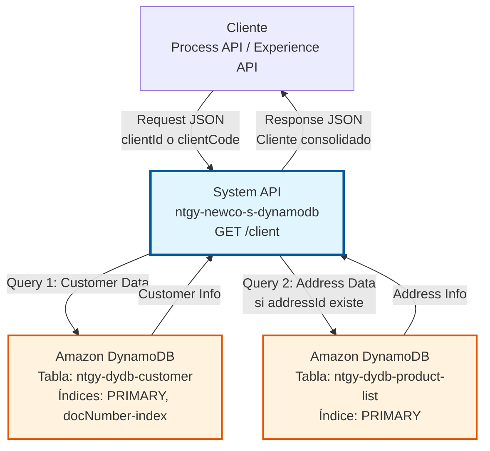
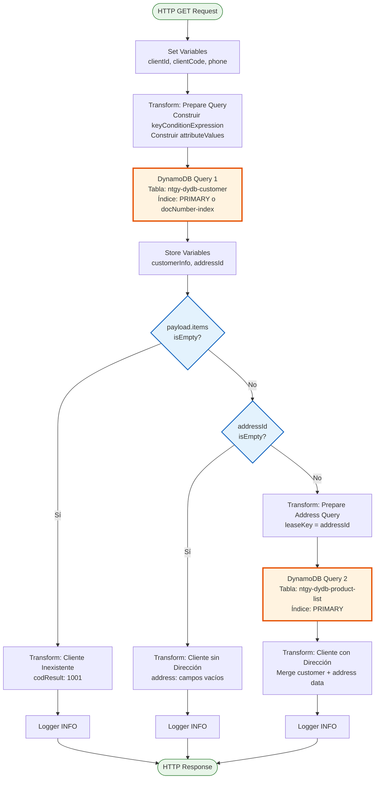
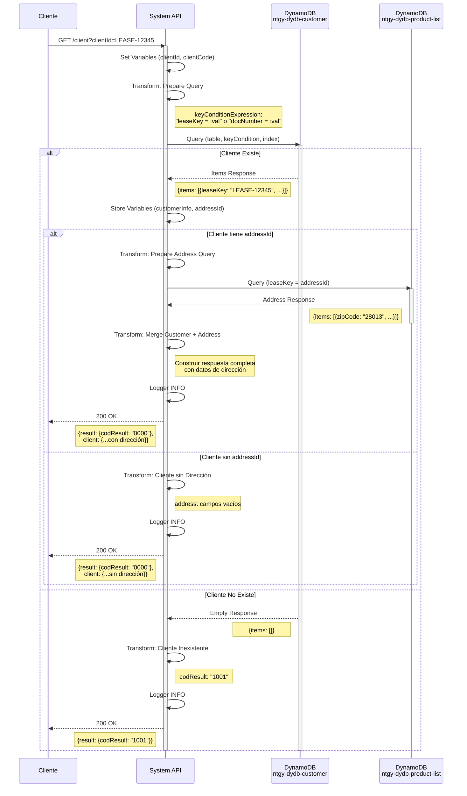
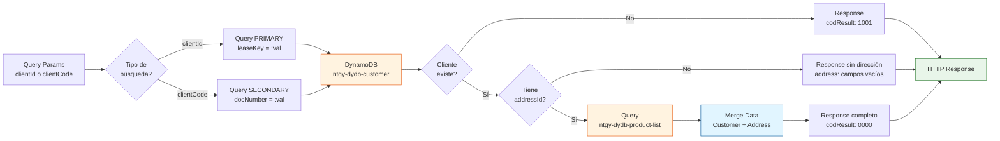

# GET /client

## 📌 Descripción General

### Propósito del Endpoint

Este endpoint recupera información completa de un cliente desde Amazon DynamoDB, proporcionando una búsqueda flexible que permite consultar por ID interno del cliente (`clientId`) o por número de documento (`clientCode`). El endpoint consolida datos de dos tablas DynamoDB para entregar una vista completa del cliente.

El endpoint soporta:
- **Búsqueda flexible**: Consulta por `clientId` (leaseKey) o `clientCode` (docNumber)
- **Índice secundario**: Utiliza índice `docNumber-index` para búsquedas por documento
- **Datos consolidados**: Combina información de cliente y dirección de múltiples tablas
- **Información completa**: Datos personales, contactos, preferencias GDPR y dirección
- **Manejo de escenarios**: Cliente inexistente, cliente sin dirección, cliente completo

### Tipo de API

**Capa:** System API (API-Led Connectivity)

**Función:** Integración directa con Amazon DynamoDB para operaciones de consulta de datos maestros de clientes.

### Patrón de Integración

**Tipo:** Request-Reply Síncrono con DynamoDB Query

**Descripción:** El endpoint recibe una solicitud con el identificador del cliente (ID o código de documento), ejecuta una query en la tabla de clientes usando el índice apropiado, valida la existencia del cliente, opcionalmente consulta la tabla de direcciones si el cliente tiene `addressId`, transforma los datos del formato DynamoDB a JSON estándar, y retorna el resultado consolidado.

### Arquitectura API-Led Connectivity



---

## 💼 Propósito del Negocio

### Casos de Uso Principales

1. **Consulta de Datos de Cliente por ID Interno**
   - Recuperar información completa de un cliente usando su identificador interno (leaseKey)
   - Obtener datos actualizados en tiempo real para operaciones de atención al cliente
   - Beneficio: Acceso rápido y directo a datos de clientes mediante clave primaria

2. **Búsqueda de Cliente por Documento de Identidad**
   - Localizar cliente usando su número de documento (DNI, NIE, CIF)
   - Validar identidad del cliente en procesos de verificación
   - Beneficio: Búsqueda flexible sin necesidad de conocer el ID interno

3. **Gestión de Preferencias GDPR**
   - Consultar preferencias de privacidad y consentimientos del cliente
   - Verificar autorizaciones para comunicaciones comerciales
   - Beneficio: Cumplimiento normativo y respeto a preferencias del cliente

4. **Gestión de Contactos del Cliente**
   - Obtener lista completa de contactos asociados al cliente
   - Identificar contactos preferidos y validados
   - Beneficio: Comunicación efectiva con las personas correctas

5. **Consulta de Dirección del Cliente**
   - Recuperar dirección completa asociada al cliente
   - Validar datos de ubicación para servicios
   - Beneficio: Información precisa para entregas y servicios en domicilio

### Contexto Empresarial

- **Dominio:** Gestión de Clientes y Datos Maestros
- **Sector:** Energía - Utilities
- **División:** Naturgy España - NewCo
- **Proceso de Negocio:** Gestión de información de clientes, atención al cliente, cumplimiento GDPR
- **Tecnología:** Amazon DynamoDB (NoSQL Database)

### Stakeholders

- **Equipos de Atención al Cliente**: Necesitan acceso rápido a información completa del cliente
- **Desarrolladores de Process APIs**: Requieren datos consolidados de clientes para procesos de negocio
- **Oficiales de Cumplimiento GDPR**: Necesitan verificar preferencias de privacidad
- **Equipos de Marketing**: Consultan preferencias de comunicación antes de campañas

### Valor de Negocio

- **Vista 360° del Cliente**: Información consolidada de múltiples fuentes en una sola respuesta
- **Flexibilidad de Búsqueda**: Dos métodos de consulta (ID interno o documento) según contexto
- **Cumplimiento GDPR**: Acceso centralizado a preferencias de privacidad
- **Performance**: Consultas optimizadas con índices secundarios (< 500ms)
- **Datos Actualizados**: Información en tiempo real desde DynamoDB

### Consumidores Potenciales

Este endpoint puede ser consumido por:
- Process APIs de gestión de clientes (NewCo)
- Process APIs de operaciones comerciales
- Experience APIs de portales web de autoservicio
- Experience APIs de aplicaciones móviles
- Sistemas de agentes de call center
- Flujos de Salesforce que requieran datos de clientes
- Integraciones de terceros autorizados

---

## 🔧 Especificación Técnica

### URLs por Ambiente

| Ambiente | URL Base | URL Completa |
|----------|----------|--------------|
| **Local** | `http://localhost:8081` | `http://localhost:8081/api/client?clientId=:clientId` |
| **Development** | `https://ntgy-newco-s-dynamodb-dev.cloudhub.io` | `https://ntgy-newco-s-dynamodb-dev.cloudhub.io/api/client?clientId=:clientId` |
| **Test** | `https://ntgy-newco-s-dynamodb-test.cloudhub.io` | `https://ntgy-newco-s-dynamodb-test.cloudhub.io/api/client?clientId=:clientId` |
| **Production** | `https://ntgy-newco-s-dynamodb.cloudhub.io` | `https://ntgy-newco-s-dynamodb.cloudhub.io/api/client?clientId=:clientId` |

### Método HTTP

```
GET /api/client
```

### Parámetros de Entrada

#### Headers HTTP

| Header | Tipo | Requerido | Descripción | Ejemplo |
|--------|------|-----------|-------------|---------|
| `Content-Type` | string | ✅ Sí | Tipo de contenido del request | `application/json` |
| `Accept` | string | ❌ No | Tipo de contenido esperado en response | `application/json` |

#### Query Parameters

**Nota:** Se debe proporcionar **uno** de los dos parámetros (clientId o clientCode), no ambos.

| Parámetro | Tipo | Requerido | Descripción | Ejemplo |
|-----------|------|-----------|-------------|---------|
| `clientId` | string | ⚠️ Condicional | ID interno del cliente (leaseKey). Requerido si no se proporciona clientCode | `"LEASE-12345"` |
| `clientCode` | string | ⚠️ Condicional | Número de documento del cliente (docNumber). Requerido si no se proporciona clientId | `"12345678A"` |

**Lógica de Búsqueda:**
- Si se proporciona `clientId` → Búsqueda directa por clave primaria `leaseKey`
- Si se proporciona `clientCode` → Búsqueda por índice secundario `docNumber-index`
- Si ambos están vacíos → Error de validación

### Respuestas

#### Respuesta Exitosa - Cliente con Dirección (200 OK)

```json
{
  "result": {
    "codResult": "0000",
    "msgResult": "No hay error"
  },
  "client": {
    "clientId": "LEASE-12345",
    "addressId": "ADDR-67890",
    "isIndividualClient": true,
    "name": "Juan",
    "email": "juan.perez@example.com",
    "phone": "+34612345678",
    "surname": "Pérez",
    "surname2": "García",
    "docTypeId": "DNI",
    "docNumber": "12345678A",
    "nationalityId": "ES",
    "birthDate": "1985-03-15",
    "businessName": "",
    "cnae": "",
    "idEnergyUseType": "RESIDENTIAL",
    "preferredLanguage": "es",
    "areacliente": true,
    "bypassSign": false,
    "gdprPreferences": {
      "commercialCommunications": true,
      "dataTransfer": false,
      "keepData": true,
      "communications": true,
      "profile": false,
      "advertising": false,
      "survey": true,
      "market": false
    },
    "contacts": [
      {
        "contactId": "CONT-001",
        "clientId": "LEASE-12345",
        "name": "María",
        "surname": "López",
        "surname2": "Martínez",
        "docTypeId": "DNI",
        "docNumber": "87654321B",
        "nationalityId": "ES",
        "representationTypeId": "LEGAL",
        "scheduleId": "SCH-001",
        "preferredPhone": {
          "prefix": "+34",
          "number": "698765432"
        },
        "phone2": {
          "prefix": "+34",
          "number": "912345678"
        },
        "channel": "EMAIL",
        "preferredEmail": "maria.lopez@example.com",
        "isPreferred": true,
        "isValidated": true,
        "vlocity_cmt__Type__c": "PRIMARY",
        "isHolder": false
      }
    ],
    "address": {
      "zipCode": "28013",
      "province": "Madrid",
      "city": "Madrid",
      "way": "Calle Mayor",
      "number": "123",
      "floor": "3",
      "door": "A",
      "portal": "1",
      "stairs": "Izquierda"
    }
  }
}
```

#### Respuesta Exitosa - Cliente sin Dirección (200 OK)

```json
{
  "result": {
    "codResult": "0000",
    "msgResult": "No hay error"
  },
  "client": {
    "clientId": "LEASE-12345",
    "addressId": "ADDR-67890",
    "isIndividualClient": true,
    "name": "Juan",
    "email": "juan.perez@example.com",
    "phone": "+34612345678",
    "surname": "Pérez",
    "surname2": "García",
    "docTypeId": "DNI",
    "docNumber": "12345678A",
    "nationalityId": "ES",
    "birthDate": "1985-03-15",
    "businessName": "",
    "cnae": "",
    "idEnergyUseType": "RESIDENTIAL",
    "preferredLanguage": "es",
    "areacliente": true,
    "bypassSign": false,
    "gdprPreferences": {
      "commercialCommunications": true,
      "dataTransfer": false,
      "keepData": true,
      "communications": true,
      "profile": false,
      "advertising": false,
      "survey": true,
      "market": false
    },
    "contacts": [],
    "address": {
      "zipCode": "",
      "province": "",
      "city": "",
      "way": "",
      "number": "",
      "floor": "",
      "door": "",
      "portal": "",
      "stairs": ""
    }
  }
}
```

#### Respuesta - Cliente No Encontrado (200 OK)

```json
{
  "result": {
    "codResult": "1001",
    "msgResult": "Cliente Inexistente"
  }
}
```

### Códigos de Resultado

| Código | Descripción | Significado |
|--------|-------------|-------------|
| `0000` | No hay error | Cliente recuperado exitosamente (con o sin dirección) |
| `1001` | Cliente Inexistente | El cliente no existe en la tabla ntgy-dydb-customer |

### Estructura de Datos del Cliente

#### Datos Personales/Empresa

| Campo | Tipo | Descripción |
|-------|------|-------------|
| `clientId` | string | Identificador único del cliente (leaseKey) |
| `addressId` | string | Identificador de la dirección asociada |
| `isIndividualClient` | boolean | Indica si es cliente individual (true) o empresa (false) |
| `name` | string | Nombre del cliente |
| `surname` | string | Primer apellido |
| `surname2` | string | Segundo apellido |
| `docTypeId` | string | Tipo de documento (DNI, NIE, CIF, etc.) |
| `docNumber` | string | Número de documento |
| `nationalityId` | string | Código de nacionalidad (ISO 3166-1 alpha-2) |
| `birthDate` | string | Fecha de nacimiento (formato: YYYY-MM-DD) |
| `businessName` | string | Razón social (solo para empresas) |
| `cnae` | string | Código CNAE (solo para empresas) |
| `idEnergyUseType` | string | Tipo de uso de energía |
| `preferredLanguage` | string | Idioma preferido (es, ca, eu, gl, en) |
| `areacliente` | boolean | Indica si tiene acceso al área de cliente |
| `bypassSign` | boolean | Indica si puede omitir firma digital |

#### Datos de Contacto

| Campo | Tipo | Descripción |
|-------|------|-------------|
| `email` | string | Email principal del cliente |
| `phone` | string | Teléfono principal del cliente |

#### Preferencias GDPR

| Campo | Tipo | Descripción |
|-------|------|-------------|
| `commercialCommunications` | boolean | Acepta comunicaciones comerciales |
| `dataTransfer` | boolean | Acepta transferencia de datos |
| `keepData` | boolean | Acepta conservación de datos |
| `communications` | boolean | Acepta comunicaciones generales |
| `profile` | boolean | Acepta perfilado |
| `advertising` | boolean | Acepta publicidad |
| `survey` | boolean | Acepta encuestas |
| `market` | boolean | Acepta estudios de mercado |

#### Contactos (Array)

| Campo | Tipo | Descripción |
|-------|------|-------------|
| `contactId` | string | Identificador único del contacto |
| `clientId` | string | ID del cliente al que pertenece |
| `name` | string | Nombre del contacto |
| `surname` | string | Primer apellido |
| `surname2` | string | Segundo apellido |
| `docTypeId` | string | Tipo de documento |
| `docNumber` | string | Número de documento |
| `nationalityId` | string | Código de nacionalidad |
| `representationTypeId` | string | Tipo de representación (LEGAL, AUTHORIZED, etc.) |
| `scheduleId` | string | ID de horario de contacto |
| `preferredPhone` | object | Teléfono preferido (prefix, number) |
| `phone2` | object | Teléfono secundario (prefix, number) |
| `channel` | string | Canal de comunicación preferido |
| `preferredEmail` | string | Email preferido |
| `isPreferred` | boolean | Indica si es contacto preferido |
| `isValidated` | boolean | Indica si está validado |
| `vlocity_cmt__Type__c` | string | Tipo de contacto (Salesforce) |
| `isHolder` | boolean | Indica si es titular |

#### Dirección

| Campo | Tipo | Descripción |
|-------|------|-------------|
| `zipCode` | string | Código postal |
| `province` | string | Provincia |
| `city` | string | Ciudad/Municipio |
| `way` | string | Tipo y nombre de vía |
| `number` | string | Número |
| `floor` | string | Piso |
| `door` | string | Puerta |
| `portal` | string | Portal |
| `stairs` | string | Escalera |

### Autenticación y Autorización

- **Tipo:** Client ID & Client Secret (Anypoint Platform)
- **Autorización AWS:** El usuario de servicio debe tener permisos IAM para:
  - Ejecutar operación `dynamodb:Query` en tabla `ntgy-dydb-customer`
  - Ejecutar operación `dynamodb:Query` en tabla `ntgy-dydb-product-list`
  - Acceso de lectura a índice secundario `docNumber-index`
  - Permisos configurados mediante IAM policies

### Timeouts

| Tipo | Valor | Descripción |
|------|-------|-------------|
| **Request Timeout** | 30 segundos | Tiempo máximo de espera para la respuesta |
| **Connection Timeout** | 10 segundos | Tiempo máximo para establecer conexión con DynamoDB |
| **DynamoDB Query** | 5 segundos | Timeout específico para cada operación Query |

---

## 🏗️ Implementación Técnica

### Arquitectura del Flow



### Diagrama de Secuencia



### Componentes Principales

#### 1. Configuración de Variables Iniciales

```xml
<ee:transform doc:name="Transform Message">
    <ee:variables>
        <ee:set-variable variableName="clientId">
            <![CDATA[attributes.queryParams.'clientId']]>
        </ee:set-variable>
        <ee:set-variable variableName="clientCode">
            <![CDATA[attributes.queryParams.'clientCode']]>
        </ee:set-variable>
        <ee:set-variable variableName="phone">
            <![CDATA[attributes.queryParams.'phone']]>
        </ee:set-variable>
    </ee:variables>
</ee:transform>
```

**Propósito:** Extraer parámetros de query y almacenarlos en variables para uso posterior.

#### 2. Preparación de Query DynamoDB

```dataweave
%dw 2.0
output application/java
---
{
    ":val": {"S": if(isEmpty(vars.clientCode)) vars.clientId else vars.clientCode}
}
```

**Variables adicionales:**
```dataweave
%dw 2.0
output application/java
---
if(isEmpty(vars.clientCode))
    "leaseKey = :val"
else
    "docNumber = :val"
```

**Lógica:**
- Si `clientCode` está vacío → Buscar por `leaseKey` (clave primaria)
- Si `clientCode` tiene valor → Buscar por `docNumber` (índice secundario)

#### 3. Primera Query - Tabla de Clientes

```xml
<dynamodb:query 
    doc:name="Query" 
    config-ref="Amazon_DynamoDB_Configuration" 
    keyConditionExpression="#[vars.keyConditionExpression]" 
    indexName='#[if(!isEmpty(vars.clientCode)) "docNumber-index" else null]' 
    tableName="ntgy-dydb-customer" 
    attributeValues="#[payload]"/>
```

**Características:**
- **Tabla:** `ntgy-dydb-customer`
- **Índice:** Dinámico (`docNumber-index` si se busca por código, PRIMARY si se busca por ID)
- **Condición:** Dinámica según parámetro de entrada
- **Resultado:** Lista de items (normalmente 1 item)

#### 4. Almacenamiento de Información del Cliente

```dataweave
%dw 2.0
output application/json
---
payload
```

**Variables almacenadas:**
- `customerInfo`: Resultado completo de la query de cliente
- `addressId`: ID de dirección extraído del cliente (`payload.items[0].addressId.s`)

#### 5. Decisión por Existencia de Cliente

```xml
<choice doc:name="Choice">
    <when expression="#[isEmpty(payload.items)]">
        <!-- Cliente no existe -->
    </when>
    <when expression="#[isEmpty(vars.addressId)]">
        <!-- Cliente existe sin dirección -->
    </when>
    <otherwise>
        <!-- Cliente existe con dirección -->
    </otherwise>
</choice>
```

#### 6. Transformación - Cliente No Encontrado

```dataweave
%dw 2.0
output application/json
---
{
    "result": {
        "codResult": "1001",
        "msgResult": "Cliente Inexistente"
    } 
}
```

#### 7. Segunda Query - Tabla de Direcciones (Condicional)

```xml
<dynamodb:query 
    tableName="ntgy-dydb-product-list" 
    doc:name="Query" 
    config-ref="Amazon_DynamoDB_Configuration" 
    keyConditionExpression="leaseKey = :leaseKey" 
    attributeValues="#[payload]" />
```

**Preparación del payload:**
```dataweave
%dw 2.0
output application/java
---
{
    ":leaseKey": {"S": vars.addressId}
}
```

**Características:**
- **Tabla:** `ntgy-dydb-product-list`
- **Índice:** PRIMARY (leaseKey)
- **Condición:** `leaseKey = :leaseKey`
- **Solo se ejecuta:** Si el cliente tiene `addressId` no vacío

#### 8. Transformación - Cliente con Dirección

```dataweave
%dw 2.0
output application/json
---
{
    "result": {
        "codResult": "0000",
        "msgResult": "No hay error"
    }, 
    "client": {	 
        "clientId": vars.customerInfo.items[0].leaseKey.s,
        "addressId": vars.customerInfo.items[0].addressId.s,
        "isIndividualClient": vars.customerInfo.items[0].isIndividualClient.bool,
        "name": vars.customerInfo.items[0].name.s,
        "email": vars.customerInfo.items[0].email.s,
        "phone": vars.customerInfo.items[0].phone.s,		
        "surname": vars.customerInfo.items[0].surname.s,
        "surname2": vars.customerInfo.items[0].surname2.s,
        "docTypeId": vars.customerInfo.items[0].docTypeId.s,
        "docNumber": vars.customerInfo.items[0].docNumber.s,
        "nationalityId": vars.customerInfo.items[0].nationalityId.s,
        "birthDate": vars.customerInfo.items[0].birthdate.s,
        "businessName": vars.customerInfo.items[0].businessName.s default "",
        "cnae": vars.customerInfo.items[0].cnae.s default "",
        "idEnergyUseType": vars.customerInfo.items[0].idEnergyUseType.s,
        "preferredLanguage": vars.customerInfo.items[0].preferredLanguage.s,
        "areacliente": vars.customerInfo.items[0].areacliente.bool,
        "bypassSign": vars.customerInfo.items[0].NewCo_BypassFirmaOmega__c.bool default false,
        "gdprPreferences": {
            "commercialCommunications": vars.customerInfo.items[0].gdprPreferences.m.commercialCommunications.bool,
            "dataTransfer": vars.customerInfo.items[0].gdprPreferences.m.dataTransfer.bool,
            "keepData": vars.customerInfo.items[0].gdprPreferences.m.keepData.bool,
            "communications": vars.customerInfo.items[0].gdprPreferences.m.communications.bool,
            "profile": vars.customerInfo.items[0].gdprPreferences.m.profile.bool,
            "advertising": vars.customerInfo.items[0].gdprPreferences.m.advertising.bool,
            "survey": vars.customerInfo.items[0].gdprPreferences.m.survey.bool,
            "market": vars.customerInfo.items[0].gdprPreferences.m.market.bool
        },
        "contacts": vars.customerInfo.items[0].contacts.l map {
            "contactId": $.m.contactId.s,
            "clientId": $.m.clientId.s,
            "name": $.m.name.s,
            "surname": $.m.surname.s,
            "surname2": $.m.surname2.s,
            "docTypeId": $.m.docTypeId.s,
            "docNumber": $.m.docNumber.s,
            "nationalityId": $.m.nationalityId.s,
            "representationTypeId": $.m.representationTypeId.s,
            "scheduleId": $.m.scheduleId.s,
            "preferredPhone": {
                "prefix": $.m.preferredPhone.m.prefix.s,
                "number": $.m.preferredPhone.m.number.s
            },
            "phone2": {
                "prefix": $.m.phone2.m.prefix.s,
                "number": $.m.phone2.m.number.s
            },
            "channel": $.m.channel.s,
            "preferredEmail": $.m.preferredEmail.s,
            "isPreferred": $.m.isPreferred.bool,
            "isValidated": $.m.isValidated.bool,
            "vlocity_cmt__Type__c": $.m.vlocity_cmt__Type__c.s,
            "isHolder": $.m.isHolder.bool
        },
        "address": {
            "zipCode": payload.items[0].zipCode.s,		
            "province": payload.items[0].province.s,
            "city": payload.items[0].city.s,
            "way": payload.items[0].way.s,
            "number": payload.items[0].number.s,
            "floor": payload.items[0].floor.s,
            "door": payload.items[0].door.s,							 
            "portal": payload.items[0].portal.s,
            "stairs": payload.items[0].stairs.s
        }
    }
}
```

**Características de la transformación:**
- Convierte formato de atributos DynamoDB a JSON simple
- Mapea datos del cliente desde `vars.customerInfo`
- Mapea datos de dirección desde `payload` (segunda query)
- Transforma array de contactos con mapeo completo de campos
- Maneja valores por defecto para campos opcionales

### Diagrama de Transformación de Datos



### Variables de Contexto

| Variable | Tipo | Descripción | Ejemplo |
|----------|------|-------------|---------|
| `vars.clientId` | String | ID interno del cliente desde query param | `"LEASE-12345"` |
| `vars.clientCode` | String | Número de documento desde query param | `"12345678A"` |
| `vars.phone` | String | Teléfono desde query param (opcional) | `"+34612345678"` |
| `vars.keyConditionExpression` | String | Expresión de condición para DynamoDB | `"leaseKey = :val"` |
| `vars.customerInfo` | Object | Información completa del cliente de primera query | `{items: [...]}` |
| `vars.addressId` | String | ID de dirección extraído del cliente | `"ADDR-67890"` |

### Configuración de DynamoDB

**Conexión configurada en global.xml:**
```xml
<dynamodb:config name="Amazon_DynamoDB_Configuration">
    <dynamodb:basic-connection 
        accessKey="${dynamodb.accessKey}" 
        secretKey="${secure::dynamodb.secretKey}" 
        region="${dynamodb.region}" />
</dynamodb:config>
```

**Propiedades por ambiente:**
- **accessKey**: Clave de acceso AWS IAM
- **secretKey**: Clave secreta AWS IAM (encriptada)
- **region**: Región AWS (ej: us-east-1, eu-west-1)

### Dependencias Técnicas

**Conectores:**
- Amazon DynamoDB Connector 1.5.3+
- HTTP Connector 1.11.1
- APIKit Module 1.11.11

**Módulos:**
- Secure Configuration Property Module (credenciales)
- Mule Tracing Module (observabilidad)

---

## 💻 Ejemplos de Uso

### Ejemplo 1: Búsqueda por Client ID

**Request:**
```bash
curl -X GET "http://localhost:8081/api/client?clientId=LEASE-12345" \
  -H "Content-Type: application/json" \
  -H "client_id: your-client-id" \
  -H "client_secret: your-client-secret"
```

**Response (200 OK - Cliente con dirección):**
```json
{
  "result": {
    "codResult": "0000",
    "msgResult": "No hay error"
  },
  "client": {
    "clientId": "LEASE-12345",
    "addressId": "ADDR-67890",
    "isIndividualClient": true,
    "name": "Juan",
    "email": "juan.perez@naturgy.com",
    "phone": "+34612345678",
    "surname": "Pérez",
    "surname2": "García",
    "docTypeId": "DNI",
    "docNumber": "12345678A",
    "nationalityId": "ES",
    "birthDate": "1985-03-15",
    "businessName": "",
    "cnae": "",
    "idEnergyUseType": "RESIDENTIAL",
    "preferredLanguage": "es",
    "areacliente": true,
    "bypassSign": false,
    "gdprPreferences": {
      "commercialCommunications": true,
      "dataTransfer": false,
      "keepData": true,
      "communications": true,
      "profile": false,
      "advertising": false,
      "survey": true,
      "market": false
    },
    "contacts": [
      {
        "contactId": "CONT-001",
        "clientId": "LEASE-12345",
        "name": "María",
        "surname": "López",
        "surname2": "Martínez",
        "docTypeId": "DNI",
        "docNumber": "87654321B",
        "nationalityId": "ES",
        "representationTypeId": "LEGAL",
        "scheduleId": "SCH-001",
        "preferredPhone": {
          "prefix": "+34",
          "number": "698765432"
        },
        "phone2": {
          "prefix": "+34",
          "number": "912345678"
        },
        "channel": "EMAIL",
        "preferredEmail": "maria.lopez@example.com",
        "isPreferred": true,
        "isValidated": true,
        "vlocity_cmt__Type__c": "PRIMARY",
        "isHolder": false
      }
    ],
    "address": {
      "zipCode": "28013",
      "province": "Madrid",
      "city": "Madrid",
      "way": "Calle Mayor",
      "number": "123",
      "floor": "3",
      "door": "A",
      "portal": "1",
      "stairs": "Izquierda"
    }
  }
}
```

### Ejemplo 2: Búsqueda por Código de Documento

**Request:**
```bash
curl -X GET "http://localhost:8081/api/client?clientCode=12345678A" \
  -H "Content-Type: application/json" \
  -H "client_id: your-client-id" \
  -H "client_secret: your-client-secret"
```

**Response (200 OK - Mismo resultado que ejemplo 1):**
El resultado es idéntico al Ejemplo 1, ya que ambos métodos de búsqueda localizan al mismo cliente.

### Ejemplo 3: Cliente No Encontrado

**Request:**
```bash
curl -X GET "http://localhost:8081/api/client?clientId=LEASE-99999" \
  -H "Content-Type: application/json" \
  -H "client_id: your-client-id" \
  -H "client_secret: your-client-secret"
```

**Response (200 OK - Cliente inexistente):**
```json
{
  "result": {
    "codResult": "1001",
    "msgResult": "Cliente Inexistente"
  }
}
```

### Ejemplo 4: Cliente Empresa (sin dirección)

**Request:**
```bash
curl -X GET "http://localhost:8081/api/client?clientCode=B12345678" \
  -H "Content-Type: application/json" \
  -H "client_id: your-client-id" \
  -H "client_secret: your-client-secret"
```

**Response (200 OK - Cliente empresa sin dirección):**
```json
{
  "result": {
    "codResult": "0000",
    "msgResult": "No hay error"
  },
  "client": {
    "clientId": "LEASE-67890",
    "addressId": "",
    "isIndividualClient": false,
    "name": "",
    "email": "contacto@empresa.com",
    "phone": "+34912345678",
    "surname": "",
    "surname2": "",
    "docTypeId": "CIF",
    "docNumber": "B12345678",
    "nationalityId": "ES",
    "birthDate": "",
    "businessName": "Empresa Ejemplo S.L.",
    "cnae": "4321",
    "idEnergyUseType": "COMMERCIAL",
    "preferredLanguage": "es",
    "areacliente": true,
    "bypassSign": false,
    "gdprPreferences": {
      "commercialCommunications": false,
      "dataTransfer": false,
      "keepData": true,
      "communications": true,
      "profile": false,
      "advertising": false,
      "survey": false,
      "market": false
    },
    "contacts": [],
    "address": {
      "zipCode": "",
      "province": "",
      "city": "",
      "way": "",
      "number": "",
      "floor": "",
      "door": "",
      "portal": "",
      "stairs": ""
    }
  }
}
```

### Ejemplo 5: Uso desde JavaScript/Node.js

```javascript
const axios = require('axios');

async function getClientFromDynamoDB(clientId = null, clientCode = null) {
  try {
    // Construir query params
    const params = new URLSearchParams();
    if (clientId) params.append('clientId', clientId);
    if (clientCode) params.append('clientCode', clientCode);
    
    const response = await axios.get(
      `https://ntgy-newco-s-dynamodb.cloudhub.io/api/client?${params}`,
      {
        headers: {
          'Content-Type': 'application/json',
          'client_id': 'your-client-id',
          'client_secret': 'your-client-secret'
        }
      }
    );

    if (response.data.result.codResult === '0000') {
      console.log('Cliente encontrado:', response.data.client);
      return response.data.client;
    } else if (response.data.result.codResult === '1001') {
      console.log('Cliente no encontrado');
      return null;
    } else {
      console.error('Error:', response.data.result.msgResult);
      throw new Error(response.data.result.msgResult);
    }
  } catch (error) {
    console.error('Error en la petición:', error.message);
    throw error;
  }
}

// Uso - Búsqueda por ID
getClientFromDynamoDB('LEASE-12345', null)
  .then(client => {
    if (client) {
      console.log('Email:', client.email);
      console.log('Preferencias GDPR:', client.gdprPreferences);
      console.log('Número de contactos:', client.contacts.length);
    }
  })
  .catch(err => console.error('Error:', err));

// Uso - Búsqueda por documento
getClientFromDynamoDB(null, '12345678A')
  .then(client => console.log('Cliente:', client))
  .catch(err => console.error('Error:', err));
```

### Ejemplo 6: Uso desde Python

```python
import requests
import json

def get_client_from_dynamodb(client_id=None, client_code=None):
    """
    Recupera información de cliente desde DynamoDB
    
    Args:
        client_id: ID interno del cliente (opcional)
        client_code: Número de documento del cliente (opcional)
    
    Returns:
        dict: Información del cliente o None si no existe
    """
    url = "https://ntgy-newco-s-dynamodb.cloudhub.io/api/client"
    
    # Construir query params
    params = {}
    if client_id:
        params['clientId'] = client_id
    if client_code:
        params['clientCode'] = client_code
    
    headers = {
        'Content-Type': 'application/json',
        'client_id': 'your-client-id',
        'client_secret': 'your-client-secret'
    }
    
    try:
        response = requests.get(url, headers=headers, params=params)
        response.raise_for_status()
        
        data = response.json()
        
        if data['result']['codResult'] == '0000':
            print('Cliente encontrado')
            return data['client']
        elif data['result']['codResult'] == '1001':
            print('Cliente no encontrado')
            return None
        else:
            print(f"Error: {data['result']['msgResult']}")
            raise Exception(data['result']['msgResult'])
            
    except requests.exceptions.RequestException as e:
        print(f'Error en la petición: {e}')
        raise

# Uso - Búsqueda por ID
client = get_client_from_dynamodb(client_id='LEASE-12345')
if client:
    print(f"Nombre: {client['name']} {client['surname']}")
    print(f"Email: {client['email']}")
    print(f"Dirección: {client['address']['way']} {client['address']['number']}")
    print(f"Contactos: {len(client['contacts'])}")

# Uso - Búsqueda por documento
client = get_client_from_dynamodb(client_code='12345678A')
if client:
    print(f"Cliente ID: {client['clientId']}")
    print(f"GDPR - Comunicaciones comerciales: {client['gdprPreferences']['commercialCommunications']}")
```

### Ejemplo 7: Verificación de Preferencias GDPR

```bash
# Script para verificar si un cliente acepta comunicaciones comerciales
curl -X GET "http://localhost:8081/api/client?clientCode=12345678A" \
  -H "Content-Type: application/json" \
  -H "client_id: your-client-id" \
  -H "client_secret: your-client-secret" \
  | jq '.client.gdprPreferences.commercialCommunications'

# Resultado: true o false
```

### Consideraciones de Uso

**Performance:**
- Búsqueda por `clientId` (PRIMARY): < 50ms en DynamoDB
- Búsqueda por `clientCode` (SECONDARY INDEX): < 100ms en DynamoDB
- Tiempo total de respuesta típico: 300-600ms (incluye segunda query si hay dirección)
- Segunda query solo se ejecuta si el cliente tiene `addressId`

**Mejores Prácticas:**
- Usar `clientId` cuando esté disponible (más rápido, usa clave primaria)
- Usar `clientCode` para búsquedas por documento de identidad
- Cachear resultados si los datos no cambian frecuentemente (TTL recomendado: 5-10 minutos)
- Implementar retry logic para errores transitorios
- Validar preferencias GDPR antes de enviar comunicaciones

**Limitaciones:**
- Solo se puede buscar por un parámetro a la vez (clientId O clientCode)
- No soporta búsquedas por otros campos (email, phone, etc.)
- La dirección puede estar vacía si el cliente no tiene `addressId` o si la tabla product-list no contiene el registro
- Array de contactos puede estar vacío si el cliente no tiene contactos registrados

**Casos de Error Comunes:**
- **Cliente no encontrado (1001)**: El ID o código de documento no existe en la tabla
- **Timeout**: La query tarda más de 30 segundos (revisar índices y capacidad de DynamoDB)
- **Throttling**: Se excedió la capacidad provisionada de DynamoDB (implementar exponential backoff)
- **Credenciales inválidas**: Verificar permisos IAM del usuario de servicio
