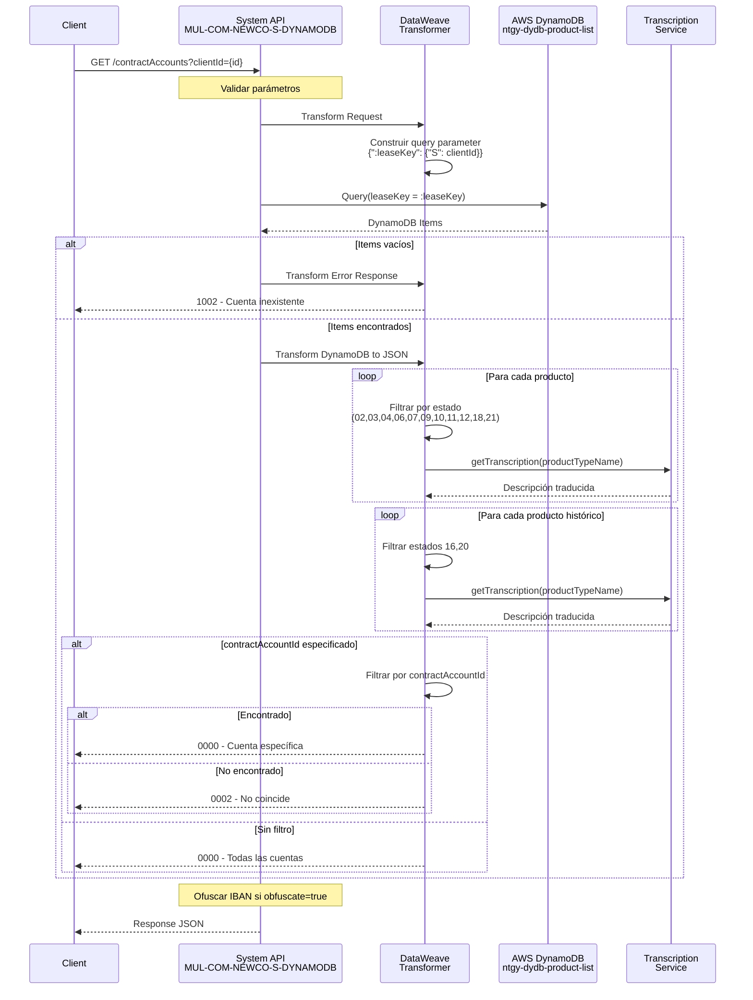
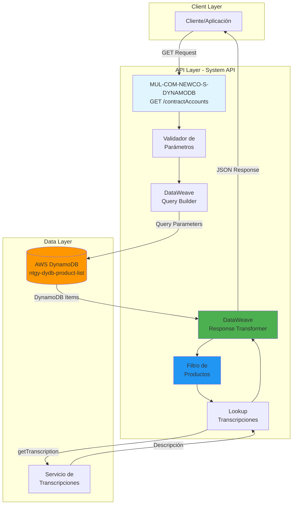
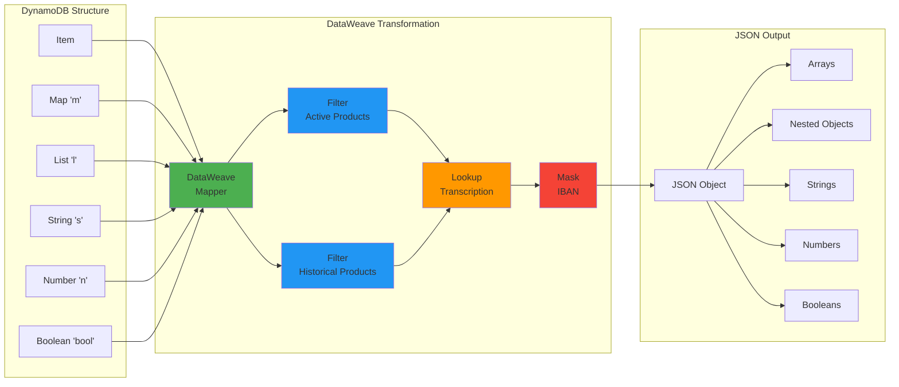

  partition_key: "leaseKey"
  index_type: "Primary Key"
---

# GET /contractAccounts

## 📌 Descripción General

Endpoint de System API que consulta las cuentas contrato y sus productos asociados desde AWS DynamoDB. Recupera información detallada de contratos, productos activos e históricos, direcciones, datos técnicos (CUPS, potencias, tarifas), facturas y cuentas bancarias asociadas a un cliente específico.

**Características principales:**
- Consulta mediante partition key (leaseKey/clientId)
- Filtrado opcional por contractAccountId específico
- Transformación compleja de estructura DynamoDB a JSON
- Filtrado de productos por estado
- Lookup de transcripciones multiidioma
- Ofuscación condicional de datos sensibles (IBAN)
- Manejo de productos históricos (estados 16 y 20)

## 💼 Propósito del Negocio

### Objetivo
Proporcionar acceso centralizado a toda la información de cuentas contrato de un cliente, incluyendo contratos activos, productos energéticos, datos técnicos de suministro, direcciones y métodos de pago.

### Casos de Uso
1. **Consulta de Cartera de Productos**: Obtener todos los contratos y productos de un cliente
2. **Gestión de Contratos**: Visualizar estado y detalles de contratos activos
3. **Datos Técnicos de Suministro**: Acceder a información de CUPS, potencias y tarifas
4. **Historial de Productos**: Consultar productos dados de baja o finalizados
5. **Información de Facturación**: Obtener última factura y datos de pago
6. **Gestión de Direcciones**: Consultar direcciones de suministro y correspondencia

### Valor de Negocio
- **Visión 360° del Cliente**: Información completa de la relación contractual
- **Autogestión**: Permite a clientes consultar su cartera de productos
- **Soporte al Cliente**: Facilita la atención y resolución de consultas
- **Gestión Comercial**: Base para procesos de venta cruzada y retención

## 🔧 Especificación Técnica

### Endpoint
```
GET /contractAccounts
```

### Parámetros de Consulta

| Parámetro | Tipo | Requerido | Descripción |
|-----------|------|-----------|-------------|
| `clientId` | String | Sí | Identificador único del cliente (usado como partition key en DynamoDB) |
| `contractAccountId` | String | No | Filtro opcional para obtener una cuenta contrato específica |
| `obfuscate` | String | No | Controla ofuscación de IBAN ("true"/"false", default: "true") |
| `language` | String | No | Idioma para transcripciones ("ES", "EN", "CA", default: "ES") |

### Headers Requeridos
```http
Content-Type: application/json
client-id: {clientId}
client-secret: {clientSecret}
```

### Respuestas

#### Éxito (200 OK)
```json
{
  "result": {
    "codResult": "0000",
    "msgResult": "No hay error"
  },
  "contractAccountList": [
    {
      "clientId": "string",
      "contractAccountId": "string",
      "lastInvoice": {
        "invoiceId": "string",
        "invoiceNum": "string",
        "issuedDate": "string",
        "billingDate": "string",
        "status": "string",
        "amount": 0,
        "interactiveInvoice": false,
        "pdfDocumentId": "string",
        "productFamilyIdList": ["string"],
        "refNumber": "string"
      },
      "address": {
        "fullAddress": "string",
        "addressStreet": "string",
        "placeId": "string",
        "masterId": "string",
        "addressId": "string",
        "zipCode": "string",
        "province": "string",
        "city": "string",
        "town": "string",
        "wayId": "string",
        "way": "string",
        "wayType": "string",
        "number": "string",
        "floor": "string",
        "door": "string",
        "portal": "string",
        "stairs": "string"
      },
      "contractAccountRefList": [
        {
          "refNum": "string",
          "isDirectPayment": false,
          "isOnlineBill": false,
          "mailingAddress": { },
          "bankAccount": {
            "bankAccountId": "string",
            "contactId": "string",
            "holderName": "string",
            "holderType": "string",
            "iban": "ES12 3456 7890 1234 5678 ****"
          },
          "products": [
            {
              "contractId": "string",
              "contractStatus": "string",
              "contractNumber": "string",
              "isPortability": false,
              "contractPdfNumber": "string",
              "renewedContract": false,
              "productType": {
                "isEco": false,
                "productTypeId": "string",
                "productTypeName": "string",
                "Assetid": "string",
                "isActiveFUV": "string",
                "svaFamily": "string",
                "productTypeFamily": "string",
                "priceBookEntryId": "string",
                "ProductServiceCRMId": "string",
                "productCode": "string",
                "productRate": "string",
                "productTypeNameExtended": "string",
                "productStatus": "string",
                "countEquipment": false
              },
              "isActive": false,
              "contractSignatureDate": "string",
              "startDate": "string",
              "endDate": "string",
              "dropOutDate": "string",
              "isPending": false,
              "techData": {
                "IPDate": "string",
                "isValidCIE": false,
                "changePower": false,
                "techDataId": "string",
                "cups": "string",
                "distribution": "string",
                "rate": "string",
                "rateId": "string",
                "voltage": "string",
                "selfConsumption": false,
                "powerBie": "string",
                "installation": "string",
                "remoteManagement": false,
                "serviceType": "string",
                "powerPlain": "string",
                "powerValley": "string",
                "recommendedPowerPlain": "string",
                "recommendedPowerValley": "string",
                "cnae": "string",
                "type": "string",
                "subsection": "string",
                "cupsType": "string",
                "collective": false,
                "installationPower": 0
              },
              "pendingUnsubscribe": false,
              "cancelIndicator": "string",
              "productHistoricalList": []
            }
          ]
        }
      ]
    }
  ]
}
```

#### Cuenta Contrato Inexistente (200 OK)
```json
{
  "result": {
    "codResult": "1002",
    "msgResult": "Cuenta Contrato inexistente"
  }
}
```

#### ContractAccountId No Encontrado (200 OK)
```json
{
  "result": {
    "codResult": "0002",
    "msgResult": "Ningun contractAccountId de la lista de objetos coincide con el de la llamada [contractAccountId]"
  }
}
```

#### Error de Validación (400 Bad Request)
```json
{
  "error": {
    "code": "400",
    "message": "Bad Request - Parámetros inválidos"
  }
}
```

#### Error de Autenticación (401 Unauthorized)
```json
{
  "error": {
    "code": "401",
    "message": "Unauthorized - Credenciales inválidas"
  }
}
```

#### Error Interno (500 Internal Server Error)
```json
{
  "error": {
    "code": "500",
    "message": "Internal Server Error"
  }
}
```

## 🏗️ Implementación Técnica

### Arquitectura del Flujo



### Operación de Backend: DynamoDB Query

**Tabla:** `ntgy-dydb-product-list`

**Operación:** Query con Key Condition Expression

```xml
<dynamodb:query 
    tableName="ntgy-dydb-product-list" 
    config-ref="Amazon_DynamoDB_Configuration" 
    keyConditionExpression="leaseKey = :leaseKey" 
    attributeValues="#[payload]" />
```

**Parámetros de Query:**
```dataweave
{
    ":leaseKey": {"S": vars.clientId}
}
```

**Estructura de la Tabla:**
- **Partition Key:** `leaseKey` (String) - Identificador del cliente
- **Atributos:** Estructura compleja anidada con mapas y listas de DynamoDB

### Transformaciones DataWeave

#### 1. Transformación de Entrada (Construcción de Query)
```dataweave
%dw 2.0
output application/java
---
{
    ":leaseKey": {"S": vars.clientId}
}
```

#### 2. Transformación Principal (DynamoDB → JSON)

**Mapeo de Estructura DynamoDB:**
```dataweave
"contractAccountList": payload.items[0].contractAccountList.l map {
    "clientId": $.m.clientId.s,
    "contractAccountId": $.m.contractAccountId.s,
    "lastInvoice": {
        "invoiceId": $.m.lastInvoice.m.invoiceID.s,
        "invoiceNum": $.m.lastInvoice.m.invoiceNum.s,
        "issuedDate": $.m.lastInvoice.m.issuedDate.s,
        "billingDate": $.m.lastInvoice.m.billingDate.s,
        "status": $.m.lastInvoice.m.status.s,
        "amount": if($.m.lastInvoice.m.amount.n != null) 
                    $.m.lastInvoice.m.amount.n as Number 
                  else 0,
        "interactiveInvoice": $.m.lastInvoice.m.interactiveInvoice.bool,
        "pdfDocumentId": $.m.lastInvoice.m.pdfDocumentId.s,
        "productFamilyIdList": $.m.lastInvoice.m.productFamilyIdList.l.s,
        "refNumber": $.m.lastInvoice.m.refNumber.s
    },
    // ... más campos
}
```

**Filtrado de Productos Activos:**
```dataweave
"products": caref.m.products.l filter ((pref) -> 
    (pref.m.productType.m.status.s matches /^(02|03|04|06|07|09|10|11|12|18|21)$/) 
    or 
    (pref.m.productType.m.status.s == "08" and isEmpty(pref.m.productType.m.endValidityDate.s))
) map(pref)-> {
    // Mapeo de producto
}
```

**Estados de Producto:**
- **02-12, 18, 21:** Estados activos estándar
- **08:** Activo solo si no tiene fecha de fin de validez

**Lookup de Transcripciones:**
```dataweave
"productTypeName": do {
    var transcription = try(() -> lookup("getTranscription", {
        "language": (vars.language default "ES"),
        "transcriptionListId": [pref.m.productType.m.productTypeNameExtended.s]
    }, 10000))
    ---
    if(transcription.success)
        transcription.result.transcription[0].description
    else
        pref.m.productType.m.productTypeName.s
}
```

**Filtrado de Productos Históricos:**
```dataweave
"productHistoricalList": caref.m.products.l filter ((prefHistorical) -> 
    pref.m.contractId.s == prefHistorical.m.contractId.s 
    and 
    (prefHistorical.m.productType.m.status.s matches /^(16|20)$/)
) map(prefHistorical)-> {
    // Mapeo de producto histórico
}
```

**Estados Históricos:**
- **16:** Producto dado de baja
- **20:** Producto finalizado

#### 3. Ofuscación de IBAN
```dataweave
"iban": if(isEmpty(caref.m.bankAccount.m.iban.s)) 
          null 
        else 
          caref.m.bankAccount.m.iban.s
```

**Nota:** La ofuscación se aplica en el logger final:
```dataweave
fun maskFields(in, fields, mask="****") =
  applyWhenKey(in,
    ((value) -> (value as String)[0 to 19] ++ mask default ""),
    ((key) -> fields contains (key as String)))
---
if ((isEmpty(vars.obfuscate)) or (vars.obfuscate == "true")) 
  maskFields(payload, ['iban']) 
else 
  payload
```

### Lógica de Negocio

#### Casos de Respuesta

**Caso 1: Items Vacíos**
```xml
<when expression="#[isEmpty(payload.items)]">
    <ee:transform>
        {
            "result": {
                "codResult": "1002",
                "msgResult": "Cuenta Contrato inexistente"
            }
        }
    </ee:transform>
</when>
```

**Caso 2: Sin Filtro por ContractAccountId**
```xml
<when expression="#[vars.contractAccountIdQuery == null]">
    <ee:transform>
        {
            "result": {
                "codResult": "0000",
                "msgResult": "No hay error"
            },
            (vars.contractAccountList)
        }
    </ee:transform>
</when>
```

**Caso 3: Con Filtro por ContractAccountId**
```xml
<otherwise>
    <foreach collection="#[vars.contractAccountList[0]]">
        <!-- Buscar contractAccountId específico -->
        <choice>
            <when expression="#[payload.contractAccountId == vars.contractAccountIdQuery]">
                <!-- Guardar cuenta encontrada -->
            </when>
        </choice>
    </foreach>
    
    <choice>
        <when expression="#[isEmpty(vars.contractAccount)]">
            <!-- No encontrado: código 0002 -->
        </when>
        <otherwise>
            <!-- Encontrado: código 0000 -->
        </otherwise>
    </choice>
</otherwise>
```

### Diagrama de Arquitectura



### Diagrama de Transformación de Datos



### Manejo de Errores

**Errores de DynamoDB:**
- Timeout de conexión
- Tabla no encontrada
- Permisos insuficientes
- Throttling de requests

**Errores de Transformación:**
- Estructura de datos inesperada
- Campos nulos no manejados
- Errores en lookup de transcripciones

**Errores de Validación:**
- clientId vacío o inválido
- Formato de parámetros incorrecto

## 💻 Ejemplos de Uso

### Ejemplo 1: Consulta de Todas las Cuentas Contrato

**Request:**
```bash
curl -X GET "https://api.naturgy.com/s-dynamodb/contractAccounts?clientId=CLI123456" \
  -H "Content-Type: application/json" \
  -H "client-id: your-client-id" \
  -H "client-secret: your-client-secret"
```

**Response (200 OK):**
```json
{
  "result": {
    "codResult": "0000",
    "msgResult": "No hay error"
  },
  "contractAccountList": [
    {
      "clientId": "CLI123456",
      "contractAccountId": "CA001",
      "lastInvoice": {
        "invoiceId": "INV2024001",
        "invoiceNum": "F-2024-001",
        "issuedDate": "2024-01-15",
        "billingDate": "2024-01-01",
        "status": "PAID",
        "amount": 125.50,
        "interactiveInvoice": true,
        "pdfDocumentId": "DOC123",
        "productFamilyIdList": ["ELEC", "GAS"],
        "refNumber": "REF001"
      },
      "address": {
        "fullAddress": "Calle Mayor 123, 28001 Madrid",
        "addressStreet": "Calle Mayor 123",
        "placeId": "PL001",
        "masterId": "M001",
        "addressId": "ADDR001",
        "zipCode": "28001",
        "province": "Madrid",
        "city": "Madrid",
        "town": "Madrid",
        "wayId": "W001",
        "way": "Calle Mayor",
        "wayType": "Calle",
        "number": "123",
        "floor": "3",
        "door": "A",
        "portal": "1",
        "stairs": "Izquierda"
      },
      "contractAccountRefList": [
        {
          "refNum": "REF001",
          "isDirectPayment": true,
          "isOnlineBill": true,
          "mailingAddress": {
            "fullAddress": "Calle Mayor 123, 28001 Madrid",
            "addressId": "ADDR001",
            "zipCode": "28001",
            "province": "Madrid",
            "city": "Madrid",
            "town": "Madrid",
            "wayId": "W001",
            "way": "Calle Mayor",
            "wayType": "Calle",
            "number": "123",
            "floor": "3",
            "door": "A",
            "portal": "1",
            "stairs": "Izquierda"
          },
          "bankAccount": {
            "bankAccountId": "BA001",
            "contactId": "CONT001",
            "holderName": "Juan Pérez García",
            "holderType": "TITULAR",
            "iban": "ES12 3456 7890 1234 ****"
          },
          "products": [
            {
              "contractId": "CONT001",
              "contractStatus": "ACTIVE",
              "contractNumber": "C-2023-001",
              "isPortability": false,
              "contractPdfNumber": "PDF001",
              "renewedContract": false,
              "productType": {
                "isEco": true,
                "productTypeId": "PT001",
                "productTypeName": "Tarifa Estable Electricidad",
                "Assetid": "ASSET001",
                "isActiveFUV": "true",
                "svaFamily": "ELECTRICITY",
                "productTypeFamily": "RESIDENTIAL",
                "priceBookEntryId": "PBE001",
                "ProductServiceCRMId": "CRM001",
                "productCode": "ELEC-STABLE",
                "productRate": "2.0TD",
                "productTypeNameExtended": "TARIFA_ESTABLE_ELEC",
                "productStatus": "02",
                "countEquipment": false
              },
              "isActive": true,
              "contractSignatureDate": "2023-06-15",
              "startDate": "2023-07-01",
              "endDate": "2024-06-30",
              "dropOutDate": null,
              "isPending": false,
              "techData": {
                "IPDate": "2023-07-01",
                "isValidCIE": true,
                "changePower": false,
                "techDataId": "TD001",
                "cups": "ES0021000000000001JN0F",
                "distribution": "UFD",
                "rate": "2.0TD",
                "rateId": "RATE001",
                "voltage": "BT",
                "selfConsumption": false,
                "powerBie": "5.75",
                "installation": "MONOFASICA",
                "remoteManagement": true,
                "serviceType": "ELECTRICITY",
                "powerPlain": "5.75",
                "powerValley": "5.75",
                "recommendedPowerPlain": "5.75",
                "recommendedPowerValley": "5.75",
                "cnae": "9820",
                "type": "INDIVIDUAL",
                "subsection": "A",
                "cupsType": "RESIDENTIAL",
                "collective": false,
                "installationPower": 5.75
              },
              "pendingUnsubscribe": false,
              "cancelIndicator": null,
              "productHistoricalList": []
            }
          ]
        }
      ]
    }
  ]
}
```

### Ejemplo 2: Consulta de Cuenta Contrato Específica

**Request:**
```bash
curl -X GET "https://api.naturgy.com/s-dynamodb/contractAccounts?clientId=CLI123456&contractAccountId=CA001" \
  -H "Content-Type: application/json" \
  -H "client-id: your-client-id" \
  -H "client-secret: your-client-secret"
```

**Response (200 OK):**
```json
{
  "result": {
    "codResult": "0000",
    "msgResult": "No hay error"
  },
  "contractAccountList": [
    {
      "clientId": "CLI123456",
      "contractAccountId": "CA001",
      "lastInvoice": {
        "invoiceId": "INV2024001",
        "invoiceNum": "F-2024-001",
        "issuedDate": "2024-01-15",
        "billingDate": "2024-01-01",
        "status": "PAID",
        "amount": 125.50,
        "interactiveInvoice": true,
        "pdfDocumentId": "DOC123",
        "productFamilyIdList": ["ELEC"],
        "refNumber": "REF001"
      },
      "address": {
        "fullAddress": "Calle Mayor 123, 28001 Madrid",
        "zipCode": "28001",
        "province": "Madrid",
        "city": "Madrid"
      },
      "contractAccountRefList": [
        {
          "refNum": "REF001",
          "isDirectPayment": true,
          "isOnlineBill": true,
          "products": [
            {
              "contractId": "CONT001",
              "contractStatus": "ACTIVE",
              "productType": {
                "productTypeName": "Tarifa Estable Electricidad",
                "productStatus": "02"
              },
              "techData": {
                "cups": "ES0021000000000001JN0F",
                "rate": "2.0TD"
              }
            }
          ]
        }
      ]
    }
  ]
}
```

### Ejemplo 3: Cuenta Contrato Inexistente

**Request:**
```bash
curl -X GET "https://api.naturgy.com/s-dynamodb/contractAccounts?clientId=CLI999999" \
  -H "Content-Type: application/json" \
  -H "client-id: your-client-id" \
  -H "client-secret: your-client-secret"
```

**Response (200 OK):**
```json
{
  "result": {
    "codResult": "1002",
    "msgResult": "Cuenta Contrato inexistente"
  }
}
```

### Ejemplo 4: ContractAccountId No Encontrado

**Request:**
```bash
curl -X GET "https://api.naturgy.com/s-dynamodb/contractAccounts?clientId=CLI123456&contractAccountId=CA999" \
  -H "Content-Type: application/json" \
  -H "client-id: your-client-id" \
  -H "client-secret: your-client-secret"
```

**Response (200 OK):**
```json
{
  "result": {
    "codResult": "0002",
    "msgResult": "Ningun contractAccountId de la lista de objetos coincide con el de la llamada CA999"
  }
}
```

### Ejemplo 5: Consulta con Idioma Específico

**Request:**
```bash
curl -X GET "https://api.naturgy.com/s-dynamodb/contractAccounts?clientId=CLI123456&language=EN" \
  -H "Content-Type: application/json" \
  -H "client-id: your-client-id" \
  -H "client-secret: your-client-secret"
```

**Response (200 OK):**
```json
{
  "result": {
    "codResult": "0000",
    "msgResult": "No hay error"
  },
  "contractAccountList": [
    {
      "clientId": "CLI123456",
      "contractAccountId": "CA001",
      "contractAccountRefList": [
        {
          "products": [
            {
              "productType": {
                "productTypeName": "Stable Electricity Rate"
              }
            }
          ]
        }
      ]
    }
  ]
}
```

### Ejemplo 6: Consulta sin Ofuscación de IBAN

**Request:**
```bash
curl -X GET "https://api.naturgy.com/s-dynamodb/contractAccounts?clientId=CLI123456&obfuscate=false" \
  -H "Content-Type: application/json" \
  -H "client-id: your-client-id" \
  -H "client-secret: your-client-secret"
```

**Response (200 OK):**
```json
{
  "result": {
    "codResult": "0000",
    "msgResult": "No hay error"
  },
  "contractAccountList": [
    {
      "contractAccountRefList": [
        {
          "bankAccount": {
            "iban": "ES12 3456 7890 1234 5678 9012"
          }
        }
      ]
    }
  ]
}
```

### Ejemplo 7: Producto con Histórico

**Request:**
```bash
curl -X GET "https://api.naturgy.com/s-dynamodb/contractAccounts?clientId=CLI123456" \
  -H "Content-Type: application/json" \
  -H "client-id: your-client-id" \
  -H "client-secret: your-client-secret"
```

**Response (200 OK):**
```json
{
  "result": {
    "codResult": "0000",
    "msgResult": "No hay error"
  },
  "contractAccountList": [
    {
      "contractAccountRefList": [
        {
          "products": [
            {
              "contractId": "CONT001",
              "contractStatus": "ACTIVE",
              "productType": {
                "productStatus": "02"
              },
              "productHistoricalList": [
                {
                  "contractId": "CONT001",
                  "contractNumber": "C-2022-001",
                  "productType": {
                    "productTypeName": "Tarifa Anterior",
                    "productStatus": "16"
                  },
                  "startDate": "2022-01-01",
                  "endDate": "2023-06-30",
                  "dropOutDate": "2023-06-30"
                }
              ]
            }
          ]
        }
      ]
    }
  ]
}
```

### Ejemplo 8: Error de Autenticación

**Request:**
```bash
curl -X GET "https://api.naturgy.com/s-dynamodb/contractAccounts?clientId=CLI123456" \
  -H "Content-Type: application/json" \
  -H "client-id: invalid-client-id" \
  -H "client-secret: invalid-secret"
```

**Response (401 Unauthorized):**
```json
{
  "error": {
    "code": "401",
    "message": "Unauthorized - Credenciales inválidas"
  }
}
```
