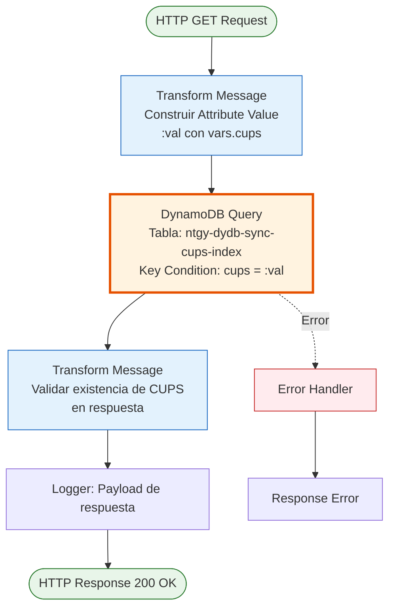
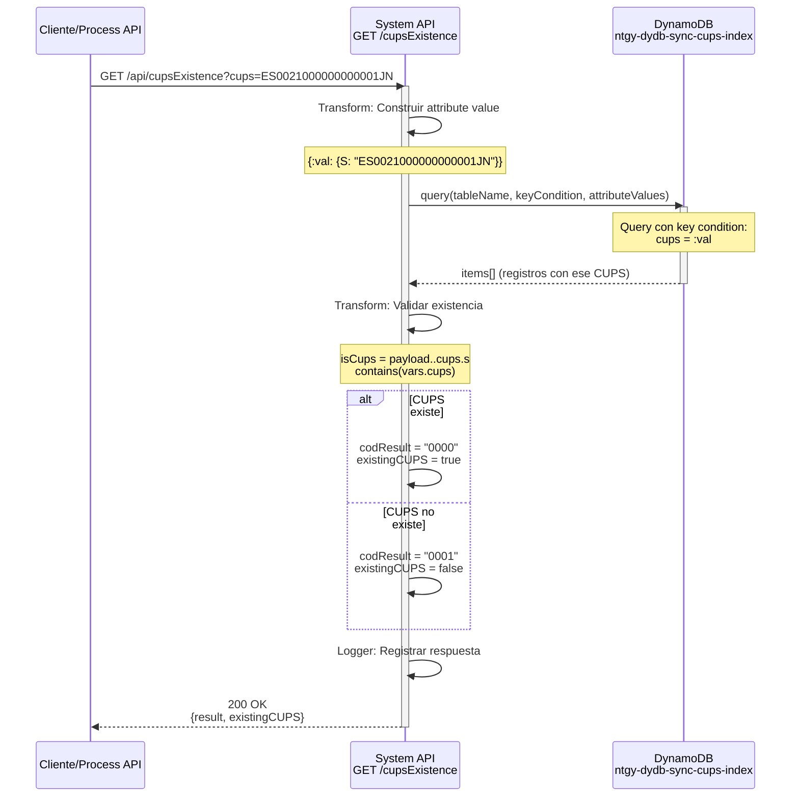
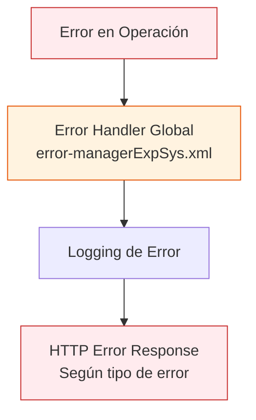

# GET /cupsExistence

## 📌 Descripción General

### Propósito del Endpoint

Este endpoint verifica la existencia de un CUPS (Código Universal de Punto de Suministro) en el sistema consultando el índice de sincronización almacenado en DynamoDB (`ntgy-dydb-sync-cups-index`). Utiliza una operación de query eficiente para buscar el CUPS específico y retorna un indicador booleano de su existencia junto con un código de resultado.

El endpoint soporta:
- **Validación de CUPS**: Verifica si un punto de suministro existe en el sistema
- **Query Eficiente**: Usa índice de DynamoDB para búsqueda rápida
- **Respuesta Binaria**: Retorna existencia como boolean más código de resultado

### Tipo de API

**Capa:** System API (API-Led Connectivity)

**Función:** Integración directa con Amazon DynamoDB para validación de existencia de puntos de suministro (CUPS).

### Patrón de Integración

**Tipo:** Request-Reply Síncrono con DynamoDB Query

**Descripción:** Recibe un código CUPS como parámetro, ejecuta una query en la tabla `ntgy-dydb-sync-cups-index` de DynamoDB usando key condition expression, valida la existencia del CUPS en los resultados mediante DataWeave, y retorna un indicador booleano junto con código de resultado.

### Arquitectura API-Led Connectivity

```mermaid
graph TB
    Client[Cliente/Process API<br/>Solicita Validación]
    S[System API<br/>ntgy-newco-s-dynamodb<br/>GET /cupsExistence]
    DDB[(DynamoDB<br/>ntgy-dydb-sync-cups-index<br/>Índice de CUPS)]
    
    Client -->|GET Request<br/>+ CUPS param| S
    S -->|Construir Query| S
    S -->|query con key condition| DDB
    DDB -->|Items matching CUPS| S
    S -->|Validar existencia| S
    S -->|{existingCUPS: boolean} JSON| Client
    
    style S fill:#e1f5ff,stroke:#01579b,stroke-width:3px
    style DDB fill:#fff3e0,stroke:#e65100,stroke-width:2px
```

---

## 💼 Propósito del Negocio

### Casos de Uso Principales

1. **Validación Previa a Operaciones**
   - Verificar que un CUPS existe antes de realizar operaciones sobre él
   - Prevenir errores en procesos de alta, modificación o baja
   - Beneficio: Evitar operaciones sobre puntos de suministro inexistentes

2. **Validación en Formularios**
   - Validar CUPS ingresado por usuario en tiempo real
   - Proporcionar feedback inmediato sobre validez del CUPS
   - Beneficio: Mejor experiencia de usuario y reducción de errores

3. **Sincronización de Datos**
   - Verificar si un CUPS ya está sincronizado en el sistema
   - Evitar duplicados en procesos de sincronización
   - Beneficio: Integridad de datos y prevención de duplicados

4. **Procesos de Onboarding**
   - Validar CUPS durante alta de nuevos contratos
   - Verificar disponibilidad del punto de suministro
   - Beneficio: Procesos de alta más robustos y confiables

### Contexto Empresarial

- **Dominio:** Gestión de Puntos de Suministro Eléctrico
- **Sector:** Energía - Utilities
- **División:** Naturgy España - NewCo
- **Proceso de Negocio:** Validación de puntos de suministro para operaciones comerciales
- **Tipo de Datos:** Datos de referencia de puntos de suministro (CUPS)

### Stakeholders

- **Equipos de Ventas**: Necesitan validar CUPS durante proceso de venta
- **Equipos de Atención al Cliente**: Validan CUPS en consultas y gestiones
- **Equipos de Desarrollo**: Integran validación en formularios y procesos
- **Equipos de Operaciones**: Verifican CUPS antes de operaciones técnicas

### Valor de Negocio

- **Prevención de Errores**: Evita operaciones sobre CUPS inexistentes
- **Validación en Tiempo Real**: Feedback inmediato al usuario
- **Integridad de Datos**: Mantiene consistencia en el sistema
- **Mejor Experiencia de Usuario**: Validación rápida y clara

### Consumidores Potenciales

Este endpoint puede ser consumido por:
- Experience APIs de portales web y móviles
- Process APIs de gestión de contratos y clientes
- Aplicaciones de ventas y atención al cliente
- Formularios de alta y modificación de contratos
- Sistemas de validación y compliance

---

## 🔧 Especificación Técnica

### URLs por Ambiente

| Ambiente | URL Base | URL Completa |
|----------|----------|--------------|
| **Local** | `http://localhost:8081` | `http://localhost:8081/api/cupsExistence` |
| **Development** | `https://ntgy-newco-s-dynamodb-dev.us-e2.cloudhub.io` | `https://ntgy-newco-s-dynamodb-dev.us-e2.cloudhub.io/api/cupsExistence` |
| **UAT** | `https://ntgy-newco-s-dynamodb-uat.us-e2.cloudhub.io` | `https://ntgy-newco-s-dynamodb-uat.us-e2.cloudhub.io/api/cupsExistence` |
| **Production** | `https://ntgy-newco-s-dynamodb-pro.us-e2.cloudhub.io` | `https://ntgy-newco-s-dynamodb-pro.us-e2.cloudhub.io/api/cupsExistence` |

### Método HTTP

```
GET /api/cupsExistence
```

### Parámetros de Entrada

#### Headers HTTP

| Header | Tipo | Requerido | Descripción | Ejemplo |
|--------|------|-----------|-------------|---------|
| `Accept` | string | ❌ No | Tipo de contenido esperado en response | `application/json` |
| `client_id` | string | ✅ Sí | Client ID de Anypoint Platform | `abc123...` |
| `client_secret` | string | ✅ Sí | Client Secret de Anypoint Platform | `xyz789...` |

#### Query Parameters

| Parámetro | Tipo | Requerido | Descripción | Formato | Ejemplo |
|-----------|------|-----------|-------------|---------|---------|
| `cups` | string | ✅ Sí | Código Universal de Punto de Suministro a verificar | Código alfanumérico | `ES0021000000000001JN` |

**Notas sobre el Parámetro CUPS:**
- El CUPS es el identificador único del punto de suministro eléctrico
- Formato típico en España: 20-22 caracteres alfanuméricos
- Ejemplo: `ES0021000000000001JN` (ES + código distribuidora + número secuencial + dígitos control)
- El endpoint valida la existencia, no el formato del CUPS

### Respuestas

#### Respuesta Exitosa - CUPS Existe (200 OK)

```json
{
  "result": {
    "codResult": "0000",
    "msgResult": "No hay error"
  },
  "existingCUPS": true
}
```

**Descripción de Campos:**

| Campo | Tipo | Descripción |
|-------|------|-------------|
| `result.codResult` | string | Código de resultado (`0000` = CUPS existe) |
| `result.msgResult` | string | Mensaje descriptivo del resultado |
| `existingCUPS` | boolean | `true` si el CUPS existe en el sistema |

#### Respuesta Exitosa - CUPS No Existe (200 OK)

```json
{
  "result": {
    "codResult": "0001",
    "msgResult": "No existe el CUPS"
  },
  "existingCUPS": false
}
```

**Descripción de Campos:**

| Campo | Tipo | Descripción |
|-------|------|-------------|
| `result.codResult` | string | Código de resultado (`0001` = CUPS no existe) |
| `result.msgResult` | string | Mensaje descriptivo: "No existe el CUPS" |
| `existingCUPS` | boolean | `false` si el CUPS no existe en el sistema |

**Nota Importante:** Ambas respuestas retornan HTTP 200 OK. La no existencia del CUPS no es un error técnico, sino un resultado de negocio válido. El campo `existingCUPS` y el `codResult` indican si el CUPS existe o no.

#### Respuesta de Error

En caso de error técnico (ej: error de conexión a DynamoDB, parámetro faltante), el endpoint utiliza el error handler global del proyecto (`error-managerExpSys.xml`). Las respuestas de error siguen el formato estándar del sistema.

### Autenticación y Autorización

- **Tipo:** Client ID & Client Secret (Anypoint Platform)
- **Autorización DynamoDB:** El usuario de servicio debe tener permisos para:
  - Operación `Query` en tabla `ntgy-dydb-sync-cups-index`
  - Acceso de lectura a la tabla
  - Permisos IAM configurados correctamente

### Timeouts

| Tipo | Valor | Descripción |
|------|-------|-------------|
| **Request Timeout** | 30 segundos | Tiempo máximo de espera para la respuesta |
| **Connection Timeout** | 10 segundos | Tiempo máximo para establecer conexión con DynamoDB |
| **DynamoDB Query** | 20 segundos | Tiempo máximo para operación query |

---

## 🏗️ Implementación Técnica

### Arquitectura del Flow



### Componentes del Flow

#### 1. Transformación de Entrada (DataWeave)

```dataweave
%dw 2.0
output application/java
---
{
    ":val": {"S": vars.cups}
}
```

**Análisis de la Transformación:**

- **Propósito:** Construir el attribute value para la query de DynamoDB
- **Input:** `vars.cups` (parámetro de query del request)
- **Output:** Java Map con formato DynamoDB
- **Estructura:**
  - `:val`: Placeholder para usar en key condition expression
  - `{"S": vars.cups}`: Formato DynamoDB para String

#### 2. DynamoDB Query

```xml
<dynamodb:query 
    doc:name="Query" 
    config-ref="Amazon_DynamoDB_Configuration" 
    tableName="ntgy-dydb-sync-cups-index" 
    keyConditionExpression="cups = :val" 
    attributeValues="#[payload]"/>
```

**Análisis de la Operación:**

- **Operación:** Query (más eficiente que Scan)
- **Tabla:** `ntgy-dydb-sync-cups-index`
- **Key Condition:** `cups = :val` (búsqueda exacta por CUPS)
- **Attribute Values:** Payload construido en paso anterior

**⚠️ Nota sobre Scan Comentado:**
```xml
<!-- [STUDIO:"Scan"]
<dynamodb:scan tableName="ntgy-dydb-product-list" .../>
[STUDIO] -->
```
- Hay un scan comentado que no se usa
- Query es más eficiente porque usa el índice
- Query requiere key condition expression

**Ventajas de Query vs Scan:**
- **Query:** Usa índice, más rápido, menos costoso
- **Scan:** Lee toda la tabla, más lento, más costoso
- Para búsqueda por clave primaria, Query es la opción correcta

#### 3. Transformación de Respuesta (DataWeave)

```dataweave
%dw 2.0
output application/json
//var isCups = payload.Items.*contractAccountList..contractAccountRefList..techData..cups.S contains(vars.cups)
var isCups = payload..cups.s contains(vars.cups)
---
{
    "result": {
        "codResult": if(isCups) "0000" else "0001",
        "msgResult": if(isCups) "No hay error" else "No existe el CUPS"
    },
    "existingCUPS": isCups
}
```

**Análisis de la Transformación:**

1. **Variable isCups:**
   - Usa selector recursivo `..` para buscar en toda la estructura
   - Busca atributo `cups.s` (formato DynamoDB String)
   - Usa `contains()` para verificar si el CUPS está presente
   - Retorna boolean

2. **Lógica Condicional:**
   - Si `isCups = true`:
     - `codResult`: "0000" (éxito)
     - `msgResult`: "No hay error"
   - Si `isCups = false`:
     - `codResult`: "0001" (no encontrado)
     - `msgResult`: "No existe el CUPS"

3. **Campo existingCUPS:**
   - Retorna directamente el valor boolean de `isCups`
   - Facilita validación en cliente sin parsear mensaje

**Nota sobre Código Comentado:**
```dataweave
//var isCups = payload.Items.*contractAccountList..contractAccountRefList..techData..cups.S contains(vars.cups)
```
- Hay una versión anterior comentada con path más específico
- La versión actual usa selector recursivo más genérico
- Ambas buscan el CUPS en la estructura de respuesta

#### 4. Logger Final

```xml
<logger level="INFO" 
        doc:name="Logger" 
        message="#[payload]"/>
```
- Registra el payload de respuesta completo
- Nivel INFO para trazabilidad
- Útil para auditoría y troubleshooting

### Diagrama de Secuencia



### Tabla DynamoDB

#### ntgy-dydb-sync-cups-index

**Propósito:** Índice de sincronización de CUPS (Códigos Universales de Punto de Suministro) para validación rápida de existencia.

**Estructura de Items:**

| Atributo | Tipo DynamoDB | Descripción | Ejemplo |
|----------|---------------|-------------|---------|
| `cups` | String (S) | Código Universal de Punto de Suministro (clave primaria) | `"ES0021000000000001JN"` |
| Otros atributos | Varios | Información adicional del punto de suministro | Varía según sincronización |

**Operación Utilizada:**
- **Query con Key Condition:** Búsqueda eficiente por clave primaria
- **Ventaja:** Usa índice, respuesta rápida
- **Key Condition Expression:** `cups = :val` (igualdad exacta)

**Capacidad:**
- Read Capacity Units (RCU): Auto-scaling
- Tamaño estimado por item: Variable según datos sincronizados
- Cantidad típica de items: Miles a millones de CUPS

**Índices:**
- Primary Key: `cups` (Partition Key)
- Optimizado para búsquedas por CUPS específico

### Transformaciones DataWeave

#### Transformación 1: Construcción de Attribute Value

**Ubicación:** Inline en el flow XML (líneas 2-11)

**Propósito:** Preparar el valor del CUPS en formato DynamoDB para la query

**Características:**
- Convierte string simple a formato DynamoDB
- Usa placeholder `:val` para key condition
- Output: Java Map

#### Transformación 2: Validación de Existencia

**Ubicación:** Inline en el flow XML (líneas 14-28)

**Propósito:** Validar si el CUPS existe en los resultados y construir respuesta

**Características:**
- Usa selector recursivo `..` para buscar en estructura
- Función `contains()` para verificar presencia
- Lógica condicional para códigos de resultado
- Output: JSON estructurado

**Ejemplo de Transformación Completa:**

```dataweave
// Input (payload de DynamoDB Query)
{
  "Items": [
    {
      "cups": {"S": "ES0021000000000001JN"},
      "contractAccountList": {...}
    }
  ],
  "Count": 1,
  "ScannedCount": 1
}

// Variable isCups
// payload..cups.s = ["ES0021000000000001JN"]
// contains(vars.cups) = true

// Output (después de transformación)
{
  "result": {
    "codResult": "0000",
    "msgResult": "No hay error"
  },
  "existingCUPS": true
}
```

### Manejo de Errores



**Estrategia de Manejo:**
- Los errores técnicos son capturados por el error handler global
- Se registran en logs para troubleshooting y auditoría
- Se retorna respuesta de error según el tipo
- **Importante:** La no existencia del CUPS NO es un error, es un resultado válido (HTTP 200 con `codResult: "0001"`)

### Configuración de DynamoDB

```xml
<dynamodb:config name="Amazon_DynamoDB_Configuration">
    <dynamodb:basic-connection 
        accessKey="${secure::aws.accessKey}"
        secretKey="${secure::aws.secretKey}"
        region="${aws.region}"/>
</dynamodb:config>
```

**Parámetros de Configuración:**
- `accessKey`: AWS Access Key (secure property)
- `secretKey`: AWS Secret Key (secure property)
- `region`: Región de AWS (ej: eu-west-1)

---

## 💻 Ejemplos de Uso

### Ejemplo 1: Verificar CUPS Existente

#### Request

```bash
curl -X GET "https://ntgy-newco-s-dynamodb-dev.us-e2.cloudhub.io/api/cupsExistence?cups=ES0021000000000001JN" \
  -H "Accept: application/json" \
  -H "client_id: your-client-id" \
  -H "client_secret: your-client-secret"
```

#### Response (200 OK)

```json
{
  "result": {
    "codResult": "0000",
    "msgResult": "No hay error"
  },
  "existingCUPS": true
}
```

### Ejemplo 2: Verificar CUPS No Existente

#### Request

```bash
curl -X GET "https://ntgy-newco-s-dynamodb-dev.us-e2.cloudhub.io/api/cupsExistence?cups=ES9999999999999999XX" \
  -H "Accept: application/json" \
  -H "client_id: your-client-id" \
  -H "client_secret: your-client-secret"
```

#### Response (200 OK)

```json
{
  "result": {
    "codResult": "0001",
    "msgResult": "No existe el CUPS"
  },
  "existingCUPS": false
}
```

### Ejemplo 3: Uso desde JavaScript/React

```javascript
const axios = require('axios');

async function validateCUPS(cups) {
  try {
    const response = await axios.get(
      `https://ntgy-newco-s-dynamodb-dev.us-e2.cloudhub.io/api/cupsExistence`,
      {
        params: { cups },
        headers: {
          'Accept': 'application/json',
          'client_id': process.env.CLIENT_ID,
          'client_secret': process.env.CLIENT_SECRET
        }
      }
    );
    
    const { existingCUPS, result } = response.data;
    
    return {
      exists: existingCUPS,
      code: result.codResult,
      message: result.msgResult
    };
  } catch (error) {
    console.error('Error al validar CUPS:', error.message);
    throw error;
  }
}

// Uso en componente React
function CUPSValidator() {
  const [cups, setCups] = useState('');
  const [validation, setValidation] = useState(null);
  const [loading, setLoading] = useState(false);
  
  const handleValidate = async () => {
    if (!cups) return;
    
    setLoading(true);
    try {
      const result = await validateCUPS(cups);
      setValidation(result);
    } catch (error) {
      setValidation({ exists: false, message: 'Error de validación' });
    } finally {
      setLoading(false);
    }
  };
  
  return (
    <div>
      <input
        type="text"
        value={cups}
        onChange={(e) => setCups(e.target.value)}
        placeholder="Ingrese CUPS"
      />
      <button onClick={handleValidate} disabled={loading}>
        {loading ? 'Validando...' : 'Validar CUPS'}
      </button>
      
      {validation && (
        <div className={validation.exists ? 'success' : 'error'}>
          {validation.exists ? '✓ CUPS válido' : '✗ CUPS no encontrado'}
          <p>{validation.message}</p>
        </div>
      )}
    </div>
  );
}
```

### Ejemplo 4: Uso desde Python

```python
import requests

def validate_cups(cups):
    """
    Valida la existencia de un CUPS en el sistema
    """
    url = "https://ntgy-newco-s-dynamodb-dev.us-e2.cloudhub.io/api/cupsExistence"
    headers = {
        "Accept": "application/json",
        "client_id": "your-client-id",
        "client_secret": "your-client-secret"
    }
    params = {"cups": cups}
    
    try:
        response = requests.get(url, headers=headers, params=params)
        response.raise_for_status()
        
        data = response.json()
        
        return {
            'exists': data['existingCUPS'],
            'code': data['result']['codResult'],
            'message': data['result']['msgResult']
        }
        
    except requests.exceptions.RequestException as e:
        print(f"✗ Error de conexión: {str(e)}")
        return None

# Uso
cups_to_validate = "ES0021000000000001JN"
result = validate_cups(cups_to_validate)

if result:
    if result['exists']:
        print(f"✓ CUPS {cups_to_validate} existe en el sistema")
    else:
        print(f"✗ CUPS {cups_to_validate} no encontrado")
        print(f"   Mensaje: {result['message']}")
```

### Ejemplo 5: Validación en Formulario con Feedback en Tiempo Real

```javascript
class CUPSFormValidator {
  constructor() {
    this.debounceTimer = null;
    this.cache = new Map();
  }
  
  async validateWithDebounce(cups, callback) {
    // Limpiar timer anterior
    clearTimeout(this.debounceTimer);
    
    // Verificar cache
    if (this.cache.has(cups)) {
      callback(this.cache.get(cups));
      return;
    }
    
    // Debounce de 500ms
    this.debounceTimer = setTimeout(async () => {
      try {
        const result = await validateCUPS(cups);
        this.cache.set(cups, result);
        callback(result);
      } catch (error) {
        callback({ exists: false, message: 'Error de validación' });
      }
    }, 500);
  }
  
  clearCache() {
    this.cache.clear();
  }
}

// Uso en formulario
const validator = new CUPSFormValidator();

document.getElementById('cupsInput').addEventListener('input', (e) => {
  const cups = e.target.value;
  const feedbackElement = document.getElementById('cupsFeedback');
  
  if (cups.length < 20) {
    feedbackElement.textContent = 'Ingrese CUPS completo';
    feedbackElement.className = 'warning';
    return;
  }
  
  feedbackElement.textContent = 'Validando...';
  feedbackElement.className = 'loading';
  
  validator.validateWithDebounce(cups, (result) => {
    if (result.exists) {
      feedbackElement.textContent = '✓ CUPS válido';
      feedbackElement.className = 'success';
    } else {
      feedbackElement.textContent = '✗ CUPS no encontrado';
      feedbackElement.className = 'error';
    }
  });
});
```

### Ejemplo 6: Validación Batch de Múltiples CUPS

```python
import requests
from concurrent.futures import ThreadPoolExecutor, as_completed

def validate_cups_batch(cups_list, max_workers=5):
    """
    Valida múltiples CUPS en paralelo
    """
    url = "https://ntgy-newco-s-dynamodb-dev.us-e2.cloudhub.io/api/cupsExistence"
    headers = {
        "Accept": "application/json",
        "client_id": "your-client-id",
        "client_secret": "your-client-secret"
    }
    
    def validate_single(cups):
        try:
            response = requests.get(url, headers=headers, params={"cups": cups})
            data = response.json()
            return {
                'cups': cups,
                'exists': data['existingCUPS'],
                'code': data['result']['codResult']
            }
        except Exception as e:
            return {
                'cups': cups,
                'exists': False,
                'error': str(e)
            }
    
    results = []
    with ThreadPoolExecutor(max_workers=max_workers) as executor:
        futures = {executor.submit(validate_single, cups): cups for cups in cups_list}
        
        for future in as_completed(futures):
            results.append(future.result())
    
    return results

# Uso
cups_list = [
    "ES0021000000000001JN",
    "ES0021000000000002JN",
    "ES0021000000000003JN",
    "ES9999999999999999XX"  # Este no existe
]

results = validate_cups_batch(cups_list)

# Resumen
existing = [r for r in results if r['exists']]
not_found = [r for r in results if not r['exists'] and 'error' not in r]
errors = [r for r in results if 'error' in r]

print(f"✓ CUPS existentes: {len(existing)}")
print(f"✗ CUPS no encontrados: {len(not_found)}")
print(f"⚠ Errores: {len(errors)}")
```

### Consideraciones de Uso

#### Performance
- **Operación Query:** Muy eficiente, usa índice de DynamoDB
- **Tiempo típico:** < 100ms para búsqueda por CUPS
- **Recomendación:** Ideal para validaciones en tiempo real

#### Caching
- **Estrategia recomendada:** Cache de corta duración (5-10 minutos) en cliente
- **Invalidación:** Refrescar cache después de operaciones que modifiquen CUPS
- **Beneficio:** Reduce llamadas al API para validaciones repetidas

#### Códigos de Resultado
- **0000:** CUPS existe en el sistema (operación exitosa)
- **0001:** CUPS no existe (no es error técnico, es resultado de negocio)
- **Otros códigos:** Errores técnicos manejados por error handler global

#### Mejores Prácticas
1. **Validación en tiempo real:** Implementar debounce para evitar llamadas excesivas
2. **Feedback claro:** Mostrar mensajes claros al usuario sobre existencia del CUPS
3. **Cache inteligente:** Cachear resultados positivos, no negativos (pueden cambiar)
4. **Manejo de errores:** Distinguir entre "no existe" y "error de validación"
5. **Validación de formato:** Validar formato del CUPS antes de llamar al API
