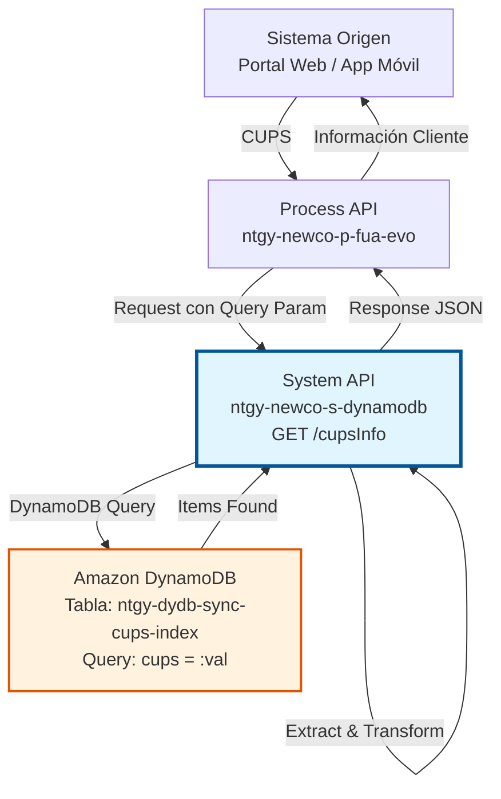
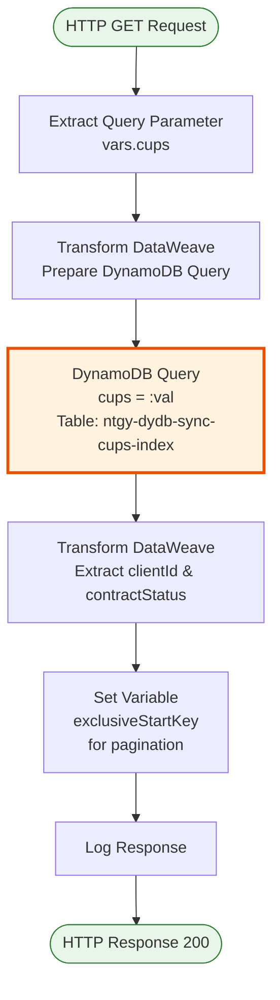
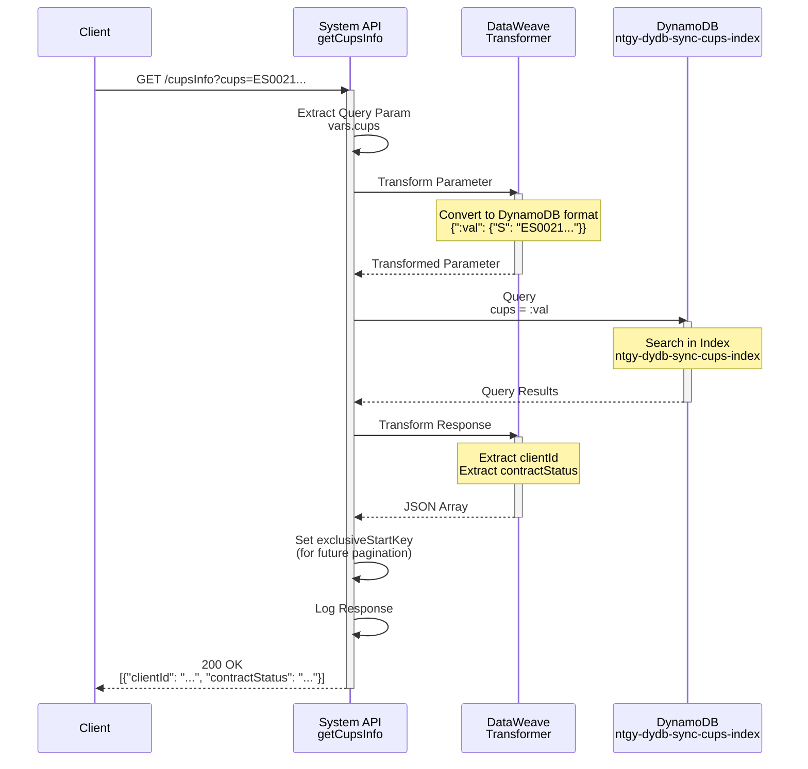
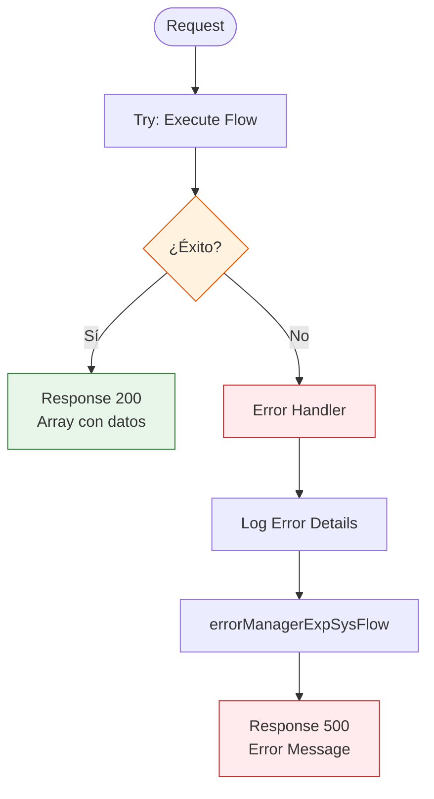

# GET /cupsInfo

## 📌 Descripción General

### Propósito del Endpoint

Este endpoint permite consultar información asociada a un CUPS (Código Universal del Punto de Suministro) específico en la tabla DynamoDB `ntgy-dydb-sync-cups-index`. Retorna el identificador del cliente y el estado del contrato vinculado al punto de suministro consultado.

El endpoint soporta:
- **Consulta por CUPS**: Búsqueda directa mediante el código CUPS
- **Validación de Suministro**: Verificación de existencia y estado del punto de suministro
- **Información de Cliente**: Obtención del clientId asociado al CUPS
- **Estado de Contrato**: Consulta del estado actual del contrato (contractStatus)

### Tipo de API

**Capa:** System API (API-Led Connectivity)

**Función:** Integración directa con Amazon DynamoDB para consulta de información de CUPS y su relación con clientes y contratos.

### Patrón de Integración

**Tipo:** Request-Reply Síncrono con DynamoDB Query

**Descripción:** El endpoint recibe un código CUPS como query parameter, transforma el parámetro al formato DynamoDB, ejecuta una query en la tabla de índice de CUPS, extrae la información del cliente y estado del contrato, y retorna un array JSON con los datos encontrados.

### Arquitectura API-Led Connectivity



---

## 💼 Propósito del Negocio

### Casos de Uso Principales

1. **Validación de Punto de Suministro**
   - Verificar que un CUPS existe en el sistema antes de operaciones críticas
   - Validar la asociación entre CUPS y cliente durante procesos de alta/baja
   - Confirmar la disponibilidad del punto de suministro para nuevos contratos

2. **Consulta de Información de Cliente**
   - Obtener el clientId asociado a un CUPS específico
   - Identificar el titular del suministro para gestiones comerciales
   - Vincular puntos de suministro con datos de cliente en procesos de atención

3. **Verificación de Estado de Contrato**
   - Consultar el estado actual del contrato asociado al CUPS
   - Validar si el contrato está activo, suspendido o cancelado
   - Determinar la elegibilidad para cambios contractuales

### Contexto Empresarial

- **Dominio:** Gestión de Suministros Energéticos
- **Sector:** Energía - Utilities
- **División:** Naturgy España - NewCo
- **Proceso de Negocio:** Validación y consulta de puntos de suministro (CUPS)
- **Módulo:** Gestión de Índice de CUPS

### Stakeholders

- **Equipos de Atención al Cliente**: Necesitan verificar información de suministros durante llamadas
- **Equipos Comerciales**: Requieren validar CUPS antes de ofertas y contrataciones
- **Equipos de Operaciones**: Validan puntos de suministro para intervenciones técnicas
- **Sistemas de Facturación**: Consultan información de cliente asociada a CUPS

### Valor de Negocio

- **Validación Rápida**: Verificación instantánea de existencia y estado de CUPS
- **Prevención de Errores**: Evita operaciones sobre CUPS inexistentes o inválidos
- **Eficiencia Operativa**: Reduce tiempo de búsqueda de información de suministros
- **Integridad de Datos**: Garantiza consistencia entre CUPS, clientes y contratos

### Consumidores Potenciales

Este endpoint puede ser consumido por:
- Process APIs de gestión de clientes y contratos
- Portales de autoservicio (web y móvil)
- Sistemas de atención al cliente (call center)
- Aplicaciones de gestión comercial
- Sistemas de validación de suministros

---

## 🔧 Especificación Técnica

### URLs por Ambiente

| Ambiente | URL Base | URL Completa |
|----------|----------|--------------|
| **Local** | `http://localhost:8081` | `http://localhost:8081/api/cupsInfo?cups={cups}` |
| **Development** | `https://ntgy-newco-s-dynamodb-dev.us-e2.cloudhub.io` | `https://ntgy-newco-s-dynamodb-dev.us-e2.cloudhub.io/api/cupsInfo?cups={cups}` |
| **UAT** | `https://ntgy-newco-s-dynamodb-uat.us-e2.cloudhub.io` | `https://ntgy-newco-s-dynamodb-uat.us-e2.cloudhub.io/api/cupsInfo?cups={cups}` |
| **Production** | `https://ntgy-newco-s-dynamodb-pro.us-e2.cloudhub.io` | `https://ntgy-newco-s-dynamodb-pro.us-e2.cloudhub.io/api/cupsInfo?cups={cups}` |

### Método HTTP

```
GET /api/cupsInfo?cups={cups}
```

### Parámetros de Entrada

#### Headers HTTP

| Header | Tipo | Requerido | Descripción | Ejemplo |
|--------|------|-----------|-------------|---------|
| `Accept` | string | ❌ No | Tipo de contenido esperado en response | `application/json` |

#### Query Parameters

| Parámetro | Tipo | Requerido | Descripción | Ejemplo |
|-----------|------|-----------|-------------|---------|
| `cups` | string | ✅ Sí | Código Universal del Punto de Suministro | `"ES0021000000000001JN0F"` |

**Formato del CUPS:**
- Longitud: 20-22 caracteres
- Formato: `ES` + 16 dígitos + 2 letras de control
- Ejemplo: `ES0021000000000001JN0F`

### Respuestas

#### Respuesta Exitosa (200 OK)

```json
[
  {
    "clientId": "12345678",
    "contractStatus": "02"
  }
]
```

**Campos de Respuesta:**

| Campo | Tipo | Descripción |
|-------|------|-------------|
| `clientId` | string | Identificador único del cliente asociado al CUPS |
| `contractStatus` | string | Código de estado del contrato (02=Activo, 08=Suspendido, 16=Cancelado, etc.) |

**Códigos de Estado de Contrato Comunes:**
- `02`: Contrato Activo
- `03`: Contrato en Proceso
- `04`: Contrato Pendiente
- `08`: Contrato Suspendido
- `16`: Contrato Cancelado
- `20`: Contrato Histórico

#### Respuesta sin Resultados (200 OK)

```json
[
  {
    "clientId": null,
    "contractStatus": null
  }
]
```

**Nota:** Cuando no se encuentra el CUPS, se retorna un array con valores null.

#### Respuesta de Error Técnico (500)

```json
{
  "result": {
    "codResult": "0001",
    "msgResult": "Error interno del servidor"
  }
}
```

### Autenticación y Autorización

- **Tipo:** Client ID & Client Secret (Anypoint Platform)
- **Autorización DynamoDB:** El usuario debe tener permisos IAM para:
  - Operación `dynamodb:Query` en tabla `ntgy-dydb-sync-cups-index`
  - Acceso de lectura a la tabla

### Timeouts

| Tipo | Valor | Descripción |
|------|-------|-------------|
| **Request Timeout** | 30 segundos | Tiempo máximo de espera para la respuesta |
| **Connection Timeout** | 10 segundos | Tiempo máximo para establecer conexión con DynamoDB |
| **Query Timeout** | 5 segundos | Tiempo máximo para ejecutar la query |

---

## 🏗️ Implementación Técnica

### Arquitectura del Flow



### Componentes del Flow

#### 1. Extracción de Query Parameter
```xml
<ee:transform doc:name="Transform Message">
    <ee:variables>
        <ee:set-variable variableName="cups">
            attributes.queryParams.'cups'
        </ee:set-variable>
    </ee:variables>
</ee:transform>
```
- **Propósito:** Extraer el parámetro `cups` de la query string
- **Variable:** `vars.cups`
- **Ubicación:** Línea 569-574 del archivo principal

#### 2. Transformación de Parámetro (Input)
```dataweave
%dw 2.0
output application/java
---
{
  ":val": {"S": vars.cups}
}
```

**Función:**
- Convierte el CUPS a formato DynamoDB String
- Prepara el parámetro para la key condition expression
- Output: Formato Java para el conector DynamoDB

**Ejemplo de Transformación:**
```json
// Input
vars.cups = "ES0021000000000001JN0F"

// Output
{
  ":val": {
    "S": "ES0021000000000001JN0F"
  }
}
```

#### 3. DynamoDB Query
```xml
<dynamodb:query 
    doc:name="Query" 
    config-ref="Amazon_DynamoDB_Configuration" 
    keyConditionExpression="cups = :val" 
    tableName="ntgy-dydb-sync-cups-index" 
    attributeValues="#[payload]"/>
```

**Configuración:**
- **Tabla:** `ntgy-dydb-sync-cups-index`
- **Key Condition:** `cups = :val`
- **Attribute Values:** Payload con el parámetro transformado
- **Operación:** Query (más eficiente que Scan)

#### 4. Transformación de Respuesta (Output)
```dataweave
%dw 2.0
output application/json
---
[{
  "clientId": payload.items..clientId.s[0],
  "contractStatus": payload.items..contractStatus.s[0]
}]
```

**Función:**
- Extrae `clientId` del primer item encontrado
- Extrae `contractStatus` del primer item encontrado
- Retorna array con un objeto JSON
- Usa navegación profunda (`..`) para acceder a campos anidados

**⚠️ NOTA IMPORTANTE:**
El código tiene comentarios que indican una transformación más compleja comentada:
```dataweave
/*(flatten(payload.items.contractAccountList.l..m.products.l) 
  filter(value, index) -> (value.m.techData.m.cups.s == vars.cups)) 
  map (item) -> {
    "clientId": item.m.productType.m.clientId.s,
    "contractStatus": item.m.contractStatus.s,
}*/
```

Esta transformación comentada sugiere:
- Búsqueda en estructura anidada de productos
- Filtrado por CUPS en datos técnicos
- Implementación más robusta pendiente de revisión

**Comentarios en el código:** `//pdte revisar` (pendiente revisar)

#### 5. Variable de Paginación
```dataweave
%dw 2.0
output application/java
---
leaseKey: {
  S: payload.lastEvaluatedKey.leaseKey.s
}
```

**Propósito:**
- Preparar `exclusiveStartKey` para paginación futura
- Almacenar el último leaseKey evaluado
- Actualmente no se usa en el flow (preparado para implementación futura)

#### 6. Logger
```xml
<logger level="INFO" message="#[payload]"/>
```
- **Propósito:** Registrar el payload de respuesta
- **Nivel:** INFO
- **Contenido:** Payload completo transformado

### Diagrama de Secuencia Detallado



### Manejo de Errores



**Tipos de Errores Manejados:**
- **DynamoDB Connectivity**: Error de conexión con DynamoDB
- **DynamoDB Throttling**: Límite de capacidad excedido
- **Invalid CUPS Format**: CUPS con formato inválido
- **Query Timeout**: Timeout en la consulta
- **ANY**: Cualquier otro error no esperado

### Configuración DynamoDB

```xml
<dynamodb:config name="Amazon_DynamoDB_Configuration">
    <dynamodb:basic-connection 
        accessKey="${secure::aws.accessKey}"
        secretKey="${secure::aws.secretKey}"
        region="${aws.region}"/>
</dynamodb:config>
```

**Parámetros de Configuración:**
- **Access Key**: Credencial AWS (secure property)
- **Secret Key**: Credencial AWS (secure property)
- **Region**: Región AWS (ej: eu-west-1)

### Tabla DynamoDB: ntgy-dydb-sync-cups-index

**Estructura:**
- **Clave Primaria (Partition Key):** `cups` (String)
- **Atributos Principales:**
  - `clientId` (String): Identificador del cliente
  - `contractStatus` (String): Estado del contrato
  - `leaseKey` (String): Clave de lease para paginación
  - Otros atributos anidados en estructura compleja

**Índices:**
- Índice primario: `cups`
- Permite búsquedas directas y eficientes por CUPS

**Capacidad:**
- Read Capacity Units (RCU): Auto-scaling
- Write Capacity Units (WCU): Auto-scaling

---

## 💻 Ejemplos de Uso

### Ejemplo 1: Consulta de CUPS Existente

#### Request

```bash
curl -X GET "https://ntgy-newco-s-dynamodb-dev.us-e2.cloudhub.io/api/cupsInfo?cups=ES0021000000000001JN0F" \
  -H "Accept: application/json" \
  -H "client_id: YOUR_CLIENT_ID" \
  -H "client_secret: YOUR_CLIENT_SECRET"
```

#### Response

```json
[
  {
    "clientId": "12345678",
    "contractStatus": "02"
  }
]
```

**Interpretación:**
- CUPS encontrado en el sistema
- Cliente asociado: `12345678`
- Estado del contrato: `02` (Activo)

### Ejemplo 2: Consulta de CUPS No Existente

#### Request

```bash
curl -X GET "https://ntgy-newco-s-dynamodb-dev.us-e2.cloudhub.io/api/cupsInfo?cups=ES9999999999999999XX9X" \
  -H "Accept: application/json" \
  -H "client_id: YOUR_CLIENT_ID" \
  -H "client_secret: YOUR_CLIENT_SECRET"
```

#### Response

```json
[
  {
    "clientId": null,
    "contractStatus": null
  }
]
```

**Interpretación:**
- CUPS no encontrado en el sistema
- Valores null indican ausencia de datos

### Ejemplo 3: Validación de Contrato Activo

#### Request

```bash
curl -X GET "https://ntgy-newco-s-dynamodb-dev.us-e2.cloudhub.io/api/cupsInfo?cups=ES0031000000000002KL1G" \
  -H "Accept: application/json" \
  -H "client_id: YOUR_CLIENT_ID" \
  -H "client_secret: YOUR_CLIENT_SECRET"
```

#### Response

```json
[
  {
    "clientId": "87654321",
    "contractStatus": "02"
  }
]
```

**Uso:** Validar que el contrato está activo antes de permitir modificaciones.

### Ejemplo 4: Verificación de Contrato Suspendido

#### Request

```bash
curl -X GET "https://ntgy-newco-s-dynamodb-dev.us-e2.cloudhub.io/api/cupsInfo?cups=ES0041000000000003MN2H" \
  -H "Accept: application/json"
```

#### Response

```json
[
  {
    "clientId": "11223344",
    "contractStatus": "08"
  }
]
```

**Interpretación:**
- Contrato suspendido (status `08`)
- Requiere reactivación antes de operaciones

### Ejemplo 5: Código JavaScript (Node.js)

```javascript
const axios = require('axios');

const getCupsInfo = async (cups) => {
  try {
    const response = await axios.get(
      'https://ntgy-newco-s-dynamodb-dev.us-e2.cloudhub.io/api/cupsInfo',
      {
        params: { cups },
        headers: {
          'Accept': 'application/json',
          'client_id': process.env.CLIENT_ID,
          'client_secret': process.env.CLIENT_SECRET
        }
      }
    );

    const cupsInfo = response.data[0];
    
    if (cupsInfo.clientId && cupsInfo.contractStatus) {
      console.log(`CUPS encontrado:`);
      console.log(`  Cliente: ${cupsInfo.clientId}`);
      console.log(`  Estado: ${cupsInfo.contractStatus}`);
      
      // Validar si el contrato está activo
      if (cupsInfo.contractStatus === '02') {
        console.log('  ✓ Contrato ACTIVO');
        return { valid: true, ...cupsInfo };
      } else {
        console.log('  ⚠ Contrato NO activo');
        return { valid: false, ...cupsInfo };
      }
    } else {
      console.log('CUPS no encontrado en el sistema');
      return { valid: false, found: false };
    }
  } catch (error) {
    console.error('Error consultando CUPS:', error.response?.data || error.message);
    throw error;
  }
};

// Uso
getCupsInfo('ES0021000000000001JN0F')
  .then(result => console.log('Resultado:', result))
  .catch(err => console.error('Error:', err));
```

### Ejemplo 6: Código Python

```python
import requests
import os

def get_cups_info(cups):
    """
    Consulta información de un CUPS en DynamoDB
    
    Args:
        cups (str): Código CUPS a consultar
        
    Returns:
        dict: Información del CUPS o None si no existe
    """
    url = "https://ntgy-newco-s-dynamodb-dev.us-e2.cloudhub.io/api/cupsInfo"
    
    headers = {
        "Accept": "application/json",
        "client_id": os.getenv("CLIENT_ID"),
        "client_secret": os.getenv("CLIENT_SECRET")
    }
    
    params = {"cups": cups}
    
    try:
        response = requests.get(url, params=params, headers=headers)
        response.raise_for_status()
        
        cups_info = response.json()[0]
        
        if cups_info.get("clientId") and cups_info.get("contractStatus"):
            print(f"CUPS encontrado:")
            print(f"  Cliente: {cups_info['clientId']}")
            print(f"  Estado: {cups_info['contractStatus']}")
            
            # Validar estado del contrato
            status_map = {
                "02": "ACTIVO",
                "03": "EN PROCESO",
                "08": "SUSPENDIDO",
                "16": "CANCELADO",
                "20": "HISTÓRICO"
            }
            
            status_desc = status_map.get(cups_info['contractStatus'], "DESCONOCIDO")
            print(f"  Descripción: {status_desc}")
            
            return {
                "valid": cups_info['contractStatus'] == "02",
                "found": True,
                **cups_info
            }
        else:
            print("CUPS no encontrado en el sistema")
            return {"valid": False, "found": False}
            
    except requests.exceptions.RequestException as e:
        print(f"Error consultando CUPS: {e}")
        raise

# Uso
if __name__ == "__main__":
    result = get_cups_info("ES0021000000000001JN0F")
    print(f"\nResultado: {result}")
```

### Ejemplo 7: Validación de Formato CUPS

```javascript
/**
 * Valida el formato de un CUPS antes de consultar
 */
function validateCupsFormat(cups) {
  // Formato: ES + 16 dígitos + 2 letras
  const cupsRegex = /^ES\d{16}[A-Z]{2}$/;
  
  if (!cups) {
    return { valid: false, error: 'CUPS no proporcionado' };
  }
  
  if (!cupsRegex.test(cups)) {
    return { 
      valid: false, 
      error: 'Formato CUPS inválido. Debe ser: ES + 16 dígitos + 2 letras' 
    };
  }
  
  return { valid: true };
}

// Uso con validación previa
async function getCupsInfoWithValidation(cups) {
  const validation = validateCupsFormat(cups);
  
  if (!validation.valid) {
    console.error(validation.error);
    return null;
  }
  
  return await getCupsInfo(cups);
}
```

## ⚠️ Notas de Implementación

### Estado Actual del Código

El código de implementación contiene comentarios que indican:

1. **Transformación Simplificada Actual:**
   ```dataweave
   [{
     "clientId": payload.items..clientId.s[0],
     "contractStatus": payload.items..contractStatus.s[0]
   }]
   ```
   - Extracción directa del primer item
   - Comentario: `//pdte revisar` (pendiente revisar)

2. **Transformación Compleja Comentada:**
   ```dataweave
   /*(flatten(payload.items.contractAccountList.l..m.products.l) 
     filter(value, index) -> (value.m.techData.m.cups.s == vars.cups)) 
     map (item) -> {
       "clientId": item.m.productType.m.clientId.s,
       "contractStatus": item.m.contractStatus.s,
   }*/
   ```
   - Búsqueda en estructura anidada de productos
   - Filtrado específico por CUPS en techData
   - Implementación más robusta

3. **Variable de Paginación Preparada:**
   - `exclusiveStartKey` se configura pero no se usa actualmente
   - Preparado para implementación futura de paginación

### Recomendaciones

- **Validar Formato CUPS:** Implementar validación de formato antes de consultar
- **Revisar Transformación:** Evaluar si la transformación simplificada es suficiente
- **Implementar Paginación:** Si se esperan múltiples resultados por CUPS
- **Documentar Estados:** Mantener catálogo actualizado de códigos de contractStatus