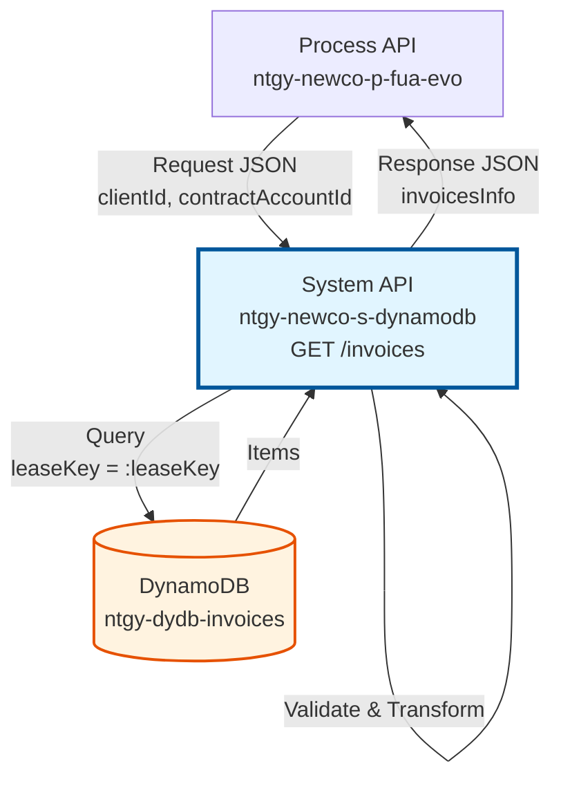
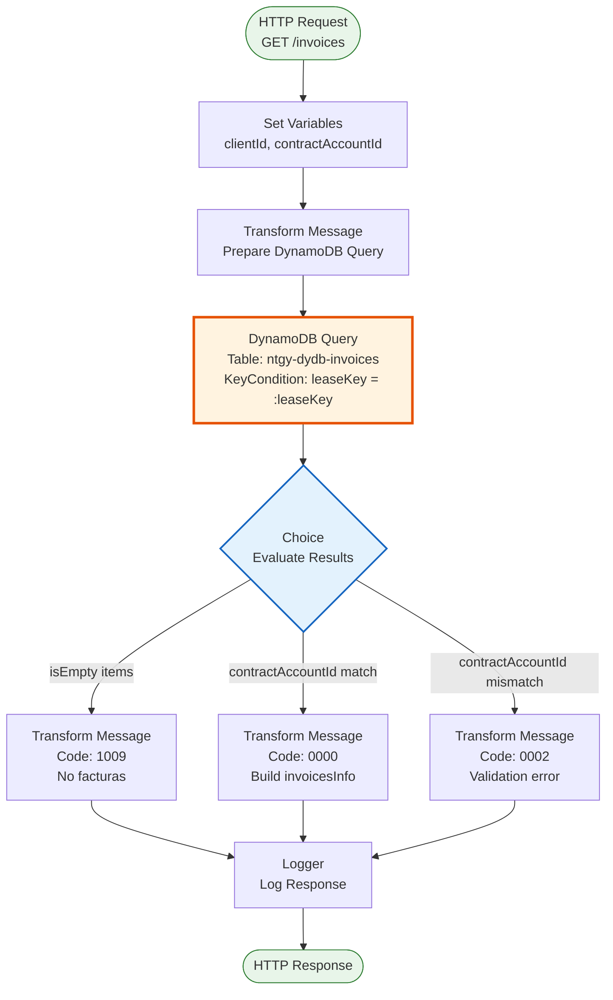
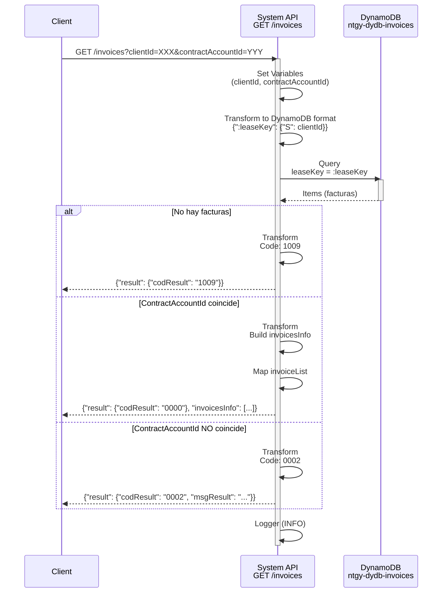

# GET /invoices

## 📌 Descripción General

### Propósito del Endpoint

Consulta las facturas asociadas a un cliente específico desde la tabla DynamoDB `ntgy-dydb-invoices`, con validación de pertenencia del contractAccountId solicitado.

El endpoint soporta:
- **Consulta por Cliente**: Recupera todas las facturas asociadas a un clientId (leaseKey)
- **Validación de Contrato**: Verifica que el contractAccountId del resultado coincida con el solicitado
- **Manejo de Casos Vacíos**: Retorna mensaje específico cuando no existen facturas
- **Estructura Completa**: Incluye lista detallada de facturas con información de facturación y PDF

### Tipo de API

**Capa:** System API (API-Led Connectivity)

**Función:** Integración directa con Amazon DynamoDB para consulta de facturas de clientes.

### Patrón de Integración

**Tipo:** Request-Reply Síncrono con DynamoDB Query

**Descripción:** Recibe clientId y contractAccountId como query parameters, transforma a formato DynamoDB, ejecuta query con keyConditionExpression, valida el contractAccountId del resultado, y retorna la lista de facturas en formato JSON.

### Arquitectura API-Led Connectivity



---

## 💼 Propósito del Negocio

### Casos de Uso Principales

1. **Consulta de Histórico de Facturas**
   - Cliente o agente consulta todas las facturas emitidas
   - Se obtiene información completa de facturación
   - Permite seguimiento de pagos y deudas

2. **Validación de Pertenencia de Contrato**
   - Verifica que el contractAccountId solicitado pertenece al cliente
   - Previene acceso a facturas de otros clientes
   - Garantiza seguridad en consultas multi-contrato

3. **Acceso a Facturas Digitales**
   - Proporciona información de disponibilidad de PDF
   - Incluye documentId para descarga de factura
   - Soporta facturas interactivas

### Contexto Empresarial

- **Dominio:** Facturación y Cobros
- **Sector:** Energía - Utilities
- **División:** Naturgy España - NewCo
- **Proceso de Negocio:** Consulta de facturas y gestión de pagos
- **Fuente de Datos:** DynamoDB (cache de datos de facturación)

### Stakeholders

- **Clientes Finales**: Consulta de sus facturas y estado de pagos
- **Agentes de Call Center**: Soporte en consultas de facturación
- **Equipos de Cobros**: Seguimiento de facturas pendientes
- **Sistemas de Autoservicio**: Portales web y apps móviles

### Valor de Negocio

- **Acceso Rápido**: Consultas < 3s desde cache DynamoDB
- **Información Completa**: Detalles de facturación, importes y estado
- **Seguridad**: Validación de pertenencia de contrato
- **Disponibilidad**: 99.9% uptime con DynamoDB

### Consumidores Potenciales

Este endpoint puede ser consumido por:
- Process APIs de facturación (ntgy-newco-p-fua-evo)
- Experience APIs de portales web y móviles
- Sistemas de agentes de call center
- Integraciones de terceros autorizados

---

## 🔧 Especificación Técnica

### URLs por Ambiente

| Ambiente | URL Base | URL Completa |
|----------|----------|--------------|
| **Local** | `http://localhost:8081` | `http://localhost:8081/api/invoices?clientId=XXX&contractAccountId=YYY` |
| **Development** | `https://ntgy-newco-s-dynamodb-dev.us-e2.cloudhub.io` | `https://ntgy-newco-s-dynamodb-dev.us-e2.cloudhub.io/api/invoices?clientId=XXX&contractAccountId=YYY` |
| **UAT** | `https://ntgy-newco-s-dynamodb-uat.us-e2.cloudhub.io` | `https://ntgy-newco-s-dynamodb-uat.us-e2.cloudhub.io/api/invoices?clientId=XXX&contractAccountId=YYY` |
| **Production** | `https://ntgy-newco-s-dynamodb-pro.us-e2.cloudhub.io` | `https://ntgy-newco-s-dynamodb-pro.us-e2.cloudhub.io/api/invoices?clientId=XXX&contractAccountId=YYY` |

### Método HTTP

```
GET /api/invoices
```

### Parámetros de Entrada

#### Headers HTTP

| Header | Tipo | Requerido | Descripción | Ejemplo |
|--------|------|-----------|-------------|---------|
| `Accept` | string | ❌ No | Tipo de contenido esperado en response | `application/json` |

#### Query Parameters

| Parámetro | Tipo | Requerido | Descripción | Ejemplo |
|-----------|------|-----------|-------------|---------|
| `clientId` | string | ✅ Sí | Identificador único del cliente (leaseKey en DynamoDB) | `"12345678"` |
| `contractAccountId` | string | ✅ Sí | Identificador de la cuenta contrato a validar | `"0001234567"` |

### Respuestas

#### Respuesta Exitosa - Facturas Encontradas (200 OK)

```json
{
  "result": {
    "codResult": "0000",
    "msgResult": "No hay error"
  },
  "invoicesInfo": [
    {
      "docNumber": "12345678A",
      "contractAccountId": "0001234567",
      "pendingAmount": "150.50",
      "invoiceList": [
        {
          "invoiceId": "INV-2024-001",
          "invoiceNum": "F-2024-001",
          "issuedDate": "2024-01-15",
          "billingDate": "2024-01-01",
          "status": "PAID",
          "productFamilyIdList": ["ELECTRICITY", "GAS"],
          "amount": "75.25",
          "interactiveInvoice": true,
          "existPdfInvoice": true,
          "pdfDocumentId": "DOC-2024-001"
        },
        {
          "invoiceId": "INV-2024-002",
          "invoiceNum": "F-2024-002",
          "issuedDate": "2024-02-15",
          "billingDate": "2024-02-01",
          "status": "PENDING",
          "productFamilyIdList": ["ELECTRICITY"],
          "amount": "75.25",
          "interactiveInvoice": true,
          "existPdfInvoice": true,
          "pdfDocumentId": "DOC-2024-002"
        }
      ]
    }
  ]
}
```

#### Respuesta - Sin Facturas (200 OK)

```json
{
  "result": {
    "codResult": "1009",
    "msgResult": "No existen facturas asociadas al cliente"
  }
}
```

#### Respuesta - Error de Validación (200 OK)

```json
{
  "result": {
    "codResult": "0002",
    "msgResult": "El contractAccountId del objeto 0001234567 no coincide con el de la llamada 0009876543"
  }
}
```

#### Respuesta de Error Técnico (500)

```json
{
  "result": {
    "codResult": "5001",
    "msgResult": "Error de conectividad con DynamoDB"
  }
}
```

### Códigos de Resultado

| Código | Tipo | Descripción |
|--------|------|-------------|
| `0000` | Success | Facturas encontradas y validadas correctamente |
| `0002` | Validation Error | El contractAccountId no coincide con el del resultado |
| `1009` | Not Found | No existen facturas asociadas al cliente |
| `5001` | Technical Error | Error de conectividad con DynamoDB |

### Autenticación y Autorización

- **Tipo:** Client ID & Client Secret (Anypoint Platform)
- **Autorización DynamoDB:** El usuario debe tener permisos para:
  - Ejecutar operación Query en tabla `ntgy-dydb-invoices`
  - Acceso de lectura a la tabla

### Timeouts

| Tipo | Valor | Descripción |
|------|-------|-------------|
| **Request Timeout** | 30 segundos | Tiempo máximo de espera para la respuesta |
| **Connection Timeout** | 10 segundos | Tiempo máximo para establecer conexión con DynamoDB |

---

## 🏗️ Implementación Técnica

### Arquitectura del Flow



### Operación DynamoDB

**Tabla:** `ntgy-dydb-invoices`

**Operación:** Query con KeyConditionExpression

**Configuración:**
```xml
<dynamodb:query 
    tableName="ntgy-dydb-invoices" 
    config-ref="Amazon_DynamoDB_Configuration" 
    keyConditionExpression="leaseKey = :leaseKey" 
    attributeValues="#[payload]"/>
```

**Key Condition:**
- **Partition Key:** `leaseKey` (mapeado desde `vars.clientId`)
- **Expression:** `leaseKey = :leaseKey`

### Transformaciones DataWeave

#### 1. Preparación de Query (Input)

**Ubicación:** Inline en flow `getInvoices`

**Transformación:**
```dataweave
%dw 2.0
output application/java
---
{
    ":leaseKey": {"S": vars.clientId}
}
```

**Propósito:** Convierte el clientId a formato DynamoDB AttributeValue (tipo String)

#### 2. Respuesta Sin Facturas

**Condición:** `isEmpty(payload.items)`

**Transformación:**
```dataweave
%dw 2.0
output application/json
---
{
    "result": {
        "codResult": "1009",
        "msgResult": "No existen facturas asociadas al cliente"
    } 
}
```

#### 3. Respuesta Exitosa con Facturas

**Condición:** `payload.items[0].contractAccountId.s == vars.contractAccountIdQuery`

**Transformación:**
```dataweave
%dw 2.0
output application/json
---
{
    "result": {
        "codResult": "0000",
        "msgResult": "No hay error"
    }
} ++ {
    "invoicesInfo": payload.items map {
        "docNumber": $.docNumber.s,
        "contractAccountId": $.contractAccountId.s,
        "pendingAmount": $.pendingAmount.n,
        "invoiceList": $.invoiceList.l map (caref)-> {
            "invoiceId": caref.m.invoiceId.s,
            "invoiceNum": caref.m.invoiceNum.s,
            "issuedDate": caref.m.issuedDate.s,
            "billingDate": caref.m.billingDate.s,
            "status": caref.m.status.s,
            "productFamilyIdList": caref.m.productFamilyIdList.l.s,
            "amount": caref.m.amount.n,
            "interactiveInvoice": caref.m.interactiveInvoice.bool,
            "existPdfInvoice": caref.m.existPdfInvoice.bool,
            "pdfDocumentId": caref.m.pdfDocumentId.s
        }
    }
}
```

**Mapeo de Tipos DynamoDB:**
- `.s` → String
- `.n` → Number
- `.bool` → Boolean
- `.l` → List
- `.m` → Map

#### 4. Respuesta de Error de Validación

**Condición:** `contractAccountId` no coincide

**Transformación:**
```dataweave
%dw 2.0
output application/json
---
{
    "result": {
        "codResult": "0002",
        "msgResult": "El contractAccountId del objeto " ++ 
                     payload.items[0].contractAccountId.s as String ++ 
                     " no coincide con el de la llamada " ++ 
                     vars.contractAccountIdQuery as String 
    }
}
```

### Diagrama de Secuencia Completo



### Estructura de Datos DynamoDB

**Tabla:** `ntgy-dydb-invoices`

**Partition Key:** `leaseKey` (String) - Identificador del cliente

**Atributos Principales:**
- `docNumber` (S) - Número de documento del cliente
- `contractAccountId` (S) - Identificador de cuenta contrato
- `pendingAmount` (N) - Importe pendiente total
- `invoiceList` (L) - Lista de facturas

**Estructura de invoiceList (Map):**
- `invoiceId` (S) - Identificador único de factura
- `invoiceNum` (S) - Número de factura
- `issuedDate` (S) - Fecha de emisión
- `billingDate` (S) - Fecha de facturación
- `status` (S) - Estado (PAID, PENDING, etc.)
- `productFamilyIdList` (L) - Lista de familias de producto
- `amount` (N) - Importe de la factura
- `interactiveInvoice` (BOOL) - Si es factura interactiva
- `existPdfInvoice` (BOOL) - Si existe PDF disponible
- `pdfDocumentId` (S) - ID del documento PDF

### Manejo de Errores

**Estrategia:** Choice con 3 escenarios

1. **Sin Facturas:** `isEmpty(payload.items)` → Código 1009
2. **Validación Exitosa:** `contractAccountId` coincide → Código 0000
3. **Validación Fallida:** `contractAccountId` no coincide → Código 0002

**Error Handling Global:** Manejado por `error-managerExpSys.xml`

### Logging

**Nivel:** INFO

**Ubicación:** Final del flow

**Contenido:** Payload completo de respuesta

---

## 💻 Ejemplos de Uso

### Ejemplo 1: Consulta Exitosa con Facturas

#### Request

```bash
curl -X GET "https://ntgy-newco-s-dynamodb-dev.us-e2.cloudhub.io/api/invoices?clientId=12345678&contractAccountId=0001234567" \
  -H "Accept: application/json" \
  -H "client_id: YOUR_CLIENT_ID" \
  -H "client_secret: YOUR_CLIENT_SECRET"
```

#### Response (200 OK)

```json
{
  "result": {
    "codResult": "0000",
    "msgResult": "No hay error"
  },
  "invoicesInfo": [
    {
      "docNumber": "12345678A",
      "contractAccountId": "0001234567",
      "pendingAmount": "150.50",
      "invoiceList": [
        {
          "invoiceId": "INV-2024-001",
          "invoiceNum": "F-2024-001",
          "issuedDate": "2024-01-15",
          "billingDate": "2024-01-01",
          "status": "PAID",
          "productFamilyIdList": ["ELECTRICITY", "GAS"],
          "amount": "75.25",
          "interactiveInvoice": true,
          "existPdfInvoice": true,
          "pdfDocumentId": "DOC-2024-001"
        },
        {
          "invoiceId": "INV-2024-002",
          "invoiceNum": "F-2024-002",
          "issuedDate": "2024-02-15",
          "billingDate": "2024-02-01",
          "status": "PENDING",
          "productFamilyIdList": ["ELECTRICITY"],
          "amount": "75.25",
          "interactiveInvoice": true,
          "existPdfInvoice": true,
          "pdfDocumentId": "DOC-2024-002"
        }
      ]
    }
  ]
}
```

### Ejemplo 2: Cliente Sin Facturas

#### Request

```bash
curl -X GET "https://ntgy-newco-s-dynamodb-dev.us-e2.cloudhub.io/api/invoices?clientId=99999999&contractAccountId=0009999999" \
  -H "Accept: application/json" \
  -H "client_id: YOUR_CLIENT_ID" \
  -H "client_secret: YOUR_CLIENT_SECRET"
```

#### Response (200 OK)

```json
{
  "result": {
    "codResult": "1009",
    "msgResult": "No existen facturas asociadas al cliente"
  }
}
```

### Ejemplo 3: Error de Validación de ContractAccountId

#### Request

```bash
curl -X GET "https://ntgy-newco-s-dynamodb-dev.us-e2.cloudhub.io/api/invoices?clientId=12345678&contractAccountId=0009876543" \
  -H "Accept: application/json" \
  -H "client_id: YOUR_CLIENT_ID" \
  -H "client_secret: YOUR_CLIENT_SECRET"
```

#### Response (200 OK)

```json
{
  "result": {
    "codResult": "0002",
    "msgResult": "El contractAccountId del objeto 0001234567 no coincide con el de la llamada 0009876543"
  }
}
```

### Ejemplo 4: Uso desde JavaScript

```javascript
const getInvoices = async (clientId, contractAccountId) => {
  const url = `https://ntgy-newco-s-dynamodb-dev.us-e2.cloudhub.io/api/invoices`;
  const params = new URLSearchParams({
    clientId: clientId,
    contractAccountId: contractAccountId
  });

  try {
    const response = await fetch(`${url}?${params}`, {
      method: 'GET',
      headers: {
        'Accept': 'application/json',
        'client_id': 'YOUR_CLIENT_ID',
        'client_secret': 'YOUR_CLIENT_SECRET'
      }
    });

    const data = await response.json();
    
    if (data.result.codResult === '0000') {
      console.log('Facturas encontradas:', data.invoicesInfo);
      return data.invoicesInfo;
    } else {
      console.error('Error:', data.result.msgResult);
      return null;
    }
  } catch (error) {
    console.error('Error de conexión:', error);
    throw error;
  }
};

// Uso
getInvoices('12345678', '0001234567')
  .then(invoices => {
    if (invoices) {
      invoices.forEach(info => {
        console.log(`Cliente: ${info.docNumber}`);
        console.log(`Pendiente: ${info.pendingAmount}€`);
        info.invoiceList.forEach(invoice => {
