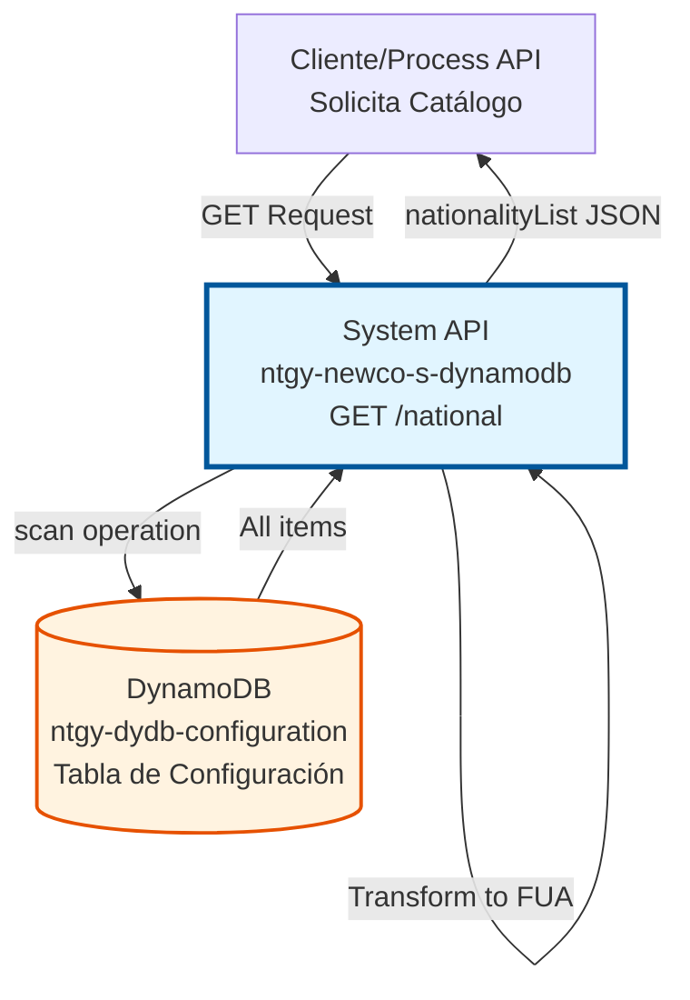
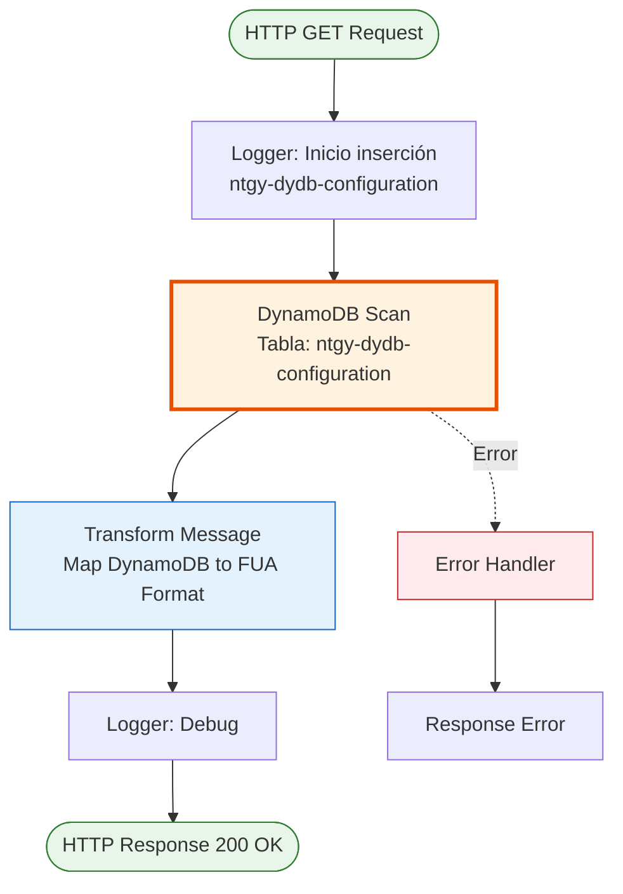
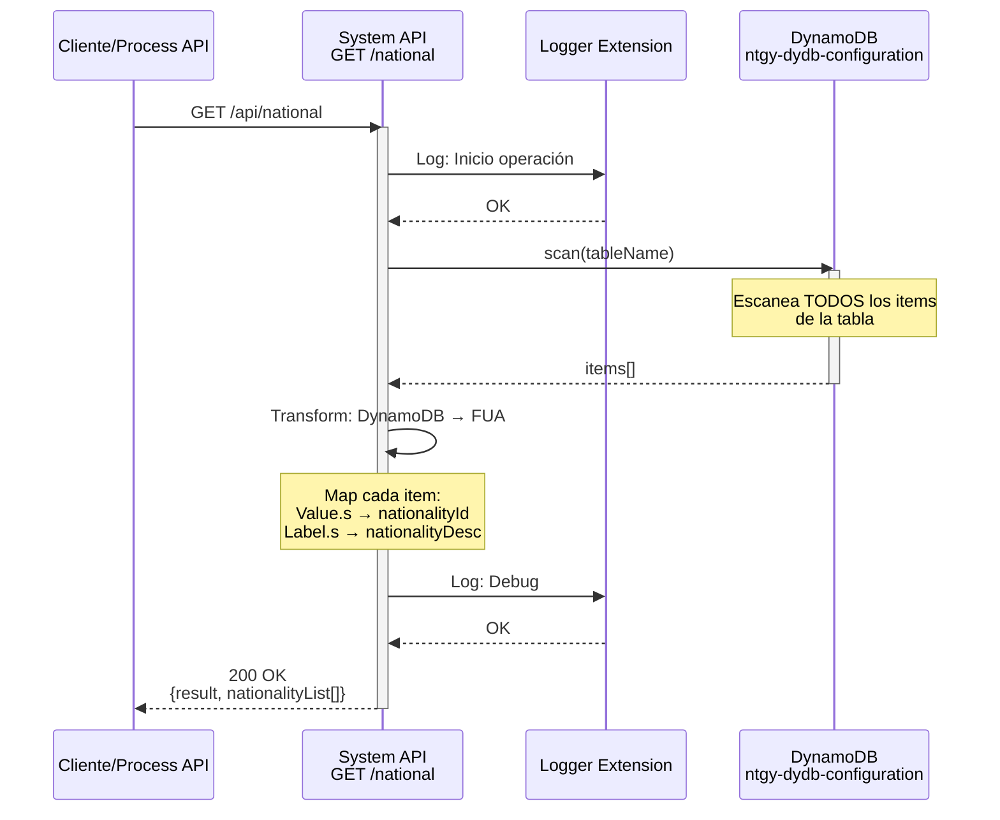
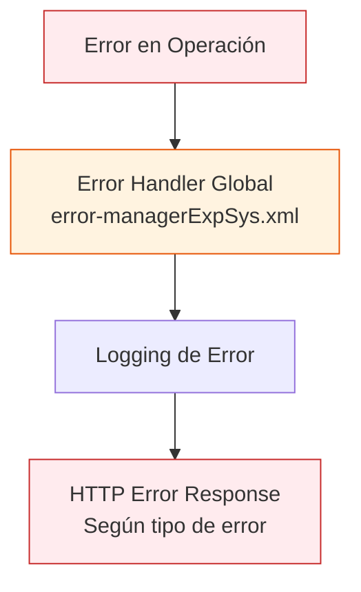

# GET /national

## 📌 Descripción General

### Propósito del Endpoint

Este endpoint recupera el catálogo completo de nacionalidades almacenadas en la tabla de configuración de DynamoDB (`ntgy-dydb-configuration`). Los datos se transforman a formato FUA y se retornan como una lista estructurada, lista para ser consumida por interfaces de usuario, validaciones y otros procesos del sistema.

El endpoint soporta:
- **Recuperación Completa**: Obtiene todas las nacionalidades sin filtros
- **Formato FUA**: Transforma datos de DynamoDB a formato estándar FUA
- **Catálogo de Referencia**: Proporciona datos maestros para dropdowns y validaciones

### Tipo de API

**Capa:** System API (API-Led Connectivity)

**Función:** Integración directa con Amazon DynamoDB para recuperación de datos de configuración de nacionalidades.

### Patrón de Integración

**Tipo:** Request-Reply Síncrono con DynamoDB Scan

**Descripción:** Ejecuta un escaneo completo de la tabla `ntgy-dydb-configuration` en DynamoDB, transforma los resultados a formato FUA mediante DataWeave, y retorna la lista completa de nacionalidades disponibles.

### Arquitectura API-Led Connectivity



---

## 💼 Propósito del Negocio

### Casos de Uso Principales

1. **Poblar Dropdowns de Nacionalidad**
   - Cargar listas desplegables en formularios de registro
   - Proporcionar opciones de nacionalidad en interfaces de usuario
   - Beneficio: Experiencia de usuario consistente en todos los canales

2. **Validación de Datos de Entrada**
   - Verificar que la nacionalidad ingresada existe en el catálogo
   - Validar documentos de identidad según nacionalidad
   - Beneficio: Datos de calidad y consistentes

3. **Sincronización de Catálogos**
   - Mantener catálogos actualizados en sistemas consumidores
   - Sincronizar datos maestros entre aplicaciones
   - Beneficio: Consistencia de datos en toda la plataforma

4. **Carga Inicial de Aplicaciones**
   - Cargar datos de referencia al iniciar aplicaciones
   - Cachear catálogos en aplicaciones cliente
   - Beneficio: Mejor performance y experiencia de usuario

### Contexto Empresarial

- **Dominio:** Gestión de Configuración y Datos Maestros
- **Sector:** Energía - Utilities
- **División:** Naturgy España - NewCo
- **Proceso de Negocio:** Provisión de datos de referencia para operaciones del sistema
- **Tipo de Datos:** Datos maestros estáticos (catálogo de nacionalidades)

### Stakeholders

- **Equipos de Desarrollo Frontend**: Necesitan catálogos para poblar interfaces
- **Equipos de UX/UI**: Requieren datos consistentes para diseño de formularios
- **Equipos de QA**: Utilizan catálogos para pruebas de validación
- **Equipos de Integración**: Consumen catálogos para sincronización entre sistemas

### Valor de Negocio

- **Centralización de Catálogos**: Fuente única de verdad para nacionalidades
- **Consistencia de Datos**: Mismos valores en todos los canales y sistemas
- **Facilidad de Mantenimiento**: Actualización centralizada de catálogos
- **Mejor UX**: Dropdowns y validaciones con datos actualizados

### Consumidores Potenciales

Este endpoint puede ser consumido por:
- Experience APIs de portales web y móviles
- Process APIs que requieren validación de nacionalidades
- Aplicaciones frontend (React, Angular, Vue)
- Sistemas de integración y middleware
- Herramientas de testing y QA

---

## 🔧 Especificación Técnica

### URLs por Ambiente

| Ambiente | URL Base | URL Completa |
|----------|----------|--------------|
| **Local** | `http://localhost:8081` | `http://localhost:8081/api/national` |
| **Development** | `https://ntgy-newco-s-dynamodb-dev.us-e2.cloudhub.io` | `https://ntgy-newco-s-dynamodb-dev.us-e2.cloudhub.io/api/national` |
| **UAT** | `https://ntgy-newco-s-dynamodb-uat.us-e2.cloudhub.io` | `https://ntgy-newco-s-dynamodb-uat.us-e2.cloudhub.io/api/national` |
| **Production** | `https://ntgy-newco-s-dynamodb-pro.us-e2.cloudhub.io` | `https://ntgy-newco-s-dynamodb-pro.us-e2.cloudhub.io/api/national` |

### Método HTTP

```
GET /api/national
```

### Parámetros de Entrada

#### Headers HTTP

| Header | Tipo | Requerido | Descripción | Ejemplo |
|--------|------|-----------|-------------|---------|
| `Accept` | string | ❌ No | Tipo de contenido esperado en response | `application/json` |
| `client_id` | string | ✅ Sí | Client ID de Anypoint Platform | `abc123...` |
| `client_secret` | string | ✅ Sí | Client Secret de Anypoint Platform | `xyz789...` |

#### Query Parameters

Este endpoint **no acepta query parameters**. Retorna el catálogo completo de nacionalidades sin filtros.

**Nota:** Para obtener una nacionalidad específica, los consumidores deben filtrar la lista en el lado del cliente.

### Respuestas

#### Respuesta Exitosa (200 OK)

```json
{
  "result": {
    "codResult": "0000",
    "msgResult": "No hay error"
  },
  "nationalityList": [
    {
      "nationalityId": "ES",
      "nationalityDesc": "España"
    },
    {
      "nationalityId": "FR",
      "nationalityDesc": "Francia"
    },
    {
      "nationalityId": "DE",
      "nationalityDesc": "Alemania"
    },
    {
      "nationalityId": "IT",
      "nationalityDesc": "Italia"
    },
    {
      "nationalityId": "PT",
      "nationalityDesc": "Portugal"
    }
  ]
}
```

**Descripción de Campos:**

| Campo | Tipo | Descripción |
|-------|------|-------------|
| `result.codResult` | string | Código de resultado (`0000` = éxito) |
| `result.msgResult` | string | Mensaje descriptivo del resultado |
| `nationalityList` | array | Lista de nacionalidades disponibles |
| `nationalityList[].nationalityId` | string | Código ISO de la nacionalidad |
| `nationalityList[].nationalityDesc` | string | Nombre completo de la nacionalidad |

#### Respuesta con Lista Vacía (200 OK)

```json
{
  "result": {
    "codResult": "0000",
    "msgResult": "No hay error"
  },
  "nationalityList": []
}
```

**Nota:** Si la tabla no contiene nacionalidades, se retorna una lista vacía con código de éxito.

#### Respuesta de Error

En caso de error, el endpoint utiliza el error handler global del proyecto (`error-managerExpSys.xml`). Las respuestas de error siguen el formato estándar del sistema según los tipos `generic.response-failed` definidos en el RAML.

### Autenticación y Autorización

- **Tipo:** Client ID & Client Secret (Anypoint Platform)
- **Autorización DynamoDB:** El usuario de servicio debe tener permisos para:
  - Operación `Scan` en tabla `ntgy-dydb-configuration`
  - Acceso de lectura a la tabla
  - Permisos IAM configurados correctamente

### Timeouts

| Tipo | Valor | Descripción |
|------|-------|-------------|
| **Request Timeout** | 30 segundos | Tiempo máximo de espera para la respuesta |
| **Connection Timeout** | 10 segundos | Tiempo máximo para establecer conexión con DynamoDB |
| **DynamoDB Scan** | 20 segundos | Tiempo máximo para operación scan |

---

## 🏗️ Implementación Técnica

### Arquitectura del Flow



### Componentes del Flow

#### 1. Logger de Inicio
```xml
<logger level="INFO" 
        message="Inicio insercion en tabla ntgy-dydb-configuration"/>
```
- Registra el inicio de la operación
- Nivel INFO para trazabilidad
- **Nota:** El mensaje dice "inserción" pero es una operación de lectura (probablemente reutilizado del POST)

#### 2. DynamoDB Scan
```xml
<dynamodb:scan 
    doc:name="Scan" 
    config-ref="Amazon_DynamoDB_Configuration" 
    tableName="ntgy-dydb-configuration"/>
```
- Ejecuta escaneo completo de la tabla
- Usa configuración global de DynamoDB
- Retorna TODOS los items de la tabla

**⚠️ Consideración de Performance:**
- **SCAN** lee toda la tabla (menos eficiente que QUERY)
- Apropiado para tablas pequeñas de configuración
- Para tablas grandes, considerar paginación o índices

#### 3. Transformación DataWeave
```dataweave
%dw 2.0
output application/json
---
{
  "result": {
    "codResult": "0000",
    "msgResult": "No hay error"
  }
} ++ "nationalityList": payload.items map {
  "nationalityId": $.Value.s,
  "nationalityDesc": $.Label.s
}
```

**Análisis de la Transformación:**

1. **Estructura Base:** Crea objeto con `result` estándar
2. **Operador ++:** Concatena con el array de nacionalidades
3. **Map Function:** Transforma cada item de DynamoDB
4. **Extracción de Campos:**
   - `$.Value.s` → `nationalityId` (código ISO)
   - `$.Label.s` → `nationalityDesc` (nombre completo)

**Formato DynamoDB → FUA:**
```
DynamoDB Item:
{
  "Value": {"S": "ES"},
  "Label": {"S": "España"}
}

↓ Transformación ↓

FUA Format:
{
  "nationalityId": "ES",
  "nationalityDesc": "España"
}
```

#### 4. Logger de Debug
```xml
<logger level="DEBUG" doc:name="Logger"/>
```
- Logging adicional para troubleshooting
- Nivel DEBUG (solo visible en modo debug)

### Diagrama de Secuencia



### Tabla DynamoDB

#### ntgy-dydb-configuration

**Propósito:** Almacena datos de configuración general del sistema, incluyendo nacionalidades.

**Estructura de Items de Nacionalidad:**

| Atributo | Tipo DynamoDB | Descripción | Ejemplo |
|----------|---------------|-------------|---------|
| `leaseKey` | String (S) | Identificador único | `"NATIONAL_ES"` |
| `Value` | String (S) | Código ISO de nacionalidad | `"ES"` |
| `Label` | String (S) | Nombre completo | `"España"` |

**Operación Utilizada:**
- **Scan:** Escaneo completo de tabla sin filtros
- **Ventaja:** Obtiene todos los items en una sola operación
- **Desventaja:** Menos eficiente que Query para tablas grandes

**Capacidad:**
- Read Capacity Units (RCU): Auto-scaling
- Tamaño estimado por item: < 1 KB
- Cantidad típica de items: 50-200 nacionalidades

### Transformaciones DataWeave

#### Transformación Principal

**Ubicación:** Inline en el flow XML

**Propósito:** Convertir formato DynamoDB a formato FUA

**Características:**
- Usa operador `++` para concatenar objetos
- Función `map` para transformar array
- Extracción de valores con notación de punto
- Output: JSON estructurado según formato FUA

**Ejemplo de Transformación Completa:**

```dataweave
// Input (payload.items de DynamoDB)
[
  {
    "leaseKey": {"S": "NATIONAL_ES"},
    "Value": {"S": "ES"},
    "Label": {"S": "España"}
  },
  {
    "leaseKey": {"S": "NATIONAL_FR"},
    "Value": {"S": "FR"},
    "Label": {"S": "Francia"}
  }
]

// Output (después de transformación)
{
  "result": {
    "codResult": "0000",
    "msgResult": "No hay error"
  },
  "nationalityList": [
    {
      "nationalityId": "ES",
      "nationalityDesc": "España"
    },
    {
      "nationalityId": "FR",
      "nationalityDesc": "Francia"
    }
  ]
}
```

### Manejo de Errores



**Estrategia de Manejo:**
- Los errores son capturados por el error handler global del proyecto
- Se registran en logs para troubleshooting y auditoría
- Se retorna respuesta de error según tipo `generic.response-failed` del RAML
- Para detalles específicos de códigos de error, consultar documentación del error handler global

### Configuración de DynamoDB

```xml
<dynamodb:config name="Amazon_DynamoDB_Configuration">
    <dynamodb:basic-connection 
        accessKey="${secure::aws.accessKey}"
        secretKey="${secure::aws.secretKey}"
        region="${aws.region}"/>
</dynamodb:config>
```

**Parámetros de Configuración:**
- `accessKey`: AWS Access Key (secure property)
- `secretKey`: AWS Secret Key (secure property)
- `region`: Región de AWS (ej: eu-west-1)

---

## 💻 Ejemplos de Uso

### Ejemplo 1: Recuperar Catálogo Completo

#### Request

```bash
curl -X GET "https://ntgy-newco-s-dynamodb-dev.us-e2.cloudhub.io/api/national" \
  -H "Accept: application/json" \
  -H "client_id: your-client-id" \
  -H "client_secret: your-client-secret"
```

#### Response (200 OK)

```json
{
  "result": {
    "codResult": "0000",
    "msgResult": "No hay error"
  },
  "nationalityList": [
    {
      "nationalityId": "ES",
      "nationalityDesc": "España"
    },
    {
      "nationalityId": "FR",
      "nationalityDesc": "Francia"
    },
    {
      "nationalityId": "DE",
      "nationalityDesc": "Alemania"
    },
    {
      "nationalityId": "IT",
      "nationalityDesc": "Italia"
    },
    {
      "nationalityId": "PT",
      "nationalityDesc": "Portugal"
    },
    {
      "nationalityId": "GB",
      "nationalityDesc": "Reino Unido"
    }
  ]
}
```

### Ejemplo 2: Uso desde JavaScript/React

```javascript
const axios = require('axios');

async function getNationalities() {
  try {
    const response = await axios.get(
      'https://ntgy-newco-s-dynamodb-dev.us-e2.cloudhub.io/api/national',
      {
        headers: {
          'Accept': 'application/json',
          'client_id': process.env.CLIENT_ID,
          'client_secret': process.env.CLIENT_SECRET
        }
      }
    );
    
    if (response.data.result.codResult === '0000') {
      console.log('Nacionalidades recuperadas:', response.data.nationalityList.length);
      return response.data.nationalityList;
    } else {
      console.error('Error en respuesta:', response.data.result.msgResult);
      return [];
    }
  } catch (error) {
    console.error('Error al recuperar nacionalidades:', error.message);
    throw error;
  }
}

// Uso en componente React
function NationalityDropdown() {
  const [nationalities, setNationalities] = useState([]);
  
  useEffect(() => {
    getNationalities().then(data => setNationalities(data));
  }, []);
  
  return (
    <select>
      <option value="">Seleccione nacionalidad</option>
      {nationalities.map(nat => (
        <option key={nat.nationalityId} value={nat.nationalityId}>
          {nat.nationalityDesc}
        </option>
      ))}
    </select>
  );
}
```

### Ejemplo 3: Uso desde Python

```python
import requests
import json

def get_nationalities():
    """
    Recupera el catálogo de nacionalidades desde DynamoDB
    """
    url = "https://ntgy-newco-s-dynamodb-dev.us-e2.cloudhub.io/api/national"
    headers = {
        "Accept": "application/json",
        "client_id": "your-client-id",
        "client_secret": "your-client-secret"
    }
    
    try:
        response = requests.get(url, headers=headers)
        response.raise_for_status()
        
        data = response.json()
        
        if data['result']['codResult'] == '0000':
            nationalities = data['nationalityList']
            print(f"✓ Recuperadas {len(nationalities)} nacionalidades")
            return nationalities
        else:
            print(f"✗ Error: {data['result']['msgResult']}")
            return []
            
    except requests.exceptions.RequestException as e:
        print(f"✗ Error de conexión: {str(e)}")
        return []

# Uso
nationalities = get_nationalities()

# Crear diccionario para búsqueda rápida
nationality_dict = {
    nat['nationalityId']: nat['nationalityDesc'] 
    for nat in nationalities
}

# Validar nacionalidad
def validate_nationality(code):
    return code in nationality_dict

# Obtener descripción
def get_nationality_name(code):
    return nationality_dict.get(code, "Desconocida")

# Ejemplos
print(validate_nationality("ES"))  # True
print(get_nationality_name("FR"))  # "Francia"
```

### Ejemplo 4: Cachear Catálogo en Cliente

```javascript
class NationalityCache {
  constructor() {
    this.cache = null;
    this.lastUpdate = null;
    this.cacheDuration = 3600000; // 1 hora en ms
  }
  
  async getNationalities(forceRefresh = false) {
    const now = Date.now();
    
    // Verificar si cache es válido
    if (!forceRefresh && 
        this.cache && 
        this.lastUpdate && 
        (now - this.lastUpdate) < this.cacheDuration) {
      console.log('Usando cache de nacionalidades');
      return this.cache;
    }
    
    // Recuperar desde API
    console.log('Actualizando cache de nacionalidades');
    const response = await axios.get(
      'https://ntgy-newco-s-dynamodb-dev.us-e2.cloudhub.io/api/national',
      {
        headers: {
          'Accept': 'application/json',
          'client_id': process.env.CLIENT_ID,
          'client_secret': process.env.CLIENT_SECRET
        }
      }
    );
    
    this.cache = response.data.nationalityList;
    this.lastUpdate = now;
    
    return this.cache;
  }
  
  findByCode(code) {
    if (!this.cache) return null;
    return this.cache.find(nat => nat.nationalityId === code);
  }
  
  search(query) {
    if (!this.cache) return [];
    const lowerQuery = query.toLowerCase();
    return this.cache.filter(nat => 
      nat.nationalityDesc.toLowerCase().includes(lowerQuery) ||
      nat.nationalityId.toLowerCase().includes(lowerQuery)
    );
  }
}

// Uso
const nationalityCache = new NationalityCache();

// Primera llamada: recupera desde API
const nationalities1 = await nationalityCache.getNationalities();

// Segunda llamada: usa cache
const nationalities2 = await nationalityCache.getNationalities();

// Búsqueda
const spain = nationalityCache.findByCode('ES');
const searchResults = nationalityCache.search('ale'); // Encuentra "Alemania"
```

### Ejemplo 5: Validación de Formulario

```javascript
async function validateRegistrationForm(formData) {
  // Obtener catálogo de nacionalidades
  const nationalities = await getNationalities();
  const validNationalityCodes = nationalities.map(n => n.nationalityId);
  
  const errors = {};
  
  // Validar nacionalidad
  if (!formData.nationality) {
    errors.nationality = 'La nacionalidad es requerida';
  } else if (!validNationalityCodes.includes(formData.nationality)) {
    errors.nationality = 'Nacionalidad no válida';
  }
  
  // Otras validaciones...
  
  return {
    isValid: Object.keys(errors).length === 0,
    errors
  };
}

// Uso
const formData = {
  name: 'Juan Pérez',
  nationality: 'ES',
  documentType: 'DNI',
  documentNumber: '12345678A'
};

const validation = await validateRegistrationForm(formData);
if (validation.isValid) {
  console.log('✓ Formulario válido');
} else {
  console.log('✗ Errores:', validation.errors);
}
```

### Consideraciones de Uso

#### Performance
- **Operación Scan:** Escanea toda la tabla (apropiado para tablas pequeñas)
- **Tiempo típico:** < 200ms para catálogo de ~100 nacionalidades
- **Recomendación:** Cachear resultados en cliente (datos cambian raramente)

#### Caching
- **Estrategia recomendada:** Cache de 1 hora en aplicaciones cliente
- **Invalidación:** Refrescar cache después de operaciones POST
- **Beneficio:** Reduce llamadas al API y mejora UX

#### Filtrado
- **Sin filtros en API:** El endpoint retorna todas las nacionalidades
- **Filtrado en cliente:** Implementar búsqueda/filtrado en aplicación
- **Ventaja:** Simplicidad del API, flexibilidad en cliente

#### Mejores Prácticas
1. **Implementar cache:** Evitar llamadas repetidas al API
2. **Manejo de errores:** Implementar fallback con lista vacía
3. **Validación:** Usar catálogo para validar inputs de usuario
4. **Búsqueda:** Implementar búsqueda fuzzy en cliente para mejor UX
5. **Accesibilidad:** Ordenar alfabéticamente en dropdowns