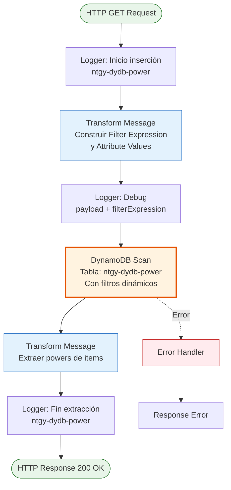
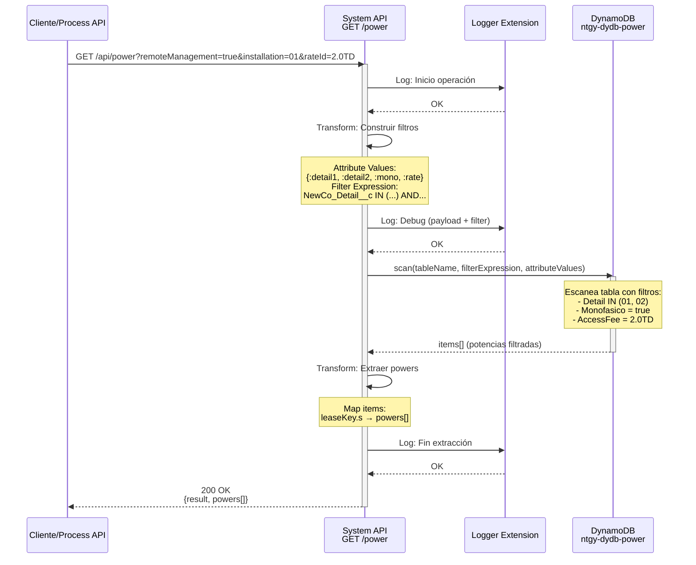
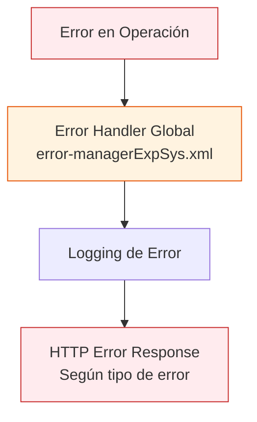

# GET /power

## 📌 Descripción General

### Propósito del Endpoint

Este endpoint consulta las potencias eléctricas disponibles desde la tabla de configuración de DynamoDB (`ntgy-dydb-power`), aplicando filtros dinámicos según el tipo de instalación (monofásica o trifásica), la gestión remota y la tarifa contratada. Los datos se transforman a formato estructurado y se retornan como una lista de potencias disponibles para el cliente.

El endpoint soporta:
- **Filtrado Dinámico**: Aplica filtros según tipo de instalación y gestión remota
- **Consulta por Tarifa**: Filtra potencias según la tarifa de acceso contratada
- **Formato Estructurado**: Transforma datos de DynamoDB a formato de respuesta estándar

### Tipo de API

**Capa:** System API (API-Led Connectivity)

**Función:** Integración directa con Amazon DynamoDB para recuperación de datos de potencias eléctricas con filtros dinámicos.

### Patrón de Integración

**Tipo:** Request-Reply Síncrono con DynamoDB Scan

**Descripción:** Ejecuta un escaneo con filtros dinámicos en la tabla `ntgy-dydb-power` de DynamoDB, construyendo la expresión de filtro según los parámetros de entrada (gestión remota, tipo de instalación, tarifa), transforma los resultados mediante DataWeave, y retorna la lista de potencias disponibles.

### Arquitectura API-Led Connectivity

```mermaid
graph TB
    Client[Cliente/Process API<br/>Solicita Potencias]
    S[System API<br/>ntgy-newco-s-dynamodb<br/>GET /power]
    DDB[(DynamoDB<br/>ntgy-dydb-power<br/>Tabla de Potencias)]
    
    Client -->|GET Request<br/>+ Query Params| S
    S -->|Construir Filter Expression| S
    S -->|scan con filtros| DDB
    DDB -->|Filtered items| S
    S -->|Transform to JSON| S
    S -->|powers[] JSON| Client
    
    style S fill:#e1f5ff,stroke:#01579b,stroke-width:3px
    style DDB fill:#fff3e0,stroke:#e65100,stroke-width:2px
```

---

## 💼 Propósito del Negocio

### Casos de Uso Principales

1. **Consulta de Potencias Disponibles**
   - Obtener potencias eléctricas disponibles según tipo de instalación del cliente
   - Filtrar potencias según si el cliente tiene gestión remota
   - Beneficio: Cliente recibe solo las opciones de potencia aplicables a su caso

2. **Configuración de Contratos**
   - Validar potencias disponibles para una tarifa específica
   - Verificar compatibilidad de potencia con tipo de instalación
   - Beneficio: Evitar configuraciones inválidas en contratos

3. **Proceso de Alta de Clientes**
   - Mostrar opciones de potencia durante el proceso de onboarding
   - Personalizar opciones según características de la instalación
   - Beneficio: Experiencia de usuario personalizada y correcta

4. **Validación de Cambios de Potencia**
   - Verificar potencias disponibles para cambios de contrato
   - Validar compatibilidad con instalación existente
   - Beneficio: Cambios de potencia sin errores

### Contexto Empresarial

- **Dominio:** Gestión de Configuración de Contratos Eléctricos
- **Sector:** Energía - Utilities
- **División:** Naturgy España - NewCo
- **Proceso de Negocio:** Configuración de potencias eléctricas para contratos de suministro
- **Tipo de Datos:** Datos de configuración de potencias eléctricas

### Stakeholders

- **Equipos de Ventas**: Necesitan conocer potencias disponibles para ofertar
- **Equipos de Onboarding**: Requieren datos para configurar nuevos contratos
- **Equipos de Atención al Cliente**: Utilizan datos para gestionar cambios de potencia
- **Equipos de Desarrollo Frontend**: Consumen endpoint para poblar formularios

### Valor de Negocio

- **Personalización de Ofertas**: Potencias específicas según tipo de instalación
- **Reducción de Errores**: Validación automática de compatibilidad
- **Mejor Experiencia de Usuario**: Solo opciones válidas para cada cliente
- **Eficiencia Operativa**: Automatización de validaciones de potencia

### Consumidores Potenciales

Este endpoint puede ser consumido por:
- Experience APIs de portales web y móviles de clientes
- Process APIs de gestión de contratos
- Aplicaciones de ventas y onboarding
- Sistemas de atención al cliente
- Herramientas de configuración de contratos

---

## 🔧 Especificación Técnica

### URLs por Ambiente

| Ambiente | URL Base | URL Completa |
|----------|----------|--------------|
| **Local** | `http://localhost:8081` | `http://localhost:8081/api/power` |
| **Development** | `https://ntgy-newco-s-dynamodb-dev.us-e2.cloudhub.io` | `https://ntgy-newco-s-dynamodb-dev.us-e2.cloudhub.io/api/power` |
| **UAT** | `https://ntgy-newco-s-dynamodb-uat.us-e2.cloudhub.io` | `https://ntgy-newco-s-dynamodb-uat.us-e2.cloudhub.io/api/power` |
| **Production** | `https://ntgy-newco-s-dynamodb-pro.us-e2.cloudhub.io` | `https://ntgy-newco-s-dynamodb-pro.us-e2.cloudhub.io/api/power` |

### Método HTTP

```
GET /api/power
```

### Parámetros de Entrada

#### Headers HTTP

| Header | Tipo | Requerido | Descripción | Ejemplo |
|--------|------|-----------|-------------|---------|
| `Accept` | string | ❌ No | Tipo de contenido esperado en response | `application/json` |
| `client_id` | string | ✅ Sí | Client ID de Anypoint Platform | `abc123...` |
| `client_secret` | string | ✅ Sí | Client Secret de Anypoint Platform | `xyz789...` |

#### Query Parameters

| Parámetro | Tipo | Requerido | Descripción | Valores Válidos | Ejemplo |
|-----------|------|-----------|-------------|-----------------|---------|
| `remoteManagement` | boolean | ❌ No | Indica si el cliente tiene gestión remota | `true`, `false` | `true` |
| `installation` | string | ❌ No | Tipo de instalación eléctrica | `"01"` (monofásica), `"02"` (trifásica) | `"01"` |
| `rateId` | string | ❌ No | Identificador de la tarifa de acceso | Código de tarifa | `"2.0TD"` |

**Notas sobre Parámetros:**
- Todos los parámetros son opcionales según el RAML
- Los filtros se aplican dinámicamente según los parámetros proporcionados
- Si no se proporcionan parámetros, se aplican filtros por defecto

**Lógica de Filtrado:**
1. **Detail (NewCo_Detail__c)**:
   - Si `remoteManagement=true`: Busca valores "01" O "02"
   - Si `remoteManagement=false` o no se proporciona: Busca solo "01"

2. **Tipo de Instalación**:
   - Si `installation="01"`: Filtra por `NewCo_Monofasico__c = true`
   - Si `installation="02"`: Filtra por `NewCo_Trifasico__c = true`

3. **Tarifa (NewCo_AccessFee__c)**:
   - Filtra por el valor exacto de `rateId`

### Respuestas

#### Respuesta Exitosa (200 OK)

```json
{
  "result": {
    "codResult": "0000",
    "msgResult": "No hay error"
  },
  "powers": [
    "3.3",
    "4.6",
    "5.75",
    "6.9",
    "8.05",
    "9.2"
  ]
}
```

**Descripción de Campos:**

| Campo | Tipo | Descripción |
|-------|------|-------------|
| `result.codResult` | string | Código de resultado (`0000` = éxito) |
| `result.msgResult` | string | Mensaje descriptivo del resultado |
| `powers` | array[string] | Lista de potencias disponibles en kW |

#### Respuesta con Lista Vacía (200 OK)

```json
{
  "result": {
    "codResult": "0000",
    "msgResult": "No hay error"
  },
  "powers": []
}
```

**Nota:** Si no hay potencias que cumplan los criterios de filtrado, se retorna una lista vacía con código de éxito.

#### Respuesta de Error

En caso de error, el endpoint utiliza el error handler global del proyecto (`error-managerExpSys.xml`). Las respuestas de error siguen el formato estándar del sistema según los tipos `generic.response-failed` definidos en el RAML.

### Autenticación y Autorización

- **Tipo:** Client ID & Client Secret (Anypoint Platform)
- **Autorización DynamoDB:** El usuario de servicio debe tener permisos para:
  - Operación `Scan` en tabla `ntgy-dydb-power`
  - Acceso de lectura a la tabla
  - Permisos IAM configurados correctamente

### Timeouts

| Tipo | Valor | Descripción |
|------|-------|-------------|
| **Request Timeout** | 30 segundos | Tiempo máximo de espera para la respuesta |
| **Connection Timeout** | 10 segundos | Tiempo máximo para establecer conexión con DynamoDB |
| **DynamoDB Scan** | 20 segundos | Tiempo máximo para operación scan |

---

## 🏗️ Implementación Técnica

### Arquitectura del Flow



### Componentes del Flow

#### 1. Logger de Inicio
```xml
<logger level="INFO" 
        message="Inicio insercion en tabla ntgy-dydb-power"/>
```
- Registra el inicio de la operación
- Nivel INFO para trazabilidad
- **Nota:** El mensaje dice "inserción" pero es una operación de lectura

#### 2. Transformación de Filtros (DataWeave)

**Primera Transformación - Construcción de Filtros:**

```dataweave
%dw 2.0
output application/java
---
{
    ":detail1": {"S": "01"},
    (":detail2": {"S": "02"}) if(vars.remoteManagement),
    (":mono": {"S": true}) if(vars.installation == "01"),
    (":trifa": {"S": true}) if(vars.installation == "02"),
    ":rate": {"S": vars.rateId}
}
```

**Análisis de la Transformación:**

1. **Attribute Values (payload):**
   - `:detail1`: Siempre incluido con valor "01"
   - `:detail2`: Solo si `remoteManagement=true`
   - `:mono`: Solo si `installation="01"` (monofásica)
   - `:trifa`: Solo si `installation="02"` (trifásica)
   - `:rate`: Valor de la tarifa (`rateId`)

2. **Filter Expression (variable):**
```dataweave
%dw 2.0
output application/java
---
(if(vars.remoteManagement)
    "NewCo_Detail__c IN (:detail1, :detail2)"
else
    "NewCo_Detail__c = :detail1") ++ " AND " ++
(if(vars.installation == "01")
    "NewCo_Monofasico__c = :mono"
else
    "NewCo_Trifasico__c = :trifa") ++ " AND " ++  
"NewCo_AccessFee__c = :rate"
```

**Ejemplos de Filter Expression Generada:**

- **Con gestión remota + monofásica:**
  ```
  NewCo_Detail__c IN (:detail1, :detail2) AND NewCo_Monofasico__c = :mono AND NewCo_AccessFee__c = :rate
  ```

- **Sin gestión remota + trifásica:**
  ```
  NewCo_Detail__c = :detail1 AND NewCo_Trifasico__c = :trifa AND NewCo_AccessFee__c = :rate
  ```

#### 3. Logger de Debug
```xml
<logger level="INFO" 
        message="#[payload] #[vars.filterExpression]"/>
```
- Registra los valores de filtro y la expresión construida
- Útil para troubleshooting de filtros dinámicos

#### 4. DynamoDB Scan
```xml
<dynamodb:scan 
    tableName="ntgy-dydb-power" 
    config-ref="Amazon_DynamoDB_Configuration" 
    filterExpression="#[vars.filterExpression]" 
    attributeValues="#[payload]"/>
```
- Ejecuta escaneo con filtros dinámicos
- Usa la expresión de filtro construida en el paso anterior
- Aplica los valores de atributos para los placeholders

**⚠️ Consideración de Performance:**
- **SCAN con filtros** es más eficiente que SCAN completo
- Los filtros se aplican en DynamoDB (no en la aplicación)
- Apropiado para tablas de configuración de tamaño medio

#### 5. Transformación de Respuesta (DataWeave)

```dataweave
%dw 2.0
output application/json
---
{
    "result": {
        "codResult": "0000",
        "msgResult": "No hay error"
    }
} ++ "powers": payload.items.leaseKey.s
```

**Análisis de la Transformación:**

1. **Estructura Base:** Crea objeto con `result` estándar
2. **Operador ++:** Concatena con el array de potencias
3. **Extracción:** `payload.items.leaseKey.s` extrae los valores de leaseKey

**Nota sobre Variable Adicional:**
El flow también crea una variable `powers` con un mapeo alternativo:
```dataweave
payload.items map {"powers": $.powers.l.s}
```
Esta variable no se usa en la respuesta final pero puede ser útil para procesamiento adicional.

#### 6. Logger de Fin
```xml
<logger level="INFO" 
        message="Fin de extraccion de datos en la tabla ntgy-dydb-power"/>
```
- Confirma finalización exitosa
- Registra operación completada

### Diagrama de Secuencia



### Tabla DynamoDB

#### ntgy-dydb-power

**Propósito:** Almacena las potencias eléctricas disponibles según tipo de instalación, gestión remota y tarifa.

**Estructura de Items:**

| Atributo | Tipo DynamoDB | Descripción | Ejemplo |
|----------|---------------|-------------|---------|
| `leaseKey` | String (S) | Identificador único / Valor de potencia | `"3.3"`, `"4.6"`, `"5.75"` |
| `NewCo_Detail__c` | String (S) | Código de detalle (01 o 02) | `"01"`, `"02"` |
| `NewCo_Monofasico__c` | Boolean (BOOL) | Indica si aplica para instalación monofásica | `true`, `false` |
| `NewCo_Trifasico__c` | Boolean (BOOL) | Indica si aplica para instalación trifásica | `true`, `false` |
| `NewCo_AccessFee__c` | String (S) | Código de tarifa de acceso | `"2.0TD"`, `"3.0TD"` |
| `powers` | List (L) | Lista de valores de potencia | `[{"S": "3.3"}, {"S": "4.6"}]` |

**Operación Utilizada:**
- **Scan con Filter Expression:** Escaneo con filtros aplicados en DynamoDB
- **Ventaja:** Filtrado eficiente en el servidor
- **Filtros Dinámicos:** La expresión de filtro se construye según parámetros

**Capacidad:**
- Read Capacity Units (RCU): Auto-scaling
- Tamaño estimado por item: < 1 KB
- Cantidad típica de items: 50-200 configuraciones de potencia

### Transformaciones DataWeave

#### Transformación 1: Construcción de Filtros

**Ubicación:** Inline en el flow XML (líneas 8-28)

**Propósito:** Construir dinámicamente los valores de atributos y la expresión de filtro según los parámetros de entrada

**Características:**
- Usa condicionales `if` para incluir atributos opcionalmente
- Construye expresión de filtro con operadores `IN` y `=`
- Concatena condiciones con `AND`
- Output: Java Map para DynamoDB

#### Transformación 2: Extracción de Potencias

**Ubicación:** Inline en el flow XML (líneas 31-46)

**Propósito:** Extraer las potencias de los items retornados por DynamoDB

**Características:**
- Usa operador `++` para concatenar objetos
- Extrae `leaseKey.s` de cada item
- Crea variable adicional con mapeo alternativo
- Output: JSON estructurado

**Ejemplo de Transformación Completa:**

```dataweave
// Input (payload.items de DynamoDB)
[
  {
    "leaseKey": {"S": "3.3"},
    "NewCo_Detail__c": {"S": "01"},
    "NewCo_Monofasico__c": {"BOOL": true},
    "NewCo_AccessFee__c": {"S": "2.0TD"}
  },
  {
    "leaseKey": {"S": "4.6"},
    "NewCo_Detail__c": {"S": "01"},
    "NewCo_Monofasico__c": {"BOOL": true},
    "NewCo_AccessFee__c": {"S": "2.0TD"}
  }
]

// Output (después de transformación)
{
  "result": {
    "codResult": "0000",
    "msgResult": "No hay error"
  },
  "powers": ["3.3", "4.6"]
}
```

### Manejo de Errores



**Estrategia de Manejo:**
- Los errores son capturados por el error handler global del proyecto
- Se registran en logs para troubleshooting y auditoría
- Se retorna respuesta de error según tipo `generic.response-failed` del RAML
- Para detalles específicos de códigos de error, consultar documentación del error handler global

### Configuración de DynamoDB

```xml
<dynamodb:config name="Amazon_DynamoDB_Configuration">
    <dynamodb:basic-connection 
        accessKey="${secure::aws.accessKey}"
        secretKey="${secure::aws.secretKey}"
        region="${aws.region}"/>
</dynamodb:config>
```

**Parámetros de Configuración:**
- `accessKey`: AWS Access Key (secure property)
- `secretKey`: AWS Secret Key (secure property)
- `region`: Región de AWS (ej: eu-west-1)

---

## 💻 Ejemplos de Uso

### Ejemplo 1: Consulta con Gestión Remota y Monofásica

#### Request

```bash
curl -X GET "https://ntgy-newco-s-dynamodb-dev.us-e2.cloudhub.io/api/power?remoteManagement=true&installation=01&rateId=2.0TD" \
  -H "Accept: application/json" \
  -H "client_id: your-client-id" \
  -H "client_secret: your-client-secret"
```

#### Response (200 OK)

```json
{
  "result": {
    "codResult": "0000",
    "msgResult": "No hay error"
  },
  "powers": [
    "3.3",
    "4.6",
    "5.75",
    "6.9",
    "8.05",
    "9.2"
  ]
}
```

### Ejemplo 2: Consulta sin Gestión Remota y Trifásica

#### Request

```bash
curl -X GET "https://ntgy-newco-s-dynamodb-dev.us-e2.cloudhub.io/api/power?remoteManagement=false&installation=02&rateId=3.0TD" \
  -H "Accept: application/json" \
  -H "client_id: your-client-id" \
  -H "client_secret: your-client-secret"
```

#### Response (200 OK)

```json
{
  "result": {
    "codResult": "0000",
    "msgResult": "No hay error"
  },
  "powers": [
    "10.35",
    "13.8",
    "17.25",
    "20.7"
  ]
}
```

### Ejemplo 3: Uso desde JavaScript/React

```javascript
const axios = require('axios');

async function getPowers(filters) {
  try {
    const params = new URLSearchParams();
    if (filters.remoteManagement !== undefined) {
      params.append('remoteManagement', filters.remoteManagement);
    }
    if (filters.installation) {
      params.append('installation', filters.installation);
    }
    if (filters.rateId) {
      params.append('rateId', filters.rateId);
    }
    
    const response = await axios.get(
      `https://ntgy-newco-s-dynamodb-dev.us-e2.cloudhub.io/api/power?${params}`,
      {
        headers: {
          'Accept': 'application/json',
          'client_id': process.env.CLIENT_ID,
          'client_secret': process.env.CLIENT_SECRET
        }
      }
    );
    
    if (response.data.result.codResult === '0000') {
      console.log('Potencias recuperadas:', response.data.powers.length);
      return response.data.powers;
    } else {
      console.error('Error en respuesta:', response.data.result.msgResult);
      return [];
    }
  } catch (error) {
    console.error('Error al recuperar potencias:', error.message);
    throw error;
  }
}

// Uso en componente React
function PowerSelector() {
  const [powers, setPowers] = useState([]);
  const [filters, setFilters] = useState({
    remoteManagement: true,
    installation: '01',
    rateId: '2.0TD'
  });
  
  useEffect(() => {
    getPowers(filters).then(data => setPowers(data));
  }, [filters]);
  
  return (
    <div>
      <h3>Potencias Disponibles</h3>
      <select>
        <option value="">Seleccione potencia</option>
        {powers.map(power => (
          <option key={power} value={power}>
            {power} kW
          </option>
        ))}
      </select>
    </div>
  );
}
```

### Ejemplo 4: Uso desde Python

```python
import requests
import json

def get_powers(remote_management=None, installation=None, rate_id=None):
    """
    Recupera potencias disponibles desde DynamoDB con filtros
    """
    url = "https://ntgy-newco-s-dynamodb-dev.us-e2.cloudhub.io/api/power"
    headers = {
        "Accept": "application/json",
        "client_id": "your-client-id",
        "client_secret": "your-client-secret"
    }
    
    params = {}
    if remote_management is not None:
        params['remoteManagement'] = str(remote_management).lower()
    if installation:
        params['installation'] = installation
    if rate_id:
        params['rateId'] = rate_id
    
    try:
        response = requests.get(url, headers=headers, params=params)
        response.raise_for_status()
        
        data = response.json()
        
        if data['result']['codResult'] == '0000':
            powers = data['powers']
            print(f"✓ Recuperadas {len(powers)} potencias")
            return powers
        else:
            print(f"✗ Error: {data['result']['msgResult']}")
            return []
            
    except requests.exceptions.RequestException as e:
        print(f"✗ Error de conexión: {str(e)}")
        return []

# Uso
powers_mono = get_powers(
    remote_management=True,
    installation='01',
    rate_id='2.0TD'
)

powers_trifa = get_powers(
    remote_management=False,
    installation='02',
    rate_id='3.0TD'
)

print("Potencias monofásicas:", powers_mono)
print("Potencias trifásicas:", powers_trifa)
```

### Ejemplo 5: Validación de Potencia Seleccionada

```javascript
async function validatePowerSelection(selectedPower, customerData) {
  // Obtener potencias disponibles según datos del cliente
  const availablePowers = await getPowers({
    remoteManagement: customerData.hasRemoteManagement,
    installation: customerData.installationType,
    rateId: customerData.rateId
  });
  
  // Validar que la potencia seleccionada está disponible
  if (!availablePowers.includes(selectedPower)) {
    return {
      isValid: false,
      error: `La potencia ${selectedPower} kW no está disponible para su tipo de instalación`
    };
  }
  
  return {
    isValid: true,
    message: `Potencia ${selectedPower} kW validada correctamente`
  };
}

// Uso
const customerData = {
  hasRemoteManagement: true,
  installationType: '01', // Monofásica
  rateId: '2.0TD'
};

const validation = await validatePowerSelection('4.6', customerData);
if (validation.isValid) {
  console.log('✓', validation.message);
} else {
  console.log('✗', validation.error);
}
```

### Consideraciones de Uso

#### Performance
- **Operación Scan con filtros:** Más eficiente que scan completo
- **Filtros en DynamoDB:** Se aplican en el servidor, no en la aplicación
- **Tiempo típico:** < 300ms para catálogo de ~100 configuraciones
- **Recomendación:** Cachear resultados en cliente si los filtros no cambian frecuentemente

#### Filtrado Dinámico
- **Construcción de filtros:** Se realiza en tiempo de ejecución según parámetros
- **Flexibilidad:** Permite diferentes combinaciones de filtros
- **Validación:** Los filtros se construyen de forma segura usando placeholders

#### Mejores Prácticas
1. **Proporcionar todos los parámetros:** Para obtener resultados más precisos
2. **Validar parámetros:** Verificar valores antes de enviar request
3. **Cachear resultados:** Si los criterios no cambian frecuentemente
4. **Manejo de lista vacía:** Implementar lógica para cuando no hay potencias disponibles
5. **Feedback al usuario:** Informar claramente cuando no hay opciones disponibles
