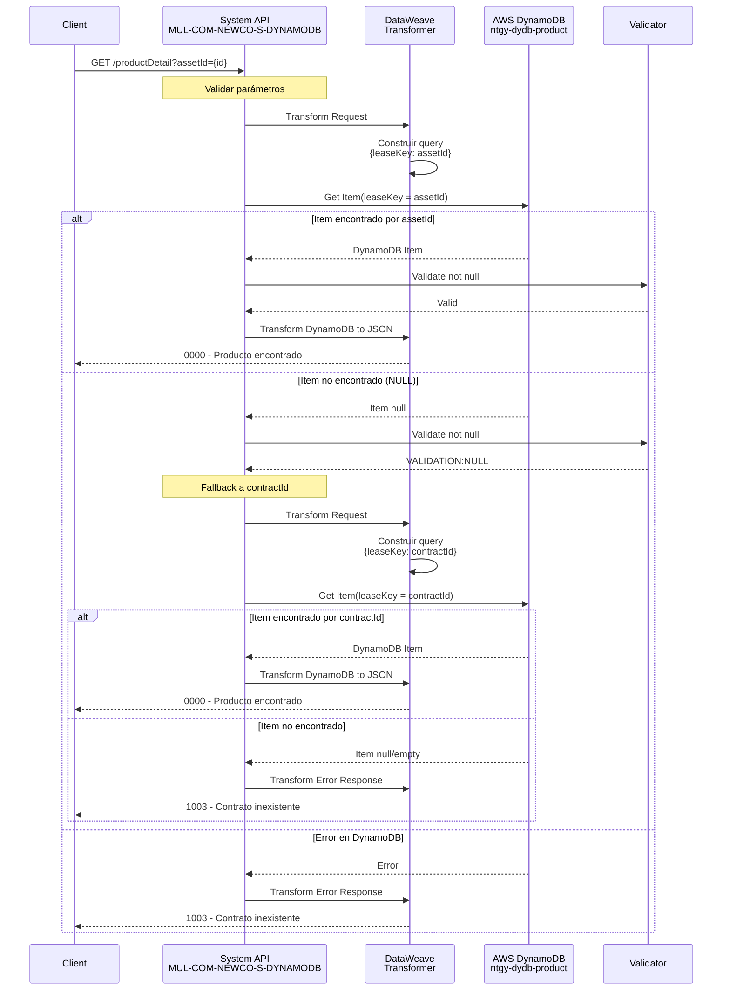
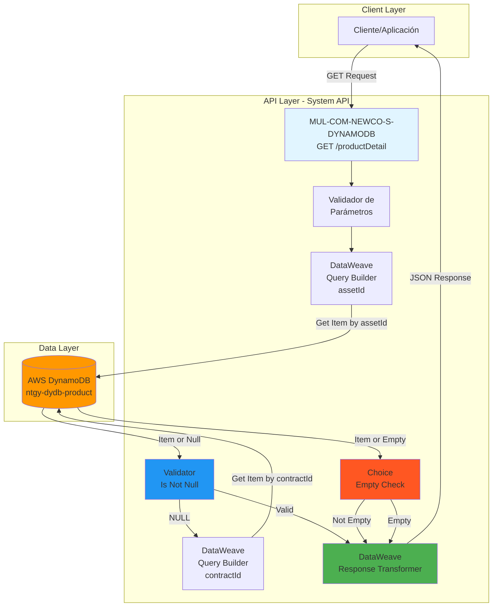
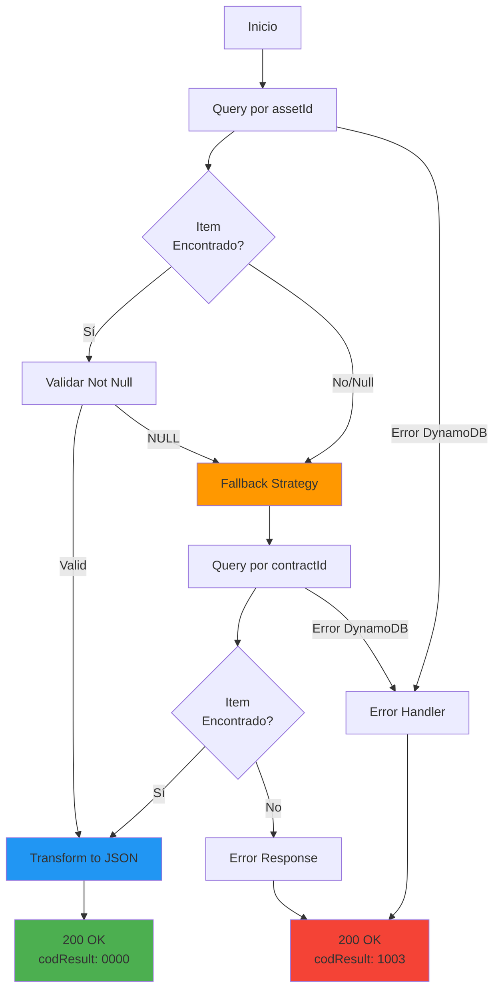

  partition_key: "leaseKey"
  fallback_strategy: "assetId → contractId"
---

# GET /productDetail

## 📌 Descripción General

Endpoint de System API que consulta el detalle completo de un producto desde AWS DynamoDB. Implementa una estrategia de búsqueda dual con fallback: primero intenta localizar el producto por `assetId` y, si no lo encuentra, realiza una segunda búsqueda por `contractId`. Retorna información detallada incluyendo datos de equipamiento, renting, precios, energía, saldo, visitas y datos comerciales.

**Características principales:**
- Búsqueda dual con fallback automático (assetId → contractId)
- Operación Get Item de DynamoDB
- Transformación compleja de estructura DynamoDB a JSON
- Manejo robusto de errores con try-catch
- Validación de existencia del item
- Múltiples secciones de datos del producto
- Soporte para diferentes tipos de productos (equipamiento, renting, servicios puntuales)

## 💼 Propósito del Negocio

### Objetivo
Proporcionar acceso detallado a toda la información de un producto contratado, incluyendo características técnicas, precios, consumos, saldos y datos comerciales, facilitando la gestión y seguimiento de productos energéticos y servicios asociados.

### Casos de Uso
1. **Consulta de Producto por Asset**: Obtener detalles usando el identificador del activo
2. **Consulta de Producto por Contrato**: Búsqueda alternativa usando el ID del contrato
3. **Información de Equipamiento Solar**: Consultar datos de paneles, baterías y puntos de carga
4. **Gestión de Renting**: Visualizar información de equipos en renting
5. **Consulta de Precios**: Obtener tarifas, IVA y términos fijos/variables
6. **Seguimiento de Consumo**: Monitorear energía consumida vs contratada
7. **Gestión de Saldo**: Consultar saldo disponible y historial de movimientos
8. **Programación de Visitas**: Ver visitas programadas y su estado
9. **Información Comercial**: Acceder a datos de marketing del producto

### Valor de Negocio
- **Información Completa**: Vista 360° del producto contratado
- **Resiliencia**: Estrategia de fallback garantiza disponibilidad de datos
- **Autogestión**: Permite a clientes consultar detalles de sus productos
- **Soporte Comercial**: Facilita venta cruzada y upselling
- **Gestión Operativa**: Base para seguimiento de instalaciones y servicios

## 🔧 Especificación Técnica

### Endpoint
```
GET /productDetail
```

### Parámetros de Consulta

| Parámetro | Tipo | Requerido | Descripción |
|-----------|------|-----------|-------------|
| `assetId` | String | Condicional* | Identificador del activo (búsqueda primaria) |
| `contractId` | String | Condicional* | Identificador del contrato (búsqueda fallback) |

**Nota:** Al menos uno de los dos parámetros debe ser proporcionado. Si se proporciona `assetId`, se usa primero; si falla, se intenta con `contractId`.

### Headers Requeridos
```http
Content-Type: application/json
client-id: {clientId}
client-secret: {clientSecret}
```

### Respuestas

#### Éxito (200 OK)
```json
{
  "result": {
    "codResult": "0000",
    "msgResult": "No hay error"
  },
  "productDetail": {
    "contractId": "string",
    "productTypeId": "string",
    "promotionDesc": "string",
    "equipmentData": {
      "panelType": "string",
      "numberPanels": 0,
      "photovoltaicPower": 0,
      "battery": false,
      "chargingPoint": false,
      "inverterPower": 0
    },
    "rentingData": {
      "type": "string",
      "brand": "string",
      "model": "string",
      "numberInstallments": 0
    },
    "oneshotData": {
      "emergency": false,
      "schedule": "string",
      "serviceType": "string"
    },
    "prices": {
      "amount": 0,
      "dateReview": "string",
      "power": [0],
      "energy": [0],
      "fixedTerm": 0,
      "variableTerm": 0,
      "iva10": {
        "pointPeriod": "string",
        "plainPeriod": "string",
        "valleyPeriod": "string",
        "power1": "string",
        "power2": "string"
      },
      "iva21": {
        "pointPeriod": "string",
        "plainPeriod": "string",
        "valleyPeriod": "string",
        "power1": "string",
        "power2": "string"
      }
    },
    "choice": {
      "type": "string",
      "days": ["string"],
      "hours": ["string"],
      "recommendedDays": ["string"],
      "recommendedHours": ["string"]
    },
    "energy": {
      "consumedEnergy": "string",
      "contractedEnergy": "string",
      "lastBillDate": "string",
      "validityDate": "string",
      "anualMaxConsumption": "string",
      "textTP": ["string"]
    },
    "balance": {
      "availableBalance": "string",
      "consumedBalance": "string",
      "initialBalance": "string",
      "actualValidity": "string",
      "currency": "string",
      "history": [
        {
          "activityDate": "string",
          "activityType": "string",
          "amount": "string",
          "availableBalance": "string",
          "validity": "string"
        }
      ]
    },
    "visits": [
      {
        "period": "string",
        "state": "string",
        "date": "string",
        "type": "string"
      }
    ],
    "marketingInfo": [
      {
        "text": "string",
        "icon": "string"
      }
    ]
  }
}
```

#### Contrato Inexistente (200 OK)
```json
{
  "result": {
    "codResult": "1003",
    "msgResult": "Contrato inexistente"
  }
}
```

#### Error de Validación (400 Bad Request)
```json
{
  "error": {
    "code": "400",
    "message": "Bad Request - Parámetros inválidos"
  }
}
```

#### Error de Autenticación (401 Unauthorized)
```json
{
  "error": {
    "code": "401",
    "message": "Unauthorized - Credenciales inválidas"
  }
}
```

#### Error Interno (500 Internal Server Error)
```json
{
  "error": {
    "code": "500",
    "message": "Internal Server Error"
  }
}
```

## 🏗️ Implementación Técnica

### Arquitectura del Flujo



### Operación de Backend: DynamoDB Get Item

**Tabla:** `ntgy-dydb-product`

**Operación:** Get Item con estrategia de fallback

**Búsqueda Primaria (por assetId):**
```xml
<ee:transform>
    <ee:set-payload>
        {
            "leaseKey": {"S": vars.assetId}
        }
    </ee:set-payload>
</ee:transform>
<dynamodb:get-item 
    tableName="ntgy-dydb-product" 
    config-ref="Amazon_DynamoDB_Configuration" />
```

**Búsqueda Fallback (por contractId):**
```xml
<on-error-continue type="VALIDATION:NULL">
    <ee:transform>
        <ee:set-payload>
            {
                "leaseKey": {"S": vars.contractId}
            }
        </ee:set-payload>
    </ee:transform>
    <dynamodb:get-item 
        tableName="ntgy-dydb-product" 
        config-ref="Amazon_DynamoDB_Configuration" />
</on-error-continue>
```

**Estructura de la Tabla:**
- **Partition Key:** `leaseKey` (String) - Puede ser assetId o contractId
- **Atributos:** Estructura compleja con múltiples secciones de datos

### Flujo de Ejecución

#### 1. Transformación Inicial (Búsqueda por assetId)
```dataweave
%dw 2.0
output application/java
---
{
    "leaseKey": {"S": vars.assetId}
}
```

#### 2. Try-Catch con Validación
```xml
<try>
    <dynamodb:get-item tableName="ntgy-dydb-product" />
    <validation:is-not-null value="#[payload.item]"/>
    
    <error-handler>
        <on-error-continue type="VALIDATION:NULL">
            <!-- Fallback a contractId -->
        </on-error-continue>
        <on-error-propagate>
            <!-- Error 1003 -->
        </on-error-propagate>
    </error-handler>
</try>
```

#### 3. Choice: Item Vacío vs Encontrado
```xml
<choice>
    <when expression="#[isEmpty(payload.item)]">
        <!-- Error 1003: Contrato inexistente -->
    </when>
    <otherwise>
        <!-- Transformación exitosa -->
    </otherwise>
</choice>
```

#### 4. Transformación Principal (DynamoDB → JSON)

**Mapeo de Datos de Equipamiento:**
```dataweave
"equipmentData": {
    "panelType": payload.item.panelType.s,
    "numberPanels": (payload.item.numberPanels.n default 0) as Number,
    "photovoltaicPower": (payload.item.photovoltaicPower.n default 0) as Number,
    "battery": payload.item.battery.bool,
    "chargingPoint": payload.item.chargingPoint.bool,
    "inverterPower": (payload.item.inverterPower.n default 0) as Number
}
```

**Mapeo de Datos de Renting:**
```dataweave
"rentingData": {
    "type": payload.item.rentingType.s,
    "brand": payload.item.brand.s,
    "model": payload.item.model.s,
    "numberInstallments": (payload.item.numberInstallments.n default 0) as Number
}
```

**Mapeo de Datos de Servicios Puntuales:**
```dataweave
"oneshotData": {
    ("emergency": payload.item.emergency.s as Boolean) 
        if not isEmpty(payload.item.emergency.s),
    "schedule": payload.item.schedule.s,
    "serviceType": payload.item.serviceType.s
}
```

**Mapeo de Precios:**
```dataweave
"prices": {
    "amount": (payload.item.prices.m.amount.n default 0) as Number,
    "dateReview": payload.item.prices.m.dateReview.s,
    "power": payload.item.prices.m.power.l.n map ($ default 0) as Number,
    "energy": payload.item.prices.m.energy.l.n map ($ default 0) as Number,
    "fixedTerm": (payload.item.prices.m.fixedTerm.n default 0) as Number,
    "variableTerm": (payload.item.prices.m.variableTerm.n default 0) as Number,
    "iva10": {
        "pointPeriod": payload.item.prices.m.iva10.m.pointPeriod.s,
        "plainPeriod": payload.item.prices.m.iva10.m.plainPeriod.s,
        "valleyPeriod": payload.item.prices.m.iva10.m.valleyPeriod.s,
        "power1": if(payload.item.prices.m.iva10.m.power1.s != null) 
                    payload.item.prices.m.iva10.m.power1.s else 0,
        "power2": if(payload.item.prices.m.iva10.m.power2.s != null) 
                    payload.item.prices.m.iva10.m.power2.s else 0
    },
    "iva21": {
        "pointPeriod": payload.item.prices.m.iva21.m.pointPeriod.s,
        "plainPeriod": payload.item.prices.m.iva21.m.plainPeriod.s,
        "valleyPeriod": payload.item.prices.m.iva21.m.valleyPeriod.s,
        "power1": if(payload.item.prices.m.iva21.m.power1.s != null) 
                    payload.item.prices.m.iva21.m.power1.s else 0,
        "power2": if(payload.item.prices.m.iva21.m.power2.s != null) 
                    payload.item.prices.m.iva21.m.power2.s else 0
    }
}
```

**Mapeo de Elección de Días/Horas:**
```dataweave
"choice": {
    "type": payload.item.choice.m."type".s,
    "days": payload.item.choice.m.days.l.s,
    "hours": payload.item.choice.m.hours.l.s,
    "recommendedDays": payload.item.choice.m.recommendedDays.l.s,
    "recommendedHours": payload.item.choice.m.recommendedHours.l.s
}
```

**Mapeo de Energía:**
```dataweave
"energy": {
    "consumedEnergy": payload.item.energy.m.consumedEnergy.s,
    "contractedEnergy": payload.item.energy.m.contractedEnergy.n,
    "lastBillDate": payload.item.energy.m.lastBillDate.s,
    "validityDate": payload.item.energy.m.validityDate.s,
    "anualMaxConsumption": payload.item.energy.m.anualMaxConsumption.n,
    "textTP": payload.item.energy.m.textTP.l.s
}
```

**Mapeo de Saldo:**
```dataweave
"balance": {
    "availableBalance": payload.item.balance.m.availableBalance.n,
    "consumedBalance": payload.item.balance.m.consumedBalance.n,
    "initialBalance": payload.item.balance.m.initialBalance.n,
    "actualValidity": payload.item.balance.m.actualValidity.s,
    "currency": payload.item.balance.m.currency.s,
    "history": payload.item.balance.m.history.l map {
        "activityDate": $.m.activityDate.s,
        "activityType": $.m.activityType.s,
        "amount": $.m.amount.n,
        "availableBalance": $.m.availableBalance.n,
        "validity": $.m."validity".s
    }
}
```

**Mapeo de Visitas:**
```dataweave
"visits": payload.item.visits.l map {
    "period": $.m.period.s,
    "state": $.m.state.s,
    "date": $.m.date.s,
    "type": $.m."type".s
}
```

**Mapeo de Información de Marketing:**
```dataweave
"marketingInfo": payload.item.marketingInfo.l default [{
    m: {
        text: {s: null},
        icon: {s: null}
    }
}] map {
    "text": $.m.text.s,
    "icon": $.m.icon.s
}
```

### Diagrama de Arquitectura



### Diagrama de Estrategia de Fallback



### Lógica de Negocio

#### Estrategia de Búsqueda Dual

**1. Búsqueda Primaria (assetId):**
- Se intenta primero con el `assetId` proporcionado
- Si el item existe y no es null, se procesa exitosamente
- Si el item es null, se activa el fallback

**2. Búsqueda Fallback (contractId):**
- Se activa automáticamente si la búsqueda por assetId falla
- Usa el `contractId` como partition key alternativa
- Si encuentra el item, se procesa exitosamente
- Si no encuentra el item, retorna error 1003

**3. Manejo de Errores:**
- **VALIDATION:NULL**: Activa fallback a contractId
- **Otros errores**: Propagan error 1003
- **Item vacío**: Retorna error 1003

### Manejo de Errores

**Errores de DynamoDB:**
- Timeout de conexión
- Tabla no encontrada
- Permisos insuficientes
- Throttling de requests

**Errores de Validación:**
- Item null (activa fallback)
- Item vacío (error 1003)
- Parámetros faltantes

**Errores de Transformación:**
- Estructura de datos inesperada
- Campos nulos no manejados
- Conversiones de tipo fallidas

## 💻 Ejemplos de Uso

### Ejemplo 1: Consulta Exitosa por assetId

**Request:**
```bash
curl -X GET "https://api.naturgy.com/s-dynamodb/productDetail?assetId=ASSET123456" \
  -H "Content-Type: application/json" \
  -H "client-id: your-client-id" \
  -H "client-secret: your-client-secret"
```

**Response (200 OK):**
```json
{
  "result": {
    "codResult": "0000",
    "msgResult": "No hay error"
  },
  "productDetail": {
    "contractId": "CONT001",
    "productTypeId": "SOLAR-001",
    "promotionDesc": "Instalación Solar Residencial",
    "equipmentData": {
      "panelType": "Monocristalino",
      "numberPanels": 12,
      "photovoltaicPower": 4.8,
      "battery": true,
      "chargingPoint": false,
      "inverterPower": 5.0
    },
    "rentingData": {
      "type": "RENTING",
      "brand": "Tesla",
      "model": "Powerwall 2",
      "numberInstallments": 60
    },
    "oneshotData": {
      "emergency": false,
      "schedule": "Lunes a Viernes 9:00-18:00",
      "serviceType": "Mantenimiento"
    },
    "prices": {
      "amount": 89.50,
      "dateReview": "2024-01-01",
      "power": [3.45, 3.45],
      "energy": [0.15, 0.12, 0.10],
      "fixedTerm": 45.00,
      "variableTerm": 44.50,
      "iva10": {
        "pointPeriod": "0.165",
        "plainPeriod": "0.132",
        "valleyPeriod": "0.110",
        "power1": "3.795",
        "power2": "3.795"
      },
      "iva21": {
        "pointPeriod": "0.182",
        "plainPeriod": "0.145",
        "valleyPeriod": "0.121",
        "power1": "4.175",
        "power2": "4.175"
      }
    },
    "choice": {
      "type": "FLEXIBLE",
      "days": ["Lunes", "Miércoles", "Viernes"],
      "hours": ["10:00", "14:00", "18:00"],
      "recommendedDays": ["Martes", "Jueves"],
      "recommendedHours": ["11:00", "15:00"]
    },
    "energy": {
      "consumedEnergy": "2450",
      "contractedEnergy": "3000",
      "lastBillDate": "2024-01-15",
      "validityDate": "2024-12-31",
      "anualMaxConsumption": "36000",
      "textTP": ["Tarifa 2.0TD", "Discriminación horaria"]
    },
    "balance": {
      "availableBalance": "150.50",
      "consumedBalance": "49.50",
      "initialBalance": "200.00",
      "actualValidity": "2024-12-31",
      "currency": "EUR",
      "history": [
        {
          "activityDate": "2024-01-15",
          "activityType": "CONSUMO",
          "amount": "-25.00",
          "availableBalance": "175.00",
          "validity": "2024-12-31"
        },
        {
          "activityDate": "2024-01-10",
          "activityType": "RECARGA",
          "amount": "200.00",
          "availableBalance": "200.00",
          "validity": "2024-12-31"
        }
      ]
    },
    "visits": [
      {
        "period": "Q1-2024",
        "state": "PROGRAMADA",
        "date": "2024-03-15",
        "type": "MANTENIMIENTO"
      },
      {
        "period": "Q4-2023",
        "state": "COMPLETADA",
        "date": "2023-12-10",
        "type": "INSTALACION"
      }
    ],
    "marketingInfo": [
      {
        "text": "Ahorra hasta un 70% en tu factura eléctrica",
        "icon": "solar-panel"
      },
      {
        "text": "Batería incluida para máxima autonomía",
        "icon": "battery"
      }
    ]
  }
}
```

### Ejemplo 2: Consulta con Fallback a contractId

**Request:**
```bash
curl -X GET "https://api.naturgy.com/s-dynamodb/productDetail?assetId=INVALID&contractId=CONT001" \
  -H "Content-Type: application/json" \
  -H "client-id: your-client-id" \
  -H "client-secret: your-client-secret"
```

**Flujo:**
1. Intenta buscar por `assetId=INVALID` → No encontrado
2. Fallback automático a `contractId=CONT001` → Encontrado
3. Retorna datos del producto

**Response (200 OK):**
```json
{
  "result": {
    "codResult": "0000",
    "msgResult": "No hay error"
  },
  "productDetail": {
    "contractId": "CONT001",
    "productTypeId": "ELEC-001",
    "promotionDesc": "Tarifa Estable Electricidad"
  }
}
```

### Ejemplo 3: Producto No Encontrado

**Request:**
```bash
curl -X GET "https://api.naturgy.com/s-dynamodb/productDetail?assetId=INVALID&contractId=INVALID" \
  -H "Content-Type: application/json" \
  -H "client-id: your-client-id" \
  -H "client-secret: your-client-secret"
```

**Response (200 OK):**
```json
{
  "result": {
    "codResult": "1003",
    "msgResult": "Contrato inexistente"
  }
}
```

### Ejemplo 4: Producto de Renting

**Request:**
```bash
curl -X GET "https://api.naturgy.com/s-dynamodb/productDetail?assetId=RENT789" \
  -H "Content-Type: application/json" \
  -H "client-id: your-client-id" \
  -H "client-secret: your-client-secret"
```

**Response (200 OK):**
```json
{
  "result": {
    "codResult": "0000",
    "msgResult": "No hay error"
  },
  "productDetail": {
    "contractId": "CONT002",
    "productTypeId": "RENT-001",
    "promotionDesc": "Renting Caldera Gas",
    "equipmentData": {
      "panelType": null,
      "numberPanels": 0,
      "photovoltaicPower": 0,
      "battery": false,
      "chargingPoint": false,
      "inverterPower": 0
    },
    "rentingData": {
      "type": "RENTING",
      "brand": "Vaillant",
      "model": "ecoTEC plus",
      "numberInstallments": 48
    },
    "prices": {
      "amount": 35.00,
      "dateReview": "2024-01-01",
      "power": [],
      "energy": [],
      "fixedTerm": 35.00,
      "variableTerm": 0,
      "iva10": {
        "pointPeriod": "0",
        "plainPeriod": "0",
        "valleyPeriod": "0",
        "power1": "0",
        "power2": "0"
      },
      "iva21": {
        "pointPeriod": "0",
        "plainPeriod": "0",
        "valleyPeriod": "0",
        "power1": "0",
        "power2": "0"
      }
    },
    "visits": [],
    "marketingInfo": [
      {
        "text": "Renting sin entrada inicial",
        "icon": "renting"
      }
    ]
  }
}
```

### Ejemplo 5: Producto con Saldo y Historial

**Request:**
```bash
curl -X GET "https://api.naturgy.com/s-dynamodb/productDetail?contractId=CONT003" \
  -H "Content-Type: application/json" \
  -H "client-id: your-client-id" \
  -H "client-secret: your-client-secret"
```

**Response (200 OK):**
```json
{
  "result": {
    "codResult": "0000",
    "msgResult": "No hay error"
  },
  "productDetail": {
    "contractId": "CONT003",
    "productTypeId": "PREPAGO-001",
    "promotionDesc": "Tarifa Prepago Flexible",
    "balance": {
      "availableBalance": "75.25",
      "consumedBalance": "124.75",
      "initialBalance": "200.00",
      "actualValidity": "2024-06-30",
      "currency": "EUR",
      "history": [
        {
          "activityDate": "2024-01-20",
          "activityType": "CONSUMO",
          "amount": "-15.50",
          "availableBalance": "75.25",
          "validity": "2024-06-30"
        },
        {
          "activityDate": "2024-01-15",
          "activityType": "CONSUMO",
          "amount": "-30.00",
          "availableBalance": "90.75",
          "validity": "2024-06-30"
        },
        {
          "activityDate": "2024-01-10",
          "activityType": "CONSUMO",
          "amount": "-79.25",
          "availableBalance": "120.75",
          "validity": "2024-06-30"
        },
        {
          "activityDate": "2024-01-01",
          "activityType": "RECARGA",
          "amount": "200.00",
          "availableBalance": "200.00",
          "validity": "2024-06-30"
        }
      ]
    },
    "energy": {
      "consumedEnergy": "1245",
      "contractedEnergy": "2000",
      "lastBillDate": "2024-01-20",
      "validityDate": "2024-06-30",
      "anualMaxConsumption": "24000",
      "textTP": ["Tarifa Prepago", "Sin permanencia"]
    }
  }
}
```

### Ejemplo 6: Error de Autenticación

**Request:**
```bash
curl -X GET "https://api.naturgy.com/s-dynamodb/productDetail?assetId=ASSET123" \
  -H "Content-Type: application/json" \
  -H "client-id: invalid-client-id" \
  -H "client-secret: invalid-secret"
```

**Response (401 Unauthorized):**
```json
{
  "error": {
    "code": "401",
    "message": "Unauthorized - Credenciales inválidas"
  }
}
```

### Ejemplo 7: Producto con Visitas Programadas

**Request:**
```bash
curl -X GET "https://api.naturgy.com/s-dynamodb/productDetail?assetId=MAINT456" \
  -H "Content-Type: application/json" \
  -H "client-id: your-client-id" \
  -H "client-secret: your-client-secret"
```

**Response (200 OK):**
```json
{
  "result": {
    "codResult": "0000",
    "msgResult": "No hay error"
  },
  "productDetail": {
    "contractId": "CONT004",
    "productTypeId": "MAINT-001",
    "promotionDesc": "Plan de Mantenimiento Anual",
    "oneshotData": {
      "emergency": true,
      "schedule": "24/7 Disponible",
      "serviceType": "Mantenimiento Preventivo"
    },
    "visits": [
      {
        "period": "Q1-2024",
        "state": "COMPLETADA",
        "date": "2024-01-15",
        "type": "REVISION"
      },
      {
        "period": "Q2-2024",
        "state": "PROGRAMADA",
        "date": "2024-04-15",
        "type": "MANTENIMIENTO"
      },
      {
        "period": "Q3-2024",
        "state": "PENDIENTE",
        "date": "2024-07-15",
        "type": "REVISION"
      },
      {
        "period": "Q4-2024",
        "state": "PENDIENTE",
        "date": "2024-10-15",
        "type": "MANTENIMIENTO"
      }
    ],
    "prices": {
      "amount": 15.00,
      "dateReview": "2024-01-01",
      "fixedTerm": 15.00,
      "variableTerm": 0
    }
  }
}
```

### Ejemplo 8: Producto con Información de Marketing

**Request:**
```bash
curl -X GET "https://api.naturgy.com/s-dynamodb/productDetail?assetId=PROMO789" \
  -H "Content-Type: application/json" \
  -H "client-id: your-client-id" \
  -H "client-secret: your-client-secret"
```

**Response (200 OK):**
```json
{
  "result": {
    "codResult": "0000",
    "msgResult": "No hay error"
  },
  "productDetail": {
    "contractId": "CONT005",
    "productTypeId": "ECO-001",
    "promotionDesc": "Tarifa Eco Plus con Ventajas",
    "marketingInfo": [
      {
        "text": "100% Energía Verde Certificada",
        "icon": "eco-leaf"
      },
      {
        "text": "Descuento del 15% en horas valle",
        "icon": "discount"
      },
      {
        "text": "Sin permanencia - Cancela cuando quieras",
        "icon": "flexibility"
      },
      {
        "text": "App móvil para control de consumo",
        "icon": "mobile-app"
      }
    ],
    "prices": {
      "amount": 65.00,
      "dateReview": "2024-01-01",
      "energy": [0.18, 0.14, 0.11],
      "fixedTerm": 30.00,
      "variableTerm": 35.00
    }
  }
}
```
