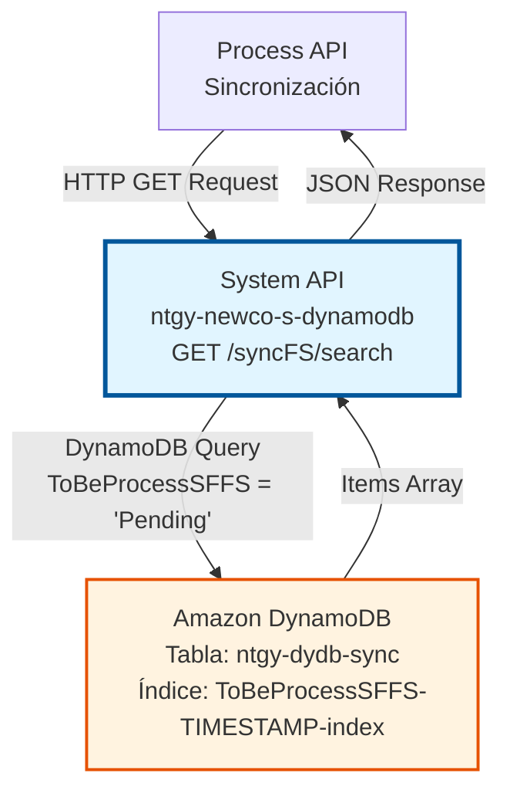
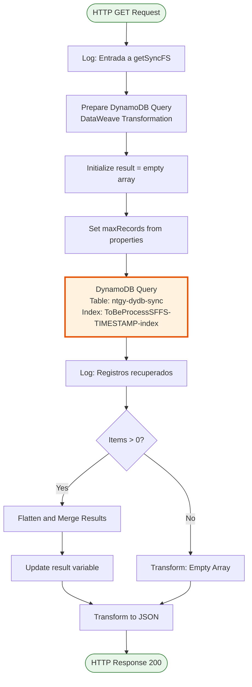
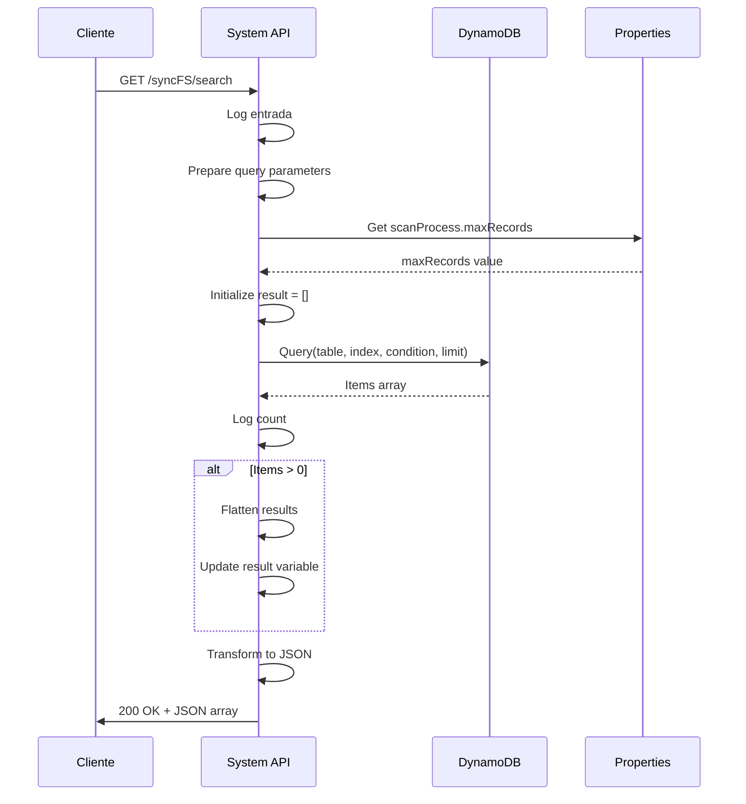

# GET /syncFS/search

## 📌 Descripción General

### Propósito del Endpoint

Este endpoint busca y recupera registros pendientes de sincronización entre Salesforce y SAP almacenados en DynamoDB. Permite identificar qué registros están en estado "Pending" y necesitan ser procesados por los flujos de sincronización.

El endpoint soporta:
- **Búsqueda de Registros Pendientes**: Consulta registros con estado `ToBeProcessSFFS = "Pending"`
- **Ordenación Temporal**: Resultados ordenados por timestamp (FIFO)
- **Límite Configurable**: Control de cantidad de registros retornados mediante configuración
- **Respuesta Estructurada**: Array JSON con todos los registros encontrados

### Tipo de API

**Capa:** System API (API-Led Connectivity)

**Función:** Integración directa con Amazon DynamoDB para consulta de registros de sincronización Salesforce-SAP.

### Patrón de Integración

**Tipo:** Request-Reply Síncrono con DynamoDB Query

**Descripción:** El endpoint recibe una solicitud HTTP GET, construye una query DynamoDB usando un índice secundario global (GSI), ejecuta la consulta filtrando por estado "Pending", y retorna los registros encontrados ordenados por timestamp.

### Arquitectura API-Led Connectivity



---

## 💼 Propósito del Negocio

### Casos de Uso Principales

1. **Monitoreo de Cola de Sincronización**
   - Los procesos de sincronización consultan periódicamente este endpoint
   - Identifican registros que necesitan ser procesados
   - Permite implementar estrategias de procesamiento por lotes

2. **Gestión de Errores de Sincronización**
   - Operadores pueden consultar registros pendientes
   - Identificar cuellos de botella en la sincronización
   - Tomar acciones correctivas sobre registros bloqueados

3. **Auditoría y Reporting**
   - Generación de reportes de registros pendientes
   - Métricas de tiempo de procesamiento
   - Análisis de volumen de sincronización

### Contexto Empresarial

- **Dominio:** Sincronización de Datos
- **Sector:** Energía - Utilities
- **División:** Naturgy España - NewCo
- **Proceso de Negocio:** Sincronización bidireccional Salesforce ↔ SAP ISU
- **Criticidad:** Alta - Garantiza consistencia de datos entre sistemas

### Stakeholders

- **Equipo de Integración**: Monitoreo y gestión de sincronización
- **Operaciones IT**: Resolución de incidencias de sincronización
- **Equipos de Salesforce y SAP**: Visibilidad del estado de sincronización

### Valor de Negocio

- **Visibilidad**: Transparencia total sobre registros pendientes de sincronización
- **Proactividad**: Detección temprana de problemas de sincronización
- **Eficiencia**: Procesamiento optimizado mediante ordenación FIFO
- **Control**: Límite configurable previene sobrecarga del sistema

### Consumidores Potenciales

Este endpoint puede ser consumido por:
- Process APIs de sincronización Salesforce-SAP
- Flujos de AWS Glue para procesamiento ETL
- Sistemas de monitoreo y alertas
- Dashboards de operaciones

---

## 🔧 Especificación Técnica

### URLs por Ambiente

| Ambiente | URL Base | URL Completa |
|----------|----------|--------------|
| **Local** | `http://localhost:8081` | `http://localhost:8081/api/syncFS/search` |
| **Development** | `https://ntgy-newco-s-dynamodb-dev.us-e2.cloudhub.io` | `https://ntgy-newco-s-dynamodb-dev.us-e2.cloudhub.io/api/syncFS/search` |
| **UAT** | `https://ntgy-newco-s-dynamodb-uat.us-e2.cloudhub.io` | `https://ntgy-newco-s-dynamodb-uat.us-e2.cloudhub.io/api/syncFS/search` |
| **Production** | `https://ntgy-newco-s-dynamodb-pro.us-e2.cloudhub.io` | `https://ntgy-newco-s-dynamodb-pro.us-e2.cloudhub.io/api/syncFS/search` |

### Método HTTP

```
GET /api/syncFS/search
```

### Parámetros de Entrada

#### Headers HTTP

| Header | Tipo | Requerido | Descripción | Ejemplo |
|--------|------|-----------|-------------|---------|
| `Accept` | string | ❌ No | Tipo de contenido esperado en response | `application/json` |

#### Query Parameters

Este endpoint no requiere query parameters. La búsqueda está pre-configurada para buscar registros con `ToBeProcessSFFS = "Pending"`.

### Respuestas

#### Respuesta Exitosa (200 OK) - Con Registros

```json
[
  {
    "id": "12345678-1234-1234-1234-123456789abc",
    "ToBeProcessSFFS": "Pending",
    "TIMESTAMP": "2026-01-15T10:30:00Z",
    "SFID": "001XX000003DHP0",
    "SAPID": "1234567890",
    "entityType": "Contract",
    "operation": "UPDATE",
    "retryCount": 0,
    "errorMessage": null,
    "createdDate": "2026-01-15T10:25:00Z"
  },
  {
    "id": "87654321-4321-4321-4321-cba987654321",
    "ToBeProcessSFFS": "Pending",
    "TIMESTAMP": "2026-01-15T10:31:00Z",
    "SFID": "001XX000003DHP1",
    "SAPID": "1234567891",
    "entityType": "Account",
    "operation": "INSERT",
    "retryCount": 1,
    "errorMessage": null,
    "createdDate": "2026-01-15T10:26:00Z"
  }
]
```

#### Respuesta Exitosa (200 OK) - Sin Registros

```json
[]
```

#### Respuesta de Error Técnico (500)

```json
{
  "result": {
    "codResult": "5001",
    "msgResult": "Error de conectividad con DynamoDB"
  }
}
```

### Autenticación y Autorización

- **Tipo:** Client ID & Client Secret (Anypoint Platform)
- **Autorización DynamoDB:** El usuario debe tener permisos IAM para:
  - Operación `dynamodb:Query` en tabla `ntgy-dydb-sync`
  - Acceso al índice `ToBeProcessSFFS-TIMESTAMP-index`

### Timeouts

| Tipo | Valor | Descripción |
|------|-------|-------------|
| **Request Timeout** | 30 segundos | Tiempo máximo de espera para la respuesta |
| **Connection Timeout** | 10 segundos | Tiempo máximo para establecer conexión con DynamoDB |

### Límites y Cuotas

- **Límite de Registros**: Configurado mediante propiedad `scanProcess.maxRecords`
- **Capacidad de Lectura**: Depende de la configuración de RCU de la tabla DynamoDB
- **Throttling**: DynamoDB puede aplicar throttling si se excede la capacidad provisionada

---

## 🏗️ Implementación Técnica

### Arquitectura del Flow



### Componentes del Flow

#### 1. Logger de Entrada (Línea 12)
```xml
<logger level="INFO" message="Log de entrada a getSyncFS: #[message.payload]" />
```
- Registra el inicio de la ejecución del flow
- Nivel INFO para trazabilidad

#### 2. Preparación de Query DynamoDB (Líneas 13-28)
```dataweave
%dw 2.0
output application/java
---
{
    "attributes":{
        ":ToBeProcessSFFS": {
            "S": "Pending"
        }
    },
    "condition":"ToBeProcessSFFS=:ToBeProcessSFFS",
    "tableName":"ntgy-dydb-sync",
    "index":"ToBeProcessSFFS-TIMESTAMP-index"
}
```

**Propósito:** Construir el objeto de configuración para la query DynamoDB

**Campos:**
- `attributes`: Valores de los atributos para la condición (formato DynamoDB)
- `condition`: Expresión de condición de clave (KeyConditionExpression)
- `tableName`: Nombre de la tabla DynamoDB
- `index`: Nombre del índice secundario global (GSI)

#### 3. Inicialización de Variables (Líneas 30-32)
```xml
<set-variable value="#[[]]" variableName="result"/>
<set-variable value="#[p('scanProcess.maxRecords') as Number]" variableName="maxRecords"/>
```

**Variables:**
- `result`: Array vacío para acumular resultados
- `maxRecords`: Límite de registros desde configuración

#### 4. Query a DynamoDB (Línea 33)
```xml
<dynamodb:query 
    config-ref="Amazon_DynamoDB_Configuration" 
    select="ALL_ATTRIBUTES" 
    tableName="#[payload.tableName]" 
    keyConditionExpression="#[payload.condition]" 
    attributeValues="#[payload.attributes]" 
    indexName="#[payload.index]" 
    limit="#[vars.maxRecords]" 
    scanIndexForward="true"/>
```

**Parámetros:**
- `select`: ALL_ATTRIBUTES (retorna todos los campos)
- `keyConditionExpression`: `ToBeProcessSFFS=:ToBeProcessSFFS`
- `indexName`: `ToBeProcessSFFS-TIMESTAMP-index`
- `limit`: Valor de `scanProcess.maxRecords`
- `scanIndexForward`: true (orden ascendente por timestamp - FIFO)

#### 5. Logger de Conteo (Línea 34)
```xml
<logger level="INFO" message="#[output application/json --- &quot;Registros recuperados &quot; ++ (sizeOf(payload.items) default '0')]" />
```
- Registra la cantidad de registros recuperados

#### 6. Procesamiento Condicional (Líneas 35-47)
```xml
<choice>
    <when expression="#[sizeOf(payload.items) &gt; 0]">
        <!-- Transformación y merge de resultados -->
    </when>
</choice>
```

**Lógica:**
- Si hay items: Flatten y merge con variable `result`
- Si no hay items: Continuar con array vacío

#### 7. Transformación Final (Líneas 48-54)
```dataweave
%dw 2.0
output application/json
---
vars.result
```
- Convierte el resultado final a JSON
- Retorna array de registros (vacío o con datos)

### Diagrama de Secuencia



### Tabla DynamoDB: ntgy-dydb-sync

#### Estructura de la Tabla

| Campo | Tipo | Descripción | Ejemplo |
|-------|------|-------------|---------|
| `id` | String (PK) | Identificador único del registro | `"uuid-v4"` |
| `ToBeProcessSFFS` | String (GSI PK) | Estado de procesamiento | `"Pending"`, `"Processed"`, `"Error"` |
| `TIMESTAMP` | String (GSI SK) | Marca temporal ISO 8601 | `"2026-01-15T10:30:00Z"` |
| `SFID` | String | ID del registro en Salesforce | `"001XX000003DHP0"` |
| `SAPID` | String | ID del registro en SAP | `"1234567890"` |
| `entityType` | String | Tipo de entidad | `"Contract"`, `"Account"`, `"Asset"` |
| `operation` | String | Operación a realizar | `"INSERT"`, `"UPDATE"`, `"DELETE"` |
| `retryCount` | Number | Número de reintentos | `0`, `1`, `2` |
| `errorMessage` | String | Mensaje de error (si aplica) | `null` o texto |
| `createdDate` | String | Fecha de creación del registro | `"2026-01-15T10:25:00Z"` |

#### Índice Secundario Global (GSI)

**Nombre:** `ToBeProcessSFFS-TIMESTAMP-index`

**Estructura:**
- **Partition Key:** `ToBeProcessSFFS` (String)
- **Sort Key:** `TIMESTAMP` (String)

**Propósito:**
- Permite consultas eficientes por estado de procesamiento
- Ordenación automática por timestamp (FIFO)
- Evita scan completo de la tabla

### Configuración

#### Archivo: properties-local.yaml (y otros ambientes)

```yaml
scanProcess:
  maxRecords: 100  # Límite de registros por consulta
```

**Propósito:** Controlar la cantidad máxima de registros retornados para evitar sobrecarga.

### Manejo de Errores

#### Errores de DynamoDB

| Código | Descripción | Acción |
|--------|-------------|--------|
| `5001` | Error de conectividad | Retry automático (3 intentos) |
| `5003` | Throttling de DynamoDB | Backoff exponencial |
| `5002` | Timeout | Aumentar timeout o reducir límite |

#### Errores de Validación

No aplica - Este endpoint no requiere validación de entrada.

---

## 💻 Ejemplos de Uso

### Ejemplo 1: Consulta Básica

#### Request

```bash
curl -X GET "http://localhost:8081/api/syncFS/search" \
  -H "Accept: application/json"
```

#### Response (200 OK) - Con Registros

```json
[
  {
    "id": "a1b2c3d4-e5f6-7890-abcd-ef1234567890",
    "ToBeProcessSFFS": "Pending",
    "TIMESTAMP": "2026-01-15T10:30:00Z",
    "SFID": "001XX000003DHP0",
    "SAPID": "1234567890",
    "entityType": "Contract",
    "operation": "UPDATE",
    "retryCount": 0,
    "errorMessage": null,
    "createdDate": "2026-01-15T10:25:00Z"
  },
  {
    "id": "b2c3d4e5-f6a7-8901-bcde-f12345678901",
    "ToBeProcessSFFS": "Pending",
    "TIMESTAMP": "2026-01-15T10:31:00Z",
    "SFID": "001XX000003DHP1",
    "SAPID": "1234567891",
    "entityType": "Account",
    "operation": "INSERT",
    "retryCount": 1,
    "errorMessage": null,
    "createdDate": "2026-01-15T10:26:00Z"
  }
]
```

### Ejemplo 2: Sin Registros Pendientes

#### Request

```bash
curl -X GET "https://ntgy-newco-s-dynamodb-dev.us-e2.cloudhub.io/api/syncFS/search" \
  -H "Accept: application/json" \
  -H "client_id: your-client-id" \
  -H "client_secret: your-client-secret"
```

#### Response (200 OK) - Array Vacío

```json
[]
```

### Ejemplo 3: Error de Conectividad

#### Request

```bash
curl -X GET "http://localhost:8081/api/syncFS/search" \
  -H "Accept: application/json"
```

#### Response (500 Internal Server Error)

```json
{
  "result": {
    "codResult": "5001",
    "msgResult": "Error de conectividad con DynamoDB: Unable to execute HTTP request"
  }
}
```

### Ejemplo 4: Integración con JavaScript

```javascript
async function getPendingSyncRecords() {
  try {
    const response = await fetch('https://ntgy-newco-s-dynamodb-pro.us-e2.cloudhub.io/api/syncFS/search', {
      method: 'GET',
      headers: {
        'Accept': 'application/json',
        'client_id': process.env.CLIENT_ID,
        'client_secret': process.env.CLIENT_SECRET
      }
    });

    if (!response.ok) {
      throw new Error(`HTTP error! status: ${response.status}`);
    }

    const pendingRecords = await response.json();
    
    console.log(`Found ${pendingRecords.length} pending records`);
    
    // Procesar registros
    for (const record of pendingRecords) {
      console.log(`Processing record ${record.id}: ${record.entityType} - ${record.operation}`);
      // Lógica de procesamiento...
    }
    
    return pendingRecords;
  } catch (error) {
    console.error('Error fetching pending sync records:', error);
    throw error;
  }
}

// Uso
getPendingSyncRecords()
  .then(records => console.log('Processing complete'))
  .catch(error => console.error('Failed to process records'));
```

### Ejemplo 5: Integración con Python

```python
import requests
import os
from typing import List, Dict

def get_pending_sync_records() -> List[Dict]:
    """
    Obtiene registros pendientes de sincronización Salesforce-SAP
    
    Returns:
        List[Dict]: Lista de registros pendientes
    """
    url = "https://ntgy-newco-s-dynamodb-pro.us-e2.cloudhub.io/api/syncFS/search"
    
    headers = {
        "Accept": "application/json",
        "client_id": os.getenv("CLIENT_ID"),
        "client_secret": os.getenv("CLIENT_SECRET")
    }
    
    try:
        response = requests.get(url, headers=headers, timeout=30)
        response.raise_for_status()
        
        pending_records = response.json()
        
        print(f"Found {len(pending_records)} pending records")
        
        # Procesar registros
        for record in pending_records:
            print(f"Processing record {record['id']}: {record['entityType']} - {record['operation']}")
            # Lógica de procesamiento...
        
        return pending_records
        
    except requests.exceptions.RequestException as e:
        print(f"Error fetching pending sync records: {e}")
        raise

# Uso
if __name__ == "__main__":
    try:
        records = get_pending_sync_records()
        print("Processing complete")
    except Exception as e:
        print(f"Failed to process records: {e}")
```

### Notas de Implementación

1. **Paginación**: Este endpoint retorna hasta `scanProcess.maxRecords` registros. Para procesar más registros, implementar lógica de polling periódico.

2. **Ordenación FIFO**: Los registros se retornan ordenados por timestamp ascendente, garantizando procesamiento en orden de llegada.

3. **Idempotencia**: La consulta es idempotente - múltiples llamadas retornan los mismos resultados hasta que los registros cambien de estado.

4. **Monitoreo**: Implementar alertas si el número de registros pendientes supera un umbral crítico.

5. **Performance**: El uso del índice GSI garantiza queries rápidas (< 100ms) independientemente del tamaño de la tabla.