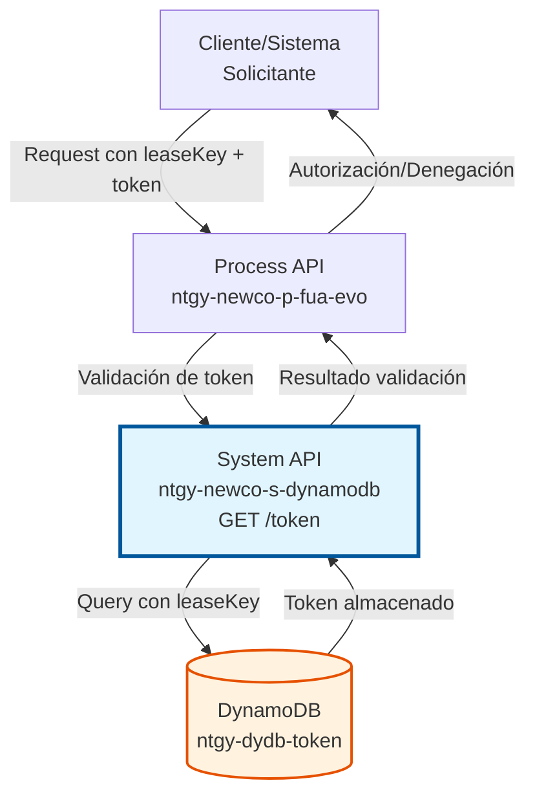
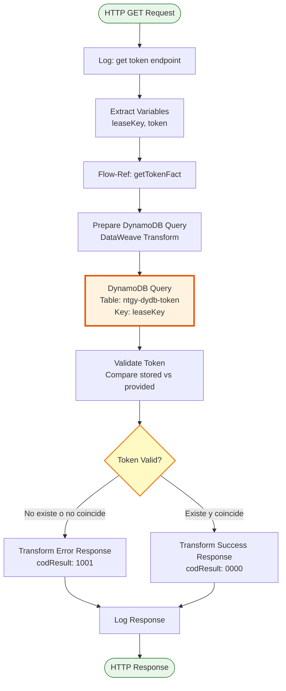
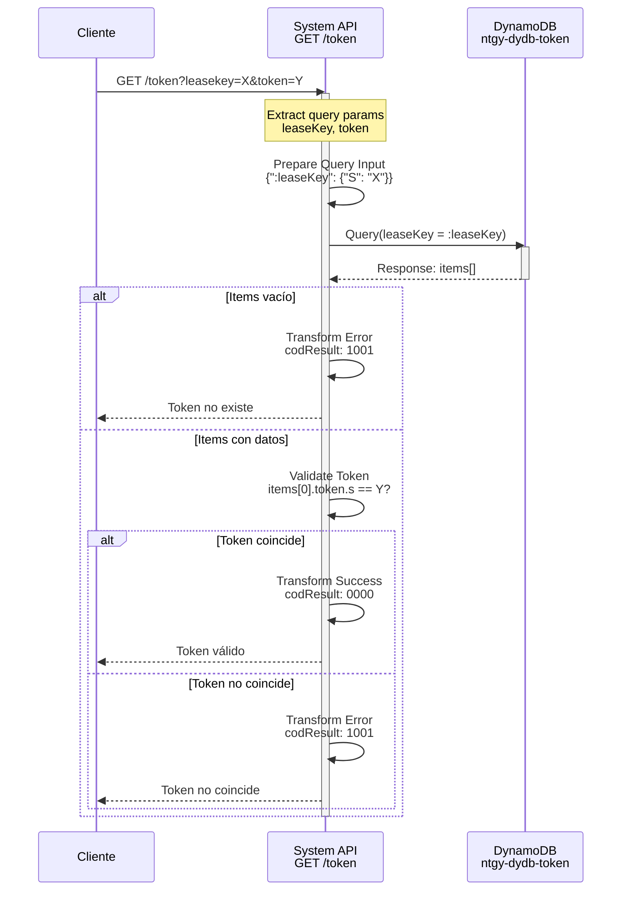

# GET /token

## 📌 Descripción General

### Propósito del Endpoint

Valida la existencia y coincidencia de un token de facturación almacenado en DynamoDB. Este endpoint es crítico para el proceso de autenticación y autorización de operaciones relacionadas con facturación, asegurando que solo usuarios con tokens válidos puedan acceder a información sensible de facturación.

El endpoint soporta:
- **Validación de Token**: Verifica que el token existe en la base de datos
- **Verificación de Coincidencia**: Comprueba que el token proporcionado coincide con el almacenado
- **Respuesta Inmediata**: Retorna resultado de validación en tiempo real
- **Auditoría de Accesos**: Registra intentos de validación para trazabilidad

### Tipo de API

**Capa:** System API (API-Led Connectivity)

**Función:** Integración directa con Amazon DynamoDB para validación de tokens de facturación.

### Patrón de Integración

**Tipo:** Request-Reply Síncrono con DynamoDB Query

**Descripción:** Recibe parámetros de validación (leaseKey y token), consulta la tabla `ntgy-dydb-token` en DynamoDB usando el leaseKey como partition key, compara el token almacenado con el proporcionado, y retorna el resultado de la validación.

### Arquitectura API-Led Connectivity



---

## 💼 Propósito del Negocio

### Casos de Uso Principales

1. **Validación de Acceso a Facturación**
   - Usuario intenta acceder a sus facturas desde portal web o app móvil
   - Sistema valida token antes de mostrar información sensible
   - Previene acceso no autorizado a datos de facturación

2. **Autenticación de Operaciones de Pago**
   - Cliente inicia proceso de pago de factura
   - Sistema verifica token para autorizar transacción
   - Garantiza que solo el titular puede realizar pagos

3. **Auditoría de Accesos**
   - Sistema registra intentos de validación de tokens
   - Detecta intentos de acceso no autorizado
   - Cumplimiento de normativas de seguridad y GDPR

### Contexto Empresarial

- **Dominio:** Facturación y Cobros
- **Sector:** Energía - Utilities
- **División:** Naturgy España - NewCo
- **Proceso de Negocio:** Gestión de tokens de facturación para control de acceso
- **Criticidad:** Alta - Seguridad de datos sensibles de facturación

### Stakeholders

- **Equipos de Facturación**: Necesitan garantizar acceso seguro a facturas
- **Equipos de Seguridad**: Requieren auditoría de accesos y prevención de fraude
- **Clientes Finales**: Esperan acceso rápido y seguro a sus facturas
- **Equipos de Desarrollo**: Consumen este endpoint para validar tokens

### Valor de Negocio

- **Seguridad**: Prevención de acceso no autorizado a información de facturación
- **Cumplimiento**: Satisface requisitos de GDPR y normativas de protección de datos
- **Experiencia de Usuario**: Validación rápida sin fricción en el proceso
- **Auditoría**: Trazabilidad completa de accesos a datos sensibles

### Consumidores Potenciales

Este endpoint puede ser consumido por:
- Process APIs de facturación (ntgy-newco-p-fua-evo)
- Experience APIs de portales web y aplicaciones móviles
- Sistemas de gestión de pagos
- Servicios de auditoría y seguridad

---

## 🔧 Especificación Técnica

### URLs por Ambiente

| Ambiente | URL Base | URL Completa |
|----------|----------|--------------|
| **Local** | `http://localhost:8081` | `http://localhost:8081/api/token?leasekey={leaseKey}&token={token}` |
| **Development** | `https://ntgy-newco-s-dynamodb-dev.us-e2.cloudhub.io` | `https://ntgy-newco-s-dynamodb-dev.us-e2.cloudhub.io/api/token?leasekey={leaseKey}&token={token}` |
| **UAT** | `https://ntgy-newco-s-dynamodb-uat.us-e2.cloudhub.io` | `https://ntgy-newco-s-dynamodb-uat.us-e2.cloudhub.io/api/token?leasekey={leaseKey}&token={token}` |
| **Production** | `https://ntgy-newco-s-dynamodb-pro.us-e2.cloudhub.io` | `https://ntgy-newco-s-dynamodb-pro.us-e2.cloudhub.io/api/token?leasekey={leaseKey}&token={token}` |

### Método HTTP

```
GET /api/token
```

### Parámetros de Entrada

#### Headers HTTP

| Header | Tipo | Requerido | Descripción | Ejemplo |
|--------|------|-----------|-------------|---------|
| `Content-Type` | string | ❌ No | Tipo de contenido (no aplica para GET) | `application/json` |
| `Accept` | string | ❌ No | Tipo de contenido esperado en response | `application/json` |

#### Query Parameters

| Parámetro | Tipo | Requerido | Descripción | Ejemplo |
|-----------|------|-----------|-------------|---------|
| `leasekey` | string | ✅ Sí | Identificador único del lease (partition key en DynamoDB) | `"LEASE123456"` |
| `token` | string | ✅ Sí | Token de facturación a validar | `"abc123def456"` |

**Nota:** Los nombres de parámetros son case-sensitive. Usar `leasekey` (minúsculas) según implementación.

### Respuestas

#### Respuesta Exitosa - Token Válido (200 OK)

```json
{
  "result": {
    "codResult": "0000",
    "msgResult": "El token existe"
  }
}
```

**Descripción:** El token existe en DynamoDB y coincide con el proporcionado.

#### Respuesta de Error de Negocio - Token Inválido (200 OK)

```json
{
  "result": {
    "codResult": "1001",
    "msgResult": "El token no existe o no coincide"
  }
}
```

**Descripción:** El token no existe en la base de datos O existe pero no coincide con el proporcionado.

**Casos que generan este error:**
- LeaseKey no existe en la tabla `ntgy-dydb-token`
- LeaseKey existe pero el token no coincide
- Tabla vacía para el leaseKey consultado

#### Respuesta de Error Técnico (500)

```json
{
  "result": {
    "codResult": "0001",
    "msgResult": "Error interno del servidor"
  }
}
```

**Descripción:** Error técnico en la consulta a DynamoDB o procesamiento interno.

### Códigos de Respuesta

| Código | Descripción | Escenario |
|--------|-------------|-----------|
| `0000` | Éxito | Token válido y coincidente |
| `1001` | Error de negocio | Token no existe o no coincide |
| `0001` | Error técnico | Fallo en DynamoDB o procesamiento |

### Autenticación y Autorización

- **Tipo:** Client ID & Client Secret (Anypoint Platform)
- **Autorización DynamoDB:** El usuario de servicio debe tener permisos para:
  - Ejecutar operación `Query` en tabla `ntgy-dydb-token`
  - Acceso de lectura (READ) a la tabla
  - Permisos IAM configurados en AWS

### Timeouts

| Tipo | Valor | Descripción |
|------|-------|-------------|
| **Request Timeout** | 30 segundos | Tiempo máximo de espera para la respuesta |
| **Connection Timeout** | 10 segundos | Tiempo máximo para establecer conexión con DynamoDB |
| **Query Timeout** | 5 segundos | Tiempo máximo para ejecutar query en DynamoDB |

---

## 🏗️ Implementación Técnica

### Arquitectura del Flow



### Diagrama de Secuencia



### Componentes del Flow

#### 1. Flow Principal (ntgy-newco-s-dynamodb.xml)

**Ubicación:** `src/main/mule/ntgy-newco-s-dynamodb.xml` (líneas 453-468)

```xml
<flow name="get:\token:ntgy-newco-s-dynamodb-config">
    <logger level="INFO" message="get:\token:ntgy-newco-s-dynamodb-config" />
    <ee:transform doc:name="Transform Message">
        <ee:variables>
            <ee:set-variable variableName="leaseKey">
                attributes.queryParams.leasekey
            </ee:set-variable>
            <ee:set-variable variableName="token">
                attributes.queryParams.token
            </ee:set-variable>
        </ee:variables>
    </ee:transform>
    <flow-ref doc:name="Flow Reference" name="getTokenFact" />
    <error-handler>
        <on-error-continue type="ANY">
            <flow-ref name="errorManagerExpSysFlow" />
        </on-error-continue>
    </error-handler>
</flow>
```

**Responsabilidades:**
- Recibir request HTTP GET
- Extraer query parameters (leasekey, token)
- Almacenar en variables de flow
- Invocar subflow de implementación
- Manejar errores globalmente

#### 2. Subflow de Implementación (getTokenFact.xml)

**Ubicación:** `src/main/mule/implementation/getTokenFact.xml` (líneas 8-66)

**Paso 1: Preparar Query Input (líneas 9-20)**
```xml
<ee:transform doc:name="Transform Message">
    <ee:set-payload><![CDATA[%dw 2.0
output application/java
---
{
    ":leaseKey": {"S": vars.leaseKey}
}]]></ee:set-payload>
</ee:transform>
```

**Paso 2: Query a DynamoDB (línea 21)**
```xml
<dynamodb:query 
    tableName="ntgy-dydb-token" 
    config-ref="Amazon_DynamoDB_Configuration" 
    keyConditionExpression="leaseKey = :leaseKey" 
    attributeValues="#[payload]" />
```

**Paso 3: Validar Token (líneas 22-31)**
```xml
<ee:transform doc:name="Transform Message">
    <ee:variables>
        <ee:set-variable variableName="existToken"><![CDATA[%dw 2.0
output application/java
---
if(payload.items[0].token.s == vars.token) true else false]]>
        </ee:set-variable>
    </ee:variables>
</ee:transform>
```

**Paso 4: Choice - Respuesta según Validación (líneas 32-64)**
```xml
<choice doc:name="Choice">
    <when expression="#[isEmpty(payload.items) or vars.existToken == false]">
        <!-- Error: Token no existe o no coincide -->
        <ee:transform>
            <ee:set-payload><![CDATA[%dw 2.0
output application/json
---
{
    "result": {
        "codResult": "1001",
        "msgResult": "El token no existe o no coincide"
    }
}]]></ee:set-payload>
        </ee:transform>
    </when>
    <otherwise>
        <!-- Éxito: Token válido -->
        <ee:transform>
            <ee:set-payload><![CDATA[%dw 2.0
output application/json
---
{
    "result": {
        "codResult": "0000",
        "msgResult": "El token existe"
    }
}]]></ee:set-payload>
        </ee:transform>
    </otherwise>
</choice>
```

**Paso 5: Logging (línea 65)**
```xml
<logger level="INFO" doc:name="Logger" message="#[payload]" />
```

### Operación de Backend: DynamoDB Query

#### Configuración de Query

```xml
<dynamodb:query 
    tableName="ntgy-dydb-token" 
    config-ref="Amazon_DynamoDB_Configuration" 
    keyConditionExpression="leaseKey = :leaseKey" 
    attributeValues="#[payload]" />
```

**Parámetros:**
- **tableName**: `ntgy-dydb-token` - Tabla de tokens de facturación
- **keyConditionExpression**: `leaseKey = :leaseKey` - Búsqueda por partition key
- **attributeValues**: Payload con formato DynamoDB: `{":leaseKey": {"S": "valor"}}`

#### Estructura de la Tabla DynamoDB

| Campo | Tipo | Descripción | Ejemplo |
|-------|------|-------------|---------|
| `leaseKey` | String (S) | Partition Key - Identificador del lease | `"LEASE123456"` |
| `token` | String (S) | Token de facturación almacenado | `"abc123def456"` |

**Índices:**
- **Primary Key:** `leaseKey` (Partition Key)
- **No hay Sort Key** en esta tabla

### Transformaciones DataWeave

#### Transformación 1: Preparar Input para DynamoDB

```dataweave
%dw 2.0
output application/java
---
{
    ":leaseKey": {"S": vars.leaseKey}
}
```

**Propósito:** Convertir el leaseKey a formato DynamoDB AttributeValue.

**Input:** Variable `vars.leaseKey` (String)

**Output:** Objeto Java con formato DynamoDB:
- `:leaseKey` - Nombre del parámetro en keyConditionExpression
- `{"S": "valor"}` - Formato DynamoDB para String

#### Transformación 2: Validar Token

```dataweave
%dw 2.0
output application/java
---
if(payload.items[0].token.s == vars.token) true else false
```

**Propósito:** Comparar token almacenado con token proporcionado.

**Input:** 
- `payload.items[0].token.s` - Token almacenado en DynamoDB
- `vars.token` - Token proporcionado en query param

**Output:** Boolean (true si coinciden, false si no)

**Nota:** Acceso a atributo DynamoDB String con `.s`

#### Transformación 3: Respuesta de Error

```dataweave
%dw 2.0
output application/json
---
{
    "result": {
        "codResult": "1001",
        "msgResult": "El token no existe o no coincide"
    }
}
```

**Propósito:** Generar respuesta estándar de error de negocio.

#### Transformación 4: Respuesta de Éxito

```dataweave
%dw 2.0
output application/json
---
{
    "result": {
        "codResult": "0000",
        "msgResult": "El token existe"
    }
}
```

**Propósito:** Generar respuesta estándar de éxito.

### Manejo de Errores

#### Errores de Negocio (Manejados en Choice)

1. **Tabla Vacía:** `isEmpty(payload.items)` → codResult: 1001
2. **Token No Coincide:** `vars.existToken == false` → codResult: 1001

#### Errores Técnicos (Manejados en Error Handler)

```xml
<error-handler>
    <on-error-continue type="ANY">
        <flow-ref name="errorManagerExpSysFlow" />
    </on-error-continue>
</error-handler>
```

**Tipos de errores capturados:**
- `DYNAMODB:CONNECTIVITY` - Error de conexión con DynamoDB
- `DYNAMODB:THROTTLING` - Límite de requests excedido
- `DYNAMODB:TIMEOUT` - Timeout en query
- `ANY` - Cualquier otro error no esperado

### Diagrama de Transformación de Datos

```mermaid
graph LR
    A[Query Params<br/>leasekey, token] --> B[Variables<br/>vars.leaseKey<br/>vars.token]
    B --> C[DynamoDB Format<br/>{':leaseKey': {'S': 'X'}}]
    C --> D[DynamoDB Query]
    D --> E[Response<br/>items[]]
    E --> F{Validación}
    F -->|Vacío o no coincide| G[Error Response<br/>codResult: 1001]
    F -->|Existe y coincide| H[Success Response<br/>codResult: 0000]
    
    style A fill:#e3f2fd
    style D fill:#fff3e0
    style F fill:#fff9c4
    style G fill:#ffebee
    style H fill:#e8f5e9
```

### Configuración de DynamoDB Connector

```xml
<dynamodb:config name="Amazon_DynamoDB_Configuration">
    <dynamodb:basic-connection 
        accessKey="${secure::aws.accessKey}"
        secretKey="${secure::aws.secretKey}"
        region="${aws.region}"/>
</dynamodb:config>
```

**Propiedades de Configuración:**
- **accessKey**: Credencial AWS (encriptada con secure properties)
- **secretKey**: Credencial AWS (encriptada con secure properties)
- **region**: Región AWS (ej: `eu-west-1`)

### Consideraciones de Performance

- **Query Optimizada:** Usa partition key directamente (operación O(1))
- **Sin Scan:** No se escanea toda la tabla, solo se consulta por key
- **Response Time Esperado:** < 100ms para queries por partition key
- **Throughput:** Limitado por RCU (Read Capacity Units) de DynamoDB

---

## 💻 Ejemplos de Uso

### Ejemplo 1: Validación Exitosa de Token

#### Request

```bash
curl -X GET "https://ntgy-newco-s-dynamodb-dev.us-e2.cloudhub.io/api/token?leasekey=LEASE123456&token=abc123def456" \
  -H "Accept: application/json"
```

#### Response (200 OK)

```json
{
  "result": {
    "codResult": "0000",
    "msgResult": "El token existe"
  }
}
```

**Interpretación:** El token es válido y el usuario puede proceder con la operación de facturación.

---

### Ejemplo 2: Token No Existe

#### Request

```bash
curl -X GET "https://ntgy-newco-s-dynamodb-dev.us-e2.cloudhub.io/api/token?leasekey=LEASE_INEXISTENTE&token=xyz789" \
  -H "Accept: application/json"
```

#### Response (200 OK)

```json
{
  "result": {
    "codResult": "1001",
    "msgResult": "El token no existe o no coincide"
  }
}
```

**Interpretación:** El leaseKey no existe en la base de datos. Acceso denegado.

---

### Ejemplo 3: Token No Coincide

#### Request

```bash
curl -X GET "https://ntgy-newco-s-dynamodb-dev.us-e2.cloudhub.io/api/token?leasekey=LEASE123456&token=token_incorrecto" \
  -H "Accept: application/json"
```

#### Response (200 OK)

```json
{
  "result": {
    "codResult": "1001",
    "msgResult": "El token no existe o no coincide"
  }
}
```

**Interpretación:** El leaseKey existe pero el token proporcionado no coincide con el almacenado. Acceso denegado.

---

### Ejemplo 4: Integración desde JavaScript

```javascript
async function validateToken(leaseKey, token) {
  const baseUrl = 'https://ntgy-newco-s-dynamodb-dev.us-e2.cloudhub.io';
  const endpoint = `/api/token?leasekey=${encodeURIComponent(leaseKey)}&token=${encodeURIComponent(token)}`;
  
  try {
    const response = await fetch(baseUrl + endpoint, {
      method: 'GET',
      headers: {
        'Accept': 'application/json'
      }
    });
    
    const data = await response.json();
    
    if (data.result.codResult === '0000') {
      console.log('✅ Token válido - Acceso autorizado');
      return true;
    } else {
      console.log('❌ Token inválido - Acceso denegado');
      console.log('Mensaje:', data.result.msgResult);
      return false;
    }
  } catch (error) {
    console.error('Error al validar token:', error);
    return false;
  }
}

// Uso
const isValid = await validateToken('LEASE123456', 'abc123def456');
if (isValid) {
  // Proceder con operación de facturación
  showInvoices();
} else {
  // Mostrar error de autenticación
  showAuthError();
}
```

---

### Ejemplo 5: Integración desde Python

```python
import requests
from typing import Dict, Tuple

def validate_token(lease_key: str, token: str) -> Tuple[bool, str]:
    """
    Valida un token de facturación contra DynamoDB.
    
    Args:
        lease_key: Identificador del lease
        token: Token a validar
        
    Returns:
        Tupla (es_valido, mensaje)
    """
    base_url = 'https://ntgy-newco-s-dynamodb-dev.us-e2.cloudhub.io'
    endpoint = f'/api/token'
    
    params = {
        'leasekey': lease_key,
        'token': token
    }
    
    try:
        response = requests.get(
            f'{base_url}{endpoint}',
            params=params,
            headers={'Accept': 'application/json'},
            timeout=10
        )
        
        response.raise_for_status()
        data = response.json()
        
        if data['result']['codResult'] == '0000':
            return True, 'Token válido'
        else:
            return False, data['result']['msgResult']
            
    except requests.exceptions.RequestException as e:
        return False, f'Error de conexión: {str(e)}'

# Uso
is_valid, message = validate_token('LEASE123456', 'abc123def456')
if is_valid:
    print(f'✅ {message}')
    # Proceder con operación
else:
    print(f'❌ {message}')
    # Manejar error
```

---

### Ejemplo 6: Manejo de Errores Completo

```javascript
async function validateTokenWithRetry(leaseKey, token, maxRetries = 3) {
  const baseUrl = 'https://ntgy-newco-s-dynamodb-dev.us-e2.cloudhub.io';
  const endpoint = `/api/token?leasekey=${encodeURIComponent(leaseKey)}&token=${encodeURIComponent(token)}`;
  
  for (let attempt = 1; attempt <= maxRetries; attempt++) {
    try {
      const response = await fetch(baseUrl + endpoint, {
        method: 'GET',
        headers: {
          'Accept': 'application/json'
        },
        timeout: 10000 // 10 segundos
      });
      
      if (!response.ok) {
        throw new Error(`HTTP ${response.status}: ${response.statusText}`);
      }
      
      const data = await response.json();
      
      return {
        success: data.result.codResult === '0000',
        code: data.result.codResult,
        message: data.result.msgResult
      };
      
    } catch (error) {
      console.error(`Intento ${attempt}/${maxRetries} falló:`, error.message);
      
      if (attempt === maxRetries) {
        return {
          success: false,
          code: 'ERROR',
          message: `Error después de ${maxRetries} intentos: ${error.message}`
        };
      }
      
      // Esperar antes de reintentar (exponential backoff)
      await new Promise(resolve => setTimeout(resolve, 1000 * attempt));
    }
  }
}

// Uso con manejo completo
const result = await validateTokenWithRetry('LEASE123456', 'abc123def456');

switch (result.code) {
  case '0000':
    console.log('✅ Token válido');
    // Proceder con operación
    break;
    
  case '1001':
    console.log('❌ Token inválido o no existe');
    // Solicitar nuevo token
    break;
    
  case 'ERROR':
    console.log('⚠️ Error técnico:', result.message);
    // Mostrar mensaje de error al usuario
    break;
}
```

---

### Ejemplo 7: Testing con Postman

**Pre-request Script:**
```javascript
// Generar token de prueba
const leaseKey = pm.environment.get("test_lease_key") || "LEASE_TEST_001";
const token = pm.environment.get("test_token") || "test_token_123";

pm.environment.set("current_lease_key", leaseKey);
pm.environment.set("current_token", token);
```

**Request:**
```
GET {{base_url}}/api/token?leasekey={{current_lease_key}}&token={{current_token}}
```

**Tests:**
```javascript
pm.test("Status code is 200", function () {
    pm.response.to.have.status(200);
});

pm.test("Response has result object", function () {
    const jsonData = pm.response.json();
    pm.expect(jsonData).to.have.property('result');
    pm.expect(jsonData.result).to.have.property('codResult');
    pm.expect(jsonData.result).to.have.property('msgResult');
});

pm.test("Token validation result is valid", function () {
    const jsonData = pm.response.json();
    const validCodes = ['0000', '1001'];
    pm.expect(validCodes).to.include(jsonData.result.codResult);
});

// Guardar resultado para siguiente request
if (pm.response.json().result.codResult === '0000') {
    pm.environment.set("token_is_valid", "true");
} else {
    pm.environment.set("token_is_valid", "false");
}