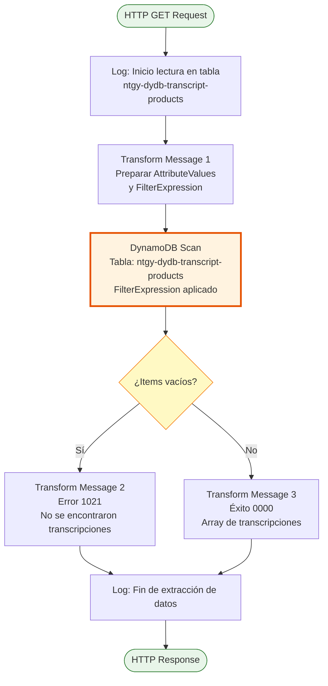
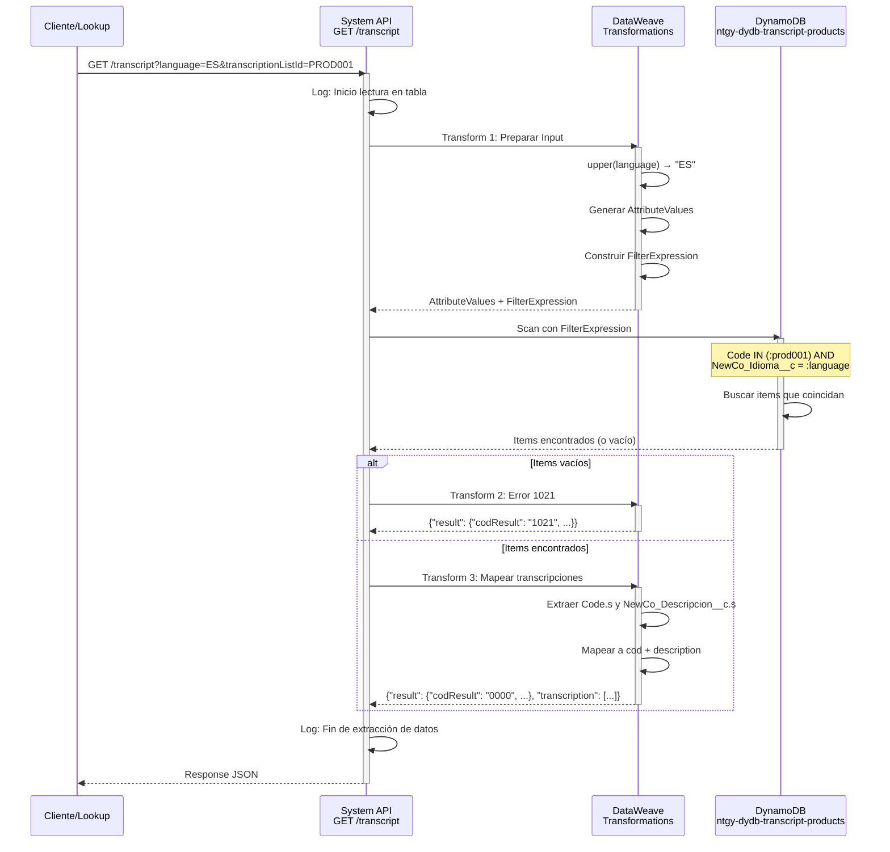

# GET /transcript

## 📌 Descripción General

### Propósito del Endpoint

Este endpoint recupera transcripciones de productos desde DynamoDB, permitiendo obtener descripciones de productos en diferentes idiomas. Es utilizado internamente por otros endpoints del API (como `getContractAccounts`) para proporcionar descripciones localizadas de productos.

El endpoint soporta:
- **Consulta por Idioma**: Filtra transcripciones según el idioma especificado (ES, EN, FR, etc.)
- **Múltiples Códigos**: Permite buscar transcripciones para varios códigos de producto simultáneamente
- **Respuesta Estructurada**: Retorna lista de transcripciones con código y descripción

### Tipo de API

**Capa:** System API (API-Led Connectivity)

**Función:** Integración directa con Amazon DynamoDB para recuperar transcripciones de productos multiidioma.

### Patrón de Integración

**Tipo:** Request-Reply Síncrono con DynamoDB Scan

**Descripción:** Recibe idioma y lista de códigos, transforma parámetros a formato DynamoDB, ejecuta scan con filtros, y retorna transcripciones encontradas.

### Arquitectura API-Led Connectivity

```mermaid
graph TB
    CA[getContractAccounts<br/>Endpoint Interno]
    T[System API<br/>ntgy-newco-s-dynamodb<br/>GET /transcript]
    DDB[Amazon DynamoDB<br/>Tabla: ntgy-dydb-transcript-products<br/>Operación: Scan con FilterExpression]
    
    CA -->|Lookup Request<br/>language + transcriptionListId| T
    T -->|Scan con Filtros<br/>Code IN (...) AND NewCo_Idioma__c = :language| DDB
    DDB -->|Items Encontrados| T
    T -->|Array de Transcripciones<br/>cod + description| CA
    
    style T fill:#e1f5ff,stroke:#01579b,stroke-width:3px
    style DDB fill:#fff3e0,stroke:#e65100,stroke-width:2px
```

---

## 💼 Propósito del Negocio

### Casos de Uso Principales

1. **Localización de Descripciones de Productos**
   - Endpoint `getContractAccounts` necesita mostrar nombres de productos en idioma del usuario
   - Se invoca lookup a `/transcript` con idioma y códigos de productos
   - Retorna descripciones traducidas para mejorar experiencia de usuario

2. **Soporte Multiidioma en Portales**
   - Portales web y móviles requieren contenido en idioma del cliente
   - Transcripciones centralizadas en DynamoDB
   - Actualización de traducciones sin modificar código

3. **Fallback a Valores Originales**
   - Si no existe transcripción para un idioma, el consumidor usa valor original
   - Garantiza que siempre se muestre información del producto
   - Evita errores por falta de traducciones

### Contexto Empresarial

- **Dominio:** Gestión de Productos - Localización
- **Sector:** Energía - Utilities
- **División:** Naturgy España - NewCo
- **Proceso de Negocio:** Presentación de información de productos en múltiples idiomas
- **Alcance:** Soporte para todos los productos del catálogo Naturgy

### Stakeholders

- **Equipos de Desarrollo**: Necesitan servicio centralizado de traducciones
- **Equipos de Contenido**: Gestionan traducciones de productos
- **Usuarios Finales**: Reciben información en su idioma preferido

### Valor de Negocio

- **Experiencia de Usuario Mejorada**: Información en idioma nativo del cliente
- **Mantenimiento Centralizado**: Traducciones en un solo lugar
- **Escalabilidad**: Fácil agregar nuevos idiomas sin cambios en código
- **Consistencia**: Mismas traducciones en todos los canales

### Consumidores Potenciales

Este endpoint puede ser consumido por:
- Endpoint interno `getContractAccounts` (uso principal)
- Process APIs que necesiten descripciones localizadas
- Experience APIs de portales multiidioma
- Servicios de reporting y analytics

---

## 🔧 Especificación Técnica

### URLs por Ambiente

| Ambiente | URL Base | URL Completa |
|----------|----------|--------------|
| **Local** | `http://localhost:8081` | `http://localhost:8081/api/transcript?language=ES&transcriptionListId=CODE1&transcriptionListId=CODE2` |
| **Development** | `https://ntgy-newco-s-dynamodb-dev.us-e2.cloudhub.io` | `https://ntgy-newco-s-dynamodb-dev.us-e2.cloudhub.io/api/transcript?language=ES&transcriptionListId=CODE1` |
| **UAT** | `https://ntgy-newco-s-dynamodb-uat.us-e2.cloudhub.io` | `https://ntgy-newco-s-dynamodb-uat.us-e2.cloudhub.io/api/transcript?language=ES&transcriptionListId=CODE1` |
| **Production** | `https://ntgy-newco-s-dynamodb-pro.us-e2.cloudhub.io` | `https://ntgy-newco-s-dynamodb-pro.us-e2.cloudhub.io/api/transcript?language=ES&transcriptionListId=CODE1` |

### Método HTTP

```
GET /api/transcript
```

### Parámetros de Entrada

#### Headers HTTP

| Header | Tipo | Requerido | Descripción | Ejemplo |
|--------|------|-----------|-------------|---------|
| `Accept` | string | ❌ No | Tipo de contenido esperado en response | `application/json` |

#### Query Parameters

| Parámetro | Tipo | Requerido | Descripción | Ejemplo |
|-----------|------|-----------|-------------|---------|
| `language` | string | ✅ Sí | Código de idioma (2 letras, uppercase) | `"ES"`, `"EN"`, `"FR"` |
| `transcriptionListId` | array[string] | ✅ Sí | Lista de códigos de productos a buscar (puede repetirse) | `"PROD001"`, `"PROD002"` |

**Nota sobre transcriptionListId:**
- Se puede pasar múltiples veces en la URL: `?transcriptionListId=CODE1&transcriptionListId=CODE2`
- Cada valor se convierte en un parámetro de filtro en DynamoDB

### Respuestas

#### Respuesta Exitosa (200 OK) - Con Resultados

```json
{
  "result": {
    "codResult": "0000",
    "msgResult": "No hay error"
  },
  "transcription": [
    {
      "cod": "PROD001",
      "description": "Tarifa Eléctrica Estándar"
    },
    {
      "cod": "PROD002",
      "description": "Tarifa Gas Natural"
    }
  ]
}
```

#### Respuesta Sin Resultados (200 OK)

```json
{
  "result": {
    "codResult": "1021",
    "msgResult": "No se han encontrado transcripciones con esos datos"
  }
}
```

**Códigos de Resultado:**
- `0000`: Operación exitosa, transcripciones encontradas
- `1021`: No se encontraron transcripciones para los parámetros dados

### Autenticación y Autorización

- **Tipo:** Client ID & Client Secret (Anypoint Platform)
- **Autorización DynamoDB:** El usuario de servicio debe tener permisos para:
  - Operación `Scan` en tabla `ntgy-dydb-transcript-products`
  - Acceso de lectura a la tabla

### Timeouts

| Tipo | Valor | Descripción |
|------|-------|-------------|
| **Request Timeout** | 30 segundos | Tiempo máximo de espera para la respuesta |
| **Connection Timeout** | 10 segundos | Tiempo máximo para establecer conexión con DynamoDB |

---

## 🏗️ Implementación Técnica

### Arquitectura del Flow



### Operación de Backend: DynamoDB Scan

**Tabla:** `ntgy-dydb-transcript-products`

**Operación:** Scan con FilterExpression

**FilterExpression Construida:**
```
Code IN (:code1, :code2, :code3, ...) AND NewCo_Idioma__c = :language
```

**AttributeValues Generados:**
```json
{
  ":language": {"S": "ES"},
  ":code1": {"S": "PROD001"},
  ":code2": {"S": "PROD002"}
}
```

**Estructura de Items en DynamoDB:**
```json
{
  "Code": {"S": "PROD001"},
  "NewCo_Idioma__c": {"S": "ES"},
  "NewCo_Descripcion__c": {"S": "Tarifa Eléctrica Estándar"}
}
```

### Transformaciones DataWeave

#### Transformación 1: Preparar Input para DynamoDB

**Ubicación en Flow:** Antes del Scan

**Código DataWeave:**
```dataweave
%dw 2.0
output application/java
---
{
	":language": {"S": upper(payload.language)},
	(payload.transcriptionListId map {
		(":" ++ lower($)): {"S": $}
	})
}
```

**Propósito:**
- Convierte `language` a uppercase y formato DynamoDB `{"S": "ES"}`
- Genera parámetros dinámicos para cada código: `:code1`, `:code2`, etc.
- Formato requerido por DynamoDB Connector

**Ejemplo de Salida:**
```json
{
  ":language": {"S": "ES"},
  ":prod001": {"S": "PROD001"},
  ":prod002": {"S": "PROD002"}
}
```

#### Variable: FilterExpression

**Código DataWeave:**
```dataweave
%dw 2.0
output application/java
---
"Code IN (" ++ (payload.transcriptionListId map (":" ++ lower($)) joinBy ",") ++ ") AND NewCo_Idioma__c = :language"
```

**Propósito:**
- Construye FilterExpression dinámica según cantidad de códigos
- Genera: `Code IN (:prod001, :prod002) AND NewCo_Idioma__c = :language`

**Ejemplo de Salida:**
```
"Code IN (:prod001,:prod002) AND NewCo_Idioma__c = :language"
```

#### Transformación 2: Respuesta Sin Resultados

**Ubicación en Flow:** Rama `when` del Choice (isEmpty)

**Código DataWeave:**
```dataweave
%dw 2.0
output application/json
---
{
	"result": {
		"codResult": "1021",
		"msgResult": "No se han encontrado transcripciones con esos datos"
	}
}
```

#### Transformación 3: Respuesta Exitosa

**Ubicación en Flow:** Rama `otherwise` del Choice

**Código DataWeave:**
```dataweave
%dw 2.0
output application/json
---
{
  "result": {
    "codResult": "0000",
    "msgResult": "No hay error"
  }
} ++ {
  "transcription": payload.items map {
    "cod": $.Code.s,
    "description": $.NewCo_Descripcion__c.s
  }
}
```

**Propósito:**
- Extrae valores de estructura DynamoDB (`.s` para strings)
- Mapea `Code` → `cod` y `NewCo_Descripcion__c` → `description`
- Genera array de transcripciones

### Diagrama de Secuencia Completo



### Manejo de Errores

#### Error de Conectividad con DynamoDB

**Tipo:** `DYNAMODB:CONNECTIVITY`

**Respuesta:**
```json
{
  "result": {
    "codResult": "5001",
    "msgResult": "Error de conectividad con DynamoDB"
  }
}
```

**Estrategia de Recuperación:**
- Retry automático (3 intentos con 2s entre intentos)
- Circuit breaker si persiste el error

#### Error de Timeout

**Tipo:** `DYNAMODB:TIMEOUT`

**Respuesta:**
```json
{
  "result": {
    "codResult": "5002",
    "msgResult": "Timeout en consulta a DynamoDB"
  }
}
```

### Logging

**Puntos de Logging:**

1. **Inicio del Flow:**
   ```
   Log Level: INFO
   Message: "Inicio lectura en tabla ntgy-dydb-transcript-products"
   ```

2. **Fin del Flow:**
   ```
   Log Level: INFO
   Message: "Fin de extraccion de datos en la tabla ntgy-dydb-transcript"
   ```

**Información Adicional en Logs:**
- Idioma solicitado
- Cantidad de códigos buscados
- Cantidad de transcripciones encontradas
- Tiempo de ejecución

---

## 💻 Ejemplos de Uso

### Ejemplo 1: Consulta de Transcripción Única

#### Request

```bash
curl -X GET "https://ntgy-newco-s-dynamodb-dev.us-e2.cloudhub.io/api/transcript?language=ES&transcriptionListId=TARIFA_ELECTRICA_STD" \
  -H "Accept: application/json" \
  -H "client_id: YOUR_CLIENT_ID" \
  -H "client_secret: YOUR_CLIENT_SECRET"
```

#### Response (200 OK)

```json
{
  "result": {
    "codResult": "0000",
    "msgResult": "No hay error"
  },
  "transcription": [
    {
      "cod": "TARIFA_ELECTRICA_STD",
      "description": "Tarifa Eléctrica Estándar"
    }
  ]
}
```

### Ejemplo 2: Consulta de Múltiples Transcripciones

#### Request

```bash
curl -X GET "https://ntgy-newco-s-dynamodb-dev.us-e2.cloudhub.io/api/transcript?language=ES&transcriptionListId=TARIFA_ELECTRICA_STD&transcriptionListId=TARIFA_GAS_NATURAL&transcriptionListId=TARIFA_DUAL" \
  -H "Accept: application/json" \
  -H "client_id: YOUR_CLIENT_ID" \
  -H "client_secret: YOUR_CLIENT_SECRET"
```

#### Response (200 OK)

```json
{
  "result": {
    "codResult": "0000",
    "msgResult": "No hay error"
  },
  "transcription": [
    {
      "cod": "TARIFA_ELECTRICA_STD",
      "description": "Tarifa Eléctrica Estándar"
    },
    {
      "cod": "TARIFA_GAS_NATURAL",
      "description": "Tarifa Gas Natural"
    },
    {
      "cod": "TARIFA_DUAL",
      "description": "Tarifa Dual Luz y Gas"
    }
  ]
}
```

### Ejemplo 3: Sin Resultados

#### Request

```bash
curl -X GET "https://ntgy-newco-s-dynamodb-dev.us-e2.cloudhub.io/api/transcript?language=FR&transcriptionListId=CODIGO_INEXISTENTE" \
  -H "Accept: application/json" \
  -H "client_id: YOUR_CLIENT_ID" \
  -H "client_secret: YOUR_CLIENT_SECRET"
```

#### Response (200 OK)

```json
{
  "result": {
    "codResult": "1021",
    "msgResult": "No se han encontrado transcripciones con esos datos"
  }
}
```

### Ejemplo 4: Uso desde DataWeave (Lookup)

Este es el uso más común desde el endpoint `getContractAccounts`:

```dataweave
%dw 2.0
output application/json

var transcriptionResult = lookup("getTranscription", {
    "language": vars.language,
    "transcriptionListId": [productTypeNameExtended]
}, 10000)  // 10s timeout
---
{
    "productTypeName": if (!isEmpty(transcriptionResult.transcription))
        transcriptionResult.transcription[0].description
    else
        productTypeNameExtended  // Fallback al valor original
}
```

### Ejemplo 5: Diferentes Idiomas

#### Request en Inglés

```bash
curl -X GET "https://ntgy-newco-s-dynamodb-dev.us-e2.cloudhub.io/api/transcript?language=EN&transcriptionListId=TARIFA_ELECTRICA_STD" \
  -H "Accept: application/json"
```

#### Response

```json
{
  "result": {
    "codResult": "0000",
    "msgResult": "No hay error"
  },
  "transcription": [
    {
      "cod": "TARIFA_ELECTRICA_STD",
      "description": "Standard Electricity Rate"
    }
  ]
}
```

### Ejemplo 6: Error de Conectividad

#### Response (500 Internal Server Error)

```json
{
  "result": {
    "codResult": "5001",
    "msgResult": "Error de conectividad con DynamoDB"
  }
}
```

---

## 📊 Consideraciones de Performance

### Optimización de Queries

**Operación Actual:** Scan con FilterExpression

**Consideraciones:**
- Scan es menos eficiente que Query (escanea toda la tabla)
- Para mejorar performance, considerar:
  - Crear índice secundario global (GSI) con `NewCo_Idioma__c` como partition key
  - Usar Query en lugar de Scan
  - Implementar caching en Object Store para transcripciones frecuentes

**Performance Esperada:**
- Scan actual: 200-500ms (depende del tamaño de la tabla)
- Con GSI: 50-100ms
- Con caching: < 10ms (cache hit)

### Estrategia de Caching Recomendada

```dataweave
// Pseudocódigo de caching
if (objectStore.contains(cacheKey)) {
    return objectStore.retrieve(cacheKey)
} else {
    result = dynamodbScan()
    objectStore.store(cacheKey, result, ttl: 1 hour)
    return result
}
```

**Beneficios:**
- Reducción de 90% en llamadas a DynamoDB
- Mejora significativa en tiempo de respuesta
- Menor costo de RCU (Read Capacity Units)

---

## 🔍 Notas Técnicas Adicionales

### Estructura de Tabla DynamoDB

**Tabla:** `ntgy-dydb-transcript-products`

**Atributos Principales:**
- `Code` (String): Código del producto
- `NewCo_Idioma__c` (String): Código de idioma (ES, EN, FR, etc.)
- `NewCo_Descripcion__c` (String): Descripción traducida

**Partition Key:** Por definir (probablemente `Code`)

**Sort Key:** Por definir (probablemente `NewCo_Idioma__c`)

### Idiomas Soportados

Idiomas comunes en el sistema:
- `ES`: Español
- `EN`: Inglés
- `FR`: Francés
- `PT`: Portugués
- `CA`: Catalán

### Uso Interno vs Externo

**Uso Principal:** Interno (lookup desde otros endpoints)

**Uso Secundario:** Puede ser consumido directamente por Process APIs

**Recomendación:** Considerar hacer este endpoint privado (no expuesto en API Manager) si solo se usa internamente.

---

**Última Actualización:** 2026-01-17  
**Versión del API:** 2.0.0  
**Mantenido por:** Equipo Naturgy - Integración Newco