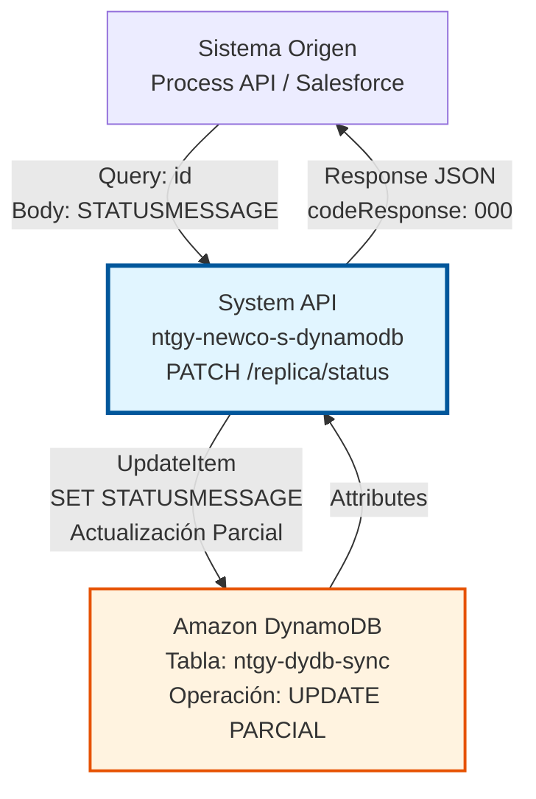
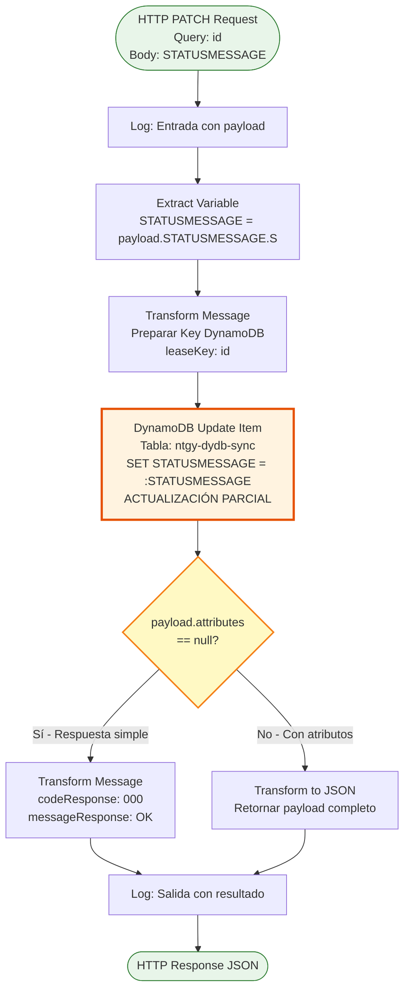
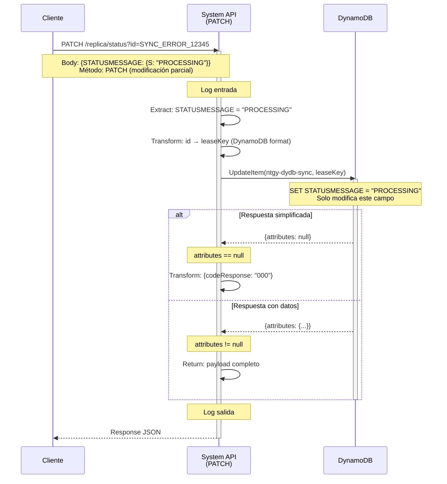
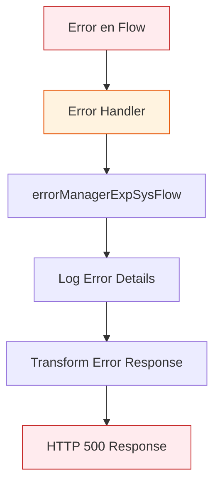

# PATCH /replica/status

## 📌 Descripción General

### Propósito del Endpoint

Este endpoint realiza una actualización parcial del campo `STATUSMESSAGE` en un registro específico de la tabla `ntgy-dydb-sync` de DynamoDB. Siguiendo la semántica REST, PATCH está diseñado específicamente para modificaciones parciales de recursos, siendo la opción más apropiada cuando solo se necesita actualizar un campo específico sin afectar el resto del registro.

El endpoint soporta:
- **Actualización Parcial Semántica**: Método HTTP PATCH indica explícitamente que es una modificación parcial
- **Actualización por ID**: Identifica el registro mediante el `leaseKey` (query parameter `id`)
- **Operación Idempotente**: Ejecutar múltiples veces con los mismos datos produce el mismo resultado
- **Preservación de Datos**: Garantiza que otros campos del registro permanecen intactos

### Tipo de API

**Capa:** System API (API-Led Connectivity)

**Función:** Integración directa con Amazon DynamoDB para actualización parcial de registros de sincronización.

### Patrón de Integración

**Tipo:** Request-Reply Síncrono con DynamoDB Update Operation (Partial Update)

**Descripción:** Recibe el ID del registro (query parameter) y el nuevo valor de `STATUSMESSAGE` (body), transforma los datos al formato DynamoDB, ejecuta una operación de actualización parcial usando `UpdateExpression`, y retorna una respuesta confirmando la actualización.

### Diferencia entre PUT y PATCH

| Aspecto | PUT /replica/status | PATCH /replica/status |
|---------|---------------------|----------------------|
| **Semántica REST** | Reemplazo completo o actualización | Modificación parcial explícita |
| **Intención** | "Actualizar el recurso" | "Modificar solo este campo" |
| **Implementación** | Misma (comparten sub-flow) | Misma (comparten sub-flow) |
| **Uso Recomendado** | Actualizaciones generales | Actualizaciones parciales específicas |
| **Idempotencia** | ✅ Sí | ✅ Sí |

**Nota Técnica:** Aunque PUT y PATCH comparten la misma implementación (`updateReplicaStatusSub_Flow`), PATCH es semánticamente más correcto para actualizaciones parciales según las especificaciones REST (RFC 5789).

### Arquitectura API-Led Connectivity



---

## 💼 Propósito del Negocio

### Casos de Uso Principales

1. **Actualización Parcial Explícita de Estado**
   - Modificar solo el campo `STATUSMESSAGE` sin afectar otros campos
   - Semántica clara de que es una modificación parcial, no un reemplazo
   - Ideal para APIs RESTful que siguen estándares estrictos

2. **Cambios de Estado Granulares**
   - Actualizar el estado de sincronización de forma precisa
   - Indicar explícitamente que solo se modifica el status
   - Mantener claridad en la intención de la operación

3. **Integración con Clientes REST Estrictos**
   - Algunos clientes REST distinguen entre PUT (reemplazo) y PATCH (modificación)
   - Proporcionar la semántica correcta según RFC 5789
   - Facilitar integración con frameworks que validan métodos HTTP

4. **Workflow de Estados con Semántica Clara**
   - PATCH indica explícitamente "solo cambio el estado"
   - PUT podría interpretarse como "reemplazo todo el recurso"
   - Mejor documentación de la intención del cambio

### Contexto Empresarial

- **Dominio:** Gestión de Sincronización de Datos
- **Sector:** Energía - Utilities
- **División:** Naturgy España - NewCo
- **Proceso de Negocio:** Control y gestión del ciclo de vida de errores de sincronización entre sistemas Imperial, Newco y Salesforce
- **Tabla DynamoDB:** ntgy-dydb-sync (Control de sincronización)

### Stakeholders

- **Arquitectos de APIs**: Requieren APIs que sigan estándares REST correctamente
- **Ingenieros de Sincronización**: Necesitan actualizar estados de forma clara y precisa
- **Equipos de Integración**: Consumen APIs con semántica REST estricta
- **Desarrolladores Frontend**: Prefieren APIs que sigan convenciones REST estándar

### Valor de Negocio

- **Semántica REST Correcta**: Sigue RFC 5789 para actualizaciones parciales
- **Claridad de Intención**: PATCH indica explícitamente modificación parcial
- **Compatibilidad con Estándares**: Facilita integración con frameworks REST
- **Documentación Clara**: La semántica del método documenta la operación
- **Flexibilidad de Integración**: Clientes pueden elegir PUT o PATCH según preferencia

### Consumidores Potenciales

Este endpoint puede ser consumido por:
- Process APIs que siguen estándares REST estrictos
- Frameworks frontend que distinguen PUT vs PATCH (Angular, React)
- Sistemas de integración que validan semántica HTTP
- APIs Gateway que enrutan según método HTTP
- Herramientas de testing que verifican conformidad REST

---

## 🔧 Especificación Técnica

### URLs por Ambiente

| Ambiente | URL Base | URL Completa |
|----------|----------|--------------|
| **Local** | `http://localhost:8081` | `http://localhost:8081/api/replica/status?id=:leaseKey` |
| **Development** | `https://ntgy-newco-s-dynamodb-dev.us-e2.cloudhub.io` | `https://ntgy-newco-s-dynamodb-dev.us-e2.cloudhub.io/api/replica/status?id=:leaseKey` |
| **UAT** | `https://ntgy-newco-s-dynamodb-uat.us-e2.cloudhub.io` | `https://ntgy-newco-s-dynamodb-uat.us-e2.cloudhub.io/api/replica/status?id=:leaseKey` |
| **Production** | `https://ntgy-newco-s-dynamodb-pro.us-e2.cloudhub.io` | `https://ntgy-newco-s-dynamodb-pro.us-e2.cloudhub.io/api/replica/status?id=:leaseKey` |

### Método HTTP

```
PATCH /api/replica/status
```

**Semántica HTTP:** PATCH indica una modificación parcial del recurso (RFC 5789)

### Parámetros de Entrada

#### Headers HTTP

| Header | Tipo | Requerido | Descripción | Ejemplo |
|--------|------|-----------|-------------|---------|
| `Content-Type` | string | ✅ Sí | Tipo de contenido del request | `application/json` |
| `Accept` | string | ❌ No | Tipo de contenido esperado en response | `application/json` |

#### Query Parameters

| Parámetro | Tipo | Requerido | Descripción | Ejemplo |
|-----------|------|-----------|-------------|---------|
| `id` | string | ✅ Sí | Identificador único del registro (leaseKey) a actualizar | `"SYNC_ERROR_12345"` |

**Nota:** El parámetro `id` corresponde al campo `leaseKey` en la tabla DynamoDB (partition key).

#### Body Parameters

**Estructura del Body:**

```json
{
  "STATUSMESSAGE": {
    "S": "NUEVO_ESTADO"
  }
}
```

| Campo | Tipo | Requerido | Descripción | Ejemplo |
|-------|------|-----------|-------------|---------|
| `STATUSMESSAGE` | Object | ✅ Sí | Objeto con formato DynamoDB | `{"S": "PROCESSING"}` |
| `STATUSMESSAGE.S` | string | ✅ Sí | Nuevo valor del mensaje de estado (tipo String en DynamoDB) | `"RESOLVED"`, `"PROCESSING"`, `"ERROR"` |

**Valores Comunes de STATUSMESSAGE:**
- `"PENDING"` - Error pendiente de procesamiento
- `"PROCESSING"` - Error en proceso de corrección
- `"RESOLVED"` - Error resuelto exitosamente
- `"FAILED"` - Intento de corrección fallido
- `"RETRY"` - Marcado para reintento
- `"CANCELLED"` - Procesamiento cancelado

### Respuestas

#### Respuesta Exitosa - Actualización Realizada (200 OK)

**Caso 1: attributes == null (respuesta simplificada)**

```json
{
  "codeResponse": "000",
  "messageResponse": "OK"
}
```

**Descripción:** El campo fue actualizado exitosamente. La respuesta simplificada indica éxito sin retornar los atributos actualizados.

**Caso 2: attributes != null (respuesta con datos)**

```json
{
  "attributes": {
    "leaseKey": {
      "S": "SYNC_ERROR_12345"
    },
    "STATUSMESSAGE": {
      "S": "PROCESSING"
    },
    "systemOrigin": {
      "S": "SALESFORCE"
    },
    "systemTarget": {
      "S": "SAP_ISU"
    },
    "timestamp": {
      "N": "1704067200000"
    }
  }
}
```

**Descripción:** El campo fue actualizado y DynamoDB retorna los atributos actualizados del item.

#### Respuesta de Error Técnico (500)

```json
{
  "result": {
    "codResult": "5001",
    "msgResult": "Error de conectividad con DynamoDB"
  }
}
```

**Descripción:** Error técnico al intentar conectar o ejecutar la operación en DynamoDB.

### Códigos de Resultado

| Código | Tipo | Descripción |
|--------|------|-------------|
| `000` | Success | Campo actualizado exitosamente |
| `5001` | Error | Error de conectividad con DynamoDB |
| `5002` | Error | Timeout en operación DynamoDB |
| `5003` | Error | Error de validación de datos |

### Autenticación y Autorización

- **Tipo:** Client ID & Client Secret (Anypoint Platform)
- **Autorización DynamoDB:** El usuario debe tener permisos para:
  - Ejecutar operación `UpdateItem` en tabla `ntgy-dydb-sync`
  - Acceso de escritura a la tabla
  - Permisos IAM configurados en AWS

### Timeouts

| Tipo | Valor | Descripción |
|------|-------|-------------|
| **Request Timeout** | 30 segundos | Tiempo máximo de espera para la respuesta |
| **Connection Timeout** | 10 segundos | Tiempo máximo para establecer conexión con DynamoDB |
| **DynamoDB Operation** | 20 segundos | Timeout específico de la operación update-item |

---

## 🏗️ Implementación Técnica

### Nota sobre Implementación Compartida

**⚠️ Importante:** Este endpoint comparte la misma implementación con PUT /replica/status (ambos usan el sub-flow `updateReplicaStatusSub_Flow`). La diferencia es puramente semántica según las convenciones REST:

- **PATCH**: Semánticamente correcto para modificaciones parciales (RFC 5789)
- **PUT**: Tradicionalmente usado para reemplazo completo, pero también acepta actualizaciones parciales

Ambos métodos producen el mismo resultado técnico, pero PATCH comunica mejor la intención de "modificar solo un campo".

### Arquitectura del Flow



### Sub-Flow Compartido: updateReplicaStatusSub_Flow

Este endpoint utiliza el mismo sub-flow que PUT /replica/status. Para detalles completos de la implementación, consultar la documentación de PUT /replica/status.

**Componentes Principales:**

1. **Logger de Entrada** - Registra el payload recibido
2. **Extracción de Variable** - Extrae `STATUSMESSAGE.S` del payload
3. **Transformación de Key** - Prepara `leaseKey` para DynamoDB
4. **Update Item** - Ejecuta `UpdateExpression: SET STATUSMESSAGE = :STATUSMESSAGE`
5. **Choice** - Determina tipo de respuesta según `attributes`
6. **Transformación de Respuesta** - Genera respuesta simplificada o completa
7. **Logger de Salida** - Registra la respuesta final

### Diagrama de Secuencia



### Operación DynamoDB

**UpdateExpression:**
```
SET STATUSMESSAGE = :STATUSMESSAGE
```

**Características:**
- **Tipo:** Actualización parcial atómica
- **Campo Actualizado:** Solo `STATUSMESSAGE`
- **Campos Preservados:** Todos los demás campos permanecen intactos
- **Idempotencia:** ✅ Sí
- **Atomicidad:** ✅ Sí

### Tabla DynamoDB: ntgy-dydb-sync

| Campo | Tipo | Actualizable por PATCH | Descripción |
|-------|------|------------------------|-------------|
| `leaseKey` | String | ❌ No | Partition Key (identificador) |
| `STATUSMESSAGE` | String | ✅ Sí | Campo modificado por este endpoint |
| `systemOrigin` | String | ❌ No | Preservado sin cambios |
| `systemTarget` | String | ❌ No | Preservado sin cambios |
| `timestamp` | Number | ❌ No | Preservado sin cambios |
| `errorDetails` | Map | ❌ No | Preservado sin cambios |

### Manejo de Errores

El manejo de errores es idéntico a PUT /replica/status:



**Tipos de Errores:**
- `DYNAMODB:CONNECTIVITY` - Error de conexión
- `DYNAMODB:TIMEOUT` - Timeout en operación
- `DYNAMODB:CONDITIONAL_CHECK_FAILED` - Registro no existe
- `ANY` - Error no esperado

---

## 💻 Ejemplos de Uso

### Ejemplo 1: Actualización Parcial con PATCH (Semántica Correcta)

#### Request
```bash
curl -X PATCH "https://ntgy-newco-s-dynamodb-dev.us-e2.cloudhub.io/api/replica/status?id=SYNC_ERROR_12345" \
  -H "Content-Type: application/json" \
  -H "client_id: your-client-id" \
  -H "client_secret: your-client-secret" \
  -d '{
    "STATUSMESSAGE": {
      "S": "PROCESSING"
    }
  }'
```

#### Response (200 OK)
```json
{
  "codeResponse": "000",
  "messageResponse": "OK"
}
```

**Interpretación:** El campo `STATUSMESSAGE` fue modificado parcialmente a `"PROCESSING"`. El uso de PATCH indica explícitamente que es una modificación parcial, no un reemplazo completo del recurso.

---

### Ejemplo 2: Comparación PUT vs PATCH

#### Usando PATCH (Semánticamente Correcto)
```bash
# PATCH indica explícitamente: "modifico solo este campo"
curl -X PATCH "https://api.example.com/replica/status?id=SYNC_ERROR_12345" \
  -H "Content-Type: application/json" \
  -d '{"STATUSMESSAGE": {"S": "RESOLVED"}}'
```

#### Usando PUT (También Funciona)
```bash
# PUT podría interpretarse como: "actualizo el recurso"
curl -X PUT "https://api.example.com/replica/status?id=SYNC_ERROR_12345" \
  -H "Content-Type: application/json" \
  -d '{"STATUSMESSAGE": {"S": "RESOLVED"}}'
```

**Resultado:** Ambos producen el mismo efecto técnico, pero PATCH comunica mejor la intención según RFC 5789.

---

### Ejemplo 3: Uso desde JavaScript con Axios (PATCH)

```javascript
const axios = require('axios');

async function patchReplicaStatus(leaseKey, newStatus) {
  try {
    // Usar PATCH para indicar modificación parcial
    const response = await axios.patch(
      'https://ntgy-newco-s-dynamodb-dev.us-e2.cloudhub.io/api/replica/status',
      {
        STATUSMESSAGE: {
          S: newStatus
        }
      },
      {
        params: { id: leaseKey },
        headers: {
          'Content-Type': 'application/json',
          'client_id': 'your-client-id',
          'client_secret': 'your-client-secret'
        }
      }
    );
    
    console.log('✅ PATCH exitoso:', response.data);
    
    if (response.data.codeResponse === '000') {
      console.log(`Campo STATUSMESSAGE modificado a: ${newStatus}`);
    }
    
    return response.data;
  } catch (error) {
    console.error('❌ Error en PATCH:', error.response?.data || error.message);
    throw error;
  }
}

// Uso: Modificación parcial explícita
patchReplicaStatus('SYNC_ERROR_12345', 'PROCESSING');
```

---

### Ejemplo 4: Uso desde Python con Requests (PATCH)

```python
import requests

def patch_replica_status(lease_key, new_status):
    """
    Modifica parcialmente el STATUSMESSAGE usando PATCH
    
    Args:
        lease_key (str): ID del registro (leaseKey)
        new_status (str): Nuevo valor del status
    
    Returns:
        dict: Respuesta del API
    """
    url = "https://ntgy-newco-s-dynamodb-dev.us-e2.cloudhub.io/api/replica/status"
    
    headers = {
        "Content-Type": "application/json",
        "client_id": "your-client-id",
        "client_secret": "your-client-secret"
    }
    
    params = {"id": lease_key}
    
    body = {
        "STATUSMESSAGE": {
            "S": new_status
        }
    }
    
    try:
        # Usar PATCH para modificación parcial
        response = requests.patch(url, json=body, headers=headers, params=params)
        response.raise_for_status()
        
        data = response.json()
        print(f"✅ PATCH exitoso: {data}")
        
        if data.get("codeResponse") == "000":
            print(f"Campo STATUSMESSAGE modificado a: {new_status}")
        
        return data
    except requests.exceptions.RequestException as e:
        print(f"❌ Error en PATCH: {e}")
        raise

# Uso: Modificación parcial
patch_replica_status("SYNC_ERROR_12345", "PROCESSING")
```

---

### Ejemplo 5: Cliente REST que Distingue PUT vs PATCH

```javascript
// Framework que valida semántica HTTP estricta

class SyncErrorClient {
  constructor(baseUrl) {
    this.baseUrl = baseUrl;
  }
  
  // PUT: Para actualizaciones generales
  async updateStatus(leaseKey, newStatus) {
    return await axios.put(
      `${this.baseUrl}/replica/status`,
      { STATUSMESSAGE: { S: newStatus } },
      { params: { id: leaseKey } }
    );
  }
  
  // PATCH: Para modificaciones parciales explícitas
  async patchStatusField(leaseKey, newStatus) {
    return await axios.patch(
      `${this.baseUrl}/replica/status`,
      { STATUSMESSAGE: { S: newStatus } },
      { params: { id: leaseKey } }
    );
  }
}

const client = new SyncErrorClient('https://api.example.com');

// Uso semánticamente correcto
await client.patchStatusField('SYNC_ERROR_12345', 'PROCESSING');
// Indica explícitamente: "solo modifico el campo status"

// También funciona, pero menos explícito
await client.updateStatus('SYNC_ERROR_12345', 'PROCESSING');
// Indica: "actualizo el recurso" (menos específico)
```

---

### Ejemplo 6: Testing con Diferentes Métodos HTTP

```javascript
// Suite de tests que valida ambos métodos

describe('Replica Status Update', () => {
  const leaseKey = 'SYNC_ERROR_TEST';
  const newStatus = 'PROCESSING';
  
  test('PATCH debe modificar solo el campo STATUSMESSAGE', async () => {
    const response = await axios.patch(
      `/replica/status?id=${leaseKey}`,
      { STATUSMESSAGE: { S: newStatus } }
    );
    
    expect(response.status).toBe(200);
    expect(response.data.codeResponse).toBe('000');
    // PATCH indica modificación parcial
  });
  
  test('PUT debe producir el mismo resultado que PATCH', async () => {
    const patchResponse = await axios.patch(
      `/replica/status?id=${leaseKey}`,
      { STATUSMESSAGE: { S: newStatus } }
    );
    
    const putResponse = await axios.put(
      `/replica/status?id=${leaseKey}`,
      { STATUSMESSAGE: { S: newStatus } }
    );
    
    // Ambos producen el mismo resultado técnico
    expect(patchResponse.data).toEqual(putResponse.data);
  });
  
  test('PATCH es semánticamente más correcto para actualizaciones parciales', () => {
    // PATCH sigue RFC 5789 para modificaciones parciales
    // PUT tradicionalmente indica reemplazo completo
    // En este caso, ambos funcionan, pero PATCH es más explícito
  });
});
```

---

### Consideraciones de Uso

#### ✅ Cuándo Usar PATCH

1. **APIs RESTful Estrictas**
   - Cuando sigues RFC 5789 estrictamente
   - Frameworks que validan semántica HTTP
   - Documentación que requiere claridad semántica

2. **Modificaciones Parciales Explícitas**
   - Cuando quieres indicar claramente "solo modifico este campo"
   - Clientes que distinguen entre PUT y PATCH
   - APIs públicas con documentación formal

3. **Integración con Frameworks Modernos**
   - Angular HttpClient distingue PUT vs PATCH
   - React Query puede cachear diferente según método
   - API Gateways que enrutan por método HTTP

#### ⚠️ Cuándo Usar PUT

1. **Compatibilidad Legacy**
   - Sistemas antiguos que no soportan PATCH
   - Clientes que solo implementan PUT
   - Integraciones existentes que usan PUT

2. **Simplicidad**
   - Cuando la distinción semántica no es crítica
   - APIs internas donde la convención es usar PUT
   - Equipos que prefieren menos métodos HTTP

#### 🔄 Comparación Técnica

| Aspecto | PATCH | PUT |
|---------|-------|-----|
| **RFC** | RFC 5789 (2010) | RFC 7231 (2014) |
| **Semántica** | Modificación parcial | Reemplazo/Actualización |
| **Idempotencia** | ✅ Sí (en este caso) | ✅ Sí |
| **Implementación** | Misma que PUT | Misma que PATCH |
| **Uso Recomendado** | Modificaciones parciales | Actualizaciones generales |
| **Soporte Navegadores** | ✅ Todos modernos | ✅ Universal |

#### 📊 Estadísticas de Uso

```javascript
// Ejemplo de métricas por método HTTP

async function getMethodUsageStats() {
  const metrics = {
    patch: {
      count: 0,
      avgResponseTime: 0,
      successRate: 0
    },
    put: {
      count: 0,
      avgResponseTime: 0,
      successRate: 0
    }
  };
  
  // Ambos métodos producen el mismo resultado
  // La elección es puramente semántica
  
  return metrics;
}
```

#### 🎯 Recomendación

**Para nuevas integraciones:** Usar **PATCH** para actualizaciones parciales, ya que es semánticamente más correcto según RFC 5789.

**Para integraciones existentes:** Continuar usando **PUT** si ya está implementado, ya que funcionalmente son idénticos.

**Para APIs públicas:** Soportar **ambos métodos** para máxima compatibilidad.

---

### Integración con Workflow Completo

```javascript
// Workflow que usa PATCH para modificaciones parciales

async function manageSyncErrorLifecycle(leaseKey) {
  try {
    // 1. Marcar como en proceso (PATCH - modificación parcial)
    await axios.patch(
      `/replica/status?id=${leaseKey}`,
      { STATUSMESSAGE: { S: 'PROCESSING' } }
    );
    console.log('⏳ Estado: PROCESSING');
    
    // 2. Procesar error...
    const result = await processError(leaseKey);
    
    // 3. Actualizar estado final (PATCH - modificación parcial)
    const finalStatus = result.success ? 'RESOLVED' : 'FAILED';
    await axios.patch(
      `/replica/status?id=${leaseKey}`,
      { STATUSMESSAGE: { S: finalStatus } }
    );
    console.log(`✅ Estado final: ${finalStatus}`);
    
  } catch (error) {
    // 4. Marcar como error (PATCH - modificación parcial)
    await axios.patch(
      `/replica/status?id=${leaseKey}`,
      { STATUSMESSAGE: { S: 'ERROR' } }
    );
    console.log('❌ Error en procesamiento');
    throw error;
  }
}
```

---

### Resumen de Diferencias PUT vs PATCH

#### Tabla Comparativa Completa

| Característica | PUT /replica/status | PATCH /replica/status |
|----------------|---------------------|----------------------|
| **RFC** | RFC 7231 | RFC 5789 |
| **Año** | 2014 | 2010 |
| **Semántica** | Actualización/Reemplazo | Modificación Parcial |
| **Idempotencia** | ✅ Sí | ✅ Sí |
| **Implementación** | `updateReplicaStatusSub_Flow` | `updateReplicaStatusSub_Flow` |
| **Resultado Técnico** | Idéntico | Idéntico |
| **Intención Comunicada** | "Actualizo el recurso" | "Modifico solo este campo" |
| **Uso Recomendado** | Actualizaciones generales | Modificaciones parciales |
| **Soporte Clientes** | Universal | Moderno (todos los navegadores actuales) |
| **Frameworks** | Todos | Angular, React, Vue (distinguen) |
| **API Gateways** | Todos | Todos (pueden enrutar diferente) |
| **Documentación** | Menos específica | Más específica |
| **Conformidad REST** | ✅ Válido | ✅ Más correcto semánticamente |

#### Recomendaciones por Escenario

**Escenario 1: Nueva API Pública**
```javascript
// Recomendación: Soportar ambos métodos
app.put('/replica/status', updateStatusHandler);
app.patch('/replica/status', updateStatusHandler); // Mismo handler

// Documentar que PATCH es preferido para modificaciones parciales
```

**Escenario 2: API Interna**
```javascript
// Recomendación: Usar solo PUT si el equipo está familiarizado
app.put('/replica/status', updateStatusHandler);

// O usar solo PATCH si se quiere ser estricto con REST
app.patch('/replica/status', updateStatusHandler);
```

**Escenario 3: Migración de API Existente**
```javascript
// Mantener PUT para compatibilidad
app.put('/replica/status', updateStatusHandler);

// Agregar PATCH como método preferido
app.patch('/replica/status', updateStatusHandler);

// Deprecar PUT gradualmente en documentación
```

---

### Conclusión

Este endpoint PATCH /replica/status proporciona una forma semánticamente correcta de realizar actualizaciones parciales según RFC 5789. Aunque comparte la implementación con PUT /replica/status, el uso de PATCH comunica mejor la intención de modificar solo un campo específico del recurso.

**Ventajas de usar PATCH:**
- ✅ Semántica REST más precisa
- ✅ Mejor documentación de la intención
- ✅ Compatibilidad con frameworks modernos
- ✅ Conformidad con estándares RFC 5789

**Cuándo usar cada método:**
- **PATCH**: Cuando quieres ser explícito sobre modificación parcial
- **PUT**: Cuando prefieres simplicidad o compatibilidad legacy
- **Ambos**: Para máxima flexibilidad en APIs públicas

La elección entre PUT y PATCH es principalmente una decisión de diseño de API y preferencia del equipo, ya que técnicamente producen el mismo resultado en este caso específico.
