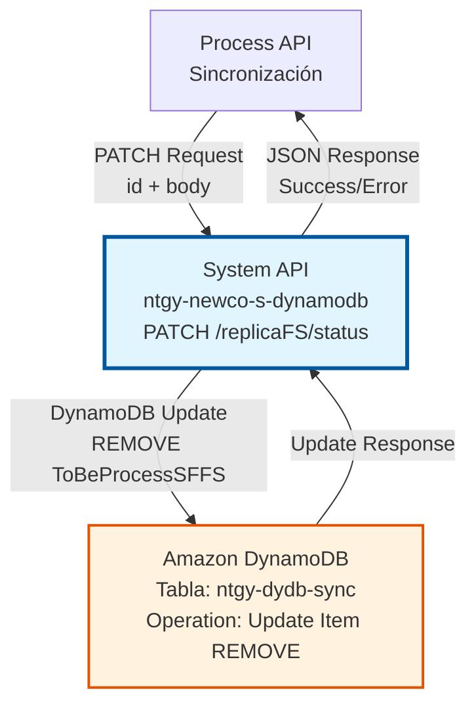
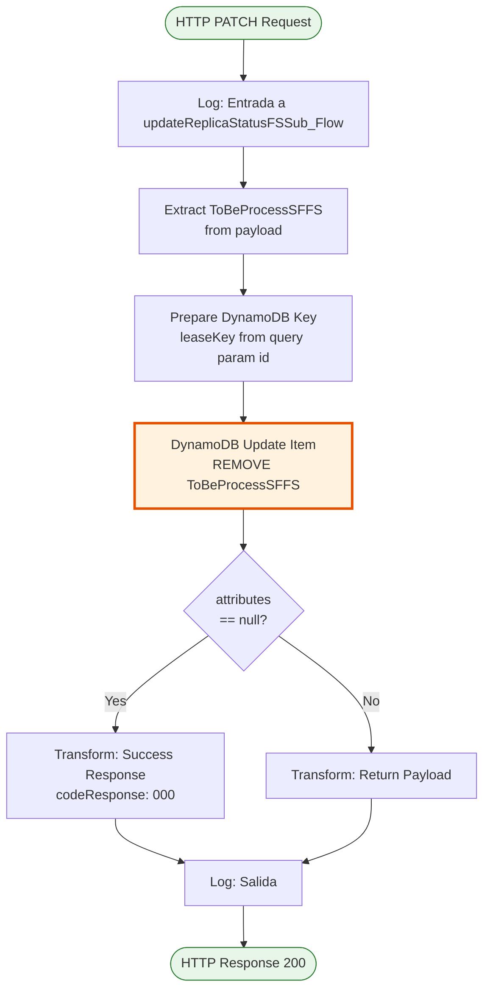
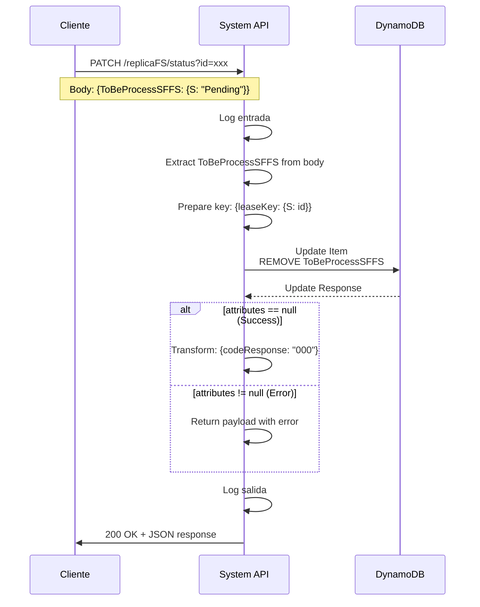

# PATCH /replicaFS/status

## 📌 Descripción General

### Propósito del Endpoint

Este endpoint actualiza el estado de un registro de sincronización Salesforce-SAP en DynamoDB eliminando el campo `ToBeProcessSFFS`. Esta operación marca efectivamente el registro como "procesado", completando el ciclo de sincronización.

El endpoint soporta:
- **Actualización Parcial**: Usa PATCH para modificar solo el estado del registro
- **Operación REMOVE**: Elimina el campo `ToBeProcessSFFS` del item en DynamoDB
- **Identificación por ID**: Usa query parameter `id` como clave primaria (`leaseKey`)
- **Validación de Respuesta**: Verifica que la operación se completó exitosamente

### Tipo de API

**Capa:** System API (API-Led Connectivity)

**Función:** Integración directa con Amazon DynamoDB para actualización de estado de sincronización Salesforce-SAP.

### Patrón de Integración

**Tipo:** Request-Reply Síncrono con DynamoDB Update

**Descripción:** El endpoint recibe un request PATCH con el ID del registro y el estado actual en el body, construye una operación de actualización DynamoDB con expresión `REMOVE ToBeProcessSFFS`, ejecuta la actualización, y retorna confirmación de éxito o error.

### Arquitectura API-Led Connectivity



---

## 💼 Propósito del Negocio

### Casos de Uso Principales

1. **Completar Ciclo de Sincronización**
   - Proceso de sincronización procesa un registro pendiente
   - Marca el registro como completado eliminando el flag `ToBeProcessSFFS`
   - Limpia la cola de registros pendientes

2. **Gestión de Estado de Sincronización**
   - Transición de estado "Pending" a "Procesado"
   - Permite que el registro no aparezca en futuras búsquedas de pendientes
   - Mantiene el registro en la tabla para auditoría

3. **Limpieza de Cola de Procesamiento**
   - Elimina registros de la cola de trabajo activa
   - Optimiza consultas futuras al índice `ToBeProcessSFFS-TIMESTAMP-index`
   - Reduce el volumen de registros en estado pendiente

### Contexto Empresarial

- **Dominio:** Sincronización de Datos
- **Sector:** Energía - Utilities
- **División:** Naturgy España - NewCo
- **Proceso de Negocio:** Finalización de sincronización Salesforce ↔ SAP ISU
- **Criticidad:** Alta - Garantiza que registros procesados no se reprocesen

### Stakeholders

- **Equipo de Integración**: Gestión del ciclo completo de sincronización
- **Operaciones IT**: Monitoreo de procesamiento exitoso
- **Equipos de Salesforce y SAP**: Confirmación de sincronización completada

### Valor de Negocio

- **Integridad**: Garantiza que registros procesados no se reprocesen
- **Eficiencia**: Optimiza consultas al reducir registros en estado pendiente
- **Auditoría**: Mantiene histórico de registros procesados
- **Confiabilidad**: Confirmación explícita de procesamiento exitoso

### Consumidores Potenciales

Este endpoint puede ser consumido por:
- Process APIs de sincronización Salesforce-SAP
- Flujos de AWS Glue tras procesamiento ETL
- Sistemas de orquestación de sincronización
- Procesos batch de limpieza

---

## 🔧 Especificación Técnica

### URLs por Ambiente

| Ambiente | URL Base | URL Completa |
|----------|----------|--------------|
| **Local** | `http://localhost:8081` | `http://localhost:8081/api/replicaFS/status?id={id}` |
| **Development** | `https://ntgy-newco-s-dynamodb-dev.us-e2.cloudhub.io` | `https://ntgy-newco-s-dynamodb-dev.us-e2.cloudhub.io/api/replicaFS/status?id={id}` |
| **UAT** | `https://ntgy-newco-s-dynamodb-uat.us-e2.cloudhub.io` | `https://ntgy-newco-s-dynamodb-uat.us-e2.cloudhub.io/api/replicaFS/status?id={id}` |
| **Production** | `https://ntgy-newco-s-dynamodb-pro.us-e2.cloudhub.io` | `https://ntgy-newco-s-dynamodb-pro.us-e2.cloudhub.io/api/replicaFS/status?id={id}` |

### Método HTTP

```
PATCH /api/replicaFS/status?id={id}
```

### Parámetros de Entrada

#### Headers HTTP

| Header | Tipo | Requerido | Descripción | Ejemplo |
|--------|------|-----------|-------------|---------|
| `Content-Type` | string | ✅ Sí | Tipo de contenido del request | `application/json` |
| `Accept` | string | ❌ No | Tipo de contenido esperado en response | `application/json` |

#### Query Parameters

| Parámetro | Tipo | Requerido | Descripción | Ejemplo |
|-----------|------|-----------|-------------|---------|
| `id` | string | ✅ Sí | Identificador único del registro (leaseKey en DynamoDB) | `"a1b2c3d4-e5f6-7890-abcd-ef1234567890"` |

#### Body Parameters

El body debe contener el objeto con el estado actual del registro:

```json
{
  "ToBeProcessSFFS": {
    "S": "Pending"
  }
}
```

**Campos del Body:**

| Campo | Tipo | Requerido | Descripción |
|-------|------|-----------|-------------|
| `ToBeProcessSFFS` | Object | ✅ Sí | Objeto DynamoDB con el estado actual |
| `ToBeProcessSFFS.S` | string | ✅ Sí | Valor del estado (formato DynamoDB String) |

**Nota:** Aunque el campo `ToBeProcessSFFS` se extrae del body, la operación de actualización lo **elimina** del registro en DynamoDB usando la expresión `REMOVE`.

### Respuestas

#### Respuesta Exitosa (200 OK)

```json
{
  "codeResponse": "000",
  "messageResponse": "OK"
}
```

#### Respuesta de Error - Registro No Encontrado (200 OK)

```json
{
  "attributes": {
    "error": "Item not found"
  }
}
```

#### Respuesta de Error Técnico (500)

```json
{
  "result": {
    "codResult": "5001",
    "msgResult": "Error de conectividad con DynamoDB"
  }
}
```

### Autenticación y Autorización

- **Tipo:** Client ID & Client Secret (Anypoint Platform)
- **Autorización DynamoDB:** El usuario debe tener permisos IAM para:
  - Operación `dynamodb:UpdateItem` en tabla `ntgy-dydb-sync`
  - Acceso de escritura a la tabla

### Timeouts

| Tipo | Valor | Descripción |
|------|-------|-------------|
| **Request Timeout** | 30 segundos | Tiempo máximo de espera para la respuesta |
| **Connection Timeout** | 10 segundos | Tiempo máximo para establecer conexión con DynamoDB |

### Validaciones

- **Query Parameter `id`**: Debe ser un string no vacío
- **Body `ToBeProcessSFFS`**: Debe existir en el payload (aunque se extraiga solo para logging)
- **Existencia del Item**: El item con el `leaseKey` especificado debe existir en DynamoDB

---

## 🏗️ Implementación Técnica

### Arquitectura del Flow



### Componentes del Flow

#### 1. Logger de Entrada (Línea 9)
```xml
<logger level="INFO" message="Log de entrada a getRegistrosReplicaStatus_Flow: #[message.payload]" />
```
- Registra el inicio de la ejecución del flow
- Nivel INFO para trazabilidad
- Incluye el payload completo para debugging

#### 2. Extracción de ToBeProcessSFFS (Líneas 10-19)
```dataweave
%dw 2.0
output application/java
---
payload.ToBeProcessSFFS.S
```

**Propósito:** Extraer el valor actual del campo `ToBeProcessSFFS` del payload

**Variable creada:** `vars.ToBeProcessSFFS`

**Nota:** Este valor se extrae pero no se usa en la actualización. La operación `REMOVE` elimina el campo independientemente de su valor actual.

#### 3. Preparación de Clave DynamoDB (Líneas 20-26)
```dataweave
%dw 2.0
output application/java
---
{
    "leaseKey": {"S": attributes.queryParams.id}
}
```

**Propósito:** Construir el objeto de clave primaria para DynamoDB

**Estructura:**
- `leaseKey`: Clave primaria de la tabla `ntgy-dydb-sync`
- Formato DynamoDB: `{"S": "valor"}` (String type)
- Valor: Tomado del query parameter `id`

#### 4. Update Item en DynamoDB (Líneas 27-28)
```xml
<dynamodb:update-item 
    config-ref="Amazon_DynamoDB_Configuration" 
    tableName="ntgy-dydb-sync" 
    updateExpression="REMOVE ToBeProcessSFFS">
</dynamodb:update-item>
```

**Parámetros:**
- `tableName`: `ntgy-dydb-sync`
- `updateExpression`: `REMOVE ToBeProcessSFFS`
- `key`: Payload con `leaseKey` (del paso anterior)

**Operación:**
- **REMOVE**: Elimina completamente el atributo `ToBeProcessSFFS` del item
- **Efecto**: El registro ya no aparecerá en búsquedas por el índice `ToBeProcessSFFS-TIMESTAMP-index`
- **Idempotencia**: Si el campo ya no existe, la operación no falla

#### 5. Validación de Respuesta (Líneas 29-48)
```xml
<choice>
    <when expression="#[payload.attributes == null]">
        <!-- Success: attributes es null -->
        <ee:transform>
            {
                "codeResponse": "000",
                "messageResponse": "OK"
            }
        </ee:transform>
    </when>
    <otherwise>
        <!-- Error: retornar payload con attributes -->
        <ee:transform>
            payload
        </ee:transform>
    </otherwise>
</choice>
```

**Lógica:**
- **Si `payload.attributes == null`**: Operación exitosa
  - Retorna código `000` (éxito)
  - Mensaje `OK`
- **Si `payload.attributes != null`**: Error en la operación
  - Retorna el payload completo con detalles del error

#### 6. Logger de Salida (Línea 49)
```xml
<logger level="INFO" message="Log Salida getItem-ntgy-dydb-sync: #[message.payload]" />
```
- Registra el resultado final de la operación
- Incluye el payload de respuesta

### Diagrama de Secuencia



### Tabla DynamoDB: ntgy-dydb-sync

#### Estructura Antes de la Actualización

| Campo | Tipo | Valor Ejemplo |
|-------|------|---------------|
| `leaseKey` (PK) | String | `"a1b2c3d4-e5f6-7890-abcd-ef1234567890"` |
| `ToBeProcessSFFS` | String | `"Pending"` |
| `TIMESTAMP` | String | `"2026-01-15T10:30:00Z"` |
| `SFID` | String | `"001XX000003DHP0"` |
| `SAPID` | String | `"1234567890"` |
| `entityType` | String | `"Contract"` |
| `operation` | String | `"UPDATE"` |

#### Estructura Después de la Actualización

| Campo | Tipo | Valor Ejemplo |
|-------|------|---------------|
| `leaseKey` (PK) | String | `"a1b2c3d4-e5f6-7890-abcd-ef1234567890"` |
| ~~`ToBeProcessSFFS`~~ | ~~String~~ | ~~**ELIMINADO**~~ |
| `TIMESTAMP` | String | `"2026-01-15T10:30:00Z"` |
| `SFID` | String | `"001XX000003DHP0"` |
| `SAPID` | String | `"1234567890"` |
| `entityType` | String | `"Contract"` |
| `operation` | String | `"UPDATE"` |

**Efecto:** El registro permanece en la tabla pero sin el campo `ToBeProcessSFFS`, por lo que no aparecerá en búsquedas del endpoint `GET /syncFS/search`.

### Operación DynamoDB: REMOVE

**Sintaxis:**
```
REMOVE ToBeProcessSFFS
```

**Características:**
- **Idempotente**: Si el atributo no existe, no genera error
- **Atómico**: La operación se completa o falla completamente
- **Eficiente**: No requiere leer el item antes de actualizar
- **Selectivo**: Solo elimina el atributo especificado, mantiene el resto

### Código Comentado (Líneas 50-55)

El código incluye una sección comentada que sugiere una implementación alternativa:

```xml
<!-- [STUDIO:"Update item1"]
<dynamodb:update-item tableName="ntgy-dydb-sync" 
    updateExpression="SET ToBeProcessSFFS = :ToBeProcessSFFS">
    <dynamodb:attribute-values>
        <dynamodb:attribute-value key=":ToBeProcessSFFS" value='#[{"S":""}]' />
    </dynamodb:attribute-values>
</dynamodb:update-item>
[STUDIO] -->
```

**Diferencia con implementación actual:**
- **Comentado**: `SET ToBeProcessSFFS = ""` (establecer a string vacío)
- **Actual**: `REMOVE ToBeProcessSFFS` (eliminar el atributo)

**Ventaja de REMOVE:**
- Más limpio: El atributo no existe vs. existe con valor vacío
- Mejor para índices: No ocupa espacio en el índice GSI
- Más eficiente: Reduce el tamaño del item

### Manejo de Errores

#### Errores de DynamoDB

| Código | Descripción | Acción |
|--------|-------------|--------|
| `5001` | Error de conectividad | Retry automático (3 intentos) |
| `5002` | Timeout | Aumentar timeout o verificar red |
| `5003` | Throttling | Backoff exponencial |

#### Errores de Validación

| Escenario | Respuesta | Código HTTP |
|-----------|-----------|-------------|
| `id` no proporcionado | Bad Request | 400 |
| Item no existe | Payload con attributes | 200 |
| Body inválido | Bad Request | 400 |

---

## 💻 Ejemplos de Uso

### Ejemplo 1: Actualización Exitosa

#### Request

```bash
curl -X PATCH "http://localhost:8081/api/replicaFS/status?id=a1b2c3d4-e5f6-7890-abcd-ef1234567890" \
  -H "Content-Type: application/json" \
  -H "Accept: application/json" \
  -d '{
    "ToBeProcessSFFS": {
      "S": "Pending"
    }
  }'
```

#### Response (200 OK)

```json
{
  "codeResponse": "000",
  "messageResponse": "OK"
}
```

### Ejemplo 2: Actualización en Producción

#### Request

```bash
curl -X PATCH "https://ntgy-newco-s-dynamodb-pro.us-e2.cloudhub.io/api/replicaFS/status?id=12345678-1234-1234-1234-123456789abc" \
  -H "Content-Type: application/json" \
  -H "Accept: application/json" \
  -H "client_id: your-client-id" \
  -H "client_secret: your-client-secret" \
  -d '{
    "ToBeProcessSFFS": {
      "S": "Pending"
    }
  }'
```

#### Response (200 OK)

```json
{
  "codeResponse": "000",
  "messageResponse": "OK"
}
```

### Ejemplo 3: Error - Item No Encontrado

#### Request

```bash
curl -X PATCH "http://localhost:8081/api/replicaFS/status?id=nonexistent-id" \
  -H "Content-Type: application/json" \
  -H "Accept: application/json" \
  -d '{
    "ToBeProcessSFFS": {
      "S": "Pending"
    }
  }'
```

#### Response (200 OK con Error)

```json
{
  "attributes": {
    "error": "The conditional request failed",
    "message": "Item with specified key does not exist"
  }
}
```

### Ejemplo 4: Integración con JavaScript

```javascript
async function markSyncRecordAsProcessed(recordId) {
  const url = 'https://ntgy-newco-s-dynamodb-pro.us-e2.cloudhub.io/api/replicaFS/status';
  
  try {
    const response = await fetch(`${url}?id=${recordId}`, {
      method: 'PATCH',
      headers: {
        'Content-Type': 'application/json',
        'Accept': 'application/json',
        'client_id': process.env.CLIENT_ID,
        'client_secret': process.env.CLIENT_SECRET
      },
      body: JSON.stringify({
        ToBeProcessSFFS: {
          S: "Pending"
        }
      })
    });

    if (!response.ok) {
      throw new Error(`HTTP error! status: ${response.status}`);
    }

    const result = await response.json();
    
    if (result.codeResponse === "000") {
      console.log(`✅ Record ${recordId} marked as processed successfully`);
      return true;
    } else {
      console.error(`❌ Failed to mark record ${recordId}:`, result);
      return false;
    }
  } catch (error) {
    console.error('Error marking sync record as processed:', error);
    throw error;
  }
}

// Uso
markSyncRecordAsProcessed('a1b2c3d4-e5f6-7890-abcd-ef1234567890')
  .then(success => {
    if (success) {
      console.log('Record processing complete');
    }
  })
  .catch(error => console.error('Failed to process record'));
```

### Ejemplo 5: Integración con Python

```python
import requests
import os
from typing import Dict, Any

def mark_sync_record_as_processed(record_id: str) -> bool:
    """
    Marca un registro de sincronización como procesado eliminando ToBeProcessSFFS
    
    Args:
        record_id: ID del registro (leaseKey)
    
    Returns:
        bool: True si la operación fue exitosa
    """
    url = "https://ntgy-newco-s-dynamodb-pro.us-e2.cloudhub.io/api/replicaFS/status"
    
    headers = {
        "Content-Type": "application/json",
        "Accept": "application/json",
        "client_id": os.getenv("CLIENT_ID"),
        "client_secret": os.getenv("CLIENT_SECRET")
    }
    
    body = {
        "ToBeProcessSFFS": {
            "S": "Pending"
        }
    }
    
    try:
        response = requests.patch(
            url,
            params={"id": record_id},
            headers=headers,
            json=body,
            timeout=30
        )
        response.raise_for_status()
        
        result = response.json()
        
        if result.get("codeResponse") == "000":
            print(f"✅ Record {record_id} marked as processed successfully")
            return True
        else:
            print(f"❌ Failed to mark record {record_id}: {result}")
            return False
            
    except requests.exceptions.RequestException as e:
        print(f"Error marking sync record as processed: {e}")
        raise

# Uso
if __name__ == "__main__":
    try:
        record_id = "a1b2c3d4-e5f6-7890-abcd-ef1234567890"
        success = mark_sync_record_as_processed(record_id)
        
        if success:
            print("Record processing complete")
        else:
            print("Record processing failed")
            
    except Exception as e:
        print(f"Failed to process record: {e}")
```

### Ejemplo 6: Flujo Completo de Sincronización

```python
import requests
import time
from typing import List, Dict

class SyncProcessor:
    def __init__(self, base_url: str, client_id: str, client_secret: str):
        self.base_url = base_url
        self.headers = {
            "Content-Type": "application/json",
            "Accept": "application/json",
            "client_id": client_id,
            "client_secret": client_secret
        }
    
    def get_pending_records(self) -> List[Dict]:
        """Obtiene registros pendientes de sincronización"""
        response = requests.get(
            f"{self.base_url}/syncFS/search",
            headers=self.headers,
            timeout=30
        )
        response.raise_for_status()
        return response.json()
    
    def process_record(self, record: Dict) -> bool:
        """Procesa un registro (lógica de negocio)"""
        # Aquí iría la lógica de sincronización real
        print(f"Processing record {record['id']}: {record['entityType']} - {record['operation']}")
        time.sleep(0.5)  # Simular procesamiento
        return True
    
    def mark_as_processed(self, record_id: str) -> bool:
        """Marca el registro como procesado"""
        response = requests.patch(
            f"{self.base_url}/replicaFS/status",
            params={"id": record_id},
            headers=self.headers,
            json={"ToBeProcessSFFS": {"S": "Pending"}},
            timeout=30
        )
        response.raise_for_status()
        result = response.json()
        return result.get("codeResponse") == "000"
    
    def run_sync_cycle(self):
        """Ejecuta un ciclo completo de sincronización"""
        print("🔄 Starting sync cycle...")
        
        # 1. Obtener registros pendientes
        pending_records = self.get_pending_records()
        print(f"📋 Found {len(pending_records)} pending records")
        
        # 2. Procesar cada registro
        processed = 0
        failed = 0
        
        for record in pending_records:
            try:
                # Procesar registro
                if self.process_record(record):
                    # Marcar como procesado
                    if self.mark_as_processed(record['id']):
                        processed += 1
                        print(f"✅ Record {record['id']} completed")
                    else:
                        failed += 1
                        print(f"❌ Failed to mark record {record['id']}")
                else:
                    failed += 1
                    print(f"❌ Failed to process record {record['id']}")
            except Exception as e:
                failed += 1
                print(f"❌ Error processing record {record['id']}: {e}")
        
        # 3. Resumen
        print(f"\n📊 Sync cycle complete:")
        print(f"   ✅ Processed: {processed}")
        print(f"   ❌ Failed: {failed}")
        print(f"   📋 Total: {len(pending_records)}")

# Uso
if __name__ == "__main__":
    processor = SyncProcessor(
        base_url="https://ntgy-newco-s-dynamodb-pro.us-e2.cloudhub.io/api",
        client_id=os.getenv("CLIENT_ID"),
        client_secret=os.getenv("CLIENT_SECRET")
    )
    
    processor.run_sync_cycle()
```

### Notas de Implementación

1. **Idempotencia**: La operación `REMOVE` es idempotente. Si el campo `ToBeProcessSFFS` ya no existe, la operación no falla.

2. **Orden de Operaciones**: Típicamente se usa después de procesar exitosamente un registro obtenido de `GET /syncFS/search`.

3. **Auditoría**: El registro permanece en la tabla para auditoría, solo se elimina el campo de estado pendiente.

4. **Performance**: La operación `REMOVE` es muy eficiente, no requiere leer el item antes de actualizar.

5. **Índice GSI**: Al eliminar `ToBeProcessSFFS`, el registro se elimina automáticamente del índice `ToBeProcessSFFS-TIMESTAMP-index`.

6. **Validación del Body**: Aunque el campo `ToBeProcessSFFS` se extrae del body, no se usa en la actualización. Se podría simplificar el endpoint para no requerir este campo en el body.