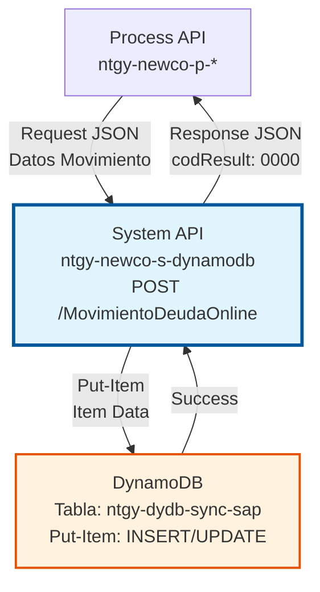
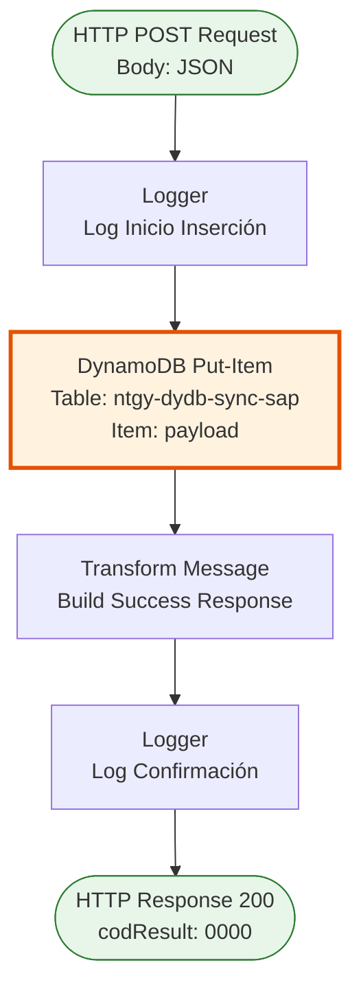
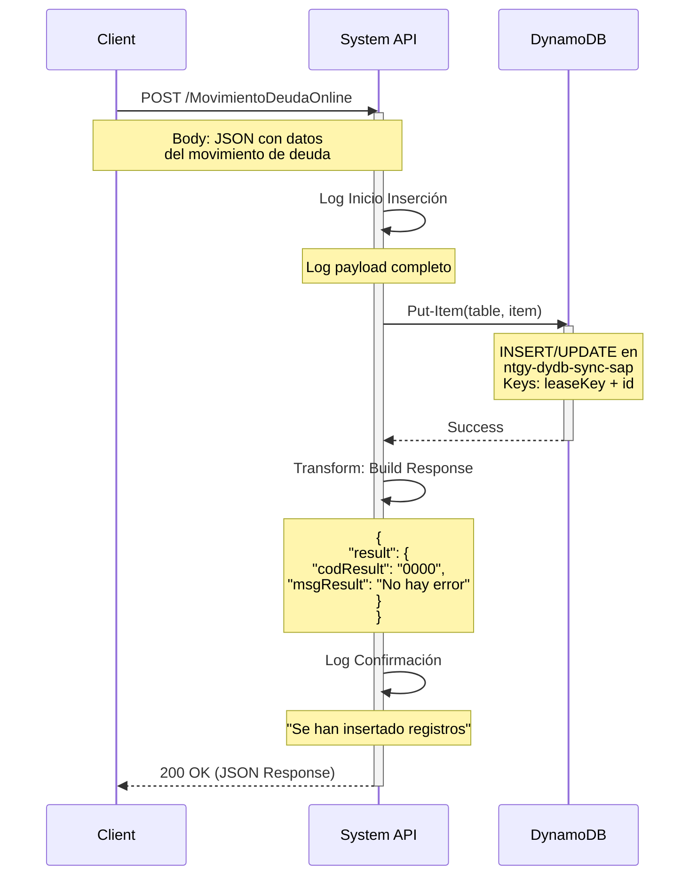

# POST /MovimientoDeudaOnline

## 📌 Descripción General

### Propósito del Endpoint

Este endpoint crea un nuevo registro de movimiento de deuda online en DynamoDB. Permite insertar información sobre traspasos de deuda entre sistemas Imperial y Newco, facilitando la sincronización con SAP ISU y el seguimiento de operaciones de deuda.

El endpoint soporta:
- **Creación de Movimientos**: Inserta nuevos registros de traspaso de deuda online
- **Sincronización SAP**: Almacena datos para posterior sincronización con SAP ISU
- **Auditoría**: Registra información completa del movimiento para trazabilidad
- **Control de Estado**: Permite seguimiento del estado del traspaso (PENDING, PROCESSED, ERROR)

### Tipo de API

**Capa:** System API (API-Led Connectivity)

**Función:** Integración directa con DynamoDB para inserción de movimientos de deuda online y sincronización con SAP ISU.

### Patrón de Integración

**Tipo:** Request-Reply Síncrono con DynamoDB Put-Item

**Descripción:** El endpoint recibe un objeto JSON con los datos del movimiento de deuda, ejecuta una operación `put-item` en DynamoDB (que inserta o actualiza el registro), y retorna una respuesta estándar de éxito con código `0000`.

### Arquitectura API-Led Connectivity



---

## 💼 Propósito del Negocio

### Casos de Uso Principales

1. **Registro de Nuevo Traspaso de Deuda**
   - Un cliente solicita un traspaso de deuda entre sistemas
   - El sistema crea un registro inicial con estado PENDING
   - Se almacena en DynamoDB para procesamiento posterior
   - **Beneficio:** Trazabilidad completa del proceso de traspaso

2. **Sincronización entre Imperial y Newco**
   - Los sistemas de migración necesitan registrar movimientos de deuda
   - Se crea un registro con información de origen y destino
   - AWS Glue procesa la sincronización posteriormente
   - **Beneficio:** Migración controlada y auditable

3. **Control de Errores de Sincronización**
   - Los procesos de sincronización detectan errores
   - Se crea un registro con información del error
   - Los equipos de operaciones pueden consultar y corregir
   - **Beneficio:** Resolución rápida de problemas de sincronización

4. **Auditoría de Operaciones de Deuda**
   - Los equipos de auditoría necesitan rastrear movimientos
   - Se registra cada operación con timestamp y detalles
   - Se mantiene histórico completo en DynamoDB
   - **Beneficio:** Cumplimiento normativo y auditoría efectiva

### Contexto Empresarial

- **Dominio:** Gestión de Deuda y Cobros
- **Sector:** Energía - Utilities
- **División:** Naturgy España - NewCo
- **Proceso de Negocio:** Traspaso de deuda online entre sistemas Imperial y Newco
- **Sistema Backend:** DynamoDB (tabla de sincronización SAP)
- **Integración:** AWS Glue para procesamiento ETL

### Stakeholders

- **Equipos de Cobros**: Registran traspasos de deuda para gestión
- **Equipos de Sincronización**: Crean registros de control de sincronización
- **Equipos de Migración**: Registran movimientos durante migración Imperial → Newco
- **Equipos de Auditoría**: Requieren trazabilidad completa de operaciones

### Valor de Negocio

- **Trazabilidad Completa**: Registro detallado de cada movimiento de deuda
- **Sincronización Confiable**: Control de estado de sincronización con SAP ISU
- **Operación Rápida**: Inserción optimizada en DynamoDB (< 50ms)
- **Auditoría Efectiva**: Histórico completo para cumplimiento normativo
- **Recuperación de Errores**: Capacidad de reintento y corrección

### Consumidores Potenciales

Este endpoint puede ser consumido por:
- Process APIs de gestión de deuda (ntgy-newco-p-deuda)
- Flujos de AWS Glue para sincronización ETL
- Sistemas de migración Imperial → Newco
- Herramientas de sincronización con SAP ISU
- Servicios de auditoría y reporting

---

## 🔧 Especificación Técnica

### URLs por Ambiente

| Ambiente | URL Base | URL Completa |
|----------|----------|--------------|
| **Local** | `http://localhost:8081` | `http://localhost:8081/api/MovimientoDeudaOnline` |
| **Development** | `https://ntgy-newco-s-dynamodb-dev.us-e2.cloudhub.io` | `https://ntgy-newco-s-dynamodb-dev.us-e2.cloudhub.io/api/MovimientoDeudaOnline` |
| **UAT** | `https://ntgy-newco-s-dynamodb-uat.us-e2.cloudhub.io` | `https://ntgy-newco-s-dynamodb-uat.us-e2.cloudhub.io/api/MovimientoDeudaOnline` |
| **Production** | `https://ntgy-newco-s-dynamodb-pro.us-e2.cloudhub.io` | `https://ntgy-newco-s-dynamodb-pro.us-e2.cloudhub.io/api/MovimientoDeudaOnline` |

### Método HTTP

```
POST /api/MovimientoDeudaOnline
```

### Parámetros de Entrada

#### Headers HTTP

| Header | Tipo | Requerido | Descripción | Ejemplo |
|--------|------|-----------|-------------|---------|
| `Content-Type` | string | ✅ Sí | Tipo de contenido del request | `application/json` |
| `Accept` | string | ❌ No | Tipo de contenido esperado en response | `application/json` |
| `client_id` | string | ✅ Sí | Client ID de Anypoint Platform | `abc123...` |
| `client_secret` | string | ✅ Sí | Client Secret de Anypoint Platform | `xyz789...` |

#### Body Parameters

**⚠️ IMPORTANTE:** Este endpoint acepta el payload directamente sin transformación. El body debe ser un objeto JSON válido en formato DynamoDB que será insertado tal cual en la tabla.

**Campos Obligatorios (Keys de DynamoDB):**

| Campo | Tipo | Descripción | Ejemplo |
|-------|------|-------------|---------|
| `leaseKey` | Object | Partition key - Identificador del cliente | `{"S": "0000123456"}` |
| `id` | Object | Sort key - Debe ser "MovimientoDeudaOnline" | `{"S": "MovimientoDeudaOnline"}` |

**Campos Adicionales (Opcionales):**

El endpoint acepta cualquier campo adicional en formato DynamoDB. Basándose en otros flows del mismo archivo que operan sobre esta tabla, los campos comunes incluyen:

- `STATUSMESSAGE`: Estado del mensaje (ej: `{"S": "InProgress"}`)
- `ERRORCODE`: Código de error (ej: `{"S": "E001"}`)
- `ERRORMESSAGE`: Mensaje de error (ej: `{"S": "Error description"}`)
- `ERRORTIMESTAMP`: Timestamp del error (ej: `{"S": "2026-01-08T10:35:00Z"}`)
- `OBJECTNAME`: Nombre del objeto (ej: `{"S": "DebtTransfer"}`)

**Nota:** La estructura exacta del payload depende del caso de uso del consumidor. El endpoint no valida ni transforma los datos de entrada.

**Formato DynamoDB:**
- `{"S": "valor"}` → String
- `{"N": "123.45"}` → Number (como string)
- `{"BOOL": true}` → Boolean
- `{"M": {...}}` → Map (objeto anidado)
- `{"L": [...]}` → List (array)

### Ejemplo de Body Request

**Ejemplo Mínimo (solo keys obligatorias):**
```json
{
  "leaseKey": {
    "S": "0000123456"
  },
  "id": {
    "S": "MovimientoDeudaOnline"
  }
}
```

**Ejemplo Completo (con campos adicionales comunes):**
```json
{
  "leaseKey": {
    "S": "0000123456"
  },
  "id": {
    "S": "MovimientoDeudaOnline"
  },
  "STATUSMESSAGE": {
    "S": "InProgress"
  },
  "ERRORCODE": {
    "S": ""
  },
  "ERRORMESSAGE": {
    "S": ""
  },
  "ERRORTIMESTAMP": {
    "S": ""
  },
  "OBJECTNAME": {
    "S": "DebtTransfer"
  }
}
```

**Nota:** Puedes incluir cualquier campo adicional que necesites. El endpoint no valida la estructura.

### Respuestas

#### Respuesta Exitosa (200 OK)

```json
{
  "result": {
    "codResult": "0000",
    "msgResult": "No hay error"
  }
}
```

**Descripción de Campos:**
- `result.codResult`: Código de resultado (`0000` = éxito)
- `result.msgResult`: Mensaje descriptivo del resultado

#### Respuesta de Error de Validación (400 Bad Request)

```json
{
  "error": "Bad Request",
  "message": "Formato de body inválido o campos requeridos faltantes"
}
```

#### Respuesta de Error Técnico (500 Internal Server Error)

```json
{
  "error": "Internal Server Error",
  "message": "Error al insertar en DynamoDB"
}
```

### Autenticación y Autorización

- **Tipo:** Client ID & Client Secret (Anypoint Platform)
- **Autorización DynamoDB:** El usuario debe tener permisos para:
  - Ejecutar operación `PutItem` en tabla `ntgy-dydb-sync-sap`
  - Acceso de escritura a la tabla
  - Permisos IAM configurados en AWS

### Timeouts

| Tipo | Valor | Descripción |
|------|-------|-------------|
| **Request Timeout** | 30 segundos | Tiempo máximo de espera para la respuesta |
| **Connection Timeout** | 10 segundos | Tiempo máximo para establecer conexión con DynamoDB |
| **Put-Item Timeout** | 5 segundos | Tiempo máximo para ejecutar la inserción en DynamoDB |

---

## 🏗️ Implementación Técnica

### Arquitectura del Flow



### Componentes del Flow

#### 1. Logger - Inicio Inserción
**Propósito:** Registrar el payload de entrada antes de la inserción en DynamoDB.

**Implementación:**
```xml
<logger 
    level="INFO" 
    doc:name="Logger" 
    message="Inicio insercion en tabla ntgy-dydb-sync-sap: #[message.payload]"/>
```

**Información Registrada:**
- Payload completo del request
- Timestamp de la operación
- Nivel INFO para operaciones normales

#### 2. DynamoDB Put-Item
**Propósito:** Insertar o actualizar el registro en la tabla de sincronización SAP.

**Configuración:**
```xml
<dynamodb:put-item 
    tableName="ntgy-dydb-sync-sap" 
    doc:name="Put item" 
    config-ref="Amazon_DynamoDB_Configuration"/>
```

**Detalles Técnicos:**
- **Tabla:** `ntgy-dydb-sync-sap`
- **Operación:** Put-Item (INSERT si no existe, UPDATE si existe)
- **Keys:** leaseKey (partition key) + id (sort key)
- **Comportamiento:** Sobrescribe el item completo si ya existe
- **Performance:** < 50ms típicamente

**Nota sobre Put-Item:**
- Si el item con las mismas keys existe, se sobrescribe completamente
- Si no existe, se crea un nuevo item
- No hay validación de duplicados (es responsabilidad del consumidor)

#### 3. Transform Message - Success Response
**Propósito:** Construir la respuesta estándar de éxito.

**Código DataWeave:**
```dataweave
%dw 2.0
output application/json
---
"result": {
    "codResult": "0000",
    "msgResult": "No hay error"
}
```

**Explicación:**
- Respuesta estándar para todas las operaciones exitosas
- `codResult: "0000"` indica éxito
- `msgResult` proporciona descripción legible

#### 4. Logger - Confirmación
**Propósito:** Registrar la confirmación de inserción exitosa.

**Implementación:**
```xml
<logger 
    level="INFO" 
    doc:name="Logger" 
    message="Se han insertado registros en la tabla ntgy-dydb-sync"/>
```

### Diagrama de Secuencia Detallado



### Estructura de Datos DynamoDB

#### Tabla: ntgy-dydb-sync-sap

**Partition Key:** `leaseKey` (String)
**Sort Key:** `id` (String)

**Ejemplo de Item Almacenado (formato DynamoDB interno):**
```json
{
  "leaseKey": "0000123456",
  "id": "MovimientoDeudaOnline",
  "STATUSMESSAGE": "InProgress",
  "ERRORCODE": "",
  "ERRORMESSAGE": "",
  "ERRORTIMESTAMP": "",
  "OBJECTNAME": "DebtTransfer"
}
```

**Nota:** La estructura exacta depende de lo que el consumidor envíe en el POST. Los campos mostrados son los que aparecen en el flow de UPDATE del mismo archivo.

### Manejo de Errores

#### Error de Conectividad DynamoDB
```xml
<on-error-propagate type="DYNAMODB:CONNECTIVITY">
    <ee:transform>
        <ee:set-payload>
            {
                "error": "DynamoDB Connection Error",
                "message": "No se pudo conectar a DynamoDB"
            }
        </ee:set-payload>
    </ee:transform>
    <set-property propertyName="http.status" value="500"/>
</on-error-propagate>
```

#### Error de Validación de Datos
```xml
<on-error-propagate type="DYNAMODB:VALIDATION">
    <ee:transform>
        <ee:set-payload>
            {
                "error": "Validation Error",
                "message": "Formato de datos inválido para DynamoDB"
            }
        </ee:set-payload>
    </ee:transform>
    <set-property propertyName="http.status" value="400"/>
</on-error-propagate>
```

#### Error de Capacidad (Throttling)
```xml
<on-error-propagate type="DYNAMODB:PROVISIONED_THROUGHPUT_EXCEEDED">
    <ee:transform>
        <ee:set-payload>
            {
                "error": "Throttling Error",
                "message": "Capacidad de escritura excedida, reintentar"
            }
        </ee:set-payload>
    </ee:transform>
    <set-property propertyName="http.status" value="429"/>
</on-error-propagate>
```

### Optimizaciones de Performance

1. **Put-Item vs Batch-Write**
   - ✅ Usa `put-item` para operaciones individuales (< 50ms)
   - Para operaciones masivas, considerar `batch-write-item`

2. **Capacidad de Escritura**
   - Auto-scaling habilitado en DynamoDB
   - WCU (Write Capacity Units) ajustados según carga

3. **Logging Eficiente**
   - Logs en puntos clave sin afectar performance
   - Nivel INFO para operaciones normales

4. **Idempotencia**
   - Put-Item es idempotente (mismo resultado en múltiples llamadas)
   - Seguro para reintentos en caso de timeout

---

## 💻 Ejemplos de Uso

### Ejemplo 1: Creación Básica con curl (Mínimo)

```bash
curl -X POST \
  'https://ntgy-newco-s-dynamodb-dev.us-e2.cloudhub.io/api/MovimientoDeudaOnline' \
  -H 'Content-Type: application/json' \
  -H 'Accept: application/json' \
  -H 'client_id: your-client-id' \
  -H 'client_secret: your-client-secret' \
  -d '{
    "leaseKey": {
      "S": "0000123456"
    },
    "id": {
      "S": "MovimientoDeudaOnline"
    }
  }'
```

**Respuesta Esperada:**
```json
{
  "result": {
    "codResult": "0000",
    "msgResult": "No hay error"
  }
}
```

### Ejemplo 2: Creación desde JavaScript (Node.js)

```javascript
const axios = require('axios');

async function createMovimientoDeuda(leaseKey, additionalFields = {}) {
  // Payload mínimo con keys obligatorias
  const payload = {
    leaseKey: { S: leaseKey },
    id: { S: "MovimientoDeudaOnline" },
    ...additionalFields  // Campos adicionales opcionales
  };

  try {
    const response = await axios.post(
      'https://ntgy-newco-s-dynamodb-dev.us-e2.cloudhub.io/api/MovimientoDeudaOnline',
      payload,
      {
        headers: {
          'Content-Type': 'application/json',
          'Accept': 'application/json',
          'client_id': process.env.CLIENT_ID,
          'client_secret': process.env.CLIENT_SECRET
        }
      }
    );
    
    console.log('Movimiento creado:', response.data);
    return response.data;
  } catch (error) {
    console.error('Error:', error.response?.data || error.message);
    throw error;
  }
}

// Uso básico (solo keys)
createMovimientoDeuda('0000123456');

// Uso con campos adicionales
createMovimientoDeuda('0000123456', {
  STATUSMESSAGE: { S: 'InProgress' },
  OBJECTNAME: { S: 'DebtTransfer' }
});
```

### Ejemplo 3: Creación desde Python

```python
import requests
import os

def create_movimiento_deuda(lease_key, additional_fields=None):
    url = 'https://ntgy-newco-s-dynamodb-dev.us-e2.cloudhub.io/api/MovimientoDeudaOnline'
    
    # Payload mínimo con keys obligatorias
    payload = {
        "leaseKey": {"S": lease_key},
        "id": {"S": "MovimientoDeudaOnline"}
    }
    
    # Agregar campos adicionales si se proporcionan
    if additional_fields:
        payload.update(additional_fields)
    
    headers = {
        'Content-Type': 'application/json',
        'Accept': 'application/json',
        'client_id': os.getenv('CLIENT_ID'),
        'client_secret': os.getenv('CLIENT_SECRET')
    }
    
    try:
        response = requests.post(url, json=payload, headers=headers)
        response.raise_for_status()
        
        data = response.json()
        print(f"Movimiento creado: {data}")
        return data
    except requests.exceptions.RequestException as e:
        print(f"Error: {e}")
        raise

# Uso básico (solo keys)
create_movimiento_deuda('0000123456')

# Uso con campos adicionales
create_movimiento_deuda('0000123456', {
    'STATUSMESSAGE': {'S': 'InProgress'},
    'OBJECTNAME': {'S': 'DebtTransfer'}
})
```

### Ejemplo 4: Registro con Campos de Error (basado en flow UPDATE)

```bash
curl -X POST \
  'https://ntgy-newco-s-dynamodb-dev.us-e2.cloudhub.io/api/MovimientoDeudaOnline' \
  -H 'Content-Type: application/json' \
  -H 'client_id: your-client-id' \
  -H 'client_secret: your-client-secret' \
  -d '{
    "leaseKey": {
      "S": "0000123456"
    },
    "id": {
      "S": "MovimientoDeudaOnline"
    },
    "STATUSMESSAGE": {
      "S": "Error"
    },
    "ERRORCODE": {
      "S": "E001"
    },
    "ERRORMESSAGE": {
      "S": "Error en sincronización con SAP ISU"
    },
    "ERRORTIMESTAMP": {
      "S": "2026-01-08T10:35:00Z"
    },
    "OBJECTNAME": {
      "S": "DebtTransfer"
    }
  }'
```

**Nota:** Los campos de error (ERRORCODE, ERRORMESSAGE, etc.) son los que aparecen en el flow `UpdateReplicaStatusErrorMovimientoDeudaOnline_Flow` del mismo archivo XML.

### Ejemplo 5: Integración con Postman

**Request:**
- **Method:** POST
- **URL:** `{{base_url}}/api/MovimientoDeudaOnline`
- **Headers:**
  - `Content-Type`: `application/json`
  - `Accept`: `application/json`
  - `client_id`: `{{client_id}}`
  - `client_secret`: `{{client_secret}}`
- **Body (raw JSON):**
```json
{
  "leaseKey": {
    "S": "{{leaseKey}}"
  },
  "id": {
    "S": "MovimientoDeudaOnline"
  },
  "timestamp": {
    "S": "{{$isoTimestamp}}"
  },
  "status": {
    "S": "PENDING"
  },
  "amount": {
    "N": "150.50"
  },
  "description": {
    "S": "Traspaso de deuda online"
  },
  "sourceSystem": {
    "S": "Imperial"
  },
  "targetSystem": {
    "S": "Newco"
  },
  "STATUSMESSAGE": {
    "S": "InProgress"
  }
}
```

**Tests (Postman):**
```javascript
pm.test("Status code is 200", function () {
    pm.response.to.have.status(200);
});

pm.test("Response has result object", function () {
    var jsonData = pm.response.json();
    pm.expect(jsonData).to.have.property('result');
});

pm.test("codResult is 0000 (success)", function () {
    var jsonData = pm.response.json();
    pm.expect(jsonData.result.codResult).to.eql("0000");
});

pm.test("Response time is less than 500ms", function () {
    pm.expect(pm.response.responseTime).to.be.below(500);
});
```

### Ejemplo 6: Función Helper para Formato DynamoDB

```javascript
// Helper para convertir objeto JavaScript a formato DynamoDB
function toDynamoDBFormat(obj) {
  const result = {};
  
  for (const [key, value] of Object.entries(obj)) {
    if (typeof value === 'string') {
      result[key] = { S: value };
    } else if (typeof value === 'number') {
      result[key] = { N: value.toString() };
    } else if (typeof value === 'boolean') {
      result[key] = { BOOL: value };
    } else if (Array.isArray(value)) {
      result[key] = { L: value.map(item => toDynamoDBFormat({ item }).item) };
    } else if (typeof value === 'object' && value !== null) {
      result[key] = { M: toDynamoDBFormat(value) };
    }
  }
  
  return result;
}

// Uso del helper
const movimientoData = {
  leaseKey: '0000123456',
  id: 'MovimientoDeudaOnline',
  timestamp: new Date().toISOString(),
  status: 'PENDING',
  amount: 150.50,
  description: 'Traspaso de deuda online',
  sourceSystem: 'Imperial',
  targetSystem: 'Newco',
  STATUSMESSAGE: 'InProgress'
};

const dynamoDBPayload = toDynamoDBFormat(movimientoData);
console.log(JSON.stringify(dynamoDBPayload, null, 2));
```

---

**Última Actualización:** 2026-01-08  
**Versión del API:** 2.0.0  
**Mantenido por:** Equipo Naturgy - Integración Newco
