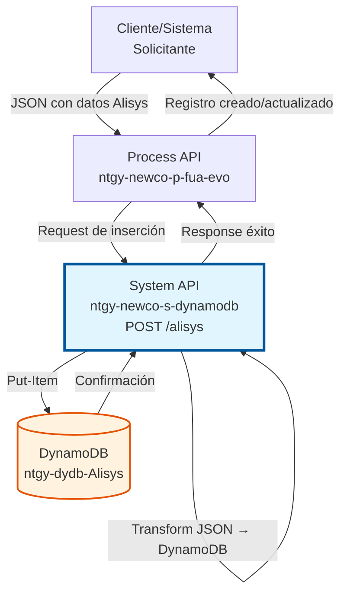
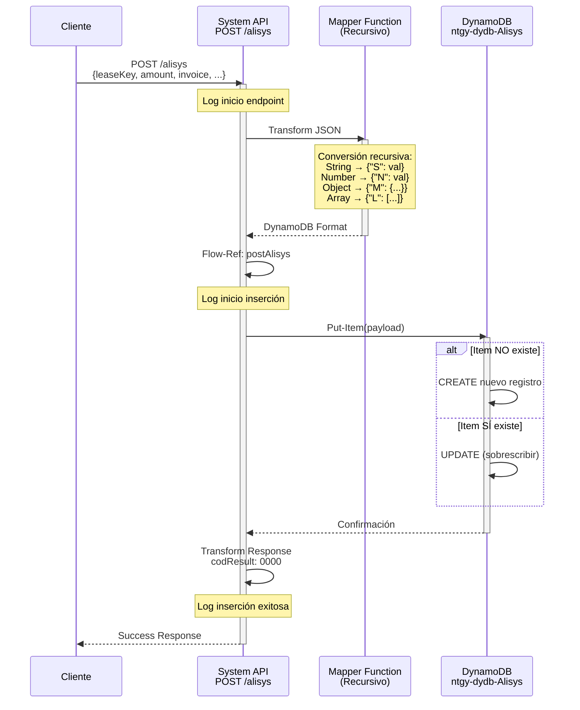
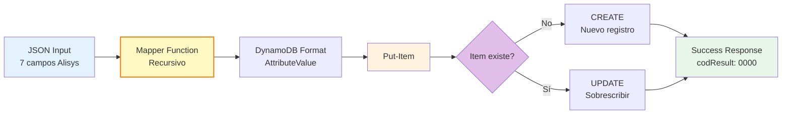

# POST /alisys

## 📌 Descripción General

### Propósito del Endpoint

Inserta o actualiza información de Alisys (sistema de gestión de deuda) en DynamoDB mediante una operación idempotente. Este endpoint permite crear nuevos registros de gestión de deuda o sobrescribir registros existentes, facilitando la sincronización de datos entre sistemas.

El endpoint soporta:
- **Inserción de Nuevos Registros**: Crea registros cuando no existen previamente
- **Actualización de Registros Existentes**: Sobrescribe registros cuando ya existen (operación idempotente)
- **Transformación Automática**: Convierte JSON estándar a formato DynamoDB recursivamente
- **Estructuras Completamente Flexibles**: Acepta cualquier JSON válido sin validación de campos específicos

### Tipo de API

**Capa:** System API (API-Led Connectivity)

**Función:** Integración directa con Amazon DynamoDB para gestión de información de deuda (Alisys).

### Patrón de Integración

**Tipo:** Request-Reply Síncrono con DynamoDB Put-Item

**Descripción:** Recibe payload JSON con datos de Alisys, transforma automáticamente a formato DynamoDB AttributeValue usando una función recursiva, ejecuta put-item en la tabla `ntgy-dydb-Alisys`, y retorna confirmación de éxito.

### Arquitectura API-Led Connectivity



---

## 💼 Propósito del Negocio

### Casos de Uso Principales

1. **Creación de Nuevos Registros de Deuda**
   - Sistema de cobros genera nuevo registro de gestión
   - Se almacenan datos completos de deuda en Alisys
   - Incluye información de contacto y referencia a Salesforce

2. **Actualización de Información Existente**
   - Cambio en monto de deuda o datos de contacto
   - Sistema actualiza registro existente
   - Operación idempotente garantiza consistencia

3. **Sincronización con Salesforce**
   - Migración de datos desde Salesforce a Alisys
   - Sincronización bidireccional de información de deuda
   - Mantiene referencia mediante idSfdc

4. **Carga Masiva de Datos**
   - Procesos ETL de migración desde sistema legacy
   - Carga inicial de datos históricos
   - Sincronización periódica entre sistemas

### Contexto Empresarial

- **Dominio:** Facturación y Cobros - Gestión de Deuda
- **Sector:** Energía - Utilities
- **División:** Naturgy España - NewCo
- **Proceso de Negocio:** Gestión centralizada de información de deuda mediante Alisys
- **Criticidad:** Alta - Información crítica para gestión de cobros

### Stakeholders

- **Equipos de Cobros**: Necesitan registrar y actualizar información de deuda
- **Equipos de Salesforce**: Requieren sincronización de datos
- **Equipos de Migración**: Usan endpoint para carga de datos históricos
- **Call Center**: Dependen de información actualizada para atención al cliente

### Valor de Negocio

- **Simplicidad**: API única para crear y actualizar registros (idempotente)
- **Flexibilidad**: Soporta estructura completa de 7 campos de Alisys
- **Automatización**: Transformación automática a formato DynamoDB
- **Escalabilidad**: DynamoDB auto-scaling para alta concurrencia
- **Trazabilidad**: Logging completo de operaciones para auditoría

### Consumidores Potenciales

Este endpoint puede ser consumido por:
- Process APIs de gestión de cobros
- Sistemas de integración con Salesforce
- Procesos ETL de migración de datos
- Servicios de sincronización entre sistemas
- Aplicaciones de gestión de deuda

---

## 🔧 Especificación Técnica

### URLs por Ambiente

| Ambiente | URL Base | URL Completa |
|----------|----------|--------------|
| **Local** | `http://localhost:8081` | `http://localhost:8081/api/alisys` |
| **Development** | `https://ntgy-newco-s-dynamodb-dev.us-e2.cloudhub.io` | `https://ntgy-newco-s-dynamodb-dev.us-e2.cloudhub.io/api/alisys` |
| **UAT** | `https://ntgy-newco-s-dynamodb-uat.us-e2.cloudhub.io` | `https://ntgy-newco-s-dynamodb-uat.us-e2.cloudhub.io/api/alisys` |
| **Production** | `https://ntgy-newco-s-dynamodb-pro.us-e2.cloudhub.io` | `https://ntgy-newco-s-dynamodb-pro.us-e2.cloudhub.io/api/alisys` |

### Método HTTP

```
POST /api/alisys
```

### Parámetros de Entrada

#### Headers HTTP

| Header | Tipo | Requerido | Descripción | Ejemplo |
|--------|------|-----------|-------------|---------|
| `Content-Type` | string | ✅ Sí | Tipo de contenido del request | `application/json` |
| `Accept` | string | ❌ No | Tipo de contenido esperado en response | `application/json` |

#### Body Parameters

**⚠️ IMPORTANTE:** El endpoint acepta **cualquier estructura JSON válida**. No hay validación de campos específicos en el código. La transformación recursiva convierte automáticamente cualquier JSON a formato DynamoDB AttributeValue.

**Estructura Típica (basada en GET /alisys):**

Los siguientes 7 campos son la estructura típica observada en las operaciones de consulta (GET /alisys), por lo que se asume que son los campos estándar para operaciones de inserción/actualización:

```json
{
  "leaseKey": "LEASE123456",
  "amount": 150.50,
  "invoice": "INV001",
  "idSfdc": "SF001",
  "telephone": "+34600123456",
  "agentMail": "agent@example.com",
  "inputCG": "CG001"
}
```

**Campos Típicos:**

| Campo | Tipo | Descripción | Ejemplo | Observación |
|-------|------|-------------|---------|-------------|
| `leaseKey` | string | Identificador único del lease (partition key de DynamoDB) | `"LEASE123456"` | **Crítico** - Necesario para identificar el registro |
| `amount` | number | Monto de la deuda | `150.50` | Opcional - Campo de negocio |
| `invoice` | string | Número de factura | `"INV001"` | Opcional - Campo de negocio |
| `idSfdc` | string | ID en Salesforce | `"SF001"` | Opcional - Referencia externa |
| `telephone` | string | Teléfono de contacto | `"+34600123456"` | Opcional - Dato de contacto |
| `agentMail` | string | Email del agente asignado | `"agent@example.com"` | Opcional - Dato de contacto |
| `inputCG` | string | Input de Centro de Gestión | `"CG001"` | Opcional - Campo de negocio |

**Notas Importantes:**
- ✅ El endpoint acepta **cualquier campo adicional** más allá de estos 7
- ✅ Todos los campos se transforman automáticamente según su tipo (String→S, Number→N, etc.)
- ⚠️ **`leaseKey` es crítico** porque es la partition key de DynamoDB (sin él, DynamoDB no puede identificar el registro)
- ⚠️ No hay validación de campos obligatorios en el código del subflow
- ⚠️ La estructura puede variar según las necesidades del negocio

### Respuestas

#### Respuesta Exitosa (200 OK)

```json
{
  "result": {
    "codResult": "0000",
    "msgResult": "No hay error"
  }
}
```

**Descripción:** El registro de Alisys fue insertado o actualizado exitosamente en DynamoDB.

**Comportamiento Idempotente:**
- Si el `leaseKey` NO existe → Se crea un nuevo registro
- Si el `leaseKey` SÍ existe → Se sobrescribe completamente el registro existente

#### Respuesta de Error Técnico (500)

```json
{
  "result": {
    "codResult": "0001",
    "msgResult": "Error interno del servidor"
  }
}
```

**Descripción:** Error técnico en la operación de put-item a DynamoDB.

**Causas posibles:**
- Error de conectividad con DynamoDB
- Throttling de DynamoDB (límite de escrituras excedido)
- Timeout en la operación
- Error en transformación de datos

### Códigos de Respuesta

| Código | Descripción | Escenario |
|--------|-------------|-----------|
| `0000` | Éxito | Registro insertado o actualizado correctamente |
| `0001` | Error técnico | Fallo en DynamoDB o procesamiento |

### Autenticación y Autorización

- **Tipo:** Client ID & Client Secret (Anypoint Platform)
- **Autorización DynamoDB:** El usuario de servicio debe tener permisos para:
  - Ejecutar operación `PutItem` en tabla `ntgy-dydb-Alisys`
  - Acceso de escritura (WRITE) a la tabla
  - Permisos IAM configurados en AWS

### Timeouts

| Tipo | Valor | Descripción |
|------|-------|-------------|
| **Request Timeout** | 30 segundos | Tiempo máximo de espera para la respuesta |
| **Connection Timeout** | 10 segundos | Tiempo máximo para establecer conexión con DynamoDB |
| **Put-Item Timeout** | 5 segundos | Tiempo máximo para ejecutar put-item en DynamoDB |

---

## 🏗️ Implementación Técnica

### Arquitectura del Flow

```mermaid
flowchart TD
    Start([HTTP POST Request]) --> Logger1[Log: post alisys endpoint]
    Logger1 --> Transform1[Transform JSON → DynamoDB<br/>Mapper Recursivo]
    Transform1 --> FlowRef[Flow-Ref: postAlisys]
    FlowRef --> Logger2[Log: Inicio inserción<br/>con payload]
    Logger2 --> PutItem[DynamoDB Put-Item<br/>Table: ntgy-dydb-Alisys]
    PutItem --> TransformResp[Transform Success Response<br/>codResult: 0000]
    TransformResp --> Logger3[Log: Inserción exitosa]
    Logger3 --> End([HTTP Response])
    
    style Start fill:#e8f5e9,stroke:#2e7d32
    style Transform1 fill:#e3f2fd,stroke:#1976d2,stroke-width:2px
    style PutItem fill:#fff3e0,stroke:#e65100,stroke-width:3px
    style End fill:#e8f5e9,stroke:#2e7d32
```



### Diagrama de Secuencia



### Componentes del Flow

#### 1. Flow Principal (ntgy-newco-s-dynamodb.xml)

**Ubicación:** `src/main/mule/ntgy-newco-s-dynamodb.xml` (líneas 545-558)

```xml
<flow name="post:\alisys:application\json:ntgy-newco-s-dynamodb-config">
    <logger level="INFO" message="post:\alisys:application\json:ntgy-newco-s-dynamodb-config" />
    
    <ee:transform doc:name="Transform Message">
        <ee:set-payload><![CDATA[%dw 2.0
output application/json
fun mapper(object) = object match {
    case attr is String -> {"S": attr}
    case attr is Number -> {"N": attr}
    case attr is Boolean -> {"Bool": attr}
    case attr is Array -> {"L": (attr map mapper($))}
    case attr is Object -> {"M": attr mapObject ($$): mapper($)}
    case attr is Null -> {"nullvalue": true}
}
---
payload mapObject ($$): mapper($)]]></ee:set-payload>
    </ee:transform>
    
    <flow-ref doc:name="Flow Reference" name="postAlisys" />
    
    <error-handler>
        <on-error-continue type="ANY">
            <flow-ref name="errorManagerExpSysFlow" />
        </on-error-continue>
    </error-handler>
</flow>
```

**Responsabilidades:**
- Recibir request HTTP POST con JSON
- Transformar JSON a formato DynamoDB usando mapper recursivo
- Invocar subflow de implementación
- Manejar errores globalmente

#### 2. Subflow de Implementación (postAlisys)

**Ubicación:** Código proporcionado (líneas 1-14)

**Paso 1: Logging de Inicio (línea 2)**
```xml
<logger level="INFO" doc:name="Entrada" 
    message="Inicio insercion en tabla ntgy-dydb-alisys: #[message.payload]" />
```

**Paso 2: Put-Item a DynamoDB (línea 3)**
```xml
<dynamodb:put-item 
    tableName="ntgy-dydb-Alisys" 
    config-ref="Amazon_DynamoDB_Configuration" />
```

**Paso 3: Transformar Respuesta de Éxito (líneas 4-12)**
```xml
<ee:transform doc:name="Transform Message">
    <ee:set-payload><![CDATA[%dw 2.0
output application/json
---
"result": {
    "codResult": "0000",
    "msgResult": "No hay error"
}]]></ee:set-payload>
</ee:transform>
```

**Paso 4: Logging de Fin (línea 13)**
```xml
<logger level="INFO" doc:name="Salida" 
    message="Se han insertado registros en la tabla ntgy-dydb-Alisys" />
```

### Operación de Backend: DynamoDB Put-Item

#### Configuración de Put-Item

```xml
<dynamodb:put-item 
    tableName="ntgy-dydb-Alisys" 
    config-ref="Amazon_DynamoDB_Configuration" />
```

**Parámetros:**
- **tableName**: `ntgy-dydb-Alisys` - Tabla de información de Alisys
- **payload**: Objeto transformado en formato DynamoDB AttributeValue

**Comportamiento Idempotente:**
- **Si leaseKey NO existe:** Crea nuevo registro en la tabla
- **Si leaseKey SÍ existe:** Sobrescribe completamente el registro existente
- **No hay validación previa:** La operación siempre tiene éxito (salvo errores técnicos)

#### Estructura de la Tabla DynamoDB

| Campo | Tipo | Descripción | Ejemplo |
|-------|------|-------------|---------|
| `leaseKey` | String (S) | Partition Key - Identificador del lease | `"LEASE123456"` |
| `amount` | Number (N) | Monto de la deuda | `150.50` |
| `invoice` | String (S) | Número de factura | `"INV001"` |
| `idSfdc` | String (S) | ID en Salesforce | `"SF001"` |
| `telephone` | String (S) | Teléfono de contacto | `"+34600123456"` |
| `agentMail` | String (S) | Email del agente | `"agent@example.com"` |
| `inputCG` | String (S) | Input de Centro de Gestión | `"CG001"` |
| `*` | Varios | Cualquier campo adicional transformado | Estructura flexible |

**Índices:**
- **Primary Key:** `leaseKey` (Partition Key)
- **No hay Sort Key** en esta tabla
- **Esquema Flexible:** DynamoDB permite cualquier atributo adicional

### Transformaciones DataWeave

#### Transformación 1: Mapper Recursivo (JSON → DynamoDB)

```dataweave
%dw 2.0
output application/json

fun mapper(object) = object match {
    case attr is String -> {"S": attr}
    case attr is Number -> {"N": attr}
    case attr is Boolean -> {"Bool": attr}
    case attr is Array -> {"L": (attr map mapper($))}
    case attr is Object -> {"M": attr mapObject ($$): mapper($)}
    case attr is Null -> {"nullvalue": true}
}
---
payload mapObject ($$): mapper($)
```

**Propósito:** Convertir cualquier estructura JSON a formato DynamoDB AttributeValue recursivamente.

**Reglas de Transformación:**

| Tipo JSON | Formato DynamoDB | Ejemplo Input | Ejemplo Output |
|-----------|------------------|---------------|----------------|
| String | `{"S": "valor"}` | `"abc"` | `{"S": "abc"}` |
| Number | `{"N": valor}` | `123` | `{"N": 123}` |
| Boolean | `{"Bool": valor}` | `true` | `{"Bool": true}` |
| Array | `{"L": [items]}` | `[1, 2, 3]` | `{"L": [{"N": 1}, {"N": 2}, {"N": 3}]}` |
| Object | `{"M": {campos}}` | `{"a": 1}` | `{"M": {"a": {"N": 1}}}` |
| Null | `{"nullvalue": true}` | `null` | `{"nullvalue": true}` |

**Ejemplo de Transformación Completa:**

**Input JSON:**
```json
{
  "leaseKey": "LEASE123",
  "amount": 150.50,
  "invoice": "INV001",
  "idSfdc": "SF001",
  "telephone": "+34600123456",
  "agentMail": "agent@example.com",
  "inputCG": "CG001"
}
```

**Output DynamoDB:**
```json
{
  "leaseKey": {"S": "LEASE123"},
  "amount": {"N": 150.50},
  "invoice": {"S": "INV001"},
  "idSfdc": {"S": "SF001"},
  "telephone": {"S": "+34600123456"},
  "agentMail": {"S": "agent@example.com"},
  "inputCG": {"S": "CG001"}
}
```

#### Transformación 2: Respuesta de Éxito

```dataweave
%dw 2.0
output application/json
---
"result": {
    "codResult": "0000",
    "msgResult": "No hay error"
}
```

**Propósito:** Generar respuesta estándar de éxito.

### Manejo de Errores

#### Errores Técnicos (Manejados en Error Handler)

```xml
<error-handler>
    <on-error-continue type="ANY">
        <flow-ref name="errorManagerExpSysFlow" />
    </on-error-continue>
</error-handler>
```

**Tipos de errores capturados:**
- `DYNAMODB:CONNECTIVITY` - Error de conexión con DynamoDB
- `DYNAMODB:THROTTLING` - Límite de escrituras excedido
- `DYNAMODB:TIMEOUT` - Timeout en put-item
- `DYNAMODB:VALIDATION` - Error de validación de datos
- `ANY` - Cualquier otro error no esperado

### Diagrama de Transformación de Datos



### Configuración de DynamoDB Connector

```xml
<dynamodb:config name="Amazon_DynamoDB_Configuration">
    <dynamodb:basic-connection 
        accessKey="${secure::aws.accessKey}"
        secretKey="${secure::aws.secretKey}"
        region="${aws.region}"/>
</dynamodb:config>
```

**Propiedades de Configuración:**
- **accessKey**: Credencial AWS (encriptada con secure properties)
- **secretKey**: Credencial AWS (encriptada con secure properties)
- **region**: Región AWS (ej: `eu-west-1`)

### Consideraciones de Performance

- **Operación Idempotente:** Put-item siempre tiene éxito (no requiere validación previa)
- **Sin Lectura Previa:** No se consulta si el item existe (más rápido)
- **Response Time Esperado:** < 50ms para put-item
- **Throughput:** Limitado por WCU (Write Capacity Units) de DynamoDB
- **Transformación Recursiva:** Overhead mínimo (< 10ms para estructuras típicas)

---

## 💻 Ejemplos de Uso

### Ejemplo 1: Inserción de Registro Completo

#### Request

```bash
curl -X POST "https://ntgy-newco-s-dynamodb-dev.us-e2.cloudhub.io/api/alisys" \
  -H "Content-Type: application/json" \
  -H "Accept: application/json" \
  -d '{
    "leaseKey": "LEASE123456",
    "amount": 150.50,
    "invoice": "INV001",
    "idSfdc": "SF001",
    "telephone": "+34600123456",
    "agentMail": "agent@example.com",
    "inputCG": "CG001"
  }'
```

#### Response (200 OK)

```json
{
  "result": {
    "codResult": "0000",
    "msgResult": "No hay error"
  }
}
```

**Interpretación:** Registro de Alisys creado exitosamente en DynamoDB con todos los campos.

---

### Ejemplo 2: Actualización de Registro Existente (Idempotente)

#### Request

```bash
curl -X POST "https://ntgy-newco-s-dynamodb-dev.us-e2.cloudhub.io/api/alisys" \
  -H "Content-Type: application/json" \
  -d '{
    "leaseKey": "LEASE123456",
    "amount": 175.75,
    "invoice": "INV002",
    "idSfdc": "SF001",
    "telephone": "+34600654321",
    "agentMail": "newagent@example.com",
    "inputCG": "CG002"
  }'
```

#### Response (200 OK)

```json
{
  "result": {
    "codResult": "0000",
    "msgResult": "No hay error"
  }
}
```

**Interpretación:** Registro existente sobrescrito con nuevos valores. La operación es idempotente.

---

### Ejemplo 3: Integración desde JavaScript

```javascript
async function createOrUpdateAlisys(alisysData) {
  const baseUrl = 'https://ntgy-newco-s-dynamodb-dev.us-e2.cloudhub.io';
  const endpoint = '/api/alisys';
  
  const payload = {
    leaseKey: alisysData.leaseKey,
    amount: alisysData.amount,
    invoice: alisysData.invoice,
    idSfdc: alisysData.idSfdc,
    telephone: alisysData.telephone,
    agentMail: alisysData.agentMail,
    inputCG: alisysData.inputCG
  };
  
  try {
    const response = await fetch(baseUrl + endpoint, {
      method: 'POST',
      headers: {
        'Content-Type': 'application/json',
        'Accept': 'application/json'
      },
      body: JSON.stringify(payload)
    });
    
    const data = await response.json();
    
    if (data.result.codResult === '0000') {
      console.log('✅ Registro de Alisys guardado exitosamente');
      return { success: true, message: 'Registro guardado' };
    } else {
      console.log('❌ Error al guardar registro');
      return { success: false, message: data.result.msgResult };
    }
  } catch (error) {
    console.error('Error de conexión:', error);
    return { success: false, message: error.message };
  }
}

// Uso
const result = await createOrUpdateAlisys({
  leaseKey: 'LEASE123456',
  amount: 150.50,
  invoice: 'INV001',
  idSfdc: 'SF001',
  telephone: '+34600123456',
  agentMail: 'agent@example.com',
  inputCG: 'CG001'
});

if (result.success) {
  console.log('Registro guardado correctamente');
} else {
  console.error('Error:', result.message);
}
```

---

### Ejemplo 4: Integración desde Python

```python
import requests
from typing import Dict

def create_or_update_alisys(alisys_data: Dict) -> Dict:
    """
    Crea o actualiza un registro de Alisys en DynamoDB.
    
    Args:
        alisys_data: Diccionario con datos de Alisys
        
    Returns:
        Dict con resultado de la operación
    """
    base_url = 'https://ntgy-newco-s-dynamodb-dev.us-e2.cloudhub.io'
    endpoint = '/api/alisys'
    
    payload = {
        'leaseKey': alisys_data['leaseKey'],
        'amount': alisys_data.get('amount'),
        'invoice': alisys_data.get('invoice'),
        'idSfdc': alisys_data.get('idSfdc'),
        'telephone': alisys_data.get('telephone'),
        'agentMail': alisys_data.get('agentMail'),
        'inputCG': alisys_data.get('inputCG')
    }
    
    try:
        response = requests.post(
            f'{base_url}{endpoint}',
            json=payload,
            headers={
                'Content-Type': 'application/json',
                'Accept': 'application/json'
            },
            timeout=10
        )
        
        response.raise_for_status()
        data = response.json()
        
        if data['result']['codResult'] == '0000':
            return {
                'success': True,
                'message': 'Registro creado/actualizado exitosamente'
            }
        else:
            return {
                'success': False,
                'message': data['result']['msgResult']
            }
            
    except requests.exceptions.RequestException as e:
        return {
            'success': False,
            'message': f'Error de conexión: {str(e)}'
        }

# Uso
result = create_or_update_alisys({
    'leaseKey': 'LEASE123456',
    'amount': 150.50,
    'invoice': 'INV001',
    'idSfdc': 'SF001',
    'telephone': '+34600123456',
    'agentMail': 'agent@example.com',
    'inputCG': 'CG001'
})

if result['success']:
    print(f"✅ {result['message']}")
else:
    print(f"❌ Error: {result['message']}")
```

---

### Ejemplo 5: Carga Masiva de Registros

```python
import requests
from typing import List, Dict

def batch_create_alisys(records: List[Dict]) -> Dict:
    """
    Crea múltiples registros de Alisys en lote.
    
    Args:
        records: Lista de diccionarios con datos de Alisys
        
    Returns:
        Dict con resultados de la operación
    """
    base_url = 'https://ntgy-newco-s-dynamodb-dev.us-e2.cloudhub.io'
    endpoint = '/api/alisys'
    
    results = {
        'success': 0,
        'failed': 0,
        'errors': []
    }
    
    for record in records:
        try:
            response = requests.post(
                f'{base_url}{endpoint}',
                json=record,
                headers={'Content-Type': 'application/json'},
                timeout=10
            )
            
            response.raise_for_status()
            data = response.json()
            
            if data['result']['codResult'] == '0000':
                results['success'] += 1
            else:
                results['failed'] += 1
                results['errors'].append({
                    'leaseKey': record.get('leaseKey'),
                    'error': data['result']['msgResult']
                })
                
        except Exception as e:
            results['failed'] += 1
            results['errors'].append({
                'leaseKey': record.get('leaseKey'),
                'error': str(e)
            })
    
    return results

# Uso
records = [
    {
        'leaseKey': 'LEASE001',
        'amount': 100.00,
        'invoice': 'INV001',
        'idSfdc': 'SF001',
        'telephone': '+34600111111',
        'agentMail': 'agent1@example.com',
        'inputCG': 'CG001'
    },
    {
        'leaseKey': 'LEASE002',
        'amount': 200.00,
        'invoice': 'INV002',
        'idSfdc': 'SF002',
        'telephone': '+34600222222',
        'agentMail': 'agent2@example.com',
        'inputCG': 'CG002'
    },
    {
        'leaseKey': 'LEASE003',
        'amount': 300.00,
        'invoice': 'INV003',
        'idSfdc': 'SF003',
        'telephone': '+34600333333',
        'agentMail': 'agent3@example.com',
        'inputCG': 'CG003'
    }
]

results = batch_create_alisys(records)
print(f"✅ Exitosos: {results['success']}")
print(f"❌ Fallidos: {results['failed']}")
if results['errors']:
    print("Errores:")
    for error in results['errors']:
        print(f"  - {error['leaseKey']}: {error['error']}")
```

---

### Ejemplo 6: Testing con Postman

**Pre-request Script:**
```javascript
// Generar datos de prueba
const leaseKey = `LEASE_TEST_${Date.now()}`;
const amount = Math.floor(Math.random() * 1000) + 100;

pm.environment.set("test_lease_key", leaseKey);
pm.environment.set("test_amount", amount);

console.log("Creando registro con leaseKey:", leaseKey);
console.log("Monto:", amount);
```

**Request Body:**
```json
{
  "leaseKey": "{{test_lease_key}}",
  "amount": {{test_amount}},
  "invoice": "INV_{{$timestamp}}",
  "idSfdc": "SF_{{$randomInt}}",
  "telephone": "+34600{{$randomInt}}",
  "agentMail": "agent{{$randomInt}}@example.com",
  "inputCG": "CG{{$randomInt}}"
}
```

**Tests:**
```javascript
pm.test("Status code is 200", function () {
    pm.response.to.have.status(200);
});

pm.test("Response time is acceptable", function () {
    pm.expect(pm.response.responseTime).to.be.below(2000);
});

const jsonData = pm.response.json();

pm.test("Response has result object", function () {
    pm.expect(jsonData).to.have.property('result');
    pm.expect(jsonData.result).to.have.property('codResult');
    pm.expect(jsonData.result).to.have.property('msgResult');
});

pm.test("Operation was successful", function () {
    pm.expect(jsonData.result.codResult).to.equal('0000');
});

if (jsonData.result.codResult === '0000') {
    console.log("✅ Registro creado/actualizado exitosamente");
    console.log("  LeaseKey:", pm.environment.get("test_lease_key"));
    console.log("  Amount:", pm.environment.get("test_amount"));
    
    // Guardar para verificación posterior
    pm.environment.set("last_created_lease", pm.environment.get("test_lease_key"));
} else {
    console.log("❌ Error:", jsonData.result.msgResult);
}
```

---

### Ejemplo 7: Sincronización con Salesforce

```javascript
// Sincronizar datos de Salesforce a Alisys

async function syncSalesforceToAlisys(salesforceId) {
  const salesforceUrl = 'https://salesforce-api.example.com/api/debt';
  const alisysUrl = 'https://ntgy-newco-s-dynamodb-dev.us-e2.cloudhub.io/api/alisys';
  
  try {
    // 1. Obtener datos de Salesforce
    console.log('1️⃣ Consultando Salesforce...');
    const sfResponse = await fetch(`${salesforceUrl}/${salesforceId}`, {
      headers: {
        'Authorization': 'Bearer YOUR_SF_TOKEN'
      }
    });
    
    const sfData = await sfResponse.json();
    console.log('✅ Datos obtenidos de Salesforce');
    
    // 2. Mapear a estructura de Alisys
    const alisysPayload = {
      leaseKey: sfData.Lease_Key__c,
      amount: sfData.Debt_Amount__c,
      invoice: sfData.Invoice_Number__c,
      idSfdc: sfData.Id,
      telephone: sfData.Contact_Phone__c,
      agentMail: sfData.Agent_Email__c,
      inputCG: sfData.Management_Center__c
    };
    
    // 3. Insertar/actualizar en Alisys
    console.log('2️⃣ Sincronizando con Alisys...');
    const alisysResponse = await fetch(alisysUrl, {
      method: 'POST',
      headers: {
        'Content-Type': 'application/json'
      },
      body: JSON.stringify(alisysPayload)
    });
    
    const alisysData = await alisysResponse.json();
    
    if (alisysData.result.codResult === '0000') {
      console.log('✅ Sincronización completada');
      return {
        success: true,
        message: 'Datos sincronizados correctamente',
        leaseKey: alisysPayload.leaseKey
      };
    } else {
      console.log('❌ Error en sincronización');
      return {
        success: false,
        message: alisysData.result.msgResult
      };
    }
    
  } catch (error) {
    console.error('Error en sincronización:', error);
    return {
      success: false,
      message: error.message
    };
  }
}

// Uso
const result = await syncSalesforceToAlisys('SF001');
console.log('Resultado:', result);
```
