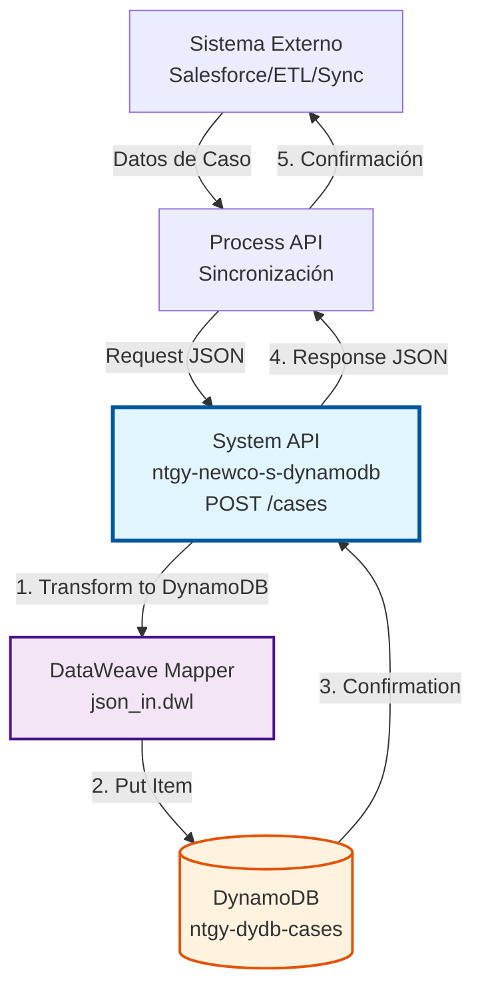
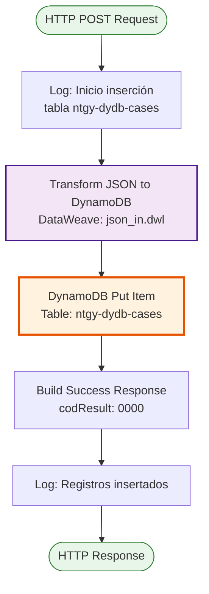
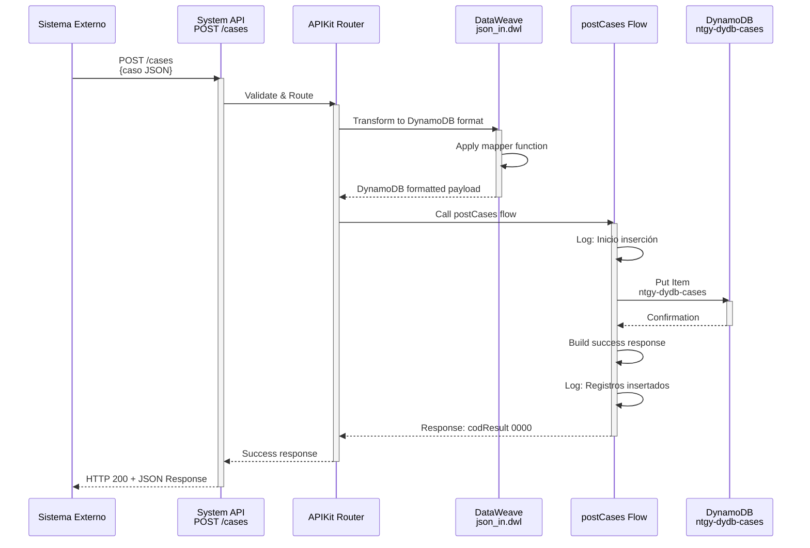

# POST /cases

## 📌 Descripción General

### Propósito del Endpoint

Este endpoint inserta casos y solicitudes de clientes en Amazon DynamoDB. Está diseñado para recibir datos de casos desde sistemas externos (como Salesforce, sistemas de sincronización o procesos ETL) y almacenarlos en la tabla `ntgy-dydb-cases` para su posterior consulta y procesamiento.

El endpoint soporta:
- **Inserción de Casos**: Almacena casos completos con toda su información
- **Formato DynamoDB**: Convierte automáticamente JSON a formato DynamoDB
- **Sincronización de Datos**: Facilita la sincronización entre sistemas
- **Operación Idempotente**: Permite sobrescribir casos existentes con la misma clave

### Tipo de API

**Capa:** System API (API-Led Connectivity)

**Función:** Integración directa con Amazon DynamoDB para inserción de casos y solicitudes de clientes.

### Patrón de Integración

**Tipo:** Fire-and-Forget con Confirmación Síncrona

**Descripción:** El endpoint recibe un payload JSON con la información del caso, lo transforma automáticamente al formato DynamoDB mediante una función mapper genérica, ejecuta la operación `put-item` en DynamoDB, y retorna una confirmación de éxito.

### Arquitectura API-Led Connectivity



---

## 💼 Propósito del Negocio

### Casos de Uso Principales

1. **Sincronización de Casos desde Salesforce**
   - Salesforce genera o actualiza un caso
   - El sistema de sincronización envía el caso a DynamoDB
   - El caso queda disponible para consulta inmediata

2. **Carga Masiva de Casos Históricos**
   - Proceso ETL extrae casos históricos
   - Los casos se insertan en lotes en DynamoDB
   - Permite migración de datos desde sistemas legacy

3. **Actualización de Casos Existentes**
   - Un caso existente cambia de estado
   - El sistema actualiza el registro en DynamoDB
   - Mantiene la información sincronizada entre sistemas

### Contexto Empresarial

- **Dominio:** Gestión de Casos y Solicitudes de Clientes
- **Sector:** Energía - Utilities
- **División:** Naturgy España - NewCo
- **Proceso de Negocio:** Sincronización de Datos, Integración de Sistemas, ETL
- **Destino de Datos:** DynamoDB (cache/repositorio centralizado)

### Stakeholders

- **Equipos de Integración**: Responsables de sincronizar datos entre sistemas
- **Administradores de Salesforce**: Gestionan el flujo de casos desde Salesforce
- **Equipos de ETL**: Ejecutan procesos de carga masiva de datos
- **Arquitectos de Datos**: Diseñan estrategias de sincronización

### Valor de Negocio

- **Centralización de Datos**: Repositorio único de casos en DynamoDB
- **Sincronización Automática**: Actualización continua desde sistemas fuente
- **Disponibilidad Inmediata**: Casos disponibles para consulta sin latencia
- **Escalabilidad**: Soporte para grandes volúmenes de inserción

### Consumidores Potenciales

Este endpoint puede ser consumido por:
- Procesos de sincronización de Salesforce
- Sistemas ETL (AWS Glue, Apache NiFi)
- Process APIs de integración
- Scripts de migración de datos
- Sistemas de replicación de datos

---

## 🔧 Especificación Técnica

### URLs por Ambiente

| Ambiente | URL Base | URL Completa |
|----------|----------|--------------|
| **Local** | `http://localhost:8081` | `http://localhost:8081/api/cases` |
| **Development** | `https://ntgy-newco-s-dynamodb-dev.us-e2.cloudhub.io` | `https://ntgy-newco-s-dynamodb-dev.us-e2.cloudhub.io/api/cases` |
| **UAT** | `https://ntgy-newco-s-dynamodb-uat.us-e2.cloudhub.io` | `https://ntgy-newco-s-dynamodb-uat.us-e2.cloudhub.io/api/cases` |
| **Production** | `https://ntgy-newco-s-dynamodb-pro.us-e2.cloudhub.io` | `https://ntgy-newco-s-dynamodb-pro.us-e2.cloudhub.io/api/cases` |

### Método HTTP

```
POST /api/cases
```

### Parámetros de Entrada

#### Headers HTTP

| Header | Tipo | Requerido | Descripción | Ejemplo |
|--------|------|-----------|-------------|---------|
| `Content-Type` | string | ✅ Sí | Tipo de contenido del request | `application/json` |
| `Accept` | string | ❌ No | Tipo de contenido esperado en response | `application/json` |

#### Body Parameters

El body debe contener un objeto JSON con información del cliente y un array de casos a insertar. La estructura se transforma automáticamente a formato DynamoDB.

**Estructura del Request:**

```json
{
  "leaseKey": "string",
  "docNumber": "string",
  "cases": [
    {
      "caseCode": "string",
      "title": "string",
      "state": "string",
      "possibleStates": [],
      "textState": "string",
      "address": "string",
      "startDate": "string",
      "endDate": "string",
      "channel": "string",
      "isCancelable": boolean,
      "hasFiles": boolean
    }
  ]
}
```

**Campos del Objeto Raíz:**

| Campo | Tipo | Requerido | Descripción |
|-------|------|-----------|-------------|
| `leaseKey` | string | ❌ No | Identificador del cliente (clave de partición en DynamoDB) |
| `docNumber` | string | ❌ No | Número de documento del cliente |
| `cases` | array | ❌ No | Array de casos a insertar |

**Campos de Cada Caso (dentro del array):**

| Campo | Tipo | Requerido | Descripción |
|-------|------|-----------|-------------|
| `caseCode` | string | ❌ No | Código único del caso |
| `title` | string | ❌ No | Título o descripción del caso |
| `state` | string | ❌ No | Estado actual del caso |
| `possibleStates` | array | ❌ No | Array de estados posibles para el caso |
| `textState` | string | ❌ No | Descripción textual del estado |
| `address` | string | ❌ No | Dirección asociada al caso |
| `startDate` | string | ❌ No | Fecha de inicio del caso (formato ISO 8601) |
| `endDate` | string | ❌ No | Fecha de finalización del caso (formato ISO 8601) |
| `channel` | string | ❌ No | Canal de origen del caso (Web, Phone, Email, etc.) |
| `isCancelable` | boolean | ❌ No | Indica si el caso puede ser cancelado |
| `hasFiles` | boolean | ❌ No | Indica si el caso tiene archivos adjuntos |

### Respuestas

#### Respuesta Exitosa (200 OK)

```json
{
  "result": {
    "codResult": "0000",
    "msgResult": "No hay error"
  }
}
```

#### Respuesta de Error de Validación (400 Bad Request)

```json
{
  "message": "Bad request"
}
```

#### Respuesta de Error Técnico (500 Internal Server Error)

```json
{
  "result": {
    "codResult": "5001",
    "msgResult": "Error al insertar en DynamoDB"
  }
}
```

### Códigos de Resultado

| Código | Tipo | Descripción |
|--------|------|-------------|
| `0000` | Success | Caso insertado correctamente |
| `5001` | Technical | Error de conectividad con DynamoDB |
| `5002` | Technical | Error en transformación de datos |

### Autenticación y Autorización

- **Tipo:** Client ID & Client Secret (Anypoint Platform)
- **Autorización DynamoDB:** El usuario debe tener permisos IAM para:
  - Ejecutar operación `PutItem` en tabla `ntgy-dydb-cases`
  - Acceso de escritura a la tabla

### Timeouts

| Tipo | Valor | Descripción |
|------|-------|-------------|
| **Request Timeout** | 30 segundos | Tiempo máximo de espera para la respuesta |
| **Connection Timeout** | 10 segundos | Tiempo máximo para establecer conexión con DynamoDB |

---

## 🏗️ Implementación Técnica

### Arquitectura del Flow



### Componentes del Flow

#### 1. Logger Inicial

**Ubicación en código:** Línea 2 del flow `postCases`

**Propósito:** Registrar el inicio de la operación de inserción

```xml
<logger level="INFO" message="Inicio insercion en tabla ntgy-dydb-cases" />
```

#### 2. Transformación de Input (json_in.dwl)

**Ubicación:** Flow principal `post:\cases:application\json:ntgy-newco-s-dynamodb-config`

**Archivo DataWeave:** `src/main/resources/dataweave/json_in.dwl`

**Función Mapper Genérica:**

```dataweave
%dw 2.0
output application/json

fun mapper(object) = object match {
    case attr is String -> {"S": attr}
    case attr is Number -> {"N": attr}
    case attr is Boolean -> {"Bool": attr}
    case attr is Array -> {"L": (attr map mapper($))}
    case attr is Object -> {"M": attr mapObject ($$): mapper($)}
    case attr is Null -> {"nullvalue": true}
}
---
payload mapObject ($$): mapper($)
```

**Explicación:**
- Convierte automáticamente tipos JSON a tipos DynamoDB
- String → `{"S": valor}`
- Number → `{"N": valor}`
- Boolean → `{"Bool": valor}`
- Array → `{"L": [elementos]}`
- Object → `{"M": {campos}}`
- Null → `{"nullvalue": true}`

**Ejemplo de Transformación:**

**Input JSON:**
```json
{
  "leaseKey": "12345678",
  "caseCode": "CASE-001",
  "isSva": true,
  "updateDate": "2024-01-15"
}
```

**Output DynamoDB:**
```json
{
  "leaseKey": {"S": "12345678"},
  "caseCode": {"S": "CASE-001"},
  "isSva": {"Bool": true},
  "updateDate": {"S": "2024-01-15"}
}
```

#### 3. Operación DynamoDB (Put Item)

**Ubicación en código:** Línea 3 del flow `postCases`

**Operación:** `dynamodb:put-item`

**Configuración:**
- **Tabla:** `ntgy-dydb-cases`
- **Config:** `Amazon_DynamoDB_Configuration`
- **Payload:** Resultado de la transformación DataWeave

**Características:**
- Inserta o sobrescribe el item si ya existe
- Usa `leaseKey` como clave de partición
- Operación atómica

```xml
<dynamodb:put-item 
    tableName="ntgy-dydb-cases" 
    config-ref="Amazon_DynamoDB_Configuration" />
```

#### 4. Construcción de Respuesta

**Ubicación en código:** Líneas 4-13 del flow `postCases`

**Transformación DataWeave:**

```dataweave
%dw 2.0
output application/json
---
"result": {
    "codResult": "0000",
    "msgResult": "No hay error"
}
```

**Respuesta Estándar:**
- Código de éxito: `0000`
- Mensaje: "No hay error"
- Formato consistente con otros endpoints

#### 5. Logger Final

**Ubicación en código:** Línea 14 del flow `postCases`

**Propósito:** Confirmar la inserción exitosa

```xml
<logger level="INFO" message="Se han insertado registros en la tabla ntgy-dydb-cases"/>
```

### Estructura de Datos DynamoDB

#### Tabla: ntgy-dydb-cases

**Clave de Partición:** `leaseKey` (String) - Identificador del cliente

**Atributos Almacenados:**

Todos los campos del JSON de entrada se almacenan en formato DynamoDB. Los atributos principales incluyen:

| Atributo | Tipo DynamoDB | Descripción |
|----------|---------------|-------------|
| `leaseKey` | S (String) | Identificador del cliente (clave de partición) |
| `caseCode` | S | Código único del caso |
| `caseId` | S | ID del caso en Salesforce |
| `typeId` | S | Tipo de caso |
| `type` | S | Categoría del caso |
| `step` | S | Paso del proceso |
| `subStep` | S | Sub-paso del proceso |
| `state` | S | Estado del caso |
| `contractAccountId` | S | ID de cuenta contrato |
| `contractId` | S | ID de contrato |
| `isSva` | BOOL | Servicio de valor añadido |
| `updateDate` | S | Fecha de actualización |
| `startDate` | S | Fecha de inicio |
| `endDate` | S | Fecha de finalización |
| `channel` | S | Canal de origen |
| `isCancelable` | BOOL | Indica si es cancelable |
| `hasFiles` | BOOL | Tiene archivos adjuntos |

### Diagrama de Secuencia Completo



### Manejo de Errores

#### Errores de Conectividad DynamoDB

```xml
<on-error-propagate type="DYNAMODB:CONNECTIVITY">
    <ee:transform>
        {
            "result": {
                "codResult": "5001",
                "msgResult": "Error de conectividad con DynamoDB"
            }
        }
    </ee:transform>
</on-error-propagate>
```

#### Errores de Validación APIKit

```xml
<on-error-propagate type="APIKIT:BAD_REQUEST">
    <ee:transform>
        {
            "message": "Bad request"
        }
    </ee:transform>
</on-error-propagate>
```

#### Errores de Transformación

```xml
<on-error-propagate type="MULE:TRANSFORMATION">
    <ee:transform>
        {
            "result": {
                "codResult": "5002",
                "msgResult": "Error en transformación de datos"
            }
        }
    </ee:transform>
</on-error-propagate>
```

### Optimizaciones Implementadas

1. **Mapper Genérico Reutilizable**: La función `mapper` en `json_in.dwl` se reutiliza para todos los endpoints POST
2. **Transformación Automática**: No requiere mapeo manual de cada campo
3. **Logging Estratégico**: Logs al inicio y fin para trazabilidad
4. **Operación Atómica**: Put-item garantiza consistencia
5. **Respuesta Estándar**: Formato consistente con otros endpoints del API

---

## 💻 Ejemplos de Uso

### Ejemplo 1: Inserción de Caso Básico

#### Request

```bash
curl -X POST "https://ntgy-newco-s-dynamodb-dev.us-e2.cloudhub.io/api/cases" \
  -H "Content-Type: application/json" \
  -H "Accept: application/json" \
  -d '{
    "leaseKey": "12345678",
    "docNumber": "12345678A",
    "cases": [
      {
        "caseCode": "CASE-2024-001",
        "title": "Solicitud de asistencia técnica",
        "state": "01",
        "possibleStates": ["01", "02", "03", "04"],
        "textState": "En proceso",
        "address": "Calle Mayor 123, Madrid",
        "startDate": "2024-01-10T09:00:00.000Z",
        "endDate": "",
        "channel": "Web",
        "isCancelable": true,
        "hasFiles": false
      }
    ]
  }'
```

#### Response (200 OK)

```json
{
  "result": {
    "codResult": "0000",
    "msgResult": "No hay error"
  }
}
```

### Ejemplo 2: Inserción de Caso de Emergencia

#### Request

```bash
curl -X POST "https://ntgy-newco-s-dynamodb-dev.us-e2.cloudhub.io/api/cases" \
  -H "Content-Type: application/json" \
  -d '{
    "leaseKey": "87654321",
    "docNumber": "87654321B",
    "cases": [
      {
        "caseCode": "CASE-2024-EMG-001",
        "title": "Emergencia - Fuga de gas",
        "state": "01",
        "possibleStates": ["01", "02"],
        "textState": "Urgente - En atención",
        "address": "Avenida Libertad 456, Barcelona",
        "startDate": "2024-01-18T08:00:00.000Z",
        "endDate": "",
        "channel": "Phone",
        "isCancelable": false,
        "hasFiles": false
      }
    ]
  }'
```

#### Response (200 OK)

```json
{
  "result": {
    "codResult": "0000",
    "msgResult": "No hay error"
  }
}
```

### Ejemplo 3: Inserción de Múltiples Casos

#### Escenario

Un cliente tiene múltiples casos que deben ser insertados en una sola operación.

#### Request

```bash
curl -X POST "https://ntgy-newco-s-dynamodb-dev.us-e2.cloudhub.io/api/cases" \
  -H "Content-Type: application/json" \
  -d '{
    "leaseKey": "12345678",
    "docNumber": "12345678A",
    "cases": [
      {
        "caseCode": "CASE-2024-001",
        "title": "Solicitud de asistencia técnica",
        "state": "03",
        "possibleStates": ["03", "04"],
        "textState": "Completado",
        "address": "Calle Mayor 123, Madrid",
        "startDate": "2024-01-10T09:00:00.000Z",
        "endDate": "2024-01-22T18:00:00.000Z",
        "channel": "Web",
        "isCancelable": false,
        "hasFiles": true
      },
      {
        "caseCode": "CASE-2024-002",
        "title": "Consulta sobre facturación",
        "state": "01",
        "possibleStates": ["01", "02", "03"],
        "textState": "En proceso",
        "address": "Calle Mayor 123, Madrid",
        "startDate": "2024-01-20T10:00:00.000Z",
        "endDate": "",
        "channel": "Email",
        "isCancelable": true,
        "hasFiles": false
      }
    ]
  }'
```

#### Response (200 OK)

```json
{
  "result": {
    "codResult": "0000",
    "msgResult": "No hay error"
  }
}
```

**Nota:** Se insertan múltiples casos para el mismo cliente (`leaseKey=12345678`) en una sola operación.

### Ejemplo 4: Error de Validación

#### Request (JSON inválido)

```bash
curl -X POST "https://ntgy-newco-s-dynamodb-dev.us-e2.cloudhub.io/api/cases" \
  -H "Content-Type: application/json" \
  -d '{
    "leaseKey": "12345678"
    "caseCode": "CASE-INVALID"
  }'
```

#### Response (400 Bad Request)

```json
{
  "message": "Bad request"
}
```

### Ejemplo 5: Integración desde JavaScript

```javascript
async function insertCases(clientData) {
  const baseUrl = 'https://ntgy-newco-s-dynamodb-dev.us-e2.cloudhub.io';
  
  try {
    const response = await fetch(`${baseUrl}/api/cases`, {
      method: 'POST',
      headers: {
        'Content-Type': 'application/json',
        'Accept': 'application/json'
      },
      body: JSON.stringify(clientData)
    });
    
    const data = await response.json();
    
    if (response.ok && data.result.codResult === '0000') {
      console.log('Cases inserted successfully');
      return { success: true, data };
    } else {
      throw new Error(`Error: ${data.result?.msgResult || data.message}`);
    }
  } catch (error) {
    console.error('Failed to insert cases:', error);
    throw error;
  }
}

// Uso
const clientCases = {
  leaseKey: '12345678',
  docNumber: '12345678A',
  cases: [
    {
      caseCode: 'CASE-2024-002',
      title: 'Nueva solicitud de servicio',
      state: '01',
      possibleStates: ['01', '02', '03', '04'],
      textState: 'Pendiente',
      address: 'Calle Ejemplo 789, Valencia',
      startDate: new Date().toISOString(),
      endDate: '',
      channel: 'API',
      isCancelable: true,
      hasFiles: false
    }
  ]
};

insertCases(clientCases)
  .then(result => console.log('Success:', result))
  .catch(error => console.error('Error:', error));
```

### Ejemplo 6: Integración desde Python

```python
import requests
from typing import Dict, Any, List
from datetime import datetime

def insert_cases(client_data: Dict[str, Any]) -> Dict[str, Any]:
    """
    Inserta casos en DynamoDB a través del System API.
    
    Args:
        client_data: Diccionario con leaseKey, docNumber y array de casos
        
    Returns:
        Diccionario con el resultado de la operación
    """
    base_url = 'https://ntgy-newco-s-dynamodb-dev.us-e2.cloudhub.io'
    
    try:
        response = requests.post(
            f'{base_url}/api/cases',
            json=client_data,
            headers={
                'Content-Type': 'application/json',
                'Accept': 'application/json'
            },
            timeout=30
        )
        
        response.raise_for_status()
        data = response.json()
        
        if data.get('result', {}).get('codResult') == '0000':
            print('Cases inserted successfully')
            return {'success': True, 'data': data}
        else:
            raise Exception(f"Error: {data.get('result', {}).get('msgResult', 'Unknown error')}")
            
    except requests.exceptions.RequestException as e:
        print(f'Failed to insert cases: {e}')
        raise

# Uso
client_cases = {
    'leaseKey': '12345678',
    'docNumber': '12345678A',
    'cases': [
        {
            'caseCode': 'CASE-2024-003',
            'title': 'Solicitud desde Python',
            'state': '01',
            'possibleStates': ['01', '02', '03'],
            'textState': 'Nuevo',
            'address': 'Plaza España 10, Sevilla',
            'startDate': datetime.now().isoformat(),
            'endDate': '',
            'channel': 'API',
            'isCancelable': True,
            'hasFiles': False
        }
    ]
}

try:
    result = insert_cases(client_cases)
    print(f'Success: {result}')
except Exception as e:
    print(f'Error: {e}')
```
