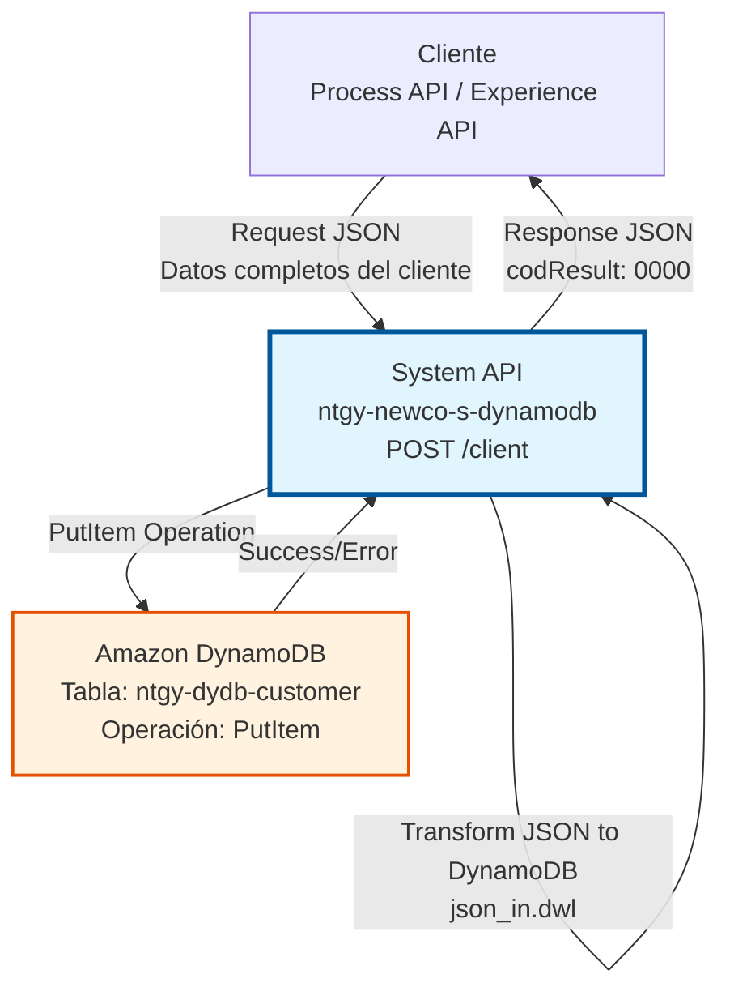
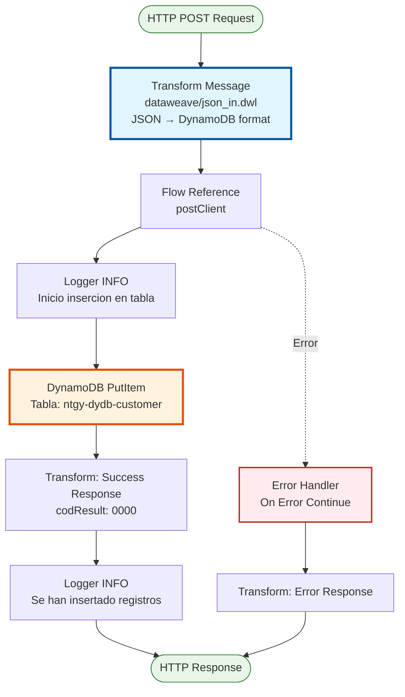
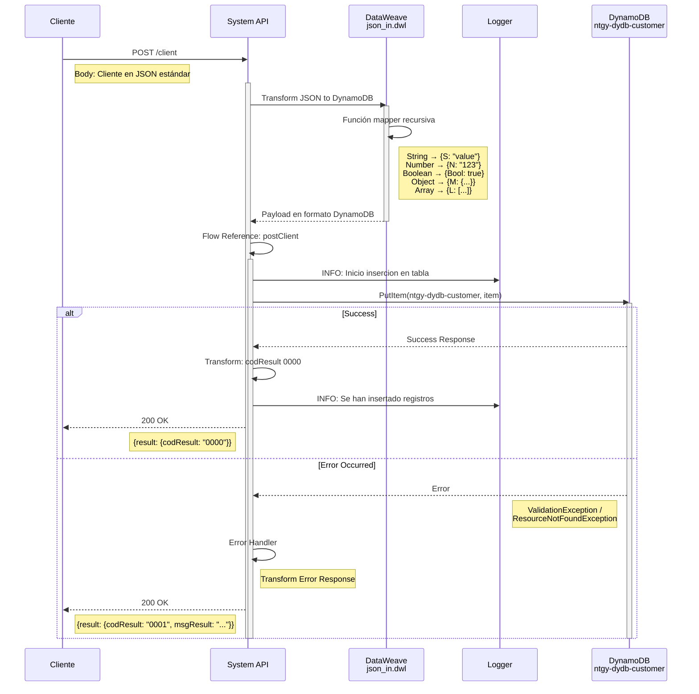
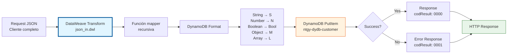

# POST /client

## 📌 Descripción General

### Propósito del Endpoint

Este endpoint crea un nuevo cliente en Amazon DynamoDB o actualiza un cliente existente si la clave ya existe. Proporciona una interfaz REST simple para la operación PutItem de DynamoDB, abstrayendo la complejidad del formato de atributos DynamoDB mediante transformación automática de JSON estándar.

El endpoint soporta:
- **Creación de clientes**: Inserta nuevos registros de clientes en la tabla
- **Actualización completa**: Reemplaza clientes existentes con la misma clave (upsert)
- **Transformación automática**: Convierte JSON estándar a formato de atributos DynamoDB
- **Datos completos**: Soporta estructura completa con datos personales, contactos, GDPR y dirección
- **Tipos complejos**: Maneja objetos anidados, arrays de contactos, y tipos primitivos

### Tipo de API

**Capa:** System API (API-Led Connectivity)

**Función:** Integración directa con Amazon DynamoDB para operaciones de escritura de datos maestros de clientes.

### Patrón de Integración

**Tipo:** Request-Reply Síncrono con DynamoDB PutItem

**Descripción:** El endpoint recibe una solicitud con los datos completos del cliente en JSON estándar, transforma automáticamente el JSON al formato de atributos DynamoDB usando una función recursiva, invoca la operación PutItem en la tabla `ntgy-dydb-customer`, y retorna una confirmación simple de éxito o error.

### Arquitectura API-Led Connectivity



---

## 💼 Propósito del Negocio

### Casos de Uso Principales

1. **Onboarding de Nuevos Clientes**
   - Crear perfiles completos de clientes en el sistema
   - Almacenar información personal, contactos y preferencias GDPR
   - Beneficio: Registro rápido y completo de nuevos clientes

2. **Sincronización desde Salesforce**
   - Replicar datos de clientes desde Salesforce a DynamoDB
   - Mantener copia local para operaciones de alta velocidad
   - Beneficio: Reducción de latencia en consultas frecuentes

3. **Actualización Masiva de Datos**
   - Actualizar información de clientes desde procesos batch
   - Migración de datos desde sistemas legacy
   - Beneficio: Gestión eficiente de actualizaciones masivas

4. **Gestión de Preferencias GDPR**
   - Actualizar consentimientos y preferencias de privacidad
   - Mantener registro actualizado de preferencias del cliente
   - Beneficio: Cumplimiento normativo y respeto a preferencias

5. **Gestión de Contactos**
   - Crear/actualizar lista completa de contactos del cliente
   - Mantener información de representantes legales
   - Beneficio: Comunicación efectiva con las personas correctas

### Contexto Empresarial

- **Dominio:** Gestión de Clientes y Datos Maestros
- **Sector:** Energía - Utilities
- **División:** Naturgy España - NewCo
- **Proceso de Negocio:** Creación y actualización de información de clientes, gestión GDPR
- **Tecnología:** Amazon DynamoDB (NoSQL Database)

### Stakeholders

- **Equipos de Onboarding**: Necesitan crear nuevos clientes rápidamente
- **Desarrolladores de Process APIs**: Requieren sincronizar datos de clientes
- **Oficiales de Cumplimiento GDPR**: Necesitan actualizar preferencias de privacidad
- **Equipos de Integración**: Requieren replicar datos desde Salesforce

### Valor de Negocio

- **Simplicidad**: Interfaz REST con JSON estándar (no requiere formato DynamoDB)
- **Upsert Automático**: Crea o actualiza según existencia de la clave
- **Datos Completos**: Soporta estructura completa del cliente en una sola operación
- **Performance**: Escritura rápida y directa en DynamoDB (< 1s)
- **Flexibilidad**: Soporta clientes individuales y empresas

### Consumidores Potenciales

Este endpoint puede ser consumido por:
- Process APIs de gestión de clientes (NewCo)
- Process APIs de sincronización con Salesforce
- Experience APIs de portales de registro
- Sistemas de integración middleware
- Flujos de Salesforce para replicación de datos
- Procesos batch de migración de datos

---

## 🔧 Especificación Técnica

### URLs por Ambiente

| Ambiente | URL Base | URL Completa |
|----------|----------|--------------|
| **Local** | `http://localhost:8081` | `http://localhost:8081/api/client` |
| **Development** | `https://ntgy-newco-s-dynamodb-dev.cloudhub.io` | `https://ntgy-newco-s-dynamodb-dev.cloudhub.io/api/client` |
| **Test** | `https://ntgy-newco-s-dynamodb-test.cloudhub.io` | `https://ntgy-newco-s-dynamodb-test.cloudhub.io/api/client` |
| **Production** | `https://ntgy-newco-s-dynamodb.cloudhub.io` | `https://ntgy-newco-s-dynamodb.cloudhub.io/api/client` |

### Método HTTP

```
POST /api/client
```

### Parámetros de Entrada

#### Headers HTTP

| Header | Tipo | Requerido | Descripción | Ejemplo |
|--------|------|-----------|-------------|---------|
| `Content-Type` | string | ✅ Sí | Tipo de contenido del request | `application/json` |
| `Accept` | string | ❌ No | Tipo de contenido esperado en response | `application/json` |

#### Body Parameters

El body debe contener el cliente completo en formato JSON estándar. **NO es necesario usar el formato de atributos DynamoDB** - la transformación es automática mediante el archivo `dataweave/json_in.dwl`.

**Estructura completa del cliente:**

```json
{
  "leaseKey": "LEASE-12345",
  "addressId": "ADDR-67890",
  "isIndividualClient": true,
  "name": "Juan",
  "email": "juan.perez@example.com",
  "phone": "+34612345678",
  "surname": "Pérez",
  "surname2": "García",
  "docTypeId": "DNI",
  "docNumber": "12345678A",
  "nationalityId": "ES",
  "birthdate": "1985-03-15",
  "businessName": "",
  "cnae": "",
  "idEnergyUseType": "RESIDENTIAL",
  "preferredLanguage": "es",
  "areacliente": true,
  "NewCo_BypassFirmaOmega__c": false,
  "gdprPreferences": {
    "commercialCommunications": true,
    "dataTransfer": false,
    "keepData": true,
    "communications": true,
    "profile": false,
    "advertising": false,
    "survey": true,
    "market": false
  },
  "contacts": [
    {
      "contactId": "CONT-001",
      "clientId": "LEASE-12345",
      "name": "María",
      "surname": "López",
      "surname2": "Martínez",
      "docTypeId": "DNI",
      "docNumber": "87654321B",
      "nationalityId": "ES",
      "representationTypeId": "LEGAL",
      "scheduleId": "SCH-001",
      "preferredPhone": {
        "prefix": "+34",
        "number": "698765432"
      },
      "phone2": {
        "prefix": "+34",
        "number": "912345678"
      },
      "channel": "EMAIL",
      "preferredEmail": "maria.lopez@example.com",
      "isPreferred": true,
      "isValidated": true,
      "vlocity_cmt__Type__c": "PRIMARY",
      "isHolder": false
    }
  ]
}
```

#### Campos Obligatorios

| Campo | Tipo | Descripción |
|-------|------|-------------|
| `leaseKey` | string | **Clave primaria** - Identificador único del cliente |
| `docTypeId` | string | Tipo de documento (DNI, NIE, CIF, etc.) |
| `docNumber` | string | Número de documento |
| `isIndividualClient` | boolean | Indica si es cliente individual (true) o empresa (false) |

#### Campos Opcionales - Datos Personales

| Campo | Tipo | Descripción | Valor por Defecto |
|-------|------|-------------|-------------------|
| `addressId` | string | ID de dirección asociada | `""` |
| `name` | string | Nombre del cliente | `""` |
| `surname` | string | Primer apellido | `""` |
| `surname2` | string | Segundo apellido | `""` |
| `nationalityId` | string | Código de nacionalidad (ISO 3166-1 alpha-2) | `""` |
| `birthdate` | string | Fecha de nacimiento (YYYY-MM-DD) | `""` |
| `businessName` | string | Razón social (solo empresas) | `""` |
| `cnae` | string | Código CNAE (solo empresas) | `""` |
| `idEnergyUseType` | string | Tipo de uso de energía | `""` |
| `preferredLanguage` | string | Idioma preferido (es, ca, eu, gl, en) | `"es"` |
| `areacliente` | boolean | Acceso al área de cliente | `false` |
| `NewCo_BypassFirmaOmega__c` | boolean | Puede omitir firma digital | `false` |

#### Campos Opcionales - Contacto

| Campo | Tipo | Descripción |
|-------|------|-------------|
| `email` | string | Email principal del cliente |
| `phone` | string | Teléfono principal del cliente |

#### Objeto GDPR Preferences

| Campo | Tipo | Descripción |
|-------|------|-------------|
| `commercialCommunications` | boolean | Acepta comunicaciones comerciales |
| `dataTransfer` | boolean | Acepta transferencia de datos |
| `keepData` | boolean | Acepta conservación de datos |
| `communications` | boolean | Acepta comunicaciones generales |
| `profile` | boolean | Acepta perfilado |
| `advertising` | boolean | Acepta publicidad |
| `survey` | boolean | Acepta encuestas |
| `market` | boolean | Acepta estudios de mercado |

#### Array de Contactos

Cada contacto en el array debe tener:

| Campo | Tipo | Descripción |
|-------|------|-------------|
| `contactId` | string | Identificador único del contacto |
| `clientId` | string | ID del cliente al que pertenece |
| `name` | string | Nombre del contacto |
| `surname` | string | Primer apellido |
| `surname2` | string | Segundo apellido |
| `docTypeId` | string | Tipo de documento |
| `docNumber` | string | Número de documento |
| `nationalityId` | string | Código de nacionalidad |
| `representationTypeId` | string | Tipo de representación |
| `scheduleId` | string | ID de horario de contacto |
| `preferredPhone` | object | Teléfono preferido (prefix, number) |
| `phone2` | object | Teléfono secundario (prefix, number) |
| `channel` | string | Canal de comunicación preferido |
| `preferredEmail` | string | Email preferido |
| `isPreferred` | boolean | Indica si es contacto preferido |
| `isValidated` | boolean | Indica si está validado |
| `vlocity_cmt__Type__c` | string | Tipo de contacto (Salesforce) |
| `isHolder` | boolean | Indica si es titular |

### Respuestas

#### Respuesta Exitosa (200 OK)

```json
{
  "result": {
    "codResult": "0000",
    "msgResult": "No hay error"
  }
}
```

#### Respuesta de Error (200 OK con error)

```json
{
  "result": {
    "codResult": "0001",
    "msgResult": "ValidationException: One or more parameter values were invalid: Missing the key leaseKey in the item"
  }
}
```

### Códigos de Resultado

| Código | Descripción | Significado |
|--------|-------------|-------------|
| `0000` | No hay error | Cliente creado/actualizado exitosamente |
| `0001` | Error | Error técnico en la operación (validación fallida, tabla no existe, etc.) |

### Comportamiento de PutItem (Upsert)

**⚠️ Importante:** La operación PutItem tiene las siguientes características:

- **Crea o Reemplaza**: Si el cliente no existe (por `leaseKey`), lo crea. Si existe, lo reemplaza completamente.
- **Reemplazo Completo**: No hace merge de campos - reemplaza el cliente entero.
- **Requiere Clave Completa**: El body debe incluir el `leaseKey` (partition key).
- **Idempotente**: Ejecutar múltiples veces con los mismos datos produce el mismo resultado.

### Autenticación y Autorización

- **Tipo:** Client ID & Client Secret (Anypoint Platform)
- **Autorización AWS:** El usuario de servicio debe tener permisos IAM para:
  - Ejecutar operación `dynamodb:PutItem` en tabla `ntgy-dydb-customer`
  - Acceso de escritura a la tabla
  - Permisos configurados mediante IAM policies

### Timeouts

| Tipo | Valor | Descripción |
|------|-------|-------------|
| **Request Timeout** | 30 segundos | Tiempo máximo de espera para la respuesta |
| **Connection Timeout** | 10 segundos | Tiempo máximo para establecer conexión con DynamoDB |
| **DynamoDB Operation** | 10 segundos | Timeout específico para operación PutItem |

---

## 🏗️ Implementación Técnica

### Arquitectura del Flow



### Diagrama de Secuencia



### Componentes Principales

#### 1. Flow Principal - Transformación Inicial

```xml
<flow name="post:\client:application\json:ntgy-newco-s-dynamodb-config">
    <ee:transform doc:name="Transform Message">
        <ee:message>
            <ee:set-payload resource="dataweave/json_in.dwl" />
        </ee:message>
    </ee:transform>
    <flow-ref doc:name="Flow Reference" name="postClient" />
    <error-handler>
        <on-error-continue>
            <flow-ref name="errorManagerExpSysFlow" />
        </on-error-continue>
    </error-handler>
</flow>
```

**Propósito:** Transforma el JSON estándar a formato DynamoDB antes de invocar el subflow.

#### 2. Transformación DataWeave - JSON a DynamoDB

**Archivo:** `src/main/resources/dataweave/json_in.dwl`

```dataweave
%dw 2.0
output application/json

fun mapper(object) = object match {
    case attr is String -> {"S": attr}
    case attr is Number -> {"N": attr}
    case attr is Boolean -> {"Bool": attr}
    case attr is Array -> {"L": (attr map mapper($))}
    case attr is Object -> {"M": attr mapObject ($$): mapper($)}
    case attr is Null -> {"nullvalue": true}
}
---
payload mapObject ($$): mapper($)
```

**Características de la transformación:**
- Detecta automáticamente el tipo de cada campo
- Convierte String a formato `{"S": "value"}`
- Convierte Number a formato `{"N": "123"}`
- Convierte Boolean a formato `{"Bool": true}`
- Maneja objetos anidados recursivamente con `{"M": {...}}`
- Maneja arrays con `{"L": [...]}`
- Maneja valores null con `{"nullvalue": true}`
- Preserva la estructura completa del JSON original

**Ejemplo de transformación:**

```javascript
// Input (JSON estándar)
{
  "leaseKey": "LEASE-12345",
  "name": "Juan",
  "age": 35,
  "isIndividualClient": true,
  "gdprPreferences": {
    "commercialCommunications": true
  },
  "contacts": [
    {
      "contactId": "CONT-001",
      "name": "María"
    }
  ]
}

// Output (formato DynamoDB)
{
  "leaseKey": {"S": "LEASE-12345"},
  "name": {"S": "Juan"},
  "age": {"N": "35"},
  "isIndividualClient": {"Bool": true},
  "gdprPreferences": {
    "M": {
      "commercialCommunications": {"Bool": true}
    }
  },
  "contacts": {
    "L": [
      {
        "M": {
          "contactId": {"S": "CONT-001"},
          "name": {"S": "María"}
        }
      }
    ]
  }
}
```

#### 3. Subflow postClient

```xml
<flow name="postClient">
    <logger level="INFO" message="Inicio insercion en tabla ntgy-dydb-customer" />
    
    <dynamodb:put-item 
        tableName="ntgy-dydb-customer" 
        doc:name="Put item" 
        config-ref="Amazon_DynamoDB_Configuration" />
    
    <ee:transform doc:name="Transform Message">
        <ee:message>
            <ee:set-payload><![CDATA[%dw 2.0
output application/json
---
{
    "result": {
        "codResult": "0000",
        "msgResult": "No hay error"
    }
}]]></ee:set-payload>
        </ee:message>
    </ee:transform>
    
    <logger level="INFO" message="Se han insertado registros en la tabla ntgy-dydb-customer" />
</flow>
```

**Flujo:**
1. Logger de inicio
2. Operación PutItem en DynamoDB
3. Transformación de respuesta exitosa
4. Logger de fin

#### 4. Operación DynamoDB PutItem

```xml
<dynamodb:put-item 
    tableName="ntgy-dydb-customer" 
    doc:name="Put item" 
    config-ref="Amazon_DynamoDB_Configuration" />
```

**Características:**
- **Conector:** Amazon DynamoDB Connector
- **Operación:** PutItem (upsert)
- **Tabla:** `ntgy-dydb-customer` (fija)
- **Payload:** Item en formato DynamoDB (ya transformado)
- **Configuración:** Credenciales AWS desde secure properties

#### 5. Transformación de Respuesta Exitosa

```dataweave
%dw 2.0
output application/json
---
{
    "result": {
        "codResult": "0000",
        "msgResult": "No hay error"
    }
}
```

**Respuesta estándar:** Indica éxito de la operación sin devolver el cliente creado.

#### 6. Manejo de Errores

El manejo de errores se realiza en el flow principal mediante `errorManagerExpSysFlow`, que captura y transforma errores de DynamoDB.

**Errores capturados:**
- `ResourceNotFoundException`: Tabla no existe
- `ValidationException`: Datos inválidos o clave faltante
- `ProvisionedThroughputExceededException`: Límite de capacidad excedido
- `ConditionalCheckFailedException`: Condición de escritura no cumplida
- Errores de conectividad con AWS
- Errores de autenticación IAM

### Configuración de DynamoDB

**Conexión configurada en global.xml:**
```xml
<dynamodb:config name="Amazon_DynamoDB_Configuration">
    <dynamodb:basic-connection 
        accessKey="${dynamodb.accessKey}" 
        secretKey="${secure::dynamodb.secretKey}" 
        region="${dynamodb.region}" />
</dynamodb:config>
```

**Propiedades por ambiente:**
- **accessKey**: Clave de acceso AWS IAM
- **secretKey**: Clave secreta AWS IAM (encriptada)
- **region**: Región AWS (ej: us-east-1, eu-west-1)

### Diagrama de Transformación de Datos



### Variables de Contexto

| Variable | Tipo | Descripción | Ejemplo |
|----------|------|-------------|---------|
| `payload` | Object | Cliente en formato DynamoDB (después de transformación) | `{leaseKey: {S: "LEASE-12345"}, ...}` |

### Dependencias Técnicas

**Conectores:**
- Amazon DynamoDB Connector 1.5.3+
- HTTP Connector 1.11.1
- APIKit Module 1.11.11

**Módulos:**
- Secure Configuration Property Module (credenciales)
- Mule Tracing Module (observabilidad)

**Archivos DataWeave:**
- `src/main/resources/dataweave/json_in.dwl` (transformación JSON → DynamoDB)

---

## 💻 Ejemplos de Uso

### Ejemplo 1: Crear Cliente Individual Nuevo

**Request:**
```bash
curl -X POST "http://localhost:8081/api/client" \
  -H "Content-Type: application/json" \
  -H "client_id: your-client-id" \
  -H "client_secret: your-client-secret" \
  -d '{
    "leaseKey": "LEASE-12345",
    "addressId": "ADDR-67890",
    "isIndividualClient": true,
    "name": "Juan",
    "email": "juan.perez@naturgy.com",
    "phone": "+34612345678",
    "surname": "Pérez",
    "surname2": "García",
    "docTypeId": "DNI",
    "docNumber": "12345678A",
    "nationalityId": "ES",
    "birthdate": "1985-03-15",
    "businessName": "",
    "cnae": "",
    "idEnergyUseType": "RESIDENTIAL",
    "preferredLanguage": "es",
    "areacliente": true,
    "NewCo_BypassFirmaOmega__c": false,
    "gdprPreferences": {
      "commercialCommunications": true,
      "dataTransfer": false,
      "keepData": true,
      "communications": true,
      "profile": false,
      "advertising": false,
      "survey": true,
      "market": false
    },
    "contacts": []
  }'
```

**Response (200 OK):**
```json
{
  "result": {
    "codResult": "0000",
    "msgResult": "No hay error"
  }
}
```

### Ejemplo 2: Crear Cliente con Contactos

**Request:**
```bash
curl -X POST "http://localhost:8081/api/client" \
  -H "Content-Type: application/json" \
  -H "client_id: your-client-id" \
  -H "client_secret: your-client-secret" \
  -d '{
    "leaseKey": "LEASE-67890",
    "addressId": "ADDR-11111",
    "isIndividualClient": true,
    "name": "María",
    "email": "maria.garcia@naturgy.com",
    "phone": "+34698765432",
    "surname": "García",
    "surname2": "López",
    "docTypeId": "DNI",
    "docNumber": "87654321B",
    "nationalityId": "ES",
    "birthdate": "1990-06-20",
    "businessName": "",
    "cnae": "",
    "idEnergyUseType": "RESIDENTIAL",
    "preferredLanguage": "es",
    "areacliente": true,
    "NewCo_BypassFirmaOmega__c": false,
    "gdprPreferences": {
      "commercialCommunications": false,
      "dataTransfer": false,
      "keepData": true,
      "communications": true,
      "profile": false,
      "advertising": false,
      "survey": false,
      "market": false
    },
    "contacts": [
      {
        "contactId": "CONT-001",
        "clientId": "LEASE-67890",
        "name": "Pedro",
        "surname": "Martínez",
        "surname2": "Sánchez",
        "docTypeId": "DNI",
        "docNumber": "11223344C",
        "nationalityId": "ES",
        "representationTypeId": "AUTHORIZED",
        "scheduleId": "SCH-002",
        "preferredPhone": {
          "prefix": "+34",
          "number": "611223344"
        },
        "phone2": {
          "prefix": "+34",
          "number": "911223344"
        },
        "channel": "PHONE",
        "preferredEmail": "pedro.martinez@example.com",
        "isPreferred": false,
        "isValidated": true,
        "vlocity_cmt__Type__c": "SECONDARY",
        "isHolder": false
      }
    ]
  }'
```

**Response (200 OK):**
```json
{
  "result": {
    "codResult": "0000",
    "msgResult": "No hay error"
  }
}
```

### Ejemplo 3: Crear Cliente Empresa

**Request:**
```bash
curl -X POST "http://localhost:8081/api/client" \
  -H "Content-Type: application/json" \
  -H "client_id: your-client-id" \
  -H "client_secret: your-client-secret" \
  -d '{
    "leaseKey": "LEASE-99999",
    "addressId": "",
    "isIndividualClient": false,
    "name": "",
    "email": "contacto@empresa.com",
    "phone": "+34912345678",
    "surname": "",
    "surname2": "",
    "docTypeId": "CIF",
    "docNumber": "B12345678",
    "nationalityId": "ES",
    "birthdate": "",
    "businessName": "Empresa Ejemplo S.L.",
    "cnae": "4321",
    "idEnergyUseType": "COMMERCIAL",
    "preferredLanguage": "es",
    "areacliente": true,
    "NewCo_BypassFirmaOmega__c": false,
    "gdprPreferences": {
      "commercialCommunications": false,
      "dataTransfer": false,
      "keepData": true,
      "communications": true,
      "profile": false,
      "advertising": false,
      "survey": false,
      "market": false
    },
    "contacts": []
  }'
```

**Response (200 OK):**
```json
{
  "result": {
    "codResult": "0000",
    "msgResult": "No hay error"
  }
}
```

### Ejemplo 4: Error - Falta Clave Primaria

**Request:**
```bash
curl -X POST "http://localhost:8081/api/client" \
  -H "Content-Type: application/json" \
  -H "client_id: your-client-id" \
  -H "client_secret: your-client-secret" \
  -d '{
    "name": "Test sin leaseKey",
    "email": "test@example.com",
    "isIndividualClient": true
  }'
```

**Response (200 OK - Error):**
```json
{
  "result": {
    "codResult": "0001",
    "msgResult": "ValidationException: One or more parameter values were invalid: Missing the key leaseKey in the item"
  }
}
```

### Ejemplo 5: Actualizar Cliente Existente (Upsert)

**Request:**
```bash
curl -X POST "http://localhost:8081/api/client" \
  -H "Content-Type: application/json" \
  -H "client_id: your-client-id" \
  -H "client_secret: your-client-secret" \
  -d '{
    "leaseKey": "LEASE-12345",
    "addressId": "ADDR-67890",
    "isIndividualClient": true,
    "name": "Juan",
    "email": "juan.perez.nuevo@naturgy.com",
    "phone": "+34612345999",
    "surname": "Pérez",
    "surname2": "García",
    "docTypeId": "DNI",
    "docNumber": "12345678A",
    "nationalityId": "ES",
    "birthdate": "1985-03-15",
    "businessName": "",
    "cnae": "",
    "idEnergyUseType": "RESIDENTIAL",
    "preferredLanguage": "ca",
    "areacliente": true,
    "NewCo_BypassFirmaOmega__c": true,
    "gdprPreferences": {
      "commercialCommunications": false,
      "dataTransfer": false,
      "keepData": true,
      "communications": true,
      "profile": true,
      "advertising": false,
      "survey": false,
      "market": false
    },
    "contacts": []
  }'
```

**Response (200 OK):**
```json
{
  "result": {
    "codResult": "0000",
    "msgResult": "No hay error"
  }
}
```

**Nota:** Este request reemplaza completamente el cliente con `leaseKey: LEASE-12345`. Los cambios incluyen:
- Email actualizado
- Teléfono actualizado
- Idioma preferido cambiado a catalán
- BypassSign activado
- Preferencias GDPR modificadas

### Ejemplo 6: Uso desde JavaScript/Node.js

```javascript
const axios = require('axios');

async function createOrUpdateClient(clientData) {
  try {
    const response = await axios.post(
      'https://ntgy-newco-s-dynamodb.cloudhub.io/api/client',
      clientData,
      {
        headers: {
          'Content-Type': 'application/json',
          'client_id': 'your-client-id',
          'client_secret': 'your-client-secret'
        }
      }
    );

    if (response.data.result.codResult === '0000') {
      console.log('Cliente creado/actualizado exitosamente');
      return true;
    } else {
      console.error('Error:', response.data.result.msgResult);
      throw new Error(response.data.result.msgResult);
    }
  } catch (error) {
    console.error('Error en la petición:', error.message);
    throw error;
  }
}

// Uso - Crear nuevo cliente
const newClient = {
  leaseKey: 'LEASE-12345',
  addressId: 'ADDR-67890',
  isIndividualClient: true,
  name: 'Juan',
  email: 'juan.perez@naturgy.com',
  phone: '+34612345678',
  surname: 'Pérez',
  surname2: 'García',
  docTypeId: 'DNI',
  docNumber: '12345678A',
  nationalityId: 'ES',
  birthdate: '1985-03-15',
  businessName: '',
  cnae: '',
  idEnergyUseType: 'RESIDENTIAL',
  preferredLanguage: 'es',
  areacliente: true,
  NewCo_BypassFirmaOmega__c: false,
  gdprPreferences: {
    commercialCommunications: true,
    dataTransfer: false,
    keepData: true,
    communications: true,
    profile: false,
    advertising: false,
    survey: true,
    market: false
  },
  contacts: []
};

createOrUpdateClient(newClient)
  .then(() => console.log('Operación completada'))
  .catch(err => console.error('Error:', err));
```

### Ejemplo 7: Uso desde Python

```python
import requests
import json

def create_or_update_client(client_data):
    url = "https://ntgy-newco-s-dynamodb.cloudhub.io/api/client"
    
    headers = {
        'Content-Type': 'application/json',
        'client_id': 'your-client-id',
        'client_secret': 'your-client-secret'
    }
    
    try:
        response = requests.post(url, headers=headers, json=client_data)
        response.raise_for_status()
        
        data = response.json()
        
        if data['result']['codResult'] == '0000':
            print('Cliente creado/actualizado exitosamente')
            return True
        else:
            error_msg = data['result']['msgResult']
            print(f'Error: {error_msg}')
            raise Exception(error_msg)
            
    except requests.exceptions.RequestException as e:
        print(f'Error en la petición: {e}')
        raise

# Uso
new_client = {
    'leaseKey': 'LEASE-12345',
    'addressId': 'ADDR-67890',
    'isIndividualClient': True,
    'name': 'Juan',
    'email': 'juan.perez@naturgy.com',
    'phone': '+34612345678',
    'surname': 'Pérez',
    'surname2': 'García',
    'docTypeId': 'DNI',
    'docNumber': '12345678A',
    'nationalityId': 'ES',
    'birthdate': '1985-03-15',
    'businessName': '',
    'cnae': '',
    'idEnergyUseType': 'RESIDENTIAL',
    'preferredLanguage': 'es',
    'areacliente': True,
    'NewCo_BypassFirmaOmega__c': False,
    'gdprPreferences': {
        'commercialCommunications': True,
        'dataTransfer': False,
        'keepData': True,
        'communications': True,
        'profile': False,
        'advertising': False,
        'survey': True,
        'market': False
    },
    'contacts': []
}

try:
    create_or_update_client(new_client)
    print('Operación completada')
except Exception as e:
    print(f'Error: {e}')
```

### Consideraciones de Uso

**Performance:**
- Operación PutItem es rápida (< 20ms en DynamoDB)
- Tiempo total de respuesta típico: 500ms - 1s (incluye transformación)
- Para operaciones masivas, considerar procesamiento batch

**Mejores Prácticas:**
- **Incluir siempre `leaseKey`**: Es la clave primaria obligatoria
- **Validar datos antes de enviar**: Evita errores de validación en DynamoDB
- **Usar upsert apropiadamente**: PutItem reemplaza el item completo
- **Estructurar contactos correctamente**: Validar estructura del array
- **Gestionar preferencias GDPR**: Incluir todos los campos booleanos
- **Implementar retry logic**: Para errores transitorios (throttling)

**Limitaciones:**
- **Reemplazo completo**: PutItem reemplaza el cliente entero, no hace merge
- **Requiere clave completa**: Debe incluir `leaseKey` (partition key)
- **No soporta actualizaciones parciales**: Para actualizar campos específicos, usar otro endpoint
- **Tabla fija**: Solo escribe en `ntgy-dydb-customer`
- **Permisos necesarios**: Requiere permisos IAM de escritura

**Diferencias con GET /client:**
- **GET**: Lee datos de DynamoDB (Query)
- **POST**: Escribe datos en DynamoDB (PutItem)
- **GET**: Transforma DynamoDB → JSON (salida)
- **POST**: Transforma JSON → DynamoDB (entrada)
- **GET**: Devuelve el cliente completo con dirección
- **POST**: Devuelve solo confirmación de éxito
- **GET**: Consulta 2 tablas (customer + product-list)
- **POST**: Escribe solo en 1 tabla (customer)

**Cuándo usar POST /client:**
- Crear nuevos clientes completos
- Actualizar/reemplazar clientes existentes completamente
- Sincronizar datos desde Salesforce
- Migración de datos desde sistemas legacy
- Actualizar preferencias GDPR completas

**Cuándo NO usar POST /client:**
- Actualizar solo algunos campos (usar PATCH si existe)
- Consultar información de clientes (usar GET /client)
- Actualizar solo la dirección (considerar endpoint específico)
- Operaciones que requieren validación de existencia previa
