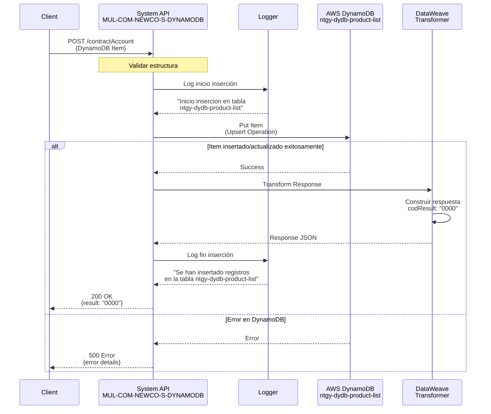
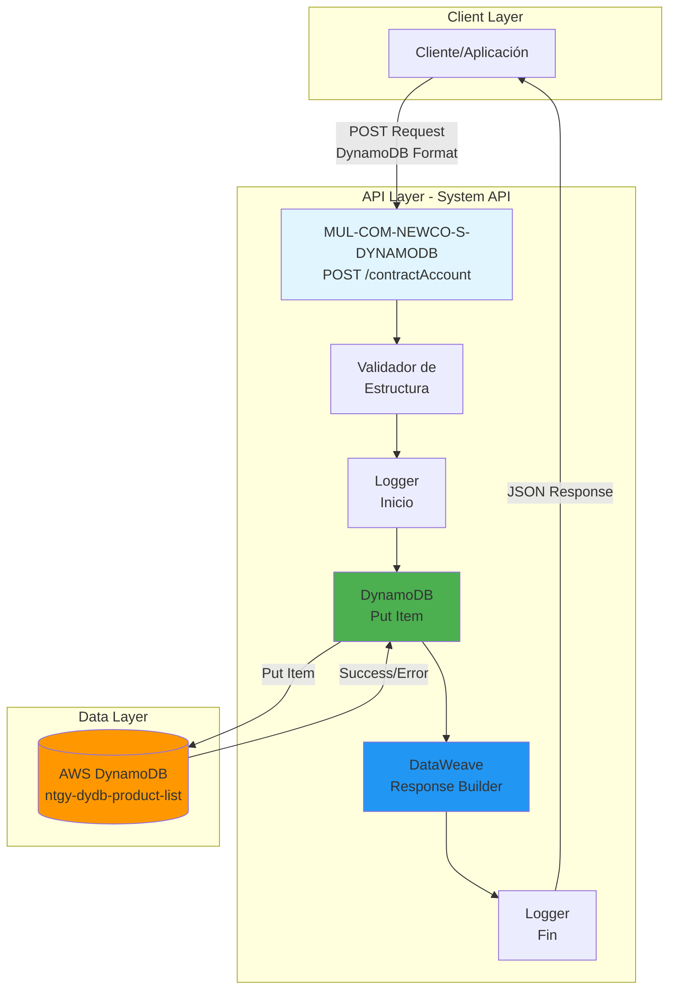
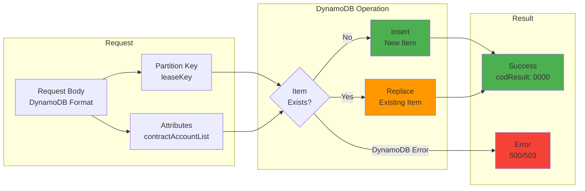

  operation_type: "Upsert"
---

# POST /contractAccount

## 📌 Descripción General

Endpoint de System API que inserta o actualiza una cuenta contrato completa en AWS DynamoDB. Realiza una operación de tipo "upsert" (insert or update) que crea un nuevo item si no existe o reemplaza completamente el item existente si la partition key ya está presente en la tabla.

**Características principales:**
- Operación atómica de escritura en DynamoDB
- Upsert: Inserta si no existe, actualiza si existe
- Reemplaza completamente el item (no es actualización parcial)
- Requiere estructura completa del contractAccount en formato DynamoDB
- Respuesta estándar de éxito/error
- Logging de inicio y fin de operación

## 💼 Propósito del Negocio

### Objetivo
Proporcionar un mecanismo centralizado para crear o actualizar información completa de cuentas contrato de clientes, incluyendo contratos, productos, direcciones, datos técnicos y métodos de pago en el sistema de almacenamiento DynamoDB.

### Casos de Uso
1. **Creación de Nueva Cuenta Contrato**: Registrar un nuevo cliente con su información contractual completa
2. **Actualización de Cuenta Existente**: Modificar información completa de una cuenta contrato existente
3. **Sincronización de Datos**: Actualizar información desde sistemas externos (CRM, SAP, etc.)
4. **Migración de Datos**: Cargar información histórica o migrada de otros sistemas
5. **Actualización Masiva**: Refrescar información de productos, contratos o datos técnicos
6. **Corrección de Datos**: Rectificar información incorrecta o desactualizada

### Valor de Negocio
- **Centralización de Datos**: Punto único de escritura para información de cuentas contrato
- **Consistencia**: Garantiza estructura uniforme de datos en DynamoDB
- **Trazabilidad**: Logging completo de operaciones de escritura
- **Integración**: Facilita sincronización con sistemas externos
- **Escalabilidad**: Aprovecha capacidad de escritura de DynamoDB

## 🔧 Especificación Técnica

### Endpoint
```
POST /contractAccount
```

### Headers Requeridos
```http
Content-Type: application/json
client-id: {clientId}
client-secret: {clientSecret}
```

### Request Body

El body debe contener la estructura completa del contractAccount en formato DynamoDB. La estructura incluye tipos de datos DynamoDB (S=String, N=Number, BOOL=Boolean, M=Map, L=List).

**Estructura del Request:**
```json
{
  "leaseKey": {
    "S": "string"
  },
  "contractAccountList": {
    "l": [
      {
        "m": {
          "clientId": {
            "s": "string"
          },
          "contractAccountId": {
            "s": "string"
          },
          "lastInvoice": {
            "m": {
              "invoiceID": {"s": "string"},
              "invoiceNum": {"s": "string"},
              "issuedDate": {"s": "string"},
              "billingDate": {"s": "string"},
              "status": {"s": "string"},
              "amount": {"n": "string"},
              "interactiveInvoice": {"bool": true},
              "pdfDocumentId": {"s": "string"},
              "productFamilyIdList": {
                "l": [{"s": "string"}]
              },
              "refNumber": {"s": "string"}
            }
          },
          "address": {
            "m": {
              "fullAddress": {"s": "string"},
              "addressStreet": {"s": "string"},
              "placeId": {"s": "string"},
              "masterId": {"s": "string"},
              "addressId": {"s": "string"},
              "zipCode": {"s": "string"},
              "province": {"s": "string"},
              "city": {"s": "string"},
              "town": {"s": "string"},
              "wayId": {"s": "string"},
              "way": {"s": "string"},
              "wayType": {"s": "string"},
              "number": {"s": "string"},
              "floor": {"s": "string"},
              "door": {"s": "string"},
              "portal": {"s": "string"},
              "stairs": {"s": "string"}
            }
          },
          "contractAccountRefList": {
            "l": [
              {
                "m": {
                  "refNum": {"s": "string"},
                  "isDirectPayment": {"bool": true},
                  "isOnlineBill": {"bool": true},
                  "mailingAddress": {"m": {}},
                  "bankAccount": {
                    "m": {
                      "bankAccountId": {"s": "string"},
                      "contactId": {"s": "string"},
                      "holderName": {"s": "string"},
                      "holderType": {"s": "string"},
                      "iban": {"s": "string"}
                    }
                  },
                  "products": {
                    "l": [
                      {
                        "m": {
                          "contractId": {"s": "string"},
                          "contractStatus": {"s": "string"},
                          "contractNumber": {"s": "string"},
                          "isPortability": {"bool": false},
                          "contractPdfNumber": {"s": "string"},
                          "renewedContract": {"bool": false},
                          "productType": {
                            "m": {
                              "isEco": {"bool": false},
                              "productTypeId": {"s": "string"},
                              "productTypeName": {"s": "string"},
                              "Assetid": {"s": "string"},
                              "isActiveFUV": {"s": "string"},
                              "svaFamily": {"s": "string"},
                              "productTypeFamily": {"s": "string"},
                              "priceBookEntryId": {"s": "string"},
                              "ProductServiceCRMId": {"s": "string"},
                              "productCode": {"s": "string"},
                              "productRate": {"s": "string"},
                              "productTypeNameExtended": {"s": "string"},
                              "status": {"s": "string"},
                              "cuentaEquipamientos": {"bool": false},
                              "documentKey": {"s": "string"},
                              "selfConsumptionType": {"s": "string"},
                              "subsection": {"s": "string"},
                              "cupsType": {"s": "string"},
                              "collective": {"bool": false},
                              "installationPower": {"n": "0"}
                            }
                          },
                          "isActive": {"bool": true},
                          "contractSignatureDate": {"s": "string"},
                          "startDate": {"s": "string"},
                          "endDate": {"s": "string"},
                          "dropOutDate": {"s": "string"},
                          "isPending": {"bool": false},
                          "techData": {
                            "m": {
                              "IPDate": {"s": "string"},
                              "isValidCIE": {"bool": false},
                              "changePower": {"bool": false},
                              "techDataId": {"s": "string"},
                              "cups": {"s": "string"},
                              "distribution": {"s": "string"},
                              "rate": {"s": "string"},
                              "rateId": {"s": "string"},
                              "voltage": {"s": "string"},
                              "selfConsumption": {"bool": false},
                              "powerBie": {"s": "string"},
                              "installation": {"s": "string"},
                              "remoteManagement": {"bool": false},
                              "serviceType": {"s": "string"},
                              "powerPlain": {"s": "string"},
                              "powerValley": {"s": "string"},
                              "recommendedPowerPlain": {"s": "string"},
                              "recommendedPowerValley": {"s": "string"},
                              "cnae": {"s": "string"}
                            }
                          },
                          "pendingUnsubscribe": {"bool": false},
                          "cancelIndicator": {"s": "string"}
                        }
                      }
                    ]
                  }
                }
              }
            ]
          }
        }
      }
    ]
  }
}
```

### Respuestas

#### Éxito (200 OK)
```json
{
  "result": {
    "codResult": "0000",
    "msgResult": "No hay error"
  }
}
```

#### Error de Validación (400 Bad Request)
```json
{
  "error": {
    "code": "400",
    "message": "Bad Request - Estructura de datos inválida"
  }
}
```

#### Error de Autenticación (401 Unauthorized)
```json
{
  "error": {
    "code": "401",
    "message": "Unauthorized - Credenciales inválidas"
  }
}
```

#### Error de DynamoDB (500 Internal Server Error)
```json
{
  "error": {
    "code": "500",
    "message": "Internal Server Error - Error al insertar en DynamoDB"
  }
}
```

#### Error de Throttling (503 Service Unavailable)
```json
{
  "error": {
    "code": "503",
    "message": "Service Unavailable - DynamoDB throttling"
  }
}
```

## 🏗️ Implementación Técnica

### Arquitectura del Flujo



### Operación de Backend: DynamoDB Put Item

**Tabla:** `ntgy-dydb-product-list`

**Operación:** Put Item (Upsert)

```xml
<dynamodb:put-item 
    tableName="ntgy-dydb-product-list" 
    config-ref="Amazon_DynamoDB_Configuration" />
```

**Características de Put Item:**
- **Operación atómica**: La escritura es todo-o-nada
- **Upsert**: Si el item existe (misma partition key), lo reemplaza completamente
- **Reemplazo completo**: No es actualización parcial, reemplaza todos los atributos
- **Idempotente**: Múltiples llamadas con mismo payload producen mismo resultado

**Estructura de la Tabla:**
- **Partition Key:** `leaseKey` (String) - Identificador del cliente
- **Atributos:** Estructura compleja anidada con mapas y listas de DynamoDB

### Flujo de Ejecución

#### 1. Logger Inicial
```xml
<logger level="INFO" 
        message="Inicio insercion en tabla ntgy-dydb-product-list" />
```
- Registra el inicio de la operación de escritura
- Nivel INFO para trazabilidad

#### 2. Put Item a DynamoDB
```xml
<dynamodb:put-item 
    tableName="ntgy-dydb-product-list" 
    config-ref="Amazon_DynamoDB_Configuration" />
```
- Recibe el payload directamente del request
- El payload debe estar en formato DynamoDB
- No hay transformación previa del request

#### 3. Transformación de Respuesta
```dataweave
%dw 2.0
output application/json
---
"result": {
    "codResult": "0000",
    "msgResult": "No hay error"
}
```
- Genera respuesta estándar de éxito
- Código 0000 indica operación exitosa

#### 4. Logger Final
```xml
<logger level="INFO" 
        message="Se han insertado registros en la tabla ntgy-dydb-product-list"/>
```
- Confirma finalización exitosa de la operación
- Nivel INFO para auditoría

### Diagrama de Arquitectura



### Diagrama de Operación Put Item



### Formato de Datos DynamoDB

**Tipos de Datos DynamoDB:**
- **S**: String
- **N**: Number (como string)
- **BOOL**: Boolean
- **M**: Map (objeto anidado)
- **L**: List (array)

**Ejemplo de Conversión:**

**JSON Normal:**
```json
{
  "clientId": "CLI123456",
  "amount": 125.50,
  "isActive": true
}
```

**Formato DynamoDB:**
```json
{
  "clientId": {"s": "CLI123456"},
  "amount": {"n": "125.50"},
  "isActive": {"bool": true}
}
```

### Validaciones

**Validaciones Implícitas:**
1. **Estructura DynamoDB**: El payload debe tener formato DynamoDB válido
2. **Partition Key**: Debe incluir el atributo `leaseKey`
3. **Tipos de Datos**: Los tipos deben coincidir con el esquema esperado
4. **Tamaño del Item**: No debe exceder 400 KB (límite de DynamoDB)

**Validaciones de Negocio:**
- Se asume que el cliente valida la estructura antes de enviar
- No hay validaciones explícitas en el código XML
- DynamoDB rechazará estructuras inválidas

### Manejo de Errores

**Errores de DynamoDB:**
- **ProvisionedThroughputExceededException**: Throttling por exceso de escrituras
- **ResourceNotFoundException**: Tabla no encontrada
- **ValidationException**: Estructura de datos inválida
- **InternalServerError**: Error interno de DynamoDB

**Errores de Conectividad:**
- Timeout de conexión
- Permisos insuficientes (IAM)
- Configuración incorrecta

**Comportamiento ante Errores:**
- El flujo no tiene manejo explícito de errores
- Los errores se propagan al cliente
- El logger no registra errores específicos

## 💻 Ejemplos de Uso

### Ejemplo 1: Inserción de Nueva Cuenta Contrato

**Request:**
```bash
curl -X POST "https://api.naturgy.com/s-dynamodb/contractAccount" \
  -H "Content-Type: application/json" \
  -H "client-id: your-client-id" \
  -H "client-secret: your-client-secret" \
  -d '{
    "leaseKey": {
      "S": "CLI123456"
    },
    "contractAccountList": {
      "l": [
        {
          "m": {
            "clientId": {"s": "CLI123456"},
            "contractAccountId": {"s": "CA001"},
            "lastInvoice": {
              "m": {
                "invoiceID": {"s": "INV2024001"},
                "invoiceNum": {"s": "F-2024-001"},
                "issuedDate": {"s": "2024-01-15"},
                "billingDate": {"s": "2024-01-01"},
                "status": {"s": "PAID"},
                "amount": {"n": "125.50"},
                "interactiveInvoice": {"bool": true},
                "pdfDocumentId": {"s": "DOC123"},
                "productFamilyIdList": {
                  "l": [
                    {"s": "ELEC"},
                    {"s": "GAS"}
                  ]
                },
                "refNumber": {"s": "REF001"}
              }
            },
            "address": {
              "m": {
                "fullAddress": {"s": "Calle Mayor 123, 28001 Madrid"},
                "addressStreet": {"s": "Calle Mayor 123"},
                "placeId": {"s": "PL001"},
                "masterId": {"s": "M001"},
                "addressId": {"s": "ADDR001"},
                "zipCode": {"s": "28001"},
                "province": {"s": "Madrid"},
                "city": {"s": "Madrid"},
                "town": {"s": "Madrid"},
                "wayId": {"s": "W001"},
                "way": {"s": "Calle Mayor"},
                "wayType": {"s": "Calle"},
                "number": {"s": "123"},
                "floor": {"s": "3"},
                "door": {"s": "A"},
                "portal": {"s": "1"},
                "stairs": {"s": "Izquierda"}
              }
            },
            "contractAccountRefList": {
              "l": [
                {
                  "m": {
                    "refNum": {"s": "REF001"},
                    "isDirectPayment": {"bool": true},
                    "isOnlineBill": {"bool": true},
                    "mailingAddress": {
                      "m": {
                        "fullAddress": {"s": "Calle Mayor 123, 28001 Madrid"},
                        "addressId": {"s": "ADDR001"},
                        "zipCode": {"s": "28001"},
                        "province": {"s": "Madrid"},
                        "city": {"s": "Madrid"},
                        "town": {"s": "Madrid"},
                        "wayId": {"s": "W001"},
                        "way": {"s": "Calle Mayor"},
                        "wayType": {"s": "Calle"},
                        "number": {"s": "123"},
                        "floor": {"s": "3"},
                        "door": {"s": "A"},
                        "portal": {"s": "1"},
                        "stairs": {"s": "Izquierda"}
                      }
                    },
                    "bankAccount": {
                      "m": {
                        "bankAccountId": {"s": "BA001"},
                        "contactId": {"s": "CONT001"},
                        "holderName": {"s": "Juan Pérez García"},
                        "holderType": {"s": "TITULAR"},
                        "iban": {"s": "ES12 3456 7890 1234 5678 9012"}
                      }
                    },
                    "products": {
                      "l": [
                        {
                          "m": {
                            "contractId": {"s": "CONT001"},
                            "contractStatus": {"s": "ACTIVE"},
                            "contractNumber": {"s": "C-2023-001"},
                            "isPortability": {"bool": false},
                            "contractPdfNumber": {"s": "PDF001"},
                            "renewedContract": {"bool": false},
                            "productType": {
                              "m": {
                                "isEco": {"bool": true},
                                "productTypeId": {"s": "PT001"},
                                "productTypeName": {"s": "Tarifa Estable Electricidad"},
                                "Assetid": {"s": "ASSET001"},
                                "isActiveFUV": {"s": "true"},
                                "svaFamily": {"s": "ELECTRICITY"},
                                "productTypeFamily": {"s": "RESIDENTIAL"},
                                "priceBookEntryId": {"s": "PBE001"},
                                "ProductServiceCRMId": {"s": "CRM001"},
                                "productCode": {"s": "ELEC-STABLE"},
                                "productRate": {"s": "2.0TD"},
                                "productTypeNameExtended": {"s": "TARIFA_ESTABLE_ELEC"},
                                "status": {"s": "02"},
                                "cuentaEquipamientos": {"bool": false}
                              }
                            },
                            "isActive": {"bool": true},
                            "contractSignatureDate": {"s": "2023-06-15"},
                            "startDate": {"s": "2023-07-01"},
                            "endDate": {"s": "2024-06-30"},
                            "dropOutDate": {"s": ""},
                            "isPending": {"bool": false},
                            "techData": {
                              "m": {
                                "IPDate": {"s": "2023-07-01"},
                                "isValidCIE": {"bool": true},
                                "changePower": {"bool": false},
                                "techDataId": {"s": "TD001"},
                                "cups": {"s": "ES0021000000000001JN0F"},
                                "distribution": {"s": "UFD"},
                                "rate": {"s": "2.0TD"},
                                "rateId": {"s": "RATE001"},
                                "voltage": {"s": "BT"},
                                "selfConsumption": {"bool": false},
                                "powerBie": {"s": "5.75"},
                                "installation": {"s": "MONOFASICA"},
                                "remoteManagement": {"bool": true},
                                "serviceType": {"s": "ELECTRICITY"},
                                "powerPlain": {"s": "5.75"},
                                "powerValley": {"s": "5.75"},
                                "recommendedPowerPlain": {"s": "5.75"},
                                "recommendedPowerValley": {"s": "5.75"},
                                "cnae": {"s": "9820"}
                              }
                            },
                            "pendingUnsubscribe": {"bool": false},
                            "cancelIndicator": {"s": ""}
                          }
                        }
                      ]
                    }
                  }
                }
              ]
            }
          }
        }
      ]
    }
  }'
```

**Response (200 OK):**
```json
{
  "result": {
    "codResult": "0000",
    "msgResult": "No hay error"
  }
}
```

### Ejemplo 2: Actualización de Cuenta Existente

**Request:**
```bash
curl -X POST "https://api.naturgy.com/s-dynamodb/contractAccount" \
  -H "Content-Type: application/json" \
  -H "client-id: your-client-id" \
  -H "client-secret: your-client-secret" \
  -d '{
    "leaseKey": {
      "S": "CLI123456"
    },
    "contractAccountList": {
      "l": [
        {
          "m": {
            "clientId": {"s": "CLI123456"},
            "contractAccountId": {"s": "CA001"},
            "lastInvoice": {
              "m": {
                "invoiceID": {"s": "INV2024002"},
                "invoiceNum": {"s": "F-2024-002"},
                "issuedDate": {"s": "2024-02-15"},
                "billingDate": {"s": "2024-02-01"},
                "status": {"s": "PENDING"},
                "amount": {"n": "135.75"},
                "interactiveInvoice": {"bool": true},
                "pdfDocumentId": {"s": "DOC124"},
                "productFamilyIdList": {
                  "l": [{"s": "ELEC"}]
                },
                "refNumber": {"s": "REF002"}
              }
            },
            "address": {
              "m": {
                "fullAddress": {"s": "Calle Mayor 123, 28001 Madrid"},
                "zipCode": {"s": "28001"},
                "province": {"s": "Madrid"},
                "city": {"s": "Madrid"}
              }
            },
            "contractAccountRefList": {
              "l": []
            }
          }
        }
      ]
    }
  }'
```

**Response (200 OK):**
```json
{
  "result": {
    "codResult": "0000",
    "msgResult": "No hay error"
  }
}
```

**Nota:** Este request reemplaza completamente el item anterior. Todos los atributos no incluidos se eliminarán.

### Ejemplo 3: Inserción Mínima (Solo Campos Requeridos)

**Request:**
```bash
curl -X POST "https://api.naturgy.com/s-dynamodb/contractAccount" \
  -H "Content-Type: application/json" \
  -H "client-id: your-client-id" \
  -H "client-secret: your-client-secret" \
  -d '{
    "leaseKey": {
      "S": "CLI789012"
    },
    "contractAccountList": {
      "l": [
        {
          "m": {
            "clientId": {"s": "CLI789012"},
            "contractAccountId": {"s": "CA002"},
            "contractAccountRefList": {
              "l": []
            }
          }
        }
      ]
    }
  }'
```

**Response (200 OK):**
```json
{
  "result": {
    "codResult": "0000",
    "msgResult": "No hay error"
  }
}
```

### Ejemplo 4: Error de Estructura Inválida

**Request:**
```bash
curl -X POST "https://api.naturgy.com/s-dynamodb/contractAccount" \
  -H "Content-Type: application/json" \
  -H "client-id: your-client-id" \
  -H "client-secret: your-client-secret" \
  -d '{
    "leaseKey": "CLI123456",
    "contractAccountList": []
  }'
```

**Response (400 Bad Request):**
```json
{
  "error": {
    "code": "400",
    "message": "Bad Request - Estructura de datos inválida. Se esperaba formato DynamoDB"
  }
}
```

### Ejemplo 5: Error de Autenticación

**Request:**
```bash
curl -X POST "https://api.naturgy.com/s-dynamodb/contractAccount" \
  -H "Content-Type: application/json" \
  -H "client-id: invalid-client-id" \
  -H "client-secret: invalid-secret" \
  -d '{
    "leaseKey": {"S": "CLI123456"},
    "contractAccountList": {"l": []}
  }'
```

**Response (401 Unauthorized):**
```json
{
  "error": {
    "code": "401",
    "message": "Unauthorized - Credenciales inválidas"
  }
}
```

### Ejemplo 6: Inserción con Múltiples Productos

**Request:**
```bash
curl -X POST "https://api.naturgy.com/s-dynamodb/contractAccount" \
  -H "Content-Type: application/json" \
  -H "client-id: your-client-id" \
  -H "client-secret: your-client-secret" \
  -d '{
    "leaseKey": {
      "S": "CLI345678"
    },
    "contractAccountList": {
      "l": [
        {
          "m": {
            "clientId": {"s": "CLI345678"},
            "contractAccountId": {"s": "CA003"},
            "contractAccountRefList": {
              "l": [
                {
                  "m": {
                    "refNum": {"s": "REF003"},
                    "products": {
                      "l": [
                        {
                          "m": {
                            "contractId": {"s": "CONT001"},
                            "contractStatus": {"s": "ACTIVE"},
                            "productType": {
                              "m": {
                                "productTypeName": {"s": "Electricidad"},
                                "status": {"s": "02"}
                              }
                            }
                          }
                        },
                        {
                          "m": {
                            "contractId": {"s": "CONT002"},
                            "contractStatus": {"s": "ACTIVE"},
                            "productType": {
                              "m": {
                                "productTypeName": {"s": "Gas Natural"},
                                "status": {"s": "02"}
                              }
                            }
                          }
                        }
                      ]
                    }
                  }
                }
              ]
            }
          }
        }
      ]
    }
  }'
```

**Response (200 OK):**
```json
{
  "result": {
    "codResult": "0000",
    "msgResult": "No hay error"
  }
}
```

### Ejemplo 7: Error de Throttling de DynamoDB

**Request:**
```bash
curl -X POST "https://api.naturgy.com/s-dynamodb/contractAccount" \
  -H "Content-Type: application/json" \
  -H "client-id: your-client-id" \
  -H "client-secret: your-client-secret" \
  -d '{
    "leaseKey": {"S": "CLI123456"},
    "contractAccountList": {"l": [{"m": {"clientId": {"s": "CLI123456"}}}]}
  }'
```

**Response (503 Service Unavailable):**
```json
{
  "error": {
    "code": "503",
    "message": "Service Unavailable - DynamoDB throttling. Demasiadas solicitudes de escritura"
  }
}
```

### Ejemplo 8: Comparación JSON Normal vs DynamoDB Format

**JSON Normal (NO VÁLIDO para este endpoint):**
```json
{
  "leaseKey": "CLI123456",
  "contractAccountList": [
    {
      "clientId": "CLI123456",
      "contractAccountId": "CA001"
    }
  ]
}
```

**Formato DynamoDB (VÁLIDO):**
```json
{
  "leaseKey": {
    "S": "CLI123456"
  },
  "contractAccountList": {
    "l": [
      {
        "m": {
          "clientId": {"s": "CLI123456"},
          "contractAccountId": {"s": "CA001"}
        }
      }
    ]
  }
}
```

**Nota Importante:** Este endpoint requiere formato DynamoDB. Si necesitas enviar JSON normal, deberías usar un endpoint diferente que realice la transformación.
